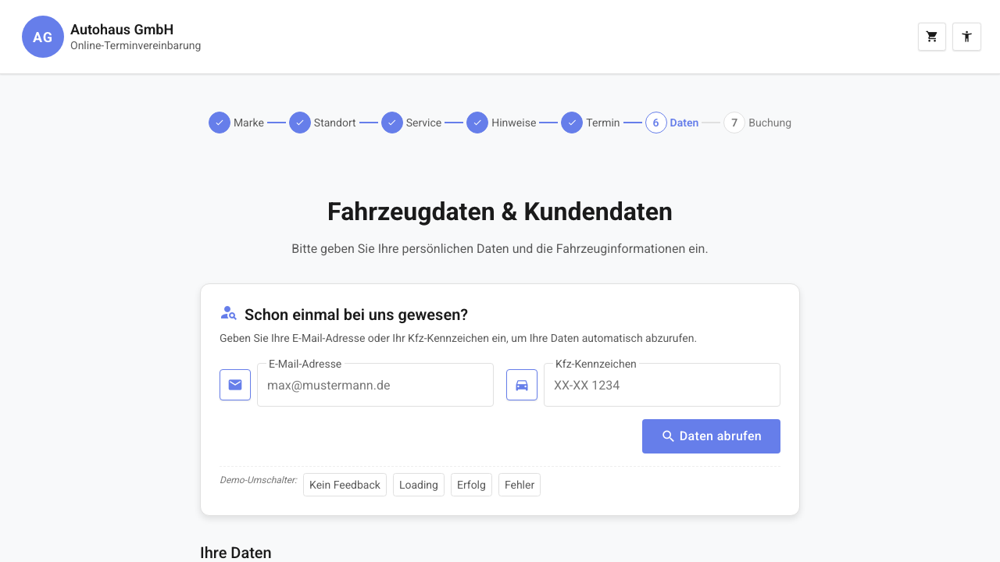

# REQ-016: User-Lookup

**Status:** Draft
**Priority:** High
**Type:** Functional
**Created:** 2026-04-13
**Author:** Claude Code
**Wizard-Schritt:** 6 von 8 (Erweiterung von REQ-009 carinformation)

---

## 1. Overview

### 1.1 Purpose
Bestandskunden können auf der carinformation-Seite (Wizard-Schritt 6) ihre Daten per E-Mail-Adresse ODER Kfz-Kennzeichen vom Server abrufen. Das bestehende Formular wird bei erfolgreicher Abfrage automatisch vorausgefuellt.

### 1.2 Scope
**Included:**
- (a) Lookup-Formular im oberen Bereich der carinformation-Seite (ersetzt bestehenden Click-Dummy-Banner)
- (b) API-Aufruf an NestJS-Backend (`POST /api/v1/customers/lookup`)
- (c) Automatisches Prefill des Kunden- und Fahrzeugformulars bei Erfolg
- (d) Erfolgs-/Fehlermeldungen nach Lookup

**Excluded:**
- Aenderungen an bestehenden Requirements (REQ-001 bis REQ-014 bleiben unangetastet)
- Authentifizierung / Login
- Registrierung neuer Kunden
- Backend-Implementierung (siehe REQ-014)
- Loading-Spinner-Nachrüstung für andere Wizard-Seiten (siehe REQ-017)

### 1.3 Related Requirements
- REQ-009: carinformation (wird um Lookup-Funktionalitaet erweitert)
- REQ-014: NestJS-Backend (stellt den Lookup-Endpunkt bereit)
- REQ-017: Loading-Spinner (globale Spinner-Nachrüstung — ausgelagert)

---

## 2. User Story

**Als** Bestandskunde
**möchte ich** meine Daten per E-Mail oder Kfz-Kennzeichen abrufen
**damit** ich das Formular nicht erneut ausfuellen muss.

**Acceptance Criteria:**
- [ ] AC-1: Lookup-Bereich zeigt zwei Eingabefelder (E-Mail, Kennzeichen) und einen „Daten abrufen"-Button
- [ ] AC-2: Mindestens eines der beiden Felder muss ausgefuellt sein, um den Button zu aktivieren
- [ ] AC-3: Bei Klick auf „Daten abrufen" erscheint ein Loading-Spinner
- [ ] AC-4: Bei Erfolg werden Kunden- und Fahrzeugformular automatisch vorausgefuellt
- [ ] AC-5: Bei Erfolg erscheint eine Erfolgsmeldung oberhalb des Formulars
- [ ] AC-6: Bei „Nicht gefunden" erscheint eine Hinweismeldung, Formular bleibt leer
- [ ] AC-7: Bei Server-Fehler erscheint eine Fehlermeldung mit „Erneut versuchen"-Button
- [ ] AC-8: Vorausgefuellte Felder sind weiterhin editierbar

---

## 3. Preconditions

### 3.1 System
- BookingStore verfuegbar mit Daten aus vorherigen Wizard-Schritten
- NestJS-Backend erreichbar (REQ-014)
- Header-Component (REQ-001) aktiv

### 3.2 User
- Benutzer befindet sich auf der carinformation-Seite (Wizard-Schritt 6)
- Keine Authentifizierung erforderlich

### 3.3 Data
- Kunden-Datenbank im Backend verfuegbar (SoftNet API via NestJS-Proxy)
- E-Mail oder Kennzeichen des Bestandskunden bekannt

### 3.4 Übergabe (Input vom vorherigen Wizard-Schritt)
| Feld | Typ | Quelle | Pflicht |
|------|-----|--------|---------|
| `BookingStore.selectedBrand` | `Brand` | REQ-002 | **Ja** |
| `BookingStore.selectedLocation` | `LocationDisplay` | REQ-003 | **Ja** |
| `BookingStore.selectedServices` | `SelectedService[]` | REQ-004 | **Ja** |
| `BookingStore.selectedAppointment` | `AppointmentSlot` | REQ-006 | **Ja** |

---

## 4. Main Flow



**Step 1:** Seite wird geladen
- **System:** Guard prueft Store-Felder (wie REQ-009)
- **System:** Zeigt carinformation-Seite mit Lookup-Bereich oben und leerem Formular darunter
- **System:** Lookup-Bereich zeigt Titel „Schon einmal bei uns gewesen?", Beschreibung, E-Mail-Feld, Kennzeichen-Feld und „Daten abrufen"-Button

**Step 2:** Benutzer gibt Suchdaten ein
- **User:** Gibt E-Mail-Adresse ODER Kfz-Kennzeichen ein (oder beides)
- **System:** Button „Daten abrufen" wird aktiviert, sobald mindestens ein Feld ausgefuellt ist

**Step 3:** Benutzer startet Lookup
- **User:** Klickt „Daten abrufen"
- **System:** Zeigt Loading-Spinner im Lookup-Bereich
- **System:** Sendet `POST /api/v1/customers/lookup` mit den eingegebenen Daten

**Step 4a:** Erfolg — Daten gefunden
- **System:** Spinner verschwindet
- **System:** Erfolgs-Meldung „Daten gefunden! Formular wurde vorausgefuellt." wird angezeigt
- **System:** Kunden- und Fahrzeugformular werden mit den empfangenen Daten vorausgefuellt
- **Expected:** Alle Felder sind weiterhin editierbar

**Step 4b:** Nicht gefunden
- **System:** Spinner verschwindet
- **System:** Info-Meldung „Keine Daten gefunden. Bitte fuellen Sie das Formular manuell aus." wird angezeigt
- **Expected:** Formular bleibt leer, Benutzer fuellt manuell aus

**Step 5:** Benutzer faehrt normal fort
- **User:** Editiert ggf. vorausgefuellte Felder, akzeptiert DSGVO, klickt „Zur Buchungsübersicht"
- **System:** Validierung und Navigation wie in REQ-009 definiert

---

## 5. Alternative Flows

### 5.1 Erneuter Lookup nach Fehlschlag

**Trigger:** Benutzer klickt „Erneut versuchen" nach Server-Fehler

**Flow:**
1. Benutzer korrigiert ggf. Eingabe im Lookup-Bereich
2. Klickt „Erneut versuchen" oder „Daten abrufen"
3. Neuer API-Call wird ausgeloest
4. Weiter mit Step 4a/4b/6.1

### 5.2 Lookup nach manuellem Ausfuellen

**Trigger:** Benutzer hat bereits Felder manuell ausgefuellt, fuehrt dann Lookup durch

**Flow:**
1. Benutzer klickt „Daten abrufen"
2. Bei Erfolg: vorhandene Formularwerte werden ueberschrieben
3. Benutzer kann ueberschriebene Felder erneut editieren

### 5.3 Beide Felder leer

**Trigger:** Benutzer klickt „Daten abrufen" ohne Eingabe

**Flow:**
1. Button ist deaktiviert (disabled), solange beide Felder leer sind
2. Kein API-Call moeglich

---

## 6. Exception Flows

### 6.1 Server-Fehler bei Lookup

**Trigger:** Backend nicht erreichbar oder interner Server-Fehler

**Flow:**
1. Spinner verschwindet
2. Fehlermeldung „Fehler beim Abrufen. Bitte versuchen Sie es erneut." wird angezeigt
3. „Erneut versuchen"-Button erscheint
4. Formular bleibt unveraendert
5. Benutzer kann manuell weitermachen oder erneut versuchen

### 6.2 Timeout bei Lookup

**Trigger:** API-Antwort dauert > 10 Sekunden

**Flow:**
1. Request wird abgebrochen
2. Fehlermeldung wie bei 6.1
3. Benutzer kann retry oder manuell fortfahren

---

## 7. Postconditions

### 7.1 Erfolg (Lookup gefunden)
| Store-Feld | Typ | Beschreibung |
|------------|-----|-------------|
| `BookingStore.customerInfo` | `CustomerInfo` | Vorausgefuellt mit Server-Daten |
| `BookingStore.vehicleInfo` | `VehicleInfo` | Vorausgefuellt mit Server-Daten |
| `BookingStore.lookupSuccess` | `true` | Lookup war erfolgreich |
| `BookingStore.isLookupLoading` | `false` | Lookup abgeschlossen |

### 7.2 Nicht gefunden
| Store-Feld | Typ | Beschreibung |
|------------|-----|-------------|
| `BookingStore.lookupSuccess` | `false` | Keine Daten gefunden |
| `BookingStore.isLookupLoading` | `false` | Lookup abgeschlossen |

### 7.3 Fehler
| Store-Feld | Typ | Beschreibung |
|------------|-----|-------------|
| `BookingStore.lookupError` | `string` | Fehlermeldung |
| `BookingStore.isLookupLoading` | `false` | Lookup abgeschlossen |
| `BookingStore.lookupSuccess` | `null` | Kein Ergebnis |

---

## 8. Business Rules

- **BR-1:** Mindestens ein Feld (E-Mail oder Kennzeichen) muss ausgefuellt sein, um den Lookup zu starten
- **BR-2:** E-Mail-Validierung im Lookup-Feld: gültiges E-Mail-Format (gleiche Regel wie Hauptformular)
- **BR-3:** Kennzeichen-Validierung im Lookup-Feld: `^[A-ZÄÖÜ]{1,3}-[A-Z]{1,2}\s?\d{1,4}$` (case-insensitive)
- **BR-4:** Bei Erfolg werden ALLE vorhandenen Felder ueberschrieben (nicht nur leere)
- **BR-5:** Vorausgefuellte Felder muessen weiterhin editierbar sein
- **BR-6:** Lookup-Ergebnis hat keinen Einfluss auf DSGVO-Checkbox (muss weiterhin manuell gesetzt werden)
- **BR-7:** Lookup nutzt ein SEPARATES `isLookupLoading`-Signal (damit der globale Spinner unabhaengig bleibt)

---

## 9. Non-Functional Requirements

### Performance
- Lookup-Response < 2 Sekunden
- Spinner erscheint sofort (< 100ms nach Klick)
- Formular-Prefill nach Lookup < 200ms

### Security
- Kein `[innerHTML]` — nur Angular Template Escaping
- Keine sensiblen Daten in URL-Parametern (Lookup per POST, nicht GET)
- E-Mail/Kennzeichen werden nur zum Lookup verwendet, nicht gespeichert
- Rate Limiting auf Backend-Seite (REQ-014)

### Usability
- Mobile-First: Lookup-Bereich stackt vertikal auf Mobile (<48em)
- WCAG 2.1 AA: alle Inputs mit `<label>`, `aria-required`, `aria-describedby` bei Fehlern
- Touch-Targets: mind. 2.75em (44px)
- Kontrast: 4.5:1
- Focus-Styles: `:focus-visible` sichtbar
- Spinner: `role="status"` + `aria-live="polite"`

---

## 10. Data Model

```typescript
// src/app/features/booking/models/customer-lookup.model.ts (NEU)

/** Lookup request / Lookup-Anfrage */
export interface CustomerLookupRequest {
  email?: string;
  licensePlate?: string;
}

/** Lookup response / Lookup-Antwort */
export interface CustomerLookupResponse {
  found: boolean;
  customer?: CustomerInfo;  // aus customer.model.ts
  vehicle?: VehicleInfo;    // aus customer.model.ts
}
```

```typescript
// Erweiterung BookingState in src/app/features/booking/stores/booking.store.ts:

interface BookingState {
  // ...bestehende Felder (branches, selectedBranch, brands, selectedBrand,
  //    locations, selectedLocation, services, selectedServices,
  //    bookingNote, appointments, selectedAppointment,
  //    workshopCalendarDate, workshopCalendarDays,
  //    customerInfo, vehicleInfo, privacyConsent,
  //    notesExtras, bookingSubmitted, bookingSubmitting, bookingError,
  //    appointmentId, isLoading, error, isDeepLinked) ...

  // NEU — Lookup:
  isLookupLoading: boolean;
  lookupError: string | null;
  lookupSuccess: boolean | null;  // null=nicht versucht, true=gefunden, false=nicht gefunden
}

const INITIAL_STATE: BookingState = {
  // ...bestehende Initialwerte...
  isLookupLoading: false,
  lookupError: null,
  lookupSuccess: null
};
```

---

## 11. UI/UX

### Mockup


### Seitenstruktur (carinformation erweitert)
1. **Header** (REQ-001) — Logo + Warenkorb + Accessibility
2. **Wizard-Breadcrumb** — Schritt 6 aktiv
3. **Titel** — „Bitte geben Sie uns letzte Informationen rund um Ihren Termin"
4. **Lookup-Bereich** (NEU — ersetzt bisherigen Click-Dummy-Banner)
   - Titel: „Schon einmal bei uns gewesen?"
   - Beschreibung: „Geben Sie Ihre E-Mail oder Ihr Kennzeichen ein"
   - E-Mail-Feld mit Icon `email` + `.icon-framed`
   - Kennzeichen-Feld mit Icon `directions_car` + `.icon-framed`
   - „Daten abrufen"-Button (`mat-flat-button`, `color="primary"`)
   - Loading-Spinner (bei Abfrage)
   - Erfolgs-/Fehler-/NotFound-Meldung
5. **Formular Kundendaten** (wie REQ-009)
6. **Formular Fahrzeugdaten** (wie REQ-009)
7. **DSGVO-Checkbox** + Pflichtfeld-Hinweis
8. **Navigation** — Zurueck / Zur Buchungsuebersicht

### Lookup-Bereich — Layout
| Zeile | Desktop (>=48em) | Mobile (<48em) |
|-------|------------------|----------------|
| Felder | E-Mail (60%) + Kennzeichen (40%) nebeneinander | Untereinander |
| Button | Rechts unter den Feldern | Volle Breite |
| Meldung | Volle Breite, unter Button | Volle Breite |

### Lookup-Formularfelder
| Feld | Typ | Icon | Pflicht | Validierung | Placeholder |
|------|-----|------|---------|-------------|-------------|
| E-Mail Adresse | `input[type=email]` | `email` | Nein (mind. 1) | E-Mail-Format | E-Mail-Adresse |
| Kfz-Kennzeichen | `input[type=text]` | `directions_car` | Nein (mind. 1) | Kennzeichen-Format | Kfz-Kennzeichen |

### Material Components
- `MatFormField` + `MatInput` fuer Lookup-Felder
- `MatIcon` mit `.icon-framed` fuer Feld-Icons
- `MatButton` (`mat-flat-button`) fuer „Daten abrufen"
- `MatProgressSpinner` (`mat-spinner`) fuer Loading-State

---

## 12. API Specification

```http
POST /api/v1/customers/lookup
Content-Type: application/json

{
  "email": "max@mustermann.de",
  "licensePlate": "B-MS1234"
}
```

**Success — Kunde gefunden (200):**
```json
{
  "found": true,
  "customer": {
    "email": "max@mustermann.de",
    "salutation": "mr",
    "firstName": "Max",
    "lastName": "Mustermann",
    "street": "Musterweg 1",
    "postalCode": "30159",
    "city": "Berlin",
    "mobilePhone": "017012345678"
  },
  "vehicle": {
    "licensePlate": "B-MS1234",
    "mileage": 50000
  }
}
```

**Success — Nicht gefunden (200):**
```json
{
  "found": false
}
```

**Error (500):**
```json
{
  "error": "InternalServerError",
  "message": "Failed to lookup customer"
}
```

**Request-Validierung:**
- Mindestens `email` oder `licensePlate` muss vorhanden sein
- `email`: gueltiges E-Mail-Format
- `licensePlate`: gueltiges deutsches Kennzeichen-Format

---

## 13. Test Cases

### TC-1: Happy Path — Lookup per E-Mail erfolgreich
- **Given:** Benutzer ist auf carinformation-Seite
- **When:** Gibt `max@mustermann.de` im E-Mail-Feld ein, klickt „Daten abrufen"
- **Then:** Spinner erscheint, nach Antwort wird Formular vorausgefuellt, Erfolgsmeldung angezeigt

### TC-2: Happy Path — Lookup per Kennzeichen erfolgreich
- **Given:** Benutzer ist auf carinformation-Seite
- **When:** Gibt `B-MS1234` im Kennzeichen-Feld ein, klickt „Daten abrufen"
- **Then:** Spinner erscheint, nach Antwort wird Formular vorausgefuellt, Erfolgsmeldung angezeigt

### TC-3: Nicht gefunden
- **Given:** Benutzer ist auf carinformation-Seite
- **When:** Gibt unbekannte E-Mail ein, klickt „Daten abrufen"
- **Then:** Spinner verschwindet, Hinweismeldung „Keine Daten gefunden..." angezeigt, Formular bleibt leer

### TC-4: Server-Fehler + Retry
- **Given:** Backend nicht erreichbar
- **When:** Benutzer klickt „Daten abrufen"
- **Then:** Fehlermeldung mit „Erneut versuchen"-Button erscheint

### TC-5: Beide Felder leer — Button deaktiviert
- **Given:** Lookup-Felder sind leer
- **When:** Benutzer betrachtet Lookup-Bereich
- **Then:** „Daten abrufen"-Button ist deaktiviert

### TC-6: Vorausgefuellte Felder sind editierbar
- **Given:** Lookup war erfolgreich, Formular vorausgefuellt
- **When:** Benutzer aendert Nachname
- **Then:** Nachname wird akzeptiert, Validierung funktioniert normal

### TC-7: Responsive — Lookup auf Mobile
- **Given:** Viewport < 48em
- **When:** Seite gerendert
- **Then:** E-Mail- und Kennzeichen-Feld stehen untereinander

---

## 14. Implementation

### Neue Dateien
```
src/app/features/booking/
├── models/
│   └── customer-lookup.model.ts           # NEU: CustomerLookupRequest, CustomerLookupResponse
└── services/
    └── customer-lookup-api.service.ts     # NEU: API Service fuer Lookup
```

### Erweiterte Dateien
```
src/app/features/booking/
├── stores/
│   └── booking.store.ts                   # ERWEITERN: isLookupLoading, lookupError, lookupSuccess + lookupCustomer rxMethod + resetLookup()
└── components/
    └── carinformation/
        ├── carinformation-container.component.ts    # ERWEITERN: Lookup-Logik, Form-Prefill
        ├── carinformation-container.component.html  # ERWEITERN: Lookup-UI-Bereich
        └── carinformation-container.component.scss  # ERWEITERN: Lookup-Styles

src/app/core/i18n/
└── translations.ts                        # ERWEITERN: booking.carinformation.lookup.* Keys
```

### Route
Keine neue Route — Lookup ist Teil der bestehenden carinformation-Route.

### Effort
- Development: 6 Stunden
- Testing: 3 Stunden

---

## 15. Dependencies

**Requires:**
- REQ-009: carinformation (bestehende Seite wird erweitert)
- REQ-014: NestJS-Backend (stellt `/api/v1/customers/lookup` bereit)

**Blocks:**
- Keine

---

## 16. Naming Glossary

### Container Methods (Erweiterung CarinformationContainerComponent)
| Methode | Beschreibung |
|---------|--------------|
| `onLookup()` | Lookup starten — Store.lookupCustomer aufrufen |
| `onLookupRetry()` | Erneuten Lookup nach Fehler starten |
| `prefillForms(customer, vehicle)` | Kunden- und Fahrzeugformular mit Lookup-Daten befuellen |

### API Service (NEU: CustomerLookupApiService)
| Methode | Beschreibung |
|---------|--------------|
| `lookupCustomer(request: CustomerLookupRequest): Promise<CustomerLookupResponse>` | POST an `/api/v1/customers/lookup` |

### Signal Store (Erweiterung BookingStore)
| Methode/Signal | Beschreibung |
|----------------|--------------|
| `lookupCustomer: rxMethod<CustomerLookupRequest>` | Lookup-Daten laden, Ergebnis in State speichern |
| `resetLookup()` | `isLookupLoading`, `lookupError`, `lookupSuccess` zuruecksetzen |
| `isLookupLoading` | Signal: Lookup laeuft gerade |
| `lookupError` | Signal: Fehlermeldung bei Lookup |
| `lookupSuccess` | Signal: `null` (nicht versucht), `true` (gefunden), `false` (nicht gefunden) |

### Computed Signals (Erweiterung BookingStore)
| Signal | Beschreibung |
|--------|--------------|
| `hasLookupError` | `boolean` — `lookupError !== null` |
| `isLookupNotFound` | `boolean` — `lookupSuccess === false` |
| `isLookupFound` | `boolean` — `lookupSuccess === true` |

### Models (NEU: customer-lookup.model.ts)
| Interface | Beschreibung |
|-----------|--------------|
| `CustomerLookupRequest` | `{ email?: string; licensePlate?: string }` |
| `CustomerLookupResponse` | `{ found: boolean; customer?: CustomerInfo; vehicle?: VehicleInfo }` |

---

## 17. i18n Keys

```typescript
// Ergänzung in src/app/core/i18n/translations.ts unter booking.carinformation:

// DE:
carinformation: {
  // ...bestehende Keys...
  lookup: {
    title: 'Schon einmal bei uns gewesen?',
    description: 'Geben Sie Ihre E-Mail oder Ihr Kennzeichen ein',
    submit: 'Daten abrufen',
    success: 'Daten gefunden! Formular wurde vorausgefüllt.',
    notFound: 'Keine Daten gefunden. Bitte füllen Sie das Formular manuell aus.',
    error: 'Fehler beim Abrufen. Bitte versuchen Sie es erneut.',
    retry: 'Erneut versuchen',
    emailPlaceholder: 'E-Mail-Adresse',
    licensePlatePlaceholder: 'Kfz-Kennzeichen'
  }
}

// EN:
carinformation: {
  // ...bestehende Keys...
  lookup: {
    title: 'Been here before?',
    description: 'Enter your email or license plate',
    submit: 'Retrieve Data',
    success: 'Data found! Form has been prefilled.',
    notFound: 'No data found. Please fill in the form manually.',
    error: 'Error retrieving data. Please try again.',
    retry: 'Try again',
    emailPlaceholder: 'Email address',
    licensePlatePlaceholder: 'License plate'
  }
}
```

---

## 18. Approval

| Role | Name | Date |
|------|------|------|
| Product Owner | | |
| Tech Lead | | |

---

## 19. Implementation Notes

**WICHTIG: Code muss BILINGUAL sein!**

- Kommentare DE + EN
- Error Messages ueber i18n Keys (kein Hardcoding)
- JSDoc bilingual
- Alle i18n-Keys unter `booking.carinformation.lookup.*` registrieren

**Lookup-Pattern (Reactive Forms):**
```typescript
// Container erstellt separates lookupForm (FormGroup mit email + licensePlate)
// Bei Submit: Store.lookupCustomer(request) aufrufen
// Bei Erfolg: customerForm.patchValue() + vehicleForm.patchValue()
// Lookup-Form ist UNABHÄNGIG vom Hauptformular
```

**Store-Erweiterung (NICHT neuer Store):**
```typescript
// BookingState erweitern um isLookupLoading, lookupError, lookupSuccess
// Neue rxMethod: lookupCustomer — setzt isLookupLoading, ruft API auf, patcht customerInfo + vehicleInfo bei Erfolg
// resetLookup() — Lookup-State zuruecksetzen
// resetFromStep() muss lookupSuccess/lookupError NICHT zuruecksetzen
```
