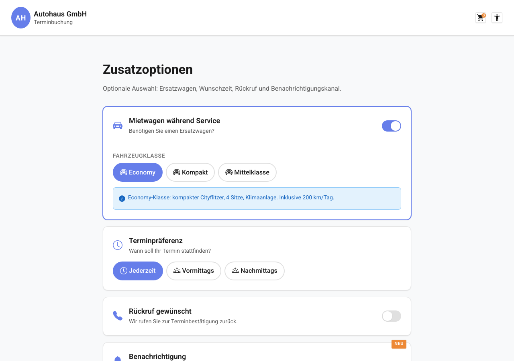

# REQ-027: Notification Channel Toggle

**Status:** Draft
**Priority:** Medium
**Type:** Functional
**Created:** 2026-06-01
**Author:** Claude Code
**Wizard-Schritt:** 4 von 8 (Erweiterung der Hinweisseite, REQ-005 / REQ-012)

---

## 1. Overview

### 1.1 Purpose
Auf der Hinweisseite (Wizard-Schritt 4, `/home/notes`) wird unter dem bestehenden
Rueckruf-Switch eine neue Pill-Group "Benachrichtigung" hinzugefuegt. Damit kann
der Kunde waehlen, ob er Buchungs-Benachrichtigungen per **E-Mail** (Default)
oder per **SMS** erhalten moechte. Die Auswahl wird als neues Feld
`notificationChannel` im bestehenden `NotesExtras`-Modell mitgefuehrt und beim
Absenden der Buchung in das SoftNet-Format `notifications: { SMS, SMTP }` der
Endpoints `api.planning.snaps.query` und `api.planning.appointments.add`
gemappt.

### 1.2 Scope
**Included:**
- Pill-Group "Benachrichtigung" UNTER dem Rueckruf-Switch-Card auf `/home/notes`
  (zwei Optionen: E-Mail / SMS, immer sichtbar)
- Erweiterung des bestehenden Interfaces `NotesExtras` um
  `notificationChannel: NotificationChannel`
- Erweiterung der Konstante `DEFAULT_NOTES_EXTRAS` um
  `notificationChannel: 'email'`
- Erweiterung der Presentational-Component `NotesExtrasFormComponent`
  (Signal-Bindings + neue Methode `onNotificationChannelChange`)
- Erweiterung des `BookingStore` um ein Computed Signal
  `selectedNotificationChannel` und Mapping in `submitBooking`
- Mapping im `AppointmentApiService` vor `POST /snaps` und `POST /appointments`:
  `email` -> `{ SMS: false, SMTP: true }`, `sms` -> `{ SMS: true, SMTP: false }`
- Erweiterung der i18n-Keys unter `booking.notes.notification.*` (DE + EN)
- Integration in die Buchungsuebersicht (REQ-010): neue Zeile "Benachrichtigung"
  in der Extras-Kachel

**Excluded:**
- Mehrfachauswahl (E-Mail UND SMS gleichzeitig) — bewusst Single-Choice
- Validierung der Mobilfunknummer abhaengig von der Auswahl (Mobilnummer ist im
  CarInformation-Step bereits Pflicht)
- Benachrichtigung per Push / WhatsApp / andere Kanaele
- Aenderung des `callbackOption`-Verhaltens (bleibt unveraendert)
- Persistierung im LocalStorage (Click-Dummy: Store-State only)

### 1.3 Related Requirements
- REQ-005: Hinweisfenster (Basis der Notes-Page)
- REQ-012: Hinweisseite Erweitert (fuehrt `NotesExtras`-Modell und Dropdowns ein)
- REQ-010: Buchungsuebersicht (zeigt Extras-Zusammenfassung an, wird ergaenzt)
- REQ-025: Mietwagen-Kategorie + Rueckruf-Switch (UI-Pattern fuer Switch-Cards)

---

## 2. User Story

**As a** customer booking a workshop appointment
**I want** to choose whether I receive booking notifications by email or SMS
**So that** I get the confirmation through my preferred channel without missing
anything important.

**Acceptance Criteria:**
- [ ] AC-01: Pill-Group "Benachrichtigung" ist sichtbar UNTER dem Rueckruf-Switch-Card
- [ ] AC-02: Default-Auswahl ist `E-Mail` (entspricht `notificationChannel: 'email'`)
- [ ] AC-03: Auswahl persistiert beim Wizard-Schritt-Wechsel (Speicherung im `BookingStore.notesExtras`)
- [ ] AC-04: Beim Absenden wird `notifications.SMTP: true` (E-Mail) bzw. `notifications.SMS: true` (SMS) korrekt im Request-Body beider Endpoints uebermittelt
- [ ] AC-05: Visuell konsistent mit den vorhandenen Switch-Cards / Pill-Groups (gleiche Spacing, Icons, Padding, ARIA-Struktur)
- [ ] AC-06: WCAG 2.1 AA — Touch-Target >= 2.75em, ARIA-Labels, sichtbare `:focus-visible` Styles, Kontrast >= 4.5:1
- [ ] AC-07: Responsive Layout: Mobile (< 48em), Tablet (>= 48em), Desktop (>= 64em) — Pill-Group full-width, keine Inhalte abgeschnitten
- [ ] AC-08: Alle Labels sind ueber i18n-Keys uebersetzt (DE + EN)
- [ ] AC-09: Bestehende Funktionalitaet (Mietwagen, Terminpraeferenz, Rueckruf, Textarea, Service-Hints, Buttons) bleibt unveraendert
- [ ] AC-10: Test-Coverage > 80% fuer die geaenderten Dateien

---

## 3. Preconditions

### 3.1 System
- Angular App laeuft
- `BookingStore` verfuegbar (`providedIn: 'root'`)
- Header-Component (REQ-001) aktiv
- Routing fuer `/home/notes` konfiguriert
- REQ-005 + REQ-012 vollstaendig implementiert

### 3.2 User
- Benutzer hat `/home/notes` aufgerufen
- Benutzer kam via "Weiter"-Button von der Serviceauswahl-Seite (REQ-004 / REQ-011 / REQ-025)
- Guards bestanden (Branch, Brand, Location, Services)

### 3.3 Data
- `NotesExtras`-Interface bereits im Store registriert (REQ-012)
- `DEFAULT_NOTES_EXTRAS` enthaelt `notificationChannel: 'email'`
- i18n-Keys unter `booking.notes.notification.*` definiert

### 3.4 Uebergabe (Input von vorigem Wizard-Schritt)
| Feld | Typ | Quelle | Pflicht |
|------|-----|--------|---------|
| `BookingStore.selectedBranch` | `BranchConfig` | REQ-003 / REQ-025 | Ja — Guard prueft |
| `BookingStore.selectedBrand` | `Brand` | REQ-002 | Ja — Guard prueft |
| `BookingStore.selectedServices` | `SelectedService[]` | REQ-004 / REQ-011 | Ja — Guard prueft |
| `BookingStore.notesExtras` | `NotesExtras \| null` | REQ-012 / REQ-027 | Nein — wird auf der Page gesetzt |

---

## 4. Main Flow

### Mockup


**Step 1:** Seite wird geladen
- **System:** Liest bestehende Store-Werte (`notesExtras`)
- **System:** Rendert Mietwagen-Switch, Terminpraeferenz-Pills, Rueckruf-Switch (alle wie in REQ-012/REQ-025 unveraendert)
- **System:** Rendert die NEUE Pill-Group "Benachrichtigung" UNTER dem Rueckruf-Switch-Card
- **System:** Falls `notesExtras.notificationChannel` vorhanden -> Pill-Group vorausgewaehlt; sonst Default `email`
- **Expected:** Pill-Group mit 2 Optionen sichtbar, "E-Mail" als Default aktiv

**Step 2:** Benutzer waehlt Benachrichtigungskanal
- **User:** Klickt auf die Pill "SMS" (oder verwendet Pfeiltasten + Space)
- **System:** Setzt internes Signal `notificationChannel` auf `'sms'`
- **System:** Emittiert `extrasChanged` Output mit vollstaendigem `NotesExtras`-Objekt
- **Expected:** Pill "SMS" ist visuell aktiv (Primaerfarbe), Pill "E-Mail" inaktiv

**Step 3:** Benutzer klickt "Weiter"
- **User:** Klickt den "Weiter"-Button im Container
- **System:** `NotesContainerComponent.onContinue()` ruft `BookingStore.setNotesExtras(extras)` auf
- **System:** Navigiert zum naechsten Wizard-Schritt (`/home/appointment`)
- **Expected:** `BookingStore.notesExtras.notificationChannel === 'sms'`

**Step 4:** Benutzer durchlaeuft restlichen Wizard und sendet Buchung ab (REQ-010)
- **User:** Klickt "Jetzt anfragen" in der Buchungsuebersicht
- **System:** `BookingStore.submitBooking` baut Request, `AppointmentApiService.createAppointment(request)` wird aufgerufen
- **System:** Mapping: `notificationChannel: 'sms'` -> `notifications: { SMS: true, SMTP: false }`
- **System:** POST `/api/appointments` enthaelt `notifications` im Body
- **Expected:** Backend erhaelt korrektes Mapping; SoftNet `api.planning.appointments.add` wird mit `notifications: { SMS: true, SMTP: false }` aufgerufen

---

## 5. Alternative Flows

### 5.1 Alt Flow A: Benutzer behaelt Default

**Trigger:** Benutzer aendert nichts an der Pill-Group.

**Flow:**
1. System nutzt Default `notificationChannel: 'email'`
2. `setNotesExtras` speichert `{ ..., notificationChannel: 'email' }`
3. Mapping beim Absenden: `notifications: { SMS: false, SMTP: true }`

### 5.2 Alt Flow B: Wechsel zurueck zu E-Mail

**Trigger:** Benutzer hat SMS gewaehlt, klickt jetzt erneut auf E-Mail.

**Flow:**
1. Signal-State wechselt zurueck auf `'email'`
2. `extrasChanged` emittiert neuen Wert
3. Container speichert beim "Weiter"-Klick `notificationChannel: 'email'`

### 5.3 Alt Flow C: Ruecknavigation und erneutes Oeffnen

**Trigger:** Benutzer kommt aus einem spaeteren Schritt zurueck zu `/home/notes`.

**Flow:**
1. Resolver / Container liest `BookingStore.notesExtras`
2. Falls vorhanden -> `initialExtras` Input fuellt die Pill-Group via `effect()`
3. Aktuelle Auswahl ist sichtbar markiert

### 5.4 Alt Flow D: Benutzer aendert nur Benachrichtigung

**Trigger:** Benutzer aendert nur die Pill-Group, sonst nichts.

**Flow:**
1. Andere Felder bleiben auf bestehenden Werten (Store oder Defaults)
2. Beim "Weiter" wird das vollstaendige `NotesExtras`-Objekt gespeichert — alle Felder, nicht nur das neue

---

## 6. Exception Flows

### 6.1 Exception E1: Ungueltiger Wert via DevTools / URL-Manipulation

**Trigger:** Manipulierter Wert in den Pill-Inputs (z.B. `'whatsapp'`).

**Flow:**
1. TypeScript Union Type `NotificationChannel = 'email' | 'sms'` schliesst andere Werte zur Compile-Zeit aus
2. Runtime: Component akzeptiert nur die definierten 2 Optionen (Radio-Inputs mit festen `value`-Attributen)
3. Bei ungueltigem `initialExtras` Input -> Fallback auf `DEFAULT_NOTES_EXTRAS.notificationChannel`
4. Kein Fehler sichtbar, kein Crash

### 6.2 Exception E2: Backend-API-Fehler beim Absenden

**Trigger:** Backend antwortet mit 5xx oder Netzwerkfehler.

**Flow:**
1. `submitBooking` faengt Fehler via `catchError` ab
2. `bookingError` wird im Store gesetzt
3. UI zeigt Fehlermeldung (bestehender Mechanismus aus REQ-010)
4. Auswahl `notificationChannel` bleibt im Store erhalten — Benutzer kann erneut absenden

### 6.3 Exception E3: i18n-Key fehlt

**Trigger:** Translation-Key `booking.notes.notification.*` ist nicht in der aktuellen Sprache definiert.

**Flow:**
1. ngx-translate-Fallback zeigt den Key selbst an
2. `/check-i18n` schlaegt Alarm im Build
3. Wird vor Merge gefixt

---

## 7. Postconditions

### 7.1 Success — Uebergabe an naechsten Wizard-Schritt
| Feld | Typ | Wert | Beschreibung |
|------|-----|------|--------------|
| `BookingStore.notesExtras.notificationChannel` | `NotificationChannel` | `'email'` oder `'sms'` | **Neu** — Auswahl gesetzt |
| `BookingStore.notesExtras.appointmentPreference` | `AppointmentPreference` | unveraendert | aus REQ-012 |
| `BookingStore.notesExtras.callbackOption` | `CallbackOption` | unveraendert | aus REQ-012 / REQ-025 |
| Alle weiteren Store-Felder | wie zuvor | unveraendert | — |

### 7.2 Success — Request an Backend
- `POST /api/snaps` Body enthaelt: `notifications: { SMS: <bool>, SMTP: <bool> }`
- `POST /api/appointments` Body enthaelt: `notifications: { SMS: <bool>, SMTP: <bool> }`
- Genau einer der beiden Booleans ist `true`

### 7.3 Failure
- Keine Aenderung am `BookingStore`
- `bookingError` gesetzt, UI zeigt Fehlerstatus
- Benutzer kann Auswahl korrigieren / erneut versuchen

---

## 8. Business Rules

- **BR-1:** Default-Auswahl ist immer `'email'` (definiert in `DEFAULT_NOTES_EXTRAS`)
- **BR-2:** Pill-Group ist Single-Choice — genau eine Option ist aktiv, niemals beide oder keine
- **BR-3:** Auswahl ist **kein** Pflichtfeld im Sinne einer Validierung — sie ist immer vorbelegt
- **BR-4:** Mapping fuer SoftNet: `email -> { SMS: false, SMTP: true }`, `sms -> { SMS: true, SMTP: false }`
- **BR-5:** Position: Direkt UNTER dem Rueckruf-Switch-Card und VOR dem Anmerkungen-Textarea
- **BR-6:** Beim Wechsel der Branch / Location wird `notesExtras` auf `null` zurueckgesetzt (bestehende Logik im Store) — beim erneuten Besuch der Notes-Page gilt wieder der Default
- **BR-7:** Werte als TypeScript Union Type (`'email' | 'sms'`) — keine Strings, keine Enums
- **BR-8:** Bestehende Business Rules aus REQ-005, REQ-012, REQ-025 bleiben unveraendert

---

## 9. Non-Functional Requirements

### Performance
- Pill-Group-Interaktion < 16ms (Signal-Update, kein DOM-Reflow)
- Kein zusaetzlicher API-Call durch die Auswahl
- Bundle-Size-Erhoehung < 1KB (nur Markup + i18n-Keys)

### Security
- Kein `[innerHTML]` — alle Texte via Angular Template-Escaping
- Werte sind Union-Type-eingeschraenkt, keine Freitext-Eingabe
- Backend (Spring Boot) MUSS Wert revalidieren bevor an SoftNet weitergegeben

### Usability / Accessibility
- WCAG 2.1 AA: `role="radiogroup"` auf der Pill-Group, `aria-label` aus i18n
- Touch-Target >= 2.75em (44px) pro Pill
- `:focus-visible` Outline gut sichtbar
- Keyboard-Navigation: Tab erreicht die Gruppe, Pfeiltasten wechseln zwischen Pills, Space/Enter aktiviert
- Screen Reader: `aria-label="Wie moechten Sie benachrichtigt werden?"` wird vorgelesen, einzelne Pills haben Labels "E-Mail" / "SMS"
- Kontrast aktiver Pill >= 4.5:1 gegen Hintergrund

### Responsive
- Mobile (< 48em): Pill-Group full-width, Pills nebeneinander oder wrap je nach Platz
- Tablet / Desktop: Pill-Group full-width innerhalb der Notes-Card

### i18n
- Vollstaendige Uebersetzung DE + EN
- Schluessel-Pfad konsistent mit existierendem Schema (`booking.notes.notification.*`)

---

## 10. Data Model

```typescript
// src/app/features/booking/models/notes-extras.model.ts

/**
 * Notification channel for booking confirmations.
 * Benachrichtigungskanal fuer Buchungsbestaetigungen.
 */
export type NotificationChannel = 'email' | 'sms';

/**
 * Appointment preference for scheduling.
 * Terminpraeferenz fuer Terminplanung.
 */
export type AppointmentPreference = 'anytime' | 'morning' | 'afternoon';

/**
 * Callback option (REQ-025 AC-12: only 'no' | 'yes').
 * Rueckruf-Option.
 */
export type CallbackOption = 'no' | 'yes';

/**
 * Extended notes extras — selections on the notes page.
 * Erweiterte Hinweis-Extras — Auswahlen auf der Hinweisseite.
 *
 * REQ-027: neues Feld `notificationChannel`.
 */
export interface NotesExtras {
  appointmentPreference: AppointmentPreference;
  callbackOption: CallbackOption;
  notificationChannel: NotificationChannel; // NEU (REQ-027)
}

export const DEFAULT_NOTES_EXTRAS: NotesExtras = {
  appointmentPreference: 'anytime',
  callbackOption: 'no',
  notificationChannel: 'email' // NEU (REQ-027) — Default: E-Mail
};
```

```typescript
// API mapping helper (in notes-extras.model.ts oder appointment-api.service.ts)

/**
 * Maps the UI-side notification channel to SoftNet's `notifications` object.
 * Mappt den UI-Benachrichtigungskanal auf das SoftNet-`notifications`-Objekt.
 */
export function mapNotificationChannelToSoftnet(
  channel: NotificationChannel
): { SMS: boolean; SMTP: boolean } {
  return channel === 'sms'
    ? { SMS: true,  SMTP: false }
    : { SMS: false, SMTP: true  };
}
```

```typescript
// BookingStore — neues Computed Signal in withComputed:
selectedNotificationChannel: computed<NotificationChannel>(
  () => notesExtras()?.notificationChannel ?? 'email'
),
```

---

## 11. UI/UX

### Mockup


### Layout-Struktur (Ausschnitt — Notes-Page)

```
+------------------------------------------------------------------+
|  Mietwagen — Switch-Card                              (REQ-025)  |
+------------------------------------------------------------------+
|  Terminpraeferenz — Pill-Group                        (REQ-012)  |
+------------------------------------------------------------------+
|  Rueckruf — Switch-Card                               (REQ-025)  |
+------------------------------------------------------------------+
|  +------------------------------------------------------------+  |
|  | [bi-bell-fill]  Benachrichtigung                           |  |
|  |                                                            |  |
|  | Wie moechten Sie benachrichtigt werden?                    |  |
|  |                                                            |  |
|  | [ E-Mail ]  [ SMS ]                                        |  |
|  +------------------------------------------------------------+  |
+------------------------------------------------------------------+
|  Textarea Anmerkungen                                 (REQ-005)  |
+------------------------------------------------------------------+
|  Service-Hints                                        (REQ-005)  |
+------------------------------------------------------------------+
|  [ < Zurueck ]                              [ Weiter > ]         |
+------------------------------------------------------------------+
```

### UI Elements
| Element | Typ | Klasse / Component | ARIA |
|---------|-----|--------------------|------|
| Container-Card | `<div class="card">` | bestehende Card-Klasse | `role="region"`, `aria-label` aus i18n |
| Icon | `<i class="bi bi-bell-fill">` | Bootstrap Icon | `aria-hidden="true"` |
| Titel | `<p class="switch-card__title">` | bestehender Titel-Stil | — |
| Hinweis | `<p class="switch-card__hint">` | bestehender Hint-Stil | — |
| Pill-Group | `<div class="pill-group">` | bestehende Pill-Group | `role="radiogroup"`, `aria-label` |
| Pill E-Mail | `<input type="radio">` + `<label>` | bestehender Pill-Stil | name=`notificationChannel` |
| Pill SMS | `<input type="radio">` + `<label>` | bestehender Pill-Stil | name=`notificationChannel` |

### Options im Detail
| Wert | Label (DE) | Label (EN) | Icon |
|------|-----------|-----------|------|
| `'email'` | E-Mail | Email | `bi-envelope-fill` |
| `'sms'` | SMS | SMS | `bi-chat-dots-fill` |

### Responsive Verhalten
| Viewport | Pill-Group | Pills |
|----------|-----------|-------|
| Mobile (< 48em) | Full-width, ggf. wrap | je 50% breit |
| Tablet (>= 48em) | Full-width | nebeneinander |
| Desktop (>= 64em) | Full-width | nebeneinander |

### Design-Hinweise
- Card-Hintergrund: `var(--color-background-surface)` (weiss)
- Aktive Pill: `var(--color-primary)` + weisser Text
- Inaktive Pill: transparenter Hintergrund + `var(--color-text-primary)`
- Border-Radius: konsistent mit anderen Pill-Groups (Variable)
- Spacing: `var(--spacing-md)` zwischen den Karten (gleicher Abstand wie zu den anderen Switch-Cards / Pill-Groups)
- Buttons (Zurueck/Weiter) IMMER `mat-flat-button` (filled)
- Icons IMMER `aria-hidden="true"` mit `aria-label` am Container
- Keine Inline-Styles, keine hardcodierten Farben / px-Werte

---

## 12. API Specification

Keine NEUE Backend-Route. Bestehende Endpoints werden um das Feld `notifications`
im Request-Body ERWEITERT. Das Backend (Spring Boot) reicht es an SoftNet weiter
(`scope.api.planning.service`).

### 12.1 Snaps Query (Termin-Suche)

```http
POST /api/snaps
Content-Type: application/json

{
  "branchId": "...",
  "jobTypeIds": ["..."],
  "fromDate": "2026-06-02",
  "toDate":   "2026-06-30",
  "mode": "next-available",
  "brandName": "audi",
  "variant": "default",
  "timePreference": "AM",
  "notifications": { "SMS": false, "SMTP": true }
}
```

### 12.2 Appointment Create

```http
POST /api/appointments
Content-Type: application/json

{
  "snapId":   "...",
  "branchId": "...",
  "customer": { /* ... */ },
  "vehicle":  { /* ... */ },
  "note":     "...",
  "callbackRequested": false,
  "notifications": { "SMS": true, "SMTP": false }
}
```

**Mapping (im Frontend, vor dem POST):**
| `notificationChannel` | `notifications.SMS` | `notifications.SMTP` |
|----------------------|---------------------|----------------------|
| `'email'` (Default)  | `false`             | `true`               |
| `'sms'`              | `true`              | `false`              |

**Success (201) / (200) — unveraendert zu REQ-010:**
```json
{ "data": { "id": "uuid", "status": "confirmed", "date": "...", "time": "..." } }
```

**Error (400 / 5xx):**
```json
{ "error": "BackendError", "message": "..." }
```

> SoftNet-Hintergrund: Die Endpoints `api.planning.snaps.query` und
> `api.planning.appointments.add` akzeptieren beide ein `notifications`-Property
> mit den Booleans `SMS` und `SMTP` (siehe `soft-netOpenAPI.html`).

---

## 13. Test Cases

### TC-01: Default ist 'email' beim ersten Aufruf
- **Given:** `BookingStore.notesExtras === null`
- **When:** Seite `/home/notes` wird geladen
- **Then:** Pill "E-Mail" ist aktiv, `selectedNotificationChannel()` liefert `'email'`

### TC-02: Wechsel auf SMS aktualisiert internen Signal-State
- **Given:** Pill-Group sichtbar
- **When:** Benutzer klickt auf Pill "SMS"
- **Then:** `notificationChannel()` (im Component) === `'sms'`, `extrasChanged` Output wird emittiert

### TC-03: Mapping 'email' liefert `{ SMS: false, SMTP: true }`
- **Given:** `notesExtras.notificationChannel === 'email'`
- **When:** `mapNotificationChannelToSoftnet('email')` aufgerufen
- **Then:** Rueckgabe `{ SMS: false, SMTP: true }`

### TC-04: Mapping 'sms' liefert `{ SMS: true, SMTP: false }`
- **Given:** `notesExtras.notificationChannel === 'sms'`
- **When:** `mapNotificationChannelToSoftnet('sms')` aufgerufen
- **Then:** Rueckgabe `{ SMS: true, SMTP: false }`

### TC-05: Auswahl ueberlebt Wizard-Schritt-Wechsel
- **Given:** Benutzer setzt Auswahl auf `'sms'`, klickt "Weiter"
- **When:** Benutzer navigiert zurueck zu `/home/notes`
- **Then:** Pill "SMS" ist visuell aktiv, `notesExtras.notificationChannel === 'sms'`

### TC-06: Submit-Request enthaelt korrektes `notifications`-Property
- **Given:** `notesExtras.notificationChannel === 'sms'`, vollstaendige Buchung
- **When:** `submitBooking` wird ausgeloest
- **Then:** HTTP POST `/api/appointments` Body enthaelt `notifications: { SMS: true, SMTP: false }`

### TC-07: Snaps-Request enthaelt korrektes `notifications`-Property
- **Given:** `notesExtras.notificationChannel === 'email'`
- **When:** `loadAppointments` wird ausgeloest
- **Then:** HTTP POST `/api/snaps` Body enthaelt `notifications: { SMS: false, SMTP: true }`

### TC-08: A11y — ARIA-Labels, Focus, Keyboard
- **Given:** Pill-Group sichtbar
- **When:** Tab erreicht die Pill-Group, Pfeil-rechts gedrueckt
- **Then:** Fokus wechselt auf naechste Pill, sichtbares `:focus-visible` Outline, `aria-label` wird vom Screen Reader vorgelesen

### TC-09: i18n DE
- **Given:** Sprache DE aktiv
- **When:** Seite gerendert
- **Then:** Titel "Benachrichtigung", Frage "Wie moechten Sie benachrichtigt werden?", Pills "E-Mail", "SMS"

### TC-10: i18n EN
- **Given:** Sprache EN aktiv
- **When:** Seite gerendert
- **Then:** Titel "Notification", Frage "How would you like to be notified?", Pills "Email", "SMS"

### TC-11: Bestehende Funktionalitaet unveraendert
- **Given:** Notes-Page geladen
- **When:** Benutzer interagiert mit Mietwagen / Terminpraeferenz / Rueckruf / Textarea
- **Then:** Alle bestehenden Outputs/Stores werden weiter korrekt befuellt (Regressionstest)

### TC-12: Reset bei Branch-Wechsel
- **Given:** `notificationChannel === 'sms'` gespeichert
- **When:** Benutzer wechselt die Branch
- **Then:** `notesExtras` wird `null`, bei erneutem Besuch der Notes-Page ist Default `'email'` wieder aktiv

---

## 14. Implementation

### Components (bestehende erweitern, KEINE neuen Container!)
- [ ] `NotesContainerComponent` — Container bleibt strukturell unveraendert, nur via existierendem `onExtrasChanged(extras)` Output das neue Feld mitgereicht
- [ ] `NotesExtrasFormComponent` — ERWEITERN:
  - [ ] Neues Signal `notificationChannel = signal<NotificationChannel>(DEFAULT_NOTES_EXTRAS.notificationChannel)`
  - [ ] Neue Computed `notificationChannelItems` (`email` + `sms` mit Icons + Labels)
  - [ ] Neue Methode `onNotificationChannelChange(value: NotificationChannel): void`
  - [ ] `emitExtras()` erweitert um `notificationChannel: this.notificationChannel()`
  - [ ] `effect()` auf `initialExtras` setzt zusaetzlich `notificationChannel`
- [ ] Template (`notes-extras-form.component.html`): neue Card UNTER dem Rueckruf-Switch-Card mit Pill-Group

### Models
- [ ] `NotificationChannel` Union Type in `notes-extras.model.ts`
- [ ] `NotesExtras` Interface um `notificationChannel: NotificationChannel` erweitern
- [ ] `DEFAULT_NOTES_EXTRAS` um `notificationChannel: 'email'` erweitern

### Store (BookingStore erweitern, KEIN neuer Store!)
- [ ] Computed `selectedNotificationChannel` in `withComputed`
- [ ] `submitBooking`: Request um `notifications: mapNotificationChannelToSoftnet(...)` erweitern
- [ ] `loadAppointments` ggf. um `notifications` ergaenzen (falls SoftNet das fuer Snap-Query benoetigt)

### Services
- [ ] `AppointmentApiService.CreateAppointmentRequest` um `notifications?: { SMS: boolean; SMTP: boolean }` erweitern
- [ ] Helper-Funktion `mapNotificationChannelToSoftnet` einfuehren (in `notes-extras.model.ts` oder im Service)
- [ ] Beim Aufruf `createAppointment` und `getAppointments` das Mapping anwenden

### i18n
- [ ] DE-Keys unter `booking.notes.notification.*` ergaenzen
- [ ] EN-Keys analog
- [ ] `/check-i18n` muss gruen sein

### Tests
- [ ] Unit Tests: `notes-extras-form.component.spec.ts` (Default, Wechsel, Output)
- [ ] Unit Tests: `booking.store.spec.ts` (Computed, submitBooking Request)
- [ ] Unit Tests: `appointment-api.service.spec.ts` (Mapping)
- [ ] Coverage >= 80%
- [ ] E2E `npm run e2e:backend` gruen ueber 3 Viewports

### Folder Structure (Erweiterung)
```
src/app/features/booking/
├── models/
│   └── notes-extras.model.ts                # ERWEITERN
├── components/notes/
│   ├── notes-container.component.ts         # unveraendert
│   ├── notes-extras-form.component.ts       # ERWEITERN
│   ├── notes-extras-form.component.html     # ERWEITERN
│   └── notes-extras-form.component.scss     # ggf. minimale Erweiterung
├── services/
│   └── appointment-api.service.ts           # ERWEITERN (Request + Mapping)
└── stores/
    └── booking.store.ts                     # ERWEITERN (Computed + submitBooking)
```

### Effort
- Development: 3 Stunden
- Testing: 2 Stunden

---

## 15. Dependencies

**Requires:**
- REQ-005: Hinweisfenster (Basis-Page)
- REQ-012: Hinweisseite Erweitert (`NotesExtras`-Modell)
- REQ-010: Buchungsuebersicht (zeigt Auswahl an, Request wird hier abgesendet)

**Blocks:**
- —

---

## 16. Naming Glossary

### Container Methods (NotesContainerComponent — unveraendert)
| Method | Description |
|--------|-------------|
| `onExtrasChanged(extras: NotesExtras)` | Output-Handler vom `NotesExtrasFormComponent` — speichert komplettes `NotesExtras`-Objekt im Store |
| `onContinue()` | Speichert State + Navigation zum naechsten Schritt |

### Presentational: NotesExtrasFormComponent (ERWEITERT)
| Member | Type | Description |
|--------|------|-------------|
| `notificationChannel` | `signal<NotificationChannel>` | Interner Auswahl-State |
| `notificationChannelItems` | `computed<...[]>` | Items fuer Pill-Group (value, label, icon) |
| `onNotificationChannelChange(value: NotificationChannel)` | Method | Reagiert auf Pill-Klick, emittiert `extrasChanged` |

### API Service (AppointmentApiService — ERWEITERT)
| Member | Type | Description |
|--------|------|-------------|
| `CreateAppointmentRequest.notifications` | `{ SMS: boolean; SMTP: boolean }` | NEU — SoftNet-Mapping |
| `createAppointment(request)` | `Promise<AppointmentResponse>` | POST `/appointments` mit `notifications` |
| `getAppointments(...)` | `Promise<AppointmentSlot[]>` | POST `/snaps` mit `notifications` |

### Signal Store Extension (BookingStore)
| Member | Description |
|--------|-------------|
| `selectedNotificationChannel` | Computed Signal — aktuelle Auswahl mit Fallback `'email'` |
| `submitBooking` | Request-Builder fuegt `notifications: mapNotificationChannelToSoftnet(...)` hinzu |

### Helper / Model
| Item | Description |
|------|-------------|
| `NotificationChannel` | Union Type `'email' \| 'sms'` |
| `DEFAULT_NOTES_EXTRAS.notificationChannel` | `'email'` |
| `mapNotificationChannelToSoftnet(channel)` | Pure function — `NotificationChannel -> { SMS, SMTP }` |

---

## 17. i18n Keys

```typescript
// DE — in translations.ts unter booking.notes ERGAENZEN
booking: {
  notes: {
    // ... bestehende Keys (REQ-005, REQ-012, REQ-025) ...
    notification: {
      title: 'Benachrichtigung',
      label: 'Wie moechten Sie benachrichtigt werden?',
      email: 'E-Mail',
      sms: 'SMS'
    }
  }
}

// EN — in translations.ts unter booking.notes ERGAENZEN
booking: {
  notes: {
    // ... existing keys ...
    notification: {
      title: 'Notification',
      label: 'How would you like to be notified?',
      email: 'Email',
      sms: 'SMS'
    }
  }
}
```

**Buchungsuebersicht (REQ-010) — optionale Erweiterung in `booking.bookingOverview.tiles.extras`:**

```typescript
// DE
extras: {
  // ... bestehend ...
  notificationLabel: 'Benachrichtigung'
}

// EN
extras: {
  // ... existing ...
  notificationLabel: 'Notification'
}
```

---

## 18. Approval

| Role | Name | Date |
|------|------|------|
| Product Owner | | |
| Tech Lead | | |

---

## 19. Implementation Notes

**WICHTIG: Code muss BILINGUAL kommentiert sein!**

- Kommentare: DE + EN
- Error Messages: Englisch
- i18n Keys: vollstaendig DE + EN
- JSDoc: bilingual

**Design-System:**
- KEINE Farben aus Mockups!
- IMMER `_variables.scss` verwenden
- Helles Theme (`var(--color-background-surface)` fuer Karten/Container)
- Icons IMMER mit `aria-hidden="true"` und Container-`aria-label`
- Buttons IMMER `mat-flat-button` (filled)
- Touch-Target >= 2.75em

**Store-Erweiterung:**
- KEIN neuer Store — bestehenden `BookingStore` erweitern
- Bestehendes Interface `NotesExtras` erweitern, NICHT duplizieren
- `DEFAULT_NOTES_EXTRAS` als Single Source of Truth fuer den Default

**API-Mapping:**
- Helper-Funktion `mapNotificationChannelToSoftnet` ist pure und testbar
- Mapping erfolgt im Frontend, das Backend reicht den `notifications`-Payload nur an SoftNet weiter
- Snap-Query UND Appointment-Add bekommen denselben Payload

**Architektur (Reminder):**
- Container/Presentational beachten: NotesContainer holt Store-State, NotesExtrasForm ist rein presentational mit `input()`/`output()`
- OnPush ChangeDetection
- Reactive Signals statt Method-Calls im Template

**Bestehende Logik bewahren:**
- Mietwagen-Switch (REQ-025), Terminpraeferenz-Pills (REQ-012), Rueckruf-Switch (REQ-025) bleiben unveraendert
- Textarea (REQ-005), Service-Hints (REQ-005), Guards, Route bleiben unveraendert
