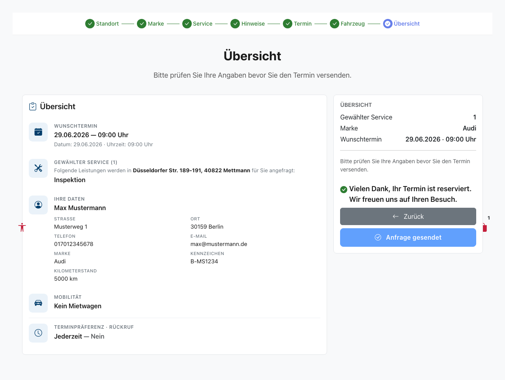
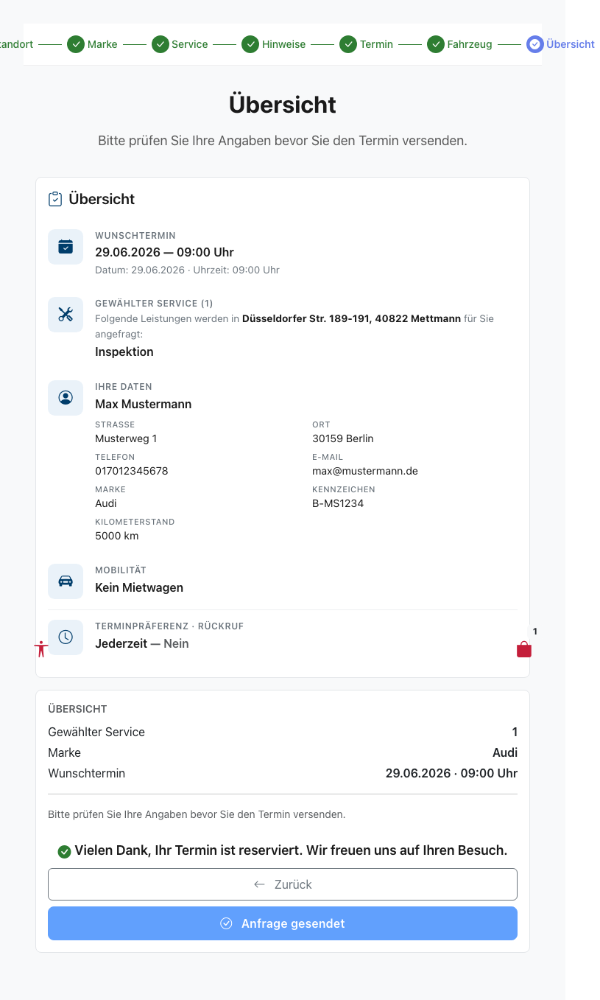
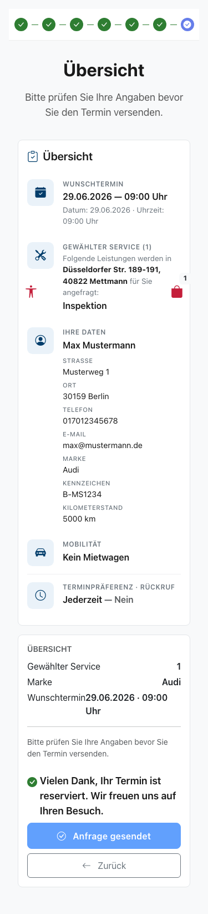

# Feature-Dokumentation: Buchungsbestätigung (Confirmation Message)

**Erstellt:** 2026-06-20
**Requirement:** REQ-028-Buchungsbestaetigung
**Sprache:** DE
**Status:** Implementiert

---

## Übersicht

Nach dem erfolgreichen Absenden einer Buchungsanfrage auf der finalen Wizard-Seite
„Buchungsübersicht" (`/home/booking-overview`) erscheint DIREKT UNTER dem
Submit-Button eine prominente, hervorgehobene Bestätigungsnachricht:

> **„Vielen Dank, Ihr Termin ist reserviert. Wir freuen uns auf Ihren Besuch."**

Die Nachricht wird in fetten Highlight-Lettern dargestellt (`font-weight: 600`,
`color: var(--color-text-primary)` — konsistent mit dem bestehenden
Highlight-Stil `summary-row__value`). Damit erhält der Kunde eine eindeutige,
beruhigende visuelle Erfolgsmeldung und muss sich nicht mehr fragen, ob der
Klick auf den Button korrekt war.

Bisher änderte sich nach dem Absenden nur der Text des Submit-Buttons von
„Jetzt anfragen" zu „Anfrage gesendet" — eine zu unauffällige Rückmeldung.
REQ-028 ergänzt diese Bestätigung als zusätzliche, separate Zeile; der
Button-Text-Toggle bleibt unverändert erhalten.

Die Bestätigung ist rein präsentational: Sie löst keinen API-Call aus, ändert
keinen Store-State und wird ausschließlich im Erfolgs-Zustand
(`hasSubmitted() === true`) gerendert.

---

## Benutzerführung

### Schritt 1: Benutzer ist auf der Buchungsübersicht

**Beschreibung:** Das System rendert die Übersichts-Kacheln (links) und die
Sticky-Sidebar (rechts) mit dem Submit-Button „Jetzt anfragen". Der
Zustand `hasSubmitted()` ist `false` — es wird KEINE Bestätigungsnachricht
angezeigt. Der Submit-Button ist aktiv.

### Schritt 2: Benutzer klickt „Jetzt anfragen"
**Beschreibung:** Der Klick ruft `onSubmit()` auf, das `store.submitBooking()`
auslöst. Während des Sendens (`isSubmitting()`) wird die Sidebar durch einen
Loading-Block ersetzt (Spinner, „Ihre Anfrage wird gesendet…"). In diesem
Zustand ist KEINE Bestätigung sichtbar.

### Schritt 3: Buchung erfolgreich abgesendet

**Beschreibung:** Nach erfolgreichem Absenden setzt `submitBooking`
`bookingSubmitted = true` und `bookingSubmitting = false`. Die Sidebar wird
wieder gerendert, der Submit-Button-Text wechselt zu „Anfrage gesendet" und der
Button ist deaktiviert. `hasSubmitted()` ist nun `true` — die
Bestätigungsnachricht „Vielen Dank, Ihr Termin ist reserviert. Wir freuen uns
auf Ihren Besuch." erscheint DIREKT UNTER dem Submit-Button in fetten
Highlight-Lettern. Der Bestätigungs-Container trägt `role="status"` und
`aria-live="polite"`, sodass Screen-Reader die Nachricht beim Erscheinen
vorlesen.

---

## Responsive Ansichten

### Desktop (1280x720)

Die Bestätigung erscheint full-width innerhalb der Sticky-Sidebar-Card
(`col-lg-4`, rechts).

### Tablet (768x1024)

Die Sidebar ist einspaltig gestapelt; die Bestätigung wird full-width angezeigt.

### Mobile (375x667)

Die Sidebar ist unter der Übersicht gestapelt (Sticky deaktiviert); die
Bestätigung ist full-width, der Text bricht korrekt um, kein horizontales
Überlaufen.

---

## Barrierefreiheit

- **Tastaturnavigation:** Die Bestätigung ist eine textliche Statusmeldung ohne
  interaktive Elemente; der Tab-Fluss (Submit-Button → Zurück-Button) bleibt
  unverändert.
- **Screen Reader:** Der Bestätigungs-Container hat `role="status"` und
  `aria-live="polite"` — die Erfolgsmeldung wird beim Erscheinen
  nicht-unterbrechend vorgelesen (`polite` statt `assertive`, da Erfolg).
- **Farbkontrast:** WCAG 2.1 AA konform — `var(--color-text-primary)` gegen
  `var(--color-background-surface)` (weiße Card) >= 4.5:1.
- **Focus-Styles:** Keine neuen interaktiven Elemente; die Information ist
  explizit textlich (keine reine Farbcodierung).

---

## Technische Details

| Eigenschaft | Wert |
|-------------|------|
| Route | `/#/home/booking-overview` |
| Container Component | `BookingOverviewContainerComponent` |
| Store | `BookingStore` (`providedIn: 'root'`) |
| API Service | Keiner (rein präsentational, kein API-Call) |
| Steuerndes Signal | `hasSubmitted()` (proxied `store.hasBookingSubmitted`) |
| CSS-Klasse | `.booking-overview__confirmation` |
| i18n-Key | `bookingOverview.confirmation.message` |
| ARIA | `role="status"`, `aria-live="polite"` |
