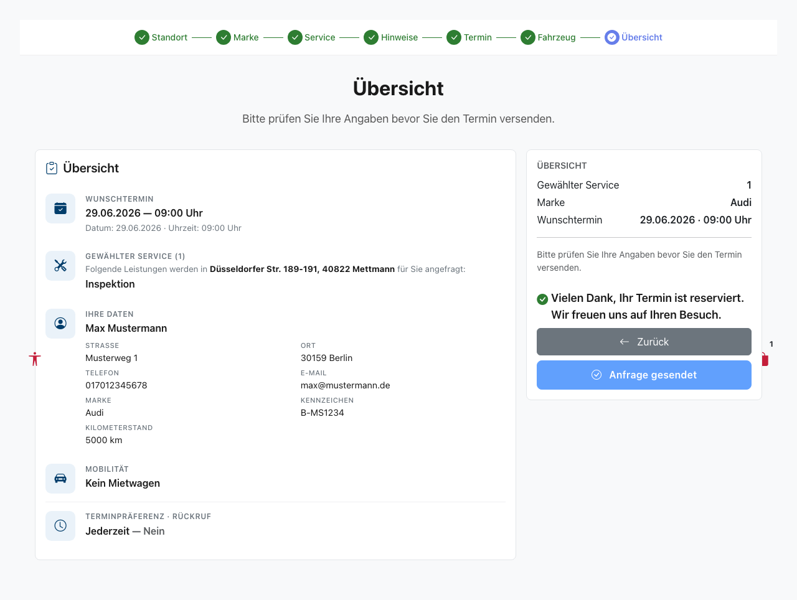
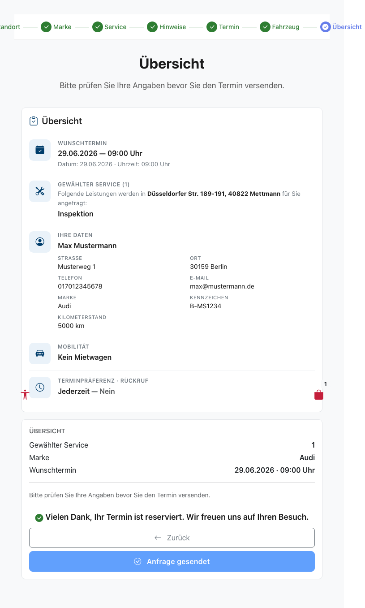
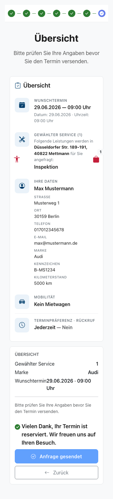

# Feature Documentation: Booking Confirmation (Confirmation Message)

**Created:** 2026-06-20
**Requirement:** REQ-028-Buchungsbestaetigung
**Language:** EN
**Status:** Implemented

---

## Overview

After successfully submitting a booking request on the final wizard page
"Booking Overview" (`/home/booking-overview`), a prominent, highlighted
confirmation message appears DIRECTLY BELOW the submit button:

> **"Thank you, your appointment is reserved. We look forward to your visit."**

The message is rendered in bold highlight lettering (`font-weight: 600`,
`color: var(--color-text-primary)` — consistent with the existing highlight
style `summary-row__value`). This gives the customer a clear, reassuring visual
success message, removing any doubt about whether the button click was correct.

Previously, only the submit button text changed from "Request Now" to
"Request Sent" after submission — a feedback that was too subtle. REQ-028 adds
this confirmation as an additional, separate line; the button text toggle
remains unchanged.

The confirmation is purely presentational: it triggers no API call, changes no
store state, and is rendered exclusively in the success state
(`hasSubmitted() === true`).

---

## User Guidance

### Step 1: User is on the booking overview

**Description:** The system renders the overview tiles (left) and the sticky
sidebar (right) with the submit button "Request Now". The state
`hasSubmitted()` is `false` — NO confirmation message is shown. The submit
button is active.

### Step 2: User clicks "Request Now"
**Description:** The click calls `onSubmit()`, which triggers
`store.submitBooking()`. While sending (`isSubmitting()`), the sidebar is
replaced by a loading block (spinner, "Your request is being sent…"). In this
state NO confirmation is visible.

### Step 3: Booking successfully submitted

**Description:** After a successful submission, `submitBooking` sets
`bookingSubmitted = true` and `bookingSubmitting = false`. The sidebar is
re-rendered, the submit button text changes to "Request Sent", and the button
is disabled. `hasSubmitted()` is now `true` — the confirmation message
"Thank you, your appointment is reserved. We look forward to your visit."
appears DIRECTLY BELOW the submit button in bold highlight lettering. The
confirmation container carries `role="status"` and `aria-live="polite"`, so
screen readers announce the message as it appears.

---

## Responsive Views

### Desktop (1280x720)

The confirmation appears full-width inside the sticky sidebar card
(`col-lg-4`, right).

### Tablet (768x1024)

The sidebar is stacked in a single column; the confirmation is shown full-width.

### Mobile (375x667)

The sidebar is stacked below the overview (sticky disabled); the confirmation is
full-width, the text wraps correctly, with no horizontal overflow.

---

## Accessibility

- **Keyboard navigation:** The confirmation is a textual status message with no
  interactive elements; the tab flow (submit button → back button) remains
  unchanged.
- **Screen reader:** The confirmation container has `role="status"` and
  `aria-live="polite"` — the success message is announced non-disruptively as it
  appears (`polite` instead of `assertive`, since it is a success).
- **Color contrast:** WCAG 2.1 AA compliant — `var(--color-text-primary)`
  against `var(--color-background-surface)` (white card) >= 4.5:1.
- **Focus styles:** No new interactive elements; the information is explicitly
  textual (no color-only coding).

---

## Technical Details

| Property | Value |
|----------|-------|
| Route | `/#/home/booking-overview` |
| Container Component | `BookingOverviewContainerComponent` |
| Store | `BookingStore` (`providedIn: 'root'`) |
| API Service | None (purely presentational, no API call) |
| Controlling signal | `hasSubmitted()` (proxied `store.hasBookingSubmitted`) |
| CSS class | `.booking-overview__confirmation` |
| i18n key | `bookingOverview.confirmation.message` |
| ARIA | `role="status"`, `aria-live="polite"` |
