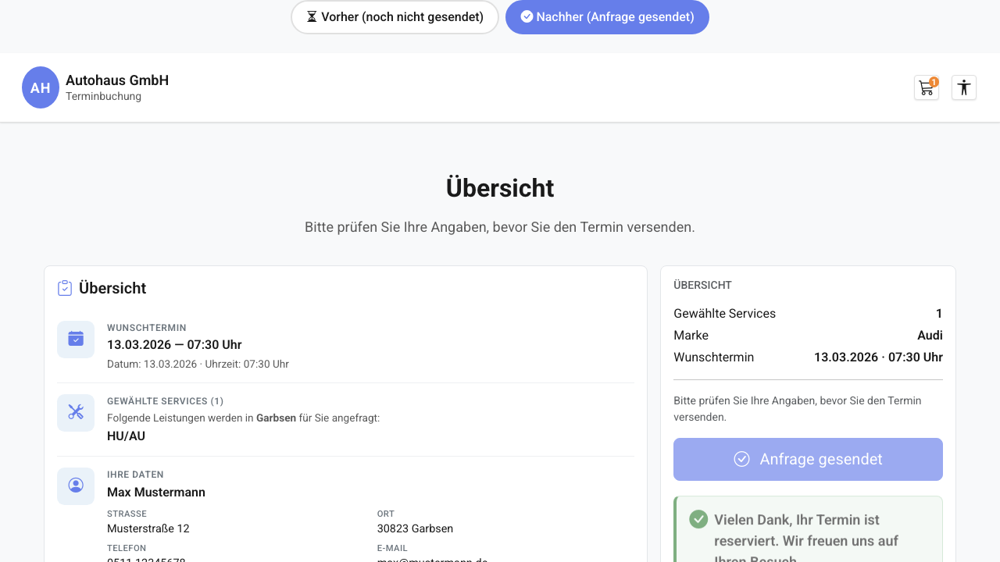

# REQ-028: Buchungsbestätigung (Confirmation Message)

**Status:** Draft
**Priority:** Medium
**Type:** Functional
**Created:** 2026-06-19
**Author:** Claude Code
**Wizard-Schritt:** Letzter Schritt (Erweiterung der Buchungsübersicht, REQ-010)

---

## 1. Overview

### 1.1 Purpose
Auf der finalen Wizard-Seite „Buchungsübersicht" (`/home/booking-overview`) ändert
sich nach erfolgreichem Absenden der Buchungsanfrage bisher NUR der Text des
Submit-Buttons von „Jetzt anfragen" (`bookingOverview.navigation.submit`) zu
„Anfrage gesendet" (`bookingOverview.navigation.submitted`). Diese Rückmeldung ist
für den Kunden zu unauffällig — es bleibt unklar, ob die Buchung wirklich
erfolgreich war.

REQ-028 ergänzt im `submitted`-Zustand DIREKT UNTER dem Submit-Button eine
prominente, hervorgehobene Bestätigungsnachricht in fetten Highlight-Lettern
(visuell analog zu den Werten für Straße/Ort = CSS-Klasse `summary-row__value`,
`font-weight: 600`, `color: var(--color-text-primary)`):

> „Vielen Dank, Ihr Termin ist reserviert. Wir freuen uns auf Ihren Besuch."

Damit erhält der Kunde eine eindeutige, beruhigende visuelle Erfolgsmeldung
(Kernwert „User First").

### 1.2 Scope

**Included:**
- Neue Bestätigungsnachricht UNTER dem Submit-Button in der Sticky-Sidebar-Card
  (`.booking-overview__sidebar` → `nav.booking-overview__navigation`),
  gerendert ausschließlich im Erfolgs-Zustand `@if (hasSubmitted())`
- Visuelle Hervorhebung in fetten Highlight-Lettern (VW-artig): wiederverwendetes
  Stil-Pattern von `summary-row__value` (`font-weight: 600`,
  `color: var(--color-text-primary)`)
- Ein neuer i18n-Key `bookingOverview.confirmation.message` (DE + EN als Pflicht,
  UK/FR/AR analog ergänzt — das Projekt hat 5 Sprachen)
- Accessibility: `role="status"` + `aria-live="polite"`, damit Screen-Reader die
  Bestätigung beim Erscheinen vorlesen
- Erweiterung von Template (`.html`), Styling (`.scss`) und i18n der bestehenden
  `BookingOverviewContainerComponent`

**Excluded:**
- Kein neuer Wizard-Schritt, keine neue Route, keine eigene Bestätigungsseite
- Kein neuer Store, kein neuer Service, kein neuer Component
- Keine Änderung am Submit-Button-Verhalten selbst (Text-Toggle
  `submit` ↔ `submitted` bleibt wie in REQ-010 bestehen)
- Keine Änderung am Submit-/API-Flow (`submitBooking`, `bookingSubmitted`,
  `appointmentId`) — REQ-028 ist rein präsentational
- Keine Anzeige der Bestätigungsnummer / `appointmentId` (separates späteres REQ)
- Keine E-Mail-/SMS-Versandlogik (separat in REQ-027 als Kanal-Auswahl behandelt)

### 1.3 Related Requirements
- **REQ-010: Buchungsübersicht** — definiert die Seite, den Submit-Button und den
  Zustand `bookingSubmitted` / `hasBookingSubmitted`. REQ-028 erweitert diese Seite.
- **REQ-024: Error Fallback Screen** — definiert das Pattern für visuelle
  Statusmeldungen mit `role`/`aria-live` (hier: Erfolg statt Fehler).
- **REQ-026: Bootstrap-UI-Migration + Boxenstopp-Modus + UX-Anpassungen** —
  die booking-overview-Seite nutzt seither Bootstrap statt Angular Material;
  Icons sind Bootstrap Icons (`bi bi-*`).
- **REQ-027: Notification Channel Toggle** — jüngste, ähnlich kleine UI-Erweiterung
  am selben Buchungs-Flow (Stil-/Detailtiefe-Referenz).

---

## 2. User Story

**Als** Kunde, der gerade seine Buchungsanfrage abgesendet hat
**möchte ich** eine klare, gut sichtbare Bestätigung sehen, dass mein Termin
reserviert wurde
**damit** ich sicher weiß, dass meine Anfrage erfolgreich war, und mich nicht
fragen muss, ob ich den Button korrekt geklickt habe.

**Acceptance Criteria:**
- [ ] AC-1: Im Ausgangszustand (vor Submit) wird KEINE Bestätigungsnachricht
  angezeigt — nur der Submit-Button mit Text „Jetzt anfragen".
- [ ] AC-2: Nach erfolgreichem Absenden (`hasSubmitted() === true`) erscheint
  DIREKT UNTER dem Submit-Button die Nachricht „Vielen Dank, Ihr Termin ist
  reserviert. Wir freuen uns auf Ihren Besuch."
- [ ] AC-3: Die Nachricht ist visuell hervorgehoben (fett, `font-weight: 600`,
  `color: var(--color-text-primary)`) — konsistent mit dem Highlight-Stil
  `summary-row__value`.
- [ ] AC-4: Der Submit-Button-Text wechselt parallel weiterhin zu „Anfrage gesendet"
  (unverändert aus REQ-010) — die neue Nachricht ergänzt, ersetzt ihn nicht.
- [ ] AC-5: Während des Sendens (`isSubmitting()`) und im Fehlerfall
  (`submitError()`) wird die Bestätigung NICHT angezeigt (die ganze Sidebar wird
  in diesen Zuständen ohnehin durch Loading-/Error-Block ersetzt).
- [ ] AC-6: Die Bestätigung ist über einen i18n-Key übersetzt und in DE + EN
  korrekt vorhanden (UK/FR/AR analog ergänzt).
- [ ] AC-7: WCAG 2.1 AA: Der Bestätigungs-Container hat `role="status"` +
  `aria-live="polite"`, sodass Screen-Reader die Nachricht beim Erscheinen
  vorlesen; Kontrast >= 4.5:1.
- [ ] AC-8: Responsive: Die Nachricht ist auf Mobile (< 48em), Tablet (>= 48em)
  und Desktop (>= 64em) vollständig sichtbar, korrekt umgebrochen, kein
  horizontales Überlaufen.
- [ ] AC-9: Bestehende Funktionalität der Seite (Übersichts-Kacheln, Zurück-Button,
  Submit-Flow, Guard) bleibt unverändert — keine Regression.
- [ ] AC-10: Test-Coverage > 80 % für die geänderte Component.

---

## 3. Preconditions

### 3.1 System
- Angular App läuft
- `BookingStore` verfügbar (`providedIn: 'root'`) mit Feldern `bookingSubmitted`,
  `bookingSubmitting`, `bookingError` und Computed `hasBookingSubmitted`,
  `isBookingSubmitting`, `hasBookingError`
- Route `/home/booking-overview` konfiguriert, Guard aus REQ-010 aktiv
- i18n-Service (ngx-translate) aktiv, Block `bookingOverview` existiert pro Sprache

### 3.2 User
- Benutzer hat alle vorherigen Wizard-Schritte durchlaufen und ist auf
  `/home/booking-overview`
- Benutzer hat den Submit-Button „Jetzt anfragen" geklickt
- Kein Login erforderlich

### 3.3 Data
- Buchung wurde erfolgreich abgesendet: `bookingSubmitted === true`
  (`hasBookingSubmitted() === true`)
- `bookingError === null` und `bookingSubmitting === false` — d. h. weder Lade-
  noch Fehlerzustand aktiv
- Statische Click-Dummy-/Produktiv-Übergabe — REQ-028 löst keinen eigenen API-Call aus

### 3.4 Übergabe (relevanter Store-State)
| Feld | Typ | Quelle | Relevanz für REQ-028 |
|------|-----|--------|----------------------|
| `BookingStore.bookingSubmitted` | `boolean` | REQ-010 (`submitBooking`) | **Ja** — steuert `@if (hasSubmitted())` |
| `BookingStore.bookingSubmitting` | `boolean` | REQ-010 | Ja — Bestätigung nur, wenn `false` |
| `BookingStore.bookingError` | `string \| null` | REQ-010 | Ja — Bestätigung nur, wenn `null` |
| `BookingStore.appointmentId` | `string \| null` | REQ-010 | Nein — wird in REQ-028 NICHT angezeigt |

---

## 4. Main Flow



**Step 1:** Benutzer ist auf der Buchungsübersicht
- **System:** Rendert die Übersichts-Kacheln (links) und die Sticky-Sidebar (rechts)
  mit dem Submit-Button „Jetzt anfragen".
- **System:** `hasSubmitted()` ist `false` → KEINE Bestätigungsnachricht sichtbar.
- **Expected:** Submit-Button aktiv, Text „Jetzt anfragen", keine Bestätigung.

**Step 2:** Benutzer klickt „Jetzt anfragen"
- **User:** Klickt den Submit-Button.
- **System:** `onSubmit()` ruft `store.submitBooking()` auf, `isSubmitting()` wird
  `true`. Die Sidebar wird durch den Loading-Block ersetzt (Spinner, „Ihre Anfrage
  wird gesendet…").
- **Expected:** Während des Sendens KEINE Bestätigung (Loading-Zustand aktiv).

**Step 3:** Buchung erfolgreich abgesendet
- **System:** `submitBooking` setzt `bookingSubmitted = true`,
  `bookingSubmitting = false`, `appointmentId = response.id`.
- **System:** Sidebar wird wieder gerendert, Submit-Button-Text wechselt zu
  „Anfrage gesendet", Button ist `[disabled]`.
- **System:** `@if (hasSubmitted())` ist nun `true` → die Bestätigungsnachricht
  „Vielen Dank, Ihr Termin ist reserviert. Wir freuen uns auf Ihren Besuch."
  erscheint DIREKT UNTER dem Submit-Button in fetten Highlight-Lettern.
- **System:** Der Bestätigungs-Container hat `role="status"` + `aria-live="polite"`
  → Screen-Reader liest die Nachricht vor.
- **Expected:** Prominente, hervorgehobene Erfolgsmeldung sichtbar und vorgelesen.

---

## 5. Alternative Flows

### 5.1 Alt Flow A: Benutzer kehrt per Browser-Zurück zur Seite zurück

**Trigger:** Benutzer navigiert nach dem Absenden mit dem Browser-Zurück-Button
erneut auf `/home/booking-overview`.

**Flow:**
1. Guard (REQ-010) prüft den Store — alle Felder noch vorhanden, kein Redirect.
2. `bookingSubmitted` ist weiterhin `true` → `hasSubmitted()` ist `true`.
3. Die Bestätigungsnachricht wird erneut angezeigt (idempotent, kein erneuter
   API-Call).

### 5.2 Alt Flow B: Sprachumschaltung im submitted-Zustand

**Trigger:** Benutzer wechselt nach dem Absenden die UI-Sprache (z. B. DE → EN).

**Flow:**
1. `hasSubmitted()` bleibt `true`.
2. ngx-translate liefert die Bestätigung in der neuen Sprache
   (`bookingOverview.confirmation.message`).
3. Nachricht erscheint in der gewählten Sprache, Stil unverändert.

---

## 6. Exception Flows

### 6.1 Exception E1: Submit schlägt fehl

**Trigger:** `submitBooking` läuft in einen Fehler (`bookingError !== null`).

**Flow:**
1. `bookingSubmitting` wird `false`, `bookingError` wird gesetzt,
   `bookingSubmitted` bleibt `false`.
2. Der Container-Zustand wechselt in den Error-Block (`submitError()` ist `true`).
3. `hasSubmitted()` bleibt `false` → die Bestätigungsnachricht wird NICHT angezeigt.
4. Benutzer sieht stattdessen den bestehenden Fehler-Block mit Retry-Button
   (REQ-010 / Fehlerbehandlung).

### 6.2 Exception E2: i18n-Key fehlt

**Trigger:** Translation-Key `bookingOverview.confirmation.message` ist in der
aktiven Sprache nicht definiert.

**Flow:**
1. ngx-translate-Fallback zeigt den Key-Pfad selbst an.
2. `/check-i18n` schlägt im Build Alarm (Key in allen 5 Sprachen Pflicht).
3. Wird vor Merge gefixt.

---

## 7. Postconditions

### 7.1 Erfolg (Bestätigung sichtbar)
- Die Bestätigungsnachricht ist unter dem Submit-Button sichtbar.
- Der Store-State bleibt unverändert (REQ-028 ändert keinen State):
  `bookingSubmitted === true`, `bookingError === null`,
  `bookingSubmitting === false`.
- Keine Navigation, kein zusätzlicher API-Call durch REQ-028.

### 7.2 Kein submitted-Zustand
- `hasSubmitted() === false` → keine Bestätigung gerendert.
- Seite verhält sich exakt wie vor REQ-028.

---

## 8. Business Rules

- **BR-1:** Die Bestätigungsnachricht wird AUSSCHLIESSLICH gerendert, wenn
  `hasSubmitted() === true` (`@if (hasSubmitted())`).
- **BR-2:** Position: DIREKT UNTER dem Submit-Button, innerhalb der
  Sidebar-Navigation (`nav.booking-overview__navigation`), VOR dem Zurück-Button.
- **BR-3:** Der Submit-Button-Text-Toggle (`submit` ↔ `submitted`) aus REQ-010
  bleibt unverändert — die Bestätigung ist eine ergänzende, separate Zeile.
- **BR-4:** Die Bestätigung ist rein präsentational — sie ändert KEINEN Store-State
  und löst KEINEN API-Call aus.
- **BR-5:** Der Text wird IMMER über den i18n-Key
  `bookingOverview.confirmation.message` aufgelöst — kein Hardcoded-String im
  Template.
- **BR-6:** Visuelle Hervorhebung folgt dem bestehenden Highlight-Pattern
  `summary-row__value` (`font-weight: 600`, `color: var(--color-text-primary)`) —
  keine neuen Farben, keine hardcodierten Pixel.
- **BR-7:** Während Loading (`isSubmitting()`) und Fehler (`submitError()`) wird die
  Bestätigung nicht angezeigt (diese Zustände ersetzen die gesamte Sidebar-Ansicht).

---

## 9. Non-Functional Requirements

### Performance
- Reines Markup + Stil — keine zusätzliche Berechnung, kein API-Call.
- Render-Update beim Zustandswechsel `submitted` < 16 ms (Signal-getrieben, OnPush).
- Bundle-Size-Erhöhung < 0,5 KB (nur Markup + ein i18n-Key pro Sprache).
- Lighthouse Performance > 90 (unverändert zur Seite).

### Security
- Kein `[innerHTML]` — Text ausschließlich via Angular Template-Escaping + i18n.
- Keine Anzeige sensibler Daten (keine `appointmentId`, keine Kundendaten in der
  Bestätigung).
- Kein `eval`, kein direktes DOM-Manipulieren.

### Usability / Accessibility
- WCAG 2.1 AA: Bestätigungs-Container mit `role="status"` + `aria-live="polite"`,
  damit Screen-Reader die Erfolgsmeldung beim Erscheinen ansagen (nicht-
  unterbrechend, da Erfolg — nicht `assertive`).
- Kontrast `var(--color-text-primary)` gegen `var(--color-background-surface)`
  >= 4.5:1.
- Lesbare Schriftgröße (em/rem), keine reine Farbcodierung der Information
  (Text ist explizit).
- Mobile-First, Breakpoints: < 48em / >= 48em / >= 64em.

### i18n
- Vollständige Übersetzung DE + EN (Pflicht).
- UK/FR/AR analog ergänzt, da das Projekt 5 Sprachen führt (`/check-i18n` Pflicht).
- Schlüssel-Pfad konsistent mit bestehendem Schema (`bookingOverview.*`).

### Maintainability
- KEIN neuer Store/Service/Component — Erweiterung der bestehenden
  `BookingOverviewContainerComponent`.
- Wiederverwendung des bestehenden Highlight-Stils statt Duplizierung.

---

## 10. Data Model

**Keine neuen Types, Interfaces oder Store-Felder erforderlich.**

REQ-028 ist rein präsentational und stützt sich vollständig auf bereits in REQ-010
vorhandene Store-Felder und Computed Signals:

```typescript
// src/app/features/booking/stores/booking.store.ts (BESTEHEND — nur referenziert)

interface BookingState {
  // ...
  bookingSubmitted: boolean;   // REQ-010: true nach erfolgreichem submitBooking()
  bookingSubmitting: boolean;  // REQ-010: true während des Sendens
  bookingError: string | null; // REQ-010: gesetzt bei Submit-Fehler
  appointmentId: string | null; // REQ-010: NICHT von REQ-028 genutzt
  // ...
}

// Bestehende Computed Signals (withComputed):
hasBookingSubmitted: computed(() => bookingSubmitted());   // steuert die Bestätigung
isBookingSubmitting: computed(() => bookingSubmitting());
hasBookingError:     computed(() => bookingError() !== null);
```

Im Container werden diese bereits referenziert:

```typescript
// booking-overview-container.component.ts (BESTEHEND — keine Änderung nötig)
protected readonly isSubmitting  = this.store.isBookingSubmitting;
protected readonly hasSubmitted  = this.store.hasBookingSubmitted;
protected readonly submitError   = computed(
  () => this.store.hasBookingError() && !this.store.isBookingSubmitting()
);
```

Die neue Bestätigungsnachricht bindet im Template ausschließlich an das bereits
vorhandene `hasSubmitted()`.

---

## 11. UI/UX

### Mockup


### Position im Layout (Ausschnitt — Sticky-Sidebar `.booking-overview__sidebar`)

```
+--------------------------------------------------+
|  ÜBERSICHT (Card-Heading)                        |
|  Service                                    2    |
|  Marke                          Volkswagen       |
|  Wunschtermin           15.04.2026 · 10:00 Uhr   |
|  --------------------------------------------    |
|  Bitte prüfen Sie Ihre Angaben ...               |
|                                                  |
|  [ ✓  Anfrage gesendet ]   ← disabled (submitted)|
|                                                  |
|  Vielen Dank, Ihr Termin ist reserviert.         |  ← NEU (REQ-028)
|  Wir freuen uns auf Ihren Besuch.                |     fett, hervorgehoben
|                                                  |
|  [ ←  Zurück ]                                   |
+--------------------------------------------------+
```

### UI Elements
| Element | Typ | Klasse / Component | ARIA | Sichtbarkeit |
|---------|-----|--------------------|------|--------------|
| Submit-Button | `<button class="btn btn-primary btn-lg">` | `.booking-overview__submit-button` (bestehend) | `aria-label` aus i18n, `[disabled]="hasSubmitted()"` | immer (im else-Block) |
| Bestätigungsnachricht | `<p>` | `.booking-overview__confirmation` (NEU) | `role="status"`, `aria-live="polite"` | nur `@if (hasSubmitted())` |
| Zurück-Button | `<button class="btn btn-outline-secondary">` | `.booking-overview__back-button` (bestehend) | `aria-label` aus i18n | immer |

### Bootstrap-Komponenten
- Layout/Buttons: Bootstrap (`btn btn-primary btn-lg`, `btn btn-outline-secondary`),
  Grid `row` / `col-lg-*`, Sticky via `.sticky-top` — alles bestehend aus REQ-026.
- Icons: Bootstrap Icons (`bi bi-*`) — bestehend (z. B. `bi bi-check-circle` im
  Submit-Button). REQ-028 fügt KEIN Icon hinzu (rein textliche Bestätigung), kann
  optional `bi bi-check-circle-fill` als dekoratives, `aria-hidden="true"` Prefix
  ergänzen — der hervorgehobene Text bleibt jedoch primär.

### Styling-Hinweise
- Hervorhebung analog `summary-row__value`: `font-weight: 600`,
  `color: var(--color-text-primary)`.
- Abstand zum Submit-Button über CSS-Variable (`var(--spacing-sm)` o. ä.) —
  KEINE hardcodierten Pixel.
- Hintergrund-Kontext: `var(--color-background-surface)` (weiße Sidebar-Card).
- Mobile-First, kein horizontales Überlaufen, Text bricht um.
- KEINE Inline-Styles, KEINE Mockup-Farben — ausschließlich `_variables.scss`.

### Responsive Verhalten
| Viewport | Sidebar | Bestätigung |
|----------|---------|-------------|
| Mobile (< 48em) | gestapelt unter Übersicht (Sticky deaktiviert, vgl. SCSS-Kommentar) | full-width, Text bricht um |
| Tablet (>= 48em) | gestapelt / einspaltig | full-width |
| Desktop (>= 64em / `lg`) | Sticky rechts (`col-lg-4`) | full-width innerhalb der Card |

---

## 12. API Specification

**Keine API-Änderung.** REQ-028 ist rein präsentational (Click-Dummy / statisch).

- Es wird KEIN neuer Endpunkt eingeführt.
- Es wird KEIN bestehender Request-/Response-Body erweitert.
- Die Bestätigung reagiert ausschließlich auf das bereits durch REQ-010 gesetzte
  `bookingSubmitted`-Flag, das der bestehende `submitBooking`-Flow nach dem
  `POST /appointments` setzt:

```typescript
// BESTEHEND aus REQ-010 — REQ-028 ändert hieran NICHTS:
return from(appointmentApi.createAppointment(request)).pipe(
  tap((response) => {
    patchState(store, {
      bookingSubmitted: true,   // ← triggert die Bestätigung (REQ-028)
      bookingSubmitting: false,
      appointmentId: response.id,
    });
  }),
  // ... catchError ...
);
```

---

## 13. Test Cases

### TC-1: Bestätigung erscheint erst nach Submit
- **Given:** Seite geladen, `hasSubmitted()` ist `false`
- **When:** Seite gerendert
- **Then:** Element `.booking-overview__confirmation` ist NICHT im DOM

### TC-2: Bestätigung sichtbar nach erfolgreichem Submit
- **Given:** `bookingSubmitted === true`, `bookingError === null`,
  `bookingSubmitting === false`
- **When:** Seite gerendert
- **Then:** `.booking-overview__confirmation` ist sichtbar und zeigt
  „Vielen Dank, Ihr Termin ist reserviert. Wir freuen uns auf Ihren Besuch."

### TC-3: Bestätigung steht UNTER dem Submit-Button
- **Given:** `hasSubmitted() === true`
- **When:** Seite gerendert
- **Then:** Im DOM folgt `.booking-overview__confirmation` auf
  `.booking-overview__submit-button` und steht VOR `.booking-overview__back-button`

### TC-4: Submit-Button-Text-Toggle bleibt erhalten
- **Given:** `hasSubmitted() === true`
- **When:** Seite gerendert
- **Then:** Submit-Button zeigt „Anfrage gesendet" und ist `disabled`
  (Regression zu REQ-010)

### TC-5: Keine Bestätigung während des Sendens
- **Given:** `isSubmitting() === true`
- **When:** Seite gerendert
- **Then:** Loading-Block sichtbar, `.booking-overview__confirmation` NICHT im DOM

### TC-6: Keine Bestätigung im Fehlerfall
- **Given:** `submitError() === true` (`bookingError !== null`,
  `bookingSubmitting === false`)
- **When:** Seite gerendert
- **Then:** Error-Block sichtbar, `.booking-overview__confirmation` NICHT im DOM

### TC-7: A11y — role/aria-live
- **Given:** `hasSubmitted() === true`
- **When:** Seite gerendert
- **Then:** Bestätigungs-Container hat `role="status"` und `aria-live="polite"`;
  Screen-Reader liest die Nachricht beim Erscheinen vor

### TC-8: Hervorhebungs-Stil
- **Given:** Bestätigung sichtbar
- **When:** Computed Styles geprüft
- **Then:** `font-weight: 600`, `color: var(--color-text-primary)` (analog
  `summary-row__value`)

### TC-9: i18n DE
- **Given:** Sprache DE aktiv, `hasSubmitted() === true`
- **When:** Seite gerendert
- **Then:** Text „Vielen Dank, Ihr Termin ist reserviert. Wir freuen uns auf Ihren
  Besuch."

### TC-10: i18n EN
- **Given:** Sprache EN aktiv, `hasSubmitted() === true`
- **When:** Seite gerendert
- **Then:** Text „Thank you, your appointment is reserved. We look forward to your
  visit."

### TC-11: Responsive — Mobile
- **Given:** Viewport < 48em, `hasSubmitted() === true`
- **When:** Seite gerendert
- **Then:** Bestätigung full-width, Text umgebrochen, kein horizontales Überlaufen

### TC-12: Bestehende Funktionalität unverändert
- **Given:** Seite geladen
- **When:** Benutzer interagiert mit Übersichts-Kacheln, Zurück-Button, Submit
- **Then:** Alle bestehenden Flows funktionieren wie zuvor (Regressionstest)

---

## 14. Implementation

**Erweiterung der bestehenden `BookingOverviewContainerComponent` — KEIN neuer
Store, KEIN neuer Service, KEIN neuer Component, KEINE neue Route.**

### Geänderte Dateien
```
src/app/features/booking/components/booking-overview/
├── booking-overview-container.component.html   # ERWEITERN: @if (hasSubmitted())-Block
│                                                #   mit Bestätigung UNTER dem Submit-Button
├── booking-overview-container.component.scss    # ERWEITERN: .booking-overview__confirmation
│                                                #   (font-weight 600, color var(--color-text-primary))
└── booking-overview-container.component.ts      # ggf. UNVERÄNDERT — bindet bestehendes hasSubmitted()

src/app/core/i18n/translations.ts                # ERWEITERN: bookingOverview.confirmation.message
                                                 #   in DE + EN (Pflicht), UK/FR/AR analog
```

### Template-Skizze (Ausschnitt, innerhalb `nav.booking-overview__navigation`)
```html
<button
  type="button"
  class="btn btn-primary btn-lg w-100 booking-overview__submit-button"
  [disabled]="hasSubmitted()"
  [attr.aria-label]="bookingOverview.navigation.submit | translate"
  (click)="onSubmit()">
  <i class="bi bi-check-circle me-2" aria-hidden="true"></i>
  @if (hasSubmitted()) {
    <span>{{ bookingOverview.navigation.submitted | translate }}</span>
  } @else {
    <span>{{ bookingOverview.navigation.submit | translate }}</span>
  }
</button>

<!-- NEU (REQ-028): prominente Bestätigung UNTER dem Submit-Button -->
@if (hasSubmitted()) {
  <p class="booking-overview__confirmation" role="status" aria-live="polite">
    {{ bookingOverview.confirmation.message | translate }}
  </p>
}

<button
  type="button"
  class="btn btn-outline-secondary w-100 booking-overview__back-button"
  ...>
  <i class="bi bi-arrow-left me-2" aria-hidden="true"></i>
  {{ bookingOverview.navigation.back | translate }}
</button>
```

### SCSS-Skizze
```scss
.booking-overview {
  &__confirmation {
    // Highlight-Pattern analog summary-row__value
    font-weight: 600;
    color: var(--color-text-primary);
    margin: var(--spacing-sm) 0 0;
  }
}
```

### TypeScript
- `BookingOverviewContainerComponent` exponiert `hasSubmitted` bereits
  (`protected readonly hasSubmitted = this.store.hasBookingSubmitted;`) —
  in der Regel ist KEINE Code-Änderung nötig, nur Template + SCSS + i18n.
- Der i18n-Alias `protected readonly bookingOverview = i18nKeys.booking.bookingOverview;`
  existiert bereits und stellt den neuen Key `bookingOverview.confirmation.message`
  typsicher bereit.

### Tests
- [ ] Unit-Tests: `booking-overview-container.component.spec.ts` —
  Bestätigung erscheint nur bei `hasSubmitted() === true`, nicht bei Loading/Error,
  `role="status"`/`aria-live`, i18n-Key gebunden
- [ ] Coverage >= 80 %
- [ ] E2E `npm run e2e:backend` grün über 3 Viewports (Smoke: Bestätigung sichtbar
  nach Submit)

### Effort
- Development: 1 Stunde
- Testing: 1 Stunde

---

## 15. Dependencies

**Requires:**
- **REQ-010: Buchungsübersicht** — liefert die Seite, den Submit-Button und das
  `bookingSubmitted`-Flag / `hasBookingSubmitted`-Computed.
- **REQ-026: Bootstrap-UI-Migration** — definiert das Bootstrap-Markup
  (`btn`, Grid, `.sticky-top`) und Bootstrap-Icons (`bi bi-*`) dieser Seite.

**Blocks:**
- Keine

---

## 16. Naming Glossary

**Code-Sprache: Englisch (FIXIERT).** UI-Texte: DE + EN (+ UK/FR/AR).

### Container (BookingOverviewContainerComponent — bestehend)
| Member | Typ | Beschreibung |
|--------|-----|--------------|
| `hasSubmitted` | `Signal<boolean>` (proxied `store.hasBookingSubmitted`) | Steuert `@if`-Anzeige der Bestätigung |
| `isSubmitting` | `Signal<boolean>` (proxied `store.isBookingSubmitting`) | Loading-Zustand (Bestätigung dann verborgen) |
| `submitError` | `Signal<boolean>` (computed) | Fehler-Zustand (Bestätigung dann verborgen) |
| `bookingOverview` | i18n-Alias | `i18nKeys.booking.bookingOverview` — liefert `confirmation.message` |
| `onSubmit()` | `void` | Bestehend — ruft `store.submitBooking()` |

### CSS-Klassen (Englisch, BEM)
| Klasse | Beschreibung |
|--------|--------------|
| `.booking-overview__confirmation` | NEU — Container der hervorgehobenen Bestätigungsnachricht |
| `.booking-overview__submit-button` | Bestehend — Submit-Button |
| `.booking-overview__back-button` | Bestehend — Zurück-Button |
| `summary-row__value` | Bestehend (personal-data-tile) — Stil-Vorbild für die Hervorhebung |

### i18n-Key (Pfad englisch)
| Key | Beschreibung |
|-----|--------------|
| `bookingOverview.confirmation.message` | NEU — Bestätigungstext nach erfolgreichem Submit |

---

## 17. i18n Keys

Code-Sprache: Englisch. Neuer Key-Block `confirmation` unter dem bestehenden
`bookingOverview`-Block (jeweils direkt nach `navigation`). DE + EN sind Pflicht;
UK/FR/AR werden analog ergänzt, da das Projekt 5 Sprachen führt
(`/check-i18n` muss grün sein).

### DE (Deutsch) — `src/app/core/i18n/translations.ts`, Block `bookingOverview` (~Z. 278)
```typescript
bookingOverview: {
  // ... bestehende Keys (title, subtitle, tiles, navigation: { back, submit, submitting, submitted }) ...
  navigation: {
    back: 'Zurück',
    submit: 'Jetzt anfragen',
    submitting: 'Wird gesendet...',
    submitted: 'Anfrage gesendet'
  },
  confirmation: {
    message: 'Vielen Dank, Ihr Termin ist reserviert. Wir freuen uns auf Ihren Besuch.'
  }
}
```

### EN (English) — Block `bookingOverview` (~Z. 617)
```typescript
bookingOverview: {
  // ... existing keys ...
  navigation: {
    back: 'Back',
    submit: 'Request Now',
    submitting: 'Sending...',
    submitted: 'Request Sent'
  },
  confirmation: {
    message: 'Thank you, your appointment is reserved. We look forward to your visit.'
  }
}
```

### Weitere Sprachen (analog ergänzen — Hinweis, nicht Pflichtumfang dieses REQ)
```typescript
// UK (Ukrainisch) — Block bookingOverview
confirmation: {
  message: 'Дякуємо, ваш запис заброньовано. Ми з нетерпінням чекаємо на ваш візит.'
}

// FR (Français)
confirmation: {
  message: 'Merci, votre rendez-vous est réservé. Nous nous réjouissons de votre visite.'
}

// AR (Arabic, RTL)
confirmation: {
  message: 'شكرًا لك، تم حجز موعدك. نتطلع إلى زيارتك.'
}
```

---

## 18. Approval

| Role | Name | Date |
|------|------|------|
| Product Owner | | |
| Tech Lead | | |

---

## 19. Implementation Notes

**Code-Sprache: Englisch (FIXIERT).** Klassen, Methoden, Felder, CSS-Klassen und
i18n-Key-Pfade sind Englisch. UI-Texte sind lokalisiert (DE + EN Pflicht, UK/FR/AR
analog).

### Wichtige Konventionen
- **Kein neuer Store/Service/Component/Route:** ausschließlich Erweiterung der
  bestehenden `BookingOverviewContainerComponent` (Template + SCSS) plus ein
  i18n-Key.
- **Container/Presentational:** Die Bestätigung ist so klein, dass sie inline im
  Container-Template lebt — kein Presentational-Split nötig. OnPush bleibt.
- **Signal statt Method-Call im Template:** Anzeige über das bestehende Computed
  Signal `hasSubmitted()`, keine neue Methode.
- **Kein `[innerHTML]`:** Text via Angular Template-Escaping + ngx-translate.

### Styling-Hinweise
- Hervorhebung wiederverwendet das bestehende Pattern `summary-row__value`
  (`font-weight: 600`, `color: var(--color-text-primary)`) — NICHT duplizieren,
  konsistent halten.
- Alle Abstände/Farben aus `_variables.scss` — KEINE hardcodierten Pixel/Farben.
- Hintergrund-Kontext: `var(--color-background-surface)` (weiße Card).
- Mobile-First, Breakpoints < 48em / >= 48em / >= 64em.

### Accessibility
- `role="status"` + `aria-live="polite"` am Bestätigungs-Container — Erfolg wird
  nicht-unterbrechend vorgelesen (im Gegensatz zum Fehler-Block, der `assertive`
  nutzt).
- Information ist explizit textlich (keine reine Farbcodierung), Kontrast >= 4.5:1.

### Definition of Done (vgl. VISION.md)
- [ ] Alle 10 ACs erfüllt
- [ ] Tests >= 80 % Coverage (Jest)
- [ ] `/check-architecture`, `/check-i18n`, `/check-styling`, `/check-security` grün
- [ ] WCAG 2.1 AA verifiziert (Screen-Reader liest Bestätigung vor)
- [ ] Responsive über 3 Viewports getestet (E2E)
- [ ] Keine Regression auf der Buchungsübersicht (REQ-010)
