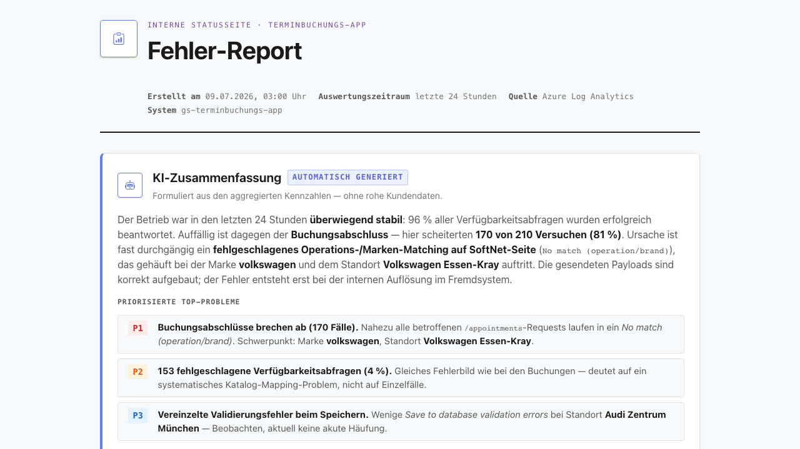

# Feature-Dokumentation: KI-Fehler-Report (REQ-030)

## Überblick

Der **KI-Fehler-Report** ist eine selbst betriebene, tägliche Auswertung der Backend-Fehler der
Terminbuchungs-App. Ein nächtlicher Cronjob wertet die Logs der letzten 24 Stunden aus Azure Log
Analytics aus, ein LLM (über Spring AI) formuliert daraus eine verständliche Zusammenfassung, und das
Ergebnis wird als geschützte HTML-Statusseite bereitgestellt.

Ziel: den Gesundheitszustand der Buchungsstrecke auf einen Blick sehen — ohne manuelle Azure-Anmeldung.

## Funktionsweise

1. **Nächtlicher Lauf (03:00 Uhr, Europe/Berlin)** — zusätzlich einmal beim Backend-Start.
2. **Datenabruf** aus Azure Log Analytics über die **System-Managed-Identity** der Container App
   (kein Secret, keine Anmeldung).
3. **Aggregation:** Buchungs-Kennzahlen (gestartet / erfolgreich / fehlgeschlagen) und eine Fehlerliste.
   Standorte werden aus `setup.json` in Klartext-Namen aufgelöst, die gewählten Services über den
   SoftNet-Katalog ebenfalls in **lesbare Namen**.
4. **KI-Zusammenfassung** via Spring AI 2.0 als typisiertes Ergebnis (`AiErrorReportSummary`), validiert
   durch den `StructuredOutputValidationAdvisor` (Selbstkorrektur bei Schema-Verletzung, bis zu 3 Versuche).
   Ein `SafeGuardAdvisor` dient als Guardrail.
5. **HTML-Seite** wird erzeugt und im Speicher gehalten; sie wird beim nächsten Lauf überschrieben.

## Aufbau der Report-Seite

- **Kopf:** Titel, Zeitpunkt des letzten Laufs, Auswertungszeitraum (letzte 24 h).
- **KI-Zusammenfassung:** Überschrift, Gesamtbewertung, priorisierte Probleme (mit Schweregrad,
  betroffenen Marken/Standorten, Ursachenhypothese), Handlungsempfehlungen.
- **Übersicht Buchungen:** gestartet / erfolgreich / fehlgeschlagen (`POST /appointments`).
- **Fehlerliste:** je Fehler Marke, Standort, **Services (Klartext)**, Fehlertyp, Trace-ID sowie die
  gesendeten (Request) und empfangenen (Response) Daten.

## Zugriff

- In der App erscheint unten mittig ein **Statusbutton** (Symbol „Clipboard"), der die Report-Seite in
  einem neuen Tab öffnet.
- **Für eingebettete Kunden (iFrame) ist der Button ausgeblendet** — er ist nur im direkten Aufruf sichtbar.
- Die Seite `/internal/report` ist durch **HTTP Basic Auth** geschützt (Kundendaten in den Payloads).

## Konfiguration (Secrets / Env)

Das Feature ist ein **Feature-Toggle**: Der Cronjob läuft **nur**, wenn API-Key und Modell gesetzt sind.

| Variable | Zweck |
|----------|-------|
| `LLM_BASE_URL` | Endpoint des eigenen (OpenAI-kompatiblen) LLM |
| `LLM_API_KEY` | API-Key (Toggle) |
| `LLM_MODEL` | Modellname (Toggle) |
| `REPORT_ADMIN_USER` / `REPORT_ADMIN_PASSWORD` | Basic-Auth-Zugang zur Report-Seite |
| `LOG_WORKSPACE_ID` | Log-Analytics-Workspace (Default gesetzt) |

Ohne `LLM_API_KEY`/`LLM_MODEL` startet das Backend normal, der Report zeigt „nicht konfiguriert".

## Fehlerverhalten

- **LLM nicht erreichbar / unsaubere Antwort:** neutrale Fallback-Zusammenfassung; Kennzahlen und
  Fehlerliste bleiben vollständig.
- **Log Analytics nicht erreichbar:** Seite zeigt einen Hinweis, der nächste Lauf ergänzt die Daten.
