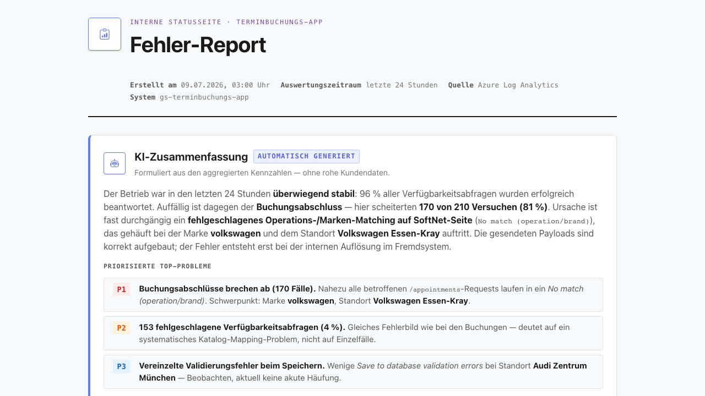

# Feature Documentation: AI Error Report (REQ-030)

## Overview

The **AI Error Report** is a self-operated daily analysis of the booking app's backend errors. A nightly
cron job evaluates the last 24 hours of logs from Azure Log Analytics, an LLM (via Spring AI) turns them
into a readable summary, and the result is served as a protected HTML status page.

Goal: see the health of the booking funnel at a glance — without a manual Azure sign-in.

## How it works

1. **Nightly run (03:00, Europe/Berlin)** — plus once on backend startup.
2. **Data fetch** from Azure Log Analytics via the container app's **system-assigned managed identity**
   (no secret, no login).
3. **Aggregation:** booking counters (started / succeeded / failed) and an error list. Locations are
   resolved to plain names from `setup.json`; the selected services are resolved to **readable names**
   from the SoftNet catalog.
4. **AI summary** via Spring AI 2.0 as a typed result (`AiErrorReportSummary`), validated by the
   `StructuredOutputValidationAdvisor` (self-correcting retry on schema violation, up to 3 attempts).
   A `SafeGuardAdvisor` acts as a guardrail.
5. **HTML page** is generated and kept in memory; it is overwritten on the next run.

## Report page layout

- **Header:** title, timestamp of the last run, evaluation window (last 24 h).
- **AI summary:** headline, overall assessment, prioritized issues (severity, affected brands/locations,
  root-cause hypothesis), recommendations.
- **Booking overview:** started / succeeded / failed (`POST /appointments`).
- **Error list:** per error — brand, location, **services (plain text)**, error type, trace ID, plus the
  sent (request) and received (response) payloads.

## Access

- The app shows a **status button** (clipboard icon, bottom center) that opens the report page in a new tab.
- **For embedded customers (iframe) the button is hidden** — it only appears on a direct call.
- The `/internal/report` page is protected by **HTTP Basic Auth** (payloads contain customer data).

## Configuration (secrets / env)

The feature is a **toggle**: the cron job runs **only** when an API key and model are set.

| Variable | Purpose |
|----------|---------|
| `LLM_BASE_URL` | Endpoint of the own (OpenAI-compatible) LLM |
| `LLM_API_KEY` | API key (toggle) |
| `LLM_MODEL` | Model name (toggle) |
| `REPORT_ADMIN_USER` / `REPORT_ADMIN_PASSWORD` | Basic-auth access to the report page |
| `LOG_WORKSPACE_ID` | Log Analytics workspace (default provided) |

Without `LLM_API_KEY`/`LLM_MODEL` the backend boots normally and the report shows "not configured".

## Error behavior

- **LLM unavailable / malformed answer:** neutral fallback summary; counters and error list stay complete.
- **Log Analytics unavailable:** the page shows a notice; the next run fills in the data.
