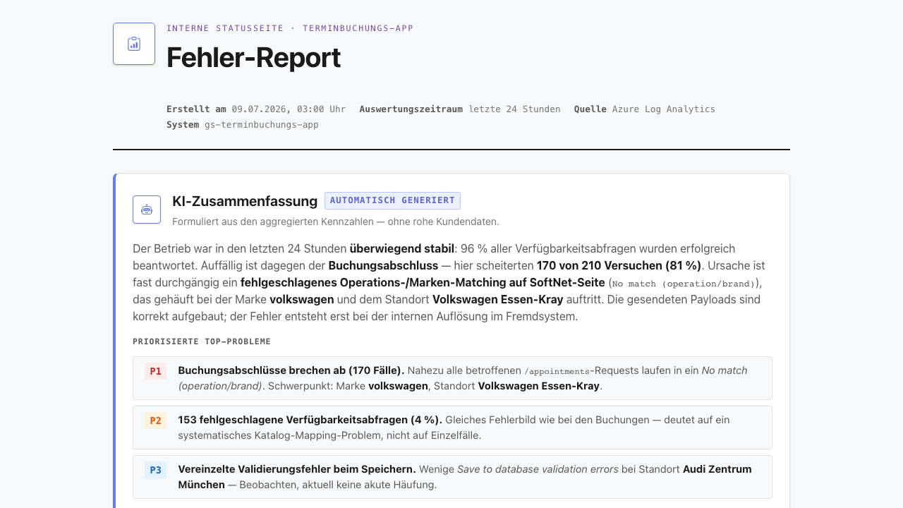

# REQ-030: AI-Error-Report (Täglicher LLM-Fehler-Report als geschützte Statusseite)

**Status:** Draft
**Priority:** High
**Type:** Non-Functional
**Created:** 2026-07-09
**Author:** Rico Sonntag

---

## 1. Overview

### 1.1 Purpose

Fehler des Terminbuchungs-Backends (SoftNet-502, Validierungsfehler, Timeouts) werden seit REQ-029 vollständig nach Azure Log Analytics geloggt (`SOFTNET_ERROR`-Marker mit Trace-ID, Request-/Response-Payload). Ausgewertet werden diese Logs heute jedoch nur **manuell** per `az login` + KQL — und dieses Login läuft wegen Conditional Access alle 12 h ab.

Dieses Requirement führt eine **selbst betriebene, tägliche Fehlerauswertung als geschützte HTML-Statusseite** ein, komplett im Spring-Boot-Backend (Azure Container App). Kein GitLab, keine Pipeline, kein externes Skript, keine wiederkehrende Anmeldung:

1. **Cronjob** (täglich 03:00 Europe/Berlin) fragt die letzten 24 h aus Azure Log Analytics ab — Anmeldung über **System-Managed-Identity** (kein Secret, kein Login).
2. **Deterministische Aggregation** der Zahlen (Verfügbarkeitsabfragen `/snaps` + Buchungsabschlüsse `/appointments`, je gestartet/erfolgreich/fehlerhaft) plus Standort-Auflösung (Branch-ID → `setup.json`).
3. **Spring AI 2.0** (`ChatClient`, OpenAI-kompatibles eigenes LLM) formuliert daraus eine **typisierte, narrative Zusammenfassung** (Structured Output gegen ein Java-Record, validiert per `StructuredOutputValidationAdvisor` mit self-correcting Retry).
4. Das Ergebnis wird als **HTML-Seite hinter Basic Auth** ausgeliefert (`GET /internal/report`), weil die Fehlerliste Kundendaten-Payloads zeigt.
5. Ein **Statusbutton** in der App öffnet die Seite — im iFrame (eingebettete Kunden) ausgeblendet.

### 1.2 Scope

**Included:**
- Spring Boot Backend (`server/`): neues Package `com.autohaus.backend.reporting` (Scheduler, Log-Analytics-Client via Managed Identity, Aggregator, Spring-AI-Summary-Service, HTML-Generator, In-Memory-Store, Controller).
- Framework-Anhebung: **Spring Boot 4.1.0-SNAPSHOT → 4.0 GA** + **Spring AI 2.0 (GA)** + `azure-identity` + `azure-monitor-query`.
- `SecurityConfig`-Erweiterung: zusätzliche `SecurityFilterChain` für `/internal/**` mit HTTP Basic Auth.
- `BackendApplication`: `@EnableScheduling`.
- Frontend: Statusbutton in `FloatingOverlayComponent`, gerendert nur außerhalb des iFrames (`@if (!isEmbedded())`), + i18n-Keys (DE/EN) für Button-Label/Tooltip.

**Excluded:**
- Kein Persistent Volume / keine Datenbank (Report lebt im Speicher, wird beim Startup einmal erzeugt).
- Keine eigene Angular-Report-Komponente (das HTML kommt komplett vom Backend; der Button öffnet nur die URL).
- Keine Änderung am SoftNet-Buchungsfluss oder am Booking-Wizard.
- Kein neuer Azure-Alert (E-Mail-Alert existiert bereits aus REQ-029).
- Kein Änderung am bestehenden Logging (REQ-029 bleibt unangetastet; dieses Feature ist reiner Consumer der Logs).

### 1.3 Related Requirements
- **REQ-029**: Backend-Error-Logging (Trace-ID, `SOFTNET_ERROR`-Payload-Dump) — **liefert die Datenquelle**, die dieses Feature auswertet.
- REQ-020/REQ-022: Azure Container App Hosting + Monitoring-Setup (Managed Identity, Log Analytics Workspace).
- REQ-025: `setup.json` Branch-Katalog (Standort-Auflösung Branch-ID → Name/Adresse).

---

## 2. User Story

**As a** Betreiber/Entwickler des Terminbuchungs-Backends
**I want** eine automatisch generierte, tägliche Fehler-Statusseite mit einer KI-formulierten Zusammenfassung und einer detaillierten Fehlerliste (Marke, Standort, Fehlertyp, Payloads)
**So that** ich den Gesundheitszustand der Buchungsstrecke ohne wiederkehrende Azure-Anmeldung auf einen Blick sehe und SoftNet-Fehler priorisiert nachverfolgen kann.

**Acceptance Criteria:**
- [ ] AC-1: Ein Scheduler generiert täglich um 03:00 Europe/Berlin einen neuen Report; zusätzlich wird beim Container-Startup einmal generiert (Überbrückung von Neustarts ohne Persistenz).
- [ ] AC-2: Der Scheduler-Bean wird **nur aktiviert, wenn `LLM_API_KEY` UND `LLM_MODEL` gesetzt sind** (`@ConditionalOnExpression`); ohne Secrets läuft der Cronjob nie und das Backend startet trotzdem sauber.
- [ ] AC-3: Die Log-Analytics-Abfrage authentifiziert sich über **System-Managed-Identity** (`DefaultAzureCredential`) — ohne Secret, ohne Login.
- [ ] AC-4: Der Report enthält oben **eine Übersicht der Buchungen** (`POST /appointments`): gestartet, davon erfolgreich, davon fehlgeschlagen. Unten eine Fehlerliste mit Marke, Standort (aufgelöst), **gewählten Services/Operationen im Klartext** (aufgelöste Namen statt IDs), Fehlertyp, gesendetem Request-Body, empfangenem Response-Body und Trace-ID.
- [ ] AC-5: Die narrative Zusammenfassung wird von Spring AI 2.0 als **typisiertes Record** (`AiErrorReportSummary`) geliefert und per `StructuredOutputValidationAdvisor` validiert; bei Schema-Verletzung erfolgt ein self-correcting Retry (max. 3 Versuche).
- [ ] AC-6: `GET /internal/report` ist nur mit **HTTP Basic Auth** (Admin-User/Passwort aus Secret) erreichbar; ohne Credentials → `401`.
- [ ] AC-7: Ans LLM gehen **nur Aggregate + Fehlertypen**, niemals rohe Kundendaten-Payloads.
- [ ] AC-8: In der App erscheint ein Statusbutton, der `/internal/report` in einem neuen Tab öffnet; im iFrame (eingebettete Kunden) ist der Button **nicht sichtbar** (`@if (!isEmbedded())`).
- [ ] AC-9: Fällt das LLM oder Log Analytics aus, liefert die Seite trotzdem einen validen Report (Fallback ohne KI-Text bzw. mit Hinweis).

---

## 3. Preconditions

### 3.1 System
- Spring Boot Backend läuft (lokal oder Azure Container App `gs-terminbuchungs-app`).
- **Managed Identity** ist auf der Container App aktiviert und besitzt die Rolle **„Log Analytics Reader"** auf dem Workspace `workspacedefaultresourcegroupdewc99c4` (Custom-ID `f4bd94f3-490e-44e2-b5e3-f98bcc5aea38`). Einrichtung durch den Subscription-Owner (kein Entra-ID-Admin nötig):
  ```bash
  az containerapp identity assign -n gs-terminbuchungs-app -g DefaultResourceGroup-DEWC --system-assigned
  PID=$(az containerapp identity show -n gs-terminbuchungs-app -g DefaultResourceGroup-DEWC --query principalId -o tsv)
  az role assignment create --assignee "$PID" --role "Log Analytics Reader" \
    --scope "/subscriptions/.../resourceGroups/DefaultResourceGroup-DEWC/providers/Microsoft.OperationalInsights/workspaces/workspacedefaultresourcegroupdewc99c4"
  ```
- Log Analytics Workspace empfängt `ContainerAppConsoleLogs_CL` inkl. `SOFTNET_ERROR`-Zeilen (REQ-029).
- Container erreicht `api.loganalytics.io` / `login.microsoftonline.com` (aus Azure heraus i. d. R. gegeben).

### 3.2 User
- Für die Statusseite: Betreiber mit den Basic-Auth-Credentials (`REPORT_ADMIN_USER` / `REPORT_ADMIN_PASSWORD`).
- Für den Statusbutton: jeder Standalone-Nutzer der App (nicht im iFrame).

### 3.3 Data
- **Secrets** als Container-Env (von außen steuerbar):
  | Variable | Zweck |
  |----------|-------|
  | `LLM_BASE_URL` | Basis-URL des eigenen, OpenAI-kompatiblen LLM |
  | `LLM_API_KEY` | API-Key (Toggle: fehlt Key/Modell → Cronjob inaktiv) |
  | `LLM_MODEL` | Modellname (Toggle-Teil) |
  | `REPORT_ADMIN_USER` | Basic-Auth-Benutzer für `/internal/report` |
  | `REPORT_ADMIN_PASSWORD` | Basic-Auth-Passwort |
  | `LOG_WORKSPACE_ID` | Custom-ID des Log Analytics Workspace für die KQL-Abfrage |
  | *(Managed Identity)* | **kein Secret** — automatisch über die Container-App-Identität |
- `setup.json` mit dem Branch-Katalog (Branch-ID → Name/Adresse) vorhanden (REQ-025).

---

## 4. Main Flow

### Mockup


**Step 1: Nächtlicher Trigger (Scheduler)**
- **System:** `ErrorReportScheduler` feuert `@Scheduled(cron="0 0 3 * * *", zone="Europe/Berlin")`. Der Bean existiert nur, wenn LLM-Key + Modell gesetzt sind (Feature-Toggle). Zusätzlich läuft die Generierung einmal beim Startup.
- **Expected:** Report-Generierung startet ohne manuelles Zutun.

**Step 2: Log Analytics abfragen (Managed Identity)**
- **System:** `LogAnalyticsClient` baut einen `LogsQueryClient` mit `DefaultAzureCredential` (Managed Identity) und führt eine KQL-Abfrage über das Fenster `ago(24h)` gegen `ContainerAppConsoleLogs_CL` aus (Übersichtszahlen + `SOFTNET_ERROR`-Detailzeilen).
- **Expected:** Ergebnismenge (Rohzeilen) ohne Login/Secret abgerufen.

**Step 3: Aggregation + Standort-Auflösung**
- **System:** `ReportAggregator` bildet deterministisch die **Buchungs-Übersicht** (`POST /appointments`): gestartet / erfolgreich (2xx) / fehlgeschlagen (4xx+5xx). Für jede Fehlerzeile extrahiert er Marke (Log-Klartext), Fehlertyp (`No match` / `Save to database validation errors` / `Read timed out` / …), Trace-ID, gesendeten Request-Body und empfangenen Response-Body. Branch-IDs werden per `SetupService.findByBranchId` in Standort-Namen aufgelöst; die `operations`-IDs aus dem Request-Body werden per `OperationIdMapper`/`JobTypesService` (SoftNet-Group-Katalog, gecacht) in **Klartext-Servicenamen** aufgelöst.
- **Expected:** Vollständiges `ReportModel` mit `BookingStats` + `List<ErrorEntry>` (Operationen als Klartext).

**Step 4: Spring-AI-Zusammenfassung (Structured Output + Validation)**
- **System:** `LlmSummaryService` ruft den Spring-AI-`ChatClient` mit den **Aggregaten + Fehlertypen** (keine rohen Payloads) auf und lässt sich die Antwort als Java-Record `AiErrorReportSummary` typisieren (`.entity(AiErrorReportSummary.class)`). Der `StructuredOutputValidationAdvisor` prüft die Antwort gegen das Schema; bei Verletzung erneuter, self-correcting Call (`.maxRepeatAttempts(3)`). Ein `SafeGuardAdvisor` (Guardrail) filtert unerwünschte Inhalte.
- **Expected:** Typisierte, schema-konforme Zusammenfassung (Headline, Gesamtbewertung, priorisierte Issues, Empfehlungen).

**Step 5: HTML rendern + Store**
- **System:** `ReportHtmlGenerator` rendert die Übersicht + Fehlerliste + KI-Zusammenfassung als HTML-Seite; `ReportStore` hält das HTML + Zeitstempel im Speicher (überschreibt den Vortag).
- **Expected:** Aktuelles HTML im Speicher verfügbar.

**Step 6: Abruf über Statusseite**
- **User:** Klickt in der App auf den Statusbutton (nur außerhalb des iFrames sichtbar) → neuer Tab auf `/internal/report`.
- **System:** `ReportController` verlangt Basic Auth (Browser-Dialog). Nach erfolgreicher Anmeldung liefert `GET /internal/report` das gespeicherte HTML.
- **Expected:** Betreiber sieht Übersicht, KI-Zusammenfassung und Fehlerliste mit aufgelösten Standorten und Payloads.

---

## 5. Alternative Flows

### 5.1 Alt Flow A: Manueller Trigger (Verifikation / erster Lauf)

**Trigger:** Betreiber möchte den Report sofort erzeugen, ohne bis 03:00 zu warten.

**Flow:**
1. Startup-Generierung: Beim Container-Start erzeugt der Scheduler einmalig einen Report (falls Secrets gesetzt) — dadurch ist die Seite direkt nach Deploy befüllt.
2. Alternativ ruft der Betreiber die Scheduler-Methode über einen internen Trigger auf (siehe Section 12, ebenfalls hinter Basic Auth).
3. `ReportStore` wird gefüllt; `/internal/report` liefert den frischen Report.

### 5.2 Alt Flow B: Keine Fehler in den letzten 24 h

**Trigger:** KQL liefert 0 Fehlerzeilen.

**Flow:**
1. `ReportAggregator` erzeugt ein `ReportModel` mit leerer `errors`-Liste und den Übersichtszahlen.
2. `LlmSummaryService` formuliert eine „alles grün"-Zusammenfassung (`overallAssessment` positiv, leere `topIssues`).
3. HTML zeigt die Übersicht + einen Hinweis „Keine Fehler im Berichtszeitraum".

---

## 6. Exception Flows

### 6.1 Exception E1: LLM nicht erreichbar oder liefert unsaubere Antwort

**Trigger:** `LlmSummaryService` — der Spring-AI-Call wirft (Netzwerk/5xx) oder die Antwort verletzt das `AiErrorReportSummary`-Schema.

**Flow:**
1. Schema-Verletzung → `StructuredOutputValidationAdvisor` löst einen self-correcting Retry aus (max. 3 Versuche mit korrigierendem Prompt).
2. Bleibt die Antwort nach den Retries unbrauchbar oder ist das LLM gar nicht erreichbar → Fallback: Der Report wird **ohne KI-Text** gerendert (nur deterministische Übersicht + Fehlerliste) mit einem Hinweisbanner „KI-Zusammenfassung derzeit nicht verfügbar".
3. Der Fehler wird geloggt (ERROR mit Trace-ID); die Report-Generierung bricht **nicht** komplett ab.

### 6.2 Exception E2: Log Analytics nicht erreichbar / Query schlägt fehl

**Trigger:** `LogAnalyticsClient` — Managed-Identity-Token-Fehler, Netzwerk, `api.loganalytics.io` nicht erreichbar oder KQL-Fehler.

**Flow:**
1. Fehler wird geloggt (ERROR).
2. `ReportStore` behält den **letzten erfolgreichen** Report (falls vorhanden); der neue Lauf überschreibt nicht mit leeren Daten.
3. Ist noch kein Report vorhanden, liefert `/internal/report` eine Fehlerseite mit Hinweis „Datenquelle derzeit nicht erreichbar" (HTTP 200, damit der Button nicht ins Leere läuft).

### 6.3 Exception E3: Secrets fehlen (Feature inaktiv)

**Trigger:** `LLM_API_KEY` und/oder `LLM_MODEL` nicht gesetzt.

**Flow:**
1. `@ConditionalOnExpression` verhindert die Erstellung der Scheduler-/Summary-Beans → Cronjob läuft nie, kein LLM-Call.
2. Das Backend startet trotzdem vollständig (übrige Features unbeeinflusst).
3. `/internal/report` liefert (hinter Basic Auth) eine statische Hinweisseite „Report-Feature nicht konfiguriert (LLM-Secrets fehlen)".

### 6.4 Exception E4: Basic Auth fehlt/falsch

**Trigger:** Aufruf von `/internal/report` ohne oder mit falschen Credentials.

**Flow:**
1. Die `/internal/**`-`SecurityFilterChain` antwortet `401 Unauthorized` mit `WWW-Authenticate: Basic`.
2. Kein HTML, keine Kundendaten werden ausgeliefert.

---

## 7. Postconditions

### 7.1 Success
- `ReportStore` hält ein aktuelles HTML + Zeitstempel im Speicher.
- `GET /internal/report` (mit Basic Auth) liefert den Report mit Übersicht, KI-Zusammenfassung und Fehlerliste.
- Der Statusbutton ist im Standalone sichtbar, im iFrame ausgeblendet.
- Log enthält eine INFO-Zeile „error report generated (N errors, Xms)".

### 7.2 Failure
- Bei Teilausfall (LLM oder Log Analytics): der letzte gültige Report bleibt erhalten bzw. Fallback-HTML wird geliefert; Fehler ist geloggt.
- Ohne Secrets: kein Scheduler, kein LLM-Call; das Backend läuft normal weiter.
- Kein Zustand der Buchungsstrecke wird verändert (reiner Read-only-Consumer).

---

## 8. Business Rules

- **BR-1:** Der Cronjob läuft ausschließlich, wenn **LLM-Key UND Modell** als Secrets gesetzt sind (Feature-Toggle via `@ConditionalOnExpression`). Fehlt eines, ist das Feature komplett inaktiv.
- **BR-2:** Deterministische Fakten (Zahlen, Fehlertypen, Payloads) stammen **ausschließlich aus KQL**; das LLM **formuliert nur** die narrative Zusammenfassung/Priorisierung und erfindet keine Zahlen.
- **BR-3:** Ans LLM gehen **nur Aggregate + Fehlertypen**, **niemals** rohe Kundendaten-Payloads. Die Payloads erscheinen ausschließlich deterministisch in der Detail-Liste des HTML.
- **BR-4:** `/internal/report` ist **nur hinter Basic Auth** erreichbar (Seite zeigt Kundendaten). Ohne Credentials → 401.
- **BR-5:** Der Statusbutton wird im iFrame (eingebettete Kunden) **nicht gerendert** (`@if (!isEmbedded())`).
- **BR-6:** Die Auswertung fasst ein **24-h-Fenster** (`ago(24h)`); der Report ist eine tägliche Momentaufnahme, keine Historie (kein DB-Bedarf).
- **BR-7:** Standort-Auflösung erfolgt **serverseitig** über `SetupService.findByBranchId` (`setup.json`), da die SoftNet-Logs nur Branch-IDs enthalten.
- **BR-8:** Die LLM-Antwort muss dem `AiErrorReportSummary`-Schema entsprechen; bei Verletzung greift der `StructuredOutputValidationAdvisor` mit max. 3 self-correcting Versuchen, danach Fallback ohne KI-Text.
- **BR-9:** Übersichtszahlen sind **getrennt** nach `/snaps` (Verfügbarkeitsabfragen) und `/appointments` (Buchungsabschlüsse), je gestartet / erfolgreich / fehlerhaft.

---

## 9. Non-Functional Requirements

### Performance
- Der Report läuft **asynchron im Scheduler/Startup**, nicht im Request-Pfad des Buchungsflusses — keine Latenz-Auswirkung auf Kunden-Requests.
- `GET /internal/report` liefert nur gespeichertes HTML aus dem Speicher → Antwortzeit < 200 ms.
- KQL-Fenster fix auf 24 h begrenzt; der LLM-Call ist auf die Aggregate beschränkt (kompakter Prompt, niedrige Token-Kosten).

### Security
- **Datenschutz:** Kundendaten (Payloads) werden ausschließlich in der Detail-Liste des HTML gezeigt und sind **nur hinter Basic Auth** abrufbar. Das LLM erhält **keine** rohen Payloads — nur Aggregate + Fehlertypen. Das LLM ist zudem eine eigene, interne Instanz (`LLM_BASE_URL`).
- **Managed Identity:** Azure-Zugriff ohne Secret/Login über `DefaultAzureCredential`; Rolle „Log Analytics Reader" ist read-only.
- **Guardrails:** Spring-AI-`SafeGuardAdvisor` (Content-Filter) schützt gegen unerwünschte/gefährliche Ausgaben; `StructuredOutputValidationAdvisor` erzwingt schema-konforme Antworten (Self-Correction, max. 3 Versuche).
- **Zugriffsschutz:** dedizierte `SecurityFilterChain` mit `securityMatcher("/internal/**")` + `httpBasic`. Die bestehende API-/CSP-Konfiguration bleibt unangetastet (`@Order`-Trennung).
- **Keine Secrets im Log/HTML**; Basic-Auth-Credentials nur aus Env.
- **Toggle-Sicherheit:** Ohne LLM-Secrets keine ausgehenden LLM-Calls (kein versehentlicher Datenabfluss).

### Usability
- Report-HTML: Mobile-responsive, lesbare Übersicht (Karten/Tabelle), Fehlerliste mit klaren Fehlertypen, Zeitstempel des letzten Laufs sichtbar.
- Statusbutton: Touch-Target ≥ 2.75em, `aria-label`/Tooltip (i18n DE/EN), WCAG 2.1 AA (Kontrast, Fokus-Style).

---

## 10. Data Model

Backend-Java (Code-Sprache Englisch). Neues Package `com.autohaus.backend.reporting`.

### 10.1 Structured-Output-Model (LLM-Antwort, typisiert)

```java
// server/.../reporting/AiErrorReportSummary.java
/**
 * Typed structured output the LLM must return. Validated by
 * StructuredOutputValidationAdvisor; violations trigger a self-correcting retry.
 * Getippte, strukturierte LLM-Antwort — per Validation-Advisor geprüft.
 */
public record AiErrorReportSummary(
    String headline,                    // one-line status headline
    String overallAssessment,           // narrative overall assessment
    List<PrioritizedIssue> topIssues,   // prioritized issue list (may be empty)
    List<String> recommendations        // actionable recommendations
) {
    public record PrioritizedIssue(
        String title,
        String severity,                // "low" | "medium" | "high" | "critical"
        String affectedBrands,          // e.g. "Audi, VW"
        String affectedLocations,       // resolved branch names
        String rootCauseHypothesis      // LLM hypothesis, no raw payloads
    ) {}
}
```

### 10.2 Deterministic DTOs (aus KQL, kein LLM)

```java
// server/.../reporting/ErrorEntry.java
/** One SOFTNET_ERROR log line, deterministically parsed. */
public record ErrorEntry(
    String traceId,
    String brand,             // from log plaintext
    String location,          // resolved via SetupService (branchId -> name)
    List<String> operations,  // resolved service names, plain text (via OperationIdMapper), never IDs
    String errorType,         // "No match" | "validation errors" | "Read timed out" | ...
    String endpoint,          // "/snaps" | "/appointments" | ...
    String requestBody,       // sent payload (shown only in HTML, never sent to LLM)
    String responseBody,      // received payload
    java.time.Instant timestamp
) {}

// server/.../reporting/BookingStats.java
/** Overview counters for bookings (POST /appointments). */
public record BookingStats(
    long started,     // total booking attempts
    long succeeded,   // 2xx
    long failed       // 4xx + 5xx
) {}

// server/.../reporting/ReportModel.java
/** Aggregated report input for HTML generation + LLM prompt. */
public record ReportModel(
    java.time.Instant generatedAt,
    BookingStats stats,
    List<ErrorEntry> errors,
    AiErrorReportSummary summary   // null when LLM unavailable (fallback)
) {}
```

### 10.3 Config Properties

```java
// server/.../reporting/ErrorReportingProperties.java
@ConfigurationProperties(prefix = "reporting")
public record ErrorReportingProperties(
    String llmBaseUrl,       // LLM_BASE_URL
    String llmApiKey,        // LLM_API_KEY (toggle)
    String llmModel,         // LLM_MODEL  (toggle)
    String adminUser,        // REPORT_ADMIN_USER
    String adminPassword,    // REPORT_ADMIN_PASSWORD
    String logWorkspaceId    // LOG_WORKSPACE_ID
) {}
```

---

## 11. UI/UX

### Mockup


### 11.1 Statusbutton (Frontend, iFrame-aware)

- Neuer FAB in `FloatingOverlayComponent` (neben Cart- und A11y-FAB), gerendert **nur außerhalb des iFrames**:
  ```html
  @if (!isEmbedded()) {
    <button type="button" class="report-fab floating-overlay__fab"
            (click)="onOpenReport()"
            [attr.aria-label]="overlay.reportLabel | translate"
            [title]="overlay.reportTooltip | translate">
      <i class="bi bi-clipboard-data" aria-hidden="true"></i>
    </button>
  }
  ```
- `isEmbedded` als Signal analog `header-container.component.ts` (`window.self !== window.top`, mit try/catch → true bei Cross-Origin).
- `onOpenReport()` öffnet `/internal/report` in neuem Tab (`window.open('/internal/report', '_blank', 'noopener')`). Der Browser fragt Basic Auth ab.

**i18n-Keys (nur Button-Label/Tooltip — DE + EN):**

| Key | DE | EN |
|-----|----|----|
| `booking.overlay.reportLabel` | Fehler-Report | Error report |
| `booking.overlay.reportTooltip` | Täglichen Fehler-Report öffnen | Open daily error report |

### 11.2 Report-Seite (Backend-HTML, kein Angular)

| Bereich | Inhalt |
|---------|--------|
| Kopf | Titel, Zeitstempel des letzten Laufs, Berichtszeitraum (letzte 24 h) |
| KI-Zusammenfassung | `headline`, `overallAssessment`, priorisierte Issues (Severity-Badge, betroffene Marken/Standorte, Root-Cause-Hypothese), Empfehlungen. Fallback-Banner, falls LLM nicht verfügbar. |
| Übersicht Buchungen | gestartet / erfolgreich / fehlgeschlagen (`POST /appointments`) |
| Fehlerliste | Tabelle: Marke, Standort, **Services (Klartext)**, Fehlertyp, Trace-ID, gesendeter Request-Body, empfangener Response-Body |

Die Report-Seite hat **keine Formularfelder** (read-only Statusseite).

---

## 12. API Specification

### 12.1 Report-Seite (Basic Auth)

```http
GET /internal/report
Authorization: Basic <base64(REPORT_ADMIN_USER:REPORT_ADMIN_PASSWORD)>
```

**Success (200):**
```
Content-Type: text/html; charset=utf-8

<!doctype html> … Übersicht + KI-Zusammenfassung + Fehlerliste …
```

**Ohne/falsche Credentials (401):**
```
WWW-Authenticate: Basic realm="internal"
```

### 12.2 Interner Trigger (optional, Verifikation — Basic Auth)

```http
POST /internal/report/refresh
Authorization: Basic <…>
```
**Success (200):** `{ "status": "generated", "errors": 3, "generatedAt": "2026-07-09T03:00:12Z" }`
Löst `ErrorReportScheduler.generate()` sofort aus (statt bis 03:00 zu warten).

### 12.3 Managed-Identity-Query gegen Log Analytics (intern, kein HTTP-Endpoint)

`LogAnalyticsClient` nutzt `com.azure.monitor.query.LogsQueryClient` + `DefaultAzureCredential`. KQL (Fenster `ago(24h)`, Workspace `LOG_WORKSPACE_ID`), z. B.:

```kql
ContainerAppConsoleLogs_CL
| where TimeGenerated > ago(24h)
| where Log_s has "SOFTNET_ERROR"
     or Log_s has "/api/v1/snaps"
     or Log_s has "/api/planning/appointments"
| project TimeGenerated, Log_s
```

Deterministisches Parsing (Marke, Fehlertyp, Payloads, Trace-ID, Endpoint) erfolgt im `ReportAggregator`; Branch-IDs werden über `setup.json` aufgelöst.

---

## 13. Test Cases

### TC-1: Feature-Toggle aus (Secrets fehlen)
- **Given:** `LLM_API_KEY`/`LLM_MODEL` nicht gesetzt.
- **When:** Kontext startet.
- **Then:** Kein `ErrorReportScheduler`/`LlmSummaryService`-Bean im Context; Backend startet sauber; `/internal/report` zeigt „nicht konfiguriert".

### TC-2: Feature-Toggle an
- **Given:** LLM-Key + Modell gesetzt.
- **When:** Kontext startet.
- **Then:** Scheduler-Bean vorhanden; Startup-Generierung läuft; `ReportStore` gefüllt.

### TC-3: Aggregation + Standort-Auflösung
- **Given:** KQL-Rohzeilen mit `SOFTNET_ERROR` (Branch-ID `68f60…`, Fehlertyp „No match").
- **When:** `ReportAggregator.aggregate(rows)`.
- **Then:** `ErrorEntry.location == "Audi Mettmann"`, korrekter `errorType`, Zahlen für `/snaps` und `/appointments` getrennt.

### TC-4: Structured Output + Validation-Advisor
- **Given:** Mock-`ChatClient` liefert zuerst schema-verletzende, dann valide Antwort.
- **When:** `LlmSummaryService.summarize(model)`.
- **Then:** `StructuredOutputValidationAdvisor` löst Retry aus; Ergebnis ist valides `AiErrorReportSummary`.

### TC-5: LLM-Fallback
- **Given:** `ChatClient` wirft / bleibt nach 3 Versuchen unbrauchbar.
- **When:** Report-Generierung.
- **Then:** `ReportModel.summary == null`; HTML rendert Fallback-Banner; Generierung bricht nicht ab.

### TC-6: Basic Auth
- **Given:** `/internal/report` ohne Credentials.
- **When:** GET.
- **Then:** `401` mit `WWW-Authenticate: Basic`. Mit korrekten Credentials → `200` HTML.

### TC-7: Datenschutz (kein Payload ans LLM)
- **Given:** `ErrorEntry` mit Request-/Response-Body.
- **When:** `LlmSummaryService` baut den Prompt.
- **Then:** Prompt enthält Aggregate + Fehlertypen, **nicht** `requestBody`/`responseBody`.

### TC-8: Frontend — Button iFrame-aware
- **Given:** `FloatingOverlayComponent`.
- **When:** `isEmbedded()` true vs. false.
- **Then:** Bei true kein Report-Button im DOM; bei false Button sichtbar, Klick öffnet `/internal/report`.

---

## 14. Implementation

### 14.1 Backend — neues Package `com.autohaus.backend.reporting`

- [ ] `ErrorReportingProperties` — `@ConfigurationProperties("reporting")` (LLM key/model/base-url, admin creds, workspace id).
- [ ] `ErrorReportingConfiguration` — `@ConditionalOnExpression("!'${reporting.llm-api-key:}'.isEmpty() && !'${reporting.llm-model:}'.isEmpty()")`; aktiviert Beans **nur wenn Key + Modell gesetzt**. Baut den Spring-AI-`ChatClient` (OpenAI-kompatibel, `base-url` konfigurierbar) inkl. `StructuredOutputValidationAdvisor(.maxRepeatAttempts(3))` + `SafeGuardAdvisor`.
- [ ] `LogAnalyticsClient` — `LogsQueryClient` + `DefaultAzureCredential` (Managed Identity), KQL letzte 24 h.
- [ ] `ReportAggregator` — deterministische Aggregation; Branch-ID → Standort via `SetupService.findByBranchId`.
- [ ] `LlmSummaryService` — Spring-AI-`ChatClient` → `AiErrorReportSummary` (`.entity(AiErrorReportSummary.class)`); Fallback bei Ausfall.
- [ ] `ReportHtmlGenerator` — rendert Übersicht + KI-Zusammenfassung + Fehlerliste (Vorlage aus der erprobten 502-Analyse), mobile-responsive.
- [ ] `ReportStore` — hält letztes HTML + Zeitstempel im Speicher (überschreibt Vortag, überbrückt Neustarts via Startup-Generierung).
- [ ] `ErrorReportScheduler` — `@Scheduled(cron="0 0 3 * * *", zone="Europe/Berlin")` + `@EventListener(ApplicationReadyEvent)` für Startup-Lauf; öffentliche `generate()`-Methode für den internen Trigger.
- [ ] `ReportController` — `GET /internal/report` (HTML) + `POST /internal/report/refresh` (JSON), beide hinter Basic Auth.
- [ ] DTOs: `AiErrorReportSummary` (+ `PrioritizedIssue`), `ErrorEntry`, `BookingStats` (+ `EndpointStats`), `ReportModel`.

### 14.2 Änderungen an Bestand

- [ ] `server/build.gradle`:
  - Spring Boot Plugin **`4.1.0-SNAPSHOT` → `4.0.x` (GA, stabil)** festnageln; Snapshot-Repository entfernbar. (Spring AI 1.x läuft nur auf Boot 3.x; **Spring AI 2.0** baut auf **Boot 4.0 / Spring Framework 7 / Jackson 3**.)
  - `implementation 'org.springframework.ai:spring-ai-starter-model-openai'` (Spring AI **2.0 GA**, OpenAI-kompatibel mit konfigurierbarer `base-url`) + `io.spring.dependency-management` BOM `org.springframework.ai:spring-ai-bom:2.0.0`.
  - `implementation 'com.azure:azure-identity'` + `implementation 'com.azure:azure-monitor-query'`.
- [ ] `BackendApplication.java` — `@EnableScheduling`.
- [ ] `application.yml` — neue `reporting.*`-Sektion (alle Werte aus Env: `LLM_BASE_URL`, `LLM_API_KEY`, `LLM_MODEL`, `REPORT_ADMIN_USER`, `REPORT_ADMIN_PASSWORD`, `LOG_WORKSPACE_ID`).
- [ ] `config/SecurityConfig.java` — zusätzliche `@Order(1)` `SecurityFilterChain` mit `securityMatcher("/internal/**")` + `httpBasic` gegen die Admin-Credentials (In-Memory-User aus `ErrorReportingProperties`); bestehende Chain als `@Order(2)`. API-/CSP-Konfiguration unangetastet.

### 14.3 Frontend

- [ ] `shared/components/floating-overlay/floating-overlay.component.ts` — `isEmbedded` Signal (analog `header-container`) + `onOpenReport()`.
- [ ] `floating-overlay.component.html` — Report-FAB in `@if (!isEmbedded())`.
- [ ] `floating-overlay.component.scss` — `.report-fab` Positionierung (var(--…), em/rem, Touch ≥ 2.75em).
- [ ] `core/i18n/translations.ts` — `booking.overlay.reportLabel` + `booking.overlay.reportTooltip` (DE + EN).

### 14.4 Infra (manuell, dokumentiert)

- [ ] Managed Identity + Rolle „Log Analytics Reader" (siehe Section 3.1) durch den Owner.
- [ ] Container-Secrets setzen (`LLM_*`, `REPORT_ADMIN_*`, `LOG_WORKSPACE_ID`).

### Effort
- Development: 12 hours (Backend 8, Frontend 1, build.gradle/Boot-4.0-Migration 3)
- Testing: 4 hours

---

## 15. Dependencies

**Requires:**
- **REQ-029**: Backend-Error-Logging — liefert die `SOFTNET_ERROR`-Log-Zeilen (Datenquelle).
- REQ-020/REQ-022: Azure Container App + Log Analytics Workspace + Managed Identity.
- REQ-025: `setup.json` Branch-Katalog (Standort-Auflösung).

**Blocks:**
- —

**Technische Voraussetzung:**
- Spring Boot **4.0 GA** (statt 4.1.0-SNAPSHOT) + Spring AI **2.0 GA** + `azure-identity` + `azure-monitor-query`.

---

## 16. Naming Glossary

### Scheduler / Services (Backend)
- `ErrorReportScheduler.generate()` — erzeugt einen Report (Cronjob + Startup + Trigger)
- `LogAnalyticsClient.queryLast24h()` — KQL-Abfrage via Managed Identity
- `ReportAggregator.aggregate(rows)` — deterministische Aggregation + Standort-Auflösung
- `LlmSummaryService.summarize(model)` — Spring-AI-`ChatClient` → `AiErrorReportSummary`
- `ReportHtmlGenerator.render(model)` — HTML-Rendering
- `ReportStore.update(html, generatedAt)` / `ReportStore.current()` — In-Memory-Halten

### Controller (Backend)
- `GET /internal/report` — liefert das gespeicherte HTML (Basic Auth)
- `POST /internal/report/refresh` — manueller Trigger (Basic Auth)

### Frontend
- `FloatingOverlayComponent.isEmbedded` — Signal (iFrame-Erkennung)
- `FloatingOverlayComponent.onOpenReport()` — öffnet `/internal/report` im neuen Tab

### Data Model (Records)
- `AiErrorReportSummary` (+ `PrioritizedIssue`) — typisierte LLM-Antwort
- `ErrorEntry` — eine geparste Fehlerzeile
- `BookingStats` (+ `EndpointStats`) — Übersichtszahlen `/snaps` + `/appointments`
- `ReportModel` — aggregiertes Report-Eingabemodell

### Konfiguration
- `reporting.*` (`ErrorReportingProperties`) — Env-gesteuerte Konfiguration
- Feature-Toggle: `@ConditionalOnExpression` auf `reporting.llm-api-key` + `reporting.llm-model`

---

## 17. Approval

| Role | Name | Date |
|------|------|------|
| Product Owner | | |
| Tech Lead | | |

---

## 18. Implementation Notes

**WICHTIG: Code muss BILINGUAL sein!**

Siehe `.claude/skills/bilingual-code.md` für Details:
- Kommentare DE + EN
- Error Messages Englisch (Code-Sprache)
- i18n Keys für beide Sprachen (nur Button-Label/Tooltip)
- JSDoc/Javadoc bilingual

**Spezifisch für dieses Feature:**
- **Spring AI 2.0 (GA) MUSS genutzt werden** — kein Eigenbau-HTTP-Client gegen die OpenAI-API. Dafür Spring Boot von `4.1.0-SNAPSHOT` auf **4.0 GA** festnageln (Spring AI 2.0 baut auf Boot 4.0 / Spring Framework 7 / Jackson 3).
- **Structured Output** über `.entity(AiErrorReportSummary.class)` auf dem `ChatClient`; **`StructuredOutputValidationAdvisor`** validiert und löst self-correcting Retries aus (`.maxRepeatAttempts(3)`) — das ist der gewünschte „Retry bei unsauberer Antwort".
- **Guardrails** über `SafeGuardAdvisor`/Content-Filter (Spring-AI-Advisor-Kette).
- **Managed Identity** über `DefaultAzureCredential` — kein Secret für Azure. Beim ersten Lauf verifizieren, dass der Container `api.loganalytics.io` / `login.microsoftonline.com` erreicht.
- **Datenschutz-Grenze strikt einhalten:** Payloads erscheinen nur im HTML (hinter Basic Auth), nie im LLM-Prompt.
- **Persistenz bewusst weggelassen:** Report lebt im Speicher, Startup-Generierung überbrückt Neustarts (Projekt hat keine DB, kein Persistent Volume).
