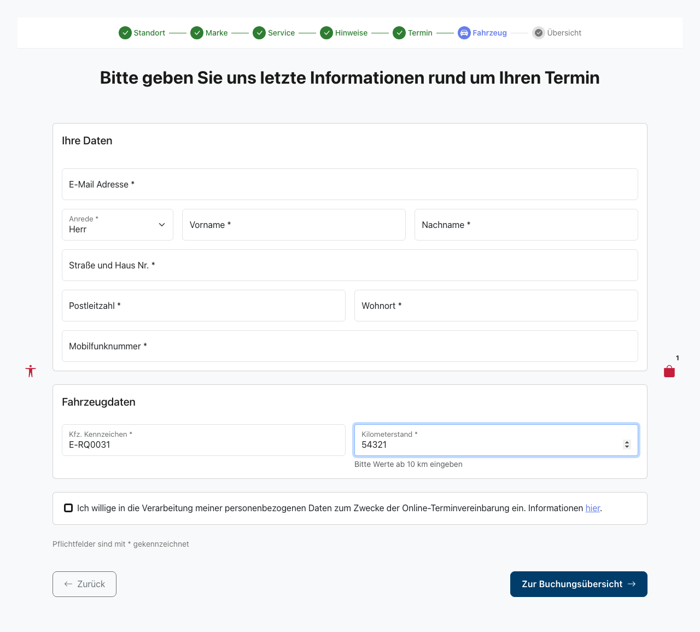
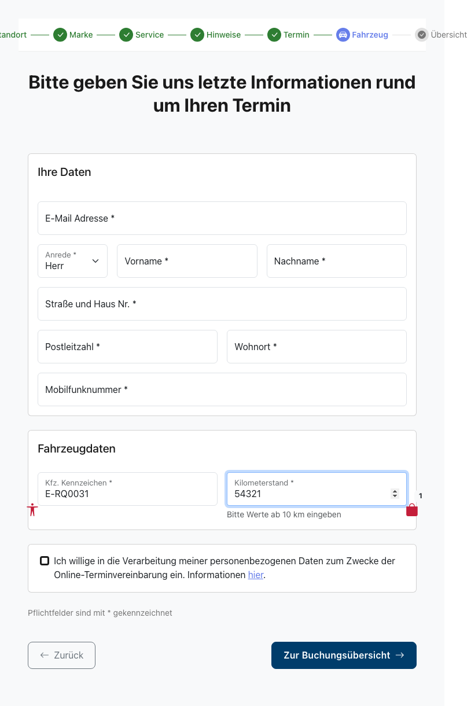
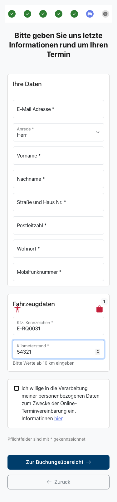

# Feature-Dokumentation: Booking-Bugfixes (Snap-Conflict-Redirect + Kilometerstand-Validierung)

**Erstellt:** 2026-07-16
**Requirement:** REQ-031-Booking-Bugfixes
**Sprache:** DE
**Status:** Implementiert

---

## Übersicht

REQ-031 behebt zwei in Produktion wiederholt aufgetretene Fehler im Buchungs-Flow des Terminbuchungs-Assistenten:

**Bugfix 1 — Snap-Conflict-Redirect (HTTP 410 Gone):**
Beim finalen Buchen kann der gewählte Zeitschlitz (Snap) zwischenzeitlich von einem anderen Kunden belegt worden sein. SoftNet antwortet in diesem Fall mit HTTP 410 Gone. Bisher ging diese Information verloren – das Backend mappte jeden SoftNet-4xx-Fehler auf HTTP 400 mit einer generischen Fehlermeldung, sodass der Benutzer nur blind erneut senden konnte. Neu reicht das Backend den Status 410 semantisch durch (`messageKey: "error.snapGone"`). Das Frontend erkennt den Status, setzt ausschließlich den belegten Zeitslot zurück, leitet den Benutzer automatisch zur Terminauswahl zurück, lädt frische Verfügbarkeiten und zeigt ein schließbares Warn-Banner (Auto-Dismiss nach 30 Sekunden). Alle übrigen Eingaben (Kunde, Fahrzeug, Services, Marke, Standort, Notizen, Einwilligung) bleiben erhalten.

**Bugfix 2 — Kilometerstand-Validierung (>= 10 km):**
Im Fahrzeugdaten-Formular waren bisher `0` und beliebig kleine Werte für den Kilometerstand gültig. SoftNet behandelt jedoch `currentMileage: 0` als „nicht gesetzt“ und lehnt die Buchung mit HTTP 400 ab. Neu erzwingen Frontend- und Backend-Validierung gemeinsam eine ganze Zahl >= 10, sodass ein ungültiger Request SoftNet gar nicht erst erreicht. Das Feld erhält einen dauerhaften Hinweistext sowie dedizierte Fehlermeldungen.

---

## Benutzerführung

### Ablauf A — Snap-Conflict-Redirect (Bugfix 1)

#### Schritt 1: Buchung absenden
**Beschreibung:** Der Benutzer hat den Assistenten bis zur Buchungsübersicht (`/home/booking-overview`) durchlaufen und klickt „Jetzt anfragen“. Der `BookingStore` sendet den Buchungs-Request (`POST /api/v1/appointments`) mit der `snapId` des gewählten Termins und setzt `bookingSubmitting: true`.

#### Schritt 2: Zeitschlitz zwischenzeitlich belegt
**Beschreibung:** SoftNet lehnt den Request mit HTTP 410 Gone ab, weil der Snap in der Zwischenzeit belegt wurde. Das Backend loggt den Fehler (REQ-029) und antwortet mit HTTP 410 und `messageKey: "error.snapGone"`. Es wird kein kritischer Fehler-Fallback-Screen ausgelöst.

#### Schritt 3: Frontend erkennt den Snap-Conflict
**Beschreibung:** Der `catchError` in `submitBooking()` erkennt den Status 410 und setzt im Store `snapConflict: true`, `selectedAppointment: null` und `bookingSubmitting: false`. `bookingError` bleibt `null`, sodass keine generische Inline-Fehlermeldung erscheint.

#### Schritt 4: Automatische Rück-Navigation zur Terminauswahl
**Beschreibung:** Ein `effect()` im `BookingOverviewContainerComponent` reagiert auf `snapConflict === true` und navigiert automatisch zu `/home/appointment`. Der `appointmentsResolver` lädt dabei frische Snaps direkt von SoftNet nach.

#### Schritt 5: Warn-Banner auf der Terminauswahl
**Beschreibung:** Die Terminauswahl rendert das `SnapConflictBannerComponent` (Warn-Stil, `role="alert"`) direkt unter der Seiten-Überschrift. Der Text lautet: „In der Zwischenzeit wurde Ihr Wunschtermin leider bereits belegt (hohe Nachfrage). Bitte wählen Sie einen neuen Termin aus. Ihre eingegebenen Daten bleiben erhalten.“ Ein 30-Sekunden-Timer startet automatisch; das Banner ist zusätzlich manuell über den X-Button schließbar. Alle bisherigen Eingaben bleiben erhalten.

#### Schritt 6: Neuen Termin wählen und Buchung abschließen
**Beschreibung:** Der Benutzer wählt einen neuen Zeitslot und klickt „Weiter“. Dabei wird `snapConflict` zurückgesetzt und der Termin gespeichert. Der Assistent führt zurück zur vorausgefüllten Fahrzeugdaten-Seite und anschließend zur Buchungsübersicht. Mit „Jetzt anfragen“ wird die Buchung erneut abgesendet und bei Erfolg die Buchungsbestätigung (REQ-028) angezeigt.

### Ablauf B — Kilometerstand-Validierung (Bugfix 2)

Der folgende Screenshot zeigt die Fahrzeugdaten-Seite (`/home/carinformation`) mit dem Kilometerstand-Feld und dem dauerhaften Hinweistext.

#### Schritt 1: Kilometerstand eingeben
**Beschreibung:** Der Benutzer gibt den Kilometerstand in das Feld „Kilometerstand“ ein. Unter dem Feld ist dauerhaft der Hinweis „Bitte Werte ab 10 km eingeben“ sichtbar; derselbe Text dient im leeren Feld als Platzhalter. Das Feld wird nach Verlassen (`on-touch`) validiert: Pflichtfeld, nur Ziffern (`^[0-9]+$`), Minimum 10.

#### Schritt 2: Ungültige Eingabe
**Beschreibung:** Bei ungültiger Eingabe erscheint eine passende Inline-Fehlermeldung (`role="alert"`). Es gibt drei unterscheidbare Meldungen:
- Leer: „Bitte geben Sie den Kilometerstand ein.“
- Unter Minimum (`0`–`9`): „Bitte geben Sie einen Kilometerstand von mindestens 10 km ein.“
- Keine gültige ganze Zahl (Dezimal-/Negativwerte): „Kilometerstand darf nur Zahlen enthalten.“

Der Button „Zur Buchungsübersicht“ ist bei ungültigem Feld blockiert (`markAllAsTouched`).

#### Schritt 3: Gültige Eingabe
**Beschreibung:** Bei einer ganzen Zahl >= 10 (z. B. `10` als Grenzwert oder `50000`) ist das Feld valide. Beim Weiter-Klick wird `vehicleInfo.mileage` im Store gespeichert. Das Backend akzeptiert den Request dank `@NotNull @Min(10)`, und das bisherige Prod-Fehlerbild („Mandatory field currentMileage not set“) tritt nicht mehr auf.

---

## Responsive Ansichten

Die folgenden Screenshots zeigen die Fahrzeugdaten-Seite (`/home/carinformation`) mit dem validierten Kilometerstand-Feld inklusive Hinweistext in drei Viewports.

### Desktop (1280x720)

### Tablet (768x1024)

### Mobile (375x667)

---

## Barrierefreiheit

- **Tastaturnavigation:** Der X-Button des Warn-Banners ist per Tab erreichbar und mit Enter/Space auslösbar. Das Kilometerstand-Feld und der „Zur Buchungsübersicht“-Button sind vollständig per Tastatur bedienbar.
- **Screen Reader:** Das Snap-Conflict-Banner besitzt `role="alert"` und wird beim Erscheinen sofort angesagt. Der X-Button trägt ein `aria-label` aus i18n („Hinweis schließen“). Der Kilometerstand-Hinweis ist über `aria-describedby="vehicle-mileage-hint vehicle-mileage-error"` mit dem Input verknüpft; Fehlermeldungen verwenden `role="alert"`.
- **Farbkontrast:** WCAG 2.1 AA konform (Kontrast >= 4.5:1); der Warn-Stil verwendet einen hellen Hintergrund (kein dunkles Overlay).
- **Focus-Styles:** Sichtbarer `:focus-visible`-Ring auf X-Button und Formularelementen; Touch-Targets >= 2.75 em.
- **Bewegung:** Bei `prefers-reduced-motion` entfällt jegliche Slide-/Fade-Animation des Banners.

---

## Technische Details

| Eigenschaft | Wert |
|-------------|------|
| Routen | `/#/home/booking-overview` (Submit-Quelle), `/#/home/appointment` (Redirect-Ziel + Banner), `/#/home/carinformation` (Kilometerstand-Feld) |
| Container Components | `BookingOverviewContainerComponent`, `AppointmentSelectionContainerComponent`, `CarinformationContainerComponent` |
| Presentational Component | `SnapConflictBannerComponent` (Warn-Banner, `output() closed`), `VehicleFormComponent` (Kilometerstand-Feld) |
| Store | `BookingStore` (erweitert um State `snapConflict`, Computed `hasSnapConflict`, Methode `clearSnapConflict()`, 410-Branch in `submitBooking()`) |
| API Service | `AppointmentApiService` (`createAppointment()`, `getAppointments()`) |
| Konstante | `SNAP_CONFLICT_BANNER_TIMEOUT_MS = 30_000` |

### Frontend-Umsetzung

- **BookingStore:** Neues State-Feld `snapConflict: boolean` (Initialwert `false`). Der `catchError` in `submitBooking()` prüft `err instanceof HttpErrorResponse && err.status === 410` und setzt in diesem Fall `snapConflict: true`, `selectedAppointment: null`, `bookingSubmitting: false` (kein `bookingError`). Die synchrone Methode `clearSnapConflict()` setzt `snapConflict: false` zurück.
- **Snap-Conflict-Banner:** `SnapConflictBannerComponent` ist ein reines Presentational-Component (kein Store-Zugriff) mit `output() closed`. Ein `timer(SNAP_CONFLICT_BANNER_TIMEOUT_MS)` mit `takeUntilDestroyed` sorgt im Container für den Auto-Dismiss nach 30 Sekunden. `clearSnapConflict()` wird bei Timer-Ablauf, X-Klick, „Weiter“-Klick und beim Zerstören des Containers aufgerufen, damit `snapConflict` nie „hängen bleibt“.
- **Kilometerstand-Validierung:** Reactive Forms mit `Validators.required`, `Validators.pattern(/^[0-9]+$/)` und `Validators.min(10)`. Die `mileageErrors`-Computed liefert die passenden Fehler-Keys (`required` → `pattern`/`digitsOnly` → `min`). Template mit `min="10"`, `inputmode="numeric"`, `form-text`-Hinweis und `aria-describedby`.

### Backend-Umsetzung

- **GlobalExceptionHandler:** `handleClientError()` erhält einen 410-Branch (vor dem generischen 4xx-Mapping), der HTTP 410 mit `messageKey: "error.snapGone"` liefert; zusätzlich ein `MESSAGE_KEY_MAP`-Eintrag `410 → error.snapGone`. Der `messageKey` `error.snapGone` ist stabiler API-Kontrakt.
- **Bean-Validation:** `CreateAppointmentRequest.VehicleDto.mileage` wurde von `@Min(0) int` auf `@NotNull @Min(10) Integer` geändert (Integer statt int, damit ein fehlender Wert nicht still zu `0` wird, sondern von `@NotNull` abgefangen wird). Zur Konsistenz wurde `CreateCarRequest.mileage` auf `@Min(10)` angepasst. Requests mit fehlendem Wert oder Wert < 10 werden mit HTTP 400 und `details[]`-Eintrag `field: "vehicle.mileage"` abgelehnt und erreichen SoftNet nicht.
- **Logging:** Das `SOFTNET_ERROR`-Logging (REQ-029: Trace-ID, Roh-Snap, Request-/Response-Body) bleibt für den 410-Fall vollständig erhalten.
