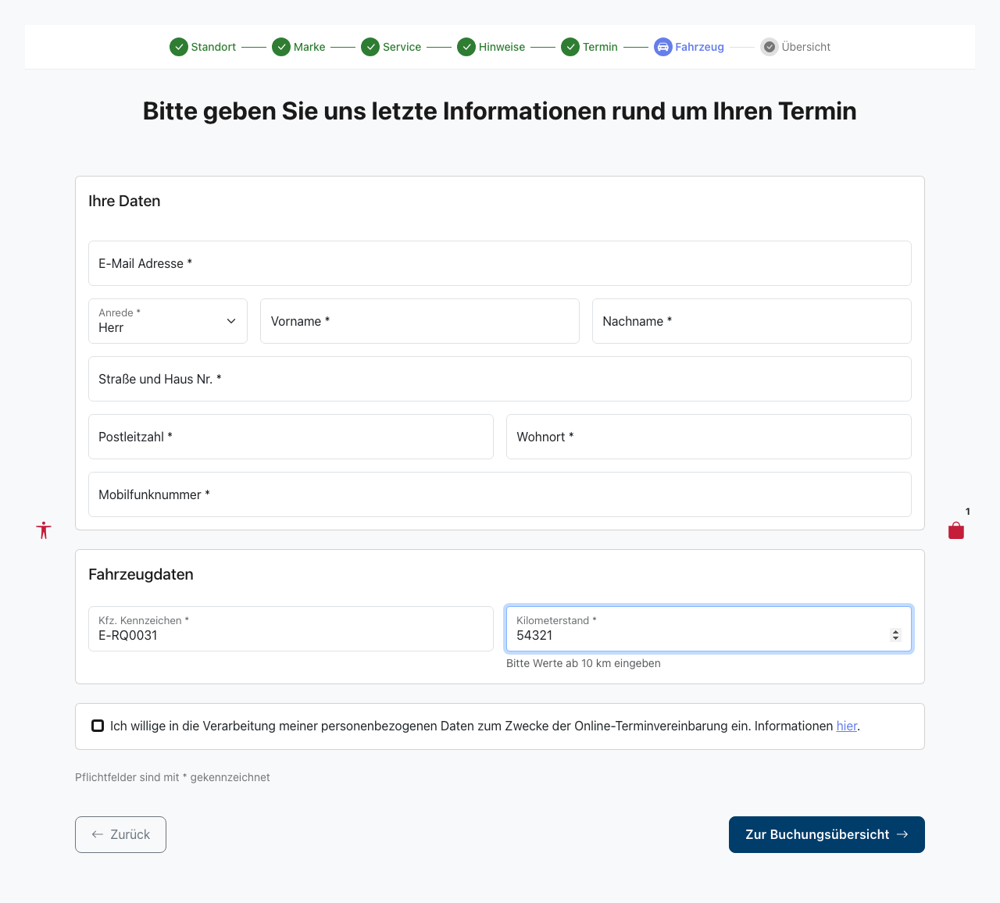
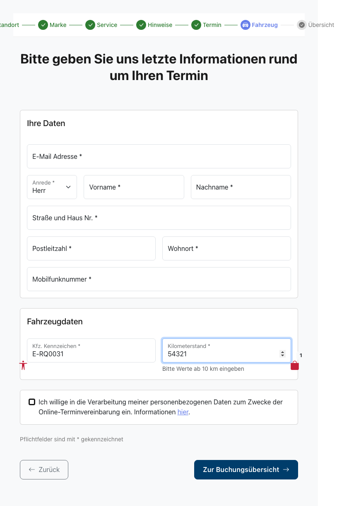
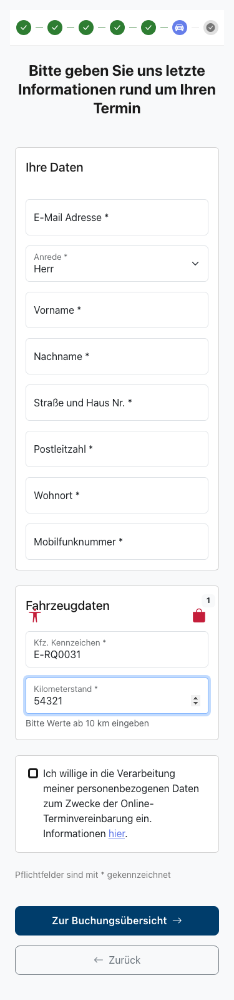

# Feature Documentation: Booking Bugfixes (Snap Conflict Redirect + Mileage Validation)

**Created:** 2026-07-16
**Requirement:** REQ-031-Booking-Bugfixes
**Language:** EN
**Status:** Implemented

---

## Overview

REQ-031 fixes two errors that repeatedly occurred in production within the booking flow of the appointment booking wizard:

**Bugfix 1 — Snap Conflict Redirect (HTTP 410 Gone):**
When finalizing a booking, the selected time slot (snap) may have been taken by another customer in the meantime. In that case SoftNet responds with HTTP 410 Gone. Previously this information was lost: the backend mapped every SoftNet 4xx error to HTTP 400 with a generic error message, so the user could only blindly resend the request. Now the backend passes the 410 status through semantically (`messageKey: "error.snapGone"`). The frontend detects the status, resets only the taken time slot, automatically redirects the user back to the appointment selection, loads fresh availabilities, and shows a dismissible warning banner (auto-dismiss after 30 seconds). All other input (customer, vehicle, services, brand, location, notes, consent) is preserved.

**Bugfix 2 — Mileage Validation (>= 10 km):**
In the vehicle data form, `0` and arbitrarily small mileage values used to be valid. However, SoftNet treats `currentMileage: 0` as "not set" and rejects the booking with HTTP 400. Now the frontend and backend validation together enforce an integer >= 10, so an invalid request never even reaches SoftNet. The field gains a persistent hint text as well as dedicated error messages.

---

## User Guidance

### Flow A — Snap Conflict Redirect (Bugfix 1)

#### Step 1: Submit the booking
**Description:** The user has completed the wizard up to the booking overview (`/home/booking-overview`) and clicks "Request now". The `BookingStore` sends the booking request (`POST /api/v1/appointments`) with the `snapId` of the selected slot and sets `bookingSubmitting: true`.

#### Step 2: Time slot taken in the meantime
**Description:** SoftNet rejects the request with HTTP 410 Gone because the snap was taken in the meantime. The backend logs the error (REQ-029) and responds with HTTP 410 and `messageKey: "error.snapGone"`. No critical error fallback screen is triggered.

#### Step 3: Frontend detects the snap conflict
**Description:** The `catchError` in `submitBooking()` detects the 410 status and sets `snapConflict: true`, `selectedAppointment: null` and `bookingSubmitting: false` in the store. `bookingError` remains `null`, so no generic inline error message is shown.

#### Step 4: Automatic navigation back to appointment selection
**Description:** An `effect()` in the `BookingOverviewContainerComponent` reacts to `snapConflict === true` and automatically navigates to `/home/appointment`. The `appointmentsResolver` reloads fresh snaps directly from SoftNet.

#### Step 5: Warning banner on the appointment selection
**Description:** The appointment selection renders the `SnapConflictBannerComponent` (warning style, `role="alert"`) directly below the page heading. The text reads: "Unfortunately, your preferred appointment has been taken in the meantime (high demand). Please select a new appointment. Your entered data has been preserved." A 30-second timer starts automatically; the banner can additionally be closed manually via the X button. All previously entered data is preserved.

#### Step 6: Select a new appointment and complete the booking
**Description:** The user selects a new time slot and clicks "Continue". This resets `snapConflict` and stores the appointment. The wizard returns to the pre-filled vehicle data page and then to the booking overview. With "Request now" the booking is submitted again and, on success, the booking confirmation (REQ-028) is shown.

### Flow B — Mileage Validation (Bugfix 2)

The following screenshot shows the vehicle data page (`/home/carinformation`) with the mileage field and its persistent hint text.

#### Step 1: Enter the mileage
**Description:** The user enters the mileage into the "Mileage" field. The hint "Please enter a value of at least 10 km" is permanently visible below the field; the same text serves as the placeholder in the empty field. The field is validated on blur (`on-touch`): required, digits only (`^[0-9]+$`), minimum 10.

#### Step 2: Invalid input
**Description:** On invalid input a matching inline error message (`role="alert"`) appears. There are three distinct messages:
- Empty: "Please enter the current mileage."
- Below minimum (`0`–`9`): "Please enter a mileage of at least 10 km."
- Not a valid integer (decimals/negative values): "Mileage may only contain digits."

The "To booking overview" button is blocked while the field is invalid (`markAllAsTouched`).

#### Step 3: Valid input
**Description:** For an integer >= 10 (e.g. `10` as the boundary value or `50000`) the field is valid. On the continue click `vehicleInfo.mileage` is stored. The backend accepts the request thanks to `@NotNull @Min(10)`, and the previous production error ("Mandatory field currentMileage not set") no longer occurs.

---

## Responsive Views

The following screenshots show the vehicle data page (`/home/carinformation`) with the validated mileage field including its hint text across three viewports.

### Desktop (1280x720)

### Tablet (768x1024)

### Mobile (375x667)

---

## Accessibility

- **Keyboard navigation:** The X button of the warning banner is reachable via Tab and can be activated with Enter/Space. The mileage field and the "To booking overview" button are fully keyboard operable.
- **Screen reader:** The snap conflict banner has `role="alert"` and is announced immediately when it appears. The X button carries an `aria-label` from i18n ("Dismiss notice"). The mileage hint is linked to the input via `aria-describedby="vehicle-mileage-hint vehicle-mileage-error"`; error messages use `role="alert"`.
- **Color contrast:** WCAG 2.1 AA compliant (contrast >= 4.5:1); the warning style uses a light background (no dark overlay).
- **Focus styles:** Visible `:focus-visible` ring on the X button and form elements; touch targets >= 2.75 em.
- **Motion:** With `prefers-reduced-motion` any slide/fade animation of the banner is omitted.

---

## Technical Details

| Property | Value |
|----------|-------|
| Routes | `/#/home/booking-overview` (submit source), `/#/home/appointment` (redirect target + banner), `/#/home/carinformation` (mileage field) |
| Container Components | `BookingOverviewContainerComponent`, `AppointmentSelectionContainerComponent`, `CarinformationContainerComponent` |
| Presentational Component | `SnapConflictBannerComponent` (warning banner, `output() closed`), `VehicleFormComponent` (mileage field) |
| Store | `BookingStore` (extended with state `snapConflict`, computed `hasSnapConflict`, method `clearSnapConflict()`, 410 branch in `submitBooking()`) |
| API Service | `AppointmentApiService` (`createAppointment()`, `getAppointments()`) |
| Constant | `SNAP_CONFLICT_BANNER_TIMEOUT_MS = 30_000` |

### Frontend Implementation

- **BookingStore:** New state field `snapConflict: boolean` (initial value `false`). The `catchError` in `submitBooking()` checks `err instanceof HttpErrorResponse && err.status === 410` and, in that case, sets `snapConflict: true`, `selectedAppointment: null`, `bookingSubmitting: false` (no `bookingError`). The synchronous method `clearSnapConflict()` resets `snapConflict: false`.
- **Snap conflict banner:** `SnapConflictBannerComponent` is a purely presentational component (no store access) with `output() closed`. A `timer(SNAP_CONFLICT_BANNER_TIMEOUT_MS)` with `takeUntilDestroyed` provides the auto-dismiss after 30 seconds in the container. `clearSnapConflict()` is called on timer expiry, X click, "Continue" click, and when the container is destroyed, so `snapConflict` never gets stuck.
- **Mileage validation:** Reactive Forms with `Validators.required`, `Validators.pattern(/^[0-9]+$/)` and `Validators.min(10)`. The `mileageErrors` computed returns the matching error keys (`required` → `pattern`/`digitsOnly` → `min`). Template with `min="10"`, `inputmode="numeric"`, a `form-text` hint and `aria-describedby`.

### Backend Implementation

- **GlobalExceptionHandler:** `handleClientError()` gains a 410 branch (before the generic 4xx mapping) that returns HTTP 410 with `messageKey: "error.snapGone"`; additionally a `MESSAGE_KEY_MAP` entry `410 → error.snapGone`. The `messageKey` `error.snapGone` is a stable API contract.
- **Bean validation:** `CreateAppointmentRequest.VehicleDto.mileage` was changed from `@Min(0) int` to `@NotNull @Min(10) Integer` (Integer instead of int, so a missing value is no longer silently coerced to `0` but caught by `@NotNull`). For consistency, `CreateCarRequest.mileage` was adjusted to `@Min(10)`. Requests with a missing value or a value < 10 are rejected with HTTP 400 and a `details[]` entry `field: "vehicle.mileage"` and do not reach SoftNet.
- **Logging:** The `SOFTNET_ERROR` logging (REQ-029: trace ID, raw snap, request/response body) is fully preserved for the 410 case.
