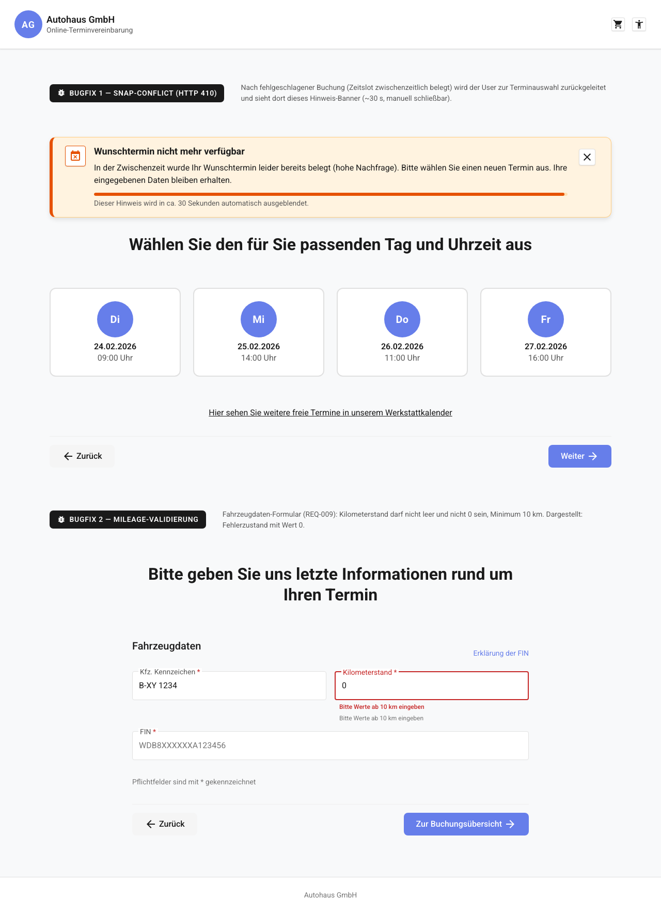

# REQ-031: Booking-Bugfixes (Snap-Conflict-Redirect + Mileage-Validierung + Werkstattkalender-Zeitzone + Kalender-Navigation)

**Status:** Draft
**Priority:** High
**Type:** Functional (Bugfix, Production)
**Created:** 2026-07-16
**Author:** Claude Code
**Betroffene Wizard-Schritte:** 5 (Terminauswahl / Werkstattkalender), 6 (carinformation), 7 (Buchungsübersicht)

---

## 1. Overview

### 1.1 Purpose

Zwei in Produktion wiederholt auftretende Fehler im Buchungs-Flow werden behoben:

**Bugfix 1 — Snap-Conflict-Redirect (HTTP 410 Gone):**
Beim finalen Buchen (`POST /api/v1/appointments` → SoftNet `POST /api/planning/appointments`, `SoftnetApiClient.java:112`) kommt es vor, dass der gewählte Zeitschlitz (Snap) zwischenzeitlich von einem anderen Kunden belegt wurde (wenige Snaps, hohe Nachfrage). SoftNet antwortet dann mit **HTTP 410 Gone** und Body `{"code":"GoneError","message":"Access to the target resource is no longer available "}` — in den Azure-Prod-Logs mehrfach verifiziert (Log Analytics, u. a. 2026-07-15 20:09 zweimal in Folge für denselben Snap; geloggt als `SOFTNET_ERROR appointment creation failed for snap <snapId>`, REQ-029). Heute verliert das Backend diese Information: `GlobalExceptionHandler.handleClientError()` mappt jeden SoftNet-4xx-Fehler (außer 401/403) auf **HTTP 400** mit `messageKey: "error.validationFailed"` (`GlobalExceptionHandler.java:66-86`). Das Frontend zeigt daraufhin die generische Fehlermeldung der Buchungsübersicht — der Benutzer weiß nicht, was passiert ist, und kann nur blind erneut senden (was erneut fehlschlägt).

Neu: Das Backend reicht den 410 semantisch durch (`messageKey: "error.snapGone"`). Das Frontend erkennt den Status 410, setzt NUR den belegten Zeitslot zurück, leitet den Benutzer automatisch zur Terminauswahl (REQ-006) zurück, lädt frische Snaps und zeigt dort ein schließbares Warn-Banner (Auto-Dismiss nach 30 Sekunden). Alle übrigen Eingaben (Kunde, Fahrzeug, Services, Marke, Standort, Notizen, Einwilligung) bleiben im `BookingStore` erhalten.

**Bugfix 2 — Mileage-Validierung (>= 10 km):**
Im Fahrzeugdaten-Formular (REQ-009) sind heute `0` und beliebig kleine Werte für den Kilometerstand gültig (`Validators.min(0)` in `carinformation-container.component.ts:51`, `@Min(0)` in `CreateAppointmentRequest.VehicleDto`, `CreateAppointmentRequest.java:33`). Das Backend mappt `vehicle.mileage` auf das SoftNet-Feld `currentMileage` (`AppointmentsService.java:115`). Geht `"currentMileage":0` an SoftNet, antwortet SoftNet mit **HTTP 400** `{"code":"ValidationError","message":"Save to database validation errors","original":{"errors":[{"message":"Mandatory field currentMileage not set","fieldname":"currentMileage"}]}}` — SoftNet behandelt `0` als „nicht gesetzt“ (Azure-Prod-Logs, verifiziert 2026-07-16). Neu: Frontend- UND Backend-Validierung erzwingen eine **ganze Zahl >= 10**, damit ein Request mit `0`/leer SoftNet gar nicht erst erreicht; das Feld erhält einen Hint sowie dedizierte Fehlermeldungen.

**Bugfix 4 — Werkstattkalender Datums-Navigation (Monate vorschalten):**
Der Datums-Picker der individuellen Terminauswahl (`workshop-calendar-date-picker.component`) nutzte einen ng-bootstrap-Popup-Datepicker (`<input ngbDatepicker>`), dessen Navigations-Header (Monatsname + Vor/Zurück-Pfeile + Monat/Jahr-Dropdowns) in diesem Projekt-Setup nicht gerendert wurde (`<div class="ngb-dp-header"></div>` blieb leer — verifiziert per DOM-Inspektion, unabhängig vom `navigation`-Input und ohne Konsolenfehler; auch die inline-Variante `<ngb-datepicker>` rendert hier gar nichts). Folge: Der Benutzer konnte nur Tage des aktuell angezeigten Monats sehen und **nicht zu anderen Monaten vorschalten**. Neu: Ersatz durch ein natives `<input type="date">` mit `min` (heute) und `max` (heute + 1 Jahr). Der native Browser-Datepicker bietet zuverlässige, schnelle Monats-/Jahr-Navigation auf allen Viewports (Desktop-Kalender-Popup, Mobile-Wheel-Picker) und fügt sich per `.form-control` ins Bootstrap-Styling ein. Der `dateSelected`-Output-Kontrakt zum Container bleibt unverändert (emittiert weiterhin ein natives `Date`).

**Bugfix 3 — Werkstattkalender-Zeitzone (UTC-Divergenz):**
SoftNet liefert Snap-Uhrzeiten in **UTC**. Die App zeigt sie überall optisch in Berliner Zeit (Europe/Berlin, DST-aware) über die `berlinTime`-Pipe (`convertToBerlinTime`, `berlin-time.pipe.ts`). In der **Schnellauswahl** (REQ-006, `appointment-card.component.html`) und in der **Buchungsübersicht** (REQ-010, `appointment-tile.component.html`) wird korrekt konvertiert. In der **individuellen Terminauswahl über den Werkstattkalender** (REQ-008, `workshop-calendar-day.component.html`) fehlte die Konvertierung: die Zeitslots wurden mit der rohen UTC-Zeit (`{{ slot.displayTime }}`) angezeigt. Folge: Der Benutzer wählt im Kalender z. B. „07:00 Uhr" (UTC), sieht in der Buchungsübersicht aber „09:00 Uhr" (Berlin, MESZ = UTC+2) — eine verwirrende Divergenz zwischen Auswahl und Zusammenfassung. Über die Schnellauswahl tritt der Fehler nicht auf (dort z. B. durchgängig „09:00 Uhr"). Neu: Der Werkstattkalender wendet dieselbe `berlinTime`-Pipe an (Anzeige **und** `aria-label`), sodass alle drei Stellen konsistent Berliner Zeit zeigen. Der gespeicherte Wert (`selectedAppointment.displayTime` = UTC) und der Buchungs-Request ans Backend bleiben unverändert — die Änderung ist rein optisch, wie in `convertToBerlinTime` dokumentiert.

### 1.2 Scope

**Included:**
- **Backend:** 410-Passthrough im `GlobalExceptionHandler` (neuer Branch in `handleClientError()`, neuer `MESSAGE_KEY_MAP`-Eintrag `410 → error.snapGone`)
- **Frontend:** 410-Erkennung in `BookingStore.submitBooking()` (rxMethod, `catchError`), neues State-Feld `snapConflict`, Reset NUR von `selectedAppointment`
- Automatische Rück-Navigation von `/home/booking-overview` zu `/home/appointment` (per `effect()` im `BookingOverviewContainerComponent`)
- Frisches Neuladen der Snaps über den bestehenden `appointmentsResolver` → `BookingStore.loadAppointments()` (POST `/api/v1/snaps` fragt SoftNet immer live ab — keine zusätzliche Cache-Invalidierung nötig, siehe BR-5)
- Neues Presentational-Component `SnapConflictBannerComponent` (Warn-Stil, `role="alert"`, X-Button, Auto-Dismiss nach 30 s)
- **Frontend Mileage:** Validators `required` + `pattern(^[0-9]+$)` + `min(10)`, Hint unter dem Feld, Fehlermeldungen für leer / unter Minimum / keine gültige Zahl
- **Backend Mileage:** `CreateAppointmentRequest.VehicleDto.mileage` von `@Min(0) int` auf `@NotNull @Min(10) Integer` (fehlender Wert wird damit explizit abgefangen statt still zu `0` zu werden); Konsistenz-Anpassung `CreateCarRequest.mileage` auf `@Min(10)`
- **Werkstattkalender-Zeitzone:** `berlinTime`-Pipe in `WorkshopCalendarDayComponent` (`imports` + Template: Slot-Anzeige und `aria-label` via `slot.displayTime | berlinTime: day().date`) — konsistent zu Schnellauswahl und Buchungsübersicht
- Neue i18n-Keys unter `booking.appointment.snapConflict.*` und `booking.carinformation.form.mileage.*` (alle Sprachen der `translations.ts`)
- Unit-Tests (Jest + JUnit) für alle neuen Pfade + E2E-Test für die Zeitzonen-Konsistenz (Kalender-Anzeige == Buchungsübersicht)

**Excluded:**
- Änderungen am Error-Fallback-Screen selbst (REQ-024) — 410 ist KEIN kritischer Fehler und wird vom `errorFallbackInterceptor` weiterhin nicht promoted (der klassifiziert nur `status === 0`, 401-Loop und 5xx)
- Änderungen am `SOFTNET_ERROR`-Logging (REQ-029) — bleibt unverändert bestehen, auch für 410
- Snap-Conflict-Banner auf der Werkstattkalender-Seite (REQ-008) — Redirect-Ziel ist ausschließlich die Terminauswahl `/home/appointment`
- Automatisches Re-Booking / automatische Neuauswahl eines Ersatz-Termins — der Benutzer wählt aktiv neu
- Retry-Mechanik der Buchungsübersicht für andere Fehler (400/5xx/Netzwerk) — bestehendes Verhalten bleibt
- Änderungen an SoftNet-Request-Aufbau, Snap-Verteilung oder `SnapPatcher`
- Neuer Store — der bestehende `BookingStore` wird erweitert

### 1.3 Related Requirements
- REQ-006: Terminauswahl (Redirect-Ziel, Banner-Anzeige, Snap-Reload)
- REQ-008: Werkstattkalender (alternativer Zeitslot-Schritt — nicht Redirect-Ziel, siehe Excluded)
- REQ-009: carinformation (Mileage-Feld im Fahrzeugdaten-Formular)
- REQ-010: Buchungsübersicht (Submit-Quelle, von der aus zurückgeleitet wird)
- REQ-015/REQ-018: API-Data-Integration + Spring-Boot-Backend (Endpunkte `/api/v1/appointments`, `/api/v1/snaps`)
- REQ-024: Error-Fallback-Screen (Abgrenzung: 410 eskaliert NICHT zum Fullscreen-Fallback)
- REQ-028: Buchungsbestätigung (Flow nach erfolgreicher Neu-Buchung unverändert)
- REQ-029: Backend-Error-Logging (`SOFTNET_ERROR`-Payload-Dump bleibt für 410 erhalten)

---

## 2. User Story

### Bugfix 1 — Snap-Conflict

**Als** Kunde, dessen Wunschtermin während der Dateneingabe von jemand anderem gebucht wurde
**möchte ich** automatisch zur Terminauswahl mit frischen Verfügbarkeiten zurückgeleitet werden und einen klaren Hinweis sehen
**damit** ich ohne erneute Dateneingabe sofort einen neuen Termin wählen und die Buchung abschließen kann.

### Bugfix 2 — Mileage

**Als** Kunde
**möchte ich** beim Kilometerstand direkt auf ungültige Eingaben (leer, 0–9, keine ganze Zahl) hingewiesen werden
**damit** meine Buchung nicht erst beim Absenden am Server scheitert.

**Acceptance Criteria:**
- [ ] AC-1: Antwortet SoftNet auf den Buchungs-POST mit 410, liefert das Backend HTTP **410** mit `messageKey: "error.snapGone"` an das Frontend (statt bisher 400/`error.validationFailed`)
- [ ] AC-2: `BookingStore.submitBooking()` erkennt HTTP 410 (`HttpErrorResponse.status === 410`) und setzt `snapConflict: true`, `selectedAppointment: null`, `bookingSubmitting: false`; `bookingError` bleibt `null` (keine generische Inline-Fehlermeldung)
- [ ] AC-3: Bei `snapConflict === true` navigiert die App automatisch von `/home/booking-overview` zu `/home/appointment` (per `effect()` im Container); der Error-Fallback-Screen `/app-error` (REQ-024) wird NICHT ausgelöst
- [ ] AC-4: Beim Laden von `/home/appointment` lädt der bestehende `appointmentsResolver` die Snap-Liste neu — frische Verfügbarkeiten via `POST /api/v1/snaps` (SoftNet-Live-Abfrage)
- [ ] AC-5: Auf der Terminauswahl-Seite erscheint ein Warn-Banner (`role="alert"`) mit dem Text DE: „In der Zwischenzeit wurde Ihr Wunschtermin leider bereits belegt (hohe Nachfrage). Bitte wählen Sie einen neuen Termin aus. Ihre eingegebenen Daten bleiben erhalten.“ / EN sinngemäß
- [ ] AC-6: Das Banner verschwindet automatisch nach 30 Sekunden (`SNAP_CONFLICT_BANNER_TIMEOUT_MS = 30_000`)
- [ ] AC-7: Das Banner ist manuell schließbar (X-Button mit `aria-label`)
- [ ] AC-8: ALLE übrigen Store-Felder bleiben erhalten: `selectedBranch`, `selectedBrand`, `selectedLocation`, `selectedServices`, `bookingNote`, `notesExtras`, `customerInfo`, `vehicleInfo`, `privacyConsent`, `selectedRentCategoryId` — nur `selectedAppointment` wird zurückgesetzt
- [ ] AC-9: Nach neuer Zeitslot-Wahl läuft der Flow normal weiter: „Weiter“ → `/home/carinformation` (vorbefüllt) → `/home/booking-overview` → „Jetzt anfragen“ → Buchungsbestätigung (REQ-028)
- [ ] AC-10: Andere Buchungsfehler (400, 5xx, Timeout, Netzwerk) verhalten sich unverändert (Inline-Error auf der Buchungsübersicht bzw. Eskalation gemäß REQ-024)
- [ ] AC-11: Das `SOFTNET_ERROR`-Logging (REQ-029: Roh-Snap, Request-Body, Response-Body, Trace-ID) bleibt für den 410-Fall vollständig erhalten
- [ ] AC-12: Kilometerstand ist Pflichtfeld und akzeptiert nur ganze Zahlen >= 10 — leer, `0`–`9`, negative Werte, Dezimalzahlen und Nicht-Zahlen sind ungültig
- [ ] AC-13: Unter dem Kilometerstand-Feld steht dauerhaft der Hint DE: „Bitte Werte ab 10 km eingeben“ / EN sinngemäß; derselbe Text wird im leeren Feld als Placeholder angezeigt (ersetzt den bisherigen Placeholder `5000`)
- [ ] AC-14: Es existieren drei unterscheidbare Inline-Fehlermeldungen: leer (`required`), unter Minimum (`min`), keine gültige ganze Zahl (`digitsOnly`)
- [ ] AC-15: Backend-Bean-Validation: `VehicleDto.mileage` ist `@NotNull @Min(10) Integer` — Requests mit fehlendem Wert oder Wert < 10 werden mit HTTP 400 und `details[]`-Eintrag `field: "vehicle.mileage"` abgelehnt
- [ ] AC-16: „Zur Buchungsübersicht“ ist bei ungültigem Kilometerstand blockiert (Formular-Validierung, `markAllAsTouched`, Inline-Fehler sichtbar)
- [ ] AC-17: Die Zeitslots im Werkstattkalender (`WorkshopCalendarDayComponent`) werden in Berliner Zeit (Europe/Berlin, DST-aware) angezeigt — identisch zur Schnellauswahl und Buchungsübersicht; die rohe UTC-Zeit erscheint NICHT mehr im UI (Anzeige + `aria-label`)
- [ ] AC-18: Wird ein Termin über den Werkstattkalender gewählt, stimmt die in der Buchungsübersicht angezeigte Uhrzeit exakt mit der im Kalender ausgewählten überein (keine UTC-/Berlin-Divergenz); der ans Backend gesendete Wert bleibt UTC (rein optische Konvertierung)
- [ ] AC-19: Der Datums-Picker der individuellen Terminauswahl erlaubt schnelles Vorschalten über Monate/Jahre (natives `<input type="date">` mit `min`=heute, `max`=heute+1 Jahr); nach Datumsauswahl werden die verfügbaren Tage/Slots ab dem gewählten Datum geladen

---

## 3. Preconditions

### 3.1 System
- Spring-Boot-Backend läuft (`:3000`, `/api/v1/*`), SoftNet-Zugangsdaten konfiguriert
- `BookingStore` (`src/app/features/booking/stores/booking.store.ts`) verfügbar
- Bestehende Guards aktiv: `servicesSelectedGuard` (Terminauswahl), `carInformationGuard`, `bookingOverviewGuard`
- `errorFallbackInterceptor` (REQ-024) registriert — klassifiziert weiterhin nur `status 0`, 401-Loop und 5xx

### 3.2 User
- **Bugfix 1:** Benutzer hat den Wizard bis `/home/booking-overview` durchlaufen und klickt „Jetzt anfragen“
- **Bugfix 2:** Benutzer befindet sich auf `/home/carinformation` im Fahrzeugdaten-Formular

### 3.3 Data — Store-Zustand vor „Jetzt anfragen“ (Bugfix 1)

| Feld | Typ | Quelle | Pflicht |
|------|-----|--------|---------|
| `BookingStore.selectedBranch` | `BranchConfig` | REQ-021 | Ja |
| `BookingStore.selectedBrand` | `Brand` | REQ-002 | Ja |
| `BookingStore.selectedLocation` | `LocationDisplay` | REQ-003 | Ja |
| `BookingStore.selectedServices` | `SelectedService[]` | REQ-004 | Ja |
| `BookingStore.bookingNote` | `string \| null` | REQ-005 | Nein |
| `BookingStore.notesExtras` | `NotesExtras \| null` | REQ-012/027 | Nein |
| `BookingStore.selectedAppointment` | `AppointmentSlot` | REQ-006/008 | Ja — enthält die `snapId` |
| `BookingStore.customerInfo` | `CustomerInfo` | REQ-009 | Ja |
| `BookingStore.vehicleInfo` | `VehicleInfo` | REQ-009 | Ja |
| `BookingStore.privacyConsent` | `boolean` | REQ-009 | Ja (`true`) |
| `BookingStore.selectedRentCategoryId` | `string \| null` | REQ-012 | Nein |

---

## 4. Main Flow



### Flow A — Snap-Conflict-Redirect (Bugfix 1)

**Step 1:** Benutzer klickt „Jetzt anfragen“ auf `/home/booking-overview`
- **User:** Klickt Submit-Button
- **System:** `BookingStore.submitBooking()` setzt `bookingSubmitting: true` und sendet `POST /api/v1/appointments` mit `snapId` des gewählten Termins

**Step 2:** SoftNet lehnt ab — Snap zwischenzeitlich belegt
- **System (Backend):** SoftNet antwortet 410 Gone; `SoftnetApiClient` loggt `SOFTNET_ERROR` mit Request-/Response-Body, `AppointmentsService` loggt zusätzlich den Roh-Snap (REQ-029)
- **System (Backend):** `GlobalExceptionHandler.handleClientError()` liefert **HTTP 410** mit `messageKey: "error.snapGone"` (NEU)

**Step 3:** Frontend erkennt Snap-Conflict
- **System:** `submitBooking()`-`catchError` prüft `err instanceof HttpErrorResponse && err.status === 410`
- **System:** `patchState`: `snapConflict: true`, `selectedAppointment: null`, `bookingSubmitting: false` — `bookingError` bleibt `null`
- **Expected:** Kein Inline-Error auf der Buchungsübersicht, kein `/app-error`

**Step 4:** Automatische Rück-Navigation
- **System:** `effect()` im `BookingOverviewContainerComponent` reagiert auf `snapConflict === true` und navigiert zu `/home/appointment`
- **System:** `servicesSelectedGuard` passiert (Services unverändert im Store), `appointmentsResolver` triggert `loadAppointments()` → frische Snaps von SoftNet

**Step 5:** Hinweis-Banner auf der Terminauswahl
- **System:** `AppointmentSelectionContainerComponent` rendert `SnapConflictBannerComponent` (Warn-Stil, `role="alert"`), startet 30-Sekunden-Timer
- **Expected:** Benutzer versteht sofort, warum er zurückgeleitet wurde; alle bisherigen Eingaben sind erhalten

**Step 6:** Benutzer wählt neuen Termin und schließt die Buchung ab
- **User:** Wählt neuen Zeitslot, klickt „Weiter“
- **System:** `clearSnapConflict()` + `selectAppointment()`; Navigation zu `/home/carinformation` — Formulare sind aus `customerInfo`/`vehicleInfo` vorbefüllt
- **User:** Klickt „Zur Buchungsübersicht“ → „Jetzt anfragen“
- **Expected:** Buchung erfolgreich (`bookingSubmitted: true`, `appointmentId` gesetzt), Bestätigung gemäß REQ-028

### Flow B — Mileage-Validierung (Bugfix 2)

**Step 1:** Benutzer gibt Kilometerstand ein
- **User:** Tippt Wert in das Feld „Kilometerstand“ (Hint „Bitte Werte ab 10 km eingeben“ dauerhaft sichtbar)
- **System:** Validiert on-touch: `required` + `pattern(^[0-9]+$)` + `min(10)`

**Step 2:** Ungültige Eingabe (leer, `0`–`9`, keine ganze Zahl)
- **System:** Zeigt passende Inline-Fehlermeldung (`invalid-feedback`, `role="alert"`); „Zur Buchungsübersicht“ blockiert bei Submit-Versuch (`markAllAsTouched`)

**Step 3:** Gültige Eingabe (ganze Zahl >= 10)
- **System:** Feld valide, `vehicleInfo.mileage` wird beim Weiter-Klick im Store gespeichert
- **Expected:** Backend akzeptiert den Request (`@NotNull @Min(10)` erfüllt); keine „mileage nicht gesetzt“-Fehler mehr in den Prod-Logs

---

## 5. Alternative Flows

### 5.1 Alt Flow A: Banner manuell schließen

**Trigger:** Benutzer klickt den X-Button des Snap-Conflict-Banners vor Ablauf der 30 Sekunden

**Flow:**
1. `SnapConflictBannerComponent` emittiert `closed`
2. Container ruft `BookingStore.clearSnapConflict()` auf, Timer wird verworfen
3. Banner verschwindet; Terminauswahl bleibt uneingeschränkt bedienbar

### 5.2 Alt Flow B: Erneuter Snap-Conflict

**Trigger:** Der neu gewählte Termin wird ebenfalls zwischenzeitlich belegt (410 beim erneuten „Jetzt anfragen“)

**Flow:**
1. Flow A wiederholt sich vollständig (Redirect, frischer Snap-Reload, Banner erneut sichtbar, Timer neu gestartet)
2. Es gibt kein Retry-Limit — jeder 410 führt erneut zur Terminauswahl (kein Endlos-Loop-Risiko, da jede Runde eine aktive Benutzer-Neuauswahl erfordert, BR-4)

### 5.3 Alt Flow C: Benutzer navigiert vom Banner weg zurück

**Trigger:** Benutzer klickt auf der Terminauswahl „Zurück“ (→ `/home/notes`), während das Banner sichtbar ist

**Flow:**
1. Standard-Zurück-Navigation gemäß REQ-006/REQ-007
2. Der Banner-Timer wird mit dem Container zerstört (`takeUntilDestroyed`); `snapConflict` wird beim Verlassen per `clearSnapConflict()` zurückgesetzt
3. Kundendaten/Fahrzeugdaten bleiben unverändert im Store

### 5.4 Alt Flow D: Mileage-Korrektur

**Trigger:** Benutzer sieht Fehlermeldung „unter Minimum“ und korrigiert den Wert

**Flow:**
1. Benutzer ändert `5` → `50000`
2. Fehlermeldung verschwindet, Feld wird valide
3. Weiter mit Flow B Step 3

---

## 6. Exception Flows

### 6.1 Exception E1: Anderer Buchungsfehler (kein 410)

**Trigger:** `POST /api/v1/appointments` schlägt mit 400/5xx/Timeout/Netzwerkfehler fehl

**Flow:**
1. `submitBooking()`-`catchError` erkennt KEINEN 410 → bestehendes Verhalten: `bookingError` wird gesetzt, `bookingSubmitting: false`
2. Buchungsübersicht zeigt den bestehenden Inline-Error (`role="alert"`) mit Retry-Button (REQ-010)
3. Kritische Fehler (5xx nach Circuit-Breaker, Netzwerk, Auth-Loop) eskalieren unverändert gemäß REQ-024 zu `/app-error`
4. `selectedAppointment` bleibt in diesem Fall gesetzt (kein Snap-Conflict)

### 6.2 Exception E2: Snap-Reload nach Redirect schlägt fehl

**Trigger:** `loadAppointments()` nach dem Redirect scheitert (SoftNet down)

**Flow:**
1. Bestehender Inline-Error-State der Terminauswahl greift (`error`-Signal, Retry-Button — REQ-017-Pattern)
2. Das Snap-Conflict-Banner bleibt zusätzlich sichtbar (unabhängige States)
3. Benutzer kann Retry klicken oder gemäß REQ-024 eskaliert die App bei kritischem Fehler

### 6.3 Exception E3: Mileage-Validierung umgangen (direkter API-Call / veralteter Client)

**Trigger:** `POST /api/v1/appointments` mit `vehicle.mileage < 10` oder fehlendem Wert

**Flow:**
1. Bean-Validation lehnt ab: `MethodArgumentNotValidException` → HTTP 400 mit `details[]`-Eintrag `{ "field": "vehicle.mileage", ... }` (bestehender Handler `GlobalExceptionHandler.handleValidation()`)
2. Der Request erreicht SoftNet NICHT — das heutige Prod-Fehlerbild (SoftNet 400 `ValidationError` / „Mandatory field currentMileage not set“, siehe 12.4) kann nicht mehr auftreten
3. Frontend zeigt den bestehenden Inline-Error der Buchungsübersicht (Exception E1)
4. Kein Datenverlust — Store unverändert

### 6.4 Exception E4: Heutiges Prod-Fehlerbild (Ist-Zustand, wird durch REQ-031 eliminiert)

**Trigger (vor dem Fix):** Buchung mit `"currentMileage":0` im SoftNet-Payload bzw. belegtem Snap

**Ist-Flow (aus den Azure-Prod-Logs, verifiziert 2026-07-16):**
1. Mileage-Fall: SoftNet antwortet 400 `{"code":"ValidationError","message":"Save to database validation errors","original":{"errors":[{"message":"Mandatory field currentMileage not set","fieldname":"currentMileage"}]}}`
2. Snap-Fall: SoftNet antwortet 410 `{"code":"GoneError","message":"Access to the target resource is no longer available "}` (u. a. 2026-07-15 20:09, zweimal in Folge für denselben Snap `e1aa4ae9-…`)
3. Backend loggt `SOFTNET_ERROR appointment creation failed for snap <snapId>` + `SOFTNET_ERROR POST /api/planning/appointments failed …` (REQ-029) und mappt BEIDE Fälle auf HTTP 400/`error.validationFailed` — der Benutzer sieht nur die generische Fehlermeldung
4. **Soll nach REQ-031:** Fall 1 tritt nicht mehr auf (Validierung, E3); Fall 2 wird als 410/`error.snapGone` durchgereicht und löst den Redirect-Flow aus (Flow A)

---

## 7. Postconditions

### 7.1 Zwischenzustand nach Snap-Conflict-Redirect (Bugfix 1)

| Store-Feld | Wert | Beschreibung |
|------------|------|--------------|
| `BookingStore.snapConflict` | `true` | **NEU** — steuert Banner + Redirect |
| `BookingStore.selectedAppointment` | `null` | Belegter Slot zurückgesetzt |
| `BookingStore.bookingSubmitting` | `false` | Submit beendet |
| `BookingStore.bookingError` | `null` | KEIN generischer Fehler |
| `BookingStore.bookingSubmitted` | `false` | Unverändert |
| `BookingStore.appointments` | `AppointmentSlot[]` | Frisch geladen (Resolver) |
| `BookingStore.selectedBranch/-Brand/-Location` | unverändert | Erhalten |
| `BookingStore.selectedServices`, `bookingNote`, `notesExtras` | unverändert | Erhalten |
| `BookingStore.customerInfo`, `vehicleInfo`, `privacyConsent` | unverändert | Erhalten |
| `BookingStore.selectedRentCategoryId` | unverändert | Erhalten |

### 7.2 Success (Neuauswahl + erfolgreiche Buchung)

- `BookingStore.snapConflict === false` (durch Timer, X oder `onContinue()`)
- `BookingStore.selectedAppointment` = neuer `AppointmentSlot`
- `BookingStore.bookingSubmitted === true`, `appointmentId` gesetzt
- Buchungsbestätigung (REQ-028) wird angezeigt

### 7.3 Success (Bugfix 2)

- `BookingStore.vehicleInfo.mileage` ist eine ganze Zahl >= 10
- Backend akzeptiert den Request; keine `mileage`-Fehler in den Prod-Logs

### 7.4 Failure

- Bei Nicht-410-Fehlern: `bookingError` gesetzt, Inline-Error auf Buchungsübersicht, Store-Daten unverändert (bestehendes Verhalten)
- Bei ungültigem Kilometerstand: keine Store-Änderung, Inline-Fehler sichtbar, Navigation blockiert

---

## 8. Business Rules

- **BR-1:** Einziger Trigger für den Snap-Conflict-Redirect ist die Backend-Antwort **HTTP 410** mit `messageKey: "error.snapGone"` (entspricht upstream dem SoftNet-`GoneError`, siehe 12.4). Die Frontend-Erkennung erfolgt über den HTTP-Status (`HttpErrorResponse.status === 410`), nicht über String-Vergleich der Message oder des SoftNet-`code`-Felds.
- **BR-2:** Beim Snap-Conflict wird AUSSCHLIESSLICH `selectedAppointment` zurückgesetzt — alle anderen Wizard-Daten bleiben erhalten (AC-8).
- **BR-3:** Banner-Verhalten: Auto-Dismiss nach exakt `SNAP_CONFLICT_BANNER_TIMEOUT_MS = 30_000` ms; zusätzlich manuell schließbar (X). `clearSnapConflict()` wird bei Timer-Ablauf, X-Klick, „Weiter“-Klick (`onContinue()`) und beim Zerstören des Containers aufgerufen — `snapConflict` darf nie „hängen bleiben“ (sonst würde der `effect()` der Buchungsübersicht beim nächsten Besuch sofort erneut redirecten).
- **BR-4:** Kein automatisches Re-Booking — der Benutzer wählt aktiv einen neuen Termin. Kein Retry-Limit für Snap-Conflicts (jede Runde erfordert Benutzer-Interaktion).
- **BR-5:** Snap-Verfügbarkeiten werden bei jedem Aufruf frisch von SoftNet geladen: `SnapsService.getSnaps()` cached die Liste NICHT (`SnapsService.java:38 ff.`); der `SnapCache` (TTL 30 min) hält nur `snapId → Roh-Snap` für die spätere Reservierung und wird beim Neuladen mit den frischen Snaps befüllt. Frontend-seitig existiert kein Snap-Cache — der `appointmentsResolver` löst bei jeder Navigation `loadAppointments()` aus. Es ist KEINE zusätzliche Invalidierung nötig.
- **BR-6:** Mileage-Gültigkeitsregel (exakt): gültig ⇔ ganze Zahl >= 10 (`^[0-9]+$` UND Wert >= 10). Ungültig: leer, `0`–`9`, negative Werte, Dezimalzahlen, Nicht-Zahlen. Hintergrund: SoftNet behandelt den gemappten Payload-Wert `"currentMileage":0` als „Mandatory field currentMileage not set“ (Prod-Logs, 12.4).
- **BR-7:** Defense in Depth: Mileage wird sowohl im Frontend (Reactive Forms) als auch im Backend (Bean Validation) geprüft. Die Backend-Validierung ist die verbindliche letzte Instanz — ein Request mit `0`/leer darf SoftNet unter keinen Umständen erreichen.
- **BR-8:** Der `messageKey` `error.snapGone` ist stabil und darf nicht umbenannt werden (API-Kontrakt Frontend ↔ Backend).
- **BR-9:** HTTP 410 ist KEIN kritischer Fehler im Sinne von REQ-024 — der `errorFallbackInterceptor` promoted ihn nicht (`classify()` prüft nur `0`, `401`-Loop, `5xx`), es erfolgt keine Navigation zu `/app-error`.
- **BR-10:** Das `SOFTNET_ERROR`-Logging (REQ-029: Trace-ID, Roh-Snap, Request-/Response-Body, max. 8 000 Zeichen) bleibt für 410 unverändert erhalten — der Azure-Alert `alert-softnet-error-logs` feuert weiterhin.
- **BR-11:** Code-Sprache für alle Identifier (Klassen, Methoden, Felder, CSS-Klassen, i18n-Key-Pfade) ist Englisch. UI-Texte werden in allen Sprachen der `translations.ts` lokalisiert.

---

## 9. Non-Functional Requirements

### Performance
- Redirect zur Terminauswahl < 500 ms nach Eintreffen der 410-Antwort (nur `patchState` + Router-Navigation)
- Snap-Reload zeigt den bestehenden Loading-Spinner (REQ-017) — kein weißer Bildschirm
- Banner-Timer erzeugt keine Change-Detection-Last (einzelner `timer(30_000)` mit `takeUntilDestroyed`)
- Mileage-Validierung synchron, kein API-Call

### Security
- Keine SoftNet-Fehlerdetails (Response-Bodies, Stack-Traces) im UI — das Banner zeigt ausschließlich den i18n-Text
- Mileage-Validierung server-seitig verbindlich (Bean Validation) — Client-Validierung ist nur UX
- Keine Benutzerdaten in URL-Parametern beim Redirect
- Kein `[innerHTML]` — Banner-Text via Angular Template Escaping

### Usability
- WCAG 2.1 AA: Banner mit `role="alert"` (wird von Screen-Readern sofort angesagt), X-Button mit `aria-label`, Touch-Target >= 2.75 em, Kontrast >= 4.5:1
- Hint am Mileage-Feld via `aria-describedby` mit dem Input verknüpft; Fehlermeldungen ebenfalls (`invalid-feedback` mit `role="alert"`)
- Mobile-First: Banner volle Breite über der Termin-Liste, umbruchfähiger Text
- `prefers-reduced-motion`: keine Slide-/Fade-Animation des Banners bei reduzierter Bewegung
- Browser-Support: aktuelle 2 Versionen Chrome, Firefox, Safari, Edge

---

## 10. Data Model

**Bestehende Interfaces werden erweitert bzw. unverändert importiert — KEIN neuer Store, KEINE neuen Feature-Models.**

```typescript
// src/app/features/booking/stores/booking.store.ts — BookingState ERWEITERN:

interface BookingState {
  // ...bestehende Felder (branches, selectedBranch, brands, selectedBrand,
  //    locations, selectedLocation, services, selectedServices, bookingNote,
  //    appointments, selectedAppointment, workshopCalendarDate, workshopCalendarDays,
  //    customerInfo, vehicleInfo, privacyConsent, notesExtras,
  //    bookingSubmitted, bookingSubmitting, bookingError, appointmentId,
  //    rentCategories, selectedRentCategoryId, jobTypes, categories, operations,
  //    isLoading, error, isDeepLinked, deepLinkGroupId)...

  /** NEU (Bugfix 1): true, wenn die Buchung mit HTTP 410 (Snap belegt) fehlschlug. */
  snapConflict: boolean;
}

const INITIAL_STATE: BookingState = {
  // ...bestehende Initialwerte...
  snapConflict: false,
};
```

```typescript
// src/app/features/booking/models/customer.model.ts — UNVERÄNDERT (nur Semantik verschärft):

export interface VehicleInfo {
  licensePlate: string;
  mileage: number;   // Ganze Zahl >= 10 (BR-6) — durch Form- und Backend-Validierung erzwungen
  vin?: string;
  model?: string;
  firstRegMonth?: string;
  firstRegYear?: string;
}
```

```typescript
// Konstante für das Banner-Timeout (Bugfix 1):
// src/app/features/booking/components/appointment-selection/snap-conflict-banner/snap-conflict-banner.component.ts
export const SNAP_CONFLICT_BANNER_TIMEOUT_MS = 30_000;
```

```java
// server/src/main/java/com/autohaus/backend/appointments/dto/CreateAppointmentRequest.java
// VehicleDto ÄNDERN — mileage: @Min(0) int  →  @NotNull @Min(10) Integer
// (Integer statt int: fehlender JSON-Wert wird nicht mehr still zu 0, sondern von @NotNull abgefangen)

public record VehicleDto(
    @NotBlank String licensePlate,
    @NotNull @Min(10) Integer mileage,
    String vin,
    String model,
    String firstRegMonth,
    String firstRegYear
) {}
```

```java
// server/src/main/java/com/autohaus/backend/cars/dto/CreateCarRequest.java
// Konsistenz: @Min(0) @Max(999999) int mileage  →  @Min(10) @Max(999999) int mileage
```

---

## 11. UI/UX

### Mockup


### UI-Elemente

| Element | Typ | CSS-Klasse / Komponente | ARIA |
|---------|-----|-------------------------|------|
| Snap-Conflict-Banner | Warn-Banner (Bootstrap 5, REQ-026) | `.snap-conflict-banner` + `alert alert-warning alert-dismissible d-flex align-items-center gap-3` | `role="alert"` |
| Banner-Icon | Bootstrap Icon | `bi bi-exclamation-triangle-fill` | `aria-hidden="true"` |
| Banner-Text | Paragraph | `.snap-conflict-banner__message` | — |
| Banner-Schließen (X) | Icon-Button | `btn-close` | `aria-label` aus i18n (`closeAriaLabel`) |
| Kilometerstand-Input | `input[type=number]` | `form-control` in `form-floating`, `min="10"`, `inputmode="numeric"` | `aria-required="true"`, `aria-describedby="vehicle-mileage-hint vehicle-mileage-error"` |
| Kilometerstand-Hint | Hilfetext | `.form-text`, `id="vehicle-mileage-hint"` | via `aria-describedby` verknüpft |
| Kilometerstand-Fehler | Inline-Error | `invalid-feedback`, `id="vehicle-mileage-error"` | `role="alert"` |

> **Hinweis UI-Framework:** Der Booking-Flow nutzt seit REQ-026 (Bootstrap-UI-Migration) Bootstrap-5-Patterns (`alert`, `btn-close`, `form-floating`, `form-control`, `invalid-feedback`, `bi`-Icons) — es werden KEINE neuen Angular-Material-Components eingeführt. Farben/Spacings weiterhin über CSS-Variablen aus `_variables.scss` (Warn-Stil hell, KEIN dunkler Hintergrund).

### Platzierung Banner (Terminauswahl, `/home/appointment`)

```
┌──────────────────────────────────────────────────────────────┐
│ [Wizard-Breadcrumb]                                          │
│ H1: Wählen Sie den für Sie passenden Tag und Uhrzeit aus     │
│ ┌──────────────────────────────────────────────────────────┐ │
│ │ ⚠  In der Zwischenzeit wurde Ihr Wunschtermin leider     │ │
│ │    bereits belegt (hohe Nachfrage). Bitte wählen Sie     │ │
│ │    einen neuen Termin aus. Ihre eingegebenen Daten       │ │
│ │    bleiben erhalten.                                 [X] │ │
│ └──────────────────────────────────────────────────────────┘ │
│ [Datum-Strip]  [Zeitslots VM/NM]                             │
│ [Zurück]                                        [Weiter]     │
└──────────────────────────────────────────────────────────────┘
```

### Banner-States

| State | Verhalten |
|-------|-----------|
| Sichtbar | `snapConflict === true` — direkt unter der Seiten-Überschrift, über dem Datum-Strip |
| Auto-Dismiss | Nach 30 s: `clearSnapConflict()`, Banner verschwindet |
| Manuell geschlossen | X-Klick: `closed`-Output → `clearSnapConflict()` |
| Focus | X-Button per Tab erreichbar, `:focus-visible`-Ring |

### Responsive Verhalten

| Viewport | Layout |
|----------|--------|
| Mobile (< 48em) | Banner volle Breite, Icon + Text gestapelt umbruchfähig, X oben rechts |
| Tablet (>= 48em) | Banner volle Breite in `page-wrap`, Icon links inline |
| Desktop (>= 64em) | Wie Tablet |

---

## 12. API Specification

### 12.1 Buchung — bestehender Endpunkt, NEUE Fehlersemantik

```http
POST /api/v1/appointments
Content-Type: application/json

{
  "snapId": "…",
  "branchId": "…",
  "variant": "default",
  "customer": { "email": "…", "firstName": "…", "lastName": "…", "mobile": "…", "address": "…", "zipCode": "…", "city": "…" },
  "vehicle": { "licensePlate": "B-MS1234", "mileage": 50000 },
  "note": "…",
  "callbackRequested": false,
  "notifications": { "SMS": false, "SMTP": true }
}
```

**NEU — Error (410 Gone), wenn SoftNet den Snap-POST mit 410 ablehnt:**
```json
{
  "statusCode": 410,
  "messageKey": "error.snapGone",
  "message": "Requested time slot is no longer available",
  "meta": {
    "timestamp": "2026-07-16T10:23:45.123Z",
    "requestId": "a1b2c3d4-e5f6-7890-abcd-ef0123456789"
  }
}
```

**NEU — Error (400 Validation), wenn `vehicle.mileage` fehlt oder < 10 ist:**
```json
{
  "statusCode": 400,
  "messageKey": "error.validationFailed",
  "message": "Validation failed",
  "details": [
    { "field": "vehicle.mileage", "messageKey": "error.validationFailed", "message": "must be greater than or equal to 10" }
  ],
  "meta": { "timestamp": "…", "requestId": "…" }
}
```

**Backend-Änderung (`GlobalExceptionHandler.handleClientError()`):**
```java
// NEU: 410-Branch VOR dem generischen 4xx-Mapping
if (softnetStatus == 410) {
    status = 410;
    messageKey = "error.snapGone";
    message = "Requested time slot is no longer available";
} else if (softnetStatus == 401 || softnetStatus == 403) {
    // ...bestehend (503 / error.serviceUnavailable)...
} else {
    // ...bestehend (400 / error.validationFailed)...
}
// Zusätzlich MESSAGE_KEY_MAP ergänzen: 410 → "error.snapGone"
```

### 12.2 Snap-Reload — bestehender Endpunkt, unverändert

```http
POST /api/v1/snaps
```
Wird durch den bestehenden `appointmentsResolver` → `BookingStore.loadAppointments()` bei der Rück-Navigation erneut ausgeführt. `SnapsService.getSnaps()` fragt SoftNet live ab (keine List-Caches, BR-5).

### 12.3 Frontend — Store-Erweiterung (kein neuer HTTP-Call)

```typescript
// booking.store.ts — submitBooking() catchError ERWEITERN:
catchError((err: unknown) => {
  if (err instanceof HttpErrorResponse && err.status === 410) {
    // Snap conflict: slot was taken in the meantime — redirect flow (REQ-031)
    patchState(store, {
      bookingSubmitting: false,
      snapConflict: true,
      selectedAppointment: null,
    });
    return EMPTY;
  }
  const message = err instanceof Error ? err.message : 'Booking submission failed';
  patchState(store, { bookingSubmitting: false, bookingError: message });
  return EMPTY;
})

// Neue synchrone Store-Methode:
clearSnapConflict(): void {
  patchState(store, { snapConflict: false });
}
```

### 12.4 Upstream-Fehlerbilder (SoftNet → Backend, aus Azure-Prod-Logs verifiziert 2026-07-16)

**Snap belegt — SoftNet `POST /api/planning/appointments` (`SoftnetApiClient.java:112`) antwortet:**
```http
HTTP/1.1 410 Gone
Content-Type: application/json

{"code":"GoneError","message":"Access to the target resource is no longer available "}
```
→ Backend loggt `SOFTNET_ERROR POST /api/planning/appointments failed …` (SoftnetApiClient) + `SOFTNET_ERROR appointment creation failed for snap <snapId>` mit Roh-Snap (AppointmentsService, REQ-029) und liefert NEU HTTP 410/`error.snapGone` ans Frontend (bisher 400/`error.validationFailed`).

**Mileage 0 — SoftNet antwortet (Ist-Zustand, entfällt nach Bugfix 2):**
```http
HTTP/1.1 400 Bad Request
Content-Type: application/json

{"code":"ValidationError","message":"Save to database validation errors","original":{"errors":[{"message":"Mandatory field currentMileage not set","fieldname":"currentMileage"}]}}
```
→ SoftNet behandelt `"currentMileage":0` als „nicht gesetzt“. Das Backend mappt `vehicle.mileage` → SoftNet-Feld `currentMileage` (`AppointmentsService.java:115`). Nach Bugfix 2 blockt die Bean-Validation (`@NotNull @Min(10)`) solche Requests VOR dem SoftNet-Call (HTTP 400 mit `details[]`, siehe 12.1) — dieses Upstream-Fehlerbild verschwindet aus den Prod-Logs.

---

## 13. Test Cases

### TC-1: 410 → Redirect + Banner (AC-1, AC-2, AC-3, AC-5)
- **Given:** Vollständiger Store, Benutzer auf `/home/booking-overview`, Backend antwortet auf den Buchungs-POST mit 410/`error.snapGone`
- **When:** Benutzer klickt „Jetzt anfragen“
- **Then:** Navigation zu `/home/appointment`, Warn-Banner mit Snap-Conflict-Text sichtbar, `selectedAppointment === null`, `bookingError === null`, KEIN `/app-error`

### TC-2: Banner Auto-Dismiss nach 30 s (AC-6)
- **Given:** Banner sichtbar (`snapConflict === true`), Jest Fake-Timers
- **When:** 30 000 ms vergehen
- **Then:** `clearSnapConflict()` aufgerufen, `snapConflict === false`, Banner nicht mehr gerendert

### TC-3: Banner manuell schließen (AC-7)
- **Given:** Banner sichtbar
- **When:** Klick auf X-Button
- **Then:** `closed`-Output emittiert, `snapConflict === false`, Banner verschwindet vor Timer-Ablauf

### TC-4: Store-Daten bleiben erhalten (AC-8)
- **Given:** Store mit `customerInfo`, `vehicleInfo`, `selectedServices`, `selectedBrand`, `selectedLocation`, `bookingNote`, `notesExtras`, `privacyConsent`, `selectedRentCategoryId`
- **When:** `submitBooking()` schlägt mit 410 fehl
- **Then:** Alle genannten Felder unverändert; NUR `selectedAppointment === null` und `snapConflict === true`

### TC-5: Frischer Snap-Reload (AC-4)
- **Given:** Redirect nach 410 hat stattgefunden
- **When:** `/home/appointment` lädt
- **Then:** `loadAppointments()` wurde erneut ausgelöst (`POST /api/v1/snaps`), `appointments` enthält die frische Liste

### TC-6: Anderer Fehler → kein Redirect (AC-10, E1)
- **Given:** Backend antwortet mit 502 (bzw. 400 Validation)
- **When:** Benutzer klickt „Jetzt anfragen“
- **Then:** `bookingError` gesetzt, Inline-Error auf `/home/booking-overview` sichtbar, `snapConflict === false`, keine Navigation zu `/home/appointment`

### TC-7: Kompletter Recovery-Flow (AC-9)
- **Given:** Banner sichtbar nach 410, frische Snaps geladen
- **When:** Benutzer wählt neuen Termin → „Weiter“ → „Zur Buchungsübersicht“ → „Jetzt anfragen“ (Backend antwortet 200)
- **Then:** `snapConflict === false` (durch `onContinue()`), carinformation vorbefüllt, `bookingSubmitted === true`, `appointmentId` gesetzt, Bestätigung sichtbar

### TC-8: Backend — 410-Passthrough (AC-1, JUnit)
- **Given:** `SoftnetApiClient` wirft `HttpClientErrorException.Gone` (410)
- **When:** `POST /api/v1/appointments`
- **Then:** Response-Status 410, Body enthält `messageKey: "error.snapGone"` und `meta.requestId`; `SOFTNET_ERROR`-Log-Zeilen (Roh-Snap + Request-/Response-Body) vorhanden (AC-11)

### TC-9: Mileage leer (AC-12, AC-14)
- **Given:** Fahrzeugdaten-Formular geöffnet
- **When:** Benutzer lässt Kilometerstand leer und verlässt das Feld / klickt „Zur Buchungsübersicht“
- **Then:** Inline-Fehler „Bitte geben Sie den Kilometerstand ein.“, Navigation blockiert

### TC-10: Mileage 0–9 (AC-12, AC-14, BR-6)
- **Given:** Formular geöffnet
- **When:** Benutzer gibt `0` (bzw. `9`) ein
- **Then:** Inline-Fehler „Bitte geben Sie einen Kilometerstand von mindestens 10 km ein.“, Feld invalide

### TC-11: Mileage gültig (AC-12)
- **Given:** Formular geöffnet
- **When:** Benutzer gibt `10` (Grenzwert) bzw. `50000` ein
- **Then:** Feld valide, `vehicleInfo.mileage` wird beim Weiter-Klick gespeichert

### TC-12: Mileage keine ganze Zahl (AC-12, AC-14, BR-6)
- **Given:** Formular geöffnet
- **When:** Benutzer gibt `10.5` bzw. `-50` ein
- **Then:** Inline-Fehler „Kilometerstand darf nur Zahlen enthalten.“ (Pattern-Verletzung), Feld invalide

### TC-13: Mileage-Hint sichtbar (AC-13)
- **Given:** Formular geöffnet, keine Eingabe
- **When:** Seite gerendert
- **Then:** Hint „Bitte Werte ab 10 km eingeben“ unter dem Feld sichtbar und via `aria-describedby` mit dem Input verknüpft

### TC-14: Backend — Bean-Validation mileage (AC-15, JUnit)
- **Given:** Request-Body mit `vehicle.mileage = 5` (bzw. `mileage` fehlt)
- **When:** `POST /api/v1/appointments`
- **Then:** HTTP 400, `details[0].field === "vehicle.mileage"`; Request erreicht SoftNet NICHT

### TC-15: Banner Accessibility (NFR)
- **Given:** Screen-Reader aktiv, Banner erscheint
- **When:** `snapConflict` wird `true`
- **Then:** Banner-Text wird via `role="alert"` sofort angesagt; X-Button per Tab erreichbar (Enter/Space schließt), Focus-Ring sichtbar

### TC-16: Werkstattkalender-Zeitzone konsistent (AC-17, AC-18, E2E)
- **Given:** Benutzer navigiert über „weitere freie Termine im Werkstattkalender" zur individuellen Terminauswahl (`/home/workshop-calendar`) und lädt einen Tag mit Slots
- **When:** Benutzer wählt einen Zeitslot, klickt „Weiter" bis zur Buchungsübersicht
- **Then:** Die im Kalender-Slot angezeigte Uhrzeit (Berliner Zeit via `berlinTime`) ist identisch mit der in der Buchungsübersicht angezeigten Uhrzeit; keine UTC-Roh-Anzeige (z. B. kein „07:00" im Kalender bei „09:00" in der Übersicht)

---

## 14. Implementation

### Geänderte Dateien — Frontend

```
src/app/features/booking/
├── stores/
│   └── booking.store.ts                        # ERWEITERN: snapConflict (State), hasSnapConflict (computed),
│                                               #   clearSnapConflict(), submitBooking()-catchError (410-Branch),
│                                               #   Import HttpErrorResponse
├── components/
│   ├── booking-overview/
│   │   └── booking-overview-container.component.ts   # ERWEITERN: effect() — bei snapConflict → /home/appointment
│   ├── appointment-selection/
│   │   ├── appointment-selection-container.component.ts    # ERWEITERN: Banner-Anbindung, 30s-Timer
│   │   │                                                   #   (timer + takeUntilDestroyed), onSnapConflictBannerClosed(),
│   │   │                                                   #   clearSnapConflict() in onContinue()
│   │   ├── appointment-selection-container.component.html  # ERWEITERN: @if (hasSnapConflict()) { <app-snap-conflict-banner /> }
│   │   └── snap-conflict-banner/
│   │       ├── snap-conflict-banner.component.ts           # NEU: Presentational, output() closed,
│   │       │                                               #   SNAP_CONFLICT_BANNER_TIMEOUT_MS (Konstante)
│   │       ├── snap-conflict-banner.component.html         # NEU: alert alert-warning, role="alert", btn-close
│   │       └── snap-conflict-banner.component.scss         # NEU: BEM, _variables.scss, reduced-motion
│   ├── carinformation/
│   │   ├── carinformation-container.component.ts           # ÄNDERN (Zeile 51): mileage-Validators →
│   │   │                                                   #   [required, pattern(/^[0-9]+$/), min(10)]
│   │   └── components/vehicle-form/
│   │       ├── vehicle-form.component.ts                   # ERWEITERN: mileageErrors-computed um 'pattern'→digitsOnly
│   │       │                                               #   und 'min'→min-Fehler; formStateTick via Child-Control-events
│   │       └── vehicle-form.component.html                 # ERWEITERN: min="10", form-text-Hint,
│   │                                                       #   aria-describedby um Hint-ID ergänzen
│   └── workshop-calendar/
│       ├── workshop-calendar-day.component.ts              # ÄNDERN (Bugfix 3): BerlinTimePipe importieren
│       └── workshop-calendar-day.component.html            # ÄNDERN (Bugfix 3): slot.displayTime | berlinTime: day().date
│                                                           #   (Anzeige + aria-label) — UTC→Berlin konsistent
src/app/core/i18n/
└── translations.ts                             # ERWEITERN: booking.appointment.snapConflict.* +
                                                #   booking.carinformation.form.mileage.hint / .error.min
                                                #   (in ALLEN Sprachen: de, en, uk, fr, ar)
```

### Geänderte Dateien — Backend

```
server/src/main/java/com/autohaus/backend/
├── common/exception/
│   └── GlobalExceptionHandler.java             # ÄNDERN: handleClientError() 410-Branch (Status 410,
│                                               #   messageKey error.snapGone) + MESSAGE_KEY_MAP-Eintrag 410
├── appointments/dto/
│   └── CreateAppointmentRequest.java           # ÄNDERN: VehicleDto.mileage → @NotNull @Min(10) Integer
└── cars/dto/
    └── CreateCarRequest.java                   # ÄNDERN: mileage → @Min(10) (Konsistenz; Endpunkt derzeit
                                                #   ohne Frontend-Aufrufer)
```

### Tests

- [ ] `booking.store.spec.ts` — 410-Branch (snapConflict/selectedAppointment/bookingError), Nicht-410-Regression, `clearSnapConflict()`
- [ ] `booking-overview-container.component.spec.ts` — `effect()`-Navigation bei `snapConflict`
- [ ] `appointment-selection-container.component.spec.ts` — Banner-Rendering-Bedingung, Timer (Fake-Timers), `onSnapConflictBannerClosed()`, `onContinue()` cleart
- [ ] `snap-conflict-banner.component.spec.ts` — `closed`-Output
- [ ] `vehicle-form.component.spec.ts` / `carinformation-container.component.spec.ts` — Validator-Matrix (leer/0/9/10/50000/10.5/-50/abc), Fehler-Keys
- [ ] `GlobalExceptionHandlerTest` (JUnit) — 410-Mapping, 401/403- und Sonstige-4xx-Regression
- [ ] `AppointmentsControllerTest` (JUnit) — Bean-Validation `vehicle.mileage` (null, 5, 10)
- [ ] `REQ-031-booking-bugfixes.spec.ts` (E2E) — TC-D: Werkstattkalender-Zeit == Buchungsübersicht-Zeit (Zeitzonen-Konsistenz, Bugfix 3)

### Effort
- Development: 6 Stunden (FE 4 h, BE 2 h)
- Testing: 4 Stunden

---

## 15. Dependencies

**Requires:**
- REQ-006: Terminauswahl (Redirect-Ziel `/home/appointment`, `appointmentsResolver`, `AppointmentSelectionContainerComponent`)
- REQ-009: carinformation (Mileage-Feld, `vehicleForm`, `VehicleFormComponent`)
- REQ-010: Buchungsübersicht (`BookingOverviewContainerComponent.onSubmit()` — Submit-Quelle des 410)
- REQ-015: API-Data-Integration (`AppointmentApiService.createAppointment()`, `getAppointments()`)
- REQ-018: Spring-Boot-Migration (`GlobalExceptionHandler`, `CreateAppointmentRequest`, `SnapsService`, `SnapCache`)
- REQ-024: Error-Fallback-Screen (Abgrenzung — `errorFallbackInterceptor` bleibt unverändert, 410 wird nicht promoted)
- REQ-029: Backend-Error-Logging (`SOFTNET_ERROR`-Dump bleibt für 410 erhalten)

**Blocks:**
- —

---

## 16. Naming Glossary

### Signal Store (Erweiterung `BookingStore`)
| Name | Typ | Beschreibung |
|------|-----|--------------|
| `snapConflict` | State `boolean` | `true` nach HTTP-410-Buchungsfehler (Slot belegt) |
| `hasSnapConflict` | Computed `boolean` | `snapConflict === true` — steuert Banner-Rendering |
| `clearSnapConflict()` | Methode | Setzt `snapConflict: false` (Timer / X / Weiter / Destroy) |
| `submitBooking()` | rxMethod (bestehend) | ERWEITERT: 410-Branch im `catchError` |

### Container Methods
| Methode | Component | Beschreibung |
|---------|-----------|--------------|
| `onSnapConflictBannerClosed()` | `AppointmentSelectionContainerComponent` | X-Klick → `clearSnapConflict()` |
| `onContinue()` | `AppointmentSelectionContainerComponent` (bestehend) | ERWEITERT: cleart `snapConflict` vor Navigation |
| `onSubmit()` / `onRetry()` | `BookingOverviewContainerComponent` (bestehend) | Unverändert — Redirect läuft über `effect()` |

### Components
| Name | Typ | Beschreibung |
|------|-----|--------------|
| `SnapConflictBannerComponent` | Presentational | Warn-Banner, `output() closed: OutputEmitterRef<void>`, kein Store-Zugriff |

### Konstanten
| Name | Wert | Beschreibung |
|------|------|--------------|
| `SNAP_CONFLICT_BANNER_TIMEOUT_MS` | `30_000` | Auto-Dismiss-Timeout des Banners |

### Backend
| Name | Beschreibung |
|------|--------------|
| `error.snapGone` | Stabiler `messageKey` für HTTP 410 (Snap belegt) — `MESSAGE_KEY_MAP`-Eintrag + `handleClientError()`-Branch |
| `VehicleDto.mileage` | `@NotNull @Min(10) Integer` — Bean Validation im Buchungs-Request |

### CSS-Klassen (BEM)
| Klasse | Beschreibung |
|--------|--------------|
| `.snap-conflict-banner` | Banner-Root (kombiniert mit Bootstrap `alert alert-warning alert-dismissible`) |
| `.snap-conflict-banner__message` | Banner-Text |

### Form Validators (carinformation)
| Validator | Regel |
|-----------|-------|
| `Validators.required` | Kilometerstand ist Pflichtfeld |
| `Validators.pattern(/^[0-9]+$/)` | Nur Ziffern (ganze Zahl, keine Dezimal-/Negativwerte) |
| `Validators.min(10)` | Minimum 10 km |

---

## 17. i18n Keys

**Code-Sprache: Englisch.** Neue Keys folgen dem bestehenden Schema `booking.[component].[section].[key]` in `src/app/core/i18n/translations.ts`. Die Struktur MUSS in allen Sprachen der Datei (`de`, `en`, `uk`, `fr`, `ar`) identisch ergänzt werden (Type-Constraint des Key-Trees); UK/FR/AR sinngemäß analog zu DE/EN übersetzen.

### DE

```typescript
booking: {
  appointment: {
    // ...bestehende Keys (title, calendarLink, backButton, continueButton, ...)...
    snapConflict: {
      message: 'In der Zwischenzeit wurde Ihr Wunschtermin leider bereits belegt (hohe Nachfrage). Bitte wählen Sie einen neuen Termin aus. Ihre eingegebenen Daten bleiben erhalten.',
      closeAriaLabel: 'Hinweis schließen'
    }
  },
  carinformation: {
    form: {
      // ...bestehende Keys...
      mileage: {
        label: 'Kilometerstand',        // bestehend
        placeholder: 'Bitte Werte ab 10 km eingeben',   // GEÄNDERT (vorher '5000')
        hint: 'Bitte Werte ab 10 km eingeben',   // NEU
        error: {
          required: 'Bitte geben Sie den Kilometerstand ein.',                    // bestehend
          digitsOnly: 'Kilometerstand darf nur Zahlen enthalten.',                // bestehend
          min: 'Bitte geben Sie einen Kilometerstand von mindestens 10 km ein.'   // NEU
        }
      }
    }
  }
}
```

### EN

```typescript
booking: {
  appointment: {
    // ...existing keys...
    snapConflict: {
      message: 'Unfortunately, your preferred appointment has been taken in the meantime (high demand). Please select a new appointment. Your entered data has been preserved.',
      closeAriaLabel: 'Dismiss notice'
    }
  },
  carinformation: {
    form: {
      // ...existing keys...
      mileage: {
        label: 'Mileage',               // existing
        placeholder: 'Please enter a value of at least 10 km',   // CHANGED (was '5000')
        hint: 'Please enter a value of at least 10 km',   // NEW
        error: {
          required: 'Please enter the current mileage.',            // existing
          digitsOnly: 'Mileage may only contain digits.',           // existing
          min: 'Please enter a mileage of at least 10 km.'          // NEW
        }
      }
    }
  }
}
```

**Component-Zugriff (Feature-Alias-Pattern, bestehend):**
```typescript
protected readonly booking = i18nKeys.booking;                                   // AppointmentSelection
protected readonly carinformation = i18nKeys.booking.carinformation;             // VehicleForm
// Template: {{ booking.appointment.snapConflict.message | translate }}
//           {{ carinformation.form.mileage.hint | translate }}
```

---

## 18. Approval

| Role | Name | Date |
|------|------|------|
| Product Owner | | |
| Tech Lead | | |

---

## 19. Implementation Notes

**WICHTIG: Code muss BILINGUAL sein!**
- Kommentare DE + EN, Error Messages Englisch, JSDoc bilingual
- Alle neuen i18n-Keys in `translations.ts` in ALLEN Sprachen (de, en, uk, fr, ar) registrieren — sonst bricht der Key-Tree-Type

**Ist-Zustand (recherchiert, Referenzen):**
- `GlobalExceptionHandler.java:66-86` — SoftNet-410 wird heute auf 400/`error.validationFailed` gemappt (Informationsverlust). Der neue 410-Branch MUSS vor dem generischen 4xx-Fallback stehen.
- `SoftnetApiClient.java:112` — Buchungs-POST an SoftNet `POST /api/planning/appointments`; `AppointmentsService.java:115` — Mapping `vehicle.mileage` → SoftNet-Payload-Feld `currentMileage`. Beide Prod-Fehlerbilder (410 `GoneError`, 400 `ValidationError`/`currentMileage`) sind in den Azure-Logs verifiziert (12.4).
- `booking.store.ts:645-704` — `submitBooking()`-rxMethod; der bestehende `catchError` setzt `bookingError` (String). `HttpErrorResponse` ist NICHT `instanceof Error` — daher expliziter `err instanceof HttpErrorResponse`-Check als erster Branch.
- `booking-overview-container.component.ts:123-136` — `onSubmit()`/`onRetry()`/`onBack()` bleiben unverändert; das Redirect läuft ausschließlich über den neuen `effect()` (Re-Entrancy unkritisch: Navigation zerstört den Component samt Effect; `clearSnapConflict()` gemäß BR-3 verhindert Redirect-Loops beim Wiederbesuch).
- `carinformation-container.component.ts:51` — heutige Validators `[required, min(0)]`; `:103` mappt `vehicleValue.mileage ?? 0` — der `?? 0`-Fallback ist nach der Validator-Verschärfung unerreichbar (Form ist bei `null` invalide) und bleibt als defensiver Code bestehen.
- `vehicle-form.component.ts:40-46` — `mileageErrors`-computed: Reihenfolge NEU: `required` → `pattern` (→ `digitsOnly`-Text) → `min` (→ `min`-Text).
- `SnapsService.java:38 ff.` — Snap-Liste wird pro Request live von SoftNet geladen; `SnapCache.java:15` (`TTL_MS = 30 min`) hält nur `snapId → Roh-Snap` für die Reservierung. Der Reload nach Redirect befüllt den Cache mit den frischen Snaps — keine explizite Invalidierung nötig.
- `error-fallback.interceptor.ts` (`classify()`) — promoted nur `status 0`, 401-Loop, 5xx; 410 fällt durch → kein `/app-error` (gewünscht, BR-9).

**Timer-Pattern (Banner):**
```typescript
// AppointmentSelectionContainerComponent — start dismiss timer when banner shows
// DE: 30s-Auto-Dismiss / EN: 30s auto-dismiss
timer(SNAP_CONFLICT_BANNER_TIMEOUT_MS)
  .pipe(takeUntilDestroyed(this.destroyRef))
  .subscribe(() => { this.store.clearSnapConflict(); });
```

**Styling:**
- Warn-Stil aus `_variables.scss` (KEINE hardcoded Farben/px, em/rem), heller Hintergrund (`var(--color-background-surface)`-Kontext), Kontrast >= 4.5:1
- `prefers-reduced-motion` respektieren (keine Banner-Animation)
- Mobile-First, Breakpoints < 48em / >= 48em / >= 64em

**Definition of Done (gemäß `docs/VISION.md`):**
- [ ] Alle 16 ACs erfüllt
- [ ] Jest-Tests > 80 % Coverage, Backend-JUnit-Tests grün
- [ ] `/check-architecture`, `/check-security`, `/check-i18n`, `/check-forms`, `/check-styling` grün
- [ ] Accessibility geprüft (Screen-Reader + Keyboard), Responsive getestet (3 Viewports)
- [ ] `npm run e2e:backend` grün (REQ-023)
