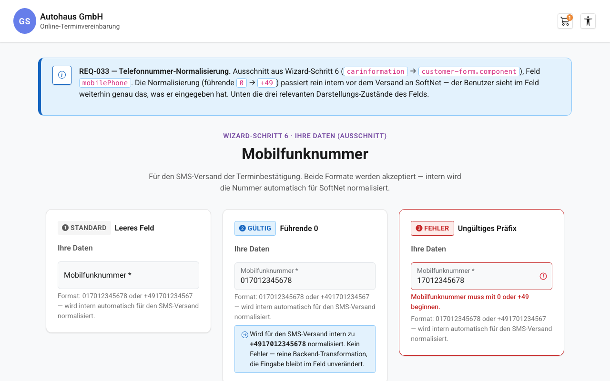

# REQ-033: Telefonnummer-Normalisierung (SMS-Format)

**Status:** Draft
**Priority:** High
**Type:** Functional (Bugfix, Production)
**Created:** 2026-07-30
**Author:** Claude Code
**Betroffener Wizard-Schritt:** 6 (carinformation, `/home/carinformation`)

---

## 1. Overview

### 1.1 Purpose

Im Buchungs-Wizard (Schritt 6, `/home/carinformation`) gibt der Kunde eine Mobilfunknummer ein, die u. a. für SMS-Bestätigungen genutzt wird (REQ-027: Notification-Channel-Toggle, `notifications: { SMS, SMTP }`). Das Formular akzeptiert dabei zwei gültige Eingabeformate — führende `0` (deutsches Trunk-Präfix, z. B. `017012345678`) oder `+49`-Präfix (z. B. `+491701234567`) — über den Pattern-Validator `Validators.pattern(/^(\+|0)[0-9\s]+$/)` (`carinformation-container.component.ts:46`). Diese Rohform wird unverändert im `BookingStore` gehalten (`CustomerInfo.mobilePhone`) und beim Absenden der Buchung 1:1 in den Request übernommen (`booking.store.ts:668-669`, `mobile`/`phone`) sowie im Backend unverändert in die SoftNet-`wishlist.client`-Map geschrieben (`AppointmentsService.patchSnapWithBookingData()`, Zeilen 96-97).

SoftNet — der externe Dienstleister für Werkstatt-Terminverwaltung inkl. SMS-Versand — verarbeitet Nummern mit führender `0` für den SMS-Versand nicht zuverlässig. Das Ergebnis ist ein **silent failure**: kein HTTP-Fehler, keine Exception, aber die SMS kommt beim Kunden nicht an. Dieses Fehlerbild wurde in einer Vorab-Analyse der Azure-Prod-Logs (Log Analytics, `gs-terminbuchungs-app`) als plausible Ursache identifiziert, nachdem ein konkreter Buchungsversuch (Kennzeichen "TE-ST 1", Filiale VW Zentrum Essen) untersucht wurde — es existierten dazu **keine** Fehler-Logs, was genau zu einem "silent issue" auf SoftNet-Seite passt: Das Backend loggt Requests nur im Fehlerfall (`SOFTNET_ERROR`, REQ-029), und ein technisch erfolgreicher, aber von SoftNet falsch verarbeiteter Request hinterlässt keine Spur.

**Die Lösung:** Eine rein interne, backend-seitige Normalisierung der Telefonnummer, bevor sie an SoftNet gesendet wird — die Nummer wird dabei ins internationale Format (`+49...`) überführt, unabhängig davon, in welchem der beiden zulässigen Formate der Kunde sie eingegeben hat.

### 1.2 Scope

**Included:**
- Neue Utility-Klasse `PhoneNumberNormalizer` (`server/src/main/java/com/autohaus/backend/common/util/PhoneNumberNormalizer.java`) mit statischer Methode `toSoftnetFormat(String rawPhoneNumber)`
- Anwendung der Normalisierung in `AppointmentsService.patchSnapWithBookingData()` auf **beide** Felder `mobile` und `phone`, bevor sie in die SoftNet-`client`-Map geschrieben werden (Zeilen 96-97)
- Anwendung der Normalisierung in `CustomersService.createCustomer()` auf das Feld `mobilePhone` (Zeile 36) — Konsistenz mit derselben SoftNet-Zielsystem-Eigenheit, auch wenn dieser `vaultitems`-Endpunkt aktuell im Buchungsflow nicht genutzt wird und zuletzt mit 401 (Scope reicht nicht) antwortete
- JUnit-Tests für `PhoneNumberNormalizer` sowie Regressionstests für `AppointmentsServiceTest` / `CustomersServiceTest`
- Optional (kein Pflichtbestandteil): leicht präzisierender Hint-Text im Formular (siehe Mockup) — rein kosmetisch, keine funktionale Änderung

**Excluded:**
- Allgemeine E.164-Normalisierung (andere Auslandsvorwahlen als `+49`)
- Unterstützung anderer Länder-Vorwahlen
- Entfernung/Bereinigung von Leerzeichen, Bindestrichen oder anderen Trennzeichen innerhalb der Nummer
- Jegliche Änderung an der bestehenden Frontend-Validierung (`Validators.pattern(/^(\+|0)[0-9\s]+$/)` bleibt exakt bestehen, weiterhin werden beide Präfixe akzeptiert)
- Neue Fehlermeldungen oder sichtbare UI-Änderungen — der Benutzer sieht im Formular weiterhin exakt das, was er eingegeben hat
- Reaktivierung des `vaultitems`-Endpunkts (bleibt 401, außerhalb des Scopes dieses Requirements)

### 1.3 Related Requirements
- REQ-027: Notification Channel Toggle (SMS als Benachrichtigungskanal — Grund, warum die Mobilfunknummer SMS-relevant ist)
- REQ-009: carinformation (Ursprung des `mobilePhone`-Formularfelds und des Pattern-Validators)
- REQ-029: Backend-Error-Logging (`SOFTNET_ERROR`-Logging nur im Fehlerfall — erklärt, warum das heutige Fehlerbild "silent" ist, d. h. ohne Log-Spur)

---

## 2. User Story

**Als** Kunde, der eine SMS-Bestätigung für seinen Werkstatttermin erhalten möchte
**möchte ich**, dass der SMS-Versand zuverlässig funktioniert — unabhängig davon, ob ich meine Mobilfunknummer mit führender `0` oder mit `+49` eingegeben habe
**damit** ich meine Buchungsbestätigung tatsächlich erhalte, ohne dass ich es merke oder selbst gegensteuern muss.

**Acceptance Criteria:**
- [ ] AC-1: `AppointmentsService` sendet für `mobile` und `phone` stets eine Nummer im `+49`-Format an SoftNet, sofern die Rohnummer mit `0` oder `+` begann
- [ ] AC-2: Eine Nummer, die bereits mit `+` beginnt, wird unverändert durchgereicht — kein Doppel-Prefixing (niemals `+49+491701234567` o. Ä.)
- [ ] AC-3: Eine Nummer, die mit `0` beginnt, hat exakt die führende `0` durch `+49` ersetzt; der Rest der Zeichenfolge (inkl. enthaltener Leerzeichen) bleibt unverändert
- [ ] AC-4: `CustomersService.createCustomer()` wendet dieselbe Normalisierung auf `mobilePhone` an (Konsistenz)
- [ ] AC-5: Formularwert, `BookingStore.customerInfo.mobilePhone` und das Backend-DTO (`CreateAppointmentRequest.CustomerDto`) bleiben vollständig unverändert — nur der ausgehende SoftNet-Request ist betroffen
- [ ] AC-6: Der Frontend-Pattern-Validator bleibt exakt `^(\+|0)[0-9\s]+$` — keine neue Fehlermeldung, keine Validierungsänderung
- [ ] AC-7: Erreicht ein unerwartetes Format (leer, kein `0`/`+`-Präfix) dennoch das Backend, wird es unverändert durchgereicht statt eine Exception zu werfen (Defense in Depth)
- [ ] AC-8: JUnit-Tests für `PhoneNumberNormalizer` sowie die beiden Call-Sites erreichen >= 80 % Coverage für die neuen/geänderten Codepfade

---

## 3. Preconditions

### 3.1 System
- Spring-Boot-Backend läuft (`:3000`, `/api/v1/*`), SoftNet-Zugangsdaten konfiguriert
- Bestehendes carinformation-Formular (REQ-009) funktionsfähig, Pflichtfeld `mobilePhone`

### 3.2 User
- Benutzer befindet sich auf `/home/carinformation` (Wizard-Schritt 6) und hat eine gültige Mobilfunknummer eingegeben (führende `0` oder `+49`)
- `notesExtras.notificationChannel === 'sms'` (REQ-027) ist der Hauptanwendungsfall, der Fix greift aber unabhängig vom gewählten Benachrichtigungskanal (auch bei `'email'` wird `mobile`/`phone` an SoftNet übermittelt)

### 3.3 Data
- `BookingStore.customerInfo.mobilePhone` ist gesetzt (Pflichtfeld, REQ-009)
- `BookingStore.customerInfo.phone` ist optional; fällt im Request auf `mobilePhone` zurück, falls nicht gesetzt (`booking.store.ts:669`)

---

## 4. Main Flow



**Step 1:** Benutzer gibt Mobilfunknummer im Formular ein
- **User:** Tippt z. B. `017012345678` (oder `+491701234567`) in das Feld "Mobilfunknummer"
- **System:** Validiert unverändert gegen `^(\+|0)[0-9\s]+$` (REQ-009) — keine Änderung an dieser Stelle

**Step 2:** Benutzer schließt das Formular ab, Store speichert den Rohwert
- **System:** `CarinformationContainerComponent.onSubmit()` speichert `customerInfo.mobilePhone` unverändert im `BookingStore` (`setCustomerInfo()`)

**Step 3:** Benutzer sendet die Buchung ab
- **System:** `BookingStore.submitBooking()` baut den Request; `mobile`/`phone` werden 1:1 aus `customerInfo` übernommen (`booking.store.ts:668-669`) — **keine** Normalisierung im Frontend

**Step 4 (NEU):** Backend normalisiert vor dem SoftNet-Call
- **System:** `AppointmentsService.patchSnapWithBookingData()` ruft für `dto.customer().mobile()` und `dto.customer().phone()` jeweils `PhoneNumberNormalizer.toSoftnetFormat(...)` auf, **bevor** die Werte in `wishlist.client.mobile` / `.phone` geschrieben werden (statt der bisherigen Zeilen 96-97)
- **Expected:** SoftNet erhält die Nummer im Format `+49...`, unabhängig vom Eingabeformat

**Step 5:** SoftNet verarbeitet die Nummer zuverlässig
- **Expected:** SMS-Versand funktioniert wie vom Kunden erwartet; keine sichtbare Änderung am Frontend

---

## 5. Alternative Flows

### 5.1 Alt Flow A: Eingabe bereits im internationalen Format (No-Op)

**Trigger:** Kunde gibt direkt `+491701234567` ein.

**Flow:**
1. `PhoneNumberNormalizer.toSoftnetFormat()` erkennt das führende `+`
2. Wert wird unverändert zurückgegeben — kein Doppel-Prefixing
3. Weiter mit Main-Flow-Step 4/5

### 5.2 Alt Flow B: `mobile` und `phone` unterscheiden sich

**Trigger:** `CustomerInfo.phone` (optionales Festnetz-Feld) ist gesetzt und unterscheidet sich von `mobilePhone`.

**Flow:**
1. Beide Felder werden **unabhängig voneinander** normalisiert (jeweils eigener Aufruf von `toSoftnetFormat()`)
2. Beginnt `phone` z. B. mit `0`, wird auch hier die führende `0` durch `+49` ersetzt — unabhängig vom Ergebnis für `mobile`

---

## 6. Exception Flows

### 6.1 Exception E1: Unerwartetes Format erreicht das Backend trotz Frontend-Guard

**Trigger:** Ein direkter API-Call oder ein veralteter Client sendet `mobile`/`phone` ohne führendes `0` oder `+` (z. B. `"17012345678"`), oder einen leeren/`null`-Wert (Letzteres wird durch `@NotBlank` auf `CustomerDto.mobile` bereits am Bean-Validation-Layer abgefangen, `CreateAppointmentRequest.java:21` — betrifft daher praktisch nur `phone`, das kein `@NotBlank` trägt).

**Flow:**
1. `PhoneNumberNormalizer.toSoftnetFormat()` erkennt kein `0`/`+`-Präfix
2. Der Wert wird **unverändert** zurückgegeben — **keine** Exception, **kein** Abbruch der Buchung (Defense in Depth statt Fehler)
3. Die Buchung läuft regulär weiter; dieses defensive Verhalten ist bewusst so gewählt, da eine Format-Verletzung durch den bestehenden Frontend-Pattern-Validator ohnehin praktisch ausgeschlossen ist

---

## 7. Postconditions

### 7.1 Success
- SoftNet erhält für `mobile` und `phone` (in `AppointmentsService`) sowie `mobilePhone` (in `CustomersService`) stets eine Nummer mit `+`-Präfix, sofern die Eingabe mit `0` oder `+` begann
- `BookingStore.customerInfo.mobilePhone`, `CustomerInfo.phone` und das Backend-DTO (`CreateAppointmentRequest.CustomerDto`) bleiben unverändert — nur der ausgehende SoftNet-Request (`wishlist.client.mobile`/`.phone` bzw. `data.mobilePhone`) ist normalisiert
- Formular, Validator und angezeigter Wert bleiben für den Benutzer identisch zu vorher

### 7.2 Failure
- Kein neues Fehlerverhalten durch dieses Requirement — bestehende Buchungsfehler (z. B. Snap-Conflict aus REQ-031) sind von dieser Änderung unabhängig
- Ein unerwartetes Telefonnummer-Format führt NICHT zu einem Buchungsabbruch (siehe Exception E1)

---

## 8. Business Rules

- **BR-1:** Normalisierungsregel (exakt): Beginnt die (getrimmte) Eingabe mit `+`, wird sie unverändert zurückgegeben. Beginnt sie mit `0`, wird die führende `0` durch `+49` ersetzt, der Rest der Zeichenfolge (inkl. enthaltener Leerzeichen) bleibt unverändert. Alle anderen Fälle werden unverändert zurückgegeben (kein Fehler).
- **BR-2:** Kein Doppel-Prefixing — eine bereits mit `+` beginnende Nummer wird niemals erneut verändert.
- **BR-3:** Keine weitere Bereinigung — Leerzeichen, Bindestriche, Klammern etc. innerhalb der Nummer bleiben exakt erhalten; das ist bewusst NICHT Teil dieses Requirements (siehe Scope-Abgrenzung 1.2).
- **BR-4:** Die Normalisierung erfolgt ausschließlich serverseitig an genau zwei Stellen: `AppointmentsService.patchSnapWithBookingData()` (Felder `client.mobile`, `client.phone`) und `CustomersService.createCustomer()` (Feld `data.mobilePhone`).
- **BR-5:** Die Transformation verändert niemals gespeicherte Werte im Frontend (Store, Formular) oder im Backend-DTO (`CreateAppointmentRequest.CustomerDto` bleibt strukturell und inhaltlich unverändert) — nur der an SoftNet gesendete Payload wird transformiert.
- **BR-6:** `null`- oder leere Eingabe wird defensiv unverändert zurückgegeben — keine `NullPointerException`.
- **BR-7:** Code-Sprache für alle Identifier (Klassen, Methoden, Konstanten) ist Englisch (`PhoneNumberNormalizer`, `toSoftnetFormat`).

---

## 9. Non-Functional Requirements

### Performance
- Reine synchrone String-Operation (Trim + Prefix-Check + Substring), keine spürbare Latenz (< 1 ms), kein zusätzlicher API-Call, keine zusätzliche Serialisierung

### Security
- Keine PII-Leaks in Logs durch diese Änderung — `PhoneNumberNormalizer` loggt selbst nichts
- Das bestehende `SOFTNET_ERROR`-Logging (REQ-029, `LogPayloadUtil.truncate`) bleibt unverändert; es protokolliert weiterhin nur im Fehlerfall den Roh-Snap bzw. Request-/Response-Body (die Telefonnummer war darin bereits vorher enthalten — diese Änderung ändert nichts an der Logging-Oberfläche)

### Usability
- Keine Änderung — rein Backend-seitige Transformation, keine Auswirkung auf Formular, Validierung oder angezeigte Werte

---

## 10. Data Model

```java
// server/src/main/java/com/autohaus/backend/common/util/PhoneNumberNormalizer.java (NEU)

package com.autohaus.backend.common.util;

/**
 * Normalizes German phone numbers to the international format SoftNet expects
 * for reliable SMS delivery — SoftNet does not reliably process numbers with a
 * leading "0" for SMS dispatch (silent failure, no error/exception).
 *
 * Normalisiert deutsche Telefonnummern in das internationale Format, das
 * SoftNet fuer eine zuverlaessige SMS-Zustellung erwartet — SoftNet
 * verarbeitet Nummern mit fuehrender "0" nicht zuverlaessig fuer den
 * SMS-Versand (silent failure, ohne Fehler/Exception).
 */
public final class PhoneNumberNormalizer {

    private static final String GERMAN_TRUNK_PREFIX = "0";
    private static final String GERMAN_COUNTRY_CODE = "+49";

    private PhoneNumberNormalizer() {
    }

    /**
     * Converts a raw phone number into SoftNet's expected format (REQ-033).
     * Wandelt eine rohe Telefonnummer in das von SoftNet erwartete Format um.
     *
     * Rules / Regeln:
     * - Starts with "+"        -&gt; returned unchanged (already international).
     * - Starts with "0"        -&gt; leading "0" replaced with "+49", rest unchanged.
     * - null / blank / other   -&gt; returned unchanged (defensive, no exception).
     *
     * No further cleanup (whitespace, dashes) is performed — out of scope (BR-3).
     */
    public static String toSoftnetFormat(String rawPhoneNumber) {
        if (rawPhoneNumber == null || rawPhoneNumber.isBlank()) {
            return rawPhoneNumber;
        }
        String trimmed = rawPhoneNumber.trim();
        if (trimmed.startsWith("+")) {
            return trimmed;
        }
        if (trimmed.startsWith(GERMAN_TRUNK_PREFIX)) {
            return GERMAN_COUNTRY_CODE + trimmed.substring(1);
        }
        return trimmed;
    }
}
```

**KEINE Änderung an TypeScript-Interfaces** — `CustomerInfo` (`src/app/features/booking/models/customer.model.ts`) bleibt exakt wie heute:

```typescript
export interface CustomerInfo {
  email: string;
  salutation: Salutation;
  firstName: string;
  lastName: string;
  street: string;
  postalCode: string;
  city: string;
  mobilePhone: string;
  phone?: string;
  country?: string;
  language?: string;
}
```

---

## 11. UI/UX

### Mockup


**Hinweis:** REQ-033 ist eine reine Backend-Änderung — es gibt **keine** funktionale UI-Änderung, kein neues Fehlerverhalten und keine Anpassung des Validators. Das Mockup zeigt lediglich den bestehenden Hint-Text am Mobilfunknummer-Feld (`booking.carinformation.form.mobilePhone.hint`, aktuell: "Format: 017012345678 oder +491701234567", `translations.ts:269` DE u. a.), ggf. leicht präzisiert, um dem Benutzer transparent zu machen, dass beide Formate akzeptiert und intern korrekt verarbeitet werden. Eine Änderung dieses Hint-Texts ist optional und kein Pflichtbestandteil dieses Requirements (siehe Abschnitt 17).

---

## 12. API Specification

Keine neue Route, keine Änderung am Frontend-Request. Die Änderung betrifft ausschließlich den vom Backend an SoftNet gesendeten Payload.

### 12.1 SoftNet-Request `AppointmentsService` — VORHER/NACHHER (`wishlist.client`)

**VORHER (Ist-Zustand):**
```json
{
  "wishlist": {
    "client": {
      "email": "max.mustermann@example.com",
      "firstName": "Max",
      "lastName": "Mustermann",
      "mobile": "017012345678",
      "phone": "017012345678"
    }
  }
}
```

**NACHHER (REQ-033 — Normalisierung angewendet):**
```json
{
  "wishlist": {
    "client": {
      "email": "max.mustermann@example.com",
      "firstName": "Max",
      "lastName": "Mustermann",
      "mobile": "+4917012345678",
      "phone": "+4917012345678"
    }
  }
}
```

**No-Op-Beispiel (Eingabe bereits `+49`, unverändert):**
```json
// VORHER
"mobile": "+491701234567"
// NACHHER — identisch
"mobile": "+491701234567"
```

### 12.2 Backend-Änderung — `AppointmentsService.patchSnapWithBookingData()`

```java
// VORHER (Zeilen 96-97)
client.put("mobile", dto.customer().mobile());
client.put("phone", dto.customer().phone() != null ? dto.customer().phone() : dto.customer().mobile());

// NACHHER (REQ-033)
client.put("mobile", PhoneNumberNormalizer.toSoftnetFormat(dto.customer().mobile()));
client.put("phone", PhoneNumberNormalizer.toSoftnetFormat(
    dto.customer().phone() != null ? dto.customer().phone() : dto.customer().mobile()));
```

### 12.3 Backend-Änderung — `CustomersService.createCustomer()`

```java
// VORHER (Zeile 36)
data.put("mobilePhone", dto.mobilePhone());

// NACHHER (REQ-033)
data.put("mobilePhone", PhoneNumberNormalizer.toSoftnetFormat(dto.mobilePhone()));
```

> **Hinweis:** `CustomersService` ruft `SoftnetApiClient.createVaultItem()` auf, dessen `vaultitems`-Endpunkt laut den SoftNet-API-Erkenntnissen (siehe `CLAUDE.md`) zuletzt mit 401 (Scope reicht nicht) antwortete und im aktiven Buchungsflow aktuell nicht genutzt wird. Die Normalisierung wird hier dennoch für Konsistenz angewendet, falls/wenn der Endpunkt reaktiviert wird.

---

## 13. Test Cases

### TC-1: Trunk-Präfix `0` wird zu `+49` normalisiert (AC-1, AC-3)
- **Given:** `dto.customer().mobile() == "017012345678"`
- **When:** `PhoneNumberNormalizer.toSoftnetFormat(...)` wird aufgerufen (bzw. Buchung wird abgesendet)
- **Then:** Der an SoftNet gesendete Wert `wishlist.client.mobile === "+4917012345678"`

### TC-2: Bereits internationales Format bleibt unverändert (AC-2, No-Op)
- **Given:** `mobile == "+491701234567"`
- **When:** `toSoftnetFormat(...)` wird aufgerufen
- **Then:** Rückgabe `=== "+491701234567"` — identisch, kein Doppel-Prefix

### TC-3: Enthaltene Leerzeichen bleiben erhalten (AC-3, BR-1, BR-3)
- **Given:** `mobile == "0170 123 45678"`
- **When:** `toSoftnetFormat(...)` wird aufgerufen
- **Then:** Rückgabe `=== "+49170 123 45678"` — nur die führende `0` wurde ersetzt, interne Leerzeichen unverändert

### TC-4: `phone`-Feld wird unabhängig von `mobile` normalisiert (AC-1, 5.2)
- **Given:** `customer.mobile == "017012345678"`, `customer.phone == "0891234567"`
- **When:** Buchung wird abgesendet
- **Then:** `wishlist.client.mobile === "+4917012345678"` UND `wishlist.client.phone === "+49891234567"`

### TC-5: `null`/leere Eingabe verursacht keinen Crash (AC-7, BR-6)
- **Given:** `mobile == null` bzw. `""` (praktisch ausgeschlossen durch Frontend-`required` / Backend-`@NotBlank`, hier als Defense-in-Depth-Fall)
- **When:** `toSoftnetFormat(...)` wird aufgerufen
- **Then:** Kein `NullPointerException`, Eingabe wird unverändert zurückgegeben

### TC-6: Unerwartetes Format ohne `0`/`+`-Präfix (AC-7, Exception E1)
- **Given:** `mobile == "17012345678"` (kein Präfix — durch Frontend-Pattern praktisch ausgeschlossen)
- **When:** `toSoftnetFormat(...)` wird aufgerufen
- **Then:** Rückgabe unverändert `"17012345678"`, keine Exception, Buchung läuft normal weiter

### TC-7: `CustomersService` normalisiert `mobilePhone` konsistent (AC-4)
- **Given:** `CreateCustomerRequest.mobilePhone == "015112345678"`
- **When:** `CustomersService.createCustomer()` wird aufgerufen
- **Then:** Der an SoftNet gesendete Payload enthält `data.mobilePhone === "+4915112345678"`

### TC-8: Store/Formularwert bleibt unverändert — Frontend-Regression (AC-5)
- **Given:** Benutzer gibt `"017012345678"` im Formular ein und schließt die Buchung ab
- **When:** Buchung wird abgesendet
- **Then:** `BookingStore.customerInfo().mobilePhone === "017012345678"` bleibt unverändert im Store; nur der SoftNet-Request ist normalisiert — kein bestehender Frontend-Testfall muss angepasst werden

---

## 14. Implementation

### Geänderte/neue Dateien — Backend

```
server/src/main/java/com/autohaus/backend/
├── common/util/
│   └── PhoneNumberNormalizer.java              # NEU: toSoftnetFormat(String) — statische Utility-Methode
├── appointments/
│   └── AppointmentsService.java                # ÄNDERN (Zeilen 96-97): mobile/phone via
│                                                #   PhoneNumberNormalizer.toSoftnetFormat() normalisieren
└── customers/
    └── CustomersService.java                   # ÄNDERN (Zeile 36): mobilePhone via
                                                 #   PhoneNumberNormalizer.toSoftnetFormat() normalisieren
```

### Tests

- [ ] `PhoneNumberNormalizerTest` (JUnit, NEU) — Präfix `0` -> `+49`, Präfix `+` (No-Op), interne Leerzeichen erhalten, `null`/leer, Format ohne Präfix
- [ ] `AppointmentsServiceTest` — ERWEITERN: `mobile`/`phone` im an SoftNet gesendeten Payload sind normalisiert (Mock-Verify auf `SoftnetApiClient.createAppointment()`)
- [ ] `CustomersServiceTest` — ERWEITERN: `mobilePhone` im an SoftNet gesendeten Payload ist normalisiert

### Effort
- Development: 1 Stunde
- Testing: 1 Stunde

---

## 15. Dependencies

**Requires:**
- REQ-027: Notification Channel Toggle (SMS-Kanal existiert bereits, `notifications.SMS`)
- REQ-009: carinformation (liefert das `mobilePhone`-Formularfeld inkl. Pattern-Validator)

**Blocks:**
- —

---

## 16. Naming Glossary

### Backend
| Name | Beschreibung |
|------|--------------|
| `PhoneNumberNormalizer` | Neue statische Utility-Klasse (`common/util`), analog zu `LogPayloadUtil` (`common/logging`) |
| `PhoneNumberNormalizer.toSoftnetFormat(String)` | Statische Methode — normalisiert eine rohe Telefonnummer ins SoftNet-Format (`+49...`) |
| `GERMAN_TRUNK_PREFIX` | Private Konstante `"0"` — deutsches Trunk-Präfix |
| `GERMAN_COUNTRY_CODE` | Private Konstante `"+49"` — deutsche Landesvorwahl |

### Call-Sites (unverändert in Name/Signatur, nur intern angepasst)
| Ort | Änderung |
|-----|----------|
| `AppointmentsService.patchSnapWithBookingData()` | `client.put("mobile", ...)` / `client.put("phone", ...)` rufen NEU `PhoneNumberNormalizer.toSoftnetFormat(...)` auf |
| `CustomersService.createCustomer()` | `data.put("mobilePhone", ...)` ruft NEU `PhoneNumberNormalizer.toSoftnetFormat(...)` auf |

---

## 17. i18n Keys

**Keine neuen i18n-Keys erforderlich** — REQ-033 ist eine reine Backend-Änderung ohne neue UI-Fehlermeldung. Der bestehende Hint-Key `booking.carinformation.form.mobilePhone.hint` (`translations.ts:269` DE: "Format: 017012345678 oder +491701234567", analog EN/UK/FR/AR) beschreibt bereits zutreffend beide unterstützten Eingabeformate und bleibt unverändert.

**Optionaler Vorschlag** (nur falls im Zuge des Mockups eine Präzisierung des Hint-Texts gewünscht wird — **kein** Pflichtbestandteil dieses Requirements, keine Änderung an Validator oder Fehlermeldungen):
```typescript
// Optionale Praezisierung (NICHT Pflicht) — booking.carinformation.form.mobilePhone.hint
// DE (unveraendert vs. optional):
hint: 'Format: 017012345678 oder +491701234567'
// EN (unveraendert vs. optional):
hint: 'Format: 017012345678 or +491701234567'
```

---

## 18. Implementation Notes

**WICHTIG: Code muss BILINGUAL sein!**

Siehe `.claude/skills/bilingual-code.md` für Details:
- Kommentare DE + EN (siehe Javadoc von `PhoneNumberNormalizer` in Abschnitt 10 als Vorlage)
- Error Messages Englisch
- JSDoc bilingual (hier nicht relevant, da keine TypeScript-Änderung)

**Ist-Zustand (recherchiert, Referenzen):**
- `AppointmentsService.java:96-97` — `patchSnapWithBookingData()` schreibt `mobile`/`phone` heute unverändert in die SoftNet-`client`-Map
- `CustomersService.java:36` — `createCustomer()` schreibt `mobilePhone` heute unverändert in den `vaultitems`-Payload
- `carinformation-container.component.ts:46` — Frontend-Pattern-Validator `^(\+|0)[0-9\s]+$`, bleibt unverändert
- `booking.store.ts:668-669` — `submitBooking()` übernimmt `mobile`/`phone` unverändert aus `customerInfo`
- `common/logging/LogPayloadUtil.java` — Stil-Vorbild für die neue Utility-Klasse (statische Methode, `private` Konstruktor, `final class`)
- Kein passendes Utility-Package für Telefonnummern-Logik existierte vor diesem Requirement (`common/` enthielt bislang nur `dto/`, `exception/`, `filter/`, `logging/`) — `common/util/` ist neu

**Definition of Done (gemäß `docs/VISION.md`):**
- [ ] Alle 8 ACs erfüllt
- [ ] JUnit-Tests grün, >= 80 % Coverage für `PhoneNumberNormalizer` und die beiden geänderten Call-Sites
- [ ] `/check-architecture`, `/check-security` grün
- [ ] Keine Frontend-Regression (bestehende Jest-Tests unverändert grün, da Frontend nicht angefasst wird)
