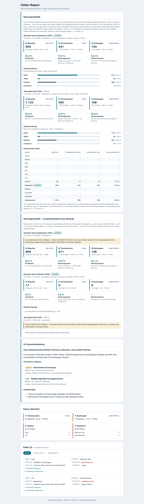
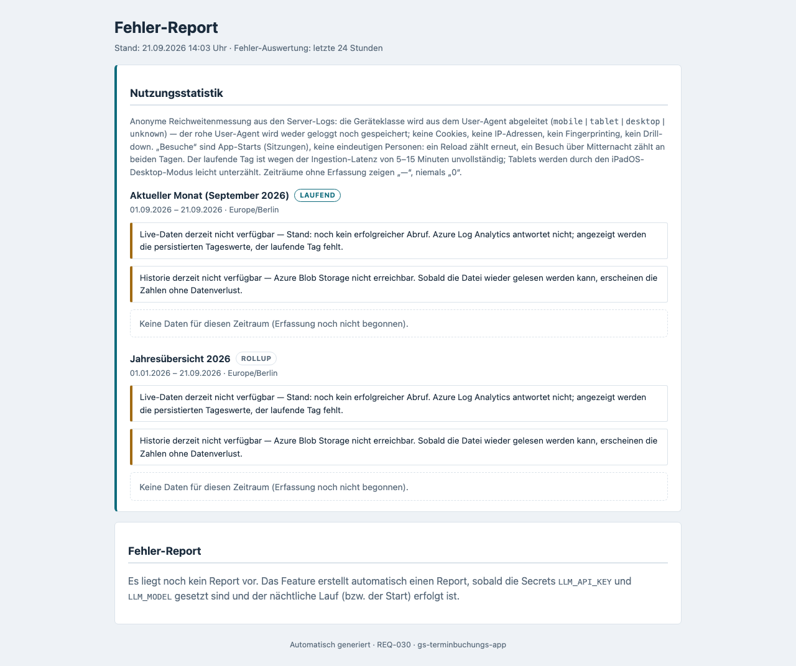
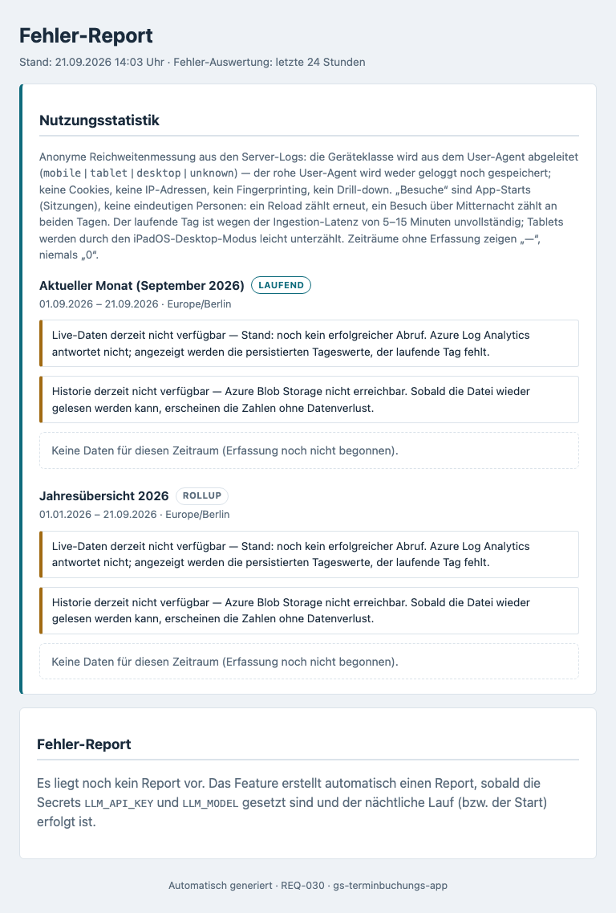
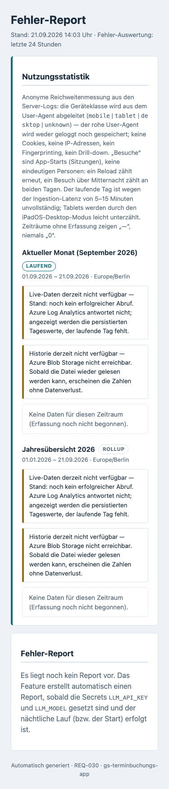

# Feature-Dokumentation: Nutzungsstatistik (REQ-037)

## Überblick

Die **Nutzungsstatistik** ergänzt die bestehende interne Statusseite (REQ-030) um einen Block ganz oben,
der beantwortet, **wie** die Terminbuchungs-App genutzt wird — nicht nur, was gerade kaputt ist.

Sie zeigt vier anonyme Kennzahlen:

- **Besuche** — App-Aufrufe (Sitzungen)
- **Terminsuchen** — gestartete Terminabfragen (`POST /api/v1/snaps`)
- **Buchungen** — abgeschlossene Buchungen (`POST /api/v1/appointments`)
- **Geräteverteilung** — mobil / Tablet / Desktop / unbekannt

Wofür das gut ist:

- **Mobile-Optimierung priorisieren.** Wenn zwei Drittel der Besucher mobil kommen, gehört die Arbeit
  ans Handy-Layout — bisher war das eine Vermutung, jetzt ist es eine Zahl.
- **Abbruchquote im Buchungsfunnel erkennen.** Zwischen „Besuch", „Terminsuche" und „Buchung" gehen
  Nutzer verloren. Die drei Quoten zeigen, an welcher der beiden Stufen es klemmt.
- **Entwicklung über das Jahr verfolgen.** Der Monatsverlauf macht sichtbar, ob eine Änderung etwas
  gebracht hat oder ob Saisonalität dahintersteckt.

Die Statistik ist **unabhängig vom KI-Fehler-Report**: Sie erscheint auch dann, wenn `LLM_API_KEY` /
`LLM_MODEL` nicht gesetzt sind und die Seite unten nur den Hinweis „Es liegt noch kein Report vor" zeigt.

## Seite aufrufen

| | |
|---|---|
| **URL** | `https://<host>/internal/report` (lokal: `http://localhost:3000/internal/report`) |
| **Anmeldung** | HTTP Basic Auth — Benutzer `REPORT_ADMIN_USER`, Passwort `REPORT_ADMIN_PASSWORD` |
| **Maschinenlesbar** | `GET /internal/report/usage.json` — dieselben Zahlen als JSON, hinter derselben Anmeldung |
| **Manuelles Neuladen** | `POST /internal/report/refresh` — höchstens **einmal pro Minute**, sonst `429` |

Ohne Zugangsdaten antworten beide Endpunkte mit **401**. In der App gibt es unten mittig einen
Statusbutton, der die Seite in einem neuen Tab öffnet (für eingebettete iFrame-Kunden ausgeblendet).

## Aufbau: zwei Blöcke

Die Sektion „Nutzungsstatistik" steht **oberhalb** der KI-Zusammenfassung und der Fehlerliste und besteht
aus zwei untereinander liegenden Blöcken — **ohne Umschalter, ohne JavaScript**:

### 1. Aktueller Monat

Zeitraum vom Monatsersten bis heute (Zeitzone `Europe/Berlin`, im Kopf des Blocks ausgewiesen). Enthält:

- drei Kacheln **Besuche · Terminsuchen · Buchungen** mit Absolutzahlen; als Untertitel die Request-Zahlen
  (Anfragen / ok / Fehler),
- darunter die drei Quoten
  **Suchquote** (Besuche mit Terminsuche),
  **Buchungsquote** (Gesamt-Conversion: Besuche mit Buchung) und
  **Abschlussquote** (Terminsuch-Sitzungen, die zur Buchung führen) — alle drei sitzungsbasiert und auf
  eine Nachkommastelle,
- die **Geräteverteilung** als vier Balken mit Absolutzahl **und** Prozentanteil. Der Prozentwert steht
  immer als Text daneben, der Balken ist nur redundante Visualisierung.

### 2. Jahresübersicht

Derselbe Aufbau für das laufende Kalenderjahr, plus eine Tabelle **„Monatsverlauf"** mit einer Zeile je
Kalendermonat (Monat · Besuche · Terminsuchen ok · Buchungen ok · Buchungsquote), dem laufenden Monat als
„laufend"-Markierung und einer Jahressumme in der Fußzeile. Geräte-Spalten enthält die Tabelle bewusst
nicht — die Geräteverteilung braucht eine Mindestfallzahl (siehe unten).

So sieht die vollständig befüllte Seite aus (Referenzdarstellung aus dem Mockup):



## Responsive Ansichten

Die folgenden Screenshots stammen von einem **lokalen Backend ohne Azure-Anbindung**. Sie zeigen deshalb
nicht die Zahlen, sondern den **Ausfallmodus** — und damit genau das Verhalten aus dem Abschnitt
„Wenn Azure nicht erreichbar ist": Die Seite lädt, benennt beide fehlenden Quellen und zeigt „keine Daten"
statt einer stillen Null. Die befüllte Darstellung steht oben als Mockup.

### Desktop (1280x720)


### Tablet (768x1024)


### Mobile (375x667)


Bei schmalen Fenstern (≤ 40em) bricht die Sektion einspaltig um; die Monatstabelle reduziert sich auf vier
Spalten, statt die Seite horizontal scrollbar zu machen.

## Wie die Zahlen zustande kommen

1. **Erfassung.** Bei jedem Request schreibt das Backend eine Zeile ins Server-Log. Diese Zeile enthält
   seit REQ-037 ein zusätzliches Feld `"device"` mit genau einem von vier Werten
   (`mobile` | `tablet` | `desktop` | `unknown`), abgeleitet aus dem ohnehin mitgesendeten
   `User-Agent`-Header.
2. **Live-Auswertung (alle 15 Minuten).** Ein Hintergrundlauf fragt die Logs des laufenden Tages aus
   Azure Log Analytics ab und legt das Ergebnis im Arbeitsspeicher ab.
3. **Nächtlicher Rollup (03:30 Uhr).** Der Vortag wird als eine Zeile mit reinen Zählern in eine kleine
   JSON-Datei im Azure Blob Storage geschrieben. Fehlende Tage der letzten 25 Tage werden dabei
   nachgezogen, etwa nach einem Container-Neustart. Der Lauf ist wiederholbar: Tageswerte werden ersetzt,
   nie aufaddiert.
4. **Anzeige.** Der Seitenaufruf liest **nur** diesen Speicher-Schnappschuss — keine Azure-Abfrage im
   Request-Pfad. Die Seite antwortet in unter 200 ms.

Health-Checks (`/api/v1/health`, rund 1 440 Pings pro Tag) und alle `/internal/**`-Aufrufe sind aus
sämtlichen Zählungen ausgeschlossen.

## Vier Grenzen, die man kennen muss

Diese vier Einschränkungen stehen auch direkt auf der Seite — sie sind kein Kleingedrucktes, sondern
Voraussetzung dafür, die Zahlen richtig zu lesen:

1. **„Besuche" sind App-Aufrufe, keine Personen.** Gezählt werden Sitzungen. Lädt dieselbe Person die
   Seite neu, zählt das erneut; eine Sitzung über Mitternacht zählt an beiden Tagen. Die Zahl ist eine
   Obergrenze für die Nutzerzahl, nicht die Nutzerzahl.
2. **Live-Zahlen hinken 5-15 Minuten nach.** So lange braucht Azure Log Analytics, bis eine Log-Zeile
   abfragbar ist. Der laufende Tag ist daher immer leicht unvollständig — ein Klick auf „Refresh" ändert
   daran nichts.
3. **Tablets werden leicht unterzählt.** iPadOS meldet sich im Standardmodus als Desktop. Solche Geräte
   landen in der Desktop-Klasse. Die Tablet-Zahl ist also eher eine Unter-, die Desktop-Zahl eher eine
   Obergrenze.
4. **Die Jahresübersicht ist in den ersten 12 Monaten unvollständig.** Sie summiert die persistierten
   Tageszeilen — Monate vor Inbetriebnahme gibt es schlicht nicht. Solche Monate erscheinen als „—",
   ausdrücklich **nicht** als „0".

Zusätzlich: Die Geräteverteilung erscheint erst ab **20 Besuchen** im Zeitraum. Darunter steht
„Zu wenig Daten für eine Geräteverteilung (n < 20)" — die Besuchs-, Such- und Buchungszahlen sowie die
Quoten bleiben sichtbar. Quoten ohne Nenner werden als „—" ausgegeben, nie als 0 % und nie als Fehler.

## Datenschutz in einfachen Worten

- **Keine Cookies, kein Web Storage, kein Fingerprinting.** Auf dem Gerät des Besuchers wird nichts
  abgelegt und nichts ausgelesen.
- **Keine IP-Adressen** in der Statistik.
- **Kein roher User-Agent.** Er wird gelesen, sofort zu einem von vier Wörtern verdichtet und verworfen —
  er erscheint in keiner Log-Zeile und wird nirgends gespeichert.
- **Nur anonyme Summen.** Die gespeicherte Datei enthält ausschließlich ganze Zahlen je Tag und
  Geräteklasse: keine Session-IDs, keine Zeitstempel einzelner Zugriffe, keine Verknüpfung mit Kunden-,
  Buchungs- oder Fahrzeugdaten.
- **Kein Drill-down.** Es gibt keine Sitzungsliste, keine Einzelrequests, keine Filterung nach Gerät und
  keine Kombination mit Marke oder Standort.
- **Aufbewahrung.** Die Log-Retention (≈ 30 Tage) bleibt unverändert. Im Blob liegen rollierend höchstens
  24 Monate an Tageszeilen; der nächtliche Lauf löscht ältere — auch dann, wenn für den Vortag kein neuer
  Wert ermittelt werden konnte.

## Betrieb

### Kill-Switch

`USAGE_STATS_ENABLED=false` schaltet das **gesamte** Feature ab: Es wird kein `User-Agent` mehr gelesen,
kein `device`-Feld geloggt, kein Hintergrundlauf ausgeführt, keine Statistik-Sektion gerendert, und
`usage.json` antwortet `404`. Die Anwendung verhält sich dann exakt wie vor REQ-037 — ohne Restspur und
ohne Hinweiszeile auf der Seite.

### Umgebungsvariablen

| Variable | Default | Zweck |
|----------|---------|-------|
| `USAGE_STATS_ENABLED` | `true` | Kill-Switch für Erfassung, Aggregation, Anzeige und Endpoint |
| `USAGE_STORAGE_ACCOUNT` | *(leer)* | Storage Account für die Historie — **leer = Historie aus** |
| `USAGE_STORAGE_CONTAINER` | `usage-stats` | Blob-Container |
| `USAGE_STORAGE_BLOB` | `usage-daily.json` | Dateiname der Tageszeilen |
| `USAGE_REFRESH_CRON` | `0 */15 * * * *` | Takt der Live-Aktualisierung |
| `USAGE_ROLLUP_CRON` | `0 30 3 * * *` | Nächtlicher Rollup (bewusst nach `REPORT_CRON`) |
| `USAGE_ZONE` | `Europe/Berlin` | Zeitzone für Tages- und Monatsgrenzen |
| `USAGE_RETENTION_MONTHS` | `24` | Aufbewahrung der Tageszeilen im Blob |
| `USAGE_REFRESH_MIN_INTERVAL_SECONDS` | `60` | Drosselung von `POST /internal/report/refresh` |
| `LOG_WORKSPACE_ID` | *(gesetzt)* | Log-Analytics-Workspace — aus REQ-030 übernommen |
| `REPORT_ADMIN_USER` / `REPORT_ADMIN_PASSWORD` | — | Basic-Auth-Zugang zur Statusseite |

Für Azure ist **kein Secret** nötig: Log Analytics und Blob Storage werden über die
System-Managed-Identity der Container App angesprochen. Die Identität braucht dafür einmalig die Rolle
`Storage Blob Data Contributor` auf dem Container (siehe `requirement.md` §3.1).

### Wenn Azure nicht erreichbar ist

Die Seite liefert **nie** einen Fehler und **nie** eine leere Seite:

| Ausfall | Verhalten |
|---------|-----------|
| Log Analytics nicht erreichbar | Historie aus dem Blob wird angezeigt, dazu der Hinweis „Live-Daten derzeit nicht verfügbar" |
| Blob nicht erreichbar | Nur der laufende Tag wird angezeigt, dazu „Historie derzeit nicht verfügbar" |
| Beides nicht erreichbar (z. B. lokal) | Beide Hinweise plus „Keine Daten für diesen Zeitraum" — genau der Zustand in den Screenshots oben |
| Rollup älter als 3 Tage | `WARN usage rollup stale: …` im Log **und** ein Hinweis im Jahresblock |
| `USAGE_STORAGE_ACCOUNT` leer | Kein Blob-Zugriff; die Seite zeigt den laufenden Tag, die Historie bleibt aus |

Ein stiller Ausfall, der sich als „0 Besuche" tarnt, ist ausdrücklich ausgeschlossen — jede fehlende
Quelle wird benannt.

### Lokale Verifikation

```bash
npm run test:local:serve                 # Frontend bauen + frisches Backend auf :3000
open http://localhost:3000/internal/report
```

Lokal ist keine Azure-Anbindung vorhanden; erwartet werden daher „Live-Daten derzeit nicht verfügbar"
und „Historie derzeit nicht verfügbar" — die Seite muss trotzdem vollständig laden.
