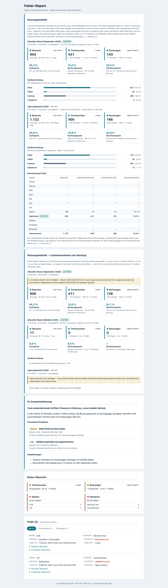
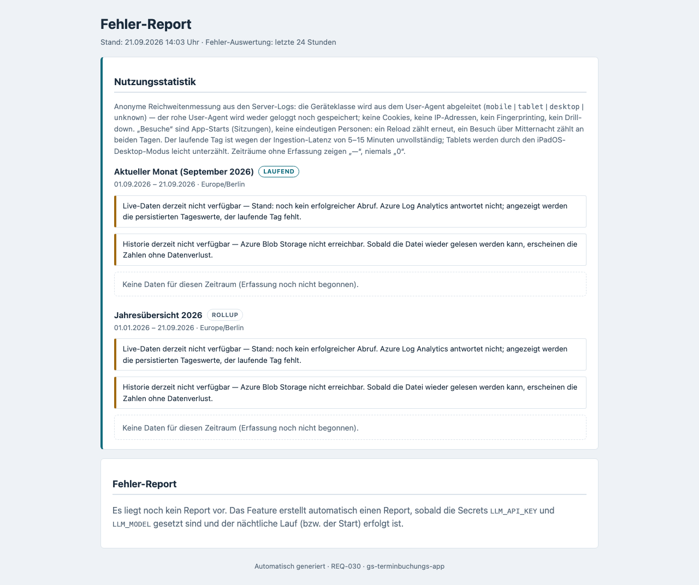
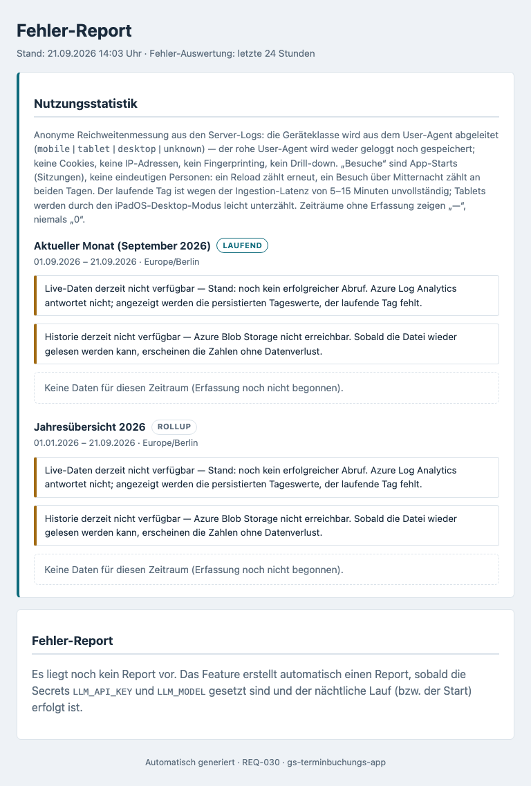
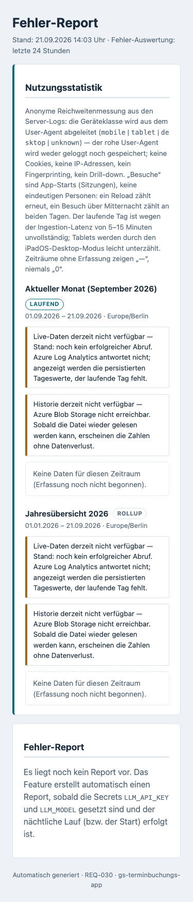

# Feature Documentation: Usage Statistics (REQ-037)

## Overview

**Usage Statistics** adds a block at the top of the existing internal status page (REQ-030) that answers
**how** the booking app is used — not just what is currently broken.

It shows four anonymous metrics:

- **Visits** — app launches (sessions)
- **Appointment searches** — started slot queries (`POST /api/v1/snaps`)
- **Bookings** — completed bookings (`POST /api/v1/appointments`)
- **Device split** — mobile / tablet / desktop / unknown

What it is good for:

- **Prioritize mobile work.** If two thirds of visitors arrive on a phone, that is where the layout work
  belongs — until now that was a guess, now it is a number.
- **Spot drop-off in the booking funnel.** Users are lost between "visit", "search" and "booking". The
  three rates show which of the two steps is the problem.
- **Track the year.** The monthly series makes it visible whether a change actually helped or whether
  seasonality explains the movement.

The statistics are **independent of the AI error report**: they appear even when `LLM_API_KEY` /
`LLM_MODEL` are unset and the lower part of the page only says "no report available yet".

## Opening the page

| | |
|---|---|
| **URL** | `https://<host>/internal/report` (locally: `http://localhost:3000/internal/report`) |
| **Sign-in** | HTTP Basic Auth — user `REPORT_ADMIN_USER`, password `REPORT_ADMIN_PASSWORD` |
| **Machine-readable** | `GET /internal/report/usage.json` — the same figures as JSON, behind the same sign-in |
| **Manual refresh** | `POST /internal/report/refresh` — at most **once per minute**, otherwise `429` |

Without credentials both endpoints answer **401**. The app itself shows a status button at the bottom
center that opens the page in a new tab (hidden for embedded iframe customers).

## Layout: two blocks

The "Nutzungsstatistik" section sits **above** the AI summary and the error list and consists of two
stacked blocks — **no toggle, no JavaScript**:

### 1. Current month

From the first of the month until today (time zone `Europe/Berlin`, stated in the block header). It contains:

- three tiles **Visits · Searches · Bookings** with absolute numbers; the subtitle carries the request
  counts (requests / ok / errors),
- below them the three rates
  **search rate** (visits that started a search),
  **booking rate** (overall conversion: visits that ended in a booking) and
  **completion rate** (search sessions that converted) — all three session-based, to one decimal,
- the **device split** as four bars with absolute number **and** percentage. The percentage is always
  present as text; the bar is redundant visualization only.

### 2. Year overview

The same layout for the current calendar year, plus a **monthly series** table with one row per calendar
month (month · visits · searches ok · bookings ok · booking rate), the current month flagged as
"laufend" (ongoing), and a year total in the footer. The table deliberately has no device columns — the
device split requires a minimum sample size (see below).

This is what the fully populated page looks like (reference rendering from the mockup):



## Responsive views

The screenshots below come from a **local backend without Azure connectivity**. They therefore do not
show the figures but the **degraded mode** — which is exactly the behavior described under
"When Azure is unreachable": the page loads, names both missing sources, and shows "no data" instead of
a silent zero. The populated rendering is the mockup above.

### Desktop (1280x720)


### Tablet (768x1024)


### Mobile (375x667)


On narrow viewports (≤ 40em) the section collapses to a single column; the monthly table drops to four
columns instead of making the page scroll horizontally.

## How the numbers are produced

1. **Collection.** Every request writes one line to the server log. Since REQ-037 that line carries an
   additional `"device"` field with exactly one of four values (`mobile` | `tablet` | `desktop` |
   `unknown`), derived from the `User-Agent` header that is sent anyway.
2. **Live refresh (every 15 minutes).** A background job queries the current day's logs from Azure Log
   Analytics and keeps the result in memory.
3. **Nightly rollup (03:30).** The previous day is written as a single row of plain counters into a small
   JSON file in Azure Blob Storage. Missing days within the last 25 days are backfilled in the same run,
   e.g. after a container restart. The run is repeatable: daily values are replaced, never added up.
4. **Display.** Opening the page reads **only** that in-memory snapshot — no Azure call in the request
   path. The page responds in under 200 ms.

Health checks (`/api/v1/health`, roughly 1,440 pings per day) and all `/internal/**` calls are excluded
from every count.

## Four limits you need to know

These four caveats are also printed on the page itself — they are not fine print but a prerequisite for
reading the numbers correctly:

1. **"Visits" are app launches, not people.** Sessions are counted. If the same person reloads, that
   counts again; a session crossing midnight counts on both days. The number is an upper bound on the
   number of users, not the number of users.
2. **Live figures lag by 5-15 minutes.** That is how long Azure Log Analytics takes to make a log line
   queryable. The current day is therefore always slightly incomplete — hitting "refresh" does not change
   that.
3. **Tablets are slightly undercounted.** In its default mode iPadOS identifies as desktop, so those
   devices land in the desktop class. The tablet figure is a lower bound, the desktop figure an upper one.
4. **The year overview is incomplete for the first 12 months.** It sums the persisted daily rows — months
   before go-live simply do not exist. Such months are shown as "—", explicitly **not** as "0".

In addition: the device split only appears from **20 visits** in the period. Below that the page says
"Zu wenig Daten für eine Geräteverteilung (n < 20)" — visits, searches, bookings and the rates stay
visible. A rate without a denominator is printed as "—", never as 0 % and never as an error.

## Privacy in plain words

- **No cookies, no web storage, no fingerprinting.** Nothing is stored on or read from the visitor's device.
- **No IP addresses** in the statistics.
- **No raw user agent.** It is read, immediately condensed into one of four words and discarded — it
  appears in no log line and is stored nowhere.
- **Anonymous totals only.** The persisted file contains nothing but integers per day and device class:
  no session IDs, no per-request timestamps, no link to customer, booking or vehicle data.
- **No drill-down.** There is no session list, no individual requests, no filtering by device, and no
  combination with brand or location.
- **Retention.** Log retention (≈ 30 days) is unchanged. The blob keeps at most 24 rolling months of daily
  rows; the nightly job deletes older ones — even when no new value could be determined for the previous day.

## Operations

### Kill switch

`USAGE_STATS_ENABLED=false` disables the **entire** feature: no `User-Agent` is read, no `device` field is
logged, no background job runs, no statistics section is rendered, and `usage.json` answers `404`. The
application then behaves exactly as it did before REQ-037 — no residue, and no availability notice on the
page either.

### Environment variables

| Variable | Default | Purpose |
|----------|---------|---------|
| `USAGE_STATS_ENABLED` | `true` | Kill switch for collection, aggregation, rendering and endpoint |
| `USAGE_STORAGE_ACCOUNT` | *(empty)* | Storage account for the history — **empty = history off** |
| `USAGE_STORAGE_CONTAINER` | `usage-stats` | Blob container |
| `USAGE_STORAGE_BLOB` | `usage-daily.json` | File name holding the daily rows |
| `USAGE_REFRESH_CRON` | `0 */15 * * * *` | Live refresh schedule |
| `USAGE_ROLLUP_CRON` | `0 30 3 * * *` | Nightly rollup (deliberately after `REPORT_CRON`) |
| `USAGE_ZONE` | `Europe/Berlin` | Time zone for day and month boundaries |
| `USAGE_RETENTION_MONTHS` | `24` | Retention of daily rows in the blob |
| `USAGE_REFRESH_MIN_INTERVAL_SECONDS` | `60` | Throttle for `POST /internal/report/refresh` |
| `LOG_WORKSPACE_ID` | *(preset)* | Log Analytics workspace — inherited from REQ-030 |
| `REPORT_ADMIN_USER` / `REPORT_ADMIN_PASSWORD` | — | Basic-auth access to the status page |

**No secret** is required for Azure: Log Analytics and Blob Storage are reached through the container
app's system-assigned managed identity. That identity needs the `Storage Blob Data Contributor` role on
the container once (see `requirement.md` §3.1).

### When Azure is unreachable

The page **never** returns an error and **never** a blank page:

| Failure | Behavior |
|---------|----------|
| Log Analytics unreachable | History from the blob is shown, plus "Live-Daten derzeit nicht verfügbar" |
| Blob unreachable | Only the current day is shown, plus "Historie derzeit nicht verfügbar" |
| Both unreachable (e.g. locally) | Both notices plus "Keine Daten für diesen Zeitraum" — exactly the state in the screenshots above |
| Rollup older than 3 days | `WARN usage rollup stale: …` in the log **and** a notice in the year block |
| `USAGE_STORAGE_ACCOUNT` empty | No blob access; the page shows the current day, history stays off |

A silent failure disguised as "0 visits" is explicitly ruled out — every missing source is named.

### Local verification

```bash
npm run test:local:serve                 # build frontend + start a fresh backend on :3000
open http://localhost:3000/internal/report
```

There is no Azure connectivity locally, so "Live-Daten derzeit nicht verfügbar" and "Historie derzeit
nicht verfügbar" are expected — the page must still load completely.
