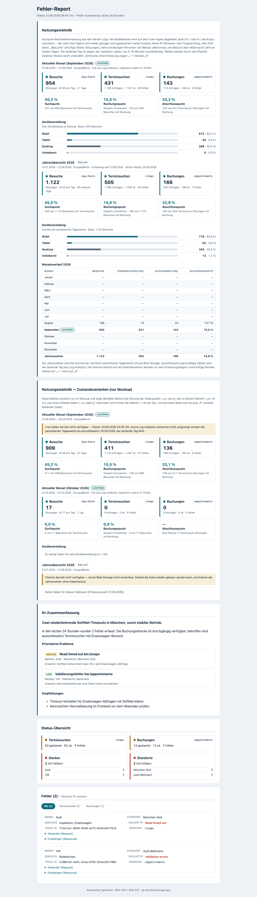

# REQ-037: Nutzungsstatistik auf der Statusseite (anonyme Geräte- und Conversion-Kennzahlen, Monat + Jahr)

**Status:** Draft
**Priority:** Medium
**Type:** Non-Functional
**Created:** 2026-09-21
**Author:** Rico Sonntag

---

## 1. Overview

### 1.1 Purpose

Die Statusseite aus REQ-030 (`GET /internal/report`, Basic Auth) beantwortet heute ausschließlich die Frage **„Was ist kaputt?"** — Ampel-Kacheln und Fehlerliste für ein 24-h-Fenster. Sie beantwortet **nicht** die Frage **„Wie wird die Anwendung genutzt?"**: Es ist unbekannt, wie viele Besucher überhaupt kommen, wie viele davon eine Terminsuche starten, wie viele am Ende wirklich buchen und ob die Nutzer mobil oder am Desktop unterwegs sind. Für die Priorisierung (Mobile-Optimierung, Abbruchquote im Buchungsfunnel) fehlt damit jede Datengrundlage. Die Information liegt technisch bereits vor — der `User-Agent`-Header wird bei jedem Request übertragen, wird aber im gesamten Backend **nirgends** ausgewertet (verifiziert am 21.09.2026, siehe §1.4).

Dieses Requirement ergänzt die Statusseite um einen **anonymen Nutzungsstatistik-Bereich ganz oben**, oberhalb der bestehenden Fehler-Sektionen:

1. **Geräteklassifizierung im Log-Pfad** — `LoggingFilter` leitet aus dem `User-Agent` eine von vier Klassen ab (`mobile` | `tablet` | `desktop` | `unknown`) und schreibt ausschließlich **diese Klasse** in die bestehende Access-Zeile. Der rohe User-Agent verlässt nie die lokale Variable. Die Ableitung ist an den Kill-Switch gekoppelt: bei `usage.enabled=false` wird der Header gar nicht erst gelesen (BR-13, Zweckbindung).
2. **Deterministische Aggregation ohne LLM** — neues Package `com.autohaus.backend.usage` mit eigenen, **immer aktiven** Beans (Aggregator, Store, Scheduler). Das Feature hängt bewusst **nicht** am LLM-Toggle aus REQ-030.
3. **Conversion-Funnel** — Besuche (App-Aufrufe) → Terminsuchen (`POST /api/v1/snaps`) → Buchungen (`POST /api/v1/appointments`), jeweils mit Conversion-Rate.
4. **Historie per Persistenz** — ein nächtlicher Rollup schreibt **Tageszeilen** mit reinen Integer-Zählern in eine kleine JSON-Datei in **Azure Blob Storage** (Managed Identity, kein Secret). Monat und Jahr werden aus diesen Tageszeilen summiert, weil die Log-Analytics-Retention (≈ 30 Tage) keine Jahresabfrage erlaubt.
5. **Zwei getrennte Blöcke** — „Aktueller Monat" und „Jahr" (der Jahresblock enthält zusätzlich eine Monatsreihe als Tabelle, AC-18), untereinander, ohne Umschalter, **ohne JavaScript und ohne externe Ressourcen**. Die `/internal/**`-Chain setzt heute **keine** CSP (verifiziert: `SecurityConfig.internalReportSecurityChain` konfiguriert keinerlei Header; der einzige CSP-Header der Anwendung — `frame-ancestors …` — steht in der `@Order(2)`-Chain und greift für `/internal/**` nicht). Dieses REQ ergänzt die fehlende CSP (AC-20).

> **Karpathy-Prinzip:** erst den Ist-Zustand erheben (§1.4), dann die **kleinstmögliche** Erweiterung des Log-Pfads (ein zusätzliches Feld), die Auswertung außerhalb des Request-Pfads, keine neue Datenkategorie erfinden — und die Anonymität nicht nachträglich absichern, sondern durch die Konstruktion erzwingen.

### 1.2 Scope

> **Nicht-Ziel / ausdrücklich:** Es entsteht **kein Web-Analytics-Produkt**. Keine Einzelnutzer-Verfolgung, keine Verweildauer, keine Seitenpfade, keine Absprungstellen im Wizard, keine Segmentierung nach Marke/Standort/Region. Gezählt werden **vier Kennzahlen** (Besuche, Terminsuchen, Buchungen, Geräteklasse) über **zwei Anzeigezeiträume** (aktueller Monat, laufendes Jahr). Der Jahresblock schlüsselt dieselben Kennzahlen zusätzlich **je Kalendermonat** auf — ohne neue Datenquelle, rein durch Summation derselben Tageszeilen (AC-18) — mehr nicht.

**Included (Backend `server/`):**
- `common/logging/DeviceClassifier.java` — deterministische User-Agent-Klassifikation (neu, ohne Bibliothek).
- `common/filter/LoggingFilter.java:33` — ein zusätzliches Log-Feld `"device"`.
- Neues Package `com.autohaus.backend.usage`: Aggregator (KQL), Blob-Client (REST + Managed Identity), In-Memory-Store, Scheduler (Refresh + nächtlicher Rollup), Renderer der HTML-Sektion, Records.
- `reporting/ReportHtmlGenerator.java` — Aufsplittung in Seitenrahmen + Report-Fragment, damit die Statistik **auch ohne Fehler-Report** gerendert wird; neue CSS-Regeln im bestehenden `<style>`-Block.
- `reporting/ReportController.java` + `reporting/ReportStore.java` — Komposition aus Statistik (immer) + Report-Fragment (wenn vorhanden); neuer Endpoint `GET /internal/report/usage.json`.
- `application.yml` + `config/UsageStatsProperties.java` — neue `usage.*`-Sektion, alle Werte aus Env.
- `config/SecurityConfig.java` — die `/internal/**`-Chain erhält eine CSP (AC-20), einen expliziten Basic-Auth-Realm (§12.2) und einen `WARN`-Listener für fehlgeschlagene Anmeldeversuche (AC-21). **Verhaltensänderung an der bestehenden REQ-030-Chain** — bewusst, begründet in §9.
- `server/build.gradle` — **eine** neue, explizite Dependency: `jackson-datatype-jsr310` (Begründung §14.1, Jackson-2-Mapper ohne Module).
- Azure: ein neuer Storage Account + Container + Data-Plane-Rollenzuweisung für die System-Managed-Identity (dokumentiert, manueller Einmal-Schritt, siehe §3.1).

**Excluded:**
- **Keine Angular-Änderung.** Die Statusseite ist serverseitig gerendertes HTML; das Frontend liefert lediglich den bereits existierenden `X-Session-Id`-Header (REQ-029).
- **Keine Cookies, kein Web Storage, kein Fingerprinting, keine IP-Auswertung, kein Consent-Banner** (Begründung §9).
- **Keine Erhöhung der Log-Analytics-Retention** (Kosten) — stattdessen Tages-Rollup ins Blob.
- **Kein Azure SDK.** Der Blob-Zugriff läuft über `RestClient` + Managed-Identity-Token, analog `LogAnalyticsClient` (Begründung: `server/build.gradle:23-26` — bewusster Verzicht wegen Jackson-2/3-Konflikt unter Spring Boot 4).
- **Keine Erweiterung von `ReportModel`.** Die Statistik wird vom Controller **komponiert**, nicht in das Fehler-Report-Modell gemischt (vermeidet den Ripple über 7 Konstruktionsstellen und hält die Statistik LLM-unabhängig).
- Keine Änderung an der Buchungsstrecke, an SoftNet-Requests oder an `LogSanitizer.SENSITIVE_FIELDS`.

### 1.3 Related Requirements
- **REQ-029**: Backend-Error-Logging (Trace-ID, `LoggingFilter`-Access-Zeile) — **liefert die Datenquelle**, die hier um genau ein Feld erweitert und ausgewertet wird.
- **REQ-030**: AI-Error-Report — die Statusseite, ihr HTML-Generator, `LogAnalyticsClient` (Managed-Identity-Muster) und die Basic-Auth-Chain, in die sich dieses Feature einhängt.
- **REQ-034**: Datensparsames Logging (`LogSanitizer`, `PiiRedactor`) — die Datenschutz-Leitplanke, zu der dieses Feature konsistent bleiben muss (§9, BR-3).
- REQ-020/REQ-022: Azure Container App + Log Analytics Workspace + System-Managed-Identity.

### 1.4 Nutzungsdaten-Inventar (Ist-Zustand, verifiziert 21.09.2026)

> **Lesart:** Die Spalte „Heute auswertbar" bewertet ausschließlich, ob sich die Kennzahl **aus den vorhandenen Log-Zeilen** ohne Code-Änderung berechnen ließe. Sie sagt nichts darüber aus, ob die Daten erhoben werden dürfen — das klärt §9.

| Kennzahl | Datenquelle heute | Heute auswertbar | Änderung nötig |
|----------|-------------------|------------------|----------------|
| Besuche (App-Aufrufe) | `"sessionId"` in `common/filter/LoggingFilter.java:33` (kommt aus `X-Session-Id`, erzeugt in `src/app/core/http/trace.service.ts:34-38`) | **Ja** — distinct `sessionId` | Nein (nur Auswertung) |
| Terminsuchen | Access-Zeile `"method":"POST"` + `/api/v1/snaps` + `"statusCode"` | **Ja** — Muster existiert in `ReportAggregator.SNAPS_STATS_KQL` | Nein |
| Buchungen | Access-Zeile `"method":"POST"` + `/api/v1/appointments` | **Ja** — `ReportAggregator.BOOKING_STATS_KQL` | Nein |
| Geräteklasse | — | **Nein** — `User-Agent` wird im gesamten Repo nicht gelesen (`grep -rni "user-agent" server/src src` → 0 Treffer) | **Ja** — neues Feld `"device"` |
| Historie > 30 Tage | `ContainerAppConsoleLogs_CL` | **Nein** — Retention ≈ 30 Tage (REQ-034 §7.3) | **Ja** — Tages-Rollup ins Blob |
| IP-Adresse | `common/filter/OriginFilter.java:74` — bereits per `LogSanitizer.maskIp` gekürzt (REQ-034) | irrelevant | Nein — **wird nicht verwendet** |

> **Zentrale Erkenntnis:** Drei der vier Kennzahlen sind **bereits heute in den Logs** — es fehlen nur die Geräteklasse (ein Log-Feld) und die Langzeit-Historie (eine kleine JSON-Datei). Es muss **keine neue Datenkategorie** erhoben werden, und die Erweiterung des Log-Pfads beschränkt sich auf ein einziges Feld mit vier möglichen Werten.

---

## 2. User Story

**As a** Betreiber/Produktverantwortlicher der Terminbuchungs-Anwendung
**I want** oben auf der bestehenden Statusseite eine anonyme Übersicht, wie viele Besucher kommen, welche Geräteklasse sie nutzen, wie viele eine Terminsuche starten und wie viele tatsächlich buchen — aufgeschlüsselt nach aktuellem Monat und laufendem Jahr
**So that** ich Mobile-Optimierung datenbasiert priorisieren, die Abbruchquote im Buchungsfunnel erkennen und die Entwicklung über das Jahr verfolgen kann, ohne personenbezogene Daten zu erheben.

**Acceptance Criteria:**
- [ ] AC-1: Bei aktiviertem Feature (`usage.enabled=true`, Default) schreibt `LoggingFilter` pro Request **ein zusätzliches Feld** `"device"` mit genau einem der Werte `mobile` | `tablet` | `desktop` | `unknown`. Der **rohe User-Agent-String erscheint in keiner Log-Zeile** und wird nirgends gespeichert. Bei `usage.enabled=false` wird weder der `User-Agent` noch `Sec-CH-UA-Mobile` gelesen und die Access-Zeile bleibt **unverändert** gegenüber heute (BR-13).
- [ ] AC-2: Die Statusseite enthält eine neue Sektion `<section class="us" aria-labelledby="us-h">` **direkt nach** `<header class="hd">` und **vor** `<section class="ai">` — also oberhalb der KI-Zusammenfassung und der Fehlerliste. **Verbindlich für den HTML/CSS-Vertrag ist die Klassentabelle in §11.2** (kebab-case wie im bestehenden Generator, kein BEM); `mockup.html` ist die **visuelle** Referenz und wird auf genau diese Klassennamen angeglichen.
- [ ] AC-3: Die Sektion besteht aus **zwei untereinander liegenden Blöcken** — „Aktueller Monat (\<Monat Jahr\>)" und „Jahresübersicht \<Jahr\>" — **ohne Umschalter und ohne JavaScript**: reines Server-HTML mit Inline-CSS, keine externen Ressourcen, vereinbar mit der in AC-20 festgelegten CSP.
- [ ] AC-4: Jeder Block zeigt die **Geräteverteilung** (mobil / Tablet / Desktop / unbekannt) je mit Absolutzahl **und** Prozentanteil auf **eine Nachkommastelle**; die vier Anteile summieren sich **exakt auf 100,0 %** (Largest-Remainder-Verfahren, Rundungsdifferenz auf die größte Klasse gebucht — berechnet in **einem** Aufruf über alle vier Werte, siehe `DeviceBreakdown.percentages()` in §10.2). Bei `total == 0` steht viermal „—".
- [ ] AC-5: Jeder Block zeigt den **Funnel** Besuche → Terminsuchen → Buchungen (drei Kacheln mit Absolutzahlen) **und darunter** einen eigenen Quoten-Bereich (`.us-rates`) mit den drei **sitzungsbasierten** Quoten **Suchquote**, **Buchungsquote (Gesamt-Conversion)** und **Abschlussquote** nach BR-6, jeweils auf **eine Nachkommastelle** gerundet. Eine Quote aus Request-Zahlen (`bookingRequestsOk / searchRequestsOk`) ist **ausdrücklich nicht** zulässig — die Request-Zahlen erscheinen ausschließlich als Untertitel der Funnel-Kacheln.
- [ ] AC-6: Die Statistik wird gerendert, **auch wenn `LLM_API_KEY`/`LLM_MODEL` nicht gesetzt sind**. Liegt kein Fehler-Report vor, zeigt die Seite die Statistik **plus** den bisherigen Hinweistext — nicht mehr nur den Platzhalter.
- [ ] AC-7: Die Aggregation läuft **ausschließlich im Scheduler** (Startup + alle 15 min + nächtlicher Rollup). `GET /internal/report` liest nur den In-Memory-Snapshot und führt **keine** Log-Analytics- oder Blob-Abfrage im Request-Pfad aus; Antwortzeit < 200 ms.
- [ ] AC-8: Der nächtliche Rollup schreibt **eine Tageszeile pro Kalendertag (Europe/Berlin)** in eine JSON-Datei in Azure Blob Storage, authentifiziert über **System-Managed-Identity** (kein Secret). Der Lauf ist **idempotent**: absolute Tageswerte werden **ersetzt**, niemals inkrementiert.
- [ ] AC-9: Beim nächtlichen Lauf werden **fehlende Tage der letzten 25 Tage nachgezogen** (Catch-up nach Container-Ausfall oder verpasster Nacht) — innerhalb der Log-Analytics-Retention.
- [ ] AC-10: Bei parallelen Läufen (mehrere Replicas, Deploy mit zwei Revisionen) geht kein Tag verloren: Schreibzugriff mit **ETag / `If-Match`**, bei HTTP 412 neu lesen, mergen, erneut schreiben (max. 3 Versuche).
- [ ] AC-11: Ist **Log Analytics** nicht erreichbar, lädt die Seite trotzdem: Historie aus dem Blob + Hinweis „Live-Daten derzeit nicht verfügbar". Ist das **Blob** nicht erreichbar, lädt die Seite trotzdem: nur der laufende Tag + Hinweis „Historie derzeit nicht verfügbar". **Nie 5xx, nie eine leere Seite.**
- [ ] AC-12: Zeiträume ohne Daten (Monate vor der Inbetriebnahme) werden als **„keine Daten" (—)** dargestellt, **nicht als „0"**.
- [ ] AC-13: Eine Conversion-Rate mit Divisor 0 wird als **„—"** ausgegeben — keine Division durch Null, kein `NaN`, kein `Infinity`.
- [ ] AC-14: **Anonymität:** keine Cookies, kein Web Storage, kein Fingerprinting, keine IP-Adresse, kein roher User-Agent, keine Sitzungsliste, kein Drill-down. Die persistierte Datei enthält **ausschließlich ganzzahlige Zähler** (keine Session-IDs, keine Einzel-Zeitstempel).
- [ ] AC-15: `/api/v1/health` (Azure-URL-Ping-Tests, ≈ 1 440 Requests/Tag) und alle `/internal/**`-Aufrufe sind aus **sämtlichen** Zählungen ausgeschlossen.
- [ ] AC-16: `GET /internal/report/usage.json` liefert hinter Basic Auth dasselbe Aggregat maschinenlesbar als JSON (Verifikation/Monitoring); ohne Credentials → `401`.
- [ ] AC-17: Die Sektion ist bei ≤ 40em **einspaltig und ohne horizontales Scrollen der Seite** lesbar; die Monatstabelle reduziert sich dort auf vier Spalten (§11.2) und liegt zusätzlich in einem fokussierbaren `role="region"`-Container als Rückfallebene. Sie nutzt die bestehenden CSS-Variablen aus `ReportHtmlGenerator.css()` sowie **genau die fünf in §11.2 namentlich freigegebenen neuen Tokens** (keine weiteren Hex-Farben) und erfüllt WCAG 2.1 AA: Textkontrast ≥ 4.5:1, Balken-gegen-Spur-Kontrast ≥ 3:1 (1.4.11), Prozentanteile zusätzlich als Text, Statusangaben nie allein über Farbe (1.4.1).
- [ ] AC-18: Der **Jahresblock** enthält unter den Kacheln eine Tabelle „Monatsverlauf \<Jahr\>" mit **einer Zeile je Kalendermonat** des laufenden Jahres (Januar bis Dezember) und den Spalten Monat · Besuche · Terminsuchen (ok) · Buchungen (ok) · Buchungsquote. Monate **vor Erfassungsbeginn** und künftige Monate erscheinen als „—" (`.us-nd`), der laufende Monat ist über ein **echtes DOM-Element** (`.us-badge`, Text „laufend") gekennzeichnet — nicht über `::after`-Content und nicht allein über Farbe. Eine `<tfoot>`-Zeile zeigt die Jahressumme. **Geräte-Spalten enthält die Tabelle nicht** (Begründung §11.2).
- [ ] AC-19: **Mindestfallzahl:** Die Geräteverteilung eines Zeitraums wird nur ausgegeben, wenn der Zeitraum mindestens `MIN_VISITS_FOR_BREAKDOWN` = **20** Besuche hat; darunter erscheint statt der vier Balken der Hinweis „Zu wenig Daten für eine Geräteverteilung (n < 20)". Besuchs-, Such- und Buchungszahlen sowie die Quoten bleiben sichtbar (BR-12).
- [ ] AC-20: Die `/internal/**`-Chain sendet `Content-Security-Policy: default-src 'none'; style-src 'self' 'unsafe-inline'; img-src 'none'; form-action 'none'; frame-ancestors 'none'; base-uri 'none'`. Die Seite bleibt damit vollständig darstellbar (nur Inline-CSS, keine Skripte, keine externen Ressourcen).
- [ ] AC-21: `POST /internal/report/refresh` ist serverseitig gedrosselt: frühestens **60 s** nach dem letzten Lauf, sonst `429` **ohne** KQL-/Blob-Aufruf. Fehlgeschlagene Basic-Auth-Versuche auf `/internal/**` werden als `WARN` mit `LogSanitizer.maskIp(...)` geloggt (kein Benutzername im Klartext, kein Passwort).
- [ ] AC-22: Bei `usage.enabled=false` enthält das HTML von `GET /internal/report` **weder** `class="us"` **noch** einen Verfügbarkeits-Hinweis zur Statistik; `GET /internal/report/usage.json` antwortet `404`. Der Rest der Seite ist unverändert.

---

## 3. Preconditions

### 3.1 System

- Spring Boot Backend läuft (lokal `:3000` oder Azure Container App `gs-terminbuchungs-app`, RG `DefaultResourceGroup-DEWC`, westeurope).
- **System-Managed-Identity** aktiv (Principal-ID `bf7a675c-a2e3-487b-809f-b6483033ff0b`) mit der Rolle **„Log Analytics Reader"** auf dem Workspace `workspacedefaultresourcegroupdewc99c4` (Custom-ID `f4bd94f3-490e-44e2-b5e3-f98bcc5aea38`) — Bestand aus REQ-030.
- **Neu, einmalig:** Storage Account + Container + **Data-Plane-Rolle**. „Owner"/„Contributor" auf der Resource Group reicht für den Datenpfad **nicht** — es braucht zwingend `Storage Blob Data Contributor`. Das gilt **auch für die ausführende Person**: sobald `--allow-shared-key-access false` gesetzt ist (siehe unten), läuft `az storage container create --auth-mode login` über den Datenpfad und scheitert ohne eigene Data-Plane-Rolle mit `AuthorizationPermissionMismatch`. Deshalb die Reihenfolge: Account anlegen → **eigene** Rolle auf Account-Scope → RBAC-Propagation abwarten (bis ≈ 5 min) → Container anlegen → Rolle für die Managed Identity auf **Container-Scope**.
  ```bash
  SUB=044bbaf1-5d0f-44ee-bb52-c42c729c93d9
  RG=DefaultResourceGroup-DEWC
  SA=gsterminbuchungstats          # 3-24 Zeichen, lowercase alnum, global eindeutig
  PID=bf7a675c-a2e3-487b-809f-b6483033ff0b
  ME=$(az ad signed-in-user show --query id -o tsv)
  ACCT="/subscriptions/$SUB/resourceGroups/$RG/providers/Microsoft.Storage/storageAccounts/$SA"

  # 1) Account — Shared Keys deaktiviert, damit die Container-Scope-Rolle nicht per
  #    listKeys umgangen werden kann (§9 "Managed Identity"); Soft-Delete/Versioning aus,
  #    damit gelöschte Tageszeilen nicht über die zugesagten 24 Monate hinaus liegen bleiben.
  az storage account create -n $SA -g $RG -l westeurope \
    --sku Standard_LRS --kind StorageV2 \
    --min-tls-version TLS1_2 --allow-blob-public-access false --https-only true \
    --allow-shared-key-access false --allow-cross-tenant-replication false

  az storage account blob-service-properties update -n $SA -g $RG \
    --enable-delete-retention false --enable-container-delete-retention false \
    --enable-versioning false --enable-change-feed false

  # 2) Eigene Data-Plane-Rolle (Owner allein genügt NICHT), dann Propagation abwarten
  az role assignment create --assignee-object-id $ME --assignee-principal-type User \
    --role "Storage Blob Data Contributor" --scope "$ACCT"
  sleep 300

  # 3) Container (läuft über den Datenpfad, daher Schritt 2 zwingend vorher)
  az storage container create --account-name $SA -n usage-stats --auth-mode login

  # 4) Managed Identity — eng auf Container-Scope
  az role assignment create --assignee-object-id $PID --assignee-principal-type ServicePrincipal \
    --role "Storage Blob Data Contributor" \
    --scope "$ACCT/blobServices/default/containers/usage-stats"
  ```
  > **Alternative ohne eigene Data-Plane-Rolle:** Den Container control-plane-seitig per ARM/Bicep (`Microsoft.Storage/storageAccounts/blobServices/containers`) anlegen — dafür genügen Owner-/Contributor-Rechte. Schritt 2 entfällt dann.
  > **Außerbetriebnahme:** Wird das Feature abgeschaltet, werden Container **und** Storage Account gelöscht (`az storage account delete`); damit endet auch die Aufbewahrung der Aggregate (NFR-Datenschutz-7).
- Container erreicht `<account>.blob.core.windows.net` und `api.loganalytics.io`.
- Logback-Pattern aus REQ-029 aktiv (`%d{ISO8601} [%thread] %-5level %logger{36} - %X{traceId:-system}: %msg%n`) — daraus resultiert das von den KQL-Queries gematchte Präfix `INFO  HTTP` (zwei Leerzeichen durch `%-5level`-Padding). **Das Spring-Profil `json` (LogstashEncoder, `logback-spring.xml:12-21`) wird für dieses Feature nicht unterstützt** und ist in Produktion nicht aktiv.

### 3.2 User
- Für die Statusseite: Betreiber mit den Basic-Auth-Credentials (`REPORT_ADMIN_USER` / `REPORT_ADMIN_PASSWORD`) — unverändert aus REQ-030.
- n/a für Endnutzer der Buchungsstrecke: kein UI, keine Interaktion, keine Einwilligung (§9).

### 3.3 Data

| Variable | Zweck |
|----------|-------|
| `USAGE_STATS_ENABLED` | Kill-Switch für das gesamte Feature (Default `true`) — gated **Erhebung** (Log-Feld `device`), **Aggregation** (Scheduler, KQL, Blob), **Rendering** (Sektion) und **Endpoint** (`usage.json`). Bei `false` verhält sich die Anwendung exakt wie vor REQ-037 (AC-22, BR-13) |
| `USAGE_STORAGE_ACCOUNT` | Name des Storage Accounts (leer → Historie deaktiviert, Seite läuft weiter) |
| `USAGE_STORAGE_CONTAINER` | Blob-Container (Default `usage-stats`) |
| `USAGE_STORAGE_BLOB` | Dateiname (Default `usage-daily.json`) |
| `USAGE_REFRESH_CRON` | Takt der Live-Aktualisierung (Default `0 */15 * * * *`) |
| `USAGE_ROLLUP_CRON` | Nächtlicher Rollup (Default `0 30 3 * * *` — bewusst **nach** `REPORT_CRON` `0 0 3`) |
| `USAGE_ZONE` | Zeitzone für Tages-/Monatsgrenzen (Default `Europe/Berlin`) |
| `USAGE_RETENTION_MONTHS` | Rollierende Aufbewahrung im Blob (Default `24`) |
| `USAGE_REFRESH_MIN_INTERVAL_SECONDS` | Drosselung von `POST /internal/report/refresh` (Default `60`, AC-21) |
| `LOG_WORKSPACE_ID` | Bestand aus REQ-030 — wird wiederverwendet |
| *(Managed Identity)* | **kein Secret** — automatisch über die Container-App-Identität |

- Das Frontend sendet bereits `X-Session-Id` an alle `/api/`-Requests (`src/app/core/http/session-token.interceptor.ts:36`) — keine Änderung nötig.

---

## 4. Main Flow

### Mockup


**Step 1: Request wird geloggt (Erfassung)**
- **System:** `LoggingFilter` liest im `finally`-Block — **nur wenn `usage.enabled` true ist** — `request.getHeader("User-Agent")` und `request.getHeader("Sec-CH-UA-Mobile")` in **lokale Variablen**, übergibt sie an `DeviceClassifier.classifyDevice(...)` und schreibt ausschließlich das Ergebnis als `"device"` in die bestehende Access-Zeile. Die lokalen Variablen verlassen die Methode nicht.
- **Expected:** Eine Log-Zeile pro Request mit `correlationId`, `sessionId`, `method`, `url`, `statusCode`, `duration`, `device` — ohne rohen User-Agent.

**Step 2: Live-Aktualisierung des laufenden Tages (alle 15 min)**
- **System:** `UsageStatsScheduler.refreshCurrentUsage()` fragt über `LogAnalyticsClient` drei KQL-Queries für **den laufenden Kalendertag** (Europe/Berlin, in UTC-Grenzen übersetzt) ab: Besuche je Geräteklasse, Terminsuchen, Buchungen. Ergebnis → `DailyUsage` für heute.
- **Expected:** `UsageStatsStore` hält einen frischen Tageswert; Ingestion-Latenz von 5-15 min (`docs/infrastructure/azure-read.md:329`) ist bekannt und wird auf der Seite ausgewiesen.

**Step 3: Historie laden + Perioden berechnen**
- **System:** `UsageStatsService.loadUsageHistory()` liest die Blob-Datei (gecacht, Reload beim Refresh-Lauf) und summiert daraus die Tageszeilen des **aktuellen Monats** und des **laufenden Kalenderjahres**. Die Live-Tage aus Step 2 (heute **und** jeder noch nicht gerollte Vortag, siehe BR-9) werden zu beiden Summen addiert; ein Tag, der im Blob steht, gewinnt immer gegen den Live-Wert, sodass keine Doppelzählung entsteht. `computeConversionRate(...)` bildet die drei Quoten; `UsageStatsService.buildMonthlySeries()` summiert dieselben Tageszeilen zusätzlich je Kalendermonat (AC-18).
- **Expected:** Zwei `PeriodUsage`-Objekte („Monat", „Jahr") plus zwölf Monatszeilen im `UsageStatsStore`.

**Step 4: Seitenaufruf**
- **User:** Öffnet `/internal/report` (Basic-Auth-Dialog des Browsers).
- **System:** `ReportController` holt den Snapshot aus dem `UsageStatsStore` (reiner Speicherzugriff), rendert über `UsageSectionRenderer.render(usage)` die Sektion `<section class="us">` und komponiert die Seite über `ReportHtmlGenerator.renderPage(usage, fragment)`: Kopf → **Statistik** → Fehler-Report-Fragment (falls vorhanden) bzw. Hinweistext → Footer. Bei `usage.enabled=false` übergibt der Controller `null` als `usage`, und `renderPage(...)` lässt die Sektion ersatzlos weg (AC-22).
- **Expected:** Seite in < 200 ms, Statistik ganz oben, darunter unverändert KI-Zusammenfassung / Status-Übersicht / Fehlerliste.

**Step 5: Nächtlicher Rollup (03:30 Europe/Berlin)**
- **System:** `UsageStatsScheduler.rollUpPreviousDay()` aggregiert den **Vortag** (max. 2 Tage alt → immer innerhalb der Retention), prüft die letzten 25 Tage auf Lücken und zieht fehlende nach. `persistDailySnapshot(...)` liest das Blob inkl. `ETag`, **ersetzt** die betroffenen Tageszeilen, entfernt Tage älter als `USAGE_RETENTION_MONTHS` und schreibt mit `If-Match` zurück.
- **Expected:** Blob enthält je Kalendertag genau eine Zeile mit absoluten Zählern; wiederholte Läufe erzeugen dasselbe Ergebnis. Der **Retention-Purge läuft unabhängig davon**, ob für den Vortag ein neuer Wert ermittelt werden konnte (NFR-Datenschutz-7); liegt der jüngste Tag im Blob mehr als **3 Tage** zurück, wird das als `WARN` geloggt und als Hinweis auf der Seite ausgewiesen (§9 Observability).

**Step 6: Monatswechsel**
- **System:** Am 1. eines Monats greift `startOfMonth` (Europe/Berlin) auf den neuen Monat; der Monatsblock beginnt bei den Zahlen des laufenden Tages, der Jahresblock wächst weiter.
- **Expected:** Kein manueller Eingriff, kein Datenverlust — der Vormonat bleibt als Tageszeilen im Blob erhalten.

---

## 5. Alternative Flows

### 5.1 Alt Flow A: Erste Inbetriebnahme (noch keine Historie)

**Trigger:** Das Blob existiert noch nicht (HTTP 404 beim ersten `GET`).

**Flow:**
1. `UsageBlobClient` behandelt 404 als „leere Historie" (kein Fehler) und liefert `UsageHistory.empty()`.
2. Der erste nächtliche Lauf legt die Datei per `PUT` mit `If-None-Match: *` an und zieht per Catch-up bis zu 25 zurückliegende Tage nach — **Besuche, Terminsuchen und Buchungen sind dadurch sofort rückwirkend vorhanden**, die Geräteklasse jedoch erst ab dem Deploy. Zeilen ohne `"device"` liefern in KQL einen **Leerstring**; die Query bildet diesen (und jeden nicht zur Whitelist gehörenden Wert) **explizit** auf `unknown` ab (§12.4, BR-2), damit die Summe der vier Geräteklassen immer der Besuchszahl entspricht (AC-4).
3. Der Jahresblock weist aus: „Erfassung seit \<Datum\>" statt eines vollen Kalenderjahres.

### 5.2 Alt Flow B: Monat ohne Nutzung

**Trigger:** Im Zeitraum gab es 0 Besuche.

**Flow:**
1. `PeriodUsage.visits == 0` und `hasData == true` (es gab Tageszeilen, sie sind nur leer).
2. Der Block zeigt „0 Besuche"; alle Conversion-Raten stehen auf „—" (Divisor 0, siehe BR-6).
3. Die Geräteverteilung entfällt zugunsten des Hinweises „Zu wenig Daten für eine Geräteverteilung (n < 20)" (BR-12) — **kein** „keine Daten für diesen Zeitraum", weil der Zeitraum belegbar erfasst wurde (`hasData == true`). Die Besuchszahl „0" wird ausgewiesen.

### 5.3 Alt Flow C: Feature abgeschaltet

**Trigger:** `USAGE_STATS_ENABLED=false`.

**Flow:**
1. **Konditional sind genau zwei Beans:** `UsageStatsScheduler` und `UsageStatsAggregator` tragen `@ConditionalOnProperty(name="usage.enabled", havingValue="true", matchIfMissing=true)` und werden nicht erzeugt; es laufen keine KQL- und keine Blob-Abfragen. `UsageStatsStore`, `UsageStatsService`, `UsageBlobClient` und `UsageSectionRenderer` bleiben unbedingte `@Component` (sie sind ohne Scheduler wirkungslos und kosten nichts).
2. `LoggingFilter` liest **weder** `User-Agent` **noch** `Sec-CH-UA-Mobile` und schreibt **kein** `"device"`-Feld (BR-13). Es wird also nichts „auf Vorrat" erhoben; nach dem Wiedereinschalten beginnt die Geräteerfassung neu (Besuche, Terminsuchen und Buchungen lassen sich dagegen weiterhin rückwirkend aus dem Bestandslog nachziehen).
3. `ReportController` fragt `UsageStatsProperties.enabled()` ab und ruft `renderPage(null, fragment)`; `renderPage(...)` lässt die Sektion bei `usage == null` **vollständig** weg — **kein** „derzeit nicht verfügbar"-Hinweis (AC-22). `GET /internal/report/usage.json` antwortet `404`, `POST /internal/report/refresh` aktualisiert nur den Fehler-Report (sofern dessen Scheduler-Bean existiert). Alles Übrige bleibt unverändert.

---

## 6. Exception Flows

### 6.1 Exception E1: Log Analytics nicht erreichbar

**Trigger:** `LogAnalyticsClient.LogAnalyticsUnavailableException` — lokal fehlt `IDENTITY_ENDPOINT` (Normalfall bei Entwicklung/Smoke-Test), in Azure Netzwerk-/Token-Fehler oder KQL-Fehler.

**Flow:**
1. `UsageStatsAggregator` fängt die Exception, loggt `WARN` (ohne Stacktrace-Spam) und liefert `Optional.empty()` für den laufenden Tag.
2. Der `UsageStatsStore` behält den **letzten erfolgreichen** Snapshot; die Perioden werden aus der Blob-Historie **ohne** heutigen Tag gebildet.
3. Die Sektion rendert mit dem Hinweis „Live-Daten derzeit nicht verfügbar — Stand: \<letzter erfolgreicher Abruf\>". HTTP 200, die Seite bleibt vollständig nutzbar.

### 6.2 Exception E2: Blob Storage nicht erreichbar / nicht konfiguriert

**Trigger:** `UsageBlobClient.BlobUnavailableException` (403 wegen fehlender Data-Plane-Rolle, Netzwerk, Token) oder `USAGE_STORAGE_ACCOUNT` leer.

**Flow:**
1. Fehler wird einmal je Lauf als `WARN` geloggt (kein Abbruch des Refresh-Zyklus).
2. Die Perioden werden **nur aus dem laufenden Tag** gebildet; Monat und Jahr zeigen zusätzlich den Hinweis „Historie derzeit nicht verfügbar — es werden nur die Zahlen des laufenden Tages gezeigt."
3. Der nächtliche Rollup überspringt den Schreibvorgang und versucht es in der Folgenacht erneut; dank Catch-up (AC-9) geht kein Tag verloren, solange der Ausfall < 25 Tage dauert.

### 6.3 Exception E3: Schreibkonflikt beim Rollup (mehrere Replicas)

**Trigger:** `PUT` auf das Blob antwortet `412 Precondition Failed`, weil eine andere Replica zwischenzeitlich geschrieben hat.

**Flow:**
1. `persistDailySnapshot(...)` liest das Blob neu (frischer `ETag`), führt den Merge erneut aus und schreibt erneut — **max. 3 Versuche** mit kurzem Backoff.
2. Da der Rollup **absolute Werte ersetzt** statt zu inkrementieren (BR-8), ist jedes Ergebnis identisch — ein „Lost Update" ist fachlich folgenlos.
3. Scheitern alle 3 Versuche → `WARN`, kein Abbruch; die Folgenacht zieht den Tag per Catch-up nach.

### 6.4 Exception E4: Unbrauchbare oder fremde Blob-Daten

**Trigger:** Die Datei ist kein valides JSON, hat eine unbekannte `schemaVersion` oder enthält negative/nicht-numerische Werte.

**Flow:**
1. `UsageHistory` wird als leer behandelt (kein Crash), `ERROR` mit Dateiname und `schemaVersion` wird geloggt.
2. Die Datei wird **nicht** überschrieben, damit sie manuell analysiert werden kann; der Rollup schreibt keine neuen Tageszeilen, bis das Problem behoben ist. **Die Seite weist das aus** („Historie derzeit nicht verfügbar" plus „letzter Rollup: \<Datum\>"), und da nichts geschrieben wird, entsteht auch keine unbemerkte Verlängerung der Aufbewahrung — die Datei bleibt eingefroren und wird beim Beheben vollständig neu geschrieben (inkl. Retention-Purge, NFR-Datenschutz-7).
3. Die Seite zeigt den Hinweis aus E2 („Historie derzeit nicht verfügbar").

### 6.5 Exception E5: Basic Auth fehlt/falsch

**Trigger:** Aufruf von `/internal/report` oder `/internal/report/usage.json` ohne bzw. mit falschen Credentials.

**Flow:**
1. Die `/internal/**`-`SecurityFilterChain` (`config/SecurityConfig.java:46-56`, `@Order(1)`) antwortet `401` mit `WWW-Authenticate: Basic realm="internal"` — der Realm wird in diesem REQ explizit gesetzt (`httpBasic(b -> b.realmName("internal"))`); **heute** liefert `httpBasic(Customizer.withDefaults())` den Spring-Default `realm="Realm"` (verifiziert in `SecurityConfig.java:54`). Fehlversuche werden als `WARN` mit maskierter IP geloggt (AC-21).
2. Es werden **keine** Zahlen ausgeliefert. Ohne gesetztes `REPORT_ADMIN_PASSWORD` bleibt die Seite gesperrt (zufälliges UUID-Passwort, `SecurityConfig:89-100`).

---

## 7. Postconditions

### 7.1 Success
- `UsageStatsStore` hält einen Snapshot mit zwei Perioden („Monat", „Jahr"), der 12-teiligen Monatsreihe (AC-18), dem Zeitstempel des letzten erfolgreichen Abrufs, `lastRollupDay` und den Verfügbarkeits-Flags.
- `GET /internal/report` liefert die Statusseite mit der Statistik-Sektion **ganz oben**, unabhängig vom LLM-Toggle.
- Das Blob enthält je Kalendertag genau eine Zeile mit ausschließlich ganzzahligen, anonymen Zählern; Tage älter als `USAGE_RETENTION_MONTHS` sind entfernt.
- Log enthält eine INFO-Zeile `usage stats refreshed: N visits today` bzw. `usage rollup written: N day(s)`.

### 7.2 Failure
- Bei Ausfall einer der beiden Quellen bleibt die Seite vollständig abrufbar; die fehlende Quelle wird **sichtbar benannt**, nicht durch Nullen kaschiert.
- Kein Zustand der Buchungsstrecke wird verändert (reiner Read-only-Consumer); keine Kunden-Requests werden verzögert oder blockiert.
- Bei Fehlern im Statistik-Pfad bleibt der bestehende Fehler-Report aus REQ-030 unberührt.

---

## 8. Business Rules

- **BR-1 (Geräteklassen — abschließend):** Es existieren **genau vier** Werte: `mobile`, `tablet`, `desktop`, `unknown`. Es gibt bewusst **keine** Klasse `bot` — Bots und Crawler führen kein JavaScript aus, erzeugen daher keine `sessionId` und fallen durch BR-4 automatisch heraus. **Zusicherung auf beiden Seiten:** Der Klassifizierer gibt ausschließlich einen dieser vier Werte zurück, und die Auswertung bildet jeden anderen Wert — insbesondere den **Leerstring** aus Log-Zeilen von vor dem Deploy — serverseitig **wie auch in der KQL** auf `unknown` ab. Damit gilt immer `visits.total() == visitCount` (AC-4).
- **BR-2 (Klassifikationsregeln):** `DeviceClassifier.classifyDevice(...)` wertet den auf 512 Zeichen gekappten, per `toLowerCase(Locale.ROOT)` normalisierten User-Agent **in dieser Reihenfolge** aus — die erste zutreffende Regel gewinnt:

  | # | Bedingung | Ergebnis |
  |---|-----------|----------|
  | 1 | `null`, leer oder nur Whitespace | `unknown` |
  | 2 | enthält `ipad`, `tablet`, `kindle`, `silk`, `playbook` **oder** (`android` **und nicht** `mobi`) | `tablet` |
  | 3 | enthält `mobi`, `iphone`, `ipod`, `android`, `windows phone`, `blackberry` | `mobile` |
  | 4 | enthält `windows nt`, `macintosh`, `x11`, `cros`, `linux` | `desktop` |
  | 5 | Regeln 1-4 greifen nicht, aber Header `Sec-CH-UA-Mobile` vorhanden | `?1` → `mobile`, `?0` → `desktop` |
  | 6 | sonst | `unknown` |

  **Whitelist beim Einlesen:** Jeder aus einer Log-Zeile gelesene `device`-Wert, der nicht exakt einem der vier Literale entspricht (leer, abgeschnitten, fremd), wird auf `unknown` gemappt — in der KQL per `iff(isempty(Device) or Device !in ('mobile','tablet','desktop','unknown'), 'unknown', Device)` und im `UsageStatsAggregator` identisch (BR-1, §12.4).

  **Tablet wird vor Mobile geprüft**, weil iPad-User-Agents beide Merkmale enthalten. **Bekannte Grenze:** iPadOS-Safari im Desktop-Modus sendet einen Macintosh-User-Agent und wird als `desktop` gezählt — eine Unterscheidung wäre nur per Fingerprinting möglich und ist daher ausgeschlossen (BR-3). Tablets werden dadurch systematisch leicht unterzählt.
- **BR-3 (keine Roh-Header, kein Fingerprinting):** **Weder der rohe `User-Agent` noch der Client-Hint-Header `Sec-CH-UA-Mobile`** wird geloggt, weitergegeben, persistiert oder in eine Fehlermeldung, Debug-Zeile oder Exception aufgenommen — auch nicht gekürzt. Es werden keine weiteren Dimensionen erhoben (kein Betriebssystem, keine Browserversion, keine Auflösung, keine Region, keine Sprache) — jede zusätzliche Dimension erhöht die Re-Identifizierbarkeit bei kleinen Fallzahlen. **Keine aktive Abfrage der Endeinrichtung:** Die Anwendung setzt **keinen `Accept-CH`-Response-Header** und fordert **keine High-Entropy-Client-Hints** an (`Sec-CH-UA-Platform-Version`, `Sec-CH-UA-Model`, `Sec-CH-UA-Full-Version-List` …). Ausgewertet wird ausschließlich der ohnehin vom Browser gesendete Low-Entropy-Hint `Sec-CH-UA-Mobile` — diese Einschränkung trägt die Consent-Bewertung in NFR-Datenschutz-3 und ist per Regressionstest abgesichert (TC-3).
- **BR-4 (Definition „Besuch"):** Ein **Besuch** ist eine **eindeutige `sessionId`** auf `/api/`-Log-Zeilen innerhalb eines Kalendertages (Europe/Berlin). Die `sessionId` entsteht pro App-Bootstrap im Browser-RAM (`src/app/core/http/trace.service.ts:34-38`) — **kein Cookie, kein Storage, keine Persistenz**. Daraus folgt ausdrücklich: **Ein Besuch ist ein App-Aufruf, kein eindeutiger Nutzer.** Reload und zweiter Tab zählen erneut; eine Sitzung über Mitternacht zählt an beiden Tagen. Die Seite beschriftet die Kennzahl daher als **„Besuche (App-Aufrufe)"**. Gezählt wird exakt per `summarize by SessionId` + `count()` bzw. `count_distinctif(...)` — **nicht** per `dcount()`/`dcountif()` (HyperLogLog, ≈ 1,6 % Schätzfehler). Das gilt **für alle** Sitzungszahlen, also auch für `sessionsWithSearch` und `sessionsWithBooking`, weil sie Zähler bzw. Nenner der drei Quoten aus BR-6 sind.
- **BR-5 (Funnel-Definition):** **Terminsuche** = `POST /api/v1/snaps`, **Buchung** = `POST /api/v1/appointments`. Für die Quoten zählen **Sitzungen mit mindestens einem erfolgreichen Aufruf** (`statusCode < 400`); zusätzlich werden die absoluten Request-Zahlen (gesamt / erfolgreich) ausgewiesen, damit Fehlversuche sichtbar bleiben. Ein 4xx/5xx-Versuch zählt in die Request-Zahl, **nicht** in den Funnel.
- **BR-6 (Conversion-Berechnung):** `Suchquote = sessionsWithSearch / visits`, `Buchungsquote = sessionsWithBooking / visits`, `Abschlussquote = sessionsWithBooking / sessionsWithSearch`. Ausgabe auf **eine Nachkommastelle** (`Math.round(value * 1000) / 10.0`). Ist der Divisor **0**, ist das Ergebnis `null` und wird als **„—"** gerendert — nie `0,0 %`, nie `NaN`.
- **BR-7 (Zeitzone):** Alle Tages-, Monats- und Jahresgrenzen gelten in **Europe/Berlin**. Da `TimeGenerated` in Log Analytics UTC ist, berechnet Java die Grenzen als `ZonedDateTime` und übergibt sie als **explizite UTC-Instants** an die KQL (`datetime(...)`) — `startofmonth(now())` wird bewusst **nicht** verwendet, weil es UTC-basiert ist.
- **BR-8 (Idempotenz des Rollups):** Der Rollup berechnet absolute Tageswerte neu und **ersetzt** die Tageszeile — niemals `+=`. Zwei parallele Läufe erzeugen dasselbe Ergebnis.
- **BR-9 (Zwei Quellen, klare Grenze — Blob gewinnt, Live schließt den Rand):** Tage, die **im Blob stehen**, kommen **ausschließlich** aus dem Blob. Alle Tage **danach** — das ist der laufende Tag und, solange der nächtliche Rollup noch nicht gelaufen oder fehlgeschlagen ist, auch der Vortag — kommen **ausschließlich** live aus Log Analytics (maximal die letzten 3 Tage, danach greift der Catch-up aus AC-9). Ein Tag wird nie aus beiden Quellen gezählt. **Begründung:** Der Rollup läuft um 03:30 Europe/Berlin; zwischen 00:00 und 03:30 ist „gestern" weder im Blob noch der laufende Tag. Ohne diese Regel verlöre die Seite jede Nacht 3,5 Stunden lang einen vollständigen Tag — bei fehlgeschlagenem Rollup sogar über 24 h, stillschweigend. Das wäre ein stiller Ausfall und ist nach §9 (Observability) unzulässig.
- **BR-10 (Ausschlüsse):** Aus **allen** Zählungen ausgeschlossen sind `/api/v1/health` (Azure-URL-Ping-Tests, ≈ 1 440 Requests/Tag), alle `/internal/**`-Pfade und alle Zeilen ohne `sessionId`. Alle KQL-Queries filtern zusätzlich auf `ContainerAppName_s == 'gs-terminbuchungs-app'`, weil der Workspace der RG-Default-Workspace und potenziell geteilt ist.
- **BR-11 (keine Verknüpfung):** Geräteklasse und `sessionId` werden **nicht** mit Buchungs-Payloads, Kundendaten, `SOFTNET_ERROR`-Zeilen, Marke oder Standort zusammengeführt. Die Statistik kennt keine fachlichen Dimensionen.
- **BR-12 (Mindestfallzahl für die Geräteverteilung):** Die vierstufige Geräteverteilung wird **nur** ausgegeben, wenn der Zeitraum mindestens `MIN_VISITS_FOR_BREAKDOWN` = **20** Besuche hat (Konstante in `UsageSectionRenderer`). Darunter erscheint statt der Balken der Text „Zu wenig Daten für eine Geräteverteilung (n < 20)". Betroffen sind praktisch nur die ersten Tage nach Inbetriebnahme und sehr schwache Monate. **Bewusst nicht unterdrückt** werden die Besuchs-, Such- und Buchungszahlen sowie die drei Quoten: Sie tragen keine Geräte-Dimension, sind reine Summen bzw. Verhältnisse über denselben Zeitraum und damit nicht feiner auflösbar als die Besuchszahl selbst, die als Bezugsgröße ohnehin sichtbar sein muss. Die Monatstabelle (AC-18) enthält aus demselben Grund **keine** Geräte-Spalten.
- **BR-13 (Kill-Switch gated auch die Erhebung):** `usage.enabled=false` schaltet **Erhebung, Aggregation, Rendering und Endpoint** gemeinsam ab. `LoggingFilter` liest die beiden Header dann gar nicht erst. Es wird **nichts** „auf Vorrat" für einen möglicherweise später reaktivierten Zweck erhoben (Zweckbindung, Art. 5 Abs. 1 lit. b DSGVO). Praktisch heißt das: Nach dem Wiedereinschalten beginnt die Geräteerfassung ab diesem Zeitpunkt — die drei übrigen Kennzahlen lassen sich weiterhin aus dem Bestandslog nachziehen (AC-9).
- **BR-14 (Monatsreihe ohne neue Datenquelle):** Die Monatstabelle im Jahresblock (AC-18) wird ausschließlich durch Summation derselben Tageszeilen gebildet, die schon Monat und Jahr speisen (`UsageStatsService.buildMonthlySeries()`). Sie erhebt nichts Zusätzliches, erzeugt keine KQL-Abfrage und ist damit keine neue Datenkategorie. Monate ohne Tageszeilen haben `hasData == false` und erscheinen als „—" (AC-12), nicht als „0".

- **BR-15 (Erfassungsbeginn):** Ist `usage.collecting-since` (ISO-Datum, `USAGE_COLLECTING_SINCE`) gesetzt, werden **alle Tage vor diesem Datum gar nicht gezählt** — weder im Monatsblock, noch im Jahresblock, noch in der Monatsreihe. Leer bzw. nicht gesetzt bedeutet **keine Begrenzung** (Verhalten wie zuvor). **Begründung:** Das Log-Feld `device` existiert erst seit dem Produktivgang des Features; ältere Log-Zeilen tragen es nicht und werden per BR-1 vollständig auf `unknown` abgebildet. Eine Besuchszahl, deren zugehörige Geräteverteilung zu 100 % „unbekannt" lautet, sagt etwas anderes aus, als sie suggeriert — mehrere tausend Besuche ohne jede Gerätekennung sind irreführender als gar keine Zahl. Es gilt derselbe Grundsatz wie in AC-12: **lieber „keine Daten" als eine Zahl mit stillschweigend anderer Bedeutung.** **Umsetzung an genau einer Stelle:** `UsageStatsService.buildPeriods()` entfernt die betroffenen Tage direkt nach dem Merge aus der `SortedMap`, bevor irgendetwas summiert wird — Monat, Jahr und Monatsreihe sind dadurch konstruktionsbedingt konsistent und können nicht auseinanderlaufen. Zusätzlich wird der Zeitraumbeginn von Monat und Jahr auf den Erfassungsbeginn angehoben, damit das Zeitraum-Label die Wahrheit sagt (`22.09.2026 – 22.09.2026` statt `01.09.2026 – 22.09.2026`). Monate, die **vollständig** vor dem Erfassungsbeginn liegen, behalten ihre Kalendergrenzen, haben aber `hasData == false` und erscheinen als „—", nicht als „0" (AC-12). Das angezeigte „Erfassung seit …" ist das **spätere** von konfiguriertem Beginn und erstem persistierten Blob-Tag; ist nur die Property gesetzt (Zustand unmittelbar nach dem Produktivgang), gewinnt sie. **Die Klemmung betrifft ausschließlich die Anzeige, nicht die Persistenz:** Der nächtliche Rollup schreibt weiterhin jeden Tag, den er sieht — eine spätere Lockerung der Konfiguration holt die älteren Tage zurück, statt sie verloren zu haben.

---

## 9. Non-Functional Requirements

### Performance
- **Keine Aggregation im Request-Pfad.** `GET /internal/report` liest ausschließlich den In-Memory-Snapshot → Antwortzeit < 200 ms, unverändert gegenüber heute. Die KQL-Queries (3 je abzufragendem Tag — Geräte, `/snaps`, `/appointments`; im Regelfall 3, am Rand nach BR-9 bis zu 9, je ≈ 1-3 s, Read-Timeout 30 s) laufen im Scheduler.
- Refresh-Takt 15 min: kostet keine Aktualität, weil die Ingestion-Latenz von `ContainerAppConsoleLogs_CL` ohnehin **5-15 min** beträgt (`docs/infrastructure/azure-read.md:329`).
- Das zusätzliche Log-Feld kostet ≈ 18 Byte je Log-Zeile; die Klassifikation ist eine Handvoll `String.contains` auf max. 512 Zeichen (≪ 1 µs) und darf die Latenz von Kunden-Requests nicht messbar erhöhen.
- Blob-Datei: 365 Tageszeilen ≈ 45 KB, bei 24 Monaten Aufbewahrung ≈ 90 KB — ein `GET`/`PUT` pro Nacht.
- **Missbrauchspfad `refresh`:** `POST /internal/report/refresh` löst künftig **immer** 3-9 KQL-Läufe aus (bisher ohne LLM-Toggle wirkungslos, `503`). Da `/internal/**` öffentlich erreichbar ist und die Chain weder Rate-Limiting noch Lockout kennt, ist der Endpoint auf **einen Lauf pro `USAGE_REFRESH_MIN_INTERVAL_SECONDS` (Default 60 s)** gedrosselt; darüber hinausgehende Aufrufe antworten `429` **ohne** Backend-Abfrage (AC-21). `GET /internal/report` und `usage.json` lesen weiterhin nur den Snapshot und sind damit nicht missbrauchsrelevant.

### Security / Datenschutz
- **NFR-Datenschutz-1 (Datensparsamkeit, Art. 5 Abs. 1 lit. c DSGVO):** Aus dem `User-Agent`-Header wird ausschließlich die Geräteklasse `mobile|tablet|desktop|unknown` abgeleitet. Der rohe String wird zu keinem Zeitpunkt geloggt, weitergegeben oder persistiert; er existiert nur als lokale Variable innerhalb von `LoggingFilter.doFilterInternal()`.
- **NFR-Datenschutz-2 (Zweckbindung, Art. 5 Abs. 1 lit. b):** Die Geräteklasse dient ausschließlich der aggregierten Reichweitenmessung und wird nicht mit Buchungs-, Kunden- oder Fahrzeugdaten verknüpft (BR-11).
- **NFR-Datenschutz-3 (keine Endgeräte-Speicherung, § 25 TDDDG):** Es werden keine Cookies gesetzt, kein Web Storage genutzt und kein Fingerprinting betrieben. Für die **Geräteklasse** ist die Bewertung eindeutig: `User-Agent` und `Sec-CH-UA-Mobile` sind ohnehin bei jedem Request mitgesendete Low-Entropy-Header, die Anwendung fordert nichts aktiv an (kein `Accept-CH`, BR-3) und speichert nichts auf der Endeinrichtung. Insoweit greift § 25 TDDDG nicht.
  **Offener Punkt — `sessionId` (tragende Kennzahl „Besuche"):** Die `X-Session-Id` ist **kein** Protokoll-Header, sondern wird von App-Code im Browser erzeugt (`src/app/core/http/trace.service.ts:34-38`, `crypto.getRandomValues`) und vom Interceptor an jeden `/api/`-Request gehängt (`src/app/core/http/session-token.interceptor.ts:36`). Sie lebt ausschließlich im RAM (kein Cookie, kein Storage, keine Persistenz über den Reload hinaus). Nach EDPB-Leitlinien 2/2023 ist eine vom (gecachten) Skript erzeugte und zurückgesendete Kennung ein **diskutabler** Fall von Art. 5 Abs. 3 ePrivacy / § 25 TDDDG; hinzu kommt eine **Zweckänderung** (Art. 6 Abs. 4): Die ID wurde in REQ-029 für Fehleranalyse/Tracing eingeführt, nicht für Reichweitenmessung, und Reichweitenmessung ist von der Ausnahme „unbedingt erforderlich" (§ 25 Abs. 2 Nr. 2 TDDDG) gerade **nicht** gedeckt.
  **Daraus folgt:** Die Aussage „keine Einwilligung erforderlich" gilt **belegt** für die Geräteklasse und steht für die Besuchszählung unter dem Vorbehalt einer **dokumentierten Freigabe durch den Datenschutzbeauftragten / die Rechtsabteilung**. Diese Freigabe ist ein **Gate vor der Implementierung** (§14.4) und wird in §17 namentlich gezeichnet; das Ergebnis wird hier als Entscheidungsnotiz nachgetragen.
  **Fallback, falls die Freigabe ausbleibt:** „Besuche" werden serverseitig als Anzahl der Requests auf `/api/v1/session/token` gezählt — dieser Request trägt verifiziert **keine** clientseitig erzeugte Kennung (der Interceptor überspringt ihn, `session-token.interceptor.ts:20`), er entsteht einmal pro App-Bootstrap und ist eine reine Server-Beobachtung. Die dann geltende Einschränkung („ein Token-Refresh nach `app.session.ttl-minutes` zählt erneut") wird analog zur Reload-Einschränkung **auf der Seite** ausgewiesen. Geräteverteilung und Funnel-Quoten wären in diesem Modus nur noch request- statt sitzungsbasiert — die Umstellung ist in §18 als offener Punkt vermerkt.
- **NFR-Datenschutz-4 (anonyme Persistenz):** Die Blob-Datei enthält ausschließlich ganzzahlige Zähler je Tag und Geräteklasse — keine Session-IDs, keine IP-Adressen, keine User-Agents, keine Einzel-Zeitstempel. Sie ist damit **nicht personenbezogen**; die DSGVO findet auf das Aggregat keine Anwendung.
- **NFR-Datenschutz-5 (Rechtsgrundlage + Nachweise):** Art. 6 Abs. 1 lit. f (berechtigtes Interesse an Betrieb, Kapazitätsplanung und Barrierefreiheits-/Mobile-Priorisierung). Eine **DSFA nach Art. 35 ist nicht erforderlich**: keine Profilbildung, keine automatisierte Einzelentscheidung, kein systematisches Monitoring von Personen. Berechtigtes Interesse verlangt jedoch **Nachweise**, die hier ausdrücklich Teil des Lieferumfangs sind (§14.4):
  1. **Interessenabwägung** dokumentiert (Anhang zu §9, siehe unten),
  2. **Datenschutzerklärung** der einbettenden Website (gottfried-schultz.de) um den Passus „Reichweitenmessung aus Server-Logs" ergänzt (Art. 13 Abs. 1 lit. d: verfolgte Interessen, Kategorien, Speicherdauer),
  3. **Verzeichnis von Verarbeitungstätigkeiten (VVT)** angelegt bzw. aktualisiert (Art. 30) — auch ein reines Aggregat-Feature mit neuer Erhebungsdimension gehört hinein.

  **Anhang: Interessenabwägung (Art. 6 Abs. 1 lit. f)**

  | Prüfpunkt | Bewertung |
  |-----------|-----------|
  | Zweck | Betrieb und Priorisierung der Terminbuchungs-App: Mobile-Optimierung, Erkennen von Abbrüchen im Buchungsfunnel, Kapazitätsplanung |
  | Erforderlichkeit | Kein milderes Mittel: Ohne Geräteklasse ist nicht entscheidbar, ob Mobile-Arbeit priorisiert werden muss; Befragungen o. Ä. liefern keine belastbare Verteilung. Erhoben wird die **kleinstmögliche** Ableitung (4 Werte) aus einem ohnehin übertragenen Header, keine zusätzliche Dimension (BR-3) |
  | Eingriffsintensität | Sehr gering: keine Cookies, kein Fingerprinting, keine IP-Speicherung, kein Roh-User-Agent, keine Verknüpfung mit Kunden-/Buchungsdaten (BR-11), kein Drill-down (NFR-Datenschutz-8) |
  | Betroffeneninteressen | Kein Tracking über Sitzungen oder Websites hinweg möglich; die persistierten Daten sind Aggregate ohne Personenbezug (NFR-Datenschutz-4); die Log-Rohdaten unterliegen der unveränderten Retention von ≈ 30 Tagen |
  | Erwartbarkeit | Server-seitige Reichweitenmessung aus Protokolldaten ist bei einer Buchungsanwendung erwartbar und wird in der Datenschutzerklärung ausgewiesen |
  | Betroffenenrechte | Auskunft/Löschung laufen ins Leere, weil kein Personenbezug besteht; Widerspruch ist mangels Identifizierbarkeit gegenstandslos (Art. 11 Abs. 2) — darauf weist die Datenschutzerklärung hin |
  | Ergebnis | Berechtigtes Interesse überwiegt. Offen bleibt allein die Bewertung der `sessionId` als Zählgrundlage (NFR-Datenschutz-3) |
- **NFR-Datenschutz-6 (Konsistenz zu REQ-034):** `LogSanitizer.SENSITIVE_FIELDS` und `PiiRedactor.PII_FIELDS` bleiben **unverändert**; `device` ist ausdrücklich kein sensibles Feld.

  **Abweichungen / Klarstellungen zu REQ-034** (bestehende REQs werden nicht editiert — die Korrektur erfolgt über ein Folge-REQ):

  | REQ-034 | Wortlaut dort | Verhältnis zu REQ-037 |
  |---------|---------------|-----------------------|
  | **BR-1** (Zeile 180) | `X-Session-Id`-**Wert** steht auf der Verbotsliste („dürfen nie im Klartext geloggt werden"), getrennt von JWT/API-Keys genannt | **Widerspruch innerhalb von REQ-034 selbst:** §1.4 (Zeile 62) stuft **dieselbe** `LoggingFilter`-Zeile inklusive `sessionId` als „KEINE PII / Referenz-Baseline ✅" und änderungsfrei ein. REQ-037 erhebt nichts Neues, sondern wertet diese Baseline-Zeile aus. Die Auflösung wird **nicht** einseitig hier behauptet, sondern als **Folge-REQ** „REQ-034 BR-1 vs. §1.4 klarstellen" erfasst; bis dahin gilt der Ist-Zustand des Codes (die ID wird geloggt). Freigabe in §17. |
  | **BR-4** (Zeile 183) | „Falls Header geloggt werden, nur Allowlist: `content-type`, `correlation-id`, `request-id`" | REQ-037 loggt **keinen Header-Wert**. `device` ist eine aus zwei Headern **abgeleitete, vierwertige Klassifikation**; die Header-Werte selbst verlassen die lokale Variable nicht (BR-3). Die Allowlist wird daher nicht aufgeweicht, sondern um die Kategorie „abgeleitete, nicht rückrechenbare Klassifikationen" ergänzt — ebenfalls Gegenstand des Folge-REQ. |
- **NFR-Datenschutz-7 (Aufbewahrung, Art. 5 Abs. 1 lit. e):** Die Log-Retention wird **nicht erhöht**. Im Blob werden rollierend maximal `USAGE_RETENTION_MONTHS` (Default 24) Monate an Tageszeilen vorgehalten; ältere Zeilen entfernt der nächtliche Lauf. **Der Retention-Purge ist nicht an den Erfolg des Rollups gekoppelt:** Er läuft auch dann, wenn für den Vortag kein Wert ermittelt werden konnte — die Löschfrist kann also nicht unbemerkt aussetzen. Liegt der jüngste Tag im Blob mehr als **3 Tage** zurück, wird das als `WARN` geloggt und **auf der Statusseite** ausgewiesen. Auf Speicherseite sind **Soft-Delete, Container-Soft-Delete, Versioning und Change-Feed deaktiviert** (§3.1), damit gelöschte Tageszeilen nicht über die zugesagten 24 Monate hinaus vorgehalten werden. **Bei Außerbetriebnahme** des Features werden Container und Storage Account gelöscht (§3.1).
- **NFR-Datenschutz-8 (kein Drill-down, Mindestfallzahl):** Die Seite zeigt ausschließlich Aggregate. Es gibt keine Sitzungsliste, keine Einzelrequests, keine Filterung nach Geräteklasse und keine Kombination mit Standort oder Marke. Der Schutz bei kleinen Fallzahlen ist **mechanisch unterlegt** und nicht bloß behauptet: Die Geräteverteilung erscheint erst ab **20 Besuchen** im Zeitraum (BR-12, AC-19), und die Monatstabelle (AC-18) enthält **keine** Geräte-Spalten. **Restrisiko, offen benannt:** Statistik und zeitstempelbehaftete Fehlerliste (mit Marke/Standort, REQ-030) stehen auf **derselben** Seite. Ein Betreiber könnte bei sehr kleinen Fallzahlen theoretisch Zusammenhänge herstellen. Das wird in Kauf genommen, weil beide Bereiche ausschließlich demselben, über Basic Auth authentifizierten Betreiberkreis zugänglich sind (NFR-Datenschutz-9), die Statistik selbst keine Zeitstempel unterhalb der Tagesebene kennt und keine Verknüpfungsschlüssel existieren (BR-11).
- **NFR-Datenschutz-9 (Zugriffsschutz):** Die Statistik wird ausschließlich unter `/internal/**` hinter Basic Auth ausgeliefert (`SecurityConfig.internalReportSecurityChain`, `@Order(1)`) — unverändert. Auch `usage.json` liegt hinter dieser Chain.
- **Managed Identity:** Blob-Zugriff ohne Secret über die System-Managed-Identity; Rolle auf **Container-Scope** begrenzt (kein Account-weiter Zugriff), Public Blob Access deaktiviert, TLS 1.2 erzwungen. Damit diese Scope-Begrenzung nicht wirkungslos ist, sind **Shared-Key-Zugriffe deaktiviert** (`--allow-shared-key-access false`, §3.1): Andernfalls könnte jeder mit `listKeys`-Recht (Owner/Contributor auf der RG — solche Rollen existieren im Projekt) RBAC umgehen und account-weit, nicht identitätsbezogen auditierbar zugreifen. Die Anwendung nutzt ausschließlich Managed-Identity-Token (§12.5), es bricht also nichts.

### Wartbarkeit
- Eigenes Package `com.autohaus.backend.usage` — klare Trennung vom LLM-gegateten `reporting`-Package; ein einziger Kill-Switch (`USAGE_STATS_ENABLED`).
- Der Blob-Client übernimmt das erprobte Muster aus `LogAnalyticsClient` (Managed-Identity-Token, Response als `String` lesen und mit dem Jackson-**2**-`ObjectMapper` parsen) — kein zweiter HTTP-Stack, kein Azure SDK.
- `schemaVersion` im Blob ermöglicht spätere Formatänderungen ohne Datenverlust.

### Observability
- Je Refresh eine INFO-Zeile mit Dauer und Besuchszahl; je Rollup eine INFO-Zeile mit Anzahl geschriebener Tage.
- Ausfälle von Log Analytics oder Blob werden als `WARN` geloggt **und auf der Seite sichtbar gemacht** — ein stiller Ausfall, der als „0 Besuche" erscheint, ist ausdrücklich unzulässig.
- **Veralteter Rollup:** Liegt der jüngste Tag im Blob mehr als 3 Tage zurück, erscheint `WARN usage rollup stale: last day <Datum>` im Log **und** der Hinweis „Letzter Rollup: \<Datum\> — Historie möglicherweise unvollständig" im Jahresblock (`.us-warn`). Damit wird auch ein dauerhaft pausierender Rollup (E4) sichtbar, der sonst die Löschfrist und die Historie still aushebeln würde.
- Fehlgeschlagene Basic-Auth-Versuche auf `/internal/**` werden als `WARN` mit `LogSanitizer.maskIp(...)` geloggt, damit Brute-Force-Versuche gegen die öffentlich erreichbare Statusseite sichtbar werden (AC-21) — ohne Benutzername im Klartext, ohne Passwort.
- `GET /internal/report/usage.json` erlaubt die Verifikation ohne HTML-Parsing.

### Usability
- Zwei Blöcke untereinander, klar beschriftet mit Zeitraum **und** Zeitzone; jede Kennzahl trägt ihre Definition als Kurzhinweis (z. B. „Besuche (App-Aufrufe) — Reload zählt erneut"). Der Jahresblock enthält zusätzlich den Monatsverlauf als Tabelle (AC-18) — dieselben Kennzahlen, nur feiner aufgelöst, ohne Umschalter.
- Hinweiszeile zur Ingestion-Latenz („Live-Zahlen des laufenden Tages hinken 5-15 Minuten nach").
- WCAG 2.1 AA: Kontrast ≥ 4.5:1 über die bestehenden CSS-Variablen; Prozentwerte stehen **als Text** neben jedem Balken (Balkenlänge ist nur redundante Visualisierung); `font-variant-numeric: tabular-nums` für alle Zahlen.
- Responsive: Grid bricht bei `max-width: 40em` auf eine Spalte um (bestehende Media-Query).

---

## 10. Data Model

Backend-Java (Code-Sprache Englisch). Neues Package `com.autohaus.backend.usage`; der Klassifizierer liegt bei den Log-Bausteinen in `common/logging`.

### 10.1 Geräteklassifikation

```java
// server/src/main/java/com/autohaus/backend/common/logging/DeviceClassifier.java
/**
 * Leitet aus einem User-Agent die anonyme Geräteklasse ab / derives the anonymous device
 * class from a user agent. Gibt ausschließlich einen der vier Werte zurück; der rohe
 * User-Agent wird weder geloggt noch gespeichert (REQ-037 BR-3).
 */
public final class DeviceClassifier {
    public static final String MOBILE  = "mobile";
    public static final String TABLET  = "tablet";
    public static final String DESKTOP = "desktop";
    public static final String UNKNOWN = "unknown";
    /** Defensive cap — pathological headers must not cost CPU. */
    public static final int MAX_USER_AGENT_CHARS = 512;

    private DeviceClassifier() {}

    /** @param userAgent raw header value, may be null; @param chUaMobile Sec-CH-UA-Mobile ("?0"/"?1"), may be null */
    public static String classifyDevice(String userAgent, String chUaMobile);
}
```

### 10.2 Aggregat-Modelle (deterministisch, kein LLM)

```java
// server/src/main/java/com/autohaus/backend/usage/DeviceBreakdown.java
/** Besuche je Geräteklasse / visits per device class. Anonyme Zähler, keine IDs. */
public record DeviceBreakdown(
    long mobile,
    long tablet,
    long desktop,
    long unknown
) {
    public long total();                     // mobile + tablet + desktop + unknown
    /**
     * Alle vier Anteile in EINEM Durchgang / all four shares in one pass: eine
     * Nachkommastelle, Largest-Remainder-Korrektur auf die größte Klasse, Summe exakt
     * 100.0 (AC-4). Bei total == 0 sind alle vier Felder null -> gerendert als "—".
     * Eine Einzelwert-Methode kann das nicht leisten (sie kennt die anderen Klassen nicht).
     */
    public DevicePercentages percentages();
    public DeviceBreakdown plus(DeviceBreakdown other);

    /** Prozentanteile je Klasse / percentage shares per class; null when total == 0. */
    public record DevicePercentages(Double mobile, Double tablet, Double desktop, Double unknown) {}
}

// server/src/main/java/com/autohaus/backend/usage/DailyUsage.java
/**
 * Kennzahlen eines Kalendertages (Europe/Berlin) / one calendar day's counters.
 * Persistierte Einheit im Blob — enthält ausschließlich Integer-Zähler (REQ-037 AC-14).
 */
public record DailyUsage(
    // KEIN Feld "day": Der Kalendertag ist ausschließlich der Map-Key in UsageHistory.days
    // (§10.3). Ein zusätzliches Record-Feld würde beim Jackson-Round-Trip entweder als
    // null zurückkommen oder ein im Schema nicht vorgesehenes "day" schreiben.
    DeviceBreakdown visits,            // distinct sessionIds per device class
    long searchRequests,               // POST /api/v1/snaps, total
    long searchRequestsOk,             // thereof statusCode < 400
    long bookingRequests,              // POST /api/v1/appointments, total
    long bookingRequestsOk,            // thereof statusCode < 400
    long sessionsWithSearch,           // sessions with >= 1 successful search
    long sessionsWithBooking           // sessions with >= 1 successful booking
) {
    public static DailyUsage empty();
    public DailyUsage plus(DailyUsage other);
}
// Tagesbezug in Java: Map.Entry<LocalDate, DailyUsage> bzw. SortedMap<LocalDate, DailyUsage>
// nach dem Parsen — Summation, Lückenerkennung und Retention-Purge arbeiten auf dem Key.

// server/src/main/java/com/autohaus/backend/usage/PeriodUsage.java
/**
 * Aggregat eines Anzeigezeitraums (Monat oder Jahr) / one display period's aggregate.
 * hasData == false bedeutet "keine Daten" (—) und ist NICHT dasselbe wie lauter Nullen.
 */
public record PeriodUsage(
    String label,              // "Aktueller Monat (September 2026)" | "Jahr 2026" | "September"
    String rangeLabel,         // "01.09.2026 – 21.09.2026 · Europe/Berlin" (nur Anzeige)
    LocalDate rangeFrom,       // maschinenlesbar, ISO in JSON: "2026-09-01"
    LocalDate rangeTo,         // maschinenlesbar, ISO in JSON: "2026-09-21"
    boolean hasData,
    DeviceBreakdown visits,
    long visitCount,
    long searchRequests, long searchRequestsOk,
    long bookingRequests, long bookingRequestsOk,
    long sessionsWithSearch, long sessionsWithBooking,
    Double searchRate,         // null -> "—" (divisor 0), otherwise one decimal
    Double bookingRate,        // total conversion: sessionsWithBooking / visits
    Double closeRate           // sessionsWithBooking / sessionsWithSearch
) {}

// server/src/main/java/com/autohaus/backend/usage/UsageStats.java
/**
 * Render-Eingabemodell der Statistik-Sektion / render input for the usage section.
 * Bewusst KEIN Feld in ReportModel: die Statistik ist unabhängig vom (LLM-gegateten)
 * Fehler-Report und wird vom ReportController komponiert (REQ-037 §1.2 Excluded).
 */
public record UsageStats(
    PeriodUsage month,
    PeriodUsage year,
    List<PeriodUsage> months,  // AC-18: 12 Einträge (Januar..Dezember des laufenden Jahres);
                               // Monate vor Erfassungsbeginn / in der Zukunft: hasData == false
    Instant liveAsOf,          // last successful Log Analytics refresh, null when never
    boolean liveAvailable,     // false -> hint "Live-Daten derzeit nicht verfügbar"
    boolean historyAvailable,  // false -> hint "Historie derzeit nicht verfügbar"
    LocalDate collectingSince, // first persisted day, null when history empty
    LocalDate lastRollupDay    // jüngster Tag im Blob; > 3 Tage alt -> ".us-warn" (§9)
) {
    // Leerzustand / empty state: month+year mit hasData=false, months = 12 leere Einträge,
    // liveAvailable=false, historyAvailable=false. Wirft nie, liefert nie null-Felder.
    public static UsageStats unavailable();
}

// server/src/main/java/com/autohaus/backend/usage/UsageHistory.java
/** Deserialisierte Blob-Datei / the deserialized blob file, keyed by ISO date. */
public record UsageHistory(
    int schemaVersion,
    Instant updatedAt,
    Map<String, DailyUsage> days      // key: "2026-09-20"
) {
    public static UsageHistory empty();
}
```

**Warum kein `BookingStats`?** `reporting/BookingStats.java` (started/succeeded/failed) bildet ein 24-h-Fehlerfenster **ohne** Sitzungsbezug ab. Der Funnel braucht zusätzlich `sessionsWithSearch`/`sessionsWithBooking` und muss über Tage summierbar sein (`plus(...)`). Eine Erweiterung von `BookingStats` würde REQ-030 an 7 Konstruktionsstellen verändern, ohne dort Nutzen zu stiften — daher eigene Records im `usage`-Package.

### 10.3 Persistiertes Blob-Schema

`https://<USAGE_STORAGE_ACCOUNT>.blob.core.windows.net/usage-stats/usage-daily.json`

```json
{
  "schemaVersion": 1,
  "updatedAt": "2026-09-21T01:30:12Z",
  "days": {
    "2026-09-19": {
      "visits": { "mobile": 38, "tablet": 2, "desktop": 15, "unknown": 1 },
      "searchRequests": 61, "searchRequestsOk": 58,
      "bookingRequests": 11, "bookingRequestsOk": 10,
      "sessionsWithSearch": 27, "sessionsWithBooking": 9
    },
    "2026-09-20": {
      "visits": { "mobile": 41, "tablet": 3, "desktop": 12, "unknown": 1 },
      "searchRequests": 55, "searchRequestsOk": 53,
      "bookingRequests": 9, "bookingRequestsOk": 9,
      "sessionsWithSearch": 22, "sessionsWithBooking": 7
    }
  }
}
```

**Keine** Session-IDs, **keine** IP-Adressen, **keine** User-Agents, **keine** Einzel-Zeitstempel — ausschließlich Integer-Zähler je Tag (AC-14).

**Verbindlich für den Round-Trip:** Der Kalendertag ist **ausschließlich der Map-Key** (`days["2026-09-19"]`); die Tagesobjekte enthalten **kein** Feld `day` — passend zu `DailyUsage` ohne `day`-Komponente (§10.2). Beim Laden wird jeder Key als ISO-`LocalDate` geparst; nicht parsebare Keys führen zu E4 (Datei als unbrauchbar behandeln). Serialisiert wird über einen Mapper mit registriertem `JavaTimeModule` und `WRITE_DATES_AS_TIMESTAMPS` deaktiviert (§14.1), damit `updatedAt` als ISO-8601-String und nicht als Zahl geschrieben wird.

### 10.4 Config Properties

```java
// server/src/main/java/com/autohaus/backend/config/UsageStatsProperties.java
@ConfigurationProperties(prefix = "usage")
public record UsageStatsProperties(
    boolean enabled,                 // USAGE_STATS_ENABLED (gated auch das Log-Feld, BR-13)
    String refreshCron,              // USAGE_REFRESH_CRON
    String rollupCron,               // USAGE_ROLLUP_CRON
    String zone,                     // USAGE_ZONE (Europe/Berlin)
    LocalDate collectingSince,       // USAGE_COLLECTING_SINCE (BR-15, leer = keine Begrenzung)
    int retentionMonths,             // USAGE_RETENTION_MONTHS
    int refreshMinIntervalSeconds,   // USAGE_REFRESH_MIN_INTERVAL_SECONDS (AC-21)
    Storage storage
) {
    public record Storage(String account, String container, String blob) {}
}
```

```yaml
# server/src/main/resources/application.yml — neuer Block, analog zu reporting:
usage:
  enabled: ${USAGE_STATS_ENABLED:true}
  refresh-cron: ${USAGE_REFRESH_CRON:0 */15 * * * *}
  rollup-cron: ${USAGE_ROLLUP_CRON:0 30 3 * * *}
  zone: ${USAGE_ZONE:Europe/Berlin}
  # BR-15: erster Tag, der ueberhaupt gezaehlt wird. Tage DAVOR werden nicht gezaehlt,
  # weil dort das Log-Feld "device" noch nicht existierte. Leer = keine Begrenzung.
  collecting-since: ${USAGE_COLLECTING_SINCE:}
  retention-months: ${USAGE_RETENTION_MONTHS:24}
  refresh-min-interval-seconds: ${USAGE_REFRESH_MIN_INTERVAL_SECONDS:60}
  storage:
    account: ${USAGE_STORAGE_ACCOUNT:}
    container: ${USAGE_STORAGE_CONTAINER:usage-stats}
    blob: ${USAGE_STORAGE_BLOB:usage-daily.json}
```

---

## 11. UI/UX

### Mockup


**Sprache:** Die Statusseite ist eine **interne, rein deutschsprachige** Betreiberseite hinter Basic Auth. Es werden **keine i18n-Keys** angelegt und `src/app/core/i18n/translations.ts` wird **nicht** angefasst — alle Beschriftungen stehen als deutsche Literale im `UsageSectionRenderer`. (Code-Bezeichner, CSS-Klassen und JSON-Keys bleiben englisch.)

### 11.1 Platzierung

Einfügepunkt in `server/src/main/java/com/autohaus/backend/reporting/ReportHtmlGenerator.java`: **nach** dem `<header class="hd">…</header>`-Append (Zeile 32-34) und **vor** `<section class="ai">` (Zeile 37). Die Sektion ist damit das erste inhaltliche Element der Seite.

**Textkonflikt beheben:** Der Kopf sagt heute pauschal „Auswertungszeitraum: letzte 24 Stunden" (`ReportHtmlGenerator.java:34`, im Code verifiziert). Da die Seite künftig drei Zeiträume mischt (24 h Fehler, laufender Monat, laufendes Jahr), wird der Kopftext zu **„Fehler-Auswertung: letzte 24 Stunden"** präzisiert; jeder Statistik-Block trägt sein eigenes Zeitraum-Label (`.us-range`). `mockup.html` (Kopfzeile) und `mockup.png` sind entsprechend nachzuziehen.

### 11.2 Aufbau der Sektion

> **Quelle der Wahrheit:** Diese Tabelle definiert den **verbindlichen HTML/CSS-Vertrag**. `mockup.html` ist die **visuelle** Referenz (Layout, Textbausteine, Reihenfolge) und wird auf exakt diese Klassennamen angeglichen — **kebab-case ohne BEM**, wie der gesamte bestehende `ReportHtmlGenerator` (`cat-hd`, `err-list`, `pii-note`, `flt-radio`). Ein dritter Namensstil wird nicht eingeführt. Tests assertieren gegen die Namen dieser Tabelle.

| Bereich | CSS-Klasse | Inhalt |
|---------|-----------|--------|
| Sektion | `.us` | `<section class="us" aria-labelledby="us-h">` mit `<h2 id="us-h">Nutzungsstatistik</h2>` |
| Einleitung | `.us-intro` | Anonymitätshinweis (abgeleitete Geräteklasse, kein Roh-User-Agent, keine Cookies/IP/Fingerprinting) + „Besuche sind App-Starts, keine eindeutigen Personen" |
| Block | `.us-block` | Ein Zeitraum; **zwei Blöcke untereinander**, kein Umschalter |
| Blockkopf | `.us-hd`, `.us-title`, `.us-badge` (+ `.us-badge-live`) | `<h3 class="us-title">Aktueller Monat (September 2026)</h3>` bzw. „Jahresübersicht 2026"; Badge „laufend" / „Rollup" als **echtes DOM-Element** (nie `::after`-Content, nie Farbe allein — WCAG 1.4.1) |
| Zeitraum | `.us-range` | „01.09.2026 – 21.09.2026 · Europe/Berlin · live aus Log Analytics, Ingestion-Latenz 5–15 Min." |
| Funnel-Kacheln | `.us-tiles` (zusätzlich zur bestehenden `.cats`-Grid-Klasse) | **Drei** Kacheln: **Besuche (App-Starts)** · **Terminsuchen** (`/snaps`) · **Buchungen** (`/appointments`) |
| Kachel | `.cat` + **neu** `.cat-info`, bestehende `.cat-hd`, `.dot`, `.cat-name`, `.cat-ep`, **neu** `.cat-ep-plain`, `.cat-num`, `.cat-sub` | Wiederverwendung der Ampelkacheln aus `.ov`. **Neue Modifier** (heute nicht vorhanden — `ReportHtmlGenerator.java:267/270` kennt nur `cat-ok`/`cat-warn`/`cat-bad`/`cat-neutral`): `.cat-info` = neutrale Info-Kachel (Rahmen links `--accent`, Punkt `--accent`), `.cat-ep-plain` = Endpoint-Slot ohne Monospace für Klartext („App-Starts"), `.cat-num` = große Zahl, `.cat-sub` = Untertitel mit den absoluten Request-Zahlen („1.043 Anfragen · 1.018 ok · 25 Fehler") |
| Quoten | `.us-rates`, `.us-rate`, `.us-rate-val`, `.us-rate-lbl`, `.us-rate-sub` | **Drei** Quoten nach BR-6 (sitzungsbasiert!): Suchquote · Buchungsquote (Gesamt-Conversion) · Abschlussquote. `.us-rate-sub` nennt Zähler und Nenner im Klartext („431 von 954 Besuchen mit Terminsuche"). Divisor 0 → „—" (AC-13). Eine Quote aus Request-Zahlen ist unzulässig (AC-5) |
| Geräte | `.us-subtitle`, `.dev`, `.dev-row`, `.dev-lbl`, `.dev-val`, `.dev-bar`, `.dev-fill` + `.dev-fill-mobile` / `-tablet` / `-desktop` / `-unknown` | `<h4 class="us-subtitle">Geräteverteilung</h4>` + `<ul class="dev">`; vier Zeilen mit Balken (`style="width:66.3%"`, reines Style-Attribut, kein JavaScript) **und** Textausgabe „851 · 66,3 %" in `.dev-val`. Jeder Balken trägt `role="img"` + `aria-label` mit Klasse, Absolutzahl und Prozentwert |
| Zu wenig Daten | `.us-thin` | Statt der vier Balken, wenn Besuche < 20: „Zu wenig Daten für eine Geräteverteilung (n < 20)" (BR-12, AC-19) |
| Monatsverlauf | `.us-scroll`, `.us-months`, `.us-cur`, `.us-nd`, `.opt`, `.sr` | **Nur im Jahresblock** (AC-18): `<div class="us-scroll" role="region" aria-labelledby="us-months-h" tabindex="0">` um `<table class="us-months">`. Spalten: **Monat · Besuche · Terminsuchen (ok) · Buchungen (ok) · Buchungsquote**; `<tfoot>` mit der Jahressumme. `.us-cur` = laufender Monat, `.us-nd` = Zelle „—", `.opt` = bei ≤ 40em ausgeblendete Spalte („Terminsuchen", an `<th>` **und** `<td>`), `.sr` = visuell verborgener Zusatztext („keine Daten, vor Erfassungsbeginn") als **echter DOM-Text** |
| Leerzustand | `.us-empty` | „Keine Daten für diesen Zeitraum (Erfassung seit \<Datum\>)" — statt Nullen (AC-12) |
| Störungshinweis | `.us-warn` | „Live-Daten derzeit nicht verfügbar — Stand: …", „Historie derzeit nicht verfügbar" bzw. „Letzter Rollup: \<Datum\> — Historie möglicherweise unvollständig" (§9 Observability). Textband mit linkem 4px-Rand in `--warn`, **Text plus Rahmen**, nie Farbe allein |

**Warum keine Geräte-Spalten in der Monatstabelle:** Vier zusätzliche Spalten würden die Tabelle auf neun Spalten aufblähen (horizontales Scrollen auf dem Handy, Konflikt mit AC-17); lässt man `unknown` weg, summieren sich die Zeilen nicht auf 100 % und widersprechen AC-4; und je Monat aufgeschlüsselte Gerätezahlen sind genau die Feingranularität, die BR-12/NFR-Datenschutz-8 vermeiden. Die Geräteverteilung steht deshalb ausschließlich als Balkenliste je Block.

**CSS:** Die neuen Regeln werden in `ReportHtmlGenerator.css()` **vor** der abschließenden `@media(max-width:40em)`-Zeile ergänzt; die Media-Query bleibt letzte Zeile und erhält `.us-tiles{grid-template-columns:1fr}`, `.us-rates{grid-template-columns:1fr}` sowie `.us-months .opt{display:none}` (die Spalte „Terminsuchen" entfällt bei ≤ 40em, es bleiben vier Spalten → **kein horizontales Scrollen**, AC-17). Genutzt werden die vorhandenen Variablen (`--ink`, `--soft`, `--line`, `--bg`, `--surface`, `--accent`, `--ok`, `--warn`, `--bad`, `--mono`) **plus genau diese fünf neuen Farbtokens**, die im `:root`-Block ergänzt werden — weitere Hex-Werte sind unzulässig (Kontrastwerte gerechnet nach WCAG 2.1 Relative Luminance):

| Token | Wert | Zweck | Kontrast |
|-------|------|-------|----------|
| `--track` | `#e3eaf0` | Balkenspur (`.dev-bar`) | gegen `--surface` nur dekorativ, zusätzlich `1px solid var(--line)` |
| `--bar-tablet` | `#35808f` | Balkenfüllung Tablet | **3,73:1** gegen `--track` (≥ 3:1, WCAG 1.4.11) |
| `--bar-unknown` | `#6b7a87` | Balkenfüllung unbekannt | **3,57:1** gegen `--track` |
| `--row-alt` | `#f7fafc` | Zebra-Zeilen der Monatstabelle | `--ink` darauf: **13,8:1** |
| `--focus` | `#005fcc` | `:focus-visible`-Ring auf `.us-scroll` (WCAG 2.4.7) | **6,0:1** gegen `--surface` |

Mobile nutzt `--accent` (`#0e6b7c`, **4,7:1** gegen `--track`), Desktop `--soft` (`#5a6b7b`, **4,2:1** gegen `--track`) — keine zusätzlichen Tokens nötig. Alle vier Balkenfarben liegen damit über der 3:1-Grenze aus WCAG 1.4.11; zusätzlich steht jeder Wert redundant als Text daneben (AC-4). Radien laufen über die Tokens `--radius:6px`, `--radius-sm:3px`, `--radius-pill:999px` (im `:root` ergänzt, im Bestand bisher hart codiert; die neuen Regeln verwenden **keine** nackten px-Radien). Zahlen erhalten `font-variant-numeric:tabular-nums`. Keine externen Ressourcen, kein `<script>` — die Sektion arbeitet ausschließlich mit Inline-CSS und dem Style-Attribut der Balkenbreite, was von der in AC-20 festgelegten CSP (`style-src 'self' 'unsafe-inline'`) gedeckt ist.

Die Sektion hat **keine Formularfelder** und keine Interaktion (read-only Statusseite); einzig `.us-scroll` ist fokussierbar, damit die Tabelle auch per Tastatur scrollbar bleibt (WCAG 2.1.1).

---

## 12. API Specification

### 12.1 Statusseite (Basic Auth) — Pfad unverändert, Inhalt erweitert

```http
GET /internal/report
Authorization: Basic <base64(REPORT_ADMIN_USER:REPORT_ADMIN_PASSWORD)>
```

**Success (200):**
```
Content-Type: text/html; charset=utf-8

<!doctype html> … <header class="hd"> … <section class="us"> … <section class="ai"> … <section class="ov"> … <section class="err"> …
```

Die Sektion `.us` wird geliefert, **solange `usage.enabled=true`** ist (Default) — insbesondere auch ohne `LLM_API_KEY`/`LLM_MODEL`. Liegt kein Fehler-Report vor, folgt statt der drei Report-Sektionen der bisherige Hinweistext. Bei `usage.enabled=false` entfällt die Sektion **ersatzlos** (AC-22), die Seite entspricht dann exakt dem Stand vor REQ-037.

### 12.2 Maschinenlesbares Aggregat (neu, Basic Auth)

```http
GET /internal/report/usage.json
Authorization: Basic <…>
```

Die Antwort ist die **direkte Jackson-Serialisierung** von `UsageStats` (§10.2) — die Feldnamen entsprechen daher exakt den Record-Komponenten (`rangeLabel`, nicht `range`).

**Success (200):**
```json
{
  "liveAsOf": "2026-09-21T09:45:03Z",
  "liveAvailable": true,
  "historyAvailable": true,
  "collectingSince": "2026-08-27",
  "lastRollupDay": "2026-09-20",
  "month": {
    "label": "Aktueller Monat (September 2026)",
    "rangeLabel": "01.09.2026 – 21.09.2026 · Europe/Berlin",
    "rangeFrom": "2026-09-01",
    "rangeTo": "2026-09-21",
    "hasData": true,
    "visits": { "mobile": 612, "tablet": 44, "desktop": 289, "unknown": 9 },
    "visitCount": 954,
    "searchRequests": 1180, "searchRequestsOk": 1141,
    "bookingRequests": 174, "bookingRequestsOk": 168,
    "sessionsWithSearch": 431, "sessionsWithBooking": 143,
    "searchRate": 45.2, "bookingRate": 15.0, "closeRate": 33.2
  },
  "year": {
    "label": "Jahresübersicht 2026",
    "rangeLabel": "01.01.2026 – 21.09.2026 · Europe/Berlin",
    "rangeFrom": "2026-01-01",
    "rangeTo": "2026-09-21",
    "hasData": true,
    "visits": { "mobile": 2743, "tablet": 198, "desktop": 1204, "unknown": 50 },
    "visitCount": 4195,
    "searchRequests": 5210, "searchRequestsOk": 5041,
    "bookingRequests": 782, "bookingRequestsOk": 755,
    "sessionsWithSearch": 1901, "sessionsWithBooking": 623,
    "searchRate": 45.3, "bookingRate": 14.9, "closeRate": 32.8
  },
  "months": [
    { "label": "Januar", "rangeLabel": "01.01.2026 – 31.01.2026 · Europe/Berlin",
      "rangeFrom": "2026-01-01", "rangeTo": "2026-01-31", "hasData": false,
      "visits": { "mobile": 0, "tablet": 0, "desktop": 0, "unknown": 0 }, "visitCount": 0,
      "searchRequests": 0, "searchRequestsOk": 0, "bookingRequests": 0, "bookingRequestsOk": 0,
      "sessionsWithSearch": 0, "sessionsWithBooking": 0,
      "searchRate": null, "bookingRate": null, "closeRate": null },
    { "label": "September", "rangeLabel": "01.09.2026 – 21.09.2026 · Europe/Berlin",
      "rangeFrom": "2026-09-01", "rangeTo": "2026-09-21", "hasData": true,
      "visits": { "mobile": 612, "tablet": 44, "desktop": 289, "unknown": 9 }, "visitCount": 954,
      "searchRequests": 1180, "searchRequestsOk": 1141, "bookingRequests": 174, "bookingRequestsOk": 168,
      "sessionsWithSearch": 431, "sessionsWithBooking": 143,
      "searchRate": 45.2, "bookingRate": 15.0, "closeRate": 33.2 }
  ]
}
```
> `months` enthält **immer 12 Einträge** (Januar–Dezember des laufenden Jahres); im Beispiel sind aus Platzgründen nur zwei abgedruckt. `hasData:false` bedeutet „keine Daten" (—), nicht „0" (AC-12).

**Ohne/falsche Credentials (401):**
```
WWW-Authenticate: Basic realm="internal"
```
> Der Realm `internal` setzt voraus, dass `SecurityConfig` auf `httpBasic(b -> b.realmName("internal"))` umgestellt wird (§14.2). **Ohne diese Änderung** liefert Spring Security den Default `realm="Realm"` (`SecurityConfig.java:54`, `Customizer.withDefaults()`) — Tests müssen gegen den tatsächlich gesetzten Wert prüfen.

**Bei `usage.enabled=false` (404):** Der Endpoint existiert nicht (AC-22).

### 12.3 Manueller Refresh (bestehend, erweitert)

```http
POST /internal/report/refresh
Authorization: Basic <…>
```
**Success (200):** `Statistik neu erzeugt. Report neu erzeugt.`
**Success (200) ohne LLM-Toggle:** `Statistik neu erzeugt. Report-Feature nicht konfiguriert (LLM_API_KEY / LLM_MODEL fehlen).`
**Zu früh (429):** `Zu früh — frühestens 60 s nach dem letzten Lauf.` (kein KQL-, kein Blob-Aufruf, AC-21)

Bisher antwortete der Endpoint ohne LLM-Toggle mit `503` (`ReportController.java:35-38`). Künftig wird die **Statistik aktualisiert, sofern der `UsageStatsScheduler`-Bean existiert** (also bei `usage.enabled=true`); der Fehler-Report nur, wenn dessen Scheduler-Bean existiert. Sind **beide** abgeschaltet, bleibt es beim bisherigen `503`. Der Controller hält beide Scheduler über `ObjectProvider<…>` (Muster: `ReportController.java:22`), damit das Fehlen eines Beans kein Startproblem erzeugt.

### 12.4 KQL gegen Log Analytics (intern, kein HTTP-Endpoint)

Zeitgrenzen werden in Java aus Europe/Berlin nach UTC gerechnet und als `datetime(...)` eingesetzt (BR-7). Besuche je Geräteklasse für **einen Kalendertag**:

```kql
ContainerAppConsoleLogs_CL
| where ContainerAppName_s == 'gs-terminbuchungs-app'
| where TimeGenerated >= datetime(2026-09-20T22:00:00Z) and TimeGenerated < datetime(2026-09-21T22:00:00Z)
| where Log_s has 'INFO  HTTP'
| extend SessionId = extract('"sessionId":"([^"]+)"', 1, Log_s),
         Device    = extract('"device":"([a-z]+)"', 1, Log_s),
         Url       = extract('"url":"([^"]*)"', 1, Log_s)
| extend Device = iff(isempty(Device) or Device !in ('mobile','tablet','desktop','unknown'), 'unknown', Device)
| where isnotempty(SessionId) and Url startswith "/api/" and Url != "/api/v1/health"
| summarize Device = take_any(Device) by SessionId
| summarize visits = count() by Device
```

> **Die `extend`-Zeile mit der Whitelist ist zwingend** (BR-1/BR-2): `extract(...)` liefert für Log-Zeilen von **vor** dem Deploy — und damit für den gesamten Catch-up der letzten 25 Tage (AC-9) — einen **Leerstring**, der sonst als eigener Bucket erschiene und in der Vier-Klassen-Verteilung verloren ginge. Dann stimmte die Summe der Geräteanteile nicht mehr mit der Besuchszahl überein (Konflikt mit AC-4). Der `UsageStatsAggregator` wendet dieselbe Abbildung beim Einlesen der Zeilen erneut an, damit auch eine geänderte Query nichts durchrutschen lässt.

Funnel je Endpoint (identisch für `/api/v1/appointments`):

```kql
ContainerAppConsoleLogs_CL
| where ContainerAppName_s == 'gs-terminbuchungs-app'
| where TimeGenerated >= datetime(2026-09-20T22:00:00Z) and TimeGenerated < datetime(2026-09-21T22:00:00Z)
| where Log_s has 'INFO  HTTP' and Log_s has '"method":"POST"' and Log_s has '/api/v1/snaps'
| extend Status    = toint(extract('"statusCode":([0-9]+)', 1, Log_s)),
         SessionId = extract('"sessionId":"([^"]+)"', 1, Log_s)
| where Status > 0
| summarize requests = count(), requestsOk = countif(Status < 400),
            okHits = countif(Status < 400 and isnotempty(SessionId)) by SessionId
| summarize requests = sum(requests), requestsOk = sum(requestsOk),
            sessions = countif(okHits > 0)
```

> **Exakt zählen, nicht schätzen (BR-4):** `dcount(...)`/`dcountif(...)` sind HyperLogLog-Schätzer (≈ 1,6 % Fehler) und hier **unzulässig** — `sessionsWithSearch` und `sessionsWithBooking` sind Zähler bzw. Nenner **aller drei** Quoten aus AC-5/BR-6, die auf eine Nachkommastelle genau spezifiziert sind. Die zweistufige Form oben ist exakt; wo eine einzeilige Form genügt, ist `count_distinctif(SessionId, Status < 400)` zu verwenden.

### 12.5 Blob-Zugriff via Managed Identity (intern, kein HTTP-Endpoint)

`UsageBlobClient` übernimmt das Token-Muster aus `LogAnalyticsClient.fetchToken()` (`IDENTITY_ENDPOINT` + `IDENTITY_HEADER`, Header `X-IDENTITY-HEADER`), nur mit `resource=https://storage.azure.com/`.

```http
GET https://gsterminbuchungstats.blob.core.windows.net/usage-stats/usage-daily.json
Authorization: Bearer <managed-identity-token>
x-ms-version: 2021-08-06
```
**200:** JSON (siehe §10.3) + `ETag` · **404:** noch keine Historie → `UsageHistory.empty()` · **403:** Data-Plane-Rolle fehlt → E2.

```http
PUT https://gsterminbuchungstats.blob.core.windows.net/usage-stats/usage-daily.json
Authorization: Bearer <managed-identity-token>
x-ms-version: 2021-08-06
x-ms-blob-type: BlockBlob
Content-Type: application/json
If-Match: "0x8DC…"          (beim Erstanlegen stattdessen: If-None-Match: *)
```
**201:** geschrieben · **412:** Konflikt → neu lesen, mergen, erneut schreiben (max. 3 Versuche, E3).

---

## 13. Test Cases

> Umsetzung: JUnit 5 + Mockito (`@ExtendWith(MockitoExtension.class)`), `MockHttpServletRequest`/`MockHttpServletResponse` + `mock(FilterChain.class)` für den Filter (Muster: `LoggingFilterTest`), Logback-`ListAppender` bzw. `OutputCaptureExtension` für die Log-Prüfung, handgebaute Log-Analytics-Antworten per `ObjectMapper.createObjectNode()` (Muster: `ReportAggregatorTest:140-157`), `html.contains("…")`-Assertions für das Rendering (Muster: `ReportHtmlGeneratorTest`).

**Fixture-User-Agents:** iPhone (`… iPhone; CPU iPhone OS 17_5 … Mobile/15E148 Safari/604.1`), iPad (`… iPad; CPU OS 17_5 … Mobile/15E148`), Android-Tablet (`… Linux; Android 14; SM-X210 … Safari/537.36` — ohne `Mobi`), Android-Phone (`… Linux; Android 14; SM-S911B … Mobile Safari/537.36`), Windows-Desktop (`… Windows NT 10.0; Win64; x64 …`), Googlebot (`… compatible; Googlebot/2.1; +http://www.google.com/bot.html`).

### TC-1: Geräteklassifikation — Randfälle
- **Given:** Die sechs Fixture-User-Agents sowie `null`, `""` und `"   "`.
- **When:** `DeviceClassifier.classifyDevice(ua, null)`.
- **Then:** iPhone → `mobile`; iPad → `tablet`; Android-Tablet → `tablet` (kein `mobi`); Android-Phone → `mobile`; Windows → `desktop`; **Googlebot → `unknown`** — keine Regel aus BR-2 greift (der UA enthält weder `windows nt`/`macintosh`/`x11`/`cros`/`linux` noch einen Mobil-/Tablet-Marker), und es gibt bewusst keine Default-Regel „sonst desktop". Bots fallen ohnehin über die fehlende `sessionId` aus allen Zählungen heraus (BR-1/BR-4). `null`/`""`/`"   "` → `unknown`.
- **Und:** Für jeden Fixture-Wert prüft eine Regex-Assertion, dass das Ergebnis **exakt** einem der vier Literale entspricht (`^(mobile|tablet|desktop|unknown)$`).

### TC-2: Client-Hint als Tie-Breaker
- **Given:** User-Agent `"Mozilla/5.0"` (keine Regel greift).
- **When:** `classifyDevice(ua, "?1")` bzw. `classifyDevice(ua, "?0")` bzw. `classifyDevice(ua, null)`.
- **Then:** `mobile` · `desktop` · `unknown`.

### TC-3: Roher User-Agent erscheint nie im Log
- **Given:** `MockHttpServletRequest` mit dem iPhone-Fixture-User-Agent und `X-Session-Id: abc123`.
- **When:** `LoggingFilter.doFilterInternal(...)`, Log-Output per `ListAppender` erfasst.
- **Then:** Die Zeile enthält `"device":"mobile"`; sie enthält **nicht** die Teilstrings `iPhone`, `CPU iPhone OS` oder `Safari`. `verify(chain).doFilter(...)` bestätigt die unveränderte Filterkette.
- **TC-3b (pathologischer Header):** User-Agent mit **2000 Zeichen** inklusive `"`, `<`, `\n` und Nicht-ASCII → die Log-Zeile enthält `"device":"…"` mit genau einem der vier Literale (Regex-Assertion), **keinen** Teilstring des Eingabe-UA und **keine** Exception; die Kappung auf `MAX_USER_AGENT_CHARS` greift.
- **TC-3c (Fehlerpfad):** Request, der im `GlobalExceptionHandler` endet → weder die Fehler-Log-Zeile noch die Response enthalten einen UA-Teilstring (BR-3: auch keine Exception-Message transportiert ihn).
- **TC-3d (keine aktive Client-Hint-Anforderung):** Responses auf `/` und `/api/v1/health` enthalten **keinen** `Accept-CH`-Header (BR-3, NFR-Datenschutz-3).
- **TC-3e (Kill-Switch):** Bei `usage.enabled=false` enthält die Access-Zeile **kein** `"device"`-Feld, und `request.getHeader("User-Agent")` wird nicht aufgerufen (`verify(request, never())`) — BR-13, AC-1.

### TC-4: Aggregation eines Tages aus KQL-Rohzeilen
- **Given:** Gemockte Log-Analytics-Antwort mit 3 Geräte-Zeilen (`mobile=41`, `desktop=12`, `unknown=1`) und je einer Funnel-Zeile für `/snaps` und `/appointments`.
- **When:** `UsageStatsAggregator.aggregateDailyUsage(LocalDate.of(2026, 9, 20))`.
- **Then:** `DailyUsage.visits.total() == 54`, `tablet == 0`, `searchRequestsOk` und `sessionsWithBooking` korrekt übernommen.
- **Und:** Eine zusätzliche Geräte-Zeile mit **leerem** `Device`-Wert (Zeile von vor dem Deploy) sowie eine mit einem fremden Wert (`"bot"`) landen beide in `unknown` — die Summe der vier Klassen entspricht weiterhin der Besuchszahl (BR-1, AC-4).

### TC-5: Monats- und Jahresgrenze in Europe/Berlin
- **Given:** Fester Clock auf `2026-10-01T00:15+02:00` (Europe/Berlin), Historie mit Tageszeilen aus September und Oktober.
- **When:** `UsageStatsService.buildPeriods()`.
- **Then:** Der Monatsblock enthält **nur** den 01.10.; der Jahresblock enthält September **und** Oktober. Die erzeugte KQL-Untergrenze ist `2026-09-30T22:00:00Z` (UTC-Umrechnung, BR-7), **nicht** `2026-10-01T00:00:00Z`.

### TC-6: Conversion-Berechnung inklusive Division durch Null
- **Given:** `visits=954`, `sessionsWithSearch=431`, `sessionsWithBooking=143` sowie ein zweiter Fall mit `visits=0`, `sessionsWithSearch=0`.
- **When:** `computeConversionRate(...)`.
- **Then:** Fall 1 → `searchRate == 45.2`, `bookingRate == 15.0`, `closeRate == 33.2` (eine Nachkommastelle). Fall 2 → alle drei Werte `null`; das Rendering gibt „—" aus, kein `NaN`, kein `Infinity`.

### TC-7: Leere Historie ≠ Nullen
- **Given:** `UsageHistory.empty()` und kein Live-Tageswert.
- **When:** `UsageStatsService.buildPeriods()` → `UsageSectionRenderer.render(...)`.
- **Then:** `PeriodUsage.hasData == false`; das HTML enthält `class="us-empty"` und den Text „Keine Daten" — es enthält **nicht** „0 Besuche".

### TC-8: Log Analytics nicht erreichbar
- **Given:** `LogAnalyticsClient.query(...)` wirft `LogAnalyticsUnavailableException`; Blob-Historie vorhanden.
- **When:** `UsageStatsScheduler.refreshCurrentUsage()`, anschließend Seitenaufruf.
- **Then:** Kein Rethrow; `liveAvailable == false`; das HTML enthält `class="us-warn"` mit „Live-Daten derzeit nicht verfügbar" und zeigt weiterhin die Historie-Zahlen.

### TC-9: Blob nicht erreichbar
- **Given:** `UsageBlobClient.loadUsageHistory()` wirft `BlobUnavailableException`; Live-Tageswert vorhanden.
- **When:** `buildPeriods()` → Rendering.
- **Then:** `historyAvailable == false`; Monat und Jahr zeigen die Zahlen des laufenden Tages plus den Hinweis „Historie derzeit nicht verfügbar"; **kein** 5xx, die Seite rendert vollständig.

### TC-10: Rollup ist idempotent
- **Given:** Blob mit bereits vorhandener Zeile für `2026-09-20` (`visits.mobile = 41`); der Aggregator liefert für denselben Tag erneut 41.
- **When:** `persistDailySnapshot(...)` wird **zweimal** ausgeführt.
- **Then:** Die Datei enthält genau eine Zeile für `2026-09-20` mit `mobile == 41` (ersetzt, nicht addiert); `days.size()` ist unverändert. Das geschriebene JSON enthält **kein** Feld `"day"` innerhalb der Tagesobjekte (der Tag ist ausschließlich Map-Key, §10.3) und `updatedAt` als ISO-8601-**String**, nicht als Zahl.

### TC-11: Schreibkonflikt zweier Replicas
- **Given:** Der erste `PUT` antwortet `412`, der zweite `201`.
- **When:** `persistDailySnapshot(...)`.
- **Then:** Es wird erneut gelesen (`GET` zweimal aufgerufen) und erneut geschrieben; das Ergebnis enthält die Tageszeile; nach 3 erfolglosen Versuchen wird `WARN` geloggt und keine Exception nach außen gegeben.

### TC-12: Catch-up und Retention
- **Given:** Historie mit Lücken an 3 Tagen innerhalb der letzten 25 Tage sowie Tageszeilen, die älter als `retentionMonths` sind.
- **When:** `UsageStatsScheduler.rollUpPreviousDay()`.
- **Then:** Die 3 fehlenden Tage werden ergänzt, Tage außerhalb des 25-Tage-Fensters werden **nicht** erneut abgefragt, und Zeilen älter als die Retention sind aus der Datei entfernt.

### TC-13: Seite ohne LLM-Toggle
- **Given:** Kontext ohne `LLM_API_KEY`/`LLM_MODEL` (kein `ErrorReportScheduler`-Bean), `UsageStatsStore` mit Snapshot befüllt.
- **When:** `GET /internal/report` mit gültigen Basic-Auth-Credentials.
- **Then:** `200 text/html`; das HTML enthält `<section class="us"` **vor** dem Hinweistext zum fehlenden Report. Ohne Credentials → `401`. Zusätzlich: `POST /internal/report/refresh` liefert `200` (nicht mehr `503`).

### TC-13b: Reihenfolge im Normalfall (Report vorhanden)
- **Given:** Befüllter `UsageStatsStore` **und** ein vorhandenes Report-Fragment im `ReportStore`.
- **When:** `GET /internal/report` mit gültigen Credentials.
- **Then:** `html.indexOf("class=\"us\"") < html.indexOf("<section class=\"ai\"")` und beide sind `> -1` — die Statistik steht auch mit Fehler-Report **vor** der KI-Zusammenfassung (AC-2).

### TC-13c: `usage.json`
- **Given:** Befüllter `UsageStatsStore`.
- **When:** `GET /internal/report/usage.json` mit gültigen Credentials.
- **Then:** `200 application/json`; der Body enthält die Keys `month`, `year`, `months` (12 Einträge), `liveAvailable`, `historyAvailable`, `collectingSince`, `lastRollupDay`, und `month.rangeLabel` ist gesetzt (nicht `range`). Ohne Credentials → `401` mit `WWW-Authenticate`-Header (Realm-Wert wie in `SecurityConfig` gesetzt).

### TC-14: Ausschlüsse und Escaping
- **Given:** Log-Zeilen für `/api/v1/health` und `/internal/report` sowie ein Zeitraum-Label mit `<script>`-Zeichen.
- **When:** Aggregation bzw. `UsageSectionRenderer.render(...)`.
- **Then:** Health- und Internal-Zeilen fließen in **keine** Kennzahl ein (BR-10); jeder dynamische Wert ist per `esc(...)` maskiert, das HTML enthält kein unmaskiertes `<`.

### TC-15: Prozentanteile summieren sich auf 100,0
- **Given:** `new DeviceBreakdown(851, 116, 302, 15)` (total 1284) sowie `new DeviceBreakdown(0, 0, 0, 0)` und der kritische Fall `new DeviceBreakdown(1, 1, 1, 0)` (33,3 / 33,3 / 33,4).
- **When:** `percentages()`.
- **Then:** Fall 1 → `66.3 / 9.0 / 23.5 / 1.2`, Summe **exakt** `100.0`. Fall 2 → viermal `null` (Rendering „—"). Fall 3 → Summe exakt `100.0`, die Rundungsdifferenz liegt auf der **größten** Klasse (AC-4).

### TC-16: Feature abgeschaltet
- **Given:** `usage.enabled=false`.
- **When:** `GET /internal/report` bzw. `GET /internal/report/usage.json` mit gültigen Credentials.
- **Then:** Das HTML enthält **weder** `class="us"` **noch** „derzeit nicht verfügbar"; die übrigen Sektionen sind unverändert vorhanden. `usage.json` → `404`. Der `UsageStatsScheduler`-Bean existiert nicht (Kontext-Assertion). (AC-22)

### TC-17: Fallback-Report wird als Fragment gespeichert
- **Given:** `ReportAggregator.aggregate()` wirft `LogAnalyticsUnavailableException` → der **Fallbackpfad** in `ErrorReportScheduler.generate()` (heute Zeile 71) greift.
- **When:** `generate()`.
- **Then:** Der im `ReportStore` abgelegte String enthält **kein** `<!doctype` und **kein** `<html` — auch der Fallback speichert ein Fragment, sonst entstünde beim Einbau durch `renderPage(...)` ein verschachteltes Dokument.

### TC-18: Mitternachtslücke (Vortag noch nicht gerollt)
- **Given:** Fester Clock auf `2026-09-21T01:00+02:00`; Blob enthält Tage bis **19.09.**, der Rollup für den 20.09. ist noch nicht gelaufen; Log Analytics liefert Werte für den 20.09. und den 21.09.
- **When:** `UsageStatsService.buildPeriods()`.
- **Then:** Monats- **und** Jahreswert enthalten den 20.09. (live nachgezogen, BR-9); kein Tag wird doppelt gezählt (Blob gewinnt für den 19.09.); `lastRollupDay == 2026-09-19`.

### TC-19: Monatsreihe im Jahresblock
- **Given:** Historie mit Tageszeilen ab dem 27.08.2026, fester Clock auf den 21.09.2026.
- **When:** `buildMonthlySeries()` → `UsageSectionRenderer.render(...)`.
- **Then:** `months.size() == 12`; Januar–Juli `hasData == false`, August und September `hasData == true`; das HTML enthält `class="us-months"`, für Januar eine Zelle `class="us-nd"` mit „—" und für September `class="us-cur"` samt **DOM-Text** „laufend" (kein `::after`-Content). Die `<tfoot>`-Summe entspricht dem Jahreswert. (AC-18)

### TC-20: Mindestfallzahl für die Geräteverteilung
- **Given:** Zeitraum mit 19 Besuchen bzw. mit 20 Besuchen.
- **When:** `UsageSectionRenderer.render(...)`.
- **Then:** Bei 19 enthält das HTML `class="us-thin"` und den Text „Zu wenig Daten", **keine** `dev-fill`-Balken; Besuchszahl, Funnel und Quoten sind trotzdem vorhanden. Bei 20 erscheinen die vier Balken. (BR-12, AC-19)

### TC-21: Drosselung des Refresh-Endpoints
- **Given:** Zwei `POST /internal/report/refresh` innerhalb von 5 s mit gültigen Credentials.
- **When:** Ausführung.
- **Then:** Der erste Aufruf `200`, der zweite `429`; der Aggregator wird genau **einmal** aufgerufen (`verify(aggregator, times(1))`). (AC-21)

### TC-22: CSP-Header auf `/internal/**`
- **Given:** Beliebiger Aufruf von `/internal/report` mit gültigen Credentials.
- **When:** Ausführung.
- **Then:** Die Response trägt `Content-Security-Policy` mit `default-src 'none'` und `style-src 'self' 'unsafe-inline'`; die öffentliche Chain (`/`, `/api/**`) ist unverändert (`frame-ancestors …`). (AC-20)

---

## 14. Implementation

### 14.1 Neues Package `com.autohaus.backend.usage`

- [ ] `usage/DeviceBreakdown.java`, `usage/DailyUsage.java`, `usage/PeriodUsage.java`, `usage/UsageStats.java`, `usage/UsageHistory.java` — Records aus §10.
- [ ] `usage/UsageStatsAggregator.java` — `@Component` mit `@ConditionalOnProperty(name="usage.enabled", havingValue="true", matchIfMissing=true)`; baut die KQL aus §12.4 mit UTC-Grenzen, nutzt `LogAnalyticsClient.query(...)` + `LogAnalyticsClient.rows(...)`, liefert `Optional<DailyUsage>`; fängt `LogAnalyticsUnavailableException`; mappt jeden nicht zur Whitelist gehörenden `device`-Wert (inkl. Leerstring) auf `unknown` (BR-1).
- [ ] `usage/UsageBlobClient.java` — `@Component`; `RestClient` + Managed-Identity-Token (`resource=https://storage.azure.com/`), `loadUsageHistory()` / `saveUsageHistory(history, etag)`, eigene `BlobUnavailableException`; Response als `String` lesen (Spring-Boot-4-Fallstrick, vgl. `LogAnalyticsClient:63-70`).
  **Eigener Mapper — zwingend:** Der injizierbare Bean ist `new ObjectMapper()` **ohne registrierte Module** (`config/WebConfig.java:33-34`; `grep -rn "JavaTimeModule|registerModule|findAndRegisterModules" server/src/main/java` → 0 Treffer). Das zitierte Muster aus `LogAnalyticsClient` trägt hier **nicht**: dort wird ausschließlich `readTree(...)` → `JsonNode` verwendet, also nie POJO- oder `java.time`-Binding. `UsageHistory.updatedAt` (`Instant`) und die `LocalDate`-Keys würden mit dem nackten Mapper eine `InvalidDefinitionException` („Java 8 date/time type not supported by default") auslösen — **erst in Azure, im nächtlichen Rollup**, nicht lokal (Blob dort deaktiviert). Deshalb baut `UsageBlobClient` seinen **eigenen, lokalen** Mapper:
  ```java
  private static final ObjectMapper BLOB_MAPPER = JsonMapper.builder()
      .addModule(new JavaTimeModule())
      .disable(SerializationFeature.WRITE_DATES_AS_TIMESTAMPS)
      .build();
  ```
  Der globale `WebConfig.objectMapper()`-Bean bleibt **unverändert** (keine Rückwirkung auf `ReportAggregator`/`LogAnalyticsClient`). Dafür wird `jackson-datatype-jsr310` in `server/build.gradle` **explizit** deklariert, statt sich auf transitive Auflösung zu verlassen (§14.2).
- [ ] `usage/UsageStatsStore.java` — `@Component`; hält `volatile UsageStats` + `Instant liveAsOf`, `synchronized update(...)`, nie `null` nach außen (`UsageStats.unavailable()`).
- [ ] `usage/UsageStatsService.java` — `@Component`; `buildPeriods()`, `buildMonthlySeries()` (12 `PeriodUsage`-Einträge aus denselben Tageszeilen, AC-18/BR-14), `computeConversionRate(...)`; Summation: Blob-Tage gewinnen, Live-Tage schließen den Rand (BR-9 — heute **und** jeder noch nicht gerollte Vortag, max. 3 Tage). Arbeitet auf `SortedMap<LocalDate, DailyUsage>` (Tag = Map-Key, §10.2).
- [ ] `usage/UsageStatsScheduler.java` — `@Component` mit `@ConditionalOnProperty(name="usage.enabled", havingValue="true", matchIfMissing=true)`; `@EventListener(ApplicationReadyEvent.class)`, `@Scheduled(cron="${usage.refresh-cron}", zone="${usage.zone}")` → `refreshCurrentUsage()` (holt heute **und** jeden noch nicht gerollten Vortag, BR-9), `@Scheduled(cron="${usage.rollup-cron}", zone="${usage.zone}")` → `rollUpPreviousDay()` (inkl. Catch-up 25 Tage, Retention-Purge, Zufalls-Jitter 0-120 s). Der **Retention-Purge läuft unabhängig** davon, ob ein neuer Tageswert ermittelt werden konnte (NFR-Datenschutz-7); liegt `lastRollupDay` > 3 Tage zurück, wird `WARN usage rollup stale` geloggt und das Flag an den Store durchgereicht. **Nicht** in `ErrorReportingConfiguration` — bewusst LLM-unabhängig. Enthält außerdem die Drosselung für den manuellen Refresh (`refreshMinIntervalSeconds`, AC-21).
- [ ] `usage/UsageSectionRenderer.java` — `@Component`; `render(UsageStats)` → `<section class="us" aria-labelledby="us-h">…</section>` mit genau den Klassen aus §11.2, alle Werte über `esc(...)`; Konstante `MIN_VISITS_FOR_BREAKDOWN = 20` (BR-12); Monatstabelle nur im Jahresblock; Badge „laufend" als echtes Element.

### 14.2 Änderungen an Bestand

- [ ] `common/logging/DeviceClassifier.java` — **neu** (Regeln BR-2), `final` + privater Konstruktor, analog `LogSanitizer`/`LogPayloadUtil`.
- [ ] `common/filter/LoggingFilter.java:30-39` — `UsageStatsProperties` (oder `@Value("${usage.enabled:true}")`) injizieren; **nur wenn aktiviert** User-Agent + `Sec-CH-UA-Mobile` in lokale Variablen lesen, `classifyDevice(...)` aufrufen und das Format-Pattern in Zeile 33 um `,"device":"{}"` erweitern. Bei `false` bleibt Pattern **und** Argumentliste exakt wie heute (zwei Log-Aufrufe oder vorab zusammengesetztes Pattern — keine leeren `"device":""`-Felder). BR-13, AC-1.
- [ ] `reporting/ReportHtmlGenerator.java:23-74` — Aufsplittung: `renderPage(UsageStats usage, String reportFragment)` (Rahmen + Kopf + Statistik + Fragment + Footer; **`usage == null` → Sektion entfällt ersatzlos**, AC-22), `reportFragment(ReportModel)` (nur `.ai`/`.ov`/`.err`), `generate(ReportModel)` bleibt als Delegation (`renderPage(null, reportFragment(model))`) erhalten — davon lebt der bestehende `ReportHtmlGeneratorTest`; Kopftext Zeile 34 auf „Fehler-Auswertung: letzte 24 Stunden" präzisieren; `esc(...)` package-private für den Renderer.
- [ ] `reporting/ReportHtmlGenerator.css()` — neue Regeln **vor** Zeile 286 (die `@media(max-width:40em)`-Zeile bleibt letzte Zeile und wird um `.us-tiles`, `.us-rates` und `.us-months .opt` erweitert); im `:root` (Zeile 253-254) die fünf neuen Farbtokens **und** die drei Radius-Tokens aus §11.2 ergänzen; die neuen `.cat`-Modifier `.cat-info`, `.cat-ep-plain`, `.cat-num`, `.cat-sub` neben den bestehenden `cat-ok`/`cat-warn`/`cat-bad`/`cat-neutral` (Zeile 267/270) definieren; `.sr` (visually hidden) ergänzen. Bestehende Regeln werden **nicht** umgeschrieben (kein Refactor der REQ-030-CSS).
- [ ] `reporting/ReportStore.java` — Semantik von „vollständiges HTML" auf **Report-Fragment** umstellen (`update(fragment, generatedAt)` / `fragment()` / `hasReport()`).
- [ ] `reporting/ErrorReportScheduler.java:53` **und** `:71` — **beide** `store.update(htmlGenerator.generate(x), …)`-Aufrufe auf `store.update(htmlGenerator.reportFragment(x), …)` umstellen: Zeile 53 ist der Normalpfad, Zeile 71 der Log-Analytics-**Fallbackpfad** (verifiziert im Code). Bliebe der Fallback unverändert, läge im Store ein vollständiges `<!doctype html>…</html>`-Dokument, das `renderPage(...)` als Fragment einbauen würde → verschachteltes `html`/`head`/`body` genau im Störungsfall (TC-17).
- [ ] `reporting/ReportController.java:27-42` — `report()` komponiert Statistik + Fragment über `renderPage(usage, fragment)`; injiziert `UsageStatsProperties` und übergibt bei `enabled=false` `usage = null` (Sektion entfällt, AC-22); neuer `@GetMapping("/internal/report/usage.json")` (bei `enabled=false` → `404`); `refresh()` nutzt `ObjectProvider<UsageStatsScheduler>` (analog dem bestehenden `ObjectProvider<ErrorReportScheduler>`, Zeile 22), aktualisiert die Statistik nur bei vorhandenem Bean, drosselt auf `refreshMinIntervalSeconds` (`429`, AC-21) und gibt nur dann noch `503` zurück, wenn **beide** Scheduler fehlen.
- [ ] `config/SecurityConfig.java:48-56` — die `/internal/**`-Chain erhält (a) `httpBasic(b -> b.realmName("internal"))` statt `Customizer.withDefaults()` (§12.2), (b) einen `Content-Security-Policy`-Header per `StaticHeadersWriter` gemäß AC-20 — heute setzt diese Chain **keine** CSP; der bestehende `frame-ancestors`-Header steht in der `@Order(2)`-Chain und greift für `/internal/**` nicht, (c) einen `ApplicationListener<AuthenticationFailureBadCredentialsEvent>`, der fehlgeschlagene Anmeldungen als `WARN` mit `LogSanitizer.maskIp(...)` protokolliert (AC-21). **Verhaltensänderung an der bestehenden REQ-030-Chain** — bewusst und in §9 begründet.
- [ ] `config/UsageStatsProperties.java` — **neu**; in `config/WebConfig.java:29` bei `@EnableConfigurationProperties` registrieren.
- [ ] `server/src/main/resources/application.yml` — neuer `usage:`-Block (§10.4).
- [ ] `server/build.gradle` — **eine** neue Dependency: `implementation 'com.fasterxml.jackson.datatype:jackson-datatype-jsr310'`. Das Artefakt liegt heute nur transitiv auf dem Classpath und wird nirgends registriert; der Blob-Pfad braucht `JavaTimeModule` (§14.1). **Kein** Azure SDK — der Blob-Zugriff bleibt `RestClient` (vgl. Kommentar Zeilen 23-26).
- [ ] `docs/infrastructure/azure-read.md` — Abschnitt zum Storage Account + Data-Plane-Rolle + Blob-Pfad ergänzen.

### 14.3 Tests (neu)

**Neu:**
- [ ] `common/logging/DeviceClassifierTest.java` (TC-1, TC-2, TC-15-Regex) · `common/filter/LoggingFilterTest.java` erweitern (TC-3, TC-3b, TC-3c, TC-3e).
- [ ] `usage/UsageStatsAggregatorTest.java` (TC-4, TC-5, TC-14) · `usage/UsageStatsServiceTest.java` (TC-6, TC-7, TC-18, TC-19) · `usage/UsageBlobClientTest.java` (TC-9, TC-10, TC-11) · `usage/UsageStatsSchedulerTest.java` (TC-8, TC-12) · `usage/UsageSectionRendererTest.java` (TC-7, TC-14, TC-19, TC-20) · `usage/DeviceBreakdownTest.java` (TC-15).
- [ ] `reporting/ReportControllerTest.java` — **existiert heute nicht** und muss neu angelegt werden (TC-13, TC-13b, TC-13c, TC-16, TC-21, TC-22, TC-3d; MockMvc + `spring-security-test`). Coverage-Konfiguration bleibt unangetastet.

**Bestehende Tests anpassen (sonst kompiliert das Test-Sourceset nicht):**
- [ ] `reporting/ReportStoreTest.java` — ruft in **allen drei** Testmethoden `store.html()` auf (Zeilen 15, 25, 34, verifiziert); umstellen auf `store.fragment()` und die Fixtures von `"<html>x</html>"` auf ein Fragment ändern.
- [ ] `reporting/ErrorReportSchedulerTest.java` (falls vorhanden) bzw. neuer Test für TC-17 — Fallbackpfad prüft, dass das gespeicherte Fragment kein `<!doctype`/`<html` enthält.
- [ ] `reporting/ReportHtmlGeneratorTest.java` — bleibt **lauffähig ohne Anpassung**, weil `generate(ReportModel)` als Delegation (`renderPage(null, reportFragment(model))`) erhalten bleibt und weiterhin ein vollständiges Dokument liefert; die Assertion `html.contains("<!doctype html>")` (Zeile 106) ist genau deshalb der Regressionsschutz für diese Annahme. Ergänzen: ein Test, dass `reportFragment(model)` **kein** `<!doctype`/`<html`/`<style` enthält, und einer, dass `renderPage(usage, fragment)` die Statistik vor `<section class="ai">` einsetzt.

### 14.4 Infra (manuell, einmalig — dokumentiert)

- [ ] **Gate vor Implementierungsbeginn:** dokumentierte Freigabe durch Datenschutzbeauftragte/n bzw. Rechtsabteilung zur Verwendung der `sessionId` als Zählgrundlage (NFR-Datenschutz-3) — Ergebnis als Entscheidungsnotiz in §9 nachtragen, Unterschrift in §17.
- [ ] Datenschutzerklärung der einbettenden Website (gottfried-schultz.de) um den Passus **„Reichweitenmessung aus Server-Logs"** ergänzen: Geräteklasse, App-Starts, Zweck, berechtigtes Interesse, Speicherdauer (Log ≈ 30 Tage, Aggregat bis 24 Monate), keine Cookies/kein Tracking (Art. 13 Abs. 1 lit. d).
- [ ] **VVT-Eintrag** anlegen/aktualisieren (Art. 30) und die Interessenabwägung aus §9 dort referenzieren.
- [ ] Storage Account + Container + `Storage Blob Data Contributor` auf Container-Scope (§3.1), inkl. `--allow-shared-key-access false` und deaktiviertem Soft-Delete/Versioning.
- [ ] Container-App-Env setzen: `USAGE_STORAGE_ACCOUNT` (übrige Werte haben Defaults).
- [ ] Nach dem Deploy verifizieren: `az containerapp show … --query "properties.template.scale"` (Replica-Zahl → Relevanz von E3) und `az monitor log-analytics workspace show … --query retentionInDays` (bestätigt das 25-Tage-Catch-up-Fenster).

### Effort (Schätzung)
- Development: ~17 h (Klassifizierer + Filter 2 · Aggregator/KQL 4 · Blob-Client + Rollup 4 · Rendering/CSS inkl. Monatstabelle 5 · Config + SecurityConfig 2)
- Testing: ~8 h · Infra/Azure: ~1 h · Datenschutz-Artefakte (Interessenabwägung, VVT, Datenschutzerklärung, Freigabe): ~3 h

---

## 15. Dependencies

**Requires:**
- **REQ-029**: Backend-Error-Logging — liefert die Access-Zeile mit `sessionId`, die hier um `device` erweitert und ausgewertet wird (**Datenquelle**).
- **REQ-030**: AI-Error-Report — Statusseite, `ReportHtmlGenerator`, `LogAnalyticsClient` (Managed-Identity-Muster), `/internal/**`-Basic-Auth-Chain.
- **REQ-034**: Datensparsames Logging — `LogSanitizer`/`PiiRedactor` als Datenschutz-Leitplanke; §9 präzisiert dort BR-1.
- REQ-020/REQ-022: Azure Container App + Log Analytics Workspace + System-Managed-Identity.

**Blocks:**
- Keine. Rein additiv; kein anderes REQ wartet darauf.

**Technische Voraussetzung:**
- Ein **Azure Storage Account** mit Container `usage-stats` und der Data-Plane-Rolle `Storage Blob Data Contributor` für die System-Managed-Identity (§3.1) — existiert heute **nicht** und muss vor dem ersten Rollup angelegt werden. Ohne ihn läuft das Feature im Modus „nur laufender Tag" (E2).

---

## 16. Naming Glossary

### Klassifikation (`common/logging`)
- `DeviceClassifier.classifyDevice(userAgent, chUaMobile)` — leitet die anonyme Geräteklasse ab
- `DeviceClassifier.MOBILE` / `.TABLET` / `.DESKTOP` / `.UNKNOWN` — die vier zulässigen Werte
- `DeviceClassifier.MAX_USER_AGENT_CHARS` = `512` — defensive Kappung vor der Auswertung
- Log-Feld: `"device"` (Wert kleingeschrieben, genau eine der vier Klassen)

### Aggregation / Persistenz (`usage`)
- `UsageStatsAggregator.aggregateDailyUsage(day)` — KQL für einen Kalendertag (Europe/Berlin → UTC)
- `UsageStatsService.buildPeriods()` — Monat + Jahr aus Historie und den Live-Tagen am Rand (BR-9)
- `UsageStatsService.buildMonthlySeries()` — 12 Monatszeilen des laufenden Jahres aus denselben Tageszeilen (AC-18)
- `DeviceBreakdown.percentages()` — alle vier Anteile in einem Durchgang, eine Nachkommastelle, Summe 100,0 (AC-4)
- `UsageSectionRenderer.MIN_VISITS_FOR_BREAKDOWN` = `20` — Mindestfallzahl für die Geräteverteilung (BR-12)
- `UsageStatsService.computeConversionRate(numerator, denominator)` — eine Nachkommastelle, `null` bei Divisor 0
- `UsageBlobClient.loadUsageHistory()` / `UsageBlobClient.saveUsageHistory(history, etag)` — Blob-REST via Managed Identity
- `UsageStatsScheduler.refreshCurrentUsage()` — Live-Aktualisierung (Startup + alle 15 min)
- `UsageStatsScheduler.rollUpPreviousDay()` — nächtlicher Rollup inkl. Catch-up und Retention-Purge
- `UsageStatsScheduler.persistDailySnapshot(days)` — idempotentes Schreiben mit `If-Match`-Retry
- `UsageStatsStore.update(stats)` / `UsageStatsStore.current()` — In-Memory-Snapshot

### Rendering (`usage` / `reporting`)
- `UsageSectionRenderer.render(usage)` — erzeugt `<section class="us">`
- `ReportHtmlGenerator.renderPage(usage, reportFragment)` — vollständige Seite (Kopf → Statistik → Fragment → Footer)
- `ReportHtmlGenerator.reportFragment(model)` — nur `.ai` + `.ov` + `.err`
- CSS-Klassen (verbindlich, kebab-case, identisch in §11.2 und im Mockup): `.us`, `.us-intro`, `.us-block`, `.us-hd`, `.us-title`, `.us-badge`, `.us-badge-live`, `.us-range`, `.us-tiles`, `.us-rates`, `.us-rate`, `.us-rate-val`, `.us-rate-lbl`, `.us-rate-sub`, `.us-subtitle`, `.us-thin`, `.us-scroll`, `.us-months`, `.us-cur`, `.us-nd`, `.us-empty`, `.us-warn`, `.opt`, `.dev`, `.dev-row`, `.dev-lbl`, `.dev-val`, `.dev-bar`, `.dev-fill`, `.dev-fill-mobile`, `.dev-fill-tablet`, `.dev-fill-desktop`, `.dev-fill-unknown`, `.sr`
- Wiederverwendet aus dem Bestand: `.cats`, `.cat`, `.cat-hd`, `.dot`, `.cat-name`, `.cat-ep` — **neu ergänzt**: `.cat-info`, `.cat-ep-plain`, `.cat-num`, `.cat-sub`
- Neue CSS-Tokens: `--track`, `--bar-tablet`, `--bar-unknown`, `--row-alt`, `--focus`, `--radius`, `--radius-sm`, `--radius-pill`

### Controller (Backend)
- `GET /internal/report` — Statusseite inkl. Statistik (Basic Auth)
- `GET /internal/report/usage.json` — dasselbe Aggregat als JSON (Basic Auth)
- `POST /internal/report/refresh` — aktualisiert Statistik immer, Fehler-Report nur bei aktivem Toggle

### Data Model (Records)
- `DeviceBreakdown` — Besuche je Geräteklasse
- `DailyUsage` — persistierte Tageszeile (Blob-Einheit)
- `PeriodUsage` — Anzeigezeitraum (Monat / Jahr) inkl. Quoten
- `UsageStats` — Render-Eingabemodell der Sektion
- `UsageHistory` — deserialisierte Blob-Datei (`schemaVersion`, `updatedAt`, `days`)

### Konfiguration
- `usage.*` (`UsageStatsProperties`) — env-gesteuert; Kill-Switch `USAGE_STATS_ENABLED`
- JSON-Keys im Blob: `schemaVersion`, `updatedAt`, `days`, `visits` (mit `mobile`/`tablet`/`desktop`/`unknown`), `searchRequests`, `searchRequestsOk`, `bookingRequests`, `bookingRequestsOk`, `sessionsWithSearch`, `sessionsWithBooking` — **kein** `day`-Feld in den Tagesobjekten (der Kalendertag ist ausschließlich der Map-Key unter `days`)
- JSON-Keys in `usage.json`: `month`, `year`, `months`, `liveAsOf`, `liveAvailable`, `historyAvailable`, `collectingSince`, `lastRollupDay`; je Periode `label`, `rangeLabel`, `rangeFrom`, `rangeTo`, `hasData`, `visits`, `visitCount`, `searchRate`, `bookingRate`, `closeRate` (Record-Namen, kein `range`)

---

## 17. Approval

| Role | Name | Date |
|------|------|------|
| Product Owner | | |
| Tech Lead | | |
| Datenschutzbeauftragte/r (Freigabe `sessionId` als Zählgrundlage, NFR-Datenschutz-3 — **Gate vor Implementierungsbeginn**) | | |
| Verantwortliche/r für Datenschutzerklärung + VVT (NFR-Datenschutz-5) | | |
| Verantwortliche/r für die Klarstellung zu REQ-034 BR-1/BR-4 (Folge-REQ, NFR-Datenschutz-6) | | |

---

## 18. Implementation Notes

**Code bilingual** (siehe `.claude/skills/bilingual-code.md`): Kommentare DE + EN, Error-Messages und Bezeichner Englisch, Javadoc bilingual. **Ausnahme:** Die sichtbaren Beschriftungen der Statusseite sind **deutsche Literale** — die Seite ist intern und einsprachig, es werden keine i18n-Keys angelegt (§11).

**Spezifisch für dieses Feature:**
- **Anonymität durch Konstruktion, nicht durch Nachbesserung:** Der rohe User-Agent wird gelesen und im selben Ausdruck verworfen. Es darf keine Zwischenvariable, kein Debug-Log und keine Exception-Message geben, die ihn transportiert — TC-3 prüft das.
- **Statistik strikt LLM-unabhängig:** Die neuen Beans dürfen **nicht** in `ErrorReportingConfiguration` (`@ConditionalOnExpression` auf `LLM_API_KEY`/`LLM_MODEL`) landen, sonst ist die Statistik ohne LLM unsichtbar. Genau das ist heute der Grund, warum die Seite ohne Toggle nur `ReportController.placeholder()` liefert.
- **`ReportModel` bewusst unverändert:** Die Statistik wird vom Controller komponiert statt in das Fehler-Report-Modell gemischt. Das spart den Ripple über 7 Konstruktionsstellen (`ReportAggregator:100`, `ErrorReportScheduler:51`/`:58`, `LlmSummaryServiceTest:22`, `ReportHtmlGeneratorTest:34`/`:86`/`:101`) und hält die beiden Features entkoppelt.
- **Persistenz bewusst eingeführt (Abweichung von REQ-030):** REQ-030 verzichtet absichtlich auf Persistenz, weil ein 24-h-Report Neustarts per Startup-Lauf überbrückt. Eine Jahresübersicht kann das nicht — bei ≈ 30 Tagen Log-Retention und flüchtigem Container-Dateisystem ist eine externe Ablage zwingend. Gewählt: **eine kleine JSON-Datei im Blob Storage** (kein Datenbank-Betrieb, kein Persistent Volume, kein Secret dank Managed Identity).
- **Rollup nur für den Vortag, nie für „den ganzen Vormonat":** Ein Monats-Rollup am Monatsersten würde auf Daten zugreifen, die am fernen Ende bereits gepurged sind. Tageszeilen + Summation sind der einzige retention-sichere Weg (BR-9).
- **`@Scheduled` läuft in jeder Replica.** Ohne Idempotenz (BR-8) und `If-Match`-Retry (E3) entsteht ein Lost Update. `USAGE_ROLLUP_CRON` liegt bewusst **nach** `REPORT_CRON` (`0 30 3` vs. `0 0 3`), damit sich die KQL-Läufe nicht überlagern.
- **Kein Azure SDK.** `azure-storage-blob` zöge Netty und einen zweiten HTTP-Stack ins Image und widerspräche dem Entscheid in `server/build.gradle:23-26`. Blob-REST über `RestClient` ist die konsistente Wahl — inklusive des Jackson-2-Parsings über `String` (Spring-Boot-4-Fallstrick).
- **Erwartungsmanagement in der UI:** „Besuche" sind App-Aufrufe, keine Nutzer; die Live-Zahlen hinken 5-15 min nach; Tablets werden durch iPadOS-Desktop-Modus leicht unterzählt; die Jahresübersicht ist in den ersten 12 Monaten unvollständig („Erfassung seit …"). Diese vier Einschränkungen gehören **sichtbar auf die Seite**, nicht nur in dieses Dokument.
- **Verifikation nach dem Deploy:** `npm run test:local:serve`, Seite aufrufen, Statistik-Sektion prüfen (lokal erwartet: „Live-Daten derzeit nicht verfügbar" + „Historie derzeit nicht verfügbar", Seite lädt trotzdem) — anschließend in Azure `POST /internal/report/refresh` auslösen und die Zahlen gegen `GET /internal/report/usage.json` gegenprüfen.
- **Erfassungsbeginn nachgezogen (BR-15, 22.09.2026):** Nach dem Produktivgang am **21.09.2026, ca. 15:42** zeigte der Monatsblock mehrere tausend Besuche, von denen praktisch alle in der Geräteklasse „unbekannt" landeten — das Feld `device` existierte für die älteren Log-Zeilen schlicht noch nicht, und BR-1 bildet sie korrekt, aber eben vollständig auf `unknown` ab. Die Zahl war technisch richtig und fachlich irreführend. Eingeführt wurde daher `usage.collecting-since` (`USAGE_COLLECTING_SINCE`): Tage davor werden **gar nicht** gezählt, die Seite startet bei null und wächst ab dem echten Erfassungsbeginn. Das ist bewusst eine **Konfiguration und kein fest verdrahtetes Datum** — beim nächsten Feature, das ein neues Log-Feld einführt, greift derselbe Hebel ohne Code-Änderung, und das Zurückdrehen (leerer Wert) stellt das alte Verhalten wieder her. Geklemmt wird an **einer** Stelle im `UsageStatsService`, damit Monat, Jahr und Monatsreihe nicht auseinanderlaufen können. Die Persistenz bleibt unberührt (BR-15), die Historie geht also nicht verloren.
- **`@Autowired` bei zwei Konstruktoren:** `UsageStatsService` hat einen produktiven und einen paketprivaten Test-Konstruktor. Der produktive **muss** `@Autowired` tragen, sonst startet das Backend nicht — und keiner der Unit-Tests merkt das, weil hier bewusst kein Spring-Context geladen wird. Aus demselben Grund prüft `PropertiesTest` das Binding des `usage`-Blocks mit dem echten Spring-`Binder`: Ein leeres `USAGE_COLLECTING_SINCE` muss auf `null` binden, nicht in eine `DateTimeParseException` beim Start laufen.
- **KQL-Dialekt:** `count_distinctif(...)` ist in Log Analytics verfügbar, war aber zeitweise als Preview markiert. Sollte der Workspace es ablehnen, ist **ohne Diskussion** die zweistufige `summarize by SessionId`-Form aus §12.4 zu verwenden — `dcount()`/`dcountif()` bleiben in jedem Fall ausgeschlossen (BR-4).

### Offene Punkte / dokumentierte Einwände aus dem Review

| # | Punkt | Entscheidung | Einwand, der bewusst in Kauf genommen wird |
|---|-------|--------------|--------------------------------------------|
| 1 | **Monatstabelle im Jahresblock** (AC-18) | **Umgesetzt.** Die Auftraggeber-Vorgabe „zwei Blöcke untereinander, kein Umschalten" bleibt gewahrt; die Tabelle liegt **innerhalb** des Jahresblocks und die mündliche Anforderung lautete ausdrücklich „das Ganze monats- und jahresweise aufgedröselt". Sie erzeugt keine neue Datenquelle (BR-14). | Zwei Reviewer sahen darin eine Ausweitung über §1.2 („vier Kennzahlen, zwei Zeiträume") hinaus. Gegengesteuert wird über: fünf Spalten statt neun, **keine** Geräte-Spalten (sonst Konflikt mit AC-4 und mit der Mindestfallzahl), Spaltenreduktion bei ≤ 40em statt horizontalem Scrollen, `hasData=false` → „—" statt „0". |
| 2 | **Mindestfallzahl nur für die Geräteverteilung** (BR-12) | **Teilweise umgesetzt.** Der Review schlug vor, **auch** die drei Quoten ab n < 20 zu unterdrücken. Unterdrückt wird nur die Geräteverteilung. | Quoten sind Verhältnisse über denselben Zeitraum und tragen keine zusätzliche Dimension; ihre Unterdrückung würde den Monatsblock in den ersten Stunden jedes Monats unbrauchbar machen, ohne den Re-Identifizierungs-Schutz messbar zu erhöhen. Die Begründung steht in BR-12 und ist dort angreifbar dokumentiert. |
| 3 | **`sessionId` als Zählgrundlage** (NFR-Datenschutz-3) | **Offen — Gate.** Implementierung startet erst nach dokumentierter DSB-/Rechtsfreigabe (§14.4, §17). | Die Consent-Freiheit ist für die Geräteklasse belegt, für die Besuchszählung nicht. Fällt die Freigabe negativ aus, wird auf die Zählung der `/api/v1/session/token`-Requests umgestellt (Beschreibung in NFR-Datenschutz-3); Funnel und Geräteverteilung sind dann request- statt sitzungsbasiert, BR-5/BR-6 und AC-5 müssen in einem Nachtrag angepasst werden. |
| 4 | **Widerspruch in REQ-034** (BR-1 „`X-Session-Id`-Wert nie loggen" vs. §1.4 „Referenz-Baseline, PII-frei") | **Nicht hier aufgelöst.** REQ-037 dokumentiert den Widerspruch (NFR-Datenschutz-6) und erfasst die Korrektur als **Folge-REQ**. | Bestehende REQs werden grundsätzlich nicht editiert. Bis zur Klärung bleibt der Code-Ist-Zustand (die ID wird geloggt) maßgeblich; REQ-037 erhebt dadurch nichts Zusätzliches, verlässt sich aber auf eine Regel, die im Bestand uneindeutig formuliert ist. |
| 5 | **Eingriff in die REQ-030-Security-Chain** (Realm, CSP, Auth-Failure-Log) | **Umgesetzt** (AC-20, AC-21, §14.2). | Es ist eine Verhaltensänderung an einer bestehenden, funktionierenden Chain: Der `WWW-Authenticate`-Realm wechselt von `Realm` auf `internal`, und `/internal/**` bekommt erstmals eine CSP. Beides ist rückwärtskompatibel für Browser-Basic-Auth, aber jede externe Automatisierung, die auf den Realm-String prüft, muss nachgezogen werden. |
| 6 | **Mockup vs. Requirement** | **Requirement ist der Vertrag** (§11.2, AC-2). `mockup.html`/`mockup.png` werden angeglichen. | Offene Punkte am Mockup, die dort nachzuziehen sind: Klassennamen (BEM → kebab-case), Kopftext „Fehler-Auswertung: letzte 24 Stunden", Jahres-Periodenende `21.09.2026` statt `30.09.2026`, Conversion-Einzelkachel → `.us-rates` mit **drei sitzungsbasierten** Quoten, Monatstabelle ohne Geräte-Spalten, „laufend"-Badge als DOM-Element statt `::after`, Balkenfarben auf `--bar-tablet:#35808f` / `--bar-unknown:#6b7a87` (Kontrast ≥ 3:1), Zustandsvarianten `.us-warn` und `.us-thin`/`.us-empty` ergänzen. |
| 7 | **Blob-Persistenz statt Log-Analytics-Retention** | **Umgesetzt** (Auftraggeber-Entscheidung). | Bringt einen zweiten Speicherort mit eigener Aufbewahrungspflicht (NFR-Datenschutz-7), eigener Rollenverwaltung (§3.1) und eigenem Ausfallmodus (E2/E3/E4) in ein bislang zustandsloses Backend. Gegengesteuert wird über: nur Integer-Zähler, Soft-Delete/Versioning aus, Purge unabhängig vom Rollup, Löschung bei Außerbetriebnahme. |
