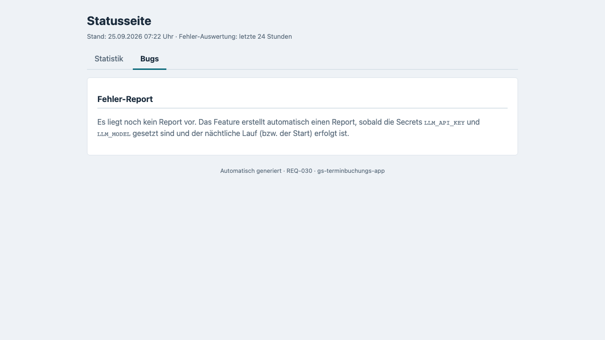
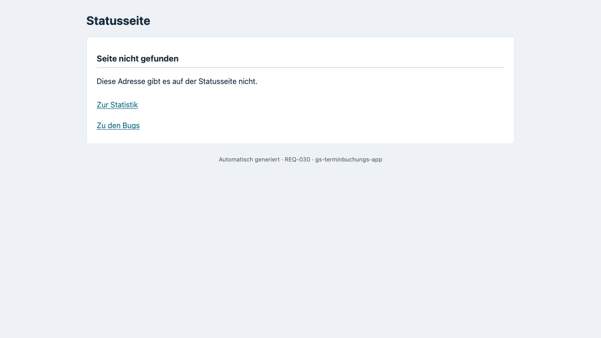
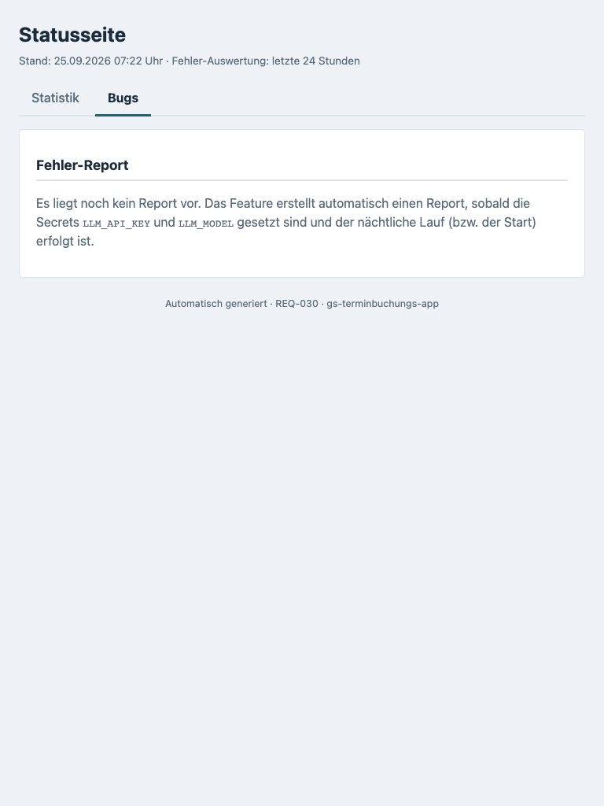
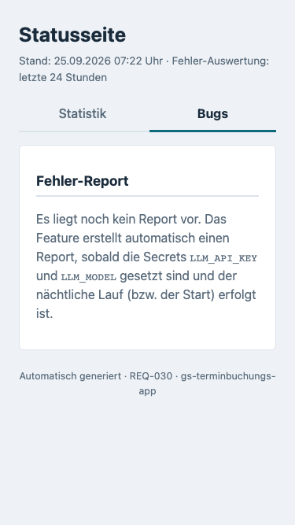

# Feature-Dokumentation: Statistik-Dashboard (REQ-038)

| | |
|---|---|
| **Erstellt** | 2026-09-24 |
| **Requirement** | [REQ-038-Statistik-Dashboard](./requirement.md) |
| **Sprache** | DE |
| **Status** | Implementiert — alle neuen Datenquellen werden **ausgeschaltet** ausgeliefert; der Product Owner hat am 24.09.2026 entschieden, beim Deploy alle fünf Schalter einzuschalten, bevor die Gates formal abgeschlossen sind (siehe „Betrieb"). Requirement-Status: Draft |
| **Zielgruppe** | Betreiber/Admin · Marketing und Standortsteuerung |

---

## Überblick

Die interne Statusseite `/internal/report` (REQ-030, erweitert um die Nutzungsstatistik aus REQ-037)
war bisher **ein einziges Dokument**: oben die Nutzungsstatistik, darunter KI-Zusammenfassung und
Fehlerliste. REQ-038 teilt sie in **zwei Registerkarten**:

- **Statistik** (Standard): Steuerungswissen für Marketing und Standortsteuerung — wo ist online
  noch etwas frei, welcher Standort läuft online gut oder schlecht, was wird wo gebucht, wann wird
  gebucht, wo steigen Besucher aus.
- **Bugs**: der bisherige Fehler-Report, **unverändert**.

Jeder Tab ist eine eigene, verlinkbare Adresse. Die Seite wird komplett im Backend erzeugt — kein
JavaScript, keine Angular-Änderung, keine neue Azure-Ressource.

### Was jede Sektion beantwortet

Der Statistik-Tab besteht aus acht Sektionen in fester Reihenfolge — **erst handeln, dann Details**:

| # | Überschrift auf der Seite | Beantwortet | Typischer Handlungsimpuls |
|---|---|---|---|
| S0 | Auf einen Blick: Handlungsimpulse | Wo lohnt sich eine Aktion, wo ist sie sinnlos? | Werbung dorthin lenken, wo Kapazität frei und die Online-Nachfrage schwach ist |
| S1 | Freie Online-Termine je Standort | Wie schnell bekommt man online einen Termin? Ist das Dauerzustand oder Ausnahme? | „meist frei" → Aktion möglich; „meist belegt" → Werbung zurückhalten |
| S2 | Online-Buchungen je Standort: Renner und Penner | Welcher Standort ist online Renner, welcher Penner? Wo ist das Interesse hoch, die Umwandlung schwach? | Viele Leistungsaufrufe, wenige Buchungen je 100 Aufrufe → Angebot/Termine vor Ort prüfen |
| S3 | Servicegruppen: Was wird wo gebucht? | Welche Leistungen werden online gebucht, an welchem Standort besonders? Wird Mietwagen mitgebucht? | Standort-Stärken gezielt bewerben, Lücken erkennen |
| S4 | Buchungs- und Terminzeiten | Buchen Kunden abends/nachts? Welche Terminzeiten sind gefragt? Wie viel Vorlauf? | Abend-Anteil hoch → Online-Kanal außerhalb der Öffnungszeiten stärken; Kurzfrist-Aktionen bewerten |
| S5 | Nutzungsstatistik | Besuche, Terminsuchen, Buchungen, Geräteklassen (REQ-037, **unverändert**) | siehe [REQ-037-Doku](../REQ-037-Nutzungsstatistik/feature-documentation-de.md) |
| S6 | Buchungsstrecke: Wo steigen Besucher aus? | An welcher Stufe und in welcher Situation brechen Besucher ab? | Szenario mit festem Handlungsimpuls, z. B. „Bugs-Tab prüfen", „Terminangebot zu schmal" |
| S7 | Messgrenzen und Datenschutz | Seit wann wird erfasst, was bedeuten „< 5", „k. A.", „n < 20", „—", was ist **nicht** messbar? | Zahlen richtig lesen |

### Wichtig vor dem ersten Blick

- **Auslieferungszustand:** Ohne Env-Override stehen alle neuen Schalter auf `false`. Der Statistik-Tab
  zeigt dann nur **S5 und S7** — alles andere erscheint erst, wenn die Schalter gesetzt sind. Für den
  ersten Deploy hat der Product Owner am 24.09.2026 entschieden, **alle fünf Schalter einzuschalten**,
  obwohl die Gates noch nicht formal abgeschlossen sind (Begründung und offene Nacharbeiten im
  Abschnitt „Betrieb").
- **Die Screenshots zeigen Testdaten.** Sie stammen aus einem lokalen Backend im Seed-Profil
  `e2e-seed` mit allen Schaltern an. Die Standortnamen kommen aus `setup.json`, **die Zahlen sind
  erfundene Fixture-Werte** (`playwright/fixtures/req038/`), keine Produktionsdaten.
- **Stand: gestern.** Alle REQ-038-Kennzahlen werden nachts berechnet; es gibt keinen Live-Wert.
  Nur S5 (REQ-037) enthält zusätzlich den laufenden Tag.
- **Nur Online.** Telefon- und Filialbuchungen sind unsichtbar — ein „Penner" kann offline stark sein.

---

## Seite aufrufen

| Adresse | Inhalt | Antwort |
|---|---|---|
| `https://<host>/internal/report` | Statistik-Tab (Standard), **ohne** Weiterleitung | 200 HTML |
| `…/internal/report/statistics` | Statistik-Tab (dieselbe Seite, kanonischer Link) | 200 HTML; 404, wenn alle Statistik-Quellen aus sind |
| `…/internal/report/bugs` | Bugs-Tab (Fehler-Report aus REQ-030) | 200 HTML, existiert immer |
| `…/internal/report/insights.json` | S0, S2–S4, S6 als JSON — **bereits anonymisiert** | 200 JSON; 404, wenn Buchungs-Insights und Trichter aus sind |
| `…/internal/report/capacity.json` | S1 als JSON | 200 JSON; 404 bei `CAPACITY_SCAN_ENABLED=false` |
| `…/internal/report/usage.json` | S5 als JSON (REQ-037, unverändert) | 200 JSON; 404 bei `USAGE_STATS_ENABLED=false` |
| `POST …/internal/report/refresh` | Neuladen der REQ-037-Live-Werte (unverändert, max. 1 × pro Minute) | löst **weder** Kapazitäts-Scan **noch** Insights-Rollup aus |
| jede andere `…/internal/report/…`-Adresse (auch `GET …/refresh`) | Seite „Seite nicht gefunden" mit Links auf die Tabs | 404 HTML; eine vorhandene Adresse mit unpassendem `Accept` → 406 |

- **Anmeldung:** HTTP Basic Auth mit `REPORT_ADMIN_USER` (Default `admin`) / `REPORT_ADMIN_PASSWORD`.
  Marketing nutzt im MVP denselben Zugang; die getrennten Adressen halten eine spätere Rollentrennung offen.
- **Ohne oder mit falschen Zugangsdaten** antwortet **jede** dieser Adressen mit **401** — auch
  unbekannte Unterpfade verraten ohne Anmeldung nicht, ob es sie gibt.
- **Aus der App:** Der Statusbutton unten mittig öffnet weiterhin `/internal/report` in einem neuen
  Tab; seine Beschriftung „Fehler-Report" bleibt vorerst (Umbenennung ist ein Folge-REQ).
- Tabs sind normale Links: **Deep-Link, Neuladen und Browser-Zurück** funktionieren. Jeder Tab hat einen
  eigenen Fenstertitel („Statusseite – Statistik" bzw. „Statusseite – Bugs").

---

## Ablauf: vom Kundenklick bis zur Zahl auf der Seite (Main Flow)

Die ersten fünf Schritte laufen im Hintergrund und haben keine eigene Oberfläche; sichtbar werden sie
über Log-Zeilen, die JSON-Endpunkte und die Seite selbst (Schritte 6–8).

**Nachtplan (Europe/Berlin):**

| Uhrzeit | Lauf | Quelle |
|---|---|---|
| 22:30 (+ 0–5 min Zufallsverzögerung) | Kapazitäts-Scan gegen SoftNet, Dauer typisch 3–5 min, höchstens 20 min | REQ-038 (K1) |
| 23:59:59 | **Tagesflush** der Buchungsmerkmale: alle `USAGE_BOOKING`-Zeilen des Tages gemischt ins Log (zusätzlich bei jedem geordneten Herunterfahren, also Neustart und Deploy) | REQ-038 (K2) |
| 00:05 | Anzeigewerte neu aufbauen (Tages-/Monatswechsel, **ohne** Abfragen) | REQ-038 |
| 03:00 | KI-Fehler-Report (Bugs-Tab) | REQ-030 |
| 03:30 | Tages-Rollup der Nutzungsstatistik | REQ-037 |
| 03:45 (+ 0–2 min) | Insights-Rollup: Buchungen, Leistungsaufrufe, Trichter, Absprungszenarien | REQ-038 (K2/K3) |
| 04:15 | **Aufbewahrungslauf** von `usage-insights.json` (Verdichtung und Löschung) — fest, nicht abschaltbar | REQ-038 |

### Schritt 1: Eine Buchung wird statistisch erfasst

Ein Kunde bucht einen Termin. **Nur nach erfolgreicher Buchung** und nur bei
`USAGE_INSIGHTS_ENABLED` an merkt sich das Backend die anonymen Buchungsmerkmale — es schreibt dabei
**keine** Log-Zeile. Die Merkmale landen in einem Zwischenspeicher im Arbeitsspeicher (höchstens
10 000 Einträge). Erst **einmal täglich um 23:59:59 Uhr** (und bei jedem geordneten Herunterfahren,
also Neustart oder Deploy) schreibt das Backend alle gesammelten Einträge **gemischt** ins Log, je
Buchung eine Zeile mit dem Job-Marker `job.usagebooking` statt der Kennung der Buchungsanfrage:

```
… - job.usagebooking: USAGE_BOOKING {"v":2,"day":"2026-10-22","branch":"68f0a1b2c3d4e5f6a7b8c9d0","group":"6908a1b2c3d4e5f6a7b8c9d1","variant":"default","ops":["6908a1b2c3d4e5f6a7b8c9e2"],"bookingDaypart":"evening","slotWeekday":"SA","slotDaypart":"morning","leadTime":"2-3","mobility":false}
```

Warum so umständlich? Der Product Owner hat am 24.09.2026 entschieden: **„nur anonyme Daten, nie
wer"**. Schriebe das Backend die Zeile im Moment der Buchung, ließe sie sich über Kennung, Millisekunde
und Thread mit der Buchungszeile (`BOOKING_CREATED`, enthält die Buchungsnummer) verbinden. Durch
Sammeln, Mischen und den eigenen Marker teilt die Statistikzeile nichts mehr mit der Buchung.

Enthalten sind nur: der **Buchungstag** ohne Uhrzeit (`day`), Standort- und Group-ID, Variante
(Standard/Radwechsel), die IDs der gebuchten Leistungen, der **Tagesabschnitt** der Buchung
(Tag 07–18 · Abend 18–22 · Nacht 22–07), Wochentag und Tagesabschnitt des Termins (früh · vorm. ·
mittags · nachm. · spät), der Vorlauf als Bucket (0–1 · 2–3 · 4–7 · 8–14 · 15–30 · über 30 Tage) und
ob ein Mietwagen mitgebucht wurde. **Nicht enthalten:** Buchungsnummer, Termindatum, Uhrzeit, Marke,
Modell, Gerät, Sitzungs-ID, Serviceberater, Kundendaten, Freitext. Scheitert die Erfassung, bleibt die
Buchungsantwort an den Kunden unverändert.

Ergänzend (nur bei aktiven Absprungszenarien, siehe S6) trägt die bestehende Access-Zeile einer
**erfolgreichen Terminsuche** das Feld `"hits"`: `none` (0 Tage mit freien Terminen ab dem gewünschten
Starttag), `few` (1–3 Tage) oder `many` (≥ 4 Tage). In jedem anderen Fall bleibt die Zeile byte-gleich.

### Schritt 2: Nächtlicher Kapazitäts-Scan (22:30)

Der Scan fragt SoftNet für **jeden Standort** (alphabetisch, 1 s Pause) nach dem nächsten freien
Online-Termin für eine feste **Referenz-Leistung** („Wischerblätter erneuern" — die kleinste Einheit).
Zieltag ist der **nächste Werktag Mo–Sa**. Fehlgeschlagene Standorte werden nach 60 s einmal
wiederholt. Der Scan läuft über alle Replicas höchstens **einmal pro Kalendertag** und bricht nach
20 Minuten ab. Log: `INFO capacity scan <Tag>: 25 ok, 0 none, 2 error in 212 s`.

Ohne `USAGE_STORAGE_ACCOUNT` läuft **kein** Scan — es gäbe weder Sperre noch Speicherort; eine
Entwickler-Maschine ruft nachts also nie SoftNet auf.

### Schritt 3: Nächtlicher Insights-Rollup (03:45)

Der Rollup wertet **gestern** aus und holt fehlende Tage der letzten 25 Tage nach (nie vor dem
Erfassungsbeginn, nie in bereits verdichtete Monate). Aus Azure Log Analytics liest er:

1. die `USAGE_BOOKING`-Zeilen des Tagesflushs (nur bei `USAGE_INSIGHTS_ENABLED`) — nur Zeilen mit dem
   Job-Marker `job.usagebooking` zählen; zugeordnet wird über den Buchungstag `day`, und weil der
   Flush um 23:59:59 erst kurz nach Mitternacht im Log ankommen kann, schaut die Abfrage 10 Minuten
   über das Tagesende hinaus,
2. die Aufrufe der Leistungsauswahl je Standort — **ohne** Sitzungs-ID (nur bei `USAGE_INSIGHTS_ENABLED`),
3. den Trichter je Sitzung (nur bei `USAGE_STATS_ENABLED` **und** `USAGE_FUNNEL_ENABLED`; bei
   zusätzlich `USAGE_DROPOFF_ENABLED` in einer Fassung, die Trichter **und** Absprungszenarien aus
   einem Ergebnis liefert).

Die gebuchten Leistungen werden dabei **Servicegruppen** zugeordnet: Name enthält „hol" → Hol & Bring;
genau ein SoftNet-Tag → Gruppe nach Tag (Inspektion, TÜV, Bremsflüssigkeit, Räderwechsel,
Aktionen/Checks, Reparatur/Beanstandung, Karosserie/Frontscheibe); mehrere Tags → Zusatzleistungen;
sonst „nicht zuordenbar". Eine Radwechsel-Buchung zählt immer auch unter Räderwechsel.
Tageswerte werden **ersetzt, nie aufaddiert** — der Lauf ist wiederholbar.
Log: `INFO usage insights rollup written: 1 day(s), 11 booking(s), 0 purged`.

### Schritt 4: Monatsverdichtung und Aufbewahrung

Tagesgenaue Standortwerte liegen höchstens bis zum **8. des Folgemonats** im Speicher (≤ 38 Tage);
dann werden sie zu Monatswerten summiert und die Tage gelöscht. Globale Tageswerte, Monatswerte und
Scans werden nach `USAGE_RETENTION_MONTHS` (24 Monate) entfernt. Die Verdichtung läuft, sobald
`USAGE_STORAGE_ACCOUNT` gesetzt ist — **auch wenn die Schalter inzwischen wieder aus sind**:

- im nächtlichen Insights-Rollup gleich mit,
- zusätzlich in einem **eigenen, festen Aufbewahrungslauf täglich um 04:15 Uhr**, der sich nicht
  abschalten lässt — auch nicht über `USAGE_INSIGHTS_ROLLUP_CRON=-`. Nach einem normalen Rollup findet
  er nichts mehr zu tun und schreibt nichts.

### Schritt 5: Anzeigewerte werden vorberechnet

Beim Start, nach jedem eigenen Lauf und täglich um 00:05 berechnet das Backend die Anzeigewerte
**einschließlich Unterdrückung** kleiner Zahlen, der Beschriftung relativ zum Abruftag („heute frei",
„morgen frei") und aller Warnhinweise. Beim Seitenaufruf wird nichts mehr gerechnet oder abgefragt.

### Schritt 6: Statistik-Tab öffnen

Aufruf von `/internal/report` (Lesezeichen oder Statusbutton der App), Anmeldung im Browser-Dialog.
Die Seite antwortet in unter 200 ms und liest ausschließlich den Speicher — nie Log Analytics, Blob
Storage oder SoftNet.


**Beschreibung:** Kopf „Statusseite" mit der Meta-Zeile
„Stand: 24.09.2026 11:31 Uhr · Auswertung bis gestern (23.09.2026) · Kapazitäts-Scan vom 23.09.2026,
22:30 Uhr", darunter die Tab-Leiste (aktiver Tab unterstrichen **und** fett) und die Sprungmarken
„Inhalt: Auf einen Blick · Freie Termine · Standorte · Servicegruppen · Zeiten · Nutzung ·
Buchungsstrecke · Messgrenzen". Die Sprungmarken nennen genau die Sektionen, die gerade angezeigt werden.
Die einzelnen Sektionen beschreibt der Abschnitt „Der Statistik-Tab im Detail".

### Schritt 7: Wechsel zum Bugs-Tab

Klick auf „Bugs" (oder direkter Aufruf von `/internal/report/bugs`) — ein neuer Seitenaufruf.



**Beschreibung:** Meta-Zeile „Stand: … · Fehler-Auswertung: letzte 24 Stunden", darunter der
gespeicherte Fehler-Report aus REQ-030 **byte-gleich** (KI-Zusammenfassung, Status-Übersicht,
Fehlerliste mit Filter). Lokal ist kein KI-Modell konfiguriert, deshalb steht dort — wie im
Screenshot — der bisherige Hinweis „Es liegt noch kein Report vor …". Browser-Zurück führt wieder
auf den Statistik-Tab.

### Schritt 8: Maschinenlesbarer Abruf (optional)

```bash
curl -s -u "admin:$REPORT_ADMIN_PASSWORD" https://<host>/internal/report/capacity.json | jq '{scanDay, targetDay, state, warnings}'
curl -s -u "admin:$REPORT_ADMIN_PASSWORD" https://<host>/internal/report/insights.json | jq '{asOf, bookingsEnabled, funnelEnabled, warnings}'
```

**Beschreibung:** Die JSON-Endpunkte liefern **dieselben, bereits unterdrückten** Werte wie die Seite.
Eine ausgeblendete Zelle trägt nie einen Wert — sie sieht so aus:
`{"value": null, "ratio": null, "percent": null, "heat": 0, "state": "SUPPRESSED"}`
(`SUPPRESSED` = „< 5", `WITHHELD` = „k. A.", `TOO_FEW` = „n < 20", `NO_DATA` = „—"). Auch Balkenbreite
(`barWidth: 0.0`), Farbstufe und Sortierung verraten nichts über einen verborgenen Wert.

---

## Der Statistik-Tab im Detail

Alle Beispielwerte stammen aus dem Screenshot oben (Seed-Set `full`, aufgenommen am 24.09.2026).

### S0 — Auf einen Blick: Handlungsimpulse

Bis zu **vier Kacheln**, regelbasiert und ohne KI; jede nennt ihre Quelle („Scan 23.09." bzw.
„August 2026") und die Regel, nach der sie gebildet wird:

| Kachel | Regel | Beispiel im Screenshot |
|---|---|---|
| **Luft heute / morgen / am {Tag}** | Standorte, die im letzten Scan (von heute oder gestern) am Zieltag frei sind; höchstens 5, sortiert nach Anzahl freier Termine (falls angezeigt), sonst alphabetisch. Der Titel richtet sich nach dem Abruftag. | „Luft heute (Do 24.09.)" mit fünf Audi-Standorten |
| **Werbe-Kandidat** | 10-Tage-Einordnung „meist frei" **und** im Vormonat im unteren Drittel der Online-Buchungen | Volkswagen Grevenbroich, Volkswagen Velbert |
| **Engpass** | 10-Tage-Einordnung „meist belegt" — Werbung derzeit wenig sinnvoll | sechs VW-Standorte |
| **Renner & Abendbuchungen** | die 3 Standorte mit den meisten Online-Buchungen im Vormonat plus Anteil der Buchungen außerhalb Mo–Fr 07–18 Uhr (erst ab 20 Buchungen) | „39 % außerhalb Mo–Fr 07–18 Uhr gebucht" |

Fehlt einer Kachel die Datenbasis (Quelle aus, weniger als 5 messbare Scan-Tage, noch kein
abgeschlossener Monat, letzter Scan fehlgeschlagen), **entfällt** sie. Fehlen alle, steht dort
„Noch keine Hinweise – zu wenig Daten."

### S1 — Freie Online-Termine je Standort

- **Zeitraumzeile:** „Kapazitäts-Scan vom 23.09.2026, 22:30–22:34 Uhr · Zieltag: Do 24.09.2026
  (nächster Werktag) · Werktage Mo–Sa · Verlauf: letzte 10 Scans (12.09.–23.09.)".
- **Spalte „Nächster freier Online-Termin"** (jüngster Scan) als Textstufe mit Datum:
  „heute frei" / „morgen frei" / „am {Wochentag} {Datum} frei" · „in n Werktagen" ·
  „belegt: ≥ 5 Werktage" · „keine Online-Termine gefunden" · „nicht messbar" mit Grund
  (z. B. „Grund: Zeitüberschreitung", „Grund: Referenz-Leistung nicht im Leistungskatalog").
  Ein Fehler erscheint **nie als 0**.
- **Verlauf letzte 10 Tage:** je Standort ein Raster der letzten 10 Scans (älteste links), jede Zelle
  mit Kürzel **und** Farbe: „frei" (am Zieltag frei) · „knapp" (erster freier Termin in 1–4 Werktagen)
  · „belegt" (≥ 5 Werktage oder keine Termine) · „—" (nicht messbar oder kein Scan; Grund in der
  Fußnote unter der Tabelle).
- **„an X von 10 Tagen frei"** und **Einordnung**: „meist frei" (≥ 7 von 10), „wechselnd" (3–6),
  „meist belegt" (≤ 2); unter 5 messbaren Tagen „zu wenig Daten". Nicht messbare Tage zählen nicht mit.
  Sortierung: „meist frei" oben, „meist belegt" unten.
- **Frei am Zieltag** (Anzahl freier Termine) erscheint nur bei `CAPACITY_SHOW_SLOT_COUNT=true` —
  in den Screenshots daher nicht.
- Darunter der Hinweis zur Referenz-Leistung („online buchbare Restkapazität, nicht die
  Werkstattauslastung") und die Legende.

Im Screenshot steht oben „Scan vom 23.09.2026 unvollständig: 3 Standorte nicht messbar." — mit der
Default-Referenz ist das der **Normalfall**: Beide Leverkusener Standorte führen „Wischerblätter
erneuern" nicht und sind deshalb dauerhaft „nicht messbar" (ein Ersatz ist offene Frage 9).

> Die Tabelle liegt in einem horizontal scrollbaren Bereich. Die Ganzseiten-Screenshots zeigen nur
> dessen sichtbaren Teil; die Spalten des jüngsten Scan-Tags, „an X von 10 Tagen frei" und
> „Einordnung" erreicht man durch seitliches Scrollen in der Tabelle.

### S2 — Online-Buchungen je Standort: Renner und Penner

Rangliste aller Standorte für den **Vormonat** (im Screenshot August 2026, „abgeschlossener Monat ·
Jahr 2026 bis Ende August"). Spalten:

Rang · Standort · Online-Buchungen (Balken + Zahl) · Anteil am Online-Volumen · Jahr bis Vormonat ·
Leistungsaufrufe (Seitenaufrufe) · Buchungen je 100 Aufrufe (**Näherung**) · außerhalb Mo–Fr 07–18 Uhr ·
späte Termine ab 16 Uhr · Rangänderung (↑ n / ↓ n / = / neu, dazu der Vormonatsrang).

- Standorte mit **0–4 Buchungen** stehen ohne Rang in der abschließenden, alphabetischen Gruppe
  „Unter 5 Buchungen: …" — mit „0" bzw. „< 5" statt der Zahl und „k. A." bei abgeleiteten Werten.
  Penner bleiben sichtbar, ihre genaue Zahl nicht.
- Anteile erscheinen erst ab 20 Buchungen, sonst „n < 20".
- **Lesart:** Viele Leistungsaufrufe, aber wenige Buchungen je 100 Aufrufe → Interesse ist da, die
  Umwandlung klemmt (Terminangebot, Leistungskatalog vor Ort prüfen). Leistungsaufrufe sind
  Seitenaufrufe (jedes erneute Betreten zählt), keine Besucher.

### S3 — Servicegruppen: Was wird wo gebucht?

- **Servicegruppen gesamt:** Balkenliste mit Nennungen und Anteil an den Buchungen, für den aktuellen
  Monat und das laufende Jahr (jeweils bis gestern) untereinander; dazu „Zusätzlich mit Mietwagen
  gebucht: 174 von 1.424 Buchungen (12,2 %)". Mehrfachnennung: Eine Buchung zählt in jeder ihrer Gruppen
  einmal.
- **Standort × Servicegruppe ({Vormonat})**: Heatmap-Tabelle mit ganzzahligem Prozentwert **und**
  Farbstufe je Zelle (Legende 1–14 % · 15–29 % · 30–44 % · ab 45 % · 0 %: keine Buchung). Eine eigene
  Zeile bekommt nur ein Standort mit **≥ 20 Buchungen** im Monat; die übrigen bilden
  „weitere Standorte (unter 20 Buchungen)". Letzte Spalte „Mietwagen".
- **Lesart:** Hohe Zellwerte zeigen, was an einem Standort besonders gut läuft (z. B. Räderwechsel
  45 % bei Audi Zentrum Düsseldorf); „nicht zuordenbar" betrifft Standorte ohne SoftNet-Tags
  (heute die beiden Leverkusener Standorte).

### S4 — Buchungs- und Terminzeiten

Für „aktueller Monat bis gestern" und „laufendes Jahr bis gestern" untereinander, ohne Umschalter:

- **Kennzahl-Kacheln:** „43 % außerhalb Mo–Fr 07–18 Uhr gebucht" (Monat) bzw. „42 %" (Jahr).
- **Wann wird gebucht?** Heatmap Wochentag × Tag (07–18) · Abend (18–22) · Nacht (22–07) — Zeitpunkt
  der **Buchung**.
- **Welche Terminzeiten sind gefragt?** Heatmap Mo–Sa × früh (vor 9) · vorm. (9–12) · mittags (12–14)
  · nachm. (14–16) · spät (ab 16) — Uhrzeit des **gebuchten Termins**. Hinweis: Kunden wählen aus dem,
  was SoftNet anbietet — die Verteilung zeigt Angebot **und** Nachfrage. Darunter ggf.
  „ohne Terminzeit: n" (bei 1–4 als „< 5", weil sich sonst eine ausgeblendete Zelle zurückrechnen ließe).
- **Vorlauf: Tage zwischen Buchung und Termin** als Balkenliste (0–1 Tag … über 30 Tage).
- Die Heatmap-Legende wird aus den Daten berechnet (z. B. „bis 12 · 13–24 · 25–36 · ab 37
  (größter Wert 48)"); jede Zelle trägt ihre Zahl als Text.

### S5 — Nutzungsstatistik (REQ-037)

Unverändert aus REQ-037 (aktueller Monat und Jahresübersicht). In **allen** Screenshots zeigt S5 den
Ausfallmodus („Live-Daten derzeit nicht verfügbar", „Historie derzeit nicht verfügbar", „Keine Daten
für diesen Zeitraum") — das ist beabsichtigt: Das Seed-Profil befüllt nur die REQ-038-Quellen, die
REQ-037-Tests erwarten lokal leere Zeiträume.

### S6 — Buchungsstrecke: Wo steigen Besucher aus?

Globaler Trichter **aller Standorte zusammen** — es gibt keine Auswertung der Strecke je Standort.
Anders als S4 zeigt S6 nur den **aktuellen Monat bis gestern** (keinen Jahreswert).
Je Sitzung und Kalendertag zählt die **höchste erreichte Stufe**:

| Stufe | Bedeutung | erkannt an |
|---|---|---|
| 1 · Besuch (App-Aufruf) | Sitzung hat die App geöffnet | irgendeine Anfrage der Sitzung |
| 2 · Leistungsauswahl | Leistungen eines Standorts geladen | Abruf der Leistungsliste |
| 3 · Hinweise | Hinweis-/Mietwagen-Schritt erreicht | Abruf der Mietwagen-Kategorien |
| 4 · Terminsuche ausgeführt | mindestens eine Terminsuche — auch mit leerer Liste | `POST /api/v1/snaps` |
| 5 · Gebucht | Buchung abgeschickt und erfolgreich | `POST /api/v1/appointments` |

Eine Anfrage mit Fehlerstatus (≥ 400) zählt nur als Stufe 1.

- **Trichter:** je Stufe absolute Zahl, „% vom Start" und „% der Vorstufe" (im Screenshot
  2.771 Besuche → 355 Buchungen = 12,8 % vom Start).
- **Ausstieg nach Stufe und Geräteklasse:** Zeilen „nach Stufe 1–4" mit den zuletzt gesehenen Seiten;
  Spalten Alle · Mobil · Tablet · Desktop · Unbekannt. Geräteklassen unter 20 Sitzungen werden zur
  Spalte „Sonstige (…)" zusammengefasst, damit sich keine ausgeblendete Klasse aus „Alle" zurückrechnen
  lässt (sichtbar im Seed-Set `thin`: „Sonstige (Tablet, Desktop)").
- **Absprungszenarien** (nur bei `USAGE_DROPOFF_ENABLED`): Jede abgebrochene Sitzung erhält **genau
  ein** Szenario — die erste zutreffende Zeile der folgenden Liste gewinnt:

  | Szenario (Seitentext) | Wann | Handlungsimpuls auf der Seite |
  |---|---|---|
  | Technischer Fehler (Fehlerseite) | letzte Anfrage mit Serverfehler (≥ 500) | Bugs-Tab prüfen |
  | Zugriff abgelehnt oder Anfragelimit | letzte Anfrage 403 oder 429 | Session-TTL und Rate-Limit prüfen |
  | Termin nach längerer Pause abgelaufen | eine Buchung mit 404 (Termin-Zwischenspeicher 30 min) | „Erneut versuchen" sendet denselben Termin — Sackgasse, eigenes Bugfix-REQ |
  | Termin war inzwischen vergeben | eine Buchung mit 410 | hohe Nachfrage bzw. langes Formular |
  | Buchung abgelehnt | letzte Anfrage ist eine Buchung mit 400–499 | Eingaben bzw. SoftNet-Validierung prüfen |
  | Terminsuche fehlgeschlagen | letzte Anfrage ist eine Suche mit 400–499 | Leistungszuordnung prüfen |
  | Nach Fehler weitergemacht, dann aufgehört | früher ein Fehler, letzte Anfrage ok | wie „Technischer Fehler" |
  | Verbindung unterbrochen | Lücke im Anfragezähler der Sitzung | Netz bzw. Circuit Breaker — Messartefakt möglich |
  | Keine Termine gefunden | letzte erfolgreiche Suche mit `hits=none` | Kapazität/Terminangebot, zusammen mit S1 lesen |
  | Nur wenige Termine angeboten | letzte erfolgreiche Suche mit `hits=few` | Terminangebot zu schmal |
  | Lange Wartezeit auf Antwort | letzte Anfrage ok, Dauer ≥ 8 s | Performance bzw. SoftNet |
  | Viele Terminsuchen ohne Buchung | ≥ 4 erfolgreiche Suchen | Termine passen nicht |
  | ohne erkennbaren Anlass – nach Stufe k | alle übrigen | Stufe 4: Formular bzw. Übersicht; genauer nur mit dem Step-Beacon (Folge-REQ 1) – Messartefakt möglich |

  Angezeigt werden eine Balkenliste (ohne die Sammelgruppe „ohne erkennbaren Anlass"), eine Tabelle
  Szenario × Stufe 1–4 mit Gesamt, Anteil und Handlungsimpuls und eine Tabelle „Nach Geräteklasse".
  Die **Summenzeile** ist zugleich Plausibilitätsprüfung: „Alle Abbrüche 2.416 = 2.771 Besuche −
  355 Buchungen".

### S7 — Messgrenzen und Datenschutz

Steht **immer** am Ende des Tabs und enthält drei Blöcke:

- **Erfassung seit** je aktiver Quelle (im Screenshot: Buchungsmerkmale und Leistungsaufrufe
  22.06.2026 · Buchungsstrecke 22.06.2026 · Absprungszenarien 20.07.2026 · Kapazitäts-Scan 10.09.2026;
  Nutzung „—", weil das Seed-Profil REQ-037 nicht befüllt).
- **Darstellungsregeln** („< 5", „n < 20", „k. A.", „—", Standortwerte nur für abgeschlossene Monate,
  Datenschutzhinweis).
- **Messgrenzen** (siehe Abschnitt „Messgrenzen" unten).

---

## Der Bugs-Tab

Der Bugs-Tab ist der unveränderte Fehler-Report aus REQ-030 (siehe Screenshot in Schritt 7). Er
funktioniert **unabhängig** von allen REQ-038-Schaltern. Fehler des Kapazitäts-Scans und des
Insights-Rollups erscheinen dort **nicht**: Die Hintergrundjobs markieren ihre Log-Zeilen mit
`job.capacityprobe`, `job.insightsrollup` bzw. `job.usagebooking` (Tagesflush), und die Fehlerabfrage
schließt jede Kennung mit Präfix `job.` aus. Geprüft wird dabei das **echte** Präfix am Zeilenanfang —
steht so ein Text in einem Kundenfeld (z. B. im Fahrzeugmodell), bleibt der Kundenfehler trotzdem
sichtbar. Echte Kundenfehler erscheinen weiterhin immer — ein Client kann diese Marker nicht für
eigene Anfragen setzen.

## Unbekannte Adressen



Tippfehler wie `/internal/report/statistik` oder `/internal/report/a/b` führen auf eine kurze
Seite „Seite nicht gefunden · Diese Adresse gibt es auf der Statusseite nicht." mit den Links
„Zur Statistik" (falls vorhanden) und „Zu den Bugs" — **nie** auf die leere Angular-Startseite. Der
angefragte Pfad wird nicht auf der Seite wiedergegeben. Das gilt auch für `GET /internal/report/refresh`
(die Adresse gibt es nur für `POST`). Ruft man dagegen eine **vorhandene** Adresse mit einem unpassenden
`Accept`-Header auf (z. B. `usage.json` mit `Accept: text/html`), antwortet das Backend wie vor REQ-038
mit **406** ohne Inhalt — nicht mit „Seite nicht gefunden".

---

## Responsive Ansichten

Ganzseiten-Aufnahmen des Statistik-Tabs (Seed-Set `full`):

### Desktop (1280 px)


### Tablet (768 px)


### Mobile (375 px)


Bugs-Tab im Viewport:

| Tablet (768 × 1024) | Mobile (375 × 667) |
|---|---|
|  |  |

- **Desktop (≥ 64em):** Impuls-Kacheln 2 × 2, die beiden Heatmaps eines Zeitraums nebeneinander.
- **Tablet (48–63.99em):** Kacheln 2 × 2, Heatmaps untereinander, alle Tabellenspalten im Scroll-Bereich.
- **Mobil (< 48em):** alles einspaltig, die beiden Tab-Links teilen sich die Breite; unter 40em werden
  optionale Spalten (z. B. „Jahr bis Vormonat", „Leistungsaufrufe") ausgeblendet.
- In keinem Viewport scrollt die **Seite** horizontal; breite Tabellen scrollen innerhalb ihres Bereichs.

---

## Zustände

Die Seite liefert **nie** einen Fehler und **nie** eine leere Seite; eine fehlende Quelle wird immer
benannt, nie als 0 kaschiert.

### Befüllt (Seed-Set `full`)

Siehe Schritt 6 und „Responsive Ansichten". Erfassung seit mehreren Monaten, zwölf Scans (einer davon
komplett fehlgeschlagen — im Verlauf als Spalte „—" am 16.09. sichtbar).

### Zu wenig Daten — erster Erfassungstag (Seed-Set `thin`)

Erfassung seit gestern, ein einziger Scan, zehn Buchungen:

| Desktop | Tablet | Mobile |
|---|---|---|
|  |  |  |

- **S0:** nur „Luft heute" — für „Werbe-Kandidat"/„Engpass" fehlen 5 messbare Tage, für „Renner" ein
  abgeschlossener Monat.
- **S1:** Verlauf fast nur „—" (Fußnote: „alle Standorte 12.09.–22.09.: kein Scan"), Einordnung
  „zu wenig Daten".
- **S2:** „— Noch kein abgeschlossener Monat seit Erfassungsbeginn (23.09.2026). Die erste Rangliste
  erscheint am 01.10.2026."; die Matrix in S3 dito.
- **S3/S4:** „Anteile: zu wenig Daten (n < 20). Gezeigt werden nur Nennungen.", Kacheln „n < 20",
  viele Zellen „< 5"; Wochentage ohne erfassten Tag zeigen „—" (keine Daten), nicht 0.
- **S6:** „Sonstige (Tablet, Desktop)"; die meisten Szenarien „< 5 · k. A.".

### Scan fehlgeschlagen, Auswertung ausstehend (Seed-Set `fail`)

Der Scan von gestern ist bei allen 27 Standorten gescheitert, der Rollup der letzten Nacht steht aus:

| Desktop | Tablet | Mobile |
|---|---|---|
|  |  |  |

- **Meta-Zeile:** „Kapazitäts-Scan vom 23.09.2026 fehlgeschlagen – angezeigt: Scan vom 22.09.2026".
- **S0:** nur „Renner & Abendbuchungen" — alle Kapazitäts-Impulse entfallen.
- **S1:** Warnbänder „Letzter Scan (23.09.2026, 22:31 Uhr) fehlgeschlagen – angezeigt: Stand 22.09.2026."
  und „Grund: SoftNet nicht erreichbar (alle 27 Standorte, auch nach erneutem Versuch). Für heute
  (Do 24.09.) liegt keine Messung vor; kein Wert wird als 0 dargestellt.", dazu der Partial-Hinweis des
  angezeigten Scans. Die Stufen sind relativ zum Abruftag beschriftet („am Mi 23.09. frei").
- **S2, S3, S4, S6:** Warnband „Auswertung für 23.09.2026 steht noch aus"; die Folgenacht holt den Tag nach.

### Weitere Zustände (ohne Screenshot)

| Zustand | Darstellung |
|---|---|
| Quelle abgeschaltet | Sektion und Sprungmarke entfallen **ersatzlos** — kein „nicht verfügbar" |
| Alle Statistik-Quellen aus | keine Tab-Leiste; `/internal/report` zeigt direkt den Bugs-Inhalt, `/statistics` antwortet 404 |
| Historie nicht verfügbar (Blob Storage fehlt, 403 oder Netzwerkfehler, noch nie ein Stand geladen) | Warnband „Historie derzeit nicht verfügbar" statt Zahlen in S1–S4, HTTP 200 |
| Noch kein Scan / erster Scan läuft | „Noch kein Kapazitäts-Scan – der erste läuft heute um 22:30 Uhr." bzw. „Noch keine Messung. Der erste Kapazitäts-Scan läuft seit … Uhr (gestartet …; üblich 3–5 Minuten). Erfassung seit …" |
| Scan unvollständig | „Scan vom … unvollständig: n Standorte nicht messbar." |
| Daten veraltet | „Letzte Auswertung: … – Daten möglicherweise veraltet" (Insights > 3 Tage, Scan > 2 Tage alt) |
| Vormonat unvollständig | „Monat unvollständig – Erfassung seit …" bzw. „unvollständig: n Tage fehlen" (bei einem Tag „unvollständig: 1 Tag fehlt") |
| Vor dem Erfassungsbeginn | „—" mit „Erfassung seit …", **nie 0** |

---

## Messgrenzen

Diese Grenzen stehen auch in S7 — sie sind Voraussetzung, um die Zahlen richtig zu lesen:

1. **Kapazität ist eine Näherung.** SoftNet liefert gerankte Vorschläge, keine Gesamtkapazität; eine
   „Auslastung in %" ist nicht messbar. Gemessen wird nur die Referenz-Leistung; ist in SoftNet ein
   Vorlauf konfiguriert, heißt „morgen nicht frei" unter Umständen „online nicht buchbar", nicht „voll".
   Feiertage zählen als Werktage.
2. **Nur Online.** Telefon- und Filialbuchungen sind unsichtbar; ein Online-Anteil an allen Buchungen
   eines Standorts ist nicht ermittelbar.
3. **Kleine Fallzahlen.** Bei rund 10 Online-Buchungen pro Tag sind das rund 11 je Standort und Monat —
   viele Zellen zeigen daher „< 5" oder „zu wenig Daten". Jahreswerte sind die robustere Sicht.
4. **Leistungsaufrufe sind Seitenaufrufe, keine Besucher;** „Buchungen je 100 Aufrufe" ist deshalb
   eine Näherung.
5. **Terminzeiten spiegeln Angebot und Nachfrage zugleich.**
6. **Servicegruppen:** Standorte ohne SoftNet-Tags (heute die beiden Leverkusener) erscheinen als
   „nicht zuordenbar".
7. **Buchungsstrecke:** Marke, Fahrzeugdaten und Übersicht lösen keinen Server-Aufruf aus und sind nicht
   einzeln sichtbar; Terminwahl und Werkstattkalender sind nicht unterscheidbar; ein Reload zählt als
   Abbruch plus neuer Besuch; eine Sitzung über Mitternacht zählt an beiden Tagen.
8. **Absprungszenarien:** Ein Reload beginnt eine neue Sitzung (die alte zählt meist als „ohne
   erkennbaren Anlass"); ein Netzabbruch am Sitzungsende bleibt unsichtbar; ein Neustart oder Deploy
   leert den Termin-Zwischenspeicher und erzeugt „Termin abgelaufen"; die Trefferzahl nennt, was der
   Server geliefert hat — die App zeigt höchstens 4 Vorschläge.
9. **Historie:** Daten gibt es erst ab dem Erfassungsbeginn der jeweiligen Quelle; davor wird nie
   rückwirkend gerechnet. Ausgefallene Nächte werden bis zu 25 Tage nachgeholt.
10. **Radwechsel** ist nur in der Saison buchbar.
11. **Buchungsmerkmale im Tagesflush:** Sie werden nicht im Moment der Buchung geschrieben, sondern im
    Speicher gesammelt und einmal täglich (23:59:59 Uhr) gebündelt und gemischt protokolliert. Bei einem
    **Absturz** der Anwendung (nicht bei Neustart oder Deploy — dort wird vorher geschrieben) fehlen die
    Buchungsmerkmale des laufenden Tages. Buchungen im Bruchteil einer Sekunde zwischen dem Flush und
    Mitternacht fallen aus dem Tagesfenster. Mehr als 10 000 Buchungen zwischen zwei Flushes würden
    verworfen (mit Warnung im Log, nur als Anzahl) — bei rund 10 Online-Buchungen am Tag rein theoretisch.

Jede Näherung trägt ihre Einschränkung zusätzlich **direkt neben dem Wert** (Referenz-Leistung in S1,
„(Näherung)" in S2).

---

## Datenschutz in einfachen Worten

**Drei Datenklassen, die nie miteinander verknüpft werden:**

| Klasse | Inhalt | Personenbezug | Schalter |
|---|---|---|---|
| K1 Betrieb | Kapazitäts-Scan je Standort | keiner (Kapazität einer Betriebsstätte) | `CAPACITY_SCAN_ENABLED` |
| K2 Buchung | `USAGE_BOOKING`, Leistungsaufrufe ohne Sitzungs-ID | Rohzeile ohne Buchungsbezug (nur Buchungstag, Tagesflush, gemischt, Job-Marker statt Anfrage-Kennung; ≈ 30 Tage Log-Retention), Auswertung anonym | `USAGE_INSIGHTS_ENABLED` |
| K3 Nutzung | REQ-037-Kennzahlen, Trichter, Absprungszenarien | Sitzungs-ID als Zählgrundlage — erst nach DSB-Freigabe | `USAGE_STATS_ENABLED`, `USAGE_FUNNEL_ENABLED`, `USAGE_DROPOFF_ENABLED` |

- **„Nur anonyme Daten, nie wer" (PO-Entscheidung 24.09.2026):** Die Statistikzeile einer Buchung wird
  nicht bei der Buchung geschrieben, sondern gesammelt, gemischt und einmal täglich unter einem eigenen
  Job-Marker protokolliert. Sie teilt weder Kennung noch Zeitpunkt noch Thread mit der Buchungszeile und
  enthält nur den Buchungstag, keine Uhrzeit.
- **Standortbezug nur aus K1 und K2.** Sitzung und Gerät werden **nie** mit einem Standort verknüpft;
  Trichter und Absprungszenarien bleiben global.
- **Kleine Zahlen werden mechanisch ausgeblendet** — auf der Seite **und** im JSON:
  - „**< 5**": Wert 1–4 (0 bleibt 0).
  - „**n < 20**" bzw. „zu wenig Daten (n < 20)": Anteile erst ab 20 Fällen.
  - „**k. A.**": zusätzlich ausgeblendet, damit sich ein verborgener Wert nicht aus einer Summe oder
    einem Anteil zurückrechnen lässt — auch dann, wenn mehrere ausgeblendete Werte nur eine einzige
    Lösung zuließen (z. B. zwei „< 5" mit Summe 2 = 1 + 1).
  - „**—**": keine Daten (z. B. vor dem Erfassungsbeginn) — nie „0".
  - Kapazitätswerte sind Betriebsdaten ohne Personenbezug; für sie gilt die „< 5"-Regel nicht.
- **Standortwerte nur für abgeschlossene Kalendermonate**; keine Werte je Standort und Tag, Stunde oder
  Gerät. Eigene Matrixzeile erst ab 20 Buchungen.
- **Keine Dimension** für Marke, Modell, Kunde, Serviceberater oder Wiederkehr-Status. Der Name des
  Serviceberaters aus SoftNet wird im Scan sofort verworfen.
- **Weiterhin:** keine Cookies, kein Browserspeicher, keine IP-Adressen, kein roher User-Agent,
  keine Verweildauer (es werden keine Zeitabstände zwischen Anfragen berechnet).
- **Offen benannte Restrisiken:**
  - In der Rangliste (S2) lässt sich die Zahl eines einzelnen „< 5"-Standorts unter Umständen aus
    Monatssumme oder Jahreswerten errechnen. Das ist hingenommen, weil dort nur die Anzahl je Betrieb
    steht; alle merkmalstragenden Standortwerte (Servicegruppen, Zeitanteile) sind zusätzlich gegen
    Rückrechnung geschützt.
  - Hat ein Standort an einem Tag **genau eine** Buchung, lässt sich deren Statistikzeile über Standort
    und Tag in den Roh-Logs (≈ 30 Tage) weiterhin der einen Buchungszeile dieses Tages zuordnen. Das
    liefert aber keine Information, die nicht ohnehin in der Buchung selbst steht.
  - Der Schutz gegen Rückrechnung prüft jede Zeile und jede Spalte für sich exakt; eine gleichzeitige
    Auswertung mehrerer Zeilen- und Spaltensummen als Gleichungssystem ist nicht vollständig
    ausgeschlossen. Dafür blendet die Seite bewusst eher zu viel als zu wenig aus.
- **Aufbewahrung:** Standort-Tageswerte höchstens bis zum 8. des Folgemonats — garantiert durch einen
  eigenen, nicht abschaltbaren Aufbewahrungslauf (täglich 04:15 Uhr), auch wenn der Rollup aus ist —,
  alles andere 24 Monate; Log-Retention unverändert (≈ 30 Tage). Gespeichert werden nur ganze Zahlen, Schlüssel, Kalendertage
  und Scan-Zeitstempel — keine Sitzungs-IDs, keine Buchungsnummern, keine Buchungszeitpunkte.

---

## Barrierefreiheit

- **Tastaturnavigation:** Tabs sind echte Links in einer beschrifteten Navigation („Bereiche der
  Statusseite"); Sprungmarken „Inhalt" zu jeder Sektion; breite Tabellen liegen in fokussierbaren
  Scroll-Bereichen (`role="region"`, `tabindex="0"`, Name „Tabelle …, horizontal scrollbar").
- **Screen Reader:** der aktive Tab trägt `aria-current="page"`; genau eine H1 „Statusseite", eigener
  Fenstertitel je Tab; Tabellen mit Beschriftung und Spalten-/Zeilenköpfen; jede Heatmap-, Matrix- und
  Verlaufszelle trägt ihren Wert als Text; „< 5", „k. A.", „n < 20" und „—" haben einen ausgeschriebenen
  Langtext für Screenreader; Balken sind redundant, die Zahl steht daneben.
- **Farbkontrast:** WCAG 2.1 AA — die neuen Farbflächen (Heat-Stufen, frei/knapp/belegt) haben für den
  Text einen Kontrast von mindestens 4,6:1; kein Zustand wird nur über Farbe vermittelt (Kürzel,
  Zahl oder Rahmen zusätzlich).
- **Focus-Styles:** sichtbarer Fokusrahmen (`:focus-visible`); aktiver Tab mit Unterstrich **und**
  Fettschrift; Tab-Links mindestens 2.75em (44 px) hoch.
- Kein horizontales Scrollen der Seite bei 375, 768 und 1280 px; kein JavaScript; kein Dark Mode
  (Bestand der Statusseite).

---

## Betrieb

### Schalter und Auslieferungszustand

| Schalter (Env) | Default | Schaltet | Gate |
|---|---|---|---|
| `CAPACITY_SCAN_ENABLED` | `false` | Scan, S1, Impulse „Luft …"/„Werbe-Kandidat"/„Engpass", `capacity.json` | S-1 |
| `USAGE_INSIGHTS_ENABLED` | `false` | Sammeln und Tagesflush der `USAGE_BOOKING`-Zeilen, Rollup-Abfragen 1+2, S2–S4, Impulse „Werbe-Kandidat"/„Renner", Buchungsteil von `insights.json` | S-2 **und** G-VVT |
| `USAGE_FUNNEL_ENABLED` | `false` | Trichter in S6 (wirkt nur mit `USAGE_STATS_ENABLED=true`) | G-DSB |
| `USAGE_DROPOFF_ENABLED` | `false` | Feld `hits`, Absprungszenarien in S6 (wirkt nur zusammen mit `USAGE_FUNNEL_ENABLED`) | G-DSB mit ausdrücklicher Abdeckung |
| `CAPACITY_SHOW_SLOT_COUNT` | `false` | Anzahl freier Termine am Zieltag in S1/S0 | S-1 ohne Kappung |

**Schalter-Werte:** `true`, `1`, `yes` oder `on` = an; `false`, `0`, `no` oder `off` = aus
(Groß-/Kleinschreibung egal). Seite, JSON und Hintergrundjob lesen den Wert gleich — ein Schalter
schaltet also nie nur die Sektion ohne ihren Job ein. Ein leerer oder unbekannter Wert verhindert den
Start der Anwendung. `USAGE_STATS_ENABLED` (REQ-037) bitte weiterhin nur mit `true`/`false` setzen.

Ohne Env-Override ist nur REQ-037 aktiv: Der Statistik-Tab zeigt S5 und S7, `insights.json` und
`capacity.json` antworten 404, es wird weder `USAGE_BOOKING` noch `hits` geschrieben, und es läuft
weder eine neue Abfrage noch ein SoftNet-Scan. Die Implementierung durfte deshalb vor den Gates erfolgen.

### Aktivierungsentscheidung des Product Owners (24.09.2026)

Der Product Owner hat entschieden, beim Deploy **alle fünf Schalter** (`USAGE_INSIGHTS_ENABLED`,
`USAGE_FUNNEL_ENABLED`, `USAGE_DROPOFF_ENABLED`, `CAPACITY_SCAN_ENABLED`, `CAPACITY_SHOW_SLOT_COUNT`)
einzuschalten, **bevor** die Gates S-1, S-2, G-DSB und G-VVT formal abgeschlossen sind.

- **Begründung:** Es entstehen ausschließlich anonyme Aggregate (Mindestfallzahlen, abgeschlossene
  Monate, Schutz gegen Rückrechnung), und die Buchungszeile ist von der Buchung entkoppelt
  (Tagesflush, gemischt, eigener Marker, nur Buchungstag).
- **Offene Nacharbeiten:** Kenntnisnahme durch die/den Datenschutzbeauftragte/n (Auswertung je
  Sitzungs-ID für Trichter und Absprungszenarien); VVT-Eintrag und Datenschutzerklärung ergänzen;
  soft-nrg über den nächtlichen Scan informieren (≈ 55 Calls/Nacht um 22:30); die Spike-Fragen S-1/S-2
  im Betrieb verifizieren.
- **Voraussetzung:** `USAGE_STATS_ENABLED=true`, sonst wirken Trichter und Absprungszenarien nicht.
- Das Requirement bleibt im Status **Draft**; die Gates unten bleiben die formale Grundlage.

### Gates vor dem Einschalten

| Gate | Prüfung | Verantwortlich | Schaltet frei |
|---|---|---|---|
| **S-1** SoftNet-Spike | Kappt SoftNet die Vorschlagsliste? Minuten-Raster, Vorlauf (`FirstAppDays`), Reservierung durch die Anfrage, Fair-Use, Erreichbarkeit um 22:30, Form der Standort-ID im Snap; Abstimmung mit soft-nrg (≈ 55 Calls/Nacht) | Tech Lead + PO | `CAPACITY_SCAN_ENABLED` (bei Kappung bleibt `CAPACITY_SHOW_SLOT_COUNT=false`) |
| **S-2** Wishlist-Rückgabe | Liefert SoftNet die angefragten Leistungs-IDs im Snap zurück? | Tech Lead | `USAGE_INSIGHTS_ENABLED` (sonst erst Fallback über den Termin-Zwischenspeicher) |
| **G-VVT** | VVT-Eintrag und Datenschutzerklärung um „Auswertung der Online-Buchungen je Standort" ergänzt | Verantwortliche/r Datenschutzerklärung | `USAGE_INSIGHTS_ENABLED` |
| **G-DSB** | Freigabe der Sitzungs-ID als Zählgrundlage; für die Absprungszenarien **ausdrücklich** auch die Auswertung je Sitzung (letzter Status, Zählerlücken, Anzahl Suchen, Trefferstufe `hits`) | Datenschutzbeauftragte/r | `USAGE_FUNNEL_ENABLED`; `USAGE_DROPOFF_ENABLED` nur bei ausdrücklicher Abdeckung |

### Umgebungsvariablen

| Variable | Default | Zweck |
|---|---|---|
| `USAGE_INSIGHTS_ENABLED` | `false` | Kill-Switch K2 (siehe oben) |
| `USAGE_INSIGHTS_COLLECTING_SINCE` | leer | Erfassungsbeginn K2 (ISO-Datum); leer = erster voller Berliner Tag nach der Aktivierung |
| `USAGE_INSIGHTS_ROLLUP_CRON` | `0 45 3 * * *` | Insights-Rollup (nach dem REQ-037-Rollup 03:30); `-` deaktiviert **nur den Rollup**, nicht die Aufbewahrung (fester Lauf 04:15) |
| `USAGE_INSIGHTS_BLOB` | `usage-insights.json` | Blob im Container `USAGE_STORAGE_CONTAINER` |
| `USAGE_FUNNEL_ENABLED` | `false` | Kill-Switch Trichter |
| `USAGE_FUNNEL_COLLECTING_SINCE` | leer | Erfassungsbeginn Trichter; leer = Aktivierungstag + 1 |
| `USAGE_DROPOFF_ENABLED` | `false` | Kill-Switch Absprungszenarien |
| `USAGE_DROPOFF_COLLECTING_SINCE` | leer | Erfassungsbeginn Absprungszenarien; leer = Aktivierungstag + 1 |
| `CAPACITY_SCAN_ENABLED` | `false` | Kill-Switch K1 |
| `CAPACITY_SCAN_CRON` | `0 30 22 * * *` | Scan-Zeitpunkt (plus 0–300 s Jitter); `-` deaktiviert |
| `CAPACITY_REFERENCE_SERVICE` | `wiper-blades` | Referenz-Leistung („Wischerblätter erneuern") |
| `CAPACITY_SHOW_SLOT_COUNT` | `false` | Anzahl freier Termine anzeigen |
| `CAPACITY_BLOB` | `capacity-daily.json` | Blob im Container `USAGE_STORAGE_CONTAINER` |
| Bestand | — | `USAGE_STATS_ENABLED`, `USAGE_STORAGE_ACCOUNT`, `USAGE_STORAGE_CONTAINER`, `USAGE_ZONE`, `USAGE_RETENTION_MONTHS`, `LOG_WORKSPACE_ID`, `REPORT_ADMIN_USER`, `REPORT_ADMIN_PASSWORD`, `RADWECHSEL_ENABLED`, `SOFTNET_TIMEOUT` — unverändert mitgenutzt. `USAGE_ZONE` **nie leer** setzen: fehlt der Wert, gilt Europe/Berlin; ein leerer Wert lässt die nächtlichen Läufe in der Standardzone der JVM laufen |

Keine neue Azure-Ressource, keine neue Rollenzuweisung, keine neuen Secrets: Die System-Managed-Identity
hat bereits „Log Analytics Reader" (REQ-030) und „Storage Blob Data Contributor" auf dem Container
`usage-stats` (REQ-037); die beiden neuen Blobs liegen im selben Container. Ohne `USAGE_STORAGE_ACCOUNT`
laufen weder Scan noch Insights-Speicherung.

> **Nie in Azure setzen:** `SPRING_PROFILES_ACTIVE=e2e-seed` und `E2E_SEED_SET` sind nur für lokale
> Tests. Der Seed-Loader verweigert den Start, sobald `USAGE_STORAGE_ACCOUNT` gesetzt ist.

### Aktivierungsreihenfolge

Vorgesehen ist jeder Schritt erst nach seinem Gate, jeweils als eigene Revision, danach Verifikation —
für den ersten Deploy gilt abweichend die Aktivierungsentscheidung oben (alle Schalter gemeinsam). Die
vollständigen Befehle stehen in [`docs/infrastructure/azure-deploy.md`](../../infrastructure/azure-deploy.md) §9.3.

1. Nach **S-1:** `CAPACITY_SCAN_ENABLED=true`
2. Nach **S-2 + G-VVT:** `USAGE_INSIGHTS_ENABLED=true` + `USAGE_INSIGHTS_COLLECTING_SINCE=<Folgetag>`
3. Nach **G-DSB:** `USAGE_FUNNEL_ENABLED=true` + `USAGE_FUNNEL_COLLECTING_SINCE=<Folgetag>`
4. Nur bei ausdrücklicher G-DSB-Abdeckung: `USAGE_DROPOFF_ENABLED=true` +
   `USAGE_DROPOFF_COLLECTING_SINCE=<Folgetag>`

Der Aktivierungstag selbst ist ein Teiltag und wird nie gezählt; ein leerer `*_COLLECTING_SINCE`-Wert
hat dieselbe Wirkung, der explizite Wert macht den Beginn aber unabhängig von Neustarts.

### Verifikation nach dem ersten Lauf

- `capacity.json`: Scan-Tag von gestern, `state` `complete` oder `partial` (`partial` ist mit der
  Default-Referenz normal — Leverkusen).
- `insights.json`: `asOf` = gestern.
- Log Analytics: `USAGE_BOOKING`-Zeilen mit dem Präfix `job.usagebooking`, `"v":2` und dem Feld `day`
  enthalten genau die Felder aus Schritt 1, keine weiteren. **Achtung:** Diese Zeilen gibt es erst nach
  dem Tagesflush um 23:59:59 (bzw. nach einem Neustart oder Deploy) — eine Prüfung direkt nach einer
  Testbuchung findet noch keine Zeile.
- Aufbewahrung: Der Lauf um 04:15 schreibt nur, wenn es etwas zu verdichten oder zu löschen gibt.
- Job-Logs: `capacity scan …` und `usage insights rollup …`.
- Die Seite zeigt dieselben Werte; Scan- und Rollup-Fehler erscheinen **nicht** im Bugs-Tab.

### Außerbetriebnahme einer Quelle

Schalter aus **und** Blob löschen — sonst bleiben die Daten bis zum Ende der Aufbewahrung liegen:

```bash
az storage blob delete --account-name <account> -c usage-stats -n capacity-daily.json --auth-mode login   # Kapazität
az storage blob delete --account-name <account> -c usage-stats -n usage-insights.json --auth-mode login   # Insights, erst wenn alle drei Insights-Schalter aus sind
```

`usage-daily.json` (REQ-037) wird von REQ-038 nie gelesen oder geschrieben — nicht löschen. Nach dem
Löschen startet die nächste Aktivierung wie eine Erstinbetriebnahme.

### Lokale Verifikation

```bash
npm run test:local:serve                      # Frontend bauen + frisches Backend auf :3000, Seed-Set full
E2E_SEED_SET=thin npm run test:local:serve    # Zustand „erster Erfassungstag"
E2E_SEED_SET=fail npm run test:local:serve    # Zustand „Scan fehlgeschlagen, Auswertung ausstehend"
open http://localhost:3000/internal/report    # Anmeldung: admin / e2e-local-secret
npm run test:local -- REQ-038                 # Playwright-Spec, 3 Viewports
node playwright/take-screenshots-req038.js    # Screenshots aller drei Seed-Sets neu aufnehmen
```

Der lokale Runner startet das Backend **immer** im Profil `e2e-seed` mit allen REQ-038-Schaltern an und
beiden Crons aus — er ruft also nie SoftNet oder Log Analytics auf und zeigt nie den
Auslieferungszustand (den prüfen die Unit-Tests). Ein anderes Seed-Set braucht einen Neustart, weil die
Anzeigewerte nur beim Start befüllt werden und „refresh" nichts nachlädt.

---

## Technische Details

| Eigenschaft | Wert |
|---|---|
| Art | Serverseitig gerenderte HTML-Seite (Spring Boot 4.1 / Java 25), CSS inline, kein JavaScript, **keine Angular-Route** (`src/` unverändert) |
| Pfade | `GET /internal/report`, `/statistics`, `/bugs`, `/insights.json`, `/capacity.json`, Catch-all `/internal/report/**` (404, auch `GET /refresh`; vorhandene Adresse mit unpassendem `Accept` → 406); unverändert `usage.json`, `POST /refresh` |
| Controller | `reporting/ReportController` (Kill-Switch-Matrix, Tab-Auswahl) |
| Seitenrahmen | `ReportHtmlGenerator.renderFrame(...)` mit `ReportTab`; `StatisticsPageRenderer` (S0 → S7, Sprungmarken) |
| Sektions-Renderer | `BriefingSectionRenderer` (S0), `CapacitySectionRenderer` (S1), `BranchRankingSectionRenderer` (S2), `ServiceGroupSectionRenderer` (S3), `TimingSectionRenderer` (S4), `UsageSectionRenderer` (S5, Bestand), `FunnelSectionRenderer` (S6), `LimitsSectionRenderer` (S7) |
| Stores (In-Memory) | `InsightsStore`, `CapacityStore` (je ein atomarer Snapshot aus Sicht und Historie), `UsageStatsStore` (Bestand) |
| Hintergrundjobs | `CapacityScanScheduler` + `CapacityProbe` (22:30), Tagesflush `UsageEventLogger` (23:59:59 und beim Herunterfahren), `InsightsScheduler` + `InsightsAggregator` + `ServiceGroupClassifier` (03:45), `InsightsRetentionJob` (Start, Rollup-Cron ohne aktiven Rollup, fester Tageslauf 04:15), Neuaufbau 00:05 |
| Datenzugriff | `LogAnalyticsClient`, `SoftnetApiClient`, `InsightsBlobClient`, `CapacityBlobClient` (Managed Identity) |
| Speicher | Blobs `usage-insights.json`, `capacity-daily.json` im Container `usage-stats`; `usage-daily.json` unverändert |
| Erfassung | `UsageEventLogger` (`USAGE_BOOKING`: Zwischenspeicher, gemischter Tagesflush unter `job.usagebooking`), Feld `hits` über `SnapsController` + `LoggingFilter` |
| Gemeinsame Helfer | `common/html` (`HtmlText`, `GermanFormat`), `common/logging/JobTrace`, `common/util/Sleeper`, `usage/UsageZone`, `config/setup/BranchNames` |
| Tests | Playwright `playwright/REQ-038-status-tabs.spec.ts` (18 Tests × 3 Viewports), Seed `StatisticsE2eSeedLoader` + `playwright/fixtures/req038/{full,thin,fail}`, Screenshots `playwright/take-screenshots-req038.js`, JUnit je Klasse |
| Designreferenz | [`mockup.html`](./mockup.html) / [`mockup.png`](./mockup.png) — verbindlich ist das Requirement |

---

## Bekannte Abweichungen und offene Fragen

**Bewusste Abweichungen** (Details in `requirement.md` §19):

- **Getrennte Pfade statt einer Seite:** löst die REQ-037-Zusage „Statistik direkt über der KI-Zusammenfassung"
  ab; dafür Deep-Link, Zurück, getrennte Dokumente und eine spätere Rollentrennung.
- **Standortbezug und globaler Trichter** lösen die REQ-037-Aussagen „keine Segmentierung nach Standort"
  bzw. „keine Absprungstellen" ab — mit k-Schwellen, abgeschlossenen Monaten und Default aus.
- **Beschriftung „belegt: ≥ 5 Werktage"** (statt „knapp"): „knapp" ist die Verlaufszelle für 1–4 Werktage.
- **Button-Beschriftung „Fehler-Report"** in der App bleibt vorerst (Folge-REQ).
- **Buchungszeile entkoppelt:** `USAGE_BOOKING` entsteht nicht mehr im Buchungs-Request, sondern im
  gemischten Tagesflush (PO-Entscheidung 24.09.2026); Preis ist die Absturz-Messgrenze (Messgrenze 11).
- **S6 nur aktueller Monat:** Trichter und Absprungszenarien zeigen keinen Jahreswert.
- **„ohne Terminzeit"** 1–4 erscheint als „< 5".
- **Unpassender `Accept`** auf einer vorhandenen Adresse ergibt 406 (wie vor REQ-038), `GET /refresh` 404.
- **Seitengröße** des Statistik-Tabs ≈ 130 KB (geschätzt waren 80–120 KB).
- **Mockup vs. Requirement:** Bei Abweichungen gilt das Requirement.

**Offene Fragen an den Product Owner** (mit Default, falls keine Antwort):

| # | Frage | Default |
|---|---|---|
| 3 | Referenz „Wischerblätter erneuern", Zieltag nächster Werktag, Scan 22:30? | Ja |
| 4 | Darf der Spike S-1 laufen, wird soft-nrg vorab gefragt? | Scan erst nach positivem Spike |
| 5 | DSB-Freigabe für die Sitzungs-ID erteilt? | Trichter bleibt aus — für den ersten Deploy abweichend durch die PO-Aktivierungsentscheidung eingeschaltet, DSB-Kenntnisnahme wird nachgeholt |
| 7 | Reichen Kalendermonate je Standort? | Ja (Datenschutz, kleine Fallzahlen) |
| 8 | Später eigener Marketing- oder Filialzugang? | Nur Admin; Pfade halten die Rollentrennung offen |
| 9 | Ersatz-Referenz für die Leverkusener Standorte? | Kein Ersatz — „nicht messbar" |
| 10 | Schwellen der Szenarien (1–3 Tage, ≥ 8 s, ≥ 4 Suchen)? | Ja |
| 15 | Nebenbefunde (u. a. „Erneut versuchen"-Sackgasse) als eigene Bugfix-REQs? | Ja |

**Beobachtungen bei der Dokumentation:**

- Die Ganzseiten-Screenshots zeigen breite Tabellen nur in ihrem sichtbaren Teil; die S1-Spalten des
  jüngsten Scan-Tags, „an X von 10 Tagen frei", „Einordnung" sowie die S2-Spalte „Rangänderung" sind auf
  keinem Screenshot zu sehen (auf der Seite per Scrollen erreichbar).
- Im Seed-Set `fail` ist der Scan vom 16.09. als vollständig mit 27 × „ok" hinterlegt — dadurch zeigen dort
  auch die beiden Leverkusener Standorte „frei", obwohl ihnen die Referenz-Leistung fehlt. Das ist ein
  Artefakt der Testdaten, kein Produktverhalten.
- Die Zustände `thin` und `fail` sind per Screenshot belegt; die Playwright-Spec prüft mit Assertions nur
  das Seed-Set `full`.
- Erfassung, Rollup und Scan gegen die echten Systeme sind erst nach dem Deploy und den Gates Ende-zu-Ende
  prüfbar.
