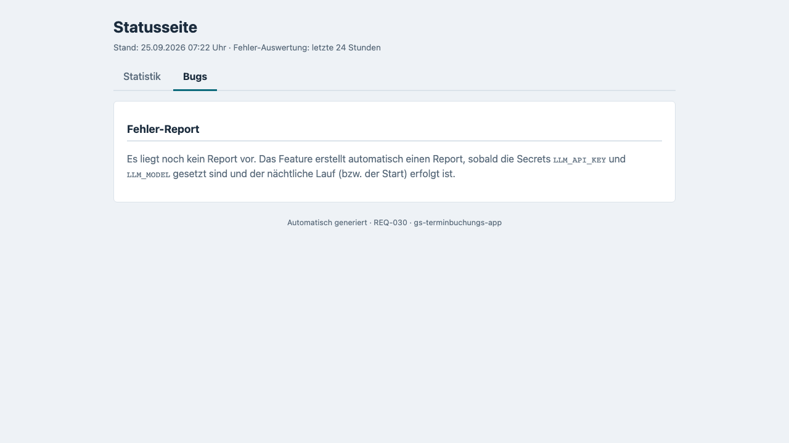
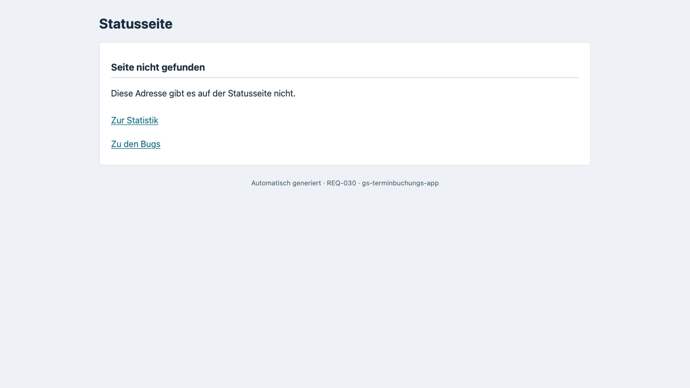
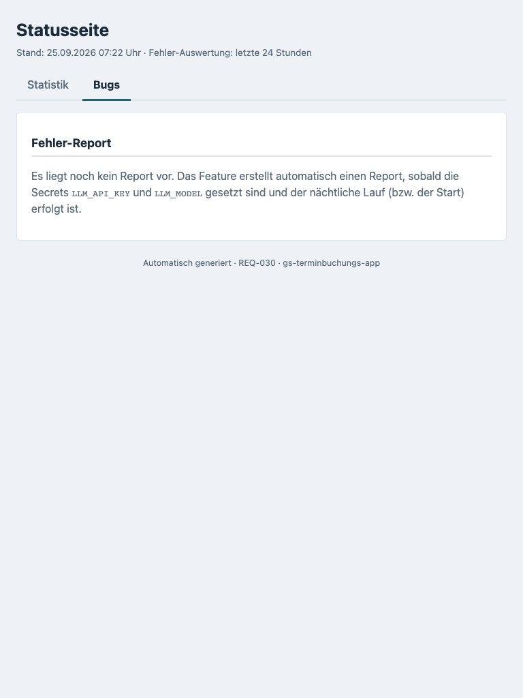
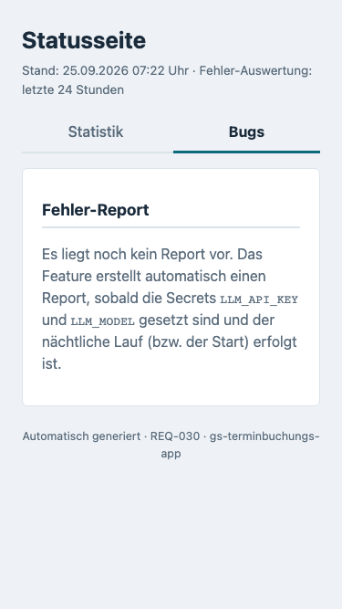

# Feature Documentation: Statistics Dashboard (REQ-038)

| | |
|---|---|
| **Created** | 2026-09-24 |
| **Requirement** | [REQ-038-Statistik-Dashboard](./requirement.md) |
| **Language** | EN |
| **Status** | Implemented — every new data source ships **switched off**; on 2026-09-24 the product owner decided to switch on all five switches at deploy time, before the gates are formally closed (see "Operations"). Requirement status: Draft |
| **Audience** | Operators/admins · marketing and location management |

> **About the language of the page:** the status page is deliberately **German-only** — an internal
> operator page without ngx-translate and without a language switch. All screenshots therefore show
> German labels. This document quotes the German on-screen text in "quotes" and gives the English
> meaning next to it; the English reference wording comes from the label catalogue in `requirement.md` §17.

---

## Overview

The internal status page `/internal/report` (REQ-030, extended by the usage statistics of REQ-037) used
to be **one single document**: usage statistics on top, AI summary and error list below. REQ-038 splits
it into **two tabs**:

- **"Statistik"** (Statistics, default): steering knowledge for marketing and location management — where
  are online slots still free, which location does well or badly online, what is booked where, when do
  customers book, where do visitors drop out.
- **"Bugs"**: the existing error report, **unchanged**.

Each tab has its own linkable address. The page is rendered entirely by the backend — no JavaScript, no
Angular change, no new Azure resource.

### What each section answers

The statistics tab consists of eight sections in a fixed order — **act first, details later**:

| # | Heading on the page (EN meaning) | Answers | Typical action |
|---|---|---|---|
| S0 | "Auf einen Blick: Handlungsimpulse" (At a glance: action hints) | Where does a campaign pay off, where is it pointless? | Steer promotion to where capacity is free and online demand is weak |
| S1 | "Freie Online-Termine je Standort" (Free online slots per location) | How quickly can a customer get an online slot? Is that permanent or an exception? | "meist frei" (mostly free) → campaign possible; "meist belegt" (mostly booked up) → hold back |
| S2 | "Online-Buchungen je Standort: Renner und Penner" (Online bookings per location: top and bottom) | Which location is the online top performer, which the laggard? Where is interest high but conversion weak? | Many service views but few bookings per 100 views → check slot offer / service catalogue on site |
| S3 | "Servicegruppen: Was wird wo gebucht?" (Service groups: what is booked where?) | Which services are booked online, where in particular? Is a rental car added? | Promote location strengths, spot gaps |
| S4 | "Buchungs- und Terminzeiten" (Booking and appointment times) | Do customers book in the evening/at night? Which slot times are in demand? How much lead time? | High evening share → strengthen the online channel outside opening hours; assess short-notice campaigns |
| S5 | "Nutzungsstatistik" (Usage statistics) | Visits, searches, bookings, device classes (REQ-037, **unchanged**) | see [REQ-037 documentation](../REQ-037-Nutzungsstatistik/feature-documentation-en.md) |
| S6 | "Buchungsstrecke: Wo steigen Besucher aus?" (Booking flow: where do visitors drop out?) | At which stage and in which situation do visitors abandon? | Scenario with a fixed action hint, e.g. "check the Bugs tab", "slot offer too narrow" |
| S7 | "Messgrenzen und Datenschutz" (Measurement limits and privacy) | Since when is data collected, what do "< 5", "k. A.", "n < 20", "—" mean, what is **not** measurable? | Read the numbers correctly |

### Before you look at the numbers

- **Delivery state:** without an env override all new switches are `false`. The statistics tab then shows
  only **S5 and S7** — everything else appears once the switches are set. For the first deploy the product
  owner decided on 2026-09-24 to **switch on all five switches** although the gates are not formally
  closed yet (rationale and open follow-ups in the section "Operations").
- **The screenshots show test data.** They come from a local backend in the seed profile `e2e-seed` with
  all switches on. Location names come from `setup.json`; **the numbers are made-up fixture values**
  (`playwright/fixtures/req038/`), not production data.
- **As of yesterday.** All REQ-038 metrics are computed overnight; there is no live value. Only S5
  (REQ-037) additionally includes the current day.
- **Online only.** Phone and branch bookings are invisible — a weak online location may be strong offline.

---

## Opening the page

| Address | Content | Response |
|---|---|---|
| `https://<host>/internal/report` | Statistics tab (default), **no** redirect | 200 HTML |
| `…/internal/report/statistics` | Statistics tab (same page, canonical link) | 200 HTML; 404 when all statistics sources are off |
| `…/internal/report/bugs` | Bugs tab (REQ-030 error report) | 200 HTML, always exists |
| `…/internal/report/insights.json` | S0, S2–S4, S6 as JSON — **already anonymised** | 200 JSON; 404 when booking insights and funnel are both off |
| `…/internal/report/capacity.json` | S1 as JSON | 200 JSON; 404 with `CAPACITY_SCAN_ENABLED=false` |
| `…/internal/report/usage.json` | S5 as JSON (REQ-037, unchanged) | 200 JSON; 404 with `USAGE_STATS_ENABLED=false` |
| `POST …/internal/report/refresh` | Reloads the REQ-037 live values (unchanged, at most once per minute) | triggers **neither** the capacity scan **nor** the insights rollup |
| any other `…/internal/report/…` address (also `GET …/refresh`) | "Seite nicht gefunden" (page not found) with links to the tabs | 404 HTML; an existing address with an unsuitable `Accept` → 406 |

- **Sign-in:** HTTP Basic Auth with `REPORT_ADMIN_USER` (default `admin`) / `REPORT_ADMIN_PASSWORD`.
  In the MVP marketing uses the same credentials; the separate addresses keep a later role split open.
- **Without or with wrong credentials** **every** one of these addresses answers **401** — unknown
  sub-paths do not reveal whether they exist.
- **From the app:** the status button at the bottom centre still opens `/internal/report` in a new tab;
  its label "Fehler-Report" (error report) stays for now (renaming is a follow-up REQ).
- Tabs are plain links: **deep link, reload and browser back** work. Each tab has its own window title
  ("Statusseite – Statistik" / "Statusseite – Bugs").

---

## Flow: from a customer click to a number on the page (main flow)

The first five steps run in the background and have no UI of their own; they become visible through log
lines, the JSON endpoints and the page itself (steps 6–8).

**Night schedule (Europe/Berlin):**

| Time | Job | Source |
|---|---|---|
| 22:30 (+ 0–5 min random delay) | Capacity scan against SoftNet, typically 3–5 min, at most 20 min | REQ-038 (K1) |
| 23:59:59 | **Daily flush** of the booking attributes: all `USAGE_BOOKING` lines of the day written to the log in shuffled order (also on every graceful shutdown, i.e. restart and deploy) | REQ-038 (K2) |
| 00:05 | Rebuild display values (day/month change, **no** queries) | REQ-038 |
| 03:00 | AI error report (Bugs tab) | REQ-030 |
| 03:30 | Daily rollup of the usage statistics | REQ-037 |
| 03:45 (+ 0–2 min) | Insights rollup: bookings, service views, funnel, drop-off scenarios | REQ-038 (K2/K3) |
| 04:15 | **Retention run** of `usage-insights.json` (compaction and deletion) — fixed, cannot be switched off | REQ-038 |

### Step 1: A booking is recorded for statistics

A customer books an appointment. **Only after a successful booking** and only with
`USAGE_INSIGHTS_ENABLED` on, the backend remembers the anonymous booking attributes — it writes **no** log
line at that moment. The attributes go into an in-memory buffer (at most 10,000 entries). Only **once a
day at 23:59:59** (and on every graceful shutdown, i.e. restart or deploy) the backend writes all
collected entries to the log in **shuffled** order, one line per booking, carrying the job marker
`job.usagebooking` instead of the ID of the booking request:

```
… - job.usagebooking: USAGE_BOOKING {"v":2,"day":"2026-10-22","branch":"68f0a1b2c3d4e5f6a7b8c9d0","group":"6908a1b2c3d4e5f6a7b8c9d1","variant":"default","ops":["6908a1b2c3d4e5f6a7b8c9e2"],"bookingDaypart":"evening","slotWeekday":"SA","slotDaypart":"morning","leadTime":"2-3","mobility":false}
```

Why the detour? On 2026-09-24 the product owner decided: **"anonymous data only, never who"**. A line
written at the moment of booking could be linked to the booking line (`BOOKING_CREATED`, which holds the
booking number) via request ID, millisecond and thread. Collecting, shuffling and the own marker mean the
statistics line shares nothing with the booking any more.

It contains only: the **booking day** without time (`day`), location and group ID, variant
(default/wheel change), the IDs of the booked services, the **part of day** of the booking (day 7am–6pm ·
evening 6–10pm · night 10pm–7am), weekday and part of day of the appointment (early · morning · midday ·
afternoon · late), the lead time as a bucket (0–1 · 2–3 · 4–7 · 8–14 · 15–30 · over 30 days) and whether
a rental car was added. **Not contained:** booking number, appointment date, time, brand, model, device,
session ID, service advisor, customer data, free text. If recording fails, the booking response to the
customer stays unchanged.

In addition (only with drop-off scenarios enabled, see S6) the existing access line of a **successful
slot search** carries the field `"hits"`: `none` (0 days with free slots from the requested start date),
`few` (1–3 days) or `many` (≥ 4 days). In every other case the line stays byte-identical.

### Step 2: Nightly capacity scan (22:30)

For **every location** (alphabetically, 1 s pause) the scan asks SoftNet for the next free online slot
for a fixed **reference service** ("Wischerblätter erneuern" — replace wiper blades, the smallest unit).
The target day is the **next working day Mon–Sat**. Failed locations are retried once after 60 s. Across
all replicas the scan runs at most **once per calendar day** and aborts after 20 minutes.
Log: `INFO capacity scan <day>: 25 ok, 0 none, 2 error in 212 s`.

Without `USAGE_STORAGE_ACCOUNT` **no** scan runs — there would be neither a lock nor a storage location,
so a developer machine never calls SoftNet at night.

### Step 3: Nightly insights rollup (03:45)

The rollup analyses **yesterday** and catches up missing days of the last 25 days (never before the
collection start, never into already compacted months). From Azure Log Analytics it reads:

1. the `USAGE_BOOKING` lines of the daily flush (only with `USAGE_INSIGHTS_ENABLED`) — only lines with the
   job marker `job.usagebooking` count; they are assigned by the booking day `day`, and because the flush
   at 23:59:59 may reach the log shortly after midnight, the query looks 10 minutes past the end of the day,
2. the calls of the service selection per location — **without** session ID (only with `USAGE_INSIGHTS_ENABLED`),
3. the funnel per session (only with `USAGE_STATS_ENABLED` **and** `USAGE_FUNNEL_ENABLED`; with
   `USAGE_DROPOFF_ENABLED` in addition, in a variant that delivers funnel **and** drop-off scenarios from
   one result).

The booked services are mapped to **service groups**: name contains "hol" → pick-up & delivery; exactly
one SoftNet tag → group of that tag (inspection, MOT, brake fluid, wheel change, offers/checks,
repair/complaint, bodywork/windscreen); several tags → extras; otherwise "not assignable". A wheel-change
booking always also counts under wheel change. Daily values are **replaced, never added up** — the run
is repeatable. Log: `INFO usage insights rollup written: 1 day(s), 11 booking(s), 0 purged`.

### Step 4: Monthly compaction and retention

Per-location daily values are kept at most until the **8th of the following month** (≤ 38 days); then
they are summed into monthly values and the days are deleted. Global daily values, monthly values and
scans are removed after `USAGE_RETENTION_MONTHS` (24 months). Compaction runs as soon as
`USAGE_STORAGE_ACCOUNT` is set — **even if the switches have been turned off again**:

- as part of the nightly insights rollup,
- additionally in an **own, fixed retention run every day at 04:15** that cannot be switched off — not even
  via `USAGE_INSIGHTS_ROLLUP_CRON=-`. After a normal rollup it finds nothing left to do and writes nothing.

### Step 5: Display values are precomputed

At startup, after each of its own runs and daily at 00:05 the backend computes the display values
**including suppression** of small numbers, the labels relative to the day of viewing ("heute frei" /
free today, "morgen frei" / free tomorrow) and all warnings. Opening the page computes or queries nothing.

### Step 6: Open the statistics tab

Open `/internal/report` (bookmark or the app's status button) and sign in via the browser dialog. The
page answers in under 200 ms and reads memory only — never Log Analytics, Blob Storage or SoftNet.


**Description:** header "Statusseite" (status page) with the meta line
"Stand: 24.09.2026 11:31 Uhr · Auswertung bis gestern (23.09.2026) · Kapazitäts-Scan vom 23.09.2026,
22:30 Uhr" (as of … · data up to yesterday … · capacity scan of …), below it the tab bar (active tab
underlined **and** bold) and the jump links "Inhalt:" (contents) to the eight sections. The jump links
list exactly the sections currently rendered. The sections are described in "The statistics tab in detail".

### Step 7: Switch to the Bugs tab

Click "Bugs" (or open `/internal/report/bugs` directly) — a new page request.



**Description:** meta line "Stand: … · Fehler-Auswertung: letzte 24 Stunden" (error analysis: last 24
hours), then the stored REQ-030 error report **byte-identical** (AI summary, status overview, error list
with filter). Locally no AI model is configured, so — as in the screenshot — the existing notice
"Es liegt noch kein Report vor …" (no report available yet) is shown. Browser back returns to the
statistics tab.

### Step 8: Machine-readable access (optional)

```bash
curl -s -u "admin:$REPORT_ADMIN_PASSWORD" https://<host>/internal/report/capacity.json | jq '{scanDay, targetDay, state, warnings}'
curl -s -u "admin:$REPORT_ADMIN_PASSWORD" https://<host>/internal/report/insights.json | jq '{asOf, bookingsEnabled, funnelEnabled, warnings}'
```

**Description:** the JSON endpoints return **the same, already suppressed** values as the page. A hidden
cell never carries a value — it looks like this:
`{"value": null, "ratio": null, "percent": null, "heat": 0, "state": "SUPPRESSED"}`
(`SUPPRESSED` = "< 5", `WITHHELD` = "k. A." (n/a), `TOO_FEW` = "n < 20", `NO_DATA` = "—"). Bar width
(`barWidth: 0.0`), colour level and ordering reveal nothing about a hidden value either.

---

## The statistics tab in detail

All example values are taken from the screenshot above (seed set `full`, recorded on 2026-09-24).

### S0 — At a glance: action hints

Up to **four tiles**, rule-based and without AI; each names its source ("Scan 23.09." or "August 2026")
and the rule it is built from:

| Tile (EN meaning) | Rule | Example in the screenshot |
|---|---|---|
| **"Luft heute / morgen / am {day}"** (capacity today / tomorrow / on {day}) | Locations that are free on the target day in the latest scan (from today or yesterday); at most 5, sorted by number of free slots (if shown), otherwise alphabetically. The title follows the day of viewing. | "Luft heute (Do 24.09.)" with five Audi locations |
| **"Werbe-Kandidat"** (promotion candidate) | 10-day classification "meist frei" (mostly free) **and** lower third of online bookings in the previous month | Volkswagen Grevenbroich, Volkswagen Velbert |
| **"Engpass"** (bottleneck) | 10-day classification "meist belegt" (mostly booked up) — promotion pointless for now | six VW locations |
| **"Renner & Abendbuchungen"** (top performers & evening bookings) | the 3 locations with the most online bookings in the previous month plus the share booked outside Mon–Fri 7am–6pm (from 20 bookings) | "39 % außerhalb Mo–Fr 07–18 Uhr gebucht" |

If a tile lacks its data basis (source off, fewer than 5 measurable scan days, no closed month yet, last
scan failed) it is **omitted**. If all are missing the section says "Noch keine Hinweise – zu wenig
Daten." (no hints yet – not enough data).

### S1 — Free online slots per location

- **Range line:** "Kapazitäts-Scan vom 23.09.2026, 22:30–22:34 Uhr · Zieltag: Do 24.09.2026 (nächster
  Werktag) · Werktage Mo–Sa · Verlauf: letzte 10 Scans (12.09.–23.09.)" — scan time, target day (next
  working day), working days Mon–Sat, trend of the last 10 scans.
- **Column "Nächster freier Online-Termin"** (next free online slot, latest scan) as a text level with
  date: "heute frei" / "morgen frei" / "am {weekday} {date} frei" (free today / tomorrow / on …) ·
  "in n Werktagen" (in n working days) · "belegt: ≥ 5 Werktage" (booked up: ≥ 5 working days) ·
  "keine Online-Termine gefunden" (no online slots found) · "nicht messbar" (not measurable) with a
  reason (e.g. "Grund: Zeitüberschreitung" / timeout, "Grund: Referenz-Leistung nicht im
  Leistungskatalog" / reference service not in catalogue). A failure is **never shown as 0**.
- **"Verlauf letzte 10 Tage"** (last 10 days): per location a grid of the last 10 scans (oldest left),
  every cell with an abbreviation **and** a colour: "frei" (free on the target day) · "knapp" (tight:
  first free slot in 1–4 working days) · "belegt" (booked up: ≥ 5 working days or no slots) · "—" (not
  measurable or no scan; reason in the footnote below the table).
- **"an X von 10 Tagen frei"** (free on X of 10 days) and **classification**: "meist frei" (≥ 7 of 10),
  "wechselnd" (mixed, 3–6), "meist belegt" (≤ 2); below 5 measurable days "zu wenig Daten" (not enough
  data). Non-measurable days do not count. Sorting: mostly free on top, mostly booked up at the bottom.
- **"Frei am Zieltag"** (number of free slots on the target day) appears only with
  `CAPACITY_SHOW_SLOT_COUNT=true` — hence not in the screenshots.
- Below: the note on the reference service ("remaining online capacity, not workshop utilisation") and
  the legend.

The screenshot shows "Scan vom 23.09.2026 unvollständig: 3 Standorte nicht messbar." (scan incomplete:
3 locations not measurable) at the top — with the default reference this is **normal**: both Leverkusen
locations do not offer "replace wiper blades" and are therefore permanently "not measurable" (a
substitute is open question 9).

> The table sits in a horizontally scrollable region. The full-page screenshots show only its visible
> part; the columns of the latest scan day, "an X von 10 Tagen frei" and "Einordnung" (classification)
> are reached by scrolling sideways inside the table.

### S2 — Online bookings per location: top and bottom

Ranking of all locations for the **previous month** (August 2026 in the screenshot, "abgeschlossener
Monat · Jahr 2026 bis Ende August" / closed month · year 2026 up to end of August). Columns:

rank · location · online bookings (bar + number) · share of online volume · year to previous month ·
service views (page views) · bookings per 100 views (**approximation**) · outside Mon–Fri 7am–6pm ·
late slots from 4pm · rank change (↑ n / ↓ n / = / "neu" (new), plus the previous month's rank).

- Locations with **0–4 bookings** appear without rank in the closing, alphabetical group
  "Unter 5 Buchungen: …" (fewer than 5 bookings) — with "0" or "< 5" instead of the number and
  "k. A." (n/a) for derived values. Laggards stay visible, their exact number does not.
- Shares appear only from 20 bookings, otherwise "n < 20".
- **How to read it:** many service views but few bookings per 100 views → interest exists, conversion
  is stuck (check slot offer and service catalogue on site). Service views are page views (every
  re-entry counts), not visitors.

### S3 — Service groups: what is booked where?

- **"Servicegruppen gesamt"** (service groups overall): bar list with mentions and share of bookings, for
  the current month and the current year (each up to yesterday) one below the other; plus "Zusätzlich mit
  Mietwagen gebucht: 174 von 1.424 Buchungen (12,2 %)" (additionally booked with a rental car). Multiple
  mentions: a booking counts once in each of its groups.
- **"Standort × Servicegruppe ({previous month})"**: heatmap table with an integer percentage **and** a
  colour level per cell (legend 1–14 % · 15–29 % · 30–44 % · from 45 % · 0 %: no booking). Only a
  location with **≥ 20 bookings** in the month gets its own row; the others form
  "weitere Standorte (unter 20 Buchungen)" (other locations, fewer than 20 bookings). Last column
  "Mietwagen" (rental car).
- **How to read it:** high cell values show what runs particularly well at a location (e.g. wheel
  change 45 % at Audi Zentrum Düsseldorf); "nicht zuordenbar" (not assignable) concerns locations
  without SoftNet tags (today the two Leverkusen locations).

### S4 — Booking and appointment times

For "current month up to yesterday" and "current year up to yesterday", stacked, without a toggle:

- **KPI tiles:** "43 % außerhalb Mo–Fr 07–18 Uhr gebucht" (booked outside Mon–Fri 7am–6pm; month) and
  "42 %" (year).
- **"Wann wird gebucht?"** (when do customers book?): heatmap weekday × day (7am–6pm) · evening
  (6–10pm) · night (10pm–7am) — time of the **booking**.
- **"Welche Terminzeiten sind gefragt?"** (which slot times are in demand?): heatmap Mon–Sat × early
  (before 9) · morning (9–12) · midday (12–2pm) · afternoon (2–4pm) · late (from 4pm) — time of the
  **booked appointment**. Note: customers pick from what SoftNet offers — the distribution reflects
  supply **and** demand. Below, if applicable, "ohne Terminzeit: n" (without slot time; 1–4 shows as
  "< 5", otherwise a hidden cell could be recomputed).
- **"Vorlauf: Tage zwischen Buchung und Termin"** (lead time: days between booking and appointment) as
  a bar list (0–1 day … over 30 days).
- The heatmap legend is computed from the data (e.g. "bis 12 · 13–24 · 25–36 · ab 37 (größter Wert 48)"
  / up to 12 … from 37, largest value 48); every cell carries its number as text.

### S5 — Usage statistics (REQ-037)

Unchanged from REQ-037 (current month and year overview). In **all** screenshots S5 shows the degraded
mode ("Live-Daten derzeit nicht verfügbar" / live data currently unavailable, "Historie derzeit nicht
verfügbar" / history currently unavailable, "Keine Daten für diesen Zeitraum" / no data for this period)
— this is intended: the seed profile fills only the REQ-038 sources, and the REQ-037 tests expect empty
periods locally.

### S6 — Booking flow: where do visitors drop out?

Global funnel of **all locations together** — there is no per-location analysis of the flow. Unlike S4,
S6 shows only the **current month up to yesterday** (no yearly value). Per session
and calendar day the **highest stage reached** counts:

| Stage (on-screen text) | Meaning | Detected by |
|---|---|---|
| 1 · "Besuch (App-Aufruf)" (visit, app start) | the session opened the app | any request of the session |
| 2 · "Leistungsauswahl" (service selection) | a location's services were loaded | call of the service list |
| 3 · "Hinweise" (notes) | the notes / rental-car step was reached | call of the rental-car categories |
| 4 · "Terminsuche ausgeführt" (appointment search run) | at least one slot search — also with an empty list | `POST /api/v1/snaps` |
| 5 · "Gebucht" (booked) | booking submitted and successful | `POST /api/v1/appointments` |

A request with an error status (≥ 400) only counts as stage 1.

- **Funnel:** per stage the absolute number, "% vom Start" (% of start) and "% der Vorstufe" (% of
  previous stage) (in the screenshot 2,771 visits → 355 bookings = 12.8 % of start).
- **"Ausstieg nach Stufe und Geräteklasse"** (drop-out by stage and device class): rows "nach Stufe 1–4"
  with the pages seen last; columns all · mobile · tablet · desktop · unknown. Device classes below
  20 sessions are merged into the column "Sonstige (…)" (other) so that no hidden class can be recomputed
  from "Alle" (all) — visible in seed set `thin`: "Sonstige (Tablet, Desktop)".
- **"Absprungszenarien"** (drop-off scenarios, only with `USAGE_DROPOFF_ENABLED`): every abandoned session
  gets **exactly one** scenario — the first matching row of the following list wins:

  | Scenario (on-screen text → EN) | When | Action hint on the page (EN) |
  |---|---|---|
  | "Technischer Fehler (Fehlerseite)" → technical error (error page) | last request with a server error (≥ 500) | check the Bugs tab |
  | "Zugriff abgelehnt oder Anfragelimit" → access denied or rate limit | last request 403 or 429 | check session TTL and rate limit |
  | "Termin nach längerer Pause abgelaufen" → slot expired after a longer pause | a booking with 404 (slot cache 30 min) | "retry" re-sends the same slot — dead end, separate bug-fix REQ |
  | "Termin war inzwischen vergeben" → slot was taken meanwhile | a booking with 410 | high demand or long form |
  | "Buchung abgelehnt" → booking rejected | last request is a booking with 400–499 | check input / SoftNet validation |
  | "Terminsuche fehlgeschlagen" → appointment search failed | last request is a search with 400–499 | check service mapping |
  | "Nach Fehler weitergemacht, dann aufgehört" → continued after an error, then left | an earlier error, last request ok | like "technical error" |
  | "Verbindung unterbrochen" → connection interrupted | gap in the session's request counter | network or circuit breaker — measurement artefact possible |
  | "Keine Termine gefunden" → no appointments found | last successful search with `hits=none` | capacity / slot offer, read together with S1 |
  | "Nur wenige Termine angeboten" → only few appointments offered | last successful search with `hits=few` | slot offer too narrow |
  | "Lange Wartezeit auf Antwort" → long wait for a response | last request ok, duration ≥ 8 s | performance or SoftNet |
  | "Viele Terminsuchen ohne Buchung" → many searches without booking | ≥ 4 successful searches | slots do not fit |
  | "ohne erkennbaren Anlass – nach Stufe k" → no recognisable trigger – after stage k | all others | stage 4: form or overview; more precise only with the step beacon (follow-up REQ 1) – measurement artefact possible |

  Shown are a bar list (without the catch-all group "no recognisable trigger"), a table scenario ×
  stage 1–4 with total, share and action hint, and a table "Nach Geräteklasse" (by device class). The
  **sum row** doubles as a plausibility check: "Alle Abbrüche 2.416 = 2.771 Besuche − 355 Buchungen"
  (all drop-offs = visits − bookings).

### S7 — Measurement limits and privacy

Always the last section of the tab, with three blocks:

- **"Erfassung seit"** (collected since) per active source (in the screenshot: booking attributes and
  service views 22.06.2026 · booking flow 22.06.2026 · drop-off scenarios 20.07.2026 · capacity scan
  10.09.2026; usage "—" because the seed profile does not fill REQ-037).
- **"Darstellungsregeln"** (display rules: "< 5", "n < 20", "k. A.", "—", location values for closed
  months only, privacy note).
- **"Messgrenzen"** (measurement limits, see the section "Measurement limits" below).

---

## The Bugs tab

The Bugs tab is the unchanged REQ-030 error report (see the screenshot in step 7). It works
**independently** of all REQ-038 switches. Errors of the capacity scan and the insights rollup do **not**
appear there: the background jobs tag their log lines with `job.capacityprobe`, `job.insightsrollup` or
`job.usagebooking` (daily flush), and the error query excludes every ID starting with `job.`. It checks
the **real** prefix at the start of the line — if such a text appears in a customer field (e.g. the car
model), the customer error still shows. Real customer errors always appear — a client cannot set these
markers for its own requests.

## Unknown addresses



Typos such as `/internal/report/statistik` or `/internal/report/a/b` lead to a short page
"Seite nicht gefunden · Diese Adresse gibt es auf der Statusseite nicht." (page not found · this address
does not exist on the status page) with the links "Zur Statistik" (go to statistics, if available) and
"Zu den Bugs" (go to bugs) — **never** to the blank Angular start page. The requested path is not echoed
on the page. This also applies to `GET /internal/report/refresh` (the address exists for `POST` only).
Calling an **existing** address with an unsuitable `Accept` header (e.g. `usage.json` with
`Accept: text/html`) instead returns **406** without a body, as before REQ-038 — not "page not found".

---

## Responsive views

Full-page captures of the statistics tab (seed set `full`):

### Desktop (1280 px)


### Tablet (768 px)


### Mobile (375 px)


Bugs tab in the viewport:

| Tablet (768 × 1024) | Mobile (375 × 667) |
|---|---|
|  |  |

- **Desktop (≥ 64em):** action tiles 2 × 2, the two heatmaps of a period side by side.
- **Tablet (48–63.99em):** tiles 2 × 2, heatmaps stacked, all table columns inside the scroll region.
- **Mobile (< 48em):** everything single-column, the two tab links share the width; below 40em optional
  columns (e.g. "Jahr bis Vormonat" / year to previous month, "Leistungsaufrufe" / service views) are hidden.
- In no viewport does the **page** scroll horizontally; wide tables scroll inside their region.

---

## States

The page **never** returns an error and **never** a blank page; a missing source is always named, never
disguised as 0.

### Populated (seed set `full`)

See step 6 and "Responsive views". Collection for several months, twelve scans (one of them failed
completely — visible in the trend as an all-"—" column on 16.09.).

### Not enough data — first day of collection (seed set `thin`)

Collection since yesterday, a single scan, ten bookings:

| Desktop | Tablet | Mobile |
|---|---|---|
|  |  |  |

- **S0:** only "Luft heute" — "Werbe-Kandidat"/"Engpass" lack 5 measurable days, "Renner" lacks a closed month.
- **S1:** trend almost only "—" (footnote: "alle Standorte 12.09.–22.09.: kein Scan" / all locations: no
  scan), classification "zu wenig Daten" (not enough data).
- **S2:** "— Noch kein abgeschlossener Monat seit Erfassungsbeginn (23.09.2026). Die erste Rangliste
  erscheint am 01.10.2026." (no closed month since collection started; the first ranking appears on
  01.10.2026); the matrix in S3 likewise.
- **S3/S4:** "Anteile: zu wenig Daten (n < 20). Gezeigt werden nur Nennungen." (shares: not enough data,
  only mentions are shown), KPI tiles "n < 20", many cells "< 5"; weekdays without a collected day show
  "—" (no data), not 0.
- **S6:** "Sonstige (Tablet, Desktop)"; most scenarios "< 5 · k. A.".

### Scan failed, analysis pending (seed set `fail`)

Yesterday's scan failed for all 27 locations, last night's rollup is pending:

| Desktop | Tablet | Mobile |
|---|---|---|
|  |  |  |

- **Meta line:** "Kapazitäts-Scan vom 23.09.2026 fehlgeschlagen – angezeigt: Scan vom 22.09.2026"
  (capacity scan failed – showing scan of 22.09.2026).
- **S0:** only "Renner & Abendbuchungen" — all capacity hints are omitted.
- **S1:** warning bands "Letzter Scan (23.09.2026, 22:31 Uhr) fehlgeschlagen – angezeigt: Stand
  22.09.2026." (last scan failed – showing 22.09.2026) and "Grund: SoftNet nicht erreichbar (alle 27
  Standorte, auch nach erneutem Versuch). Für heute (Do 24.09.) liegt keine Messung vor; kein Wert wird als
  0 dargestellt." (reason: SoftNet unreachable for all 27 locations even after a retry; no measurement for
  today; no value is shown as 0), plus the partial notice of the displayed scan. Levels are labelled
  relative to the day of viewing ("am Mi 23.09. frei" / free on Wed 23.09.).
- **S2, S3, S4, S6:** warning band "Auswertung für 23.09.2026 steht noch aus" (analysis for 23.09.2026
  pending); the following night catches up the day.

### Further states (no screenshot)

| State | Rendering |
|---|---|
| Source switched off | Section and jump link are omitted **without replacement** — no "not available" |
| All statistics sources off | no tab bar; `/internal/report` shows the Bugs content directly, `/statistics` answers 404 |
| History unavailable (Blob Storage missing, 403 or network error, nothing ever loaded) | warning band "Historie derzeit nicht verfügbar" instead of numbers in S1–S4, HTTP 200 |
| No scan yet / first scan running | "Noch kein Kapazitäts-Scan – der erste läuft heute um 22:30 Uhr." (no capacity scan yet – the first runs today at 22:30) or "Noch keine Messung. Der erste Kapazitäts-Scan läuft seit … Uhr (gestartet …; üblich 3–5 Minuten). Erfassung seit …" (no measurement yet; the first scan has been running since …) |
| Scan incomplete | "Scan vom … unvollständig: n Standorte nicht messbar." |
| Data stale | "Letzte Auswertung: … – Daten möglicherweise veraltet" (last analysis … – data may be outdated; insights > 3 days, scan > 2 days old) |
| Previous month incomplete | "Monat unvollständig – Erfassung seit …" (month incomplete – collected since …) or "unvollständig: n Tage fehlen" (n days missing; for one day "unvollständig: 1 Tag fehlt" / 1 day missing) |
| Before collection start | "—" with "Erfassung seit …", **never 0** |

---

## Measurement limits

These limits are also printed in S7 — they are a prerequisite for reading the numbers correctly:

1. **Capacity is an approximation.** SoftNet returns ranked proposals, not total capacity; a
   "utilisation in %" is not measurable. Only the reference service is measured; with a lead time
   configured in SoftNet, "not free tomorrow" may mean "not bookable online", not "full". Public holidays
   count as working days.
2. **Online only.** Phone and branch bookings are invisible; an online share of all bookings of a
   location cannot be determined.
3. **Small numbers.** About 10 online bookings per day mean about 11 per location and month — many cells
   therefore show "< 5" or "not enough data". Yearly values are the more robust view.
4. **Service views are page views, not visitors;** "bookings per 100 views" is therefore an approximation.
5. **Slot times reflect supply and demand at once.**
6. **Service groups:** locations without SoftNet tags (today the two in Leverkusen) appear as "not assignable".
7. **Booking flow:** brand, vehicle data and overview trigger no server call and are not visible
   individually; slot selection and workshop calendar cannot be told apart; a reload counts as drop-out
   plus new visit; a session across midnight counts on both days.
8. **Drop-off scenarios:** a reload starts a new session (the old one mostly counts as "no recognisable
   trigger"); a network loss at the end of a session stays invisible; a restart or deploy clears the slot
   cache and produces "slot expired"; the hit count states what the server returned — the app shows at
   most 4 proposals.
9. **History:** data exists only from the collection start of each source; nothing is computed
   retroactively. Missed nights are caught up for up to 25 days.
10. **Wheel change** is bookable in season only.
11. **Booking attributes in the daily flush:** they are not written at the moment of booking but collected
    in memory and logged once a day (23:59:59) in one bundled, shuffled batch. If the application
    **crashes** (not on restart or deploy — those write first), the booking attributes of the current day
    are missing. Bookings in the fraction of a second between the flush and midnight fall outside the day
    window. More than 10,000 bookings between two flushes would be dropped (with a log warning, count
    only) — purely theoretical at about 10 online bookings a day.

Each approximation also carries its caveat **right next to the value** (reference service in S1,
"(Näherung)" / approx. in S2).

---

## Privacy in plain words

**Three data classes that are never linked:**

| Class | Content | Personal reference | Switch |
|---|---|---|---|
| K1 operations | capacity scan per location | none (capacity of a business site) | `CAPACITY_SCAN_ENABLED` |
| K2 booking | `USAGE_BOOKING`, service views without session ID | raw line without a link to the booking (booking day only, daily flush, shuffled, job marker instead of request ID; ≈ 30 days log retention), analysis anonymous | `USAGE_INSIGHTS_ENABLED` |
| K3 usage | REQ-037 metrics, funnel, drop-off scenarios | session ID as counting basis — only after DPO approval | `USAGE_STATS_ENABLED`, `USAGE_FUNNEL_ENABLED`, `USAGE_DROPOFF_ENABLED` |

- **"Anonymous data only, never who" (PO decision 2026-09-24):** the statistics line of a booking is not
  written at booking time but collected, shuffled and logged once a day under an own job marker. It shares
  neither ID nor time nor thread with the booking line and holds only the booking day, no time.
- **Location reference only from K1 and K2.** Session and device are **never** linked to a location;
  funnel and drop-off scenarios stay global.
- **Small numbers are hidden mechanically** — on the page **and** in the JSON:
  - "**< 5**": value 1–4 (0 stays 0).
  - "**n < 20**" / "zu wenig Daten (n < 20)": shares only from 20 cases.
  - "**k. A.**" (n/a): additionally hidden so that a hidden value cannot be recomputed from a total or a
    share — also when several hidden values would allow only one solution (e.g. two "< 5" summing to
    2 = 1 + 1).
  - "**—**": no data (e.g. before collection start) — never "0".
  - Capacity values are operational data without personal reference; the "< 5" rule does not apply to them.
- **Location values for closed calendar months only**; no values per location and day, hour or device.
  An own matrix row only from 20 bookings.
- **No dimension** for brand, model, customer, service advisor or returning status. The service advisor
  name returned by SoftNet is discarded immediately during the scan.
- **Still:** no cookies, no browser storage, no IP addresses, no raw user agent, no dwell time (no time
  differences between requests are computed).
- **Residual risks, stated openly:**
  - In the ranking (S2) the number of a single "< 5" location can in some cases be derived from the
    monthly total or the yearly values. This is accepted because the ranking only holds a count per
    business; all location values that carry attributes (service groups, time shares) are additionally
    protected against recomputation.
  - If a location has **exactly one** booking on a day, its statistics line can still be matched to the
    one booking line of that day via location and day in the raw logs (≈ 30 days). This yields no
    information that is not already in the booking itself.
  - The protection against recomputation checks every row and every column exactly on its own; combining
    several row and column totals as a system of equations is not fully ruled out. In return the page
    deliberately hides rather too much than too little.
- **Retention:** per-location daily values at most until the 8th of the following month — guaranteed by
  an own retention run that cannot be switched off (daily at 04:15), even when the rollup is off —,
  everything else 24 months; log retention unchanged (≈ 30 days). Only integers, keys, calendar days and scan
  timestamps are stored — no session IDs, no booking numbers, no booking timestamps.

---

## Accessibility

- **Keyboard navigation:** tabs are real links inside a labelled navigation ("Bereiche der Statusseite"
  / status page sections); jump links "Inhalt" to every section; wide tables sit in focusable scroll
  regions (`role="region"`, `tabindex="0"`, name "Tabelle …, horizontal scrollbar").
- **Screen reader:** the active tab carries `aria-current="page"`; exactly one H1 "Statusseite", its own
  window title per tab; tables with captions and column/row headers; every heatmap, matrix and trend
  cell carries its value as text; "< 5", "k. A.", "n < 20" and "—" have a spelled-out long text for
  screen readers; bars are redundant, the number sits next to them.
- **Colour contrast:** WCAG 2.1 AA — the new colour surfaces (heat levels, free/tight/booked up) reach at
  least 4.6:1 for text; no state is conveyed by colour alone (abbreviation, number or border in addition).
- **Focus styles:** visible focus ring (`:focus-visible`); active tab with underline **and** bold; tab
  links at least 2.75em (44 px) high.
- No horizontal page scrolling at 375, 768 and 1280 px; no JavaScript; no dark mode (existing status page).

---

## Operations

### Switches and delivery state

| Switch (env) | Default | Controls | Gate |
|---|---|---|---|
| `CAPACITY_SCAN_ENABLED` | `false` | scan, S1, hints "Luft …"/"Werbe-Kandidat"/"Engpass", `capacity.json` | S-1 |
| `USAGE_INSIGHTS_ENABLED` | `false` | collecting and daily flush of the `USAGE_BOOKING` lines, rollup queries 1+2, S2–S4, hints "Werbe-Kandidat"/"Renner", booking part of `insights.json` | S-2 **and** G-VVT |
| `USAGE_FUNNEL_ENABLED` | `false` | funnel in S6 (effective only with `USAGE_STATS_ENABLED=true`) | G-DSB |
| `USAGE_DROPOFF_ENABLED` | `false` | field `hits`, drop-off scenarios in S6 (effective only together with `USAGE_FUNNEL_ENABLED`) | G-DSB with explicit coverage |
| `CAPACITY_SHOW_SLOT_COUNT` | `false` | number of free slots on the target day in S1/S0 | S-1 without capping |

**Switch values:** `true`, `1`, `yes` or `on` = on; `false`, `0`, `no` or `off` = off (case-insensitive).
Page, JSON and background job read the value the same way — a switch never turns on a section without its
job. An empty or unknown value prevents the application from starting. Keep setting `USAGE_STATS_ENABLED`
(REQ-037) with `true`/`false` only.

Without an env override only REQ-037 is active: the statistics tab shows S5 and S7, `insights.json` and
`capacity.json` answer 404, neither `USAGE_BOOKING` nor `hits` is written, and neither a new query nor a
SoftNet scan runs. That is why the implementation was allowed to happen before the gates.

### Activation decision of the product owner (2026-09-24)

The product owner decided to switch on **all five switches** (`USAGE_INSIGHTS_ENABLED`,
`USAGE_FUNNEL_ENABLED`, `USAGE_DROPOFF_ENABLED`, `CAPACITY_SCAN_ENABLED`, `CAPACITY_SHOW_SLOT_COUNT`) at
deploy time, **before** the gates S-1, S-2, G-DSB and G-VVT are formally closed.

- **Rationale:** only anonymous aggregates are produced (minimum case numbers, closed months, protection
  against recomputation), and the booking line is decoupled from the booking (daily flush, shuffled, own
  marker, booking day only).
- **Open follow-ups:** acknowledgement by the data protection officer (per-session analysis for funnel and
  drop-off scenarios); extend the record of processing and the privacy notice; inform soft-nrg about the
  nightly scan (≈ 55 calls/night at 22:30); verify the spike questions S-1/S-2 in operation.
- **Prerequisite:** `USAGE_STATS_ENABLED=true`, otherwise funnel and drop-off scenarios have no effect.
- The requirement stays in status **Draft**; the gates below remain the formal basis.

### Gates before switching on

| Gate | Check | Owner | Unlocks |
|---|---|---|---|
| **S-1** SoftNet spike | Does SoftNet cap the proposal list? Minute grid, lead time (`FirstAppDays`), reservation by the request, fair use, availability at 22:30, shape of the location ID in the snap; alignment with soft-nrg (≈ 55 calls/night) | Tech lead + PO | `CAPACITY_SCAN_ENABLED` (with capping `CAPACITY_SHOW_SLOT_COUNT` stays `false`) |
| **S-2** wishlist echo | Does SoftNet return the requested service IDs in the snap? | Tech lead | `USAGE_INSIGHTS_ENABLED` (otherwise first a fallback via the slot cache) |
| **G-VVT** | Record of processing and privacy notice extended by "analysis of online bookings per location" | Owner of the privacy notice | `USAGE_INSIGHTS_ENABLED` |
| **G-DSB** | DPO approval of the session ID as counting basis; for drop-off scenarios **explicitly** also the per-session analysis (last status, counter gaps, number of searches, hit level `hits`) | Data protection officer | `USAGE_FUNNEL_ENABLED`; `USAGE_DROPOFF_ENABLED` only with explicit coverage |

### Environment variables

| Variable | Default | Purpose |
|---|---|---|
| `USAGE_INSIGHTS_ENABLED` | `false` | Kill switch K2 (see above) |
| `USAGE_INSIGHTS_COLLECTING_SINCE` | empty | Collection start K2 (ISO date); empty = first full Berlin day after activation |
| `USAGE_INSIGHTS_ROLLUP_CRON` | `0 45 3 * * *` | Insights rollup (after the REQ-037 rollup at 03:30); `-` disables **only the rollup**, not retention (fixed run at 04:15) |
| `USAGE_INSIGHTS_BLOB` | `usage-insights.json` | Blob in the container `USAGE_STORAGE_CONTAINER` |
| `USAGE_FUNNEL_ENABLED` | `false` | Kill switch funnel |
| `USAGE_FUNNEL_COLLECTING_SINCE` | empty | Collection start funnel; empty = activation day + 1 |
| `USAGE_DROPOFF_ENABLED` | `false` | Kill switch drop-off scenarios |
| `USAGE_DROPOFF_COLLECTING_SINCE` | empty | Collection start drop-off scenarios; empty = activation day + 1 |
| `CAPACITY_SCAN_ENABLED` | `false` | Kill switch K1 |
| `CAPACITY_SCAN_CRON` | `0 30 22 * * *` | Scan time (plus 0–300 s jitter); `-` disables |
| `CAPACITY_REFERENCE_SERVICE` | `wiper-blades` | Reference service ("Wischerblätter erneuern" / replace wiper blades) |
| `CAPACITY_SHOW_SLOT_COUNT` | `false` | Show number of free slots |
| `CAPACITY_BLOB` | `capacity-daily.json` | Blob in the container `USAGE_STORAGE_CONTAINER` |
| Existing | — | `USAGE_STATS_ENABLED`, `USAGE_STORAGE_ACCOUNT`, `USAGE_STORAGE_CONTAINER`, `USAGE_ZONE`, `USAGE_RETENTION_MONTHS`, `LOG_WORKSPACE_ID`, `REPORT_ADMIN_USER`, `REPORT_ADMIN_PASSWORD`, `RADWECHSEL_ENABLED`, `SOFTNET_TIMEOUT` — unchanged, reused. **Never set `USAGE_ZONE` empty:** if it is missing, Europe/Berlin applies; an empty value makes the nightly runs use the JVM default zone |

No new Azure resource, no new role assignment, no new secrets: the system-assigned managed identity
already has "Log Analytics Reader" (REQ-030) and "Storage Blob Data Contributor" on the container
`usage-stats` (REQ-037); both new blobs live in the same container. Without `USAGE_STORAGE_ACCOUNT`
neither the scan nor insights persistence runs.

> **Never set in Azure:** `SPRING_PROFILES_ACTIVE=e2e-seed` and `E2E_SEED_SET` are for local tests only.
> The seed loader refuses to start as soon as `USAGE_STORAGE_ACCOUNT` is set.

### Activation order

The plan is each step only after its gate, each as its own revision, followed by verification — for the
first deploy the activation decision above applies instead (all switches together). The full commands are
in [`docs/infrastructure/azure-deploy.md`](../../infrastructure/azure-deploy.md) §9.3.

1. After **S-1:** `CAPACITY_SCAN_ENABLED=true`
2. After **S-2 + G-VVT:** `USAGE_INSIGHTS_ENABLED=true` + `USAGE_INSIGHTS_COLLECTING_SINCE=<next day>`
3. After **G-DSB:** `USAGE_FUNNEL_ENABLED=true` + `USAGE_FUNNEL_COLLECTING_SINCE=<next day>`
4. Only with explicit G-DSB coverage: `USAGE_DROPOFF_ENABLED=true` +
   `USAGE_DROPOFF_COLLECTING_SINCE=<next day>`

The activation day itself is a partial day and never counted; an empty `*_COLLECTING_SINCE` has the same
effect, but the explicit value makes the start independent of restarts.

### Verification after the first run

- `capacity.json`: scan day of yesterday, `state` `complete` or `partial` (`partial` is normal with the
  default reference — Leverkusen).
- `insights.json`: `asOf` = yesterday.
- Log Analytics: `USAGE_BOOKING` lines with the prefix `job.usagebooking`, `"v":2` and the field `day`
  contain exactly the fields from step 1, nothing else. **Note:** these lines only exist after the daily
  flush at 23:59:59 (or after a restart or deploy) — a check right after a test booking finds no line yet.
- Retention: the 04:15 run only writes when there is something to compact or delete.
- Job logs: `capacity scan …` and `usage insights rollup …`.
- The page shows the same values; scan and rollup errors do **not** appear in the Bugs tab.

### Decommissioning a source

Switch off **and** delete the blob — otherwise the data stays until the end of retention:

```bash
az storage blob delete --account-name <account> -c usage-stats -n capacity-daily.json --auth-mode login   # capacity
az storage blob delete --account-name <account> -c usage-stats -n usage-insights.json --auth-mode login   # insights, only once all three insights switches are off
```

`usage-daily.json` (REQ-037) is never read or written by REQ-038 — do not delete it. After deletion the
next activation starts like a first go-live.

### Local verification

```bash
npm run test:local:serve                      # build frontend + fresh backend on :3000, seed set full
E2E_SEED_SET=thin npm run test:local:serve    # state "first day of collection"
E2E_SEED_SET=fail npm run test:local:serve    # state "scan failed, analysis pending"
open http://localhost:3000/internal/report    # sign-in: admin / e2e-local-secret
npm run test:local -- REQ-038                 # Playwright spec, 3 viewports
node playwright/take-screenshots-req038.js    # re-record the screenshots of all three seed sets
```

The local runner **always** starts the backend in the profile `e2e-seed` with all REQ-038 switches on and
both crons off — it therefore never calls SoftNet or Log Analytics and never shows the delivery state
(the unit tests cover that). A different seed set needs a restart because the display values are only
filled at startup and "refresh" reloads nothing.

---

## Technical details

| Property | Value |
|---|---|
| Kind | Server-side rendered HTML page (Spring Boot 4.1 / Java 25), inline CSS, no JavaScript, **no Angular route** (`src/` unchanged) |
| Paths | `GET /internal/report`, `/statistics`, `/bugs`, `/insights.json`, `/capacity.json`, catch-all `/internal/report/**` (404, also `GET /refresh`; existing address with an unsuitable `Accept` → 406); unchanged `usage.json`, `POST /refresh` |
| Controller | `reporting/ReportController` (kill-switch matrix, tab selection) |
| Page frame | `ReportHtmlGenerator.renderFrame(...)` with `ReportTab`; `StatisticsPageRenderer` (S0 → S7, jump links) |
| Section renderers | `BriefingSectionRenderer` (S0), `CapacitySectionRenderer` (S1), `BranchRankingSectionRenderer` (S2), `ServiceGroupSectionRenderer` (S3), `TimingSectionRenderer` (S4), `UsageSectionRenderer` (S5, existing), `FunnelSectionRenderer` (S6), `LimitsSectionRenderer` (S7) |
| Stores (in memory) | `InsightsStore`, `CapacityStore` (each one atomic snapshot of view and history), `UsageStatsStore` (existing) |
| Background jobs | `CapacityScanScheduler` + `CapacityProbe` (22:30), daily flush `UsageEventLogger` (23:59:59 and on shutdown), `InsightsScheduler` + `InsightsAggregator` + `ServiceGroupClassifier` (03:45), `InsightsRetentionJob` (startup, rollup cron without an active rollup, fixed daily run at 04:15), rebuild at 00:05 |
| Data access | `LogAnalyticsClient`, `SoftnetApiClient`, `InsightsBlobClient`, `CapacityBlobClient` (managed identity) |
| Storage | Blobs `usage-insights.json`, `capacity-daily.json` in the container `usage-stats`; `usage-daily.json` unchanged |
| Collection | `UsageEventLogger` (`USAGE_BOOKING`: in-memory buffer, shuffled daily flush under `job.usagebooking`), field `hits` via `SnapsController` + `LoggingFilter` |
| Shared helpers | `common/html` (`HtmlText`, `GermanFormat`), `common/logging/JobTrace`, `common/util/Sleeper`, `usage/UsageZone`, `config/setup/BranchNames` |
| Tests | Playwright `playwright/REQ-038-status-tabs.spec.ts` (18 tests × 3 viewports), seed `StatisticsE2eSeedLoader` + `playwright/fixtures/req038/{full,thin,fail}`, screenshots `playwright/take-screenshots-req038.js`, JUnit per class |
| Design reference | [`mockup.html`](./mockup.html) / [`mockup.png`](./mockup.png) — the requirement is binding |

---

## Known deviations and open questions

**Deliberate deviations** (details in `requirement.md` §19):

- **Separate paths instead of one page:** supersedes the REQ-037 promise "statistics directly above the AI
  summary"; in return deep link, back button, separate documents and a later role split.
- **Location reference and global funnel** supersede the REQ-037 statements "no segmentation by location"
  and "no drop-off points" — with k-thresholds, closed months and default off.
- **Label "belegt: ≥ 5 Werktage"** (booked up: ≥ 5 working days, instead of "knapp"/tight): "knapp" is
  the trend cell for 1–4 working days.
- **Button label "Fehler-Report"** in the app stays for now (follow-up REQ).
- **Booking line decoupled:** `USAGE_BOOKING` is no longer written in the booking request but in the
  shuffled daily flush (PO decision 2026-09-24); the price is the crash limit (measurement limit 11).
- **S6 current month only:** funnel and drop-off scenarios show no yearly value.
- **"ohne Terminzeit"** (without slot time) 1–4 shows as "< 5".
- **Unsuitable `Accept`** on an existing address returns 406 (as before REQ-038), `GET /refresh` 404.
- **Page size** of the statistics tab ≈ 130 KB (80–120 KB were estimated).
- **Mockup vs. requirement:** where they differ, the requirement applies.

**Open questions to the product owner** (with default if unanswered):

| # | Question | Default |
|---|---|---|
| 3 | Reference "replace wiper blades", target day next working day, scan at 22:30? | Yes |
| 4 | May spike S-1 run, is soft-nrg asked beforehand? | Scan only after a positive spike |
| 5 | DPO approval for the session ID granted? | Funnel stays off — for the first deploy switched on by the PO activation decision instead, DPO acknowledgement to follow |
| 7 | Are calendar months per location enough? | Yes (privacy, small numbers) |
| 8 | Later a separate marketing or branch login? | Admin only; the paths keep the role split open |
| 9 | Substitute reference for the Leverkusen locations? | No substitute — "not measurable" |
| 10 | Scenario thresholds (1–3 days, ≥ 8 s, ≥ 4 searches)? | Yes |
| 15 | Side findings (e.g. the "retry" dead end) as separate bug-fix REQs? | Yes |

**Observations while documenting:**

- The full-page screenshots show wide tables only in their visible part; the S1 columns of the latest
  scan day, "an X von 10 Tagen frei", "Einordnung" and the S2 column "Rangänderung" (rank change) are not
  visible in any screenshot (reachable on the page by scrolling).
- In seed set `fail` the scan of 16.09. is stored as complete with 27 × "ok" — so the two Leverkusen
  locations show "frei" there although they lack the reference service. This is a test-data artefact,
  not product behaviour.
- The states `thin` and `fail` are evidenced by screenshots; the Playwright spec asserts only seed set `full`.
- Collection, rollup and scan against the real systems can only be verified end to end after the deploy
  and the gates.
