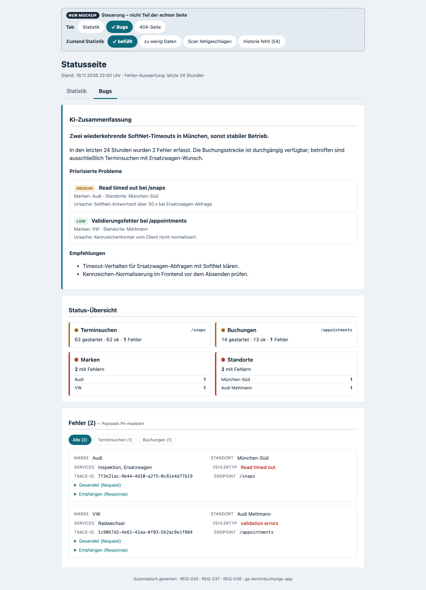
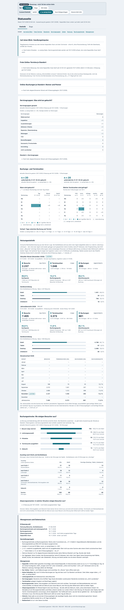

# REQ-038: Statistik-Dashboard auf der Statusseite (Tabs „Statistik | Bugs“, Online-Kapazität, Standorte, Servicegruppen, Buchungsstrecke)

**Status:** Draft
**Priority:** Medium
**Type:** Functional
**Created:** 2026-09-23
**Author:** Rico Sonntag

---

## 1. Overview

### 1.1 Purpose

Nach REQ-037 ist die Statusseite `GET /internal/report` (Basic Auth) **ein einziges Dokument**: Kopf → Nutzungsstatistik (`section.us`) → KI-Zusammenfassung, Status-Übersicht und Fehlerliste (`.ai`, `.ov`, `.err`) aus REQ-030 (`ReportHtmlGenerator.java:82-104`). Der Product Owner wünscht (Sprachtranskript vom 23.09.2026, sinngemäß):

1. die Seite in zwei Tabs **„Statistik“** und **„Bugs“** aufzuteilen — „Bugs“ ist das, was heute schon da ist;
2. im Statistik-Tab mehr Steuerungswissen: **wo Besucher im Buchungsprozess aussteigen** und welche Seiten sie zuletzt gesehen haben, **wie viel am nächsten Tag in den einzelnen Autohäusern noch frei ist** (nachts gemessen, „kleinste mögliche Einheit“), **wo online viel gebucht wird** („welcher Standort ist der Renner, welcher der Penner“), **welche Servicegruppen wo gut laufen** (Reifen, Zusatzleistungen …) und **wann gebucht wird** („abends“);
3. alles anonymisiert, mit Vorschlägen und einem Mockup.

Dieses Requirement setzt das **ausschließlich mit Bordmitteln** um — serverseitig im Spring-Boot-Backend, ohne JavaScript, ohne Angular-Änderung und ohne neue Azure-Ressource:

1. **Tabs als echte Seiten:** `/internal/report` rendert direkt den Standard-Tab „Statistik“, `/internal/report/bugs` den unveränderten Fehler-Report. Die Navigation besteht aus Links mit `aria-current="page"`, weil die CSP der internen Chain jedes Skript verbietet (`SecurityConfig.java:44-45`).
2. **Drei Datenquellen, drei Datenklassen, nie verbunden:** (K1) ein **nächtlicher SoftNet-Scan** misst je Standort den nächsten freien Online-Termin für eine Referenz-Leistung; (K2) eine **neue, schmale Log-Zeile `USAGE_BOOKING`** je erfolgreicher Buchung — im Speicher gepuffert und erst im täglichen Tagesflush (23:59:59) gemischt unter dem Job-Marker `job.usagebooking` geschrieben, nie im Buchungs-Request (Entscheidung PO 24.09.2026 „nur anonyme Daten, nie wer“, §10.2) — und die bereits geloggten Leistungsaufrufe liefern Standort-, Servicegruppen- und Zeitkennzahlen; (K3) die REQ-037-Nutzungsdaten liefern — hinter einem DSB-Gate — einen **globalen** Ausstiegs-Trichter.
3. **Nur Aggregate, mechanisch unterdrückt:** Zählwerte 1–4 erscheinen als „< 5“, Anteile erst ab 20 Fällen, Standortwerte nur für abgeschlossene Kalendermonate, Sekundärunterdrückung in Kreuztabellen (BR-9, BR-10).
4. **Ehrliche Grenzen auf der Seite:** „Auslastung in %“, „Online-Anteil an allen Buchungen“ und der vollständige Seitenpfad sind mit Bordmitteln **nicht** messbar (§1.2). Jede Näherung trägt ihre Einschränkung sichtbar neben dem Wert (BR-20), die Messgrenzen stehen dauerhaft auf der Seite (S7).

**Zwei PO-Nachträge vom 23.09.2026 sind eingearbeitet:** **(N1) Absprungszenarien** — S6 erhält je abgesprungener Sitzung genau ein primäres Szenario (Kennzahl F-4, Szenario-Katalog §8, neues Whitelist-Feld `hits` in der Access-Zeile, eigener Schalter `USAGE_DROPOFF_ENABLED` hinter Gate G-DSB). **(N2) 10-Tage-Kapazitätsverlauf** — die Tagesteil-Aufteilung des Kapazitäts-Scans (vormittags/nachmittags/spät) entfällt ersatzlos; stattdessen zeigt S1 je Standort die letzten 10 Scans als Raster „frei/knapp/belegt/—“ mit der Zusammenfassung „an X von 10 Tagen frei“ und einer Einordnung (meist frei · wechselnd · meist belegt); K-2 ist nur noch eine Gesamtzahl je Zieltag.

> **Karpathy-Prinzip:** erst belegen, was die vorhandenen Quellen hergeben (§1.4), dann die **kleinstmögliche** Erweiterung (eine Log-Zeile, ein nächtlicher Job, zwei kleine JSON-Dateien im bestehenden Container) — jede Kennzahl mit ihrer Messgrenze und der Datenschutz durch Konstruktion (Datenklassen, k-Schwellen, Vergröberung), nicht durch Nachbesserung.

### 1.2 Scope

**Included (Backend `server/`):**
- `reporting/ReportController` — getrennte Pfade je Tab, Kill-Switch-Matrix, explizite Catch-all-Methode `catchAll(HttpServletRequest)` (404 für unbekannte Pfade, 406 bei unpassendem `Accept` auf wörtlichen Pfaden), neue JSON-Endpunkte `insights.json` und `capacity.json`.
- `reporting/ReportHtmlGenerator` — gemeinsamer Seitenrahmen mit Tab-Navigation, neutralem Titel „Statusseite“, `<main>`-Wrapper, neuen CSS-Regeln und Tokens; `renderPage(usage, fragment)` bleibt als Delegation erhalten.
- **Neu** `reporting/ReportTab`, `reporting/StatisticsPageRenderer` und die Sektions-Renderer für S0, S2–S4, S6, S7 sowie `capacity/CapacitySectionRenderer` (S1).
- **Neu** `usage/insights/` — Erfassung (`UsageEventLogger`: Tagespuffer, gemischter Tagesflush um 23:59:59 und beim Herunterfahren), nächtlicher Rollup (höchstens 3 KQL), vom Schalter unabhängiger Aufbewahrungs-Job mit eigenem, nicht abschaltbarem Tageslauf (`InsightsRetentionJob`), Servicegruppen-Klassifikation, Absprungszenarien (F-4, Szenario-Whitelist), Blob `usage-insights.json`, In-Memory-Store und unterdrücktes View-Model.
- `snaps/SnapsController` und `common/filter/LoggingFilter` — **ein** neues Whitelist-Feld `hits` (`none|few|many`) am Ende der Access-Zeile, nur bei `POST /api/v1/snaps` mit Status < 400 und nur bei aktiven Schaltern `usage.enabled`, `usage.funnel.enabled` und `usage.dropoff.enabled` (§10.8); sonst bleibt die Zeile byte-gleich.
- **Neu** `capacity/` — nächtlicher Kapazitäts-Scan gegen SoftNet, Blob `capacity-daily.json`, Store und View-Model.
- `appointments/AppointmentsService` — **ein** zusätzlicher Aufruf nach erfolgreicher Buchung, nur bei aktivem Schalter; er puffert das anonyme Ereignis, schreibt im Request aber **keine** Log-Zeile (die Zeile schreibt der Tagesflush, §10.2).
- **Neu** gemeinsame Helfer: neutrales Paket `common/html` (`HtmlText`, `GermanFormat`), `common/logging/JobTrace`, `common/util/Sleeper`, `usage/UsageZone`, `config/setup/BranchNames` (§14.1).
- `reporting/ReportAggregator` — `ERRORS_KQL` schließt die eigenen Hintergrundjobs aus (BR-15).
- `usage/UsageSectionRenderer` — Zahlen-Formatter nach **neu** `usage/StatFormat` extrahiert, Verhalten und Markup von S5 unverändert.
- `application.yml` — neue Blöcke `usage.insights`, `usage.funnel`, `capacity` sowie `spring.task.scheduling.pool.size: 2`.
- Test-Infrastruktur: Seed-Profil `e2e-seed`, Playwright-Spec `REQ-038-status-tabs.spec.ts`, Screenshot-Skript `take-screenshots-req038.js`.

**Excluded (Out of Scope):**

| Nicht-Ziel | Grund | Beleg |
|---|---|---|
| Auslastung in % (belegt/gesamt) | SoftNet liefert nur freie, gerankte Terminvorschläge; es gibt keinen Kapazitäts- oder Belegungsendpunkt (31 Pfade der Spec geprüft), das Backend setzt `available` fest auf `true` | `SnapsService.java:103-109`; `soft-netOpenAPI.html` (Pfadliste, `SnapResource`) |
| Online-Anteil an **allen** Buchungen eines Standorts | `AppointmentResource` hat kein Kanal-Feld; eine standortweite Terminliste braucht `scope.api.planning.user` | `soft-netOpenAPI.html` (`GET /api/planning/appointments`) |
| Vollständiger Seitenpfad je Besucher | Marke, Fahrzeugdaten und das Betreten der Übersicht lösen keinen Server-Request aus | `booking-api.service.ts:71-78`; `carinformation-container.component.ts:81-117` |
| Funnel oder Geräteklasse **je Standort** | Die Verknüpfung `sessionId`/Gerät ↔ Standort bleibt nach REQ-037 BR-11 ausgeschlossen | REQ-037 `requirement.md:325` |
| Auswertung je Serviceberater (`checkInResource`) | Leistungs- und Verhaltenskontrolle: § 87 Abs. 1 Nr. 6 BetrVG, § 26 BDSG | `SnapsService.java:103-109` |
| Wiederkehr- vs. Neukunde | kein Signal im Buchungspfad, zudem personenbezogenes Merkmal der Kundenbeziehung | `AppointmentsService.java:206-217` |
| Cookies, Web Storage, Beacon, Verweildauer, iFrame-Merkmal | REQ-037 AC-14 gilt unverändert | REQ-037 `requirement.md:44, 93` |
| Jede Angular-Änderung, auch die Umbenennung des Buttons „Fehler-Report“ | Der Button öffnet fest `/internal/report` (`location-selection-container.component.ts:47-49`); der Pfad rendert weiterhin eine vollständige Seite | Folge-REQ 5 |
| Scan je Servicegruppe und für die tireChange-Group, Auslastungsindex | Last (ca. 190–430 SoftNet-Calls je Nacht) bzw. erst nach ≥ 8 Wochen Daten sinnvoll | Folge-REQ 3 |
| Änderungen an bestehenden REQ-Dokumenten | Projektregel „bestehende REQs nie ändern“; Abweichungen zu REQ-037 stehen in §9 | User-Memory |

**Folge-REQ-Kandidaten** (bewusst nicht Teil von REQ-038):
1. **Exakter Wizard-Pfad per Step-Beacon** — `POST /api/v1/usage/steps/{step}` aus einem Core-Service bei `NavigationEnd`; Ausnahme in `errorFallbackInterceptor` und `circuitBreakerInterceptor`. `navigator.sendBeacon` scheidet aus, weil `SessionTokenFilter` ohne Header 403 liefert (`SessionTokenFilter.java:30-51`). Braucht eine Angular-Änderung und eine eigene DSB-Freigabe. Würde zusätzlich die Absprungszenarien B-1 bis B-4 ermöglichen (Marke verlassen, Werkstattkalender ohne Datum, Validierungsfehler in den Fahrzeugdaten, Übersicht gesehen aber nicht abgeschickt — §8 Szenario-Katalog).
2. **Kontingente je Standort** über `GET /api/planning/branches/{id}/group/{gid}` (`FirstAppDays`, `MaxPerDay`) — dafür gibt es heute keine Client-Methode (`SoftnetApiClient.java:42-121`).
3. **Scan je Servicegruppe und für die tireChange-Group** sowie ein Auslastungsindex gegen ein rollierendes Maximum.
4. **Einstiege über Händler-Links** je Standort (`GET /api/v1/branches/{id}`, `deep-link.guard.ts:18-43`), Stornos, Rate der Slot-Konflikte (HTTP 410).
5. **Rollentrennung und Button:** zweiter Basic-Auth-User „marketing“ nur für `/internal/report/statistics` (heute genau ein User, `SecurityConfig.java:140-151`); Zähler-Badge „Bugs (n)“ (braucht ein Zählfeld im `ReportStore`, `ReportStore.java:22-48`); Umbenennung des Buttons „Fehler-Report“ in 5 Sprachen (`translations.ts:355-356` ff.).
6. **Nebenbefund Logging:** `checkInResource`, `model`, `currentMileage` und `firstReg*` stehen nicht in `LogSanitizer.SENSITIVE_FIELDS` (`LogSanitizer.java:41-47`) und landen im Klartext in `SOFTNET_ERROR` bzw. `BOOKING_CREATED` (`AppointmentsService.java:74-82`) — eigenes REQ, weil REQ-034 nicht geändert wird.

### 1.3 Related Requirements
- **REQ-037**: Nutzungsstatistik — **Basis und harte Voraussetzung** (noch nicht gemergt): `UsageStatsProperties`, Blob-Container `usage-stats`, `UsageBlobClient`-Muster, `UsageSectionRenderer`, CSP der `/internal/**`-Chain. REQ-038 löst einzelne REQ-037-Zusagen ausdrücklich ab (§9, Abweichungstabelle).
- **REQ-030**: AI-Error-Report — Statusseite, `ReportHtmlGenerator`, `ReportStore`-Fragment, `LogAnalyticsClient`, Basic-Auth-Chain; der Inhalt des Bugs-Tabs.
- **REQ-034**: Datensparsames Logging — Leitplanke für die neue Log-Zeile (BR-1 Verbotsliste, BR-6 kein Verhaltenseingriff).
- **REQ-029**: Backend-Error-Logging — Access-Zeile (`LoggingFilter`) und `traceId`-Präfix.
- **REQ-021 / REQ-025**: `setup.json` (27 Standorte × `default`/`tireChange`), SoftNet-Tags als Servicegruppen (`rank` 3 = Räderwechsel), Messung „date-Modus ist stingy“.
- **REQ-031**: `checkInTime` ist UTC und wird für die Anzeige nach Europe/Berlin umgerechnet (AC-17/18).
- **REQ-035**: tireChange-Group; die beiden Leverkusener tireChange-Groups antworten mit 403 (`spec.md:32-34`).
- **REQ-036**: `wishlist.rentCategoryid` — Quelle des Merkmals „Mietwagen gebucht“.

### 1.4 Ist-Inventar der Datenquellen (verifiziert 23.09.2026)

> **Lesart:** Die Tabelle bewertet ausschließlich, was die Quelle **technisch** liefert. Ob die Daten dafür verwendet werden dürfen, regelt §9 (Datenklassen K1–K3).

| Quelle | Fundstelle (verifiziert) | Liefert heute | Fehlt | Verwendung in REQ-038 |
|---|---|---|---|---|
| Access-Zeile `LoggingFilter` | `LoggingFilter.java:25-33, 68-77` | `correlationId`, `sessionId`, `method`, `url` (`getRequestURI()`, ohne Query-String), `statusCode`, `duration`, `device`; **neu (N1):** `hits` (nur `POST /snaps` < 400, §10.8) | branchId bei `POST /snaps` und `POST /appointments`; `groupId` (nur Query-Parameter) | R-3 (nur `GET /api/v1/branches/{id}/operations`, **ohne** `sessionId`); F-1 bis F-4 (global, mit `sessionId`, **ohne** branchId; F-4 zusätzlich über Statuscodes, Zählerlücken und `hits`) |
| `BOOKING_CREATED` (INFO) | `AppointmentsService.java:74-78` | Appointment-ID, `branchLabel`, redigierte `client`/`car`-Blöcke, `mobility` | Operationen, `checkInTime`, `variant` | **nicht** verwendet — enthält die Appointment-ID (direkter Schlüssel zum Kundendatensatz) |
| Gecachter SoftNet-Snap | `SnapCache.java:15, 24-33`; `AppointmentsService.java:48` | `checkInTime` (UTC, `SnapsService.java:95-98`), `groupid`, `branch`, `wishlist` (laut Spec „original wishlist“, Rückgabe der `operations` ungeprüft → Gate S-2), `checkInResource` | — | Quelle von `USAGE_BOOKING` (Slot-Zeit, Vorlauf, Operationen); `checkInResource` wird verworfen |
| Gepatchte Wishlist beim Buchen | `AppointmentsService.java:161-166` | `rentCategoryid`, `isFleet`, `fleetType` | — | Merkmal `mobility` (G-3) |
| DEBUG-Zeile Snap-Suche | `SnapsService.java:82` | `group=…`, Anzahl Operationen, `mode` | Standort-Mapping, stabiles Level | **nicht** verwendet (DEBUG, fragil) |
| SoftNet `POST /api/planning/snaps` | `SoftnetApiClient.java:76-78` | freie, gerankte Vorschläge je Wishlist | Belegung, Gesamtkapazität, Slot-Raster | K-1 bis K-3 als Proxy „online buchbare Restkapazität“ |
| SoftNet Tags/Operations | `JobTypesService.java:73-84, 94-135` (live, **ohne** Cache); `JobTypesService.java:21-25` (`rank` 3 = Räderwechsel) | Tag → Rang, Operation → Tag-IDs, Name | stabile Gruppen-IDs über Groups hinweg | Klassifikation im Rollup (§8 BR-11) |
| `OperationIdMapper` | `OperationIdMapper.java:34-63` (Schlüssel `wiper-blades` → „wischerblätter“, `pickup-delivery` → „hol“), Cache 10 min (`:27, :161-180`) | Operation-ID je Frontend-Schlüssel und Group | — | Referenz-Leistung des Scans |
| `setup.json` | `server/config/setup.json` (27 Standorte, je `default` + `tireChange`); `SetupService.java:99-107` (tireChange-Filter), `:123-149` (`resolveGroupId` mit Fallback auf `default`) | branchId (24 hex), groupId, Name | — | Whitelist für `branch`/`group`, Scan-Liste, Anzeige-Namen |
| REQ-037-Blob `usage-daily.json` | `UsageBlobClient.java:51-53, 244-249` (fremde Felder und abweichende `schemaVersion` → E4) | 7 Tageszähler ohne Dimension | jede Dimension | **unverändert**; neue Daten in eigenen Blobs |
| Scheduler-Infrastruktur | `BackendApplication.java:8` (`@EnableScheduling`, kein Pool), `application.yml:35-66` (kein `spring.task.scheduling`) | 1 Thread für ErrorReport 03:00 (`:37`), Refresh alle 15 min (`:50`), Rollup 03:30 (`:51`) | zweiter Thread | Pool-Größe 2, Scan 22:30, Insights-Rollup 03:45 |

> **Zentrale Erkenntnis:** Standort-, Servicegruppen- und Zeitkennzahlen brauchen **eine** neue Log-Zeile ohne Personenbezug; die Leistungsaufrufe je Standort und ein globaler Trichter stehen **schon heute** in den Access-Zeilen; „Auslastung“ lässt sich **nur** als online buchbare Restkapazität per nächtlichem Scan annähern. Eine echte Belegungsquote und ein Online-Anteil sind mit der 3rd-Party-API nicht erreichbar.

### 1.5 Kennzahlen-Katalog (Vorschläge an den Product Owner)

| ID | Frage | MVP / Gate | Datenquelle | Sektion |
|---|---|---|---|---|
| I-1 Luft am Zieltag | Wo lohnt sich am nächsten Werktag eine Aktion? | MVP, nach Gate S-1 | Kapazitäts-Scan (K1) | S0 |
| I-2 Werbe-Kandidaten | Wo ist viel frei und trotzdem wenig online gebucht? | MVP, nach S-1, S-2 und G-VVT | 10-Tage-Einordnung (K-3) + `USAGE_BOOKING` | S0 |
| I-3 Engpass | Wo ist Werbung derzeit sinnlos? | MVP, nach S-1 | 10-Tage-Einordnung (K-3) | S0 |
| I-4 Renner / Abend-Anteil | Wer führt, und wann wird gebucht? | MVP, nach S-2 und G-VVT | `USAGE_BOOKING` | S0 |
| K-1 Nächster freier Online-Termin | Wie schnell bekommt man online einen Termin? | MVP, nach S-1 | Scan | S1 |
| K-2 Angebotene Online-Termine am Zieltag | Wie viel ist morgen frei? (nur **Gesamtzahl** je Zieltag, N2) | nur ohne Kappung (S-1), Schalter `CAPACITY_SHOW_SLOT_COUNT` | derselbe Scan-Call | S1 |
| K-3 Verlauf letzte 10 Tage | Wo ist immer frei, wo immer belegt — Dauerzustand oder Ausnahme? | MVP, nach S-1 | `capacity-daily.json`, letzte 10 Scans (frei/knapp/belegt/—, Einordnung ab ≥ 5 messbaren Tagen, BR-26) | S1 |
| R-1 Online-Buchungen je Standort | Welcher Standort ist Renner, welcher Penner? | MVP, nach S-2 und G-VVT | `USAGE_BOOKING.branch` | S2 |
| R-2 Anteil am Online-Volumen | Wie verteilt sich das Online-Volumen? | MVP, nach S-2 und G-VVT | R-1 | S2 |
| R-3 Leistungsaufrufe | Wo ist das Interesse hoch? | MVP, nach S-2 und G-VVT | Access-Zeile `GET …/operations`, ohne `sessionId` | S2 |
| R-4 Buchungen je 100 Leistungsaufrufe | Wo ist das Interesse hoch, die Umwandlung aber schwach? | MVP, nach S-2 und G-VVT, als „(Näherung)“ | R-1, R-3 | S2 |
| G-1 Servicegruppen gesamt | Was wird gebucht? | MVP, nach S-2 und G-VVT | `USAGE_BOOKING.ops` + Klassifikation | S3 |
| G-2 Matrix Standort × Gruppe | Was läuft wo besonders gut? | MVP, nach S-2 und G-VVT | wie G-1 | S3 |
| G-3 Mietwagen-Anteil | Werden Zusatzleistungen mitgebucht? | MVP, nach S-2 und G-VVT | `USAGE_BOOKING.mobility` | S3 |
| T-1 Wann wird gebucht? | Buchen Kunden abends oder nachts? | MVP, nach S-2 und G-VVT | `bookingDaypart` + Wochentag des Tages | S4 |
| T-2 Außerhalb der Geschäftszeit | Zieht online außerhalb der Öffnungszeiten? | MVP, nach S-2 und G-VVT | wie T-1 | S4, Spalte in S2 |
| T-3 Gefragte Terminzeiten | Welche Slots werden gebucht, sind abends Termine gefragt? | MVP, nach S-2 und G-VVT | `slotWeekday` × `slotDaypart` | S4 |
| T-4 Späte Termine je Standort | Wo sind späte Termine beliebt? | MVP, nach S-2 und G-VVT | `slotDaypart = late` | Spalte in S2 |
| T-5 Vorlauf | Ziehen Kurzfrist-Aktionen? | MVP, nach S-2 und G-VVT | `leadTime` | S4 |
| F-1 Erreichte Stufe | Wie weit kommen Besucher? | Gate G-DSB, Default aus | Access-Zeile mit `sessionId` (global) | S6 |
| F-2 Ausstieg nach Stufe | Wo brechen sie ab, welche Seiten waren es zuletzt? | Gate G-DSB, Default aus | wie F-1 | S6 |
| F-3 Ausstieg nach Geräteklasse | Steigen Mobilnutzer früher aus? | Gate G-DSB, Default aus | wie F-1 | S6 |
| F-4 Absprungszenarien | In welcher Situation endete die Sitzung? (N1, Szenario-Katalog §8) | Gate G-DSB, Schalter `USAGE_DROPOFF_ENABLED`, Default aus | wie F-1 plus neues Feld `hits` (§10.8) | S6 |
| S5 Nutzung (REQ-037) | Besuche, Terminsuchen, Buchungen, Geräteklassen | Bestand, unverändert | REQ-037 | S5 |

> **Gates einheitlich:** Alle K2-Kennzahlen (I-2, I-4, R-1…R-4, G-1…G-3, T-1…T-5) liegen hinter dem einen Schalter `USAGE_INSIGHTS_ENABLED` und brauchen deshalb gemeinsam S-2 **und** G-VVT (§3.1, §14.5); I-1…I-3 und K-1…K-3 brauchen S-1, F-1…F-4 G-DSB (F-4 zusätzlich den eigenen Schalter `USAGE_DROPOFF_ENABLED`, der nur zusammen mit `USAGE_FUNNEL_ENABLED` wirkt).
>
> **Geprüft und verworfen** (siehe Out-of-Scope-Tabelle): Auslastung in %, Online-Anteil an allen Buchungen, vollständiger Seitenpfad, Funnel/Gerät je Standort, Serviceberater, Wiederkehr-Kunde.

---

## 2. User Story

**Rolle 1 — Betreiber/Admin**

**As a** Betreiber der Terminbuchungs-Anwendung
**I want** die Statusseite in die Tabs „Statistik“ und „Bugs“ getrennt, jeden Tab unter einer eigenen, verlinkbaren Adresse
**So that** ich Fehleranalyse (mit maskierten Payloads) und Nutzungs- bzw. Marketingzahlen getrennt aufrufe, per Link weitergebe und später getrennt freigeben kann.

**Rolle 2 — Marketing und Standortsteuerung**

**As a** Verantwortliche/r für Marketing und Standortsteuerung (im MVP mit den Admin-Zugangsdaten, §19 Frage 8)
**I want** morgens auf einen Blick sehen, an welchen Standorten online noch Termine frei sind, welche Standorte online Renner oder Penner sind, welche Servicegruppen wo gebucht werden, wann gebucht wird und wo Besucher aussteigen — ausschließlich als anonyme Aggregate
**So that** ich Werbung und Aktionen dorthin lenke, wo Kapazität frei und die Online-Nachfrage schwach ist, und dort zurückhalte, wo ohnehin alles ausgebucht ist.

**Acceptance Criteria:**

*Tabs und Seitenrahmen*
- [ ] AC-1: `GET /internal/report` und `GET /internal/report/` antworten **200 `text/html`** und rendern **direkt** den Standard-Tab „Statistik“ — ohne 3xx. `GET /internal/report/statistics` liefert denselben Inhalt, `GET /internal/report/bugs` den Bugs-Tab. Beide Tabs sind per Deep-Link, Neuladen und Browser-Zurück erreichbar.
- [ ] AC-2: Die Navigation ist `<nav class="tabs" aria-label="Bereiche der Statusseite">` mit genau zwei `<a>`-Links auf `/internal/report/statistics` und `/internal/report/bugs`; der aktive Link trägt `aria-current="page"`. Die Seite enthält kein `role="tablist"`/`"tab"`/`"tabpanel"`, kein `<script>`, kein `<form>`, kein ``, und der `Content-Security-Policy`-Header ist **byte-gleich** zu REQ-037 AC-20.
- [ ] AC-3: Der Bugs-Tab enthält das gespeicherte Report-Fragment (`.ai`, `.ov`, `.err` inklusive CSS-only-Fehlerfilter) **byte-gleich** bzw. den bisherigen Hinweis `.nr`, dazu die Meta-Zeile „Fehler-Auswertung: letzte 24 Stunden“. Der Statistik-Tab enthält **keines** der Elemente `.ai`, `.ov`, `.err`, `.nr`.
- [ ] AC-4: Jeder Tab hat einen eigenen `<title>` („Statusseite – Statistik“ bzw. „Statusseite – Bugs“), die H1 lautet neutral „Statusseite“, der Inhalt steht in `<main id="content">` (kein `<section>`-Wrapper). Der Statistik-Tab zeigt unter der Navigation eine Sprungmarken-Liste „Inhalt“ mit genau den Sektionen, die gerendert werden.
- [ ] AC-5: Jeder andere `GET /internal/report/**` (z. B. `/internal/report/xyz`, `/internal/report/a/b`, `/internal/report/statistik`) antwortet **404 `text/html`** mit einer kurzen Seite „Seite nicht gefunden“ und Links auf die vorhandenen Tabs — **nie** mit der Angular-`index.html`. Das gilt auch für `GET /internal/report/refresh` (der Endpunkt ist nur für `POST` gemappt). Ein **wörtlicher** GET-Pfad (`/internal/report`, `/internal/report/`, `/statistics`, `/bugs`, `/usage.json`, `/insights.json`, `/capacity.json`) mit unpassendem `Accept` antwortet dagegen **406** ohne Body, wie vor REQ-038 — nie mit einem irreführenden 404. Ohne Credentials bleibt es bei 401.
- [ ] AC-6: **Kill-Switch-Matrix:** Der Statistik-Tab existiert genau dann, wenn mindestens einer der Schalter `usage.enabled`, `usage.insights.enabled`, `capacity.enabled` aktiv ist. Sind alle drei aus, entfällt die Navigation, `/internal/report` rendert direkt den Bugs-Inhalt und `/internal/report/statistics` antwortet 404. Ein leerer oder als „nicht verfügbar“ beschrifteter Tab wird nie gezeigt.
- [ ] AC-7: Alle Seiten- und JSON-Aufrufe lesen **ausschließlich In-Memory-Snapshots**; weder Log Analytics noch Blob Storage noch SoftNet werden im Request-Pfad aufgerufen; Antwortzeit < 200 ms.

*Kapazität (S1)*
- [ ] AC-8: Bei `capacity.enabled=true` läuft der Scan nächtlich per `CAPACITY_SCAN_CRON` (Default `0 30 22 * * *`, Europe/Berlin, plus 0–300 s Jitter) **sequenziell** über alle Standorte der `default`-Groups aus `setup.json` in alphabetischer Reihenfolge (`SetupService.getAllBranches()`), mit 1 s Pause, ausschließlich über `SoftnetApiClient.getSnaps(...)`, mit genau der Wishlist aus §12.9, und schreibt das Ergebnis in `capacity-daily.json`.
- [ ] AC-9: S1 zeigt je Standort eine **Textstufe** („heute frei“, „morgen frei“ bzw. „am {Wochentag} {Datum} frei“, „in n Werktagen“, „belegt: ≥ 5 Werktage“, „keine Online-Termine gefunden“, „nicht messbar: Grund“) und den **10-Tage-Verlauf** (N2): ein Raster Standort × letzte 10 Scans (älteste links, neueste rechts, Spaltenkopf mit Datum TT.MM.), jede Zelle mit Zustand des Zieltags als **Text/Kürzel plus Farbstufe** („frei“, „knapp“, „belegt“, „—“ nach BR-26 — Farbe nie alleiniger Träger), dazu die Zusammenfassung „an {x} von {n} Tagen frei“ mit Einordnung „meist frei“ · „wechselnd“ · „meist belegt“ (bzw. „zu wenig Daten“ unter 5 messbaren Tagen) und den Hinweis zur Referenz-Leistung. Sortiert wird „meist frei“ oben, „meist belegt“ unten (BR-26). Die Stufe am Zieltag wird **relativ zum Abruftag** beschriftet (Zieltag = heute → „heute frei“, = morgen → „morgen frei“, sonst mit Wochentag und Datum); der tägliche Neuaufbau um 00:05 aktualisiert die Beschriftung ohne I/O (BR-25). K-2 erscheint nur bei `CAPACITY_SHOW_SLOT_COUNT=true` und nur als **eine Gesamtzahl** je Standort und Zieltag — es gibt keine Tagesteil-Aufteilung (vormittags/nachmittags/spät entfällt ersatzlos, N2).
- [ ] AC-10: Ein fehlgeschlagener Standort erscheint als „nicht messbar“ mit Grund, **nie als 0**. Ist der jüngste Scan `failed`, zeigt S1 den letzten Scan mit `state` `complete` oder `partial` mit Datum und einem Warnhinweis (`.st-warn`, Text plus Rahmen); ist dieser `partial`, steht zusätzlich der Partial-Hinweis (`CAPACITY_SCAN_PARTIAL`). I-1 bis I-3 entfallen dann (BR-14).
- [ ] AC-11: Fehler aus dem Scan und aus dem Insights-Rollup erscheinen **nicht** in der Fehlerliste des Bugs-Tabs.
- [ ] AC-12: Der Scan läuft über alle Replicas **höchstens einmal je Kalendertag** (Claim per ETag) und bricht nach **20 Minuten** ab; `POST /internal/report/refresh` löst weder Scan noch Insights-Rollup aus.

*Online-Buchungen, Servicegruppen, Zeiten (S0, S2–S4)*
- [ ] AC-13: Bei `usage.insights.enabled=true` puffert `AppointmentsService.createAppointment()` **nach** einer erfolgreichen SoftNet-Buchung genau ein Ereignis; im Buchungs-Request entsteht **keine** Zeile. Der Tagesflush (23:59:59 in `usage.zone` bzw. beim Herunterfahren) schreibt dafür genau eine Zeile `USAGE_BOOKING {json}` unter MDC `job.usagebooking`, mit ausschließlich den Feldern aus §10.2; ein Fehler bei der Erzeugung des Ereignisses ändert **nie** die Buchungsantwort. Bei `false` oder fehlgeschlagener Buchung entsteht weder Ereignis noch Zeile, auch nicht nach dem Flush.
- [ ] AC-14: Der nächtliche Insights-Rollup (`USAGE_INSIGHTS_ROLLUP_CRON`, Default 03:45) aggregiert den Vortag mit höchstens 3 KQL-Abfragen, zieht fehlende Tage bis 25 Tage zurück nach (nie vor `collecting-since`, nie in einen bereits verdichteten Monat) und schreibt `usage-insights.json` idempotent mit `If-Match` (max. 3 Versuche).
- [ ] AC-15: S2 zeigt für den **Vormonat** eine Rangliste aller Standorte (Balken plus Zahl, Anteil, Jahr bis Ende Vormonat, Leistungsaufrufe, „Buchungen je 100 Aufrufe (Näherung)“, außerhalb Mo–Fr 07–18 Uhr, späte Termine, Rangänderung als Text). Standorte mit 0–4 Buchungen stehen ohne Rang in der abschließenden, alphabetisch sortierten Gruppe „Unter 5 Buchungen: …“ (`tbody.rk-low`) — mit „0“ bzw. „< 5“ statt der Zahl; die Rangliste ist damit monoton (kein gerankter Standort hat weniger Buchungen als ein Standort der Gruppe).
- [ ] AC-16: S3 zeigt G-1 als Balkenliste (aktueller Monat und laufendes Jahr bis gestern) und G-2/G-3 als Heatmap-Tabelle Standort × Gruppe für den **Vormonat** mit ganzzahligem Prozentwert **und** Farbstufe je Zelle; nur Standorte mit ≥ 20 Buchungen erhalten eine eigene Zeile, die übrigen bilden „weitere Standorte“.
- [ ] AC-17: S4 zeigt T-2 als Kennzahl-Kachel (Monat und Jahr), T-1 als Heatmap 7 × 3, T-3 als Heatmap Mo–Sa × 5 und T-5 als Balkenliste — je für „aktueller Monat bis gestern“ und „laufendes Jahr bis gestern“ untereinander, ohne Umschalter.
- [ ] AC-18: S0 zeigt die Handlungsimpulse I-1 bis I-4 nach den festen Schwellen aus BR-21; fehlt die Datenbasis eines Impulses, entfällt er; fehlen alle, steht „Noch keine Hinweise – zu wenig Daten.“.

*Buchungsstrecke (S6)*
- [ ] AC-19: Bei `usage.funnel.enabled=true` (Default `false`) zeigt S6 einen **globalen** 5-Stufen-Trichter mit absoluter Zahl, „% vom Start“ und „% der Vorstufe“, die Tabelle „Ausstieg nach Stufe“ mit den festen Seitentexten und Spalten je Geräteklasse; Klassen unter 20 Sitzungen werden zur Spalte „Sonstige“ zusammengefasst, so dass sich keine ausgeblendete Klasse aus „Alle“ zurückrechnen lässt (BR-9 Nr. 7). Bei `false` entfällt die Sektion ersatzlos und die Funnel-KQL wird nicht ausgeführt.

*Datenschutz*
- [ ] AC-20: Zellunterdrückung gilt in HTML **und** JSON: Zählwerte 1–4 → „< 5“ (0 bleibt 0), Anteile erst ab Nenner ≥ 20 und nie mit Zähler oder Komplement 1–4, Matrixzeile erst ab 20 Buchungen, Sekundärunterdrückung zeilen- **und** spaltenweise nach BR-9. Unterdrückte Werte stehen in keinem Response — auch nicht mittelbar über Balkenbreiten, Farbstufen, Prozentwerte eines unterdrückten Zählers oder die Reihenfolge einer Liste.
- [ ] AC-21: Kennzahlen mit Standortbezug gibt es nur für abgeschlossene Kalendermonate; es gibt keine Kombination Standort × Stunde, × Tag, × Gerät oder × Funnel und keine Dimension für Marke, Modell, Kunde, Serviceberater oder Wiederkehr-Status.
- [ ] AC-22: Keine KQL-Abfrage von REQ-038 extrahiert zugleich `sessionId` und eine branchId, und keine enthält `join` oder `traceId` (String-Test über alle Query-Konstanten). In den Trichter-/Dropoff-Abfragen (KQL 3a/3b) zusätzlich: keine Capture-Gruppe `([0-9a-f]{24})`, kein `"url":"(`, keine `Url`-Spalte neben `SessionId`, und nach dem `project` kommt `Log_s` nicht mehr vor (BR-7, N1).
- [ ] AC-23: Vor dem Erfassungsbeginn einer Quelle und bei fehlenden Zählern zeigt die Seite „—“ mit „Erfassung seit …“, **nie 0**.
- [ ] AC-24: `usage-daily.json` (REQ-037) bleibt byte-kompatibel `schemaVersion` 1. Die neuen Blobs enthalten nur Integer-Zähler, Enum-Schlüssel, Kalendertage und Scan-Zeitstempel — keine Session-IDs, keine Appointment-IDs, keine Einzel-Zeitstempel von Buchungen. `branchDays` werden spätestens am 8. des Folgemonats verdichtet und gelöscht, alles andere nach `USAGE_RETENTION_MONTHS` (24) — für `usage-insights.json` auch dann, wenn `USAGE_INSIGHTS_ENABLED` und `USAGE_FUNNEL_ENABLED` inzwischen aus sind oder `USAGE_INSIGHTS_ROLLUP_CRON=-` gilt (`InsightsRetentionJob` mit eigenem, nicht abschaltbarem Tageslauf um 04:15, sobald `USAGE_STORAGE_ACCOUNT` gesetzt ist).
- [ ] AC-25: `GET /internal/report/insights.json` und `GET /internal/report/capacity.json` liefern hinter Basic Auth dasselbe **bereits unterdrückte** View-Model wie die Seite; ist die zugehörige Quelle aus, antworten sie 404; ohne Credentials 401.

*Darstellung und Barrierefreiheit*
- [ ] AC-26: WCAG 2.1 AA: aktiver Tab mit Unterstrich (0.2em) **und** Fettschrift, Touch-Ziele ≥ 2.75em, `:focus-visible` mit `--focus`; Heatmaps sind `<table>` mit `<caption>`, `<th scope>` und Zahl in jeder Zelle; Balken und Verlauf tragen ihren Wert als Text; kein Zustand wird nur über Farbe vermittelt; die neuen Tokens haben für `--ink`-Text einen Kontrast ≥ 4.5:1 (§11.3).
- [ ] AC-27: Beide Tabs haben bei 375, 768 und 1280 px **kein horizontales Scrollen der Seite**; breite Tabellen liegen in einem Scroll-Container mit `role="region"`, `tabindex="0"` und `aria-label`.
- [ ] AC-28: Die REQ-037-Verträge bleiben gültig: auf dem Standard-Tab gilt weiter `.us-block == 2` und `.us-empty == 2` (neue Sektionen nutzen `.st-empty`), `playwright/REQ-037-usage-statistics.spec.ts` läuft **unverändert** grün, `usage.json` und `POST /internal/report/refresh` sind unverändert.
- [ ] AC-29: Jede Näherungs-Kennzahl (K-1, K-2, R-4) trägt ihre Einschränkung als sichtbaren Text neben dem Wert; S7 „Messgrenzen und Datenschutz“ steht immer am Ende des Statistik-Tabs und nennt „Erfassung seit …“ je aktiver Quelle.
- [ ] AC-30: Unter `src/` ändert sich keine Datei; der Frontend-Button öffnet weiterhin `/internal/report` (`location-selection-container.component.ts:47-49`).

*Auslieferung und Betrieb*
- [ ] AC-31: Ohne Env-Override sind `usage.insights.enabled`, `usage.funnel.enabled`, `usage.dropoff.enabled`, `capacity.enabled` und `capacity.show-slot-count` `false`. Nach dem Deploy gilt §5.1 Zeile 1: Es wird weder ein `USAGE_BOOKING`-Ereignis gepuffert oder geschrieben (auch nicht vom Tagesflush) noch das Feld `hits` geschrieben noch eine der KQL 1–3 oder ein SoftNet-Scan ausgeführt, und `insights.json`/`capacity.json` antworten 404. Das ist die Voraussetzung dafür, dass vor S-1, S-2, G-VVT und G-DSB implementiert werden darf.
- [ ] AC-32: Ohne `USAGE_STORAGE_ACCOUNT` (oder bei 403 bzw. Netzwerkfehler des Blob Storage) läuft kein Scan und kein SoftNet-Call des Scans; alle Seiten antworten weiterhin 200; solange noch nie ein Stand geladen wurde, zeigen S1–S4 statt Zahlen den Hinweis „Historie derzeit nicht verfügbar“ (`.st-warn`), nie 5xx (E4).

*Absprungszenarien (S6, Nachtrag N1)*
- [ ] AC-33: Bei aktivem Dropoff (`usage.enabled`, `usage.funnel.enabled` und `usage.dropoff.enabled` `true`) erhält **jede** Sitzung mit MaxStep < 5 **genau ein** primäres Szenario nach der Prioritätsregel aus §8 (Szenario-Katalog, BR-27) — deterministisch, geprüft mit Fixture-Sitzungen je Szenario. Je Tag gilt als Plausibilitätsprüfung: Σ aller Szenario-Zähler = erreicht(1) − erreicht(5) (= Abbrüche des Tages); Java prüft zusätzlich `booked` ⇔ MaxStep 5.
- [ ] AC-34: Das Feld `hits` wird ausschließlich bei `POST /api/v1/snaps` mit Status < 400 und nur bei allen drei aktiven Schaltern angehängt (`"hits":"none|few|many"`, Zähldefinition §10.8); in jedem anderen Fall ist die Access-Zeile **byte-gleich** zu `ACCESS_PATTERN_WITH_DEVICE` (REQ-037, `LoggingFilter.java:32-33`).
- [ ] AC-35: Bei `usage.dropoff.enabled=false` fehlen der S6-Unterabschnitt `.fn-dropoff`, das Feld `hits` und `dropoff` im Blob vollständig; es läuft die Basisfassung `FUNNEL_KQL` (KQL 3a) statt der Dropoff-Fassung; F-1 bis F-3 bleiben unverändert. Vor `USAGE_DROPOFF_COLLECTING_SINCE` zeigt der Unterabschnitt „—“ mit „Erfassung seit …“, nie 0 (BR-19 sinngemäß).
- [ ] AC-36: Für die Dropoff-Tabellen gilt BR-9 unverändert: Werte 1–4 → „< 5“, Sekundärunterdrückung → „k. A.“ (`.st-ka`), Anteile erst ab 20 Abbrüchen; Geräteklassen mit weniger als 20 Abbrüchen werden nach dem Muster von BR-9 Nr. 7 zur Spalte „Sonstige“ zusammengefasst (keine ausgeblendete Spalte ist aus „Gesamt“ zurückrechenbar); Leerzustand `.st-empty`.

---

## 3. Preconditions

### 3.1 System

- **REQ-037 ist auf `main` gemergt.** REQ-038 baut auf `UsageStatsProperties`, `UsageBlobClient`, `UsageSectionRenderer`, `UsageStatsStore`, dem Container `usage-stats` und der CSP der `/internal/**`-Chain auf (`SecurityConfig.java:44-45, 72-85`). Ohne REQ-037 ist dieses REQ nicht umsetzbar.
- Spring Boot Backend läuft (lokal `:3000` oder Azure Container App `gs-terminbuchungs-app`, RG `DefaultResourceGroup-DEWC`, westeurope).
- **System-Managed-Identity** mit „Log Analytics Reader“ auf dem Workspace (Bestand REQ-030) und **„Storage Blob Data Contributor“ auf Container-Scope `usage-stats`** (Bestand REQ-037 §3.1). Die Rolle deckt beide neuen Blobs im selben Container ab — **keine neue Rollenzuweisung, kein neuer Storage Account**.
- SoftNet-Zugang mit `scope.api.planning.service` (Bestand): reicht für `snaps`, `operations`, `tags` und `groups`.
- Log-Pattern `%d{ISO8601} [%thread] %-5level %logger{36} - %X{traceId:-system}: %msg%n` (`application.yml:74`); das Profil `json` wird wie in REQ-037 nicht unterstützt (`UsageStatsAggregator.java:89`).
- Betrieb mit einer Replica (dokumentiert `min/max 1`, `docs/infrastructure/azure-read.md:262-264`); der Scan ist trotzdem mehrreplica-sicher (BR-17).
- **Gates vor dem Einschalten** (§14.5): S-1 vor `CAPACITY_SCAN_ENABLED`, S-2 vor `USAGE_INSIGHTS_ENABLED`, G-VVT vor `USAGE_INSIGHTS_ENABLED`, G-DSB vor `USAGE_FUNNEL_ENABLED` **und** `USAGE_DROPOFF_ENABLED` (die Freigabe muss die Auswertung je `sessionId` ausdrücklich abdecken: letzter Status, Zählerlücken, Anzahl Suchen, Trefferstufe `hits`). Die Implementierung selbst darf vor den Gates erfolgen, weil alle neuen Schalter mit `false` ausgeliefert werden. **Aktivierungsentscheidung PO vom 24.09.2026:** alle fünf Schalter beim Deploy einschalten, bevor S-1, S-2, G-DSB und G-VVT formal abgeschlossen sind — Begründung und offene Nacharbeiten in §19 „Aktivierung“.

### 3.2 User
- Betreiber mit den Basic-Auth-Credentials `REPORT_ADMIN_USER` / `REPORT_ADMIN_PASSWORD` (Bestand REQ-030). Marketing nutzt im MVP denselben Zugang; die getrennten Pfade halten eine spätere Rollentrennung offen (Folge-REQ 5).
- Endkunden der Buchungsstrecke: keine Interaktion, keine Einwilligung, keine sichtbare Änderung.

### 3.3 Data

| Variable | Default | Zweck |
|---|---|---|
| `USAGE_INSIGHTS_ENABLED` | `false` | Kill-Switch K2: Puffer und Tagesflush von `USAGE_BOOKING`, KQL 1 und 2 (nur bei „an“), Rollup, S2–S4, Teile von S0, Buchungsteil von `insights.json` (BR-6, BR-13 aus REQ-037 sinngemäß) |
| `USAGE_INSIGHTS_COLLECTING_SINCE` | leer | Erfassungsbeginn K2 (ISO-Datum); leer = **erster voller Berliner Kalendertag nach der Aktivierung** (Starttag des Prozesses mit aktivem Schalter + 1), beim ersten Rollup im Blob festgehalten (BR-19) |
| `USAGE_INSIGHTS_ROLLUP_CRON` | `0 45 3 * * *` | Nächtlicher Insights-Rollup, bewusst nach `USAGE_ROLLUP_CRON` (03:30); `-` schaltet nur den Rollup (und den an ihn gekoppelten Lauf `InsightsRetentionJob.scheduledRun`) ab, **nicht** die Aufbewahrung — deren fester Tageslauf `DAILY_CRON` 04:15 bleibt (Step 4) |
| `USAGE_INSIGHTS_BLOB` | `usage-insights.json` | Blob-Name im Container `USAGE_STORAGE_CONTAINER` |
| `USAGE_FUNNEL_ENABLED` | `false` | Kill-Switch F-1 bis F-3 (K3); wirkt nur bei `USAGE_STATS_ENABLED=true`; erst nach Gate G-DSB |
| `USAGE_FUNNEL_COLLECTING_SINCE` | leer | Erfassungsbeginn des Trichters; leer wie oben = Aktivierungstag + 1 (kein Teiltag, kein rückwirkendes Rechnen vor der Freigabe) |
| `USAGE_DROPOFF_ENABLED` | `false` | Kill-Switch F-4 (N1); wirkt nur zusammen mit `USAGE_STATS_ENABLED` und `USAGE_FUNNEL_ENABLED`; steuert gemeinsam das Feld `hits`, die Dropoff-Fassung der Abfrage (KQL 3b), `dropoff` im Blob und den S6-Unterabschnitt; erst nach Gate G-DSB |
| `USAGE_DROPOFF_COLLECTING_SINCE` | leer | Erfassungsbeginn der Absprungszenarien; leer wie oben = Aktivierungstag + 1 |
| `CAPACITY_SCAN_ENABLED` | `false` | Kill-Switch K1: Scan, S1, I-1 bis I-3, `capacity.json`; erst nach Gate S-1 |
| `CAPACITY_SCAN_CRON` | `0 30 22 * * *` | Scan-Zeitpunkt (Europe/Berlin); `-` deaktiviert den Cron (lokal/E2E) |
| `CAPACITY_REFERENCE_SERVICE` | `wiper-blades` | `OperationIdMapper`-Schlüssel der Referenz-Leistung („Wischerblätter erneuern“) |
| `CAPACITY_SHOW_SLOT_COUNT` | `false` | K-2 anzeigen — nur wenn Spike S-1 keine Kappung zeigt |
| `CAPACITY_BLOB` | `capacity-daily.json` | Blob-Name im Container `USAGE_STORAGE_CONTAINER` |
| Bestand | — | `USAGE_STATS_ENABLED`, `USAGE_STORAGE_ACCOUNT`, `USAGE_STORAGE_CONTAINER`, `USAGE_ZONE`, `USAGE_RETENTION_MONTHS`, `LOG_WORKSPACE_ID`, `REPORT_ADMIN_USER`, `REPORT_ADMIN_PASSWORD`, `RADWECHSEL_ENABLED`, `SOFTNET_TIMEOUT` — unverändert, von REQ-038 mitgenutzt; `USAGE_ZONE` nie leer setzen (BR-12) |

- **Schalter-Werte der fünf REQ-038-Schalter** (`USAGE_INSIGHTS_ENABLED`, `USAGE_FUNNEL_ENABLED`, `USAGE_DROPOFF_ENABLED`, `CAPACITY_SCAN_ENABLED`, `CAPACITY_SHOW_SLOT_COUNT`): `true`/`1`/`yes`/`on` = an, `false`/`0`/`no`/`off` = aus (Groß-/Kleinschreibung egal, getrimmt) — einheitlich über den Spring-Binder (§5.1). `USAGE_STATS_ENABLED` (REQ-037, unverändert `@ConditionalOnProperty(havingValue = "true")`) wird weiterhin nur mit `true`/`false` gesetzt.
- `setup.json` enthält die 27 Standorte mit `default`- und `tireChange`-Group (verifiziert: alle branchIds `^[a-f0-9]{24}$`).
- Ohne `USAGE_STORAGE_ACCOUNT` laufen weder Insights-Rollup-Persistenz noch Aufbewahrungs-Job noch Scan (kein Claim möglich, E4, AC-32) — lokal ist das der Normalfall.

---

## 4. Main Flow

### Mockup




**Step 1: Buchung wird statistisch erfasst (K2)**
- **User:** Ein Kunde bucht über die Buchungsstrecke einen Termin.
- **System:** `AppointmentsService.createAppointment()` bucht wie bisher bei SoftNet (`AppointmentsService.java:69-79`). **Nur nach Erfolg** und nur bei `usage.insights.enabled` ruft es `UsageEventLogger.logBooking(...)` in einem eigenen `try/catch` auf. Der Logger bildet aus branchId, aufgelöster groupId, dem gecachten Roh-Snap und dem Mietwagen-Merkmal ein `UsageBookingEvent` (nur Whitelist-Werte, §10.2), serialisiert es und legt es in den Tagespuffer, **ohne** Log-Zeile im Request. Täglich um 23:59:59 (`usage.zone`) und beim geordneten Herunterfahren (`@PreDestroy`, also auch bei Neustart und Deploy) schreibt `UsageEventLogger.flush()` alle Ereignisse gemischt (`SecureRandom`), je eine INFO-Zeile `USAGE_BOOKING {json}` unter MDC `traceId=job.usagebooking`.
- **Expected:** Je Buchung genau eine Zeile im Tagesflush ohne Appointment-ID, Termindatum, Uhrzeit, Marke, Modell, Gerät, `sessionId` oder Freitext (einziges Datum ist der Buchungstag `day`); die Zeile teilt weder `traceId` noch Millisekunde noch Thread mit `BOOKING_CREATED`; die Buchungsantwort ist bytegleich zu heute.

**Step 2: Nächtlicher Kapazitäts-Scan (K1, 22:30 Europe/Berlin)**
- **System:** `CapacityScanScheduler` wartet 0–300 s (Jitter), liest `capacity-daily.json` mit ETag und schreibt per `If-Match` den Claim `scans[D].state = "running"` (BR-17). Nach erfolgreichem Claim legt er ein `CapacityViewModel` mit `runningSince = startedAt` in den `CapacityStore` (ohne I/O); gibt es noch keinen abgeschlossenen Scan, zeigen Meta-Zeile und S1 „erster Lauf aktiv“ (`META_SCAN_RUNNING`, `CAPACITY_EMPTY_FIRST_SCAN`), sonst bleibt der letzte Scan sichtbar. Die Marken lädt er **einmal je Scan** über `SoftnetApiClient.getGroups()` (Map id → Group, 24-h-Cache, Muster `BranchesService.java:46-53`). Danach je Standort (alphabetisch nach Name über `SetupService.getAllBranches()`, 1 s Pause) über `CapacityProbe`: Marke = `brand[0]` der Group (wie `BranchesService.extractBrands`, `BranchesService.java:110-118`), Referenz-Operation über `OperationIdMapper` (`CAPACITY_REFERENCE_SERVICE`), `SoftnetApiClient.getSnaps(wishlist, groupId)` mit `asSoonAsPossible`, Nachfilter auf die Branch-ID des Snaps (robuste Extraktion, §12.9), Verwerfen von `checkInResource`. Ergebnis je Standort: `status`, `firstFreeDate`, `workdaysToFirstFree`, `freeSlotsTargetDay` (eine Gesamtzahl, keine Tagesteile — N2). Fehlgeschlagene Standorte werden nach 60 s **einmal** wiederholt. MDC `traceId=job.capacityprobe` während des gesamten Laufs (gesetzt über `JobTrace.enter(...)`, danach `JobTrace.restore(...)`; der Punkt liegt außerhalb der `X-Request-Id`-Whitelist, BR-15). Im Ergebnis-Write (absolute Werte, `If-Match`) entfernt **derselbe** Scheduler Scans älter als `USAGE_RETENTION_MONTHS` — nur er schreibt `capacity-daily.json`.
- **Expected:** `scans[D]` mit `state = complete | partial | failed` im Blob, alte Scans entfernt; `CapacityStore` hält das neu berechnete `CapacityViewModel` (`runningSince = null`); Log `INFO capacity scan D: 25 ok, 0 none, 2 error in 212 s`.

**Step 3: Nächtlicher Insights-Rollup (K2 + K3, 03:45 Europe/Berlin)**
- **System:** `InsightsScheduler` (Jitter 0–120 s) lädt `usage-insights.json` mit ETag und berechnet für **gestern** sowie für fehlende Tage der letzten 25 Tage (nie vor `collecting-since`, nie in verdichtete Monate): KQL 1 (`USAGE_BOOKING`-Zeilen des Tagesflushs, verankert auf das Präfix `job.usagebooking`, Zuordnung über das Feld `day`, Fenster bis 10 min nach Tagesende) und KQL 2 (Leistungsaufrufe je branchId) **nur bei `usage.insights.enabled`**, KQL 3 (Trichter) **nur bei `usage.enabled` und `usage.funnel.enabled`** — bei zusätzlich aktivem `usage.dropoff.enabled` in der Dropoff-Fassung 3b (§12.8), die Trichter **und** Szenarien aus **einem** Ergebnis liefert (Summe der Szenarien = erreicht(1) − erreicht(5), BR-27), sonst in der Basisfassung 3a. Ist nur der Trichter aktiv, wird genau eine Abfrage gestellt, ist nur K2 aktiv, genau zwei. Java prüft jede Zeile erneut gegen die Whitelists (auch Szenario- und Geräteschlüssel: unbekannte Werte werden verworfen, `WARN` ohne Werte; `booked` ⇔ MaxStep 5), `ServiceGroupClassifier` ordnet die Operationen Servicegruppen zu (Tags/Operations je groupId, 6 h Cache, MDC `traceId=job.insightsrollup`, Fehlerbehandlung E9), `InsightsHistory` ersetzt die Tageswerte absolut (`days`, `branchDays`).
- **Expected:** Idempotent geschriebene Tageszeilen; die Rohzeilen werden nie geloggt; Log `INFO usage insights rollup written: 1 day(s), 11 booking(s), 0 purged`.

**Step 4: Monatsverdichtung und Aufbewahrung (`usage-insights.json`)**
- **System:** `InsightsRetentionJob` ist aktiv, sobald `USAGE_STORAGE_ACCOUNT` gesetzt ist — **unabhängig** von `usage.insights.enabled` und `usage.funnel.enabled` — und macht ausschließlich Blob-I/O (keine KQL, kein SoftNet). Jeder Monat M, der abgeschlossen ist und für den heute der 8. des Folgemonats oder später ist, wird aus `branchDays` zu `branchMonths[M]` summiert; die `branchDays` von M werden gelöscht. Unabhängig vom Erfolg des Rollups werden globale Tage und `branchMonths` älter als `USAGE_RETENTION_MONTHS` entfernt. Drei Auslöser, alle idempotent (If-Match, max. 3 Versuche, Schreiben nur bei Änderung, MDC `job.insightsrollup`):
  1. **Im Rollup:** Ist der `InsightsScheduler` aktiv, ruft `rollUp()` die Aufbewahrung im **selben** Schreibvorgang auf (unverändert).
  2. **Eigener Lauf `run()`** beim Start und zum `USAGE_INSIGHTS_ROLLUP_CRON` (`scheduledRun()`) — nur, wenn **kein** `InsightsScheduler` aktiv ist; sonst überlässt er ihm die Arbeit.
  3. **Fester, nicht abschaltbarer Tageslauf `dailyRun()`** mit `DAILY_CRON` = `0 15 4 * * *` in `usage.zone`, ohne Property: läuft, sobald `USAGE_STORAGE_ACCOUNT` gesetzt ist — unabhängig von allen Schaltern, von einem aktiven `InsightsScheduler` und von `USAGE_INSIGHTS_ROLLUP_CRON=-`. Nach einem normalen Rollup findet er nichts und schreibt nichts.

  `capacity-daily.json` schreibt der Job nie (Aufbewahrung dort: Step 2).
- **Expected:** Tagesgenaue Standortwerte liegen höchstens bis zum 8. des Folgemonats (≤ 38 Tage) im Blob — auch nach vorübergehendem Abschalten der Schalter und auch bei abgeschaltetem Rollup-Cron (solange der Blob erreichbar ist).

**Step 5: View-Models werden vorberechnet**
- **System:** Nach jedem eigenen Lauf, beim Start (Blob laden, **keine** KQL, **kein** SoftNet) und täglich um 00:05 (Monats- und Tageswechsel, nur aus dem Speicher: `InsightsScheduler.rebuildViewModel()` und `CapacityScanScheduler.rebuildViewModel()`) berechnen `InsightsViewModel.build(...)` und `CapacityViewModel.build(...)` die Anzeigewerte **einschließlich Unterdrückung** (BR-9), der relativ zum Abruftag gebildeten Stufenbeschriftung (BR-25) und der Warnhinweise (Tag ausstehend, Monat unvollständig, veraltet, Historie nicht verfügbar). Schlägt das Laden beim Start fehl (E4), legt der Scheduler ein View-Model mit `WARN_HISTORY_UNAVAILABLE` ab. Die Stores halten nur diese Ergebnisse — Sicht und Historie gemeinsam in **einem** unveränderlichen `Snapshot(viewModel, history)` hinter **einer** `volatile`-Referenz (`history` nie `null`), so dass `snapshot()` immer ein konsistentes Paar liefert.
- **Expected:** Der Request-Pfad muss nichts mehr rechnen außer HTML-Verkettung.

**Step 6: Seitenaufruf Statistik (Standard-Tab)**
- **User:** Öffnet `/internal/report` (Frontend-Button oder Lesezeichen), Basic-Auth-Dialog des Browsers.
- **System:** `ReportController.statistics()` prüft die Kill-Switch-Matrix (BR-4), liest `UsageStatsStore.current()`, `InsightsStore.snapshot()`, `CapacityStore.snapshot()` und übergibt ein `StatisticsPage` an `ReportHtmlGenerator.renderStatisticsPage(page)`: `StatisticsPageRenderer` setzt Sprungmarken und Sektionen in fester Reihenfolge S0 → S7 zusammen, `renderFrame(ReportTab.STATISTICS, true, metaLine, body)` ergänzt Kopf, Navigation (`aria-current` auf „Statistik“) und Footer.
- **Expected:** HTTP 200 in < 200 ms, `<title>Statusseite – Statistik</title>`, Meta-Zeile „Stand: … · Auswertung bis gestern (…) · Kapazitäts-Scan vom …“ (§17 `META_STATISTICS`).

**Step 7: Tab-Wechsel zu „Bugs“**
- **User:** Klickt den Link „Bugs“ (oder öffnet `/internal/report/bugs` direkt).
- **System:** `ReportController.bugs()` rendert `store.fragment()` bzw. `NO_REPORT_HINT` (`ReportController.java:70-74, 106`) unverändert über `renderBugsPage(fragment, true)` → `renderFrame(ReportTab.BUGS, true, metaLine, fragment)`; Meta-Zeile „Fehler-Auswertung: letzte 24 Stunden“ (`ReportHtmlGenerator.java:88-90`).
- **Expected:** Der CSS-only-Fehlerfilter funktioniert wie bisher; Browser-Zurück führt auf den Statistik-Tab (neuer Request, `no-store`, `WebConfig.java:103-117`).

**Step 8: Maschinenlesbarer Abruf (optional)**
- **User:** Ruft `/internal/report/insights.json` bzw. `/internal/report/capacity.json` auf.
- **System:** Serialisiert das bereits unterdrückte View-Model mit einem eigenen Mapper (`JavaTimeModule`, `Include.ALWAYS`, Muster `ReportController.java:59-63`).
- **Expected:** Dieselben Werte wie auf der Seite, unterdrückte Zellen als `{"value": null, "ratio": null, "percent": null, "heat": 0, "state": "SUPPRESSED"}`.

---

## 5. Alternative Flows

### 5.1 Alt Flow A: Kill-Switch-Matrix

**Trigger:** Beliebige Kombination der Schalter.

| # | `usage.enabled` | `usage.insights.enabled` | `capacity.enabled` | `usage.funnel.enabled` | Navigation | `/internal/report` | `/statistics` | `insights.json` | `capacity.json` | `usage.json` | Sektionen im Statistik-Tab |
|---|---|---|---|---|---|---|---|---|---|---|---|
| 1 | an | aus | aus | aus | ja | Statistik | 200 | 404 | 404 | 200 | S5, S7 (Default nach Deploy, AC-31) |
| 2 | an | an | aus | aus | ja | Statistik | 200 | 200, `funnel: null` | 404 | 200 | S0 (nur I-4), S2, S3, S4, S5, S7 |
| 3 | an | an | an | aus | ja | Statistik | 200 | 200, `funnel: null` | 200 | 200 | S0–S5, S7 |
| 4 | an | an | an | an | ja | Statistik | 200 | 200 | 200 | 200 | S0–S7 |
| 5 | an | aus | aus | an | ja | Statistik | 200 | 200, nur `funnel` (`bookingsEnabled: false`) | 404 | 200 | S5, S6, S7 |
| 6 | aus | an | aus | beliebig | ja | Statistik | 200 | 200, `funnel: null` | 404 | 404 | S0 (nur I-4), S2, S3, S4, S7 |
| 7 | aus | aus | an | beliebig | ja | Statistik | 200 | 404 | 200 | 404 | S0 (nur I-1, I-3), S1, S7 |
| 8 | aus | aus | aus | beliebig | **nein** | **Bugs-Inhalt** | **404** | 404 | 404 | 404 | — |

**Allgemeine Regel** (auch für nicht aufgeführte Kombinationen): `insights.json` 200 ⇔ `usage.insights.enabled` ∨ (`usage.enabled` ∧ `usage.funnel.enabled`); `capacity.json` 200 ⇔ `capacity.enabled`; `usage.json` 200 ⇔ `usage.enabled` (REQ-037, unverändert). Der Trichter wirkt nur mit `usage.enabled` (Zeilen 6–8: „beliebig“ = wirkungslos).

**Schalter-Semantik (einheitlich):** Alle REQ-038-Conditions lesen die Schalter über Spring Boots `Binder` mit Zieltyp `Boolean` — dieselbe Konvertierung wie die Properties-Records (`UsageInsightsProperties`, `CapacityProperties` …) und damit wie Seite und JSON: `true`/`1`/`yes`/`on` = an, `false`/`0`/`no`/`off` = aus (Groß-/Kleinschreibung egal, getrimmt). Ein leerer oder unbekannter Wert ist in der Condition aus; das Record-Binding lehnt ihn für die `boolean`-Komponente ab, die Anwendung startet dann nicht. Nur eine **fehlende** Property fällt auf ihren Auslieferungs-Default zurück (`usage.enabled` an, die REQ-038-Schalter aus). So aktiviert z. B. `CAPACITY_SCAN_ENABLED=1` Sektion, JSON **und** Scheduler gemeinsam — nie eine Sektion ohne ihren Job. Umgesetzt in `InsightsSchedulerCondition.isSwitchOn(...)`, genutzt von `InsightsSchedulerCondition` und `CapacityScanCondition` (Test `SwitchSemanticsTest`). Die REQ-037-Beans (`UsageStatsScheduler`, `UsageStatsAggregator`) behalten ihr `@ConditionalOnProperty(name = "usage.enabled", havingValue = "true", matchIfMissing = true)`; `USAGE_STATS_ENABLED` wird deshalb weiterhin nur mit `true`/`false` gesetzt.

**`usage.dropoff.enabled` ist der Matrix untergeordnet** (N1): es ändert weder Navigation noch HTTP-Status, sondern steuert nur **innerhalb** eines aktiven Trichters (Zeilen 4 und 5) den Unterabschnitt `.fn-dropoff`, das Feld `hits`, die Abfrage-Fassung (KQL 3a/3b) und `dropoff` im Blob bzw. in `insights.json`; ohne aktiven Trichter ist es wirkungslos.

**Flow:**
1. `ReportController` berechnet `statisticsAvailable = usage ∨ insights ∨ capacity` (der Trichter setzt `usage` voraus und zählt nicht selbst).
2. Bei `false` rendert `/internal/report` den Bugs-Inhalt ohne Navigation; `/statistics`, `insights.json`, `capacity.json` und (wie bisher) `usage.json` antworten 404. Das entspricht REQ-037 AC-22 („Rest der Seite unverändert“).
3. Sektionen einer abgeschalteten Quelle entfallen ersatzlos, auch aus der Sprungmarken-Liste; es erscheint kein „nicht verfügbar“ (BR-4).

### 5.2–5.8 Weitere alternative Abläufe (B–H)

| § | Fall | Trigger | Ablauf |
|---|---|---|---|
| 5.2 | **B: Erste Inbetriebnahme** | `usage-insights.json` bzw. `capacity-daily.json` existieren noch nicht (HTTP 404 beim ersten `GET`). | (1) Die Blob-Clients behandeln 404 als leere Historie; der erste Schreibzugriff legt die Datei mit `If-None-Match: *` an. (2) Der erste Insights-Rollup rechnet **nicht** rückwirkend vor den Erfassungsbeginn: Buchungen und Leistungsaufrufe beginnen gemeinsam an `USAGE_INSIGHTS_COLLECTING_SINCE` (sonst wäre R-4 aus verschiedenen Zeiträumen gebildet und Tage vor dem Deploy erschienen als 0), der Trichter an `USAGE_FUNNEL_COLLECTING_SINCE` (BR-19). Ist der Wert leer, ist der Aktivierungstag selbst **nicht** Teil der Erfassung (Teiltag: Access-Zeilen ab 00:00, `USAGE_BOOKING` erst ab dem Einschalten); gezählt wird ab dem Folgetag. Der 25-Tage-Catch-up schließt nur Lücken **danach**. (3) S2 und G-2 zeigen bis zum ersten abgeschlossenen Monat „Noch kein abgeschlossener Monat seit Erfassungsbeginn (01.10.2026).“ und „Die erste Rangliste erscheint am 01.11.2026.“ (`.st-empty`); beginnt die Erfassung nach dem Monatsersten, trägt der erste Vormonat den Hinweis „Monat unvollständig – Erfassung seit 18.11.2026“ (`WARN_MONTH_PARTIAL`). S1 zeigt bis zum ersten Scan „Noch kein Kapazitäts-Scan – der erste läuft heute um 22:30 Uhr.“ und während des ersten Laufs `CAPACITY_EMPTY_FIRST_SCAN` „Noch keine Messung. Der erste Kapazitäts-Scan läuft seit 22:31 Uhr (…)“ — der Satz „Der erste Kapazitäts-Scan läuft seit … Uhr“ hat keine eigene Konstante mehr. |
| 5.3 | **C: Zu wenig Daten** | Kleine Fallzahlen (typisch: ca. 11 Online-Buchungen je Standort und Monat, abgeleitet aus REQ-037 `requirement.md:541-551`). | (1) Das View-Model setzt Zellen mit 1–4 auf `SUPPRESSED` („< 5“), Anteile mit Nenner < 20 auf `TOO_FEW` („zu wenig Daten (n < 20)“, in Tabellenzellen kurz „n < 20“ mit Langtext in `.sr`). (2) Standorte unter 20 Buchungen gehen in G-2 in die Zeile „weitere Standorte“; bleibt die Matrix dadurch ohne eigene Standortzeile, erscheint nur diese Sammelzeile. Tragen weniger als 3 Standorte mit Buchungen > 0 zur Sammelzeile bei, sind ihre Zellen „k. A.“ (BR-9 Nr. 3). (3) Fehlt allen Impulsen die Basis, zeigt S0 „Noch keine Hinweise – zu wenig Daten.“. |
| 5.4 | **D: Trichter ausgeschaltet (Default)** | `USAGE_FUNNEL_ENABLED=false` (bis zur DSB-Freigabe). | (1) KQL 3 wird nicht ausgeführt; `days[D].funnel` wird als `null` geschrieben; es wird nichts „auf Vorrat“ erhoben (Zweckbindung). (2) S6 und ihr Eintrag in „Inhalt“ entfallen ersatzlos. Es gibt **keinen Ersatz-Trichter** auf Request-Basis (BR-8). (3) **Trichter an, Dropoff aus** (`USAGE_DROPOFF_ENABLED=false`, Default): Es läuft die Basisfassung 3a ohne Szenario-Spalten, `days[D].funnel.dropoff` ist `null`, das Feld `hits` wird nie geschrieben, der Unterabschnitt `.fn-dropoff` entfällt (AC-35). |
| 5.5 | **E: Radwechsel-Buchung und Saison-Schalter** | Buchung mit `variant = tireChange` oder `RADWECHSEL_ENABLED=false`. | (1) `variant` in `USAGE_BOOKING` ist die Variante **der tatsächlich aufgelösten Group**: Fällt `SetupService.resolveGroupId` mangels tireChange-Group auf `default` zurück (`SetupService.java:133-142`), wird `default` geloggt. (2) Eine Buchung in der tireChange-Group zählt immer auch unter `tire-change` (BR-11). (3) Der Scan misst ausschließlich `default`-Groups und ist vom Saison-Schalter nicht betroffen. |
| 5.6 | **F: Referenz-Leistung fehlt an einem Standort** | Die Group enthält keine Operation zum Schlüssel `CAPACITY_REFERENCE_SERVICE` — verifiziert für die beiden Leverkusener Standorte, deren Leistungskatalog kein „Wischerblätter erneuern“ enthält (`Names_and_IDs.xlsx`, Blätter „Automobil Zentrum Leverkusen“, „Volkswagen Zentrum Leverkusen“). | (1) `CapacityProbe` ruft `getSnaps` gar nicht erst auf und liefert `status = error`, `reason = no-reference-service`. (2) S1 zeigt „nicht messbar: Referenz-Leistung nicht im Leistungskatalog“. Es gibt **keinen** stillen Ersatz durch eine andere Leistung (Vergleichbarkeit); ein Fallback ist offene Frage 9 (§19). |
| 5.7 | **G: Scan am Samstag** | Scan-Tag ist Samstag (oder Freitag vor einem Wochenende ohne Samstagsbetrieb). | (1) Zieltag = nächster Werktag Mo–Sa nach dem Scan-Tag, also Montag. (2) Stufe 0 wird relativ zum Abruftag beschriftet (BR-25): am Samstag „am Mo 23.11. frei“, ab Sonntag 00:05 „morgen frei“, am Montag „heute frei“; der Zieltag steht mit Datum über der Tabelle. Feiertage werden nicht berücksichtigt (Messgrenze in S7). |
| 5.8 | **H: Monatswechsel** | 1. eines Monats. | (1) Der Rollup am 1. (03:45) verarbeitet den letzten Tag des Vormonats; danach gilt dieser als „Vormonat“ in S2 und G-2 (berechnet aus `branchDays`). (2) Zwischen 00:05 und 03:45 zeigt die Seite den gerade abgelaufenen Monat bereits als „Vormonat“, mit dem Hinweis „Auswertung für 31.10.2026 steht noch aus“ (`.st-warn`), bis der Rollup gelaufen ist. (3) Ab dem 8. wird der Monat verdichtet (Step 4); ein fehlender Tag eines verdichteten Monats wird nicht mehr nachgeholt und als „unvollständig: n Tage fehlen“ (bei genau einem Tag „unvollständig: 1 Tag fehlt“) ausgewiesen. |

---

## 6. Exception Flows

| ID | Fehlerfall | Trigger | Ablauf |
|---|---|---|---|
| E1 | **SoftNet-Fehler beim Scan eines Standorts** | `getGroups` (einmal je Scan), `getOperations` oder `getSnaps` wirft (HTTP 401/403, 5xx, `NoRemoteConnectionError`, Timeout nach `SOFTNET_TIMEOUT` = 10 s), oder SoftNet liefert Snaps, von denen **keiner** eine lesbare Branch-ID trägt. | (1) `CapacityProbe` bildet den Fehler auf einen Grund ab: 401/403 → `softnet-forbidden`, Lese-Timeout → `timeout`, Snaps ohne lesbare Branch-ID → `unexpected-response` (nie `none`, §12.9), sonst `softnet-unavailable`; scheitert `getGroups()`, erhalten alle Standorte dieses Scans den Grund. `SoftnetApiClient` selbst hat kein Retry (`SoftnetApiClient.java:215-221`). (2) Der Scheduler wiederholt alle fehlgeschlagenen Standorte **einmal** nach 60 s. (3) Bleibt der Fehler, steht der Standort als `error` mit Grund im Blob und auf der Seite als „nicht messbar: …“ — **nie als 0** (BR-14). Die `SOFTNET_ERROR`-Zeile trägt `traceId=job.capacityprobe` und erscheint nicht im Bugs-Tab (BR-15). |
| E2 | **Scan überschreitet 20 Minuten** | Die Laufzeit erreicht `MAX_SCAN_DURATION` (20 min). | (1) Alle noch nicht gemessenen Standorte erhalten `error/timeout`, der Scan endet mit `state = partial`. (2) S1 zeigt den Hinweis „Scan vom 22.10.2026 unvollständig: n Standorte nicht messbar.“. |
| E3 | **Log Analytics beim Insights-Rollup nicht erreichbar** | `LogAnalyticsClient.LogAnalyticsUnavailableException` (lokal Normalfall, in Azure Netzwerk/Token/KQL-Fehler). | (1) Der betroffene Tag wird **nicht** geschrieben (kein Teiltag), `WARN usage insights rollup skipped for 2026-10-22`; nach 3 aufeinanderfolgenden Fehlschlägen bricht der Catch-up ab (Muster `UsageStatsScheduler.java:278-283`). (2) Die Seite zeigt „Auswertung für 22.10.2026 steht noch aus“ (`.st-warn`); die Folgenacht holt den Tag nach (≤ 25 Tage). |
| E4 | **Blob Storage nicht erreichbar oder nicht konfiguriert** | `USAGE_STORAGE_ACCOUNT` leer, 403 (Rolle fehlt), Netzwerk- oder Token-Fehler. | (1) Insights-Rollup und Scan überspringen den Lauf (`WARN` bzw. lokal `DEBUG`); **ohne Blob läuft kein Scan**, weil weder Claim noch Persistenz möglich sind. (2) Die Stores behalten den letzten erfolgreich geladenen Stand; ohne jeden Stand zeigen S1–S4 „Historie derzeit nicht verfügbar“ (`.st-warn`) statt Zahlen. HTTP 200, nie 5xx. |
| E5 | **Schreibkonflikt oder fremder Claim** | `PUT` antwortet 412/409, oder `scans[D].state = running` mit `startedAt` jünger als 30 min. | (1) Bei 412/409: neu lesen, eigene absolute Werte darüberlegen, Retention erneut anwenden, erneut schreiben — max. 3 Versuche (Muster `UsageStatsScheduler.java:319-359`). (2) Fremder frischer Claim: Scan wird übersprungen (`INFO capacity scan skipped — claimed by another replica`). Ein Claim älter als 30 min gilt als verwaist und wird übernommen. (3) `scans[D].state = complete`, `partial` oder `failed`: kein zweiter Scan am selben Kalendertag (BR-17). |
| E6 | **Unbrauchbarer Blob-Inhalt** | Kein gültiges JSON, `schemaVersion` größer als `CURRENT_SCHEMA_VERSION`, negative oder nicht-numerische Zähler, nicht-ISO-Schlüssel. | (1) `ERROR` mit Blob-Name und `schemaVersion`; die Datei wird **nicht** überschrieben (manuelle Analyse), der betroffene Job schreibt nichts, bis das Problem behoben ist. (2) Unbekannte Felder und `schemaVersion ≤ CURRENT` sind **kein** Fehler (tolerantes Lesen, BR-18); fehlende Zähler werden `null` und als „—“ gezeigt. |
| E7 | **Unbekannter Unterpfad** | `GET /internal/report/xyz`, `/internal/report/a/b`, Tippfehler wie `/internal/report/statistik`, `GET /internal/report/refresh` (nur `POST` gemappt); außerdem ein wörtlicher GET-Pfad mit unpassendem `Accept`. | (1) Die Catch-all-Methode `catchAll(HttpServletRequest)` (`@GetMapping("/internal/report/**")`) antwortet für unbekannte Pfade 404 `text/html` mit „Seite nicht gefunden“ und Links auf die vorhandenen Tabs, ohne den Pfad zu spiegeln. Literal-Mappings haben Vorrang; ein Request auf einen wörtlichen Pfad (`LITERAL_GET_PATHS`, verglichen wird der dekodierte Pfad ohne `;`-Parameter) erreicht die Catch-all-Methode nur, wenn die Content-Negotiation (`produces`) scheiterte, und erhält dann **406** ohne Body — wie vor REQ-038, nie ein irreführendes 404. (2) Ohne diese Methode liefert der SPA-Fallback die Angular-`index.html` unter der strikten CSP aus und die Seite bleibt leer (`WebConfig.java:156-175`; nur `api/` ist ausgenommen, `:159-161`). |
| E8 | **Basic Auth fehlt oder ist falsch** | Aufruf eines `/internal/report*`-Pfads ohne bzw. mit falschen Credentials. | Unverändert: 401 mit `WWW-Authenticate: Basic realm="internal"` (`SecurityConfig.java:80`), `WARN` mit maskierter IP (`SecurityConfig.java:99-107`). Auch unbekannte Unterpfade verraten ohne Anmeldung nicht, ob sie existieren. |
| E9 | **Servicegruppe nicht bestimmbar** | Operation-ID unbekannt in der Group, Group ohne Tags (Leverkusen), Tags/Operations wegen SoftNet-Fehler nicht ladbar. | (1) Fachlich nicht zuordenbar (unbekannte ID, 0 Tags) → Gruppe `unknown` („nicht zuordenbar“). (2) **Dauerhafte Verweigerung einer Group** (HTTP 401/403 bzw. `AccessContextError`, bekannt z. B. für die Leverkusener tireChange-Groups, REQ-035 `spec.md:32-34`) → die Operationen **dieser** Group zählen als `unknown`, `WARN usage insights: group <groupId> not readable (403)`; der Tag wird geschrieben, alle übrigen Standorte bleiben korrekt. (3) **Vorübergehender** technischer Ladefehler (5xx, Timeout, Netzwerkfehler) → ein Wiederholungsversuch nach 30 s; scheitert er, wird der **ganze Tag** nicht geschrieben (`WARN`) und in der Folgenacht nachgeholt — keine stille Aufblähung von `unknown`. |
| E10 | **`USAGE_BOOKING` kann nicht erzeugt werden** | Beliebige `RuntimeException` im Logger (z. B. unerwartete Snap-Struktur). Whitelist-Prüfung und Serialisierung passieren weiterhin **beim Puffern** im Request, ein Fehler landet also im eigenen `try/catch` des Requests — nicht erst im Tagesflush. | (1) Der Aufruf liegt in einem **eigenen** `try/catch` innerhalb des Erfolgszweigs. Ohne ihn würde der äußere `catch (RuntimeException e)` (`AppointmentsService.java:80-83`) ein `SOFTNET_ERROR` loggen und die erfolgreiche Buchung als Fehler melden. (2) `WARN USAGE_BOOKING skipped: <Exception-Klasse>` — **ohne** Werte, ohne Message-Text; die Buchungsantwort bleibt unverändert (REQ-034 BR-6). |
| E11 | **Ungültige Werte in den KQL-Ergebnissen** | Manipulierte oder fremde Log-Zeilen, alte Formatversion, abgeschnittene Zeilen. | (1) Java prüft jede Zeile erneut: `branch` nicht in `setup.json` oder nicht 24 hex → Zeile verworfen; unbekannte Enum-Werte → `unknown`; `ops` nur `^[a-f0-9]{24}$`, höchstens 20; Version und Tag (`InsightsAggregator.belongsToDay`): `v = 2` nur mit ISO-`day` gleich dem aggregierten Tag, `v = 1` (Altformat) nur ohne `day` oder mit gleichem Tag, jede andere Version → Zeile verworfen. (2) Erreicht eine Abfrage ihr `take`-Limit (5000), gilt der Tag als unvollständig und wird nicht geschrieben (`WARN`). (3) **Dropoff (N1):** Szenario- und Geräteschlüssel werden gegen die feste Whitelist (§8 Szenario-Katalog) geprüft; unbekannte Werte werden verworfen, dazu ein `WARN` **ohne** Werte — auch beim toleranten Lesen des Blobs (die Tagessumme bleibt konsistent, BR-27); `booked` bei MaxStep < 5 (oder umgekehrt) → Zeile verworfen. |
| E12 | **Buchungs-Snap ohne verwertbare Zeit** | `rawSnap.checkInTime` fehlt oder ist nicht parsebar. | (1) `slotWeekday`, `slotDaypart` und `leadTime` werden `unknown`; die Buchung zählt weiter in R-1 und G-1. (2) S4 weist „ohne Terminzeit: n“ unter der Heatmap aus, statt die Buchung stillschweigend zu verlieren; die Zahl ist Teil der T-3-Summe und unterliegt BR-9 — 1–4 erscheinen als „ohne Terminzeit: < 5“, bei Sekundärunterdrückung als „k. A.“ (§19). |

---

## 7. Postconditions

### 7.1 Success
- **Persistiert (Blob, Container `usage-stats`):**
  - `usage-insights.json` — `schemaVersion`, `updatedAt`, `collectingSince`, `funnelCollectingSince`, `dropoffCollectingSince`; je Kalendertag `days[D]` mit `bookings`, `bookingDaypart{day,evening,night}`, `slotGrid{MO…SU}{early,morning,midday,afternoon,late}`, `slotUnknown`, `leadTime{0-1,2-3,4-7,8-14,15-30,31+,unknown}`, `groups{…}`, `mobility`, `serviceViews`, `funnel` (oder `null`) — bei aktivem Dropoff mit `funnel.dropoff{byScenarioStep,byScenarioDevice}` (nur Integer-Randverteilungen, BR-29), sonst `dropoff: null`; `branchDays[D][branchId]` und `branchMonths[M][branchId]` mit `bookings`, `serviceViews`, `groups`, `mobility`, `offHours`, `slotLate`.
  - `capacity-daily.json` — `schemaVersion`, `referenceService`, je Scan-Tag `scans[D]` mit `state`, `startedAt`, `finishedAt`, `targetDay` und je branchId `status`, `reason`, `firstFreeDate`, `workdaysToFirstFree`, optional `freeSlotsTargetDay` (Gesamtzahl; kein Tagesteil-Objekt, N2).
  - `usage-daily.json` (REQ-037) — **unverändert**.
- **Log Analytics:** je erfolgreicher Buchung eine `USAGE_BOOKING`-Zeile, geschrieben im Tagesflush um 23:59:59 bzw. beim Herunterfahren, gemischt, mit Präfix `job.usagebooking` statt Request-`traceId` (Retention unverändert ≈ 30 Tage).
- **Im Speicher:** `InsightsStore` und `CapacityStore` je als ein `Snapshot` (View-Model + geladene Historie), Klassifikations-Cache (6 h), Group-Marken-Cache des Scans (24 h), Puffer der Buchungsereignisse seit dem letzten Flush (≤ 10 000, nur Whitelist-Werte, keine Personendaten; geht bei einem Absturz verloren). Nichts davon enthält Personendaten.
- **Log:** `INFO capacity scan …` bzw. `INFO usage insights rollup written …` je Lauf.

### 7.2 Failure
- Fällt eine Quelle aus, bleibt die Seite vollständig abrufbar; die fehlende Quelle wird **sichtbar benannt** (`.st-warn`), nie als 0 kaschiert.
- Die Buchungsstrecke ist in keinem Fehlerfall betroffen (E10); SoftNet-Fehler des Scans erreichen weder Kunden noch den Bugs-Tab.
- Der Bugs-Tab funktioniert unabhängig von allen REQ-038-Quellen.

---

## 8. Business Rules

- **BR-1 (Einstieg und unbekannte Pfade):** `GET /internal/report` (und `/internal/report/`) rendert den Standard-Tab direkt mit HTTP 200, nie mit 3xx. Jeder nicht gemappte `GET /internal/report/**` — auch `GET /internal/report/refresh` — antwortet 404 `text/html` und nie mit `index.html`. Literal-Mappings (`/statistics`, `/bugs`, `/usage.json`, `/insights.json`, `/capacity.json`) haben Vorrang vor der Catch-all-Methode; ein wörtlicher Pfad mit unpassendem `Accept` antwortet 406 ohne Body (`LITERAL_GET_PATHS`, §12.4).
- **BR-2 (Navigation ohne Skript):** Die Tabs sind `<a>`-Links in `<nav class="tabs" aria-label="Bereiche der Statusseite">`; der aktive Link trägt `aria-current="page"`. Es gibt kein `role="tab*"`, kein `<script>`, kein `<form>`. Die CSP bleibt byte-gleich (`SecurityConfig.java:44-45`).
- **BR-3 (Trennung der Inhalte):** Der Bugs-Tab enthält das gespeicherte Fragment unverändert, einschließlich des Fehlerfilters (`ReportHtmlGenerator.java:201-222`). Der Statistik-Tab enthält kein `.ai`, `.ov`, `.err` oder `.nr`; umgekehrt enthält der Bugs-Tab keine Statistik-Sektion. Kein Response enthält beide.
- **BR-4 (Kill-Switch-Matrix):** Es gilt die Matrix aus §5.1. Es wird nie ein leerer Tab und nie ein Tab oder eine Sektion „nicht verfügbar“ gezeigt; abgeschaltete Quellen entfallen ersatzlos.
- **BR-5 (Request-Pfad):** Der Request-Pfad liest nur In-Memory-Snapshots und bleibt unter 200 ms. Weder Log Analytics noch Blob Storage noch SoftNet werden im Request aufgerufen; Unterdrückung und Rangfolgen sind bereits im View-Model berechnet.
- **BR-6 (Inhalt von `USAGE_BOOKING`):** Die Zeile enthält ausschließlich die 11 Felder `v`, `day`, `branch`, `group`, `variant`, `ops`, `bookingDaypart`, `slotWeekday`, `slotDaypart`, `leadTime`, `mobility` mit den Werten aus §10.2. `variant` ist die Variante der tatsächlich aufgelösten Group. Ungültige Werte werden zu `unknown` bzw. verworfen (`ops`). Das Ereignis wird nur nach erfolgreichem `softnetApi.createAppointment(...)` und nur bei `usage.insights.enabled` gepuffert und ausschließlich im Tagesflush (23:59:59 in `usage.zone`, zusätzlich `@PreDestroy`) gemischt unter MDC `job.usagebooking` geschrieben – nie im Buchungs-Request; ein Fehlschlag verändert die Buchungsantwort nicht.
- **BR-7 (Herkunft der Standort-Dimension):** Die Standort-Dimension stammt ausschließlich aus `USAGE_BOOKING.branch`, aus Leistungsaufrufen **ohne** `sessionId` und aus dem Scan. Keine KQL-Abfrage von REQ-038 extrahiert zugleich `sessionId` und eine branchId, und keine enthält `join` oder `traceId`. **Erweiterung (N1)** für die Abfragen mit `sessionId` (KQL 3a/3b): keine Capture-Gruppe `([0-9a-f]{24})`, kein `"url":"(`, keine `Url`-Spalte neben `SessionId` (gematcht wird direkt auf `Log_s`, ohne Capture), und nach dem `project` kommt `Log_s` nicht mehr vor. Das sichert ein String-Test über alle Query-Konstanten ab (TC-17).
- **BR-8 (Trichter):** Der Trichter zählt je `sessionId` und Kalendertag den **höchsten** erreichten Schritt (1 Besuch, 2 Leistungsauswahl, 3 Hinweise, 4 **Terminsuche ausgeführt**, 5 Gebucht; Definition §12.8). Stufe 4 heißt bewusst „Terminsuche ausgeführt“, nicht „Termine angezeigt“: Sie zählt auch Suchen mit Status 200 und leerer Liste, bei denen das Frontend „Keine Termine verfügbar“ zeigt (`appointment-selection-container.component.html:63-73`; N1). Persistiert werden nur Zähler `erreicht(k)` gesamt und je Geräteklasse. Die Sektion entfällt ersatzlos, solange `usage.funnel.enabled=false` gilt; einen Ersatz-Trichter auf Request-Basis gibt es nicht.
- **BR-9 (Zellunterdrückung):** Im View-Model, vor HTML und JSON:
  1. **Primär:** Jede angezeigte Zählzelle mit Wert 1–4 (`K_MIN = 5`) wird „< 5“; 0 bleibt „0“.
  2. **Anteile:** Ein Prozentwert erscheint erst ab Nenner ≥ `N_SHARE_MIN = 20`, sonst „zu wenig Daten (n < 20)“ (`TOO_FEW`).
  3. **Matrix G-2/G-3:** Eigene Zeile erst ab `MIN_BOOKINGS_MATRIX = 20` Buchungen des Standorts; sonst Sammelzeile „weitere Standorte“, die ihrerseits denselben Regeln unterliegt. Die Sammelzeile zeigt Werte nur, wenn mindestens **3** Standorte mit Buchungen > 0 beitragen und sie zusammen ≥ 20 Buchungen hat; sonst sind alle ihre Zellen einschließlich der Buchungszahl „k. A.“ (`WITHHELD`).
  4. **Sekundär (komplementär, einheitlich für a und b):** Ausgeblendet heißt `SUPPRESSED`, `WITHHELD` oder `TOO_FEW`; eine zusätzlich ausgeblendete Zelle zeigt „k. A.“ (`WITHHELD`), nicht „< 5“, weil ihr Wert ≥ 5 sein kann. Für jede Tabelle bzw. Zeile mit sichtbarer Summe (**a**: T-1, T-3, T-5 mit Summe = Buchungen des Zeitraums, F-3-Zeilen mit Summe = „Alle“, Dropoff-Zeilen) und jede Spalte gegen eine ableitbare Randsumme (**b**: G-2/G-3 über alle Zeilen einschließlich „weitere Standorte“, Randsumme aus G-1; S2-Spalten T-2 und T-4, Randsumme aus I-4, der T-2-Kachel bzw. T-3 „spät“; Dropoff-Spalten gegen die Summenzeile) wird zusätzlich die kleinste sichtbare Zelle > 0 als „k. A.“ ausgeblendet — wiederholt bis zum Fixpunkt —, solange
     - **(a)** genau **eine** Zelle ausgeblendet ist, **oder**
     - **(b)** die ableitbare Summe der ausgeblendeten Zellen (Summe − Σ sichtbare Zellen) 1–4 ist, **oder**
     - **(c)** sich die ausgeblendeten Zellen eindeutig auflösen lassen: Summe = Summe ihrer Untergrenzen oder = Summe ihrer Obergrenzen. Leserwissen je ausgeblendeter Zelle: „< 5“ = 1–4; zusätzlich ausgeblendete Zelle = ≥ 5 bzw. ≤ Nenner; „n < 20“ = 0…n; Anteil-„k. A.“ = 1…n−1; Matrix-Komplement = n−4…n−1; sonst ≥ 0. Beispiele: zwei „< 5“ mit Summe 2 = 1 + 1 oder 8 = 4 + 4; fünfmal „< 5“ mit Summe 5 = fünfmal 1; „< 5“ + „k. A.“ mit Summe 6 ⇒ 1 + 5.

     Eine ausgeblendete Summenzelle zählt als weitere Unbekannte. Ohne sichtbare Zelle > 0 endet die Regel. Gleichstand unter gleich kleinen Kandidaten entscheidet der Name (`Collator` DE), nie ein verborgener Wert. Zeilen der Gruppe `rk-low` zählen in S2 als ausgeblendete Zellen. Umgesetzt an genau einer Stelle (`InsightsViewModelSuppression`: Knoten mit Leserintervall plus lineare Bedingungen „Summe = Σ Teile“, `Rule.SUM` bzw. `Rule.MARGIN`); die Engine ist bewusst konservativ (sie nimmt z. B. an, dass der Leser den Nenner kennt) und blendet in Randfällen mehr aus als nötig. Die Prüfung ist je Bedingung exakt; die gleichzeitige Kombination mehrerer Bedingungen (Zeilen- und Spaltensummen als Gleichungssystem) ist nicht vollständig ausgeschlossen (§19 Risiken).
     - Eine zeilenweise Regel für G-2 gibt es nicht: G-2-Zeilen sind wegen Mehrfachnennung nicht additiv und haben keine ableitbare Zeilensumme.
  5. **Ableitungen:** R-4 wird „k. A.“, wenn R-1 oder R-3 ausgeblendet ist. Ein Anteil (R-2, T-2, T-4, G-2, G-3) wird „k. A.“, wenn sein Zähler **oder** sein Komplement (Nenner − Zähler) im Bereich 1–4 liegt — unabhängig davon, ob der Zähler selbst irgendwo angezeigt wird (Beispiel: 4 späte Termine bei n = 24 ergäben eindeutig „17 %“). Werte, die aus einer ausgeblendeten Zelle abgeleitet sind, tragen keine Information: `barWidth = 0.0` und `heat = 0`, sobald die Bezugszelle nicht `VALUE` ist; die Trichter-Prozente sind selbst `Cell`s und ausgeblendet, sobald die Stufe oder ihre Vorstufe nicht `VALUE` ist; Listen ausgeblendeter Zeilen (`belowThreshold`) sind alphabetisch sortiert (`Collator` DE), nie nach dem verborgenen Wert.
  6. **Bewusste Ausnahme R-1:** Die Rangliste unterdrückt 1–4 ebenfalls, ohne komplementäre Unterdrückung. Eine Rückrechnung eines einzelnen „< 5“-Standorts bleibt möglich — aus der Monatssumme (S5-Monatstabelle, Summe der Rangliste) **und** aus der Differenz aufeinanderfolgender Werte „Jahr bis Vormonat“. Das ist hinnehmbar, weil R-1 eine reine Anzahl je Betrieb ohne Merkmalsdimension ist (§9 NFR-Datenschutz-6); alle merkmalstragenden Standortwerte fallen unter Nr. 2–5.
  7. **Geräteklassen im Trichter (F-3):** Klassen mit weniger als `MIN_SESSIONS_DEVICE = 20` Sitzungen (Stufe 1) werden zur Spalte „Sonstige“ zusammengefasst. Hat „Sonstige“ selbst weniger als 20 Sitzungen, wird die kleinste sichtbare Klasse hinzugenommen, bis „Sonstige“ ≥ 20 Sitzungen hat. Bleibt dadurch keine eigene Klasse übrig, entfällt die Aufschlüsselung und es erscheint nur „Alle“. So gibt es keine ausgeblendete Spalte, die sich als „Alle − Σ sichtbare Spalten“ zurückrechnen ließe; die Zellen unterliegen Nr. 1 und Nr. 4 a.
- **BR-10 (Zeiträume):** Kennzahlen **mit** Standortbezug (R-1 bis R-4, G-2, G-3, T-2 und T-4 je Standort, I-2, I-4) gibt es nur für **abgeschlossene Kalendermonate**: Vormonat und laufendes Jahr bis Ende Vormonat. Kennzahlen **ohne** Standortbezug (G-1, T-1 bis T-3, T-5) zeigen „aktueller Monat bis gestern“ und „laufendes Jahr bis gestern“; der Trichter und die Absprungszenarien (F-1 bis F-4, `FunnelView` mit genau einem `Period`) zeigen nur „aktueller Monat bis gestern“ (§19). Alles ist „Stand: gestern“; es gibt keinen 15-Minuten-Live-Wert.
- **BR-11 (Servicegruppen):** Je Operation gilt in dieser Reihenfolge: Name enthält „hol“ (case-insensitive) → `pickup`; genau ein Tag → Gruppe nach `rank` (0 `inspection`, 1 `tuv`, 2 `brake-fluid`, 3 `tire-change`, 4 `actions-checks`, 5 `repair`, 6 `bodywork`); ≥ 2 Tags → `extras`; 0 Tags, unbekannter Rang oder unbekannte Operation → `unknown`. `variant = tireChange` ergibt immer zusätzlich `tire-change`. Eine Buchung zählt in jeder ihrer Gruppen genau einmal; Kombinationen werden nicht gespeichert.
- **BR-12 (Zeitzone):** Alle Tages-, Monats-, Wochentags- und Tagesabschnitts-Buckets werden aus UTC nach Europe/Berlin umgerechnet (`ZonedDateTime`), die KQL-Grenzen als explizite UTC-Instants übergeben (Muster REQ-037 BR-7) — korrekt über die Sommerzeit-Umstellung (29.03.2026: 23-h-Tag, 25.10.2026: 25-h-Tag). **Zone (`usage.zone`) einheitlich für alle REQ-038-Komponenten** über `UsageZone.resolve(...)`: fehlt der Wert, gilt still Europe/Berlin; ist er leer oder keine gültige Zone, gilt Europe/Berlin mit genau einem `WARN usage.zone '<wert>' is blank or not a valid time zone — falling back to Europe/Berlin` je Wert und JVM; gültige Werte werden getrimmt. Die `@Scheduled`-Crons lesen die Zone weiterhin direkt über `${usage.zone:Europe/Berlin}`: eine ungültige Zone verhindert deshalb den Start, bei leerer Zone laufen die Crons in der JVM-Standardzone — `USAGE_ZONE` also nie leer setzen.
- **BR-13 (Scan-Isolation):** Der Scan ruft ausschließlich `SoftnetApiClient` und `OperationIdMapper` auf — nie `SnapsService`, `SnapCache` oder einen HTTP-Selbstaufruf auf `/api/v1/snaps`. Die Wishlist enthält keine Kunden- oder Fahrzeugdaten und kein `checkInTimePreference`; `checkInResource` wird sofort verworfen und nie gespeichert oder geloggt.
- **BR-14 (Fehler ist nicht Null):** Ein fehlgeschlagener Standort wird mit Grund als „nicht messbar“ angezeigt, nie als 0 und nie als „keine Online-Termine gefunden“ — auch dann nicht, wenn SoftNet zwar Snaps liefert, aber keiner eine lesbare Branch-ID trägt (`unexpected-response`). Ist der jüngste Scan `failed`, zeigt S1 den letzten Scan mit `state ∈ {complete, partial}` mit Datum und Warnhinweis; ist dieser `partial`, zusätzlich den Partial-Hinweis (AC-10).
- **BR-15 (Bugs-Tab bleibt sauber):** Scan, Insights-Rollup (einschließlich Klassifikation und Aufbewahrungslauf) und Tagesflush der Buchungsereignisse setzen für ihre gesamte Laufzeit MDC `traceId=job.capacityprobe`, `traceId=job.insightsrollup` bzw. `traceId=job.usagebooking` (über `JobTrace.enter(...)`, beim Klassifizierer `enterIfAbsent(...)`; `JobTrace.restore(previous)` stellt den vorherigen Wert wieder her). Der Punkt liegt bewusst außerhalb der `X-Request-Id`-Whitelist `^[A-Za-z0-9_-]{1,64}$` (`RequestIdFilter.java:27`), so dass kein Client diese Werte für eigene Requests setzen kann. `ERRORS_KQL` schließt jede Trace-ID mit Präfix `job.` im **echten** Log-Präfix aus (case-sensitiv, §12.8) – derzeit `job.capacityprobe`, `job.insightsrollup`, `job.usagebooking`. Fehler der Jobs erscheinen nicht in der Fehlerliste und nicht in den Kacheln „Marken/Standorte mit Fehlern“; echte Kundenfehler erscheinen dort immer, auch mit `X-Request-Id: capacityprobe` oder mit einem Job-Präfix in einem Kundenfeld.
- **BR-16 (Refresh):** `POST /internal/report/refresh` bleibt unverändert und löst weder den Scan noch den Insights-Rollup aus.
- **BR-17 (Scan-Frequenz):** Der Scan läuft über alle Replicas höchstens einmal je Kalendertag (Claim `scans[D].state = running` per `If-Match`; fremder Claim jünger als 30 min → überspringen) und höchstens 20 Minuten; danach gelten nicht gemessene Standorte als `error/timeout`.
- **BR-18 (Blob-Verträge):** `usage-daily.json` bleibt byte-kompatibel `schemaVersion` 1 und wird von REQ-038 weder gelesen noch geschrieben. Die neuen Blobs werden idempotent geschrieben (absolute Werte ersetzen, `If-Match`, max. 3 Versuche) und tolerant gelesen (unbekannte Felder ignorieren, `schemaVersion ≤ CURRENT`, fehlende Zähler → `null`). Tage eines verdichteten Monats werden nie nachgerechnet.
- **BR-19 (Erfassungsbeginn):** Vor `collecting-since` einer Quelle zeigt die Seite „—“ mit „Erfassung seit …“, nie 0. Ist der Wert leer, gilt der **erste volle Berliner Kalendertag nach der Aktivierung** (Starttag des Prozesses mit aktivem Schalter + 1; ein Neustart vor dem ersten Rollup verschiebt den Wert höchstens nach hinten); er wird beim ersten Rollup im Blob (`collectingSince`, `funnelCollectingSince`) festgehalten. Der Aktivierungstag ist damit nie ein Teiltag der Erfassung. Liegt der Erfassungsbeginn nach dem Ersten des angezeigten Vormonats, tragen S2 und G-2 den Hinweis „Monat unvollständig – Erfassung seit {date}“ (`closedMonthPartialSince`). Vor diesem Tag wird **nie** rückwirkend gerechnet — auch nicht für Leistungsaufrufe oder den Trichter, obwohl die Access-Zeilen es erlaubten (Zweckbindung, kein Rechnen vor der Freigabe). Jede Quelle (K2, Trichter, Scan) hat ihr eigenes Datum; das angezeigte Datum ist das spätere von konfiguriertem Beginn und erstem persistierten Tag (Muster REQ-037 BR-15).
- **BR-20 (Näherungen beschriften):** K-1 und K-2 tragen den Text zur Referenz-Leistung und „online buchbare Restkapazität, nicht die Werkstattauslastung“, R-4 den Zusatz „(Näherung)“ und R-3 „Aufrufe, keine Besucher“ — sichtbar neben dem Wert, nicht nur in S7.
- **BR-21 (Handlungsimpulse):** Die Impulse folgen ausschließlich diesen Schwellen:
  - **I-1:** Standorte mit Stufe `free-next-day` im jüngsten Scan (`complete`/`partial`, Scan-Tag heute oder gestern), höchstens 5, sortiert nach K-2 absteigend (wenn aktiv), sonst alphabetisch; Kacheltitel relativ zum Abruftag (BR-25).
  - **I-2:** 10-Tage-Einordnung `mostly-free` („meist frei“, BR-26; ersetzt „`free-next-day` in ≥ 3 der letzten 5 Scans“ — N2) **und** R-1 im Vormonat im unteren Drittel. **Unteres Drittel** = Position > ⌈2n/3⌉ in der Gesamtreihenfolge des Vormonats (gerankte Zeilen absteigend, danach `rk-low`), wobei n alle Standorte des Vormonats einschließlich `rk-low` umfasst; `rk-low`-Standorte (0–4 Buchungen) zählen immer zum unteren Drittel. Beispiel n = 10: ⌈20/3⌉ = 7, also Positionen 8–10; n = 27: Positionen 19–27.
  - **I-3:** 10-Tage-Einordnung `mostly-booked` („meist belegt“, BR-26; ersetzt „`tight` in ≥ 3 der letzten 5 Scans“ — N2).
  - **I-4:** die 3 Standorte mit den meisten Online-Buchungen im Vormonat (nur nicht unterdrückte) und der globale T-2-Wert des Vormonats (nur bei n ≥ 20).
  - Fehlt die Datenbasis eines Impulses (Quelle aus, Einordnung „zu wenig Daten“ mangels ≥ 5 messbarer Tage, kein abgeschlossener Monat, Scan `failed`), entfällt er; fehlen alle, erscheint „Noch keine Hinweise – zu wenig Daten.“. Keine KI, kein Zufall, keine Uhrzeit-abhängige Auswahl.
- **BR-22 (CSS-Vertrag):** Neue Sektionen verwenden ausschließlich die Präfixe `tabs`, `ib`, `cap`, `rk`, `sg`, `tm`, `fn` und `st-*` (§11, §16) sowie das Balkenmuster `.dev-*` aus REQ-037; ihr Leerzustand ist `.st-empty`, ein Kurzhinweis „zu wenig Daten“ ist `.st-thin`. `.us-*`-Klassen (auch `.us-thin`) werden außerhalb von S5 nicht verwendet, damit `.us-block == 2` und `.us-empty == 2` aus REQ-037 gültig bleiben.
- **BR-23 (Farben):** Neue Farbtokens (`--heat-1` bis `--heat-4`, `--cap-free`, `--cap-tight`, `--cap-booked`) sind nur mit dokumentiertem Kontrast ≥ 4.5:1 für `--ink`-Text freigegeben (§11.3); auf ihnen steht nur `--ink`-Text. Ein Zustand wird nie nur über Farbe vermittelt (Text, Zahl oder Rahmen zusätzlich) — auch die Zellen des 10-Tage-Verlaufs tragen ihr Kürzel als Text (BR-26).
- **BR-24 (verbotene Dimensionen):** Es gibt keine Dimension für Marke, Modell, Kunde, Serviceberater (`checkInResource`) oder Wiederkehr-Status — weder im Log noch im Blob noch auf der Seite. `USAGE_BOOKING` enthält weder Termindatum noch eine Uhrzeit; das einzige Datum ist der Berliner Buchungstag `day` ohne Uhrzeit (§10.2).
- **BR-25 (Beschriftung relativ zum Abruftag):** Stufe `free-next-day` und der Titel von I-1 werden aus `targetDay` und dem Berliner Kalendertag des View-Model-Aufbaus (`today`) gebildet: `targetDay == today` → „heute frei“ / „Luft heute ({weekday} {date})“; `targetDay == today + 1` → „morgen frei“ / „Luft morgen ({weekday} {date})“; sonst „am {weekday} {date} frei“ / „Luft am {weekday} {date}“. Der Neuaufbau um 00:05 (Step 5) aktualisiert die Beschriftung ohne I/O; der Schlüssel `free-next-day` (nächster Werktag nach dem Scan) bleibt unverändert.
- **BR-26 (10-Tage-Verlauf, N2):** Der Verlauf in S1 zeigt je Standort die **letzten 10 Scans** (= 10 Werktage Mo–Sa, älteste links, neueste rechts, Spaltenkopf TT.MM.). Zell-Zustand aus dem jeweiligen Scan-Ergebnis: **„frei“** (`free`) = am Zieltag frei (`workdaysToFirstFree == 0`, Stufe `free-next-day`); **„knapp“** (`tight`) = am Zieltag nichts frei, erster freier Termin in 1–4 Werktagen (`within-4-workdays`); **„belegt“** (`booked`) = erster freier Termin ≥ 5 Werktage entfernt oder keine Online-Termine gefunden (`tight` ∪ `none-found`); **„—“** (`not-measurable`) = Scan-Fehler (Grund im `title`-Attribut und in der Fußnote) oder kein Scan an diesem Tag. Zusammenfassung **„an {x} von {n} Tagen frei“**: x = Anzahl `free`-Zellen, n = messbare Tage (nicht messbare zählen **nicht** mit). Einordnung erst ab **≥ 5 messbaren Tagen**: **„meist frei“** (`mostly-free`, ≥ 7 von 10 frei), **„wechselnd“** (`mixed`, 3–6), **„meist belegt“** (`mostly-booked`, ≤ 2); darunter „zu wenig Daten“ (`too-few-days`). Bei weniger als 10 vorhandenen Scans gelten die Schwellen sinngemäß auf n messbare Tage (≥ 70 % frei → meist frei, ≤ 20 % → meist belegt, dazwischen wechselnd). Sortierung in S1: „meist frei“ oben, dann „wechselnd“, „meist belegt“, „zu wenig Daten“; innerhalb einer Einordnung nach x absteigend, dann Stufe des jüngsten Scans (Reihenfolge §10.4), Gleichstand nach Name (`Collator` DE). Kapazitätswerte sind Betriebsdaten ohne Personenbezug — die „< 5“-Regel gilt hier nicht (wie K-1/K-2).
- **BR-27 (Absprungszenarien, N1):** Jede Sitzung mit MaxStep < 5 erhält **genau ein** primäres Szenario: Die **erste zutreffende Zeile** des Szenario-Katalogs (unten) gewinnt; ausgewertet wird je `sessionId` und Berliner Kalendertag (dieselbe Einheit wie F-1/BR-8). Je Tag gilt: Σ Szenario-Zähler = erreicht(1) − erreicht(5) — die Summenzeile der Anzeige ist zugleich Plausibilitätsprüfung (AC-33).
- **BR-28 (Herkunft der Szenarien, N1):** Die Szenarien stammen ausschließlich aus Access-Zeilen. Es wird keine Zeitdifferenz zwischen Anfragen berechnet (`TimeGenerated` dient nur als Tagesfilter; A-3 ist ein 404-Server-Ereignis, A-11 die Serverlatenz einer einzelnen Anfrage), es gibt keine `Url`- oder branchId-Spalte und keinen Join (BR-7). Die Szenarien bleiben global und werden nie mit einem Standort kombiniert.
- **BR-29 (Feld `hits`, N1):** `hits` ∈ {`none`, `few`, `many`} (Zähldefinition §10.8). Das Feld wird nur bei `POST /api/v1/snaps` mit Status < 400 und nur bei aktiven `usage.enabled`, `usage.funnel.enabled` und `usage.dropoff.enabled` geschrieben; in jedem anderen Fall bleibt die Access-Zeile byte-gleich. Es enthält keinen Standort, kein Datum und keine Variante. Eine eigene Log-Zeile (z. B. `USAGE_SEARCH`) gibt es bewusst nicht: Sie ließe sich nur per `traceId` mit der Sitzung verbinden, und die DEBUG-Zeile derselben `traceId` enthält die groupId (`SnapsService.java:82, 84`) — Verstoß gegen BR-7.
- **BR-30 (Dropoff-Persistenz, N1):** Persistiert werden ausschließlich die zwei Randverteilungen `byScenarioStep` (Szenario × Stufe 1–4) und `byScenarioDevice` (Szenario × Geräteklasse) als Integer-Zähler (§10.6). Das Tupel Szenario × Stufe × Gerät wird nie gespeichert; keine Session-IDs, keine Zeitstempel. Solange der Schalter aus ist oder der Tag vor `dropoffCollectingSince` liegt, ist `dropoff: null` (Anzeige „—“, nie 0). Retention wie der Trichter (24 Monate).
- **BR-31 (Dropoff-Unterdrückung, N1):** BR-9 gilt unverändert für HTML und JSON: Werte 1–4 → „< 5“ (`SUPPRESSED`), Sekundärunterdrückung → „k. A.“ (`WITHHELD`, `.st-ka`) — je Zeile mit sichtbarer Gesamt-Spalte und je Spalte gegen die Summenzeile nach dem Muster von BR-9 Nr. 4; Anteile erst ab 20 Abbrüchen. Geräteklassen mit weniger als `MIN_DROPOFFS_DEVICE = 20` Abbrüchen werden nach dem Muster von BR-9 Nr. 7 zur Spalte „Sonstige“ zusammengefasst.
- **BR-32 (Handlungsimpulse der Szenarien, N1):** Jedes Szenario zeigt seinen **festen** Handlungsimpuls aus dem Katalog (Konstanten `SC_*_HINT`, §17). A-0 und A-8 tragen zusätzlich den Hinweis „Messartefakt möglich“. Einzige Quelle der Texte `SC_*_HINT` und `HINT_ARTIFACT` ist `InsightsViewModelFunnel`; der Renderer hält keine Kopie.

### Szenario-Katalog (F-4, BR-27 — Priorität von oben nach unten, N1)

Begriffe: „letzte Anfrage“ = die Anfrage mit dem höchsten correlationId-Zähler (`trace.service.ts:13-16`); „Suche“ = `POST /api/v1/snaps`; „Buchung“ = `POST /api/v1/appointments`. Eine Sitzung mit MaxStep 5 (`booked`) erhält kein Szenario.

| ID | Schlüssel | Szenario (Seitentext, §17 `SC_*`) | Regel | Quelle / Beleg | Handlungsimpuls (`SC_*_HINT`) |
|---|---|---|---|---|---|
| A-1 | `server-error` | Technischer Fehler (Fehlerseite) | letzte Anfrage ≥ 500 | Bestand; das Frontend zeigt bei 5xx die Vollbild-Fehlerseite (`error-fallback.interceptor.ts:64-66`) | Bugs-Tab prüfen |
| A-2 | `access-denied` | Zugriff abgelehnt oder Anfragelimit | letzte Anfrage 403 oder 429 | Bestand; beide Status stehen im Log, weil `LoggingFilter` außen liegt (`LoggingFilter.java:19` vor `RateLimitFilter.java:23`, `SessionTokenFilter.java:18`) | Session-TTL und Rate-Limit prüfen (`getRemoteAddr` hinter der Ingress, `RateLimitFilter.java:57`) |
| A-3 | `slot-expired` | Termin nach längerer Pause abgelaufen | mindestens eine Buchung mit 404 | Bestand; SnapCache-TTL 30 min (`SnapCache.java:15`, `AppointmentsService.java:48-52`) | „Erneut versuchen“ sendet denselben Snap (`booking-overview-container.component.ts:140-143`) — Sackgasse, eigenes Bugfix-REQ (§19 Frage 15) |
| A-4 | `slot-conflict` | Termin war inzwischen vergeben | mindestens eine Buchung mit 410 | Bestand (`GlobalExceptionHandler.java:76-81`) | hohe Nachfrage bzw. langes Formular |
| A-5 | `booking-rejected` | Buchung abgelehnt | letzte Anfrage ist eine Buchung mit 400–499 | Bestand | Eingaben bzw. SoftNet-Validierung prüfen (`GlobalExceptionHandler.java:86-90`) |
| A-6 | `search-rejected` | Terminsuche fehlgeschlagen | letzte Anfrage ist eine Suche mit 400–499 | Bestand (`SnapsService.java:44-50`) | Leistungszuordnung prüfen (REQ-035 AC-5) |
| A-7 | `error-then-quit` | Nach Fehler weitergemacht, dann aufgehört | irgendeine Anfrage ≥ 500, 403 oder 429, letzte Anfrage ok | Bestand | wie „Technischer Fehler“; der Fehler hat die Sitzung nachhaltig gestört |
| A-8 | `requests-lost` | Verbindung unterbrochen | Lücke im Zähler: MaxSeq − MinSeq + 1 > Zeilen | Bestand; der Zähler steigt vor Token und Circuit Breaker (`session-token.interceptor.ts:24, 27`; `app.config.ts:15-18`) | Netz bzw. Circuit Breaker — Messartefakt möglich (BR-32) |
| A-9 | `no-slots` | Keine Termine gefunden | letzte erfolgreiche Suche mit `hits=none` | **neues Feld** `hits` (§10.8) | Kapazität bzw. Terminangebot, zusammen mit S1 lesen |
| A-10 | `few-slots` | Nur wenige Termine angeboten | letzte erfolgreiche Suche mit `hits=few` | **neues Feld** `hits` (§10.8) | Terminangebot zu schmal |
| A-11 | `slow-response` | Lange Wartezeit auf Antwort | letzte Anfrage ok, Dauer ≥ 8 000 ms | Bestand (`duration`, `LoggingFilter.java:33`); SoftNet-Timeout 10 s (`application.yml:23`) | Performance bzw. SoftNet |
| A-12 | `many-searches` | Viele Terminsuchen ohne Buchung | mindestens 4 erfolgreiche Suchen | Bestand; Kalender-Blättern zählt mit (`workshop-calendar-container.component.ts:42-46`) | Termine passen nicht |
| A-0.k | `quiet-1` … `quiet-4` | ohne erkennbaren Anlass – nach Stufe k | alle übrigen Sitzungen, k = MaxStep (1–4) | Bestand | Stufe 4: Formular bzw. Übersicht; genauer nur mit dem Step-Beacon (Folge-REQ 1) – Messartefakt möglich (BR-32; Seitentext wörtlich aus `SC_QUIET_HINT` + „ – “ + `HINT_ARTIFACT`) |
| B-1…B-4 | — | Marke verlassen · Kalender ohne Datum · Formularfehler · Übersicht ohne Absenden | — | erst mit Step-Beacon (Folge-REQ 1) | — (Folge-REQ 1) |

**Bewusst ohne Dauer:** A-3 ist ein Server-Ereignis und A-11 eine Serverlatenz; die Zeitspanne zwischen zwei Anfragen wird nie berechnet (BR-28). **Nicht aufnehmbar:** Kundenerkennung — das Frontend ruft `/api/v1/customers` nie auf (grep in `src/app`: 0 Treffer); ebenso Reload und Netzabbruch am Sitzungsende (Messgrenzen, `LIMIT_DROPOFF` in S7).

---

## 9. Non-Functional Requirements

### Performance
- **Request-Pfad:** `GET /internal/report*` und die JSON-Endpunkte lesen je Store genau einen `volatile`-Snapshot (`InsightsStore.snapshot()`, `CapacityStore.snapshot()`, `UsageStatsStore.current()`) und verketten Strings — < 200 ms (Zusage REQ-030 §9, REQ-037 AC-7). Der Test belegt das über `verify(…, never())` auf `LogAnalyticsClient`, `InsightsBlobClient`, `CapacityBlobClient` und `SoftnetApiClient` (Muster `ReportControllerTest.java:326-341`).
- **Seitengröße:** Statistik-Tab bei 27 Standorten ≈ 130 KB HTML (Seed-Set `full`; ursprünglich geschätzt 80–120 KB, §19; heute ca. 25 KB); alle HTML-Antworten `no-store` (`WebConfig.java:103-117`).
- **Log Analytics:** 3 KQL je Nacht (2 ohne Trichter), je ≈ 1–3 s, Read-Timeout 30 s; Catch-up höchstens 25 Tage × 3. KQL 1 ist auf `take 5000` begrenzt.
- **SoftNet:** ≈ 27 `snaps`-Calls je Nacht, bei Cache-Miss des `OperationIdMapper` zusätzlich ≤ 27 `operations`-Calls und genau 1 `groups`-Call je Scan (`getGroups()`, 24-h-Cache; zusammen ≈ 55). Nur `operations` und `snaps` tragen den Header `x-nrg-group`; `getGroups()` sendet keinen (`SoftnetApiClient.java:42-49`); Klassifikation ≤ 2 Calls je in den Buchungen vorkommender groupId (typisch < 30, höchstens 108). Typische Scan-Dauer 3–5 min, Obergrenze 20 min. Der eigene `RateLimitFilter` ist nicht betroffen (`RateLimitFilter.java:47-51`, nur eingehende `/api/**`).
- **Scheduler:** `spring.task.scheduling.pool.size: 2` — ohne zweiten Thread (`BackendApplication.java:8`) würde der bis zu 20-minütige Scan den 15-Minuten-Refresh aus REQ-037 blockieren.
- **Blob-Größen (kompaktes JSON, nachgemessen):** `usage-insights.json` ≈ 1,3 MB nach 24 Monaten (globale Tage mit Trichter ≈ 1,2 KB × 730 ≈ 0,9 MB, `branchDays` ≤ 38 Tage ≈ 0,25 MB, `branchMonths` 24 Monate ≈ 0,16 MB); `capacity-daily.json` ≈ 2,6 MB nach 24 Monaten (≈ 3,6 KB je Scan bei 27 Standorten × 730; ohne Tagesteil-Objekt, N2). Der Scan schreibt die Datei zweimal je Nacht (Claim und Ergebnis), der Rollup einmal — jeweils ein PUT von wenigen MB, unkritisch. Geladen wird beim Start und nach dem eigenen Lauf, **nicht** alle 15 Minuten.
- **Buchungspfad:** `USAGE_BOOKING` kostet eine JSON-Serialisierung von ≤ 20 IDs (≪ 1 ms) plus ein Puffer-Append, **keine** Log-Zeile im Request und keinen zusätzlichen SoftNet-Call (Klassifikation erst im Rollup). Der Puffer ist auf `MAX_BUFFERED_EVENTS` = 10 000 Ereignisse begrenzt (≈ 1 000 × das erwartete Tagesvolumen, Schutz des Heaps); der Tagesflush schreibt ihn um 23:59:59 auf dem Scheduler-Thread.

### Security / Datenschutz

- **NFR-Datenschutz-1 (drei Datenklassen, nie verbunden):**

  | Klasse | Inhalt | Personenbezug | Schalter |
  |---|---|---|---|
  | **K1 Betrieb** | Kapazitäts-Scan je Standort | keiner (Kapazität einer Betriebsstätte) | `CAPACITY_SCAN_ENABLED` |
  | **K2 Buchung** | `USAGE_BOOKING`, Leistungsaufrufe ohne `sessionId` | Rohzeile ohne Buchungsbezug (nur Buchungstag, Tagesflush, gemischt, Job-Marker statt `traceId`, ≈ 30 Tage), Aggregat anonym (ErwG 26) | `USAGE_INSIGHTS_ENABLED` |
  | **K3 Nutzung** | REQ-037-Kennzahlen, Trichter und Absprungszenarien (F-4) | `sessionId` als Zählgrundlage — DSB-Freigabe offen (REQ-037 `requirement.md:347-349`, §17 leer `:1071-1079`); für F-4 muss die Freigabe die Auswertung je `sessionId` ausdrücklich abdecken (letzter Status, Zählerlücken, Anzahl Suchen, Trefferstufe) | `USAGE_STATS_ENABLED`, `USAGE_FUNNEL_ENABLED`, `USAGE_DROPOFF_ENABLED` |

  **Die Standort-Dimension kommt ausschließlich aus K1 und K2.** K3 bleibt global (BR-7, BR-8).

- **NFR-Datenschutz-2 (Verhältnis zu den Zusagen aus REQ-037):** REQ-037 wird nicht editiert; die Ablösung steht hier.

  | Zusage REQ-037 | Status | Begründung |
  |---|---|---|
  | keine Cookies, kein Storage, kein Fingerprinting, kein roher User-Agent, keine IP, kein `Accept-CH` (AC-14, BR-3) | **bleibt** | — |
  | Blob nur mit Integer-Zählern, ohne Session-IDs und Einzel-Zeitstempel (NFR-Datenschutz-4) | **bleibt**, gilt auch für die neuen Blobs | Scan-Zeitstempel sind Betriebsdaten ohne Personenbezug |
  | BR-11: kein Join von `sessionId`/Gerät mit Standort, Marke oder Buchung | **bleibt**; BR-11 „keine fachlichen Dimensionen in der Access-Zeile“ (`:325`) für `hits` **geändert** | Trichter und Szenarien global, `USAGE_BOOKING` ohne Gerät und ohne `sessionId`; `hits` hat genau drei Werte und trägt keinen Standort, keine Marke, kein Datum (BR-29) |
  | BR-13 Kill-Switch sperrt auch die Erhebung; BR-15 Erfassungsbeginn | **bleibt**, je Datenquelle eigener Schalter und eigenes `collecting-since` | — |
  | „Keine Angular-Änderung“ (`requirement.md:43`) | **bleibt** | Step-Beacon als Folge-REQ 1 |
  | Log-Retention unverändert, Blob 24 Monate, Basic Auth, Soft-Delete/Versioning aus | **bleibt** | — |
  | §1.2 „keine Absprungstellen im Wizard“ (`:29`) | **geändert**: globaler Trichter mit 5 Stufen, mit N1 zusätzlich Absprungszenarien (F-4) | ausdrücklicher PO-Wunsch; Ergebnis anonym (nur Integer-Randverteilungen, keine Sitzungsliste, kein Drill-down); Gate G-DSB, Default aus. Das Nicht-Ziel „keine Verweildauer“ (REQ-037 `requirement.md:29`) bleibt **unverändert**: keine Zeitdifferenzen, `TimeGenerated` nur als Tagesfilter (BR-28) |
  | §1.2 und NFR-Datenschutz-8 „keine Segmentierung nach Standort“ (`:29, 376`) | **geändert**, nur für K1/K2 | Standorte sind Betriebsstätten, keine Personen; k-Schwellen, abgeschlossene Monate |
  | NFR-Datenschutz-2 „Geräteklasse nur Reichweitenmessung“ (`:345`) | **erweitert**: Geräteklasse auch im globalen Trichter (F-3) | keine Verknüpfung mit Buchung/Standort; F-3 erst ab 20 Sitzungen je Klasse |
  | NFR-Datenschutz-8 „keine Filterung nach Geräteklasse … keine Geräte-Spalten“ (`:376`) | **erweitert**: Geräte-Spalten nur in F-3 (global, je Klasse ≥ 20 Sitzungen, kleine Klassen als „Sonstige“ zusammengefasst, BR-9 Nr. 7) | kein Drill-down je Standort, Marke oder Sitzung; keine Spalte lässt sich aus „Alle“ zurückrechnen |
  | „keine Änderung an der Buchungsstrecke“ (`:48`) | **geändert**: ein gepuffertes Ereignis je Buchung (die Zeile schreibt erst der Tagesflush) und ein Whitelist-Feld `hits` in der Access-Zeile (N1) | kein Unterschied im Verhalten (BR-6, BR-29, E10); die Antwort an den Kunden bleibt bytegleich |
  | AC-2/AC-3 (Reihenfolge `us` direkt nach `hd`, vor `ai`), AC-22 („Rest unverändert“) | **geändert**: getrennte Pfade, Kill-Switch-Matrix §5.1 | beseitigt das Restrisiko aus NFR-Datenschutz-8 (Statistik neben zeitgestempelter Fehlerliste) |
  | NFR-Datenschutz-5: keine DSFA | **neu bewertet, bleibt „nicht erforderlich“** | keine Profilbildung, keine Einzelentscheidung, kein systematisches Monitoring von Personen |

- **NFR-Datenschutz-3 (Rechtsgrundlage):** Art. 6 Abs. 1 lit. f DSGVO (Kapazitäts- und Marketingsteuerung je Betrieb). Die Buchungsmerkmale entstehen zur Vertragserfüllung (lit. b); ihre Weiterverwendung zu statistischen Zwecken ist nach Art. 5 Abs. 1 lit. b i. V. m. Art. 89 Abs. 1 vereinbar (Garantien: Datenminimierung, Vergröberung, k-Schwellen, kurze Rohdaten-Retention). Persistiert und angezeigt werden nur Aggregate mit Mindestfallzahl. Die Aggregate sind anonym (ErwG 26) und fallen nicht unter die DSGVO. Die Rohzeilen `USAGE_BOOKING` in Log Analytics (≈ 30 Tage; im Tagesflush gemischt und unter dem Job-Marker `job.usagebooking` geschrieben – ohne `traceId`, Zeitpunkt und Thread der Buchung, damit keiner einzelnen Buchung über Präfix oder Zeitstempel zuordenbar, §19 Nr. 4) laufen über die bestehende Log-Retention aus. **Restrisiko, offen benannt:** Hat ein Standort an einem Tag genau eine Buchung, lässt sich deren Statistikzeile über Standort + Tag in den Roh-Logs (≈ 30 Tage) weiterhin der einen `BOOKING_CREATED`-Zeile dieses Tages zuordnen; das liefert aber keine Information, die nicht ohnehin in der Buchung selbst steht. Soweit eine Rohzeile so im Einzelfall noch zuordenbar ist, gelten für sie die Betroffenenrechte; sie werden wie bisher über die bestehende Log-Retention bedient. § 25 TDDDG ist für K1 und K2 nicht berührt, weil nichts auf dem Endgerät gespeichert oder ausgelesen wird. Für K3 gilt weiter die offene Bewertung der `sessionId` aus REQ-037 NFR-Datenschutz-3 (Gate G-DSB).

  **Anhang: Interessenabwägung K1/K2 (Art. 6 Abs. 1 lit. f)**

  | Prüfpunkt | Bewertung |
  |---|---|
  | Zweck | Steuerung von Werbung und Aktionen je Standort; Erkennen freier Online-Kapazität und schwacher Online-Nachfrage |
  | Erforderlichkeit | kein milderes Mittel: SoftNet liefert weder Belegung noch Kanal; Erhoben wird nur, was die Kennzahl braucht (Tagesabschnitte statt Uhrzeiten, Vorlauf-Buckets, Gruppen statt Leistungskombinationen) |
  | Eingriffsintensität | sehr gering: keine Kundendaten, keine Appointment-ID, kein Gerät, keine `sessionId`; Standortwerte nur monatlich und ab k = 5 |
  | Erwartbarkeit | Auswertung eigener Online-Buchungen nach Standort ist für einen Autohaus-Verbund erwartbar und wird in der Datenschutzerklärung benannt |
  | Ergebnis | berechtigtes Interesse überwiegt; **vor** `USAGE_INSIGHTS_ENABLED=true` sind VVT und Datenschutzerklärung zu ergänzen (Gate G-VVT) |

- **NFR-Datenschutz-4 (Beschäftigtendaten):** `checkInResource` (Name des Serviceberaters) wird im Scan sofort verworfen und in `USAGE_BOOKING` nicht übernommen; es gibt keine Aggregation unterhalb der Standortebene (§ 87 Abs. 1 Nr. 6 BetrVG, § 26 BDSG). Wird später ein Zugang für Filialleitungen geschaffen, sind Betriebsrat und k-Schwellen neu zu bewerten (Folge-REQ 5).
- **NFR-Datenschutz-5 (Vergröberung):** keine Stunden, sondern Tagesabschnitte; kein Datum je Standort, sondern Kalendermonat; Wochentag nur global; Vorlauf in Buckets; je Standort genau zwei Zeit-Anteile (T-2, T-4), jeweils ab n ≥ 20; keine Kombination Standort × Stunde, × Tag, × Gerät, × Trichter.
- **NFR-Datenschutz-6 (Unterdrückung mechanisch):** BR-9 wird im View-Model umgesetzt; unterdrückte Rohwerte verlassen den Speicher nie (HTML und JSON). **Restrisiko, offen benannt:** Die Zahl eines einzelnen „< 5“-Standorts in R-1 lässt sich errechnen — aus der Monatssumme (Summe der Rangliste, S5-Monatstabelle), wenn genau einer unterdrückt ist, und aus der **Differenz aufeinanderfolgender Jahreswerte** („Jahr bis Ende M“ minus „Jahr bis Ende M−1“, im Vormonat angezeigt), sobald der Jahreswert sichtbar ist. Das wird hingenommen, weil R-1 eine reine Anzahl je Betrieb ohne weitere Merkmale ist (BR-9 Nr. 6). Für alle merkmalstragenden Standortwerte (G-2, G-3, T-2, T-4) gilt es **nicht**: Sie erscheinen erst ab 20 Buchungen, nie mit Zähler oder Komplement 1–4 und sind spaltenweise komplementär gegen jede ableitbare Randsumme unterdrückt (BR-9 Nr. 3–5); Jahreswerte gibt es für sie nicht. **Zweites Restrisiko:** Die Sekundärregel (BR-9 Nr. 4) prüft jede Bedingung (Zeile oder Spalte) exakt gegen eindeutige Auflösung; die gleichzeitige Kombination mehrerer Bedingungen (Zeilen- und Spaltensummen als Gleichungssystem) ist wie bisher nicht vollständig ausgeschlossen — ein volles Audit wäre nur per linearer Optimierung möglich. Die Engine ist dafür bewusst konservativ (sie nimmt z. B. an, dass der Leser den Nenner kennt) und blendet in Randfällen mehr aus als nötig.
- **NFR-Datenschutz-7 (Aufbewahrung):** globale Tageszeilen (Insights, Trichter) 24 Monate; `branchDays` bis zum 8. des Folgemonats, dann verdichtet und gelöscht; `branchMonths` und Scans 24 Monate; Log-Retention unverändert (≈ 30 Tage). Der Purge läuft unabhängig vom Erfolg des Rollups (Muster `UsageStatsScheduler.java:291, 407-417`). Verdichtung und Purge von `usage-insights.json` übernimmt `InsightsRetentionJob`, der **unabhängig von den Schaltern** läuft, sobald `USAGE_STORAGE_ACCOUNT` gesetzt ist (Step 4) — zusätzlich zur Integration im Rollup mit einem eigenen, nicht abschaltbaren Tageslauf `dailyRun()` (`DAILY_CRON` = `0 15 4 * * *` in `usage.zone`, ohne Property, unabhängig von `USAGE_INSIGHTS_ROLLUP_CRON=-` und von einem aktiven `InsightsScheduler`; idempotent, schreibt nur bei Änderung, `If-Match`, max. 3 Versuche, nur Blob-I/O). **Zusage:** Standort-Tageswerte werden spätestens am 8. des Folgemonats verdichtet, auch wenn der Rollup aus ist oder dauerhaft scheitert (solange der Blob erreichbar ist); „≤ 38 Tage tagesgenaue Standortwerte“ gilt damit auch bei vorübergehend abgeschaltetem `USAGE_INSIGHTS_ENABLED`. Die Aufbewahrung von `capacity-daily.json` (Betriebsdaten ohne Personenbezug) wendet nur der `CapacityScanScheduler` im Ergebnis-Write an. **Außerbetriebnahme:** Wird eine Quelle dauerhaft abgeschaltet, werden die betroffenen Blobs manuell gelöscht (`az storage blob delete --auth-mode login`, §14.4); bis dahin verdichtet und purgt der Aufbewahrungs-Job `usage-insights.json` weiter, `capacity-daily.json` bleibt unverändert liegen.
- **NFR-Datenschutz-8 (Zugriff):** alle neuen Pfade unter `/internal/report/**` hinter der bestehenden Basic-Auth-Chain (`SecurityConfig.java:72-85`); keine neue Chain, kein neuer User, keine neuen Secrets.
- **Security allgemein:** jeder dynamische Wert über `HtmlText.esc()` (`common/html`; `ReportHtmlGenerator.esc()` bleibt öffentlich und delegiert dorthin), auch Standortnamen aus `setup.json`; `USAGE_BOOKING` enthält nur Whitelist-Werte und damit keinen Injektionspfad in Log-Parser; die Catch-all-Seite spiegelt den angefragten Pfad **nicht** wider (kein reflektiertes Markup).

### Wartbarkeit
- Klare Pakete: `reporting` (Rahmen, Tabs, Komposition), `usage` (REQ-037 unverändert plus `StatFormat`, `UsageZone`), `usage/insights` (K2/K3-Auswertung), `capacity` (K1), **neu** das neutrale Paket `common/html` (`HtmlText`: `esc`, `fill`/`fillPlain`, `nonBreaking`, `hidden`, `noData`, `warnings`, `hasWarning`, `empty`, `scrollOpen`, `DASH`, `DASH_TEXT`, `NO_DATA_SR`, `SCROLL_ARIA`; `GermanFormat`: `number`, `day`, `dayShort`, `time`, `weekdayShort`, `weekdayAndDay`, `monthYear`/`monthName`/`monthShort`, `joinAnd`, die Formatter `dd.MM.yyyy`/`dd.MM.`/`HH:mm`, `WEEKDAY_SHORT`/`WEEKDAY_LONG`, `MONTH_NAMES`/`MONTH_SHORT`). Die Sektions-Renderer von `capacity` und `usage/insights` rendern ausschließlich über `common.html` (die Insights-Renderer zusätzlich über `StatFormat`/`CellHtml`): kein Renderer in `capacity` hängt von `usage`(`/insights`) ab, keiner in `usage/insights` von `reporting` (`ReportHtmlGenerator.esc` delegiert an `HtmlText.esc`); `capacity` ↔ `usage/insights` treffen sich fachlich nur im View-Model von S0.
- Renderer-Muster aus REQ-037: stateless `@Component`, `StringBuilder`, `HtmlText.esc()` für jeden Wert, deutsche Literale als Konstanten (§17), CSS zentral in `ReportHtmlGenerator.css()` vor den Media-Queries (`ReportHtmlGenerator.java:439-440`).
- Tolerante Blob-Leser (BR-18): neue Felder brechen alte Versionen nicht (Rollback-sicher), anders als der strikte REQ-037-Mapper.
- Die Schwellen `K_MIN`, `N_SHARE_MIN`, `MIN_BOOKINGS_MATRIX`, `MIN_BRANCHES_OTHER_ROW`, `MIN_SESSIONS_DEVICE` sind Konstanten in `InsightsViewModel` mit Javadoc-Verweis auf BR-9 — bewusst keine Env-Variablen (Datenschutzzusage, nicht Betriebsparameter).

### Observability
- Je Scan `INFO capacity scan <D>: <ok> ok, <none> none, <error> error in <s> s`; je Insights-Rollup `INFO usage insights rollup written: <n> day(s), <b> booking(s), <p> purged`.
- Tagesflush: je Ereignis eine INFO-Zeile `USAGE_BOOKING {json}` mit Präfix `job.usagebooking` (keine Summenzeile). Läuft der Puffer voll, erscheint genau ein `WARN USAGE_BOOKING buffer full (10000 events) — further bookings are not recorded until the next flush` ohne Werte, beim Flush dann `WARN USAGE_BOOKING flush: N event(s) dropped at the buffer limit of 10000` — nur als Anzahl.
- Ausfälle als `WARN` **und** sichtbar auf der Seite (`.st-warn`); ein stiller Ausfall, der als 0 erscheint, ist unzulässig.
- **Veraltete Daten:** Liegt der jüngste Insights-Tag mehr als 3 Tage vor `today` oder der jüngste Scan mehr als 2 Tage, erscheint beim Neuaufbau (Start, eigener Lauf, 00:05) einmal je Tag `WARN usage insights stale: last day <D>` bzw. `WARN capacity scan stale: last scan <D>` im Log und `WARN_STALE` (`.st-warn`) in der betroffenen Sektion (S2–S4 bzw. S1).
- **Laufender Scan:** Die Stores laden nur beim Start und nach dem eigenen Lauf; einen laufenden Scan zeigt deshalb nur die Replica, die ihn ausführt — über das `runningSince`-View-Model nach dem Claim (Step 2). Bei der dokumentierten einen Replica ist das immer die eigene.
- Die Meta-Zeile des Statistik-Tabs nennt Stand, „Auswertung bis gestern“ und das Datum des Scans; `insights.json`/`capacity.json` erlauben die Verifikation ohne HTML-Parsing.

### Usability / Accessibility (WCAG 2.1 AA)
- Reihenfolge „erst handeln, dann Details“: S0 Impulse → S1 Kapazität → S2 Standorte → S3 Servicegruppen → S4 Zeiten → S5 Nutzung → S6 Buchungsstrecke → S7 Messgrenzen.
- Jede Kennzahl trägt Zeitraum und Definition als Kurztext; Zahlen mit `font-variant-numeric: tabular-nums`, deutsche Tausendertrennung (`StatFormat.num`).
- Tabs: `aria-current`, Unterstrich 0.2em **und** Fettschrift (WCAG 1.4.1), Touch-Ziel ≥ 2.75em (2.5.5 als Projektvorgabe), `:focus-visible` mit `--focus` (2.4.7); `<title>` je Tab (2.4.2); Sprungmarken „Inhalt“ (2.4.1).
- Tabellen mit `<caption>`, `<th scope="col|row">`; Heatmap- und Verlaufszellen mit Zahl bzw. Kürzel als Text (1.4.1); Balken mit `role="img"` und `aria-label`, der den Wert nennt; Scroll-Container fokussierbar (2.1.1).
- Kontrast Text ≥ 4.5:1 (1.4.3), Grafik ≥ 3:1 wo der Wert nicht zusätzlich als Text dasteht (1.4.11); die Statusseite hat keinen Dark Mode (Bestand, `ReportHtmlGenerator.java:355-442`), REQ-038 führt keinen ein.
- Responsive: < 48em einspaltig, Tabellen im Scroll-Container, optionale Spalten (`.opt`) bei ≤ 40em ausgeblendet; kein horizontales Scrollen der Seite (AC-27).

---

## 10. Data Model

Backend-Java (Code-Sprache Englisch). **Kein TypeScript-Modell:** Das Frontend bleibt unverändert, die Statusseite ist serverseitig gerendertes HTML (Präzedenz REQ-037 §10). Alle Records sind **neu**, sofern nicht als „Bestand“ markiert.

### 10.1 Tabs und Seitenrahmen (`reporting`)

```java
// server/src/main/java/com/autohaus/backend/reporting/ReportTab.java — NEU
/** Tabs of the status page / Tabs der Statusseite (REQ-038 BR-1, BR-2). */
public enum ReportTab {
    STATISTICS("/internal/report/statistics", "Statistik", "Statusseite – Statistik"),
    BUGS("/internal/report/bugs", "Bugs", "Statusseite – Bugs");

    private final String path;   // canonical link target of the nav
    private final String label;  // visible tab label (German literal, §17)
    private final String title;  // <title> of the document (WCAG 2.4.2)
    // constructor + accessors path(), label(), title()
}

// server/src/main/java/com/autohaus/backend/reporting/StatisticsPage.java — NEU
/** Render input of the statistics tab; null members = source switched off (section omitted, BR-4). */
public record StatisticsPage(
    UsageStats usage,                 // Bestand REQ-037, null when usage.enabled=false
    InsightsViewModel insights,       // null when neither insights nor (usage and funnel) is active;
                                      // parts of a switched-off source are null, see bookingsEnabled/funnelEnabled
    CapacityViewModel capacity,       // null when capacity.enabled=false
    Briefing briefing                 // S0, null when insights and capacity are both off
) {}
```

`StatisticsPageRenderer` entscheidet ausschließlich über diese Felder: S0 (I-2/I-4), S2, S3, S4 nur bei `insights != null && insights.bookingsEnabled()`; S6 nur bei `insights != null && insights.funnelEnabled()`; S1 und I-1/I-3 nur bei `capacity != null`; S5 nur bei `usage != null`. Eine abgeschaltete Quelle erzeugt weder Sektion noch Sprungmarke noch `.st-empty` (BR-4, §5.1 Zeile 5).

### 10.2 Erfassung: `USAGE_BOOKING` (`usage/insights`)

**Zeilenformat** (Logger `UsageEventLogger`, Level INFO, Marker plus genau eine JSON-Zeile; geschrieben ausschließlich im Tagesflush unter MDC `traceId=job.usagebooking`, das vollständige Log-Präfix lautet also `… - job.usagebooking: USAGE_BOOKING {…}`):

```
USAGE_BOOKING {"v":2,"day":"2026-10-22","branch":"68f0a1b2c3d4e5f6a7b8c9d0","group":"6908a1b2c3d4e5f6a7b8c9d1","variant":"default","ops":["6908a1b2c3d4e5f6a7b8c9e2","6908a1b2c3d4e5f6a7b8c9e3"],"bookingDaypart":"evening","slotWeekday":"SA","slotDaypart":"morning","leadTime":"2-3","mobility":false}
```

Feste Feldreihenfolge (eigener Jackson-Mapper mit Mix-in, unabhängig von der globalen Konfiguration): `v`, `day`, `branch`, `group`, `variant`, `ops`, `bookingDaypart`, `slotWeekday`, `slotDaypart`, `leadTime`, `mobility`.

| Feld | Werte (abschließend) | Herkunft |
|---|---|---|
| `v` | `2` | Formatversion seit dem Tagesflush (`FORMAT_VERSION`); `1` (`LEGACY_FORMAT_VERSION`) = Altformat ohne `day`, wird weiter über `TimeGenerated` gelesen |
| `day` | ISO `yyyy-MM-dd`, keine Uhrzeit | Berliner Kalendertag des Buchungszeitpunkts (`Clock`, `usage.zone`); Zuordnungsschlüssel im Rollup (KQL 1, §12.8) |
| `branch` | `^[a-f0-9]{24}$`, muss in `setup.json` existieren | `dto.branchId()` (`AppointmentsService.java:54`, per `resolveGroupId` validiert) |
| `group` | `^[a-f0-9]{24}$` | Ergebnis von `setupService.resolveGroupId(...)` |
| `variant` | `default` \| `tireChange` | Variante des Group-Eintrags, dessen `groupId` der aufgelösten Group entspricht (Fallback-sicher, §5.5) |
| `ops` | 0–20 × `^[a-f0-9]{24}$`; ungültige Einträge verworfen | `rawSnap.wishlist.operations` (String oder `{ "id": … }`); Gate S-2, Fallback §14.2 |
| `bookingDaypart` | `day` (07–18) \| `evening` (18–22) \| `night` (22–07) | Buchungszeitpunkt (`Clock`, beim Puffern) in `usage.zone` (Europe/Berlin) |
| `slotWeekday` | `MO` \| `TU` \| `WE` \| `TH` \| `FR` \| `SA` \| `SU` \| `unknown` | `rawSnap.checkInTime` (UTC) → Europe/Berlin |
| `slotDaypart` | `early` (< 09) \| `morning` (09–12) \| `midday` (12–14) \| `afternoon` (14–16) \| `late` (≥ 16) \| `unknown` | wie `slotWeekday` |
| `leadTime` | `0-1` \| `2-3` \| `4-7` \| `8-14` \| `15-30` \| `31+` \| `unknown` | Berliner Kalendertage vom Buchungstag bis zum Termintag |
| `mobility` | `true` \| `false` | `wishlist.rentCategoryid` gesetzt (REQ-036, `AppointmentsService.java:161-166`) |

**Nicht enthalten:** Appointment-ID, snapId/`internal`, Termindatum, Uhrzeit, Marke, Modell, Gerät, `sessionId`, `checkInResource`, Kundendaten, Freitext. Das einzige Datum ist der Buchungstag `day` ohne Uhrzeit.

**Entkopplung von der Buchung (Entscheidung Product Owner 24.09.2026: „nur anonyme Daten, nie wer“):** `UsageEventLogger.logBooking(...)` prüft die Whitelist (BR-6) und serialisiert, schreibt aber **keine** Log-Zeile. Das JSON landet in einem threadsicheren In-Memory-Puffer mit der Obergrenze `MAX_BUFFERED_EVENTS` = 10 000; darüber wird verworfen, mit genau einem `WARN USAGE_BOOKING buffer full (10000 events) …` ohne Werte, beim Flush folgt `WARN USAGE_BOOKING flush: N event(s) dropped …` nur als Anzahl. `flush()` läuft per `@Scheduled(cron = "59 59 23 * * *", zone = "${usage.zone:Europe/Berlin}")` (`scheduledFlush()`, `FLUSH_CRON`) auf dem Scheduler-Thread und per `@PreDestroy` (`flushOnShutdown()`, also bei Neustart und Deploy). Er mischt den Stapel mit `SecureRandom` (`Collections.shuffle`), setzt für seine Dauer MDC `traceId=job.usagebooking` (`UsageEventLogger.TRACE_ID`; der Punkt liegt außerhalb der `X-Request-Id`-Whitelist, das Präfix ist nicht fälschbar), schreibt je Ereignis genau eine INFO-Zeile `USAGE_BOOKING {json}` und stellt die MDC danach wieder her (auf dem Scheduler-Thread: entfernt). Die Zeile teilt damit weder `traceId` noch Millisekunde noch Thread mit `BOOKING_CREATED` (Appointment-ID). Nur ein Absturz ohne `@PreDestroy` verliert die Ereignisse des laufenden Tages (`LIMIT_BOOKING_BATCH`, S7). E10 bleibt: Die Serialisierung passiert beim Puffern, ein Fehler landet also weiter im eigenen `try/catch` des Requests.

**Restrisiko, offen benannt:** Hat ein Standort an einem Tag genau eine Buchung, lässt sich deren Statistikzeile über Standort + Tag in den Roh-Logs (≈ 30 Tage) weiterhin der einen `BOOKING_CREATED`-Zeile dieses Tages zuordnen; das liefert aber keine Information, die nicht ohnehin in der Buchung selbst steht (NFR-Datenschutz-3, §19 Nr. 4).

```java
// server/src/main/java/com/autohaus/backend/usage/insights/UsageBookingEvent.java — NEU
/** One booking as anonymous event — whitelist values only (REQ-038 BR-6). */
public record UsageBookingEvent(
    int v,                        // FORMAT_VERSION = 2 (LEGACY_FORMAT_VERSION = 1: no "day", read via TimeGenerated)
    String day,                   // Berlin calendar day of the booking, ISO yyyy-MM-dd, no time of day
    String branch,                // 24 hex, from setup.json
    String group,                 // 24 hex
    String variant,               // "default" | "tireChange"
    List<String> ops,             // 0..20 x 24 hex
    BookingDaypart bookingDaypart,
    SlotWeekday slotWeekday,
    SlotDaypart slotDaypart,
    LeadTimeBucket leadTime,
    boolean mobility
) {}

public enum BookingDaypart { DAY("day"), EVENING("evening"), NIGHT("night") }             // @JsonValue key
public enum SlotWeekday { MO("MO"), TU("TU"), WE("WE"), TH("TH"), FR("FR"), SA("SA"), SU("SU"),
                          UNKNOWN("unknown") }                                                // from DayOfWeek
public enum SlotDaypart { EARLY("early"), MORNING("morning"), MIDDAY("midday"),
                          AFTERNOON("afternoon"), LATE("late"), UNKNOWN("unknown") }
public enum LeadTimeBucket { D0_1("0-1"), D2_3("2-3"), D4_7("4-7"), D8_14("8-14"),
                             D15_30("15-30"), D31_PLUS("31+"), UNKNOWN("unknown") }
public enum ServiceGroup { INSPECTION("inspection"), TUV("tuv"), BRAKE_FLUID("brake-fluid"),
                           TIRE_CHANGE("tire-change"), ACTIONS_CHECKS("actions-checks"),
                           REPAIR("repair"), BODYWORK("bodywork"), EXTRAS("extras"),
                           PICKUP("pickup"), UNKNOWN("unknown") }
// Every enum offers static fromKey(String) that maps any foreign value to UNKNOWN (or empty for
// ops) — used by the logger AND again by the aggregator when reading KQL rows (E11).
```

**JSON-Konvention für Enums (verbindlich, gilt für §10.2 und §10.4):** Jedes Enum mit Schlüssel trägt `@JsonValue String key()` und `@JsonCreator static fromKey(String)`. Log-Zeile, Blob und JSON-Endpunkte verwenden **immer den Schlüssel** (`"evening"`, `"ok"`, `"partial"`, `"free-next-day"`, `"softnet-forbidden"`), nie den Java-Namen. `fromKey` bildet unbekannte Werte der Usage-Enums auf `UNKNOWN` ab; bei den Capacity-Enums (`ProbeStatus`, `ProbeReason`, `ScanState`, `CapacityLevel`, `CapacityDayState`, `CapacityTrend`) ist ein unbekannter Wert E6, weil sonst Claim-Zustand und Stufe nicht eindeutig wären — neue Werte erfordern deshalb eine höhere `schemaVersion`. **Zweite Ausnahme (N1):** `DropoffScenario` und `SearchHits` bilden unbekannte Werte **nicht** auf `UNKNOWN` ab, sondern die Zeile bzw. der Zähler wird verworfen (`WARN` ohne Werte, E11) — ein „Sammel-Szenario“ würde die Invariante Σ Szenarien = Abbrüche stillschweigend verfälschen. **Ausnahme:** `CellState` hat keinen Schlüssel und wird als Java-Name in Großbuchstaben serialisiert (`"VALUE"`, `"SUPPRESSED"`, `"WITHHELD"`, `"TOO_FEW"`, `"NO_DATA"`).

Die Schlüssel `inspection` … `bodywork` entsprechen dem Frontend-Typ `ServiceType` (`service.model.ts:6`) und den Tag-Rängen 0–6 (`JobTypesService.java:21-25`).

### 10.3 Auswertung und Persistenz (`usage/insights`)

```java
// server/src/main/java/com/autohaus/backend/usage/insights/FunnelCounts.java — NEU
/** Sessions that reached at least stage k (BR-8). Cumulative, never a per-session tuple. */
public record FunnelCounts(Long visits, Long services, Long notes, Long search, Long booking) {}

// .../FunnelDay.java — NEU
public record FunnelDay(FunnelCounts all, Map<String, FunnelCounts> byDevice,   // keys: mobile|tablet|desktop|unknown
                        DropoffDay dropoff) {}                                   // null while usage.dropoff.enabled=false (N1)

// .../DropoffDay.java — NEU (N1) — only the two margins, never the scenario x stage x device tuple (BR-30)
public record DropoffDay(
    Map<String, Map<String, Long>> byScenarioStep,   // scenario key -> stage "1".."4" -> sessions
    Map<String, Long> byScenarioDevice               // scenario key -> device class -> sessions
) {}

// .../DropoffScenario.java — NEU (N1) — whitelist of scenario keys (catalogue §8); unknown values are DISCARDED (E11)
public enum DropoffScenario {
    SERVER_ERROR("server-error"), ACCESS_DENIED("access-denied"), SLOT_EXPIRED("slot-expired"),
    SLOT_CONFLICT("slot-conflict"), BOOKING_REJECTED("booking-rejected"), SEARCH_REJECTED("search-rejected"),
    ERROR_THEN_QUIT("error-then-quit"), REQUESTS_LOST("requests-lost"), NO_SLOTS("no-slots"),
    FEW_SLOTS("few-slots"), SLOW_RESPONSE("slow-response"), MANY_SEARCHES("many-searches"),
    QUIET_1("quiet-1"), QUIET_2("quiet-2"), QUIET_3("quiet-3"), QUIET_4("quiet-4")
}
public enum SearchHits { NONE("none"), FEW("few"), MANY("many") }   // access-line field "hits" (§10.8)

// .../InsightsDay.java — NEU  (global, no location dimension)
public record InsightsDay(
    Long bookings,                                   // null = source off / not collected -> "—"
    Map<String, Long> bookingDaypart,                // day|evening|night
    Map<String, Map<String, Long>> slotGrid,         // MO..SU -> early..late
    Long slotUnknown,                                // bookings without usable checkInTime (E12)
    Map<String, Long> leadTime,                      // 0-1 .. 31+, unknown
    Map<String, Long> groups,                        // ServiceGroup keys, mentions
    Long mobility,
    Long serviceViews,                               // sum of R-3 over all branches
    FunnelDay funnel                                 // null while usage.funnel.enabled=false
) {}

// .../BranchCounts.java — NEU  (location dimension; only in branchDays / branchMonths)
public record BranchCounts(
    Long bookings, Long serviceViews, Map<String, Long> groups,
    Long mobility, Long offHours, Long slotLate
) {}

// .../AggregatedDay.java — NEU  (result of InsightsAggregator.aggregateDay(day), never persisted as such)
public record AggregatedDay(InsightsDay global, Map<String, BranchCounts> branches) {}

// .../InsightsHistory.java — NEU  (deserialized usage-insights.json, tolerant reader)
public record InsightsHistory(
    int schemaVersion,                                        // CURRENT_SCHEMA_VERSION = 1
    Instant updatedAt,
    LocalDate collectingSince,
    LocalDate funnelCollectingSince,
    LocalDate dropoffCollectingSince,                         // N1, null while never activated
    SortedMap<LocalDate, InsightsDay> days,
    SortedMap<LocalDate, Map<String, BranchCounts>> branchDays,   // kept until the 8th of M+1
    SortedMap<YearMonth, Map<String, BranchCounts>> branchMonths  // presence of a key = month compacted (frozen)
) {
    public static InsightsHistory empty();
}
```

### 10.4 Kapazität (`capacity`)

```java
// server/src/main/java/com/autohaus/backend/capacity/ProbeResult.java — NEU
public record ProbeResult(
    ProbeStatus status,               // OK | NONE | ERROR
    ProbeReason reason,               // null unless ERROR
    LocalDate firstFreeDate,          // Europe/Berlin, null unless OK
    Integer workdaysToFirstFree,      // Mo–Sa days d with targetDay <= d < firstFreeDate; 0 = free on target day
    Integer freeSlotsTargetDay        // TOTAL distinct checkInTime on the target day (N2: no daypart split), null unless OK
) {}

public enum ProbeStatus { OK("ok"), NONE("none"), ERROR("error") }
public enum ProbeReason { SOFTNET_UNAVAILABLE("softnet-unavailable"), SOFTNET_FORBIDDEN("softnet-forbidden"),
                          TIMEOUT("timeout"), NO_REFERENCE_SERVICE("no-reference-service"), NO_BRAND("no-brand"),
                          UNEXPECTED_RESPONSE("unexpected-response") }   // snaps delivered, none with a readable branch id
public enum ScanState { RUNNING("running"), COMPLETE("complete"), PARTIAL("partial"), FAILED("failed") }
public enum CapacityLevel { FREE_NEXT_DAY("free-next-day"), WITHIN_4_WORKDAYS("within-4-workdays"),
                            TIGHT("tight"), NONE_FOUND("none-found"), NOT_MEASURABLE("not-measurable") }
// N2: cell state of one scan day in the 10-day grid and the 10-day classification (BR-26)
public enum CapacityDayState { FREE("free"), TIGHT_DAY("tight"), BOOKED("booked"), NOT_MEASURABLE("not-measurable") }
public enum CapacityTrend { MOSTLY_FREE("mostly-free"), MIXED("mixed"), MOSTLY_BOOKED("mostly-booked"),
                            TOO_FEW_DAYS("too-few-days") }

// .../CapacityScan.java — NEU
public record CapacityScan(ScanState state, Instant startedAt, Instant finishedAt,
                           LocalDate targetDay, Map<String, ProbeResult> branches) {}

// .../CapacityHistory.java — NEU  (deserialized capacity-daily.json, tolerant reader)
public record CapacityHistory(int schemaVersion, String referenceService,
                              SortedMap<LocalDate, CapacityScan> scans) {
    public static CapacityHistory empty();
}
```

**Abbildung Scan → Stufe:** `OK` mit `workdaysToFirstFree == 0` → `FREE_NEXT_DAY` (Beschriftung relativ zu `today`: „heute frei“ / „morgen frei“ / „am {weekday} {date} frei“, BR-25); 1–4 → `WITHIN_4_WORKDAYS`; ≥ 5 → `TIGHT`; `NONE` → `NONE_FOUND`; `ERROR` → `NOT_MEASURABLE`.

**Abbildung Stufe → Verlaufszelle (N2, BR-26):** `FREE_NEXT_DAY` → `free` („frei“); `WITHIN_4_WORKDAYS` → `tight` („knapp“); `TIGHT` und `NONE_FOUND` → `booked` („belegt“); `NOT_MEASURABLE` und „kein Scan an diesem Tag“ → `not-measurable` („—“).

**Sortierung in S1 (N2):** primär nach der 10-Tage-Einordnung `mostly-free` → `mixed` → `mostly-booked` → `too-few-days`; innerhalb einer Einordnung nach `freeDays` absteigend, dann nach der Stufe des jüngsten Scans (`FREE_NEXT_DAY`, aufsteigende `workdaysToFirstFree`, `NONE_FOUND`, `NOT_MEASURABLE`); Gleichstand nach Name (`Collator` DE).

### 10.5 View-Models (bereits unterdrückt, Eingabe für HTML **und** JSON)

```java
// server/src/main/java/com/autohaus/backend/usage/insights/Cell.java — NEU
/** One displayed value after suppression (BR-9). value/ratio/percent are null unless state == VALUE. */
public record Cell(Long value, Double ratio /* R-4, one decimal */,
                   Double percent /* precision per metric, see below */, int heat, CellState state) {
    public static final int MAX_HEAT = 4;
    public Cell {                                   // compact constructor: normalises EVERY instance (AC-20)
        if (state == null) state = CellState.NO_DATA;
        if (state != CellState.VALUE) { value = null; ratio = null; percent = null; heat = 0; }
        else heat = Math.clamp(heat, 0, MAX_HEAT);
    }
}
public enum CellState { VALUE, SUPPRESSED, WITHHELD, TOO_FEW, NO_DATA }   // "12" | "< 5" | "k. A." | "n < 20" | "—"

// .../InsightsViewModel.java — NEU
public record InsightsViewModel(
    LocalDate asOf,                          // "yesterday" the model was built for
    boolean bookingsEnabled,                 // usage.insights.enabled; false -> ranking..matrix are null
    boolean funnelEnabled,                   // usage.enabled && usage.funnel.enabled; false -> funnel is null
    LocalDate collectingSince, LocalDate funnelCollectingSince,
    YearMonth closedMonth,                   // Vormonat; null before the first closed month
    LocalDate closedMonthPartialSince,       // collectingSince when it lies after the 1st of closedMonth, else null
    boolean closedMonthIncomplete, int missingDays,   // days missing in a compacted month (§5.8)
    List<BranchRankingRow> ranking,          // S2, R-1..R-4, T-2, T-4 per branch, bookings >= 5
    List<BranchRankingRow> belowThreshold,   // S2 group "Unter 5 Buchungen: …" (0–4, no rank), sorted by name (Collator DE)
    Period month, Period year,               // S3 G-1, S4 T-1..T-5 (global)
    GroupMatrix matrix,                      // S3 G-2 + G-3, closed month only
    Cell closedMonthOffHoursShare,           // global T-2 of the closed month (I-4 tile), suppressed like every Cell
    FunnelView funnel,                       // S6, null while switched off; one Period: current month up to yesterday
    List<String> warnings                    // .st-warn texts (stale, pending day, month partial/incomplete, history unavailable)
) {
    public static final int K_MIN = 5;
    public static final int N_SHARE_MIN = 20;
    public static final int MIN_BOOKINGS_MATRIX = 20;
    public static final int MIN_BRANCHES_OTHER_ROW = 3;
    public static final int MIN_SESSIONS_DEVICE = 20;
    public static InsightsViewModel build(InsightsHistory h, Map<String, String> branchNames, LocalDate today,
                                          boolean bookingsEnabled, boolean funnelEnabled);
}
public record BranchRankingRow(String branchName, Integer rank, String rankMove, Integer previousRank, Cell bookings, Cell share,
                               Cell bookingsYear, Cell serviceViews, Cell bookingsPer100Views,
                               Cell offHoursShare, Cell lateShare,
                               double barWidth /* 0.0 unless bookings.state == VALUE (BR-9 Nr. 5) */) {}
public record Period(String label, String rangeLabel, Cell bookings, Map<String, Cell> groups,
                     Map<String, Map<String, Cell>> bookedWhen, Map<String, Map<String, Cell>> slotGrid,
                     Map<String, Cell> leadTime, Cell offHoursShare, Cell slotUnknown,
                     HeatLegend bookedWhenLegend, HeatLegend slotLegend) {}
public record HeatLegend(long max, long upper1, long upper2, long upper3) {}  // T-1/T-3 legend bounds, see below
public record GroupMatrix(List<String> columns, List<MatrixRow> rows) {}        // columns: ServiceGroup keys + "mobility"
public record MatrixRow(String branchName, Cell bookings, Map<String, Cell> cells, boolean otherBranches) {}
public record FunnelView(Period period, List<FunnelStage> stages,
                         List<String> deviceColumns,          // visible classes in order + "other" (BR-9 Nr. 7), empty = only "all"
                         List<String> otherDevices,           // classes merged into "other" (header text)
                         Map<String, List<Cell>> byDevice,     // keys: deviceColumns; stages 1..4 per column
                         DropoffView dropoff) {}               // N1, null while usage.dropoff.enabled=false
public record FunnelStage(String key, Cell reached, Cell percentOfStart, Cell percentOfPrevious, Cell droppedHere) {}
// percentOfStart/percentOfPrevious are WITHHELD as soon as reached or the previous stage is not VALUE (BR-9 Nr. 5)

// .../DropoffView.java — NEU (N1): already suppressed (BR-31), input for HTML and JSON
public record DropoffView(LocalDate collectingSince,
                          List<DropoffRow> rows,               // sorted by total descending, ties in catalogue order §8; A-0 aggregated last
                          DropoffRow total,                    // sum row = funnel difference (AC-33)
                          List<String> deviceColumns,          // visible classes + "other" (BR-31 / BR-9 Nr. 7)
                          List<String> otherDevices) {}
public record DropoffRow(String scenarioKey, String hint /* SC_*_HINT, §17 */, List<Cell> byStep /* stages 1..4 */,
                         Cell total, Cell share /* of all drop-offs, >= 20 only */,
                         Map<String, Cell> byDevice) {}

// server/src/main/java/com/autohaus/backend/capacity/CapacityViewModel.java — NEU
public record CapacityViewModel(LocalDate scanDay, LocalDate targetDay, ScanState state,
                                boolean showingFallbackScan,   // latest scan failed -> last complete|partial scan
                                ScanState fallbackState,       // state of the scan shown when showingFallbackScan
                                Instant runningSince,          // own replica's scan in progress (after claim), else null
                                LocalDate collectingSince,
                                List<LocalDate> last10ScanDays, // N2: column heads of the 10-day grid, oldest first
                                List<CapacityRow> rows, List<String> warnings,
                                Instant scanStartedAt, Instant scanFinishedAt, // shown scan: range line "{from}–{to} Uhr"
                                LocalDate latestScanDay) {      // latest final scan (complete|partial|failed), META_SCAN_FAILED
    public static CapacityViewModel build(CapacityHistory h, Map<String, String> branchNames,
                                          boolean showSlotCount, LocalDate today, Instant runningSince);
}
public record CapacityRow(String branchName, CapacityLevel level, String levelLabel /* relative to today, BR-25 */,
                          Integer workdays, String reasonKey,
                          Integer freeSlotsTargetDay,          // K-2 total, null unless CAPACITY_SHOW_SLOT_COUNT (N2)
                          List<CapacityDayState> last10,       // N2: 10 entries aligned to last10ScanDays (BR-26)
                          List<String> last10Reasons,          // reason key per NOT_MEASURABLE cell, else null (title/footnote)
                          Integer freeDays, Integer measurableDays,
                          CapacityTrend classification,
                          LocalDate firstFreeDate) {}          // date of the level text ("am {weekday} {date} frei", .cap-when)

// server/src/main/java/com/autohaus/backend/reporting/Briefing.java — NEU (S0)
public record Briefing(List<Impulse> impulses) {}
public record Impulse(String key /* free-target-day | promo | bottleneck | top */, String title /* relative, BR-25 */,
                      List<String> branchNames, Integer percent,
                      String source /* .ib-src, e.g. "Scan 19.11." or the month */,
                      List<Integer> values /* K-2 per name (I-1 with CAPACITY_SHOW_SLOT_COUNT), else null */) {}
```

**Invariante `Cell` (zweite Schutzlinie für AC-20):** Der kompakte Konstruktor normalisiert jede Instanz, gleich wer sie baut: `state == null` → `NO_DATA`; `state != VALUE` → `value`/`ratio`/`percent` = `null` und `heat = 0`; `heat` wird auf 0–4 begrenzt (`Cell.MAX_HEAT = 4`). Kein Konstruktionsfehler bringt damit einen verdeckten Wert ins HTML oder JSON; die erste Schutzlinie bleibt die Engine in `InsightsViewModel.build(...)` (BR-9).

**Genauigkeit der Prozentwerte (`Cell.percent`):** ganzzahlig gerundet für die Standort- und Kachelwerte R-2, T-2 (Kachel und S2-Spalte), T-4, G-2 und G-3 in der Matrix sowie für I-4; **eine Nachkommastelle** für die globalen Verteilungen G-1, T-5, den Mietwagen-Hinweis `MOBILITY_NOTE`, die Trichter-Prozente F-1/F-2 (`percentOfStart`, `percentOfPrevious`) und den Dropoff-Anteil `DROPOFF_SHARE` (N1). R-4 steht in `Cell.ratio` mit einer Nachkommastelle. Gerundet wird kaufmännisch (`RoundingMode.HALF_UP`), die Anzeige nutzt das deutsche Dezimalkomma (`StatFormat.percent`).

**Heat-Stufen:**
- **G-2** (fest, nach Anteil): 1–14 % → 1, 15–29 % → 2, 30–44 % → 3, ≥ 45 % → 4; Legende `HEAT_LEGEND_SHARE` (§17). Beide Legenden werden Eintrag für Eintrag gerendert (Trenner `LEGEND_ITEM_SEPARATOR` „ · “, Null-Eintrag „{Wert}: {Text}“ mit `LEGEND_LABEL_SEPARATOR` „: “); eigene Teil-Konstanten `LEGEND_UP_TO`/`LEGEND_RANGE`/`LEGEND_FROM`/`LEGEND_ZERO` gibt es nicht.
- **T-1/T-3** (relativ zur größten sichtbaren Zelle `max` der jeweiligen Tabelle): mit `upper1 = ⌊max/4⌋`, `upper2 = ⌊max/2⌋`, `upper3 = ⌊3·max/4⌋` gilt Wert ≤ `upper1` → 1, ≤ `upper2` → 2, ≤ `upper3` → 3, darüber → 4. Beispiele: max 44 → Grenzen 11/22/33, also 14 → 2, 9 → 1, 34 → 4; max 24 → 6/12/18, also 9 → 2, 13 → 3; eine einzige sichtbare Zelle erhält Stufe 4. Die Legende wird **zur Laufzeit** aus diesen Grenzen gebildet (`HeatLegend`, Konstante `HEAT_LEGEND_RELATIVE` mit Platzhaltern, §17) und steht als `ul.st-legend` unter jeder T-1- und T-3-Tabelle; eine feste Legende mit Absolutwerten gibt es für T-1/T-3 nicht.
- Wert 0 sowie `SUPPRESSED`-, `WITHHELD`- und `TOO_FEW`-Zellen → Stufe 0 (keine Farbe), damit die Farbe keine ausgeblendete Größe verrät; ausgeblendete Zellen gehen auch nicht in `max` ein.

### 10.6 Blob-Schemas

`https://<USAGE_STORAGE_ACCOUNT>.blob.core.windows.net/usage-stats/usage-insights.json`

```json
{
  "schemaVersion": 1,
  "updatedAt": "2026-10-23T01:52:10Z",
  "collectingSince": "2026-09-01",
  "funnelCollectingSince": null,
  "dropoffCollectingSince": null,
  "days": {
    "2026-10-22": {
      "bookings": 11,
      "bookingDaypart": { "day": 6, "evening": 4, "night": 1 },
      "slotGrid": { "MO": { "early": 0, "morning": 1, "midday": 0, "afternoon": 1, "late": 0 } },
      "slotUnknown": 0,
      "leadTime": { "0-1": 1, "2-3": 4, "4-7": 3, "8-14": 2, "15-30": 1, "31+": 0, "unknown": 0 },
      "groups": { "inspection": 5, "tire-change": 3, "extras": 4, "pickup": 1, "unknown": 0 },
      "mobility": 2,
      "serviceViews": 96,
      "funnel": null
    }
  },
  "branchDays": {
    "2026-10-22": {
      "68f0a1b2c3d4e5f6a7b8c9d0": { "bookings": 2, "serviceViews": 19, "groups": { "inspection": 1, "extras": 1 },
                                    "mobility": 0, "offHours": 1, "slotLate": 0 }
    }
  },
  "branchMonths": {
    "2026-09": {
      "68f0a1b2c3d4e5f6a7b8c9d0": { "bookings": 58, "serviceViews": 410, "groups": { "inspection": 31, "extras": 12 },
                                    "mobility": 9, "offHours": 22, "slotLate": 7 }
    }
  }
}
```

Bei aktivem Trichter: `"funnel": { "all": { "visits": 96, "services": 70, "notes": 55, "search": 47, "booking": 11 }, "byDevice": { "mobile": { … }, "tablet": { … }, "desktop": { … }, "unknown": { … } }, "dropoff": null }`. Bei zusätzlich aktivem Dropoff (N1, BR-30):

```json
"dropoff": {
  "byScenarioStep": { "server-error": { "1": 2, "2": 1, "3": 0, "4": 1 },
                      "no-slots": { "1": 0, "2": 0, "3": 0, "4": 7 },
                      "quiet-1": { "1": 22, "2": 0, "3": 0, "4": 0 } },
  "byScenarioDevice": { "server-error": { "mobile": 3, "tablet": 0, "desktop": 1, "unknown": 0 } }
}
```

Invariante je Tag: Σ `byScenarioStep` = Σ `byScenarioDevice` = `visits − booking` (BR-27). Gespeichert werden nur Randverteilungen, nie das Tupel einer Buchung oder Sitzung. Nicht belegte Schlüssel einer Map dürfen fehlen (= 0 **nur** innerhalb einer vorhandenen Map); ein fehlendes oder `null`-Objekt bedeutet „nicht erfasst“ (→ „—“).

`https://<USAGE_STORAGE_ACCOUNT>.blob.core.windows.net/usage-stats/capacity-daily.json`

```json
{
  "schemaVersion": 1,
  "referenceService": "wiper-blades",
  "scans": {
    "2026-10-22": {
      "state": "partial",
      "startedAt": "2026-10-22T20:31:12Z",
      "finishedAt": "2026-10-22T20:35:40Z",
      "targetDay": "2026-10-23",
      "branches": {
        "68f0a1b2c3d4e5f6a7b8c9d0": { "status": "ok", "firstFreeDate": "2026-10-23", "workdaysToFirstFree": 0,
                                      "freeSlotsTargetDay": 13 },
        "68f0a1b2c3d4e5f6a7b8c9d4": { "status": "none" },
        "68f0a1b2c3d4e5f6a7b8c9d5": { "status": "error", "reason": "softnet-unavailable" }
      }
    }
  }
}
```

`state` ∈ `running` \| `complete` \| `partial` (mind. ein Standort `error`) \| `failed` (kein Standort `ok`/`none`). Kein Feld enthält `checkInResource`, Operation-Namen oder Kundendaten.

### 10.7 Config Properties

```java
// server/src/main/java/com/autohaus/backend/config/UsageInsightsProperties.java — NEU
@ConfigurationProperties(prefix = "usage.insights")
public record UsageInsightsProperties(boolean enabled, LocalDate collectingSince, String rollupCron, String blob) {}

// server/src/main/java/com/autohaus/backend/config/UsageFunnelProperties.java — NEU
@ConfigurationProperties(prefix = "usage.funnel")
public record UsageFunnelProperties(boolean enabled, LocalDate collectingSince) {}

// server/src/main/java/com/autohaus/backend/config/UsageDropoffProperties.java — NEU (N1)
@ConfigurationProperties(prefix = "usage.dropoff")
public record UsageDropoffProperties(boolean enabled, LocalDate collectingSince) {}

// server/src/main/java/com/autohaus/backend/config/CapacityProperties.java — NEU
@ConfigurationProperties(prefix = "capacity")
public record CapacityProperties(boolean enabled, String scanCron, String referenceService,
                                 boolean showSlotCount, String blob) {}
// Registration: config/WebConfig.java:29 @EnableConfigurationProperties({... , UsageInsightsProperties.class,
// UsageFunnelProperties.class, CapacityProperties.class}). UsageStatsProperties (prefix "usage") stays
// unchanged — unknown nested keys (usage.insights.*, usage.funnel.*) are ignored by its binding.
```

```yaml
# server/src/main/resources/application.yml — new blocks (REQ-038)
usage:
  # ... existing REQ-037 keys unchanged ...
  insights:
    enabled: ${USAGE_INSIGHTS_ENABLED:false}
    collecting-since: ${USAGE_INSIGHTS_COLLECTING_SINCE:}
    rollup-cron: ${USAGE_INSIGHTS_ROLLUP_CRON:0 45 3 * * *}
    blob: ${USAGE_INSIGHTS_BLOB:usage-insights.json}
  funnel:
    enabled: ${USAGE_FUNNEL_ENABLED:false}
    collecting-since: ${USAGE_FUNNEL_COLLECTING_SINCE:}
  dropoff:
    enabled: ${USAGE_DROPOFF_ENABLED:false}
    collecting-since: ${USAGE_DROPOFF_COLLECTING_SINCE:}

capacity:
  enabled: ${CAPACITY_SCAN_ENABLED:false}
  scan-cron: ${CAPACITY_SCAN_CRON:0 30 22 * * *}
  reference-service: ${CAPACITY_REFERENCE_SERVICE:wiper-blades}
  show-slot-count: ${CAPACITY_SHOW_SLOT_COUNT:false}
  blob: ${CAPACITY_BLOB:capacity-daily.json}

spring:
  task:
    scheduling:
      pool:
        size: 2   # the scan must not block the 15-minute usage refresh (REQ-037)
```

Account, Container, Zeitzone und Aufbewahrung kommen aus dem Bestand (`usage.storage.*`, `usage.zone`, `usage.retention-months`).

### 10.8 Access-Zeile: Feld `hits` (N1)

**Format:** Das Feld wird am **Ende** der bestehenden Access-Zeile angehängt, nur bei `POST /api/v1/snaps` mit Status < 400 und nur bei aktiven `usage.enabled`, `usage.funnel.enabled` und `usage.dropoff.enabled` (BR-29); sonst bleibt die Zeile byte-gleich zu `ACCESS_PATTERN_WITH_DEVICE` (`LoggingFilter.java:32-33`):

```
{"correlationId":"…-0007","sessionId":"…","method":"POST","url":"/api/v1/snaps","statusCode":200,"duration":"812ms","device":"mobile","hits":"none"}
```

**Wertedomäne:** Gezählt werden die **Tage** der Antwort mit `date ≥ request.fromDate()` (`SnapResponseDto.java:5`, `SnapRequestDto.java:11`). Mit diesem Filter gilt die Regel auch für den Werkstattkalender, der clientseitig genauso filtert (`workshop-calendar-api.service.ts:58`).

| Wert | Tage | UI-Entsprechung |
|---|---|---|
| `none` | 0 | „Keine Termine verfügbar“ bzw. leerer Kalender |
| `few` | 1–3 | weniger als 4 Kacheln (`appointment-api.service.ts:132-134`) |
| `many` | ≥ 4 | volle Vorschlagsliste |

Das Feld enthält keinen Standort, kein Datum und keine Variante (BR-29).

**Wo im Code:**
- `snaps/SnapsController.java:19-22` — die `@PostMapping`-Methode bekommt `HttpServletRequest` als Parameter und setzt **nach** dem erfolgreichen `getSnaps` das Request-Attribut `UsageAccessAttributes.SEARCH_HITS` (den `SearchHits`-Wert).
- `common/filter/LoggingFilter.java:68-77` — hängt `,"hits":"<wert>"` nur an, wenn alle drei Schalter aktiv sind **und** der Attributwert in der Whitelist `none|few|many` steht; sonst bleibt die Zeile byte-gleich (AC-34).

---

## 11. UI/UX

### Mockup





`mockup.html` ist die **visuelle** Referenz (Reihenfolge, Textbausteine, Zustände „befüllt“, „zu wenig Daten“, „Scan fehlgeschlagen“); **verbindlich** für den HTML/CSS-Vertrag sind die Klassentabellen dieses Abschnitts (Präzedenz REQ-037 AC-2). **Nachträge N1/N2:** `mockup.html` und die PNGs bilden die Nachträge bereits ab — S1 zeigt das 10-Tage-Raster mit `--cap-booked` (keine Tagesteil-Aufteilung, keine Sparkline), S6 enthält den Unterabschnitt `.fn-dropoff`; bei einer verbleibenden Abweichung gilt wie immer dieser Abschnitt (§19, Abweichung 11). **Nicht umgesetzt aus dem Mockup:** das Icon im Warnband (`div.st-warn > span.st-ico`) — real ist das Warnband ein `p.st-warn` mit Text plus Rahmen ohne Icon; die CSS-Regeln `.st-warn p`, `.st-warn .st-ico` und Flex/Gap von `.st-warn` entfallen, `td.cap-day-na` ist auf `.cap-day-na` reduziert. Die Mockup-Steuerung (Radiogruppen für Tab und Zustand) existiert nur im Mockup — real sind es zwei Pfade mit Links und `aria-current`.

**Technik und Sprache:** Serverseitiges HTML aus `ReportHtmlGenerator` und den Sektions-Renderern — **keine Angular-Material-Komponenten**, keine Buttons, keine Formularfelder, kein `_variables.scss` (die Seite lädt kein Frontend-CSS; Präzedenz REQ-030/REQ-037). Farben ausschließlich über die Tokens in `ReportHtmlGenerator.css()`. Alle Beschriftungen sind deutsche Literale (§17), CSS-Klassen kebab-case ohne BEM.

### 11.1 Seitenrahmen und Tab-Navigation

```html
<header class="hd"><h1>Statusseite</h1>
  <p class="meta">Stand: 23.10.2026 09:12 Uhr · Auswertung bis gestern (22.10.2026) · Kapazitäts-Scan vom 22.10.2026, 22:31 Uhr</p></header>
<nav class="tabs" aria-label="Bereiche der Statusseite"><ul>
  <li><a href="/internal/report/statistics" aria-current="page">Statistik</a></li>
  <li><a href="/internal/report/bugs">Bugs</a></li></ul></nav>
<main id="content">
  <nav class="st-toc" aria-labelledby="toc-h"><span id="toc-h" class="st-toc-hd">Inhalt:</span><ul>…Links auf #briefing, #capacity, #branches, #service-groups, #timing, #us-h, #funnel, #limits…</ul></nav>
  <section id="briefing" class="ib" aria-labelledby="briefing-h"><h2 id="briefing-h">Auf einen Blick: Handlungsimpulse</h2>…</section>
  …
</main>
<footer class="ft">…Bestand…</footer>
```

| Element | HTML/Klasse | Inhalt | A11y |
|---|---|---|---|
| Kopf | `header.hd`, `h1`, `p.meta` | H1 „Statusseite“ (heute „Fehler-Report“, `ReportHtmlGenerator.java:86-90`); Meta je Tab (§17) | einziges `h1`; `<title>` je Tab (2.4.2) |
| Tab-Leiste | `nav.tabs` > `ul` > `li` > `a` | „Statistik“, „Bugs“; entfällt, wenn der Statistik-Tab nicht existiert (BR-4) | `aria-label`; aktiver Link `aria-current="page"`, Unterstrich 0.2em in `--accent` **und** `font-weight:700`; `min-height:2.75em`; `:focus-visible` 0.15rem `--focus` |
| Inhalt | `main#content` | Panel-Wrapper, **kein** `<section>` (globale Kartenregel `ReportHtmlGenerator.java:366`) | Landmark `main` |
| Sprungmarken | `nav.st-toc` | Links auf die gerenderten Sektionen; S5 zeigt auf die bestehende `#us-h` | reine Anker, kein `:target`-Styling |
| 404-Seite | `main#content` > `section.st-notfound` | „Seite nicht gefunden“, Text, Links „Zur Statistik“ (falls vorhanden) und „Zu den Bugs“ | `<title>Statusseite – Seite nicht gefunden</title>`; der angefragte Pfad wird nicht ausgegeben |
| Bugs-Tab | `main#content` > Fragment | `.ai`, `.ov`, `.err` (inkl. `flt-radio`-Filter) bzw. `.nr` — byte-gleich | unverändert REQ-030 |

### 11.2 Statistik-Tab: Sektionen S0–S7 (feste Reihenfolge)

Gemeinsam: `<section id="<id>" class="…" aria-labelledby="<id>-h">` mit `<h2 id="<id>-h">` — die Überschrift-ID ist immer die Sektions-ID plus `-h` (`briefing-h`, `capacity-h`, `branches-h`, `service-groups-h`, `timing-h`, `funnel-h`, `limits-h`; S5 bleibt `us-h`, der Dropoff-Unterabschnitt `fn-dropoff-h`, die 404-Seite `notfound-h`); Unterüberschriften `h3.st-sub`; Einleitung `.st-intro`; Kurzhinweis „zu wenig Daten“ unter einer Kennzahl `p.st-thin` (nie `.us-thin`, BR-22); zweispaltiges Raster für nebeneinanderstehende Tabellen `div.st-grid` > `div` (ab 64em zwei Spalten, darunter einspaltig); Zeitraum-Zeile `.st-range`; Hinweis- und Näherungstexte `.st-note`; Warnband `p.st-warn` (Text plus Rahmen, linker Rand `--warn`; **ohne** Icon — gerendert von `HtmlText.warnings(...)`); Leerzustand einer Sektion `.st-empty` (mit `.st-empty-dash` „—“); Tabellen `table.st-table` mit `.st-rank` (Rangspalte), `.st-l` (linksbündig), `.st-small` (Unterzeile im Spaltenkopf), `.st-nw` (kein Umbruch); Zellzustände `.st-sup` („< 5“), `.st-ka` („k. A.“, Sekundärunterdrückung und abgeleitete Werte), `.st-nd` („n < 20“ für `TOO_FEW`, „—“ ausschließlich für `NO_DATA`, also vor dem Erfassungsbeginn bzw. bei fehlendem Zähler) — jeweils sichtbarer Kurztext `aria-hidden` plus `.sr`-Langtext aus `CELL_*` (§17); Scroll-Container `div.st-scroll[role=region][tabindex=0][aria-label]`; optionale Spalten `.opt`; Heat-Zellen `.st-heat-1` bis `.st-heat-4` mit Legende `ul.st-legend` (`.st-sw`, `.st-sw-txt`); Icons als Inline-SVG in `span.st-ico` (`aria-hidden`). Balkenlisten nutzen das `.dev`-Muster aus REQ-037 (`.dev`, `.dev-row`, `.dev-lbl`, `.dev-bar`, `.dev-fill`, `.dev-val`) mit den Modifikatoren `.dev-wide` und `.st-fill`.

| Element | HTML/Klasse | Inhalt | A11y |
|---|---|---|---|
| **S0** Impulse | `section#briefing.ib` > `div.ib-grid` > `div.ib-tile` (+ `.ib-free` \| `.ib-tight`) mit `div.ib-hd` (`.st-ico`, `h3.ib-name`, `.ib-src`), `ul.ib-list`, `.ib-val`/`.ib-num`, `p.ib-sub` | bis zu 4 Kacheln I-1…I-4 (BR-21) mit Quelle („Scan 19.11.“) und Regeltext; sonst `.st-empty` „Noch keine Hinweise – zu wenig Daten.“ | Kacheltitel `h3`; Namen als Liste; Icon `aria-hidden` |
| **S1** Kapazität | `section#capacity.cap` > `p.st-range` + `div.st-scroll` > `table.st-table.cap-table` | Scan-Zeitraum, Zieltag, „Werktage Mo–Sa“; Spalten Standort · Nächster freier Online-Termin (jüngster Scan) · Frei am Zieltag (Referenz-Leistung, Näherung; nur K-2, **eine Gesamtzahl**) · 10 Datums-Spalten „Verlauf letzte 10 Tage“ (TT.MM., älteste links) · an X von 10 Tagen frei · Einordnung; darunter `.st-note` zur Referenz-Leistung (BR-20) und Fußnote der „—“-Gründe | `<caption class="sr">` mit Sortierregel (BR-26); `th scope` |
| S1 Stufe | `span.cap-pill` (+ `.cap-pill-free` \| `.cap-pill-tight` \| `.cap-pill-na`) + `span.cap-when` | Textstufe aus §17, bei `free-next-day` relativ zum Abruftag (BR-25); `.cap-when` nennt Datum bzw. „Grund: …“ | Stufe als Text; Hintergrund nur redundant, Zuordnung fest: Basis `.cap-pill` („in n Werktagen“, `within-4-workdays`) = `--cap-tight`, Rand `--warn` · `.cap-pill-free` (`free-next-day`) = `--cap-free`, Rand `--ok` · `.cap-pill-tight` („belegt: ≥ 5 Werktage“, `tight`/`none-found`) = `--cap-booked`, Rand `--bad` · `.cap-pill-na` ohne Farbfläche (gestrichelter Rand `--soft`) — der Level-Schlüssel `tight` (≥ 5 Werktage) und die Verlaufszelle „knapp“ (1–4 Werktage) sind verschiedene Schwellen |
| S1 Termine am Zieltag (K-2) | `span.cap-total` | eine Gesamtzahl je Standort und Zieltag, z. B. „13“ — **keine** Tagesteil-Aufteilung, keine Mini-Balken (N2) | `.sr` „freie Online-Termine am Zieltag“; Zahl als Text |
| S1 Verlauf (N2) | `td.cap-day` (+ `.cap-day-free` \| `.cap-day-tight` \| `.cap-day-booked` \| `.cap-day-na`) mit Kürzel „frei“/„knapp“/„belegt“/„—“; Zusammenfassung `td.cap-sum` („an 7 von 10 Tagen frei“) + `span.cap-class` (Einordnung §17 `CLASS_*`) | Zell-Zustand nach BR-26; „—“ mit Grund im `title` und in der Fußnote; Einordnung erst ab ≥ 5 messbaren Tagen, sonst „zu wenig Daten“ | Kürzel als Text in jeder Zelle (Farbe nie alleiniger Träger, BR-23); Hintergrund `--cap-free`/`--cap-tight`/`--cap-booked` redundant; Spaltenköpfe `th scope=col` mit Datum |
| **S2** Rangliste | `section#branches.rk` > `div.st-scroll` > `table.st-table.rk-table` | Spalten (alle in **einer** Tabelle, kein separater Jahresblock) Rang · Standort · Online-Buchungen (`span.rk-cell` > `span.rk-bar[aria-hidden] > span.rk-fill` + Zahl; Breite 0 bei ausgeblendetem Wert) · Anteil am Online-Volumen · Jahr bis Vormonat (`.opt`) · Leistungsaufrufe (Seitenaufrufe, `.opt`) · Buchungen je 100 Aufrufe (Näherung, `.opt`) · Außerhalb Mo–Fr 07–18 Uhr (`.opt`) · Späte Termine ab 16 Uhr (`.opt`) · Rangänderung (Pfeil + `.sr` + `span.rk-prev` „Sep.: 2“); Zeitraumzeile `.st-range` nennt Vormonat und „Jahr bis Ende Vormonat“ | Balken `aria-hidden`, Zahl als Text; Pfeil `aria-hidden` plus `.sr` „aufgestiegen um 1“ |
| S2 unter 5 | `tbody.rk-low` **nach allen gerankten Zeilen** mit `th[scope=rowgroup]` „Unter 5 Buchungen: VW Neuhaus, VW Oststadt“ und je Standort mit 0–4 Buchungen eine Zeile ohne Rang, alphabetisch sortiert; Buchungen „0“ bzw. `.st-sup` „< 5“, abgeleitete Werte `.st-ka` bzw. bei 0 „0“, Leistungsaufrufe sichtbar, Balken ohne Breite | Penner bleiben sichtbar, ihre Zahl nicht (BR-9); die Rangliste bleibt monoton | Zeilengruppe mit Überschrift |
| **S3** Gruppen gesamt | `section#service-groups.sg` > `h3` „Servicegruppen gesamt“ + `ul.dev` > `li.dev-row.dev-wide` (`.dev-lbl`, `.dev-bar[role=img] > .dev-fill.st-fill`, `.dev-val`) | G-1 je Gruppe: Nennungen und Anteil an den Buchungen, aktueller Monat und laufendes Jahr untereinander | Balken `aria-label` mit Nennungen und Prozent; Werte als Text |
| S3 Matrix | `h3` „Standort × Servicegruppe (Oktober 2026)“ + `div.st-scroll` > `table.st-table.sg-matrix`; Sammelzeile `tr.sg-other`; darunter `ul.st-legend` und `.st-note` zu G-3 | G-2: Zeile je Standort ≥ 20 Buchungen + „weitere Standorte“ (Werte nur bei ≥ 3 beitragenden Standorten, sonst „k. A.“, BR-9 Nr. 3); Spalten Buchungen · 10 Gruppen (7 Tag-Gruppen, Zusatzleistungen, Hol & Bring, **nicht zuordenbar**) · Mietwagen — exakt `GroupMatrix.columns` (§12.5); Zelle `td.st-heat-n` mit „38 %“ bzw. `.st-sup`/`.st-ka`/`.st-nd`; spaltenweise Sekundärunterdrückung (BR-9 Nr. 4 b) | `<caption>` nennt Monat und Lesart; Zahl in jeder Zelle; Legende als Text |
| **S4** Kennzahlen | `section#timing.tm` > `div.tm-kpis` > `div.tm-kpi` (`.tm-kpi-val`, `.tm-kpi-lbl`, `.tm-kpi-sub`) | T-2 „38 % außerhalb Mo–Fr 07–18 Uhr gebucht“, Monat und Jahr; bei n < 20 zeigt `.tm-kpi-val` `.st-nd` „n < 20“ (nicht „—“) | Text |
| S4 Heatmaps | `h3` + `div.st-scroll` > `table.st-table.st-heat` (je Zeitraum eine Tabelle, untereinander); T-3-Tabelle zusätzlich `.tm-slots` | T-1: Mo–So × Tag 07–18 Uhr · Abend 18–22 Uhr · Nacht 22–07 Uhr; T-3: Mo–Sa (So nur bei Bedarf) × früh vor 9 · vorm. 9–12 · mittags 12–14 · nachm. 14–16 · spät ab 16; T-1 und T-3 eines Zeitraums nebeneinander in `div.st-grid`; unter jeder Tabelle `ul.st-legend` mit der zur Laufzeit berechneten Legende (`HEAT_LEGEND_RELATIVE`, §10.5); darunter `.st-note` „Angebot und Nachfrage“ und „ohne Terminzeit: n“ (`SLOT_UNKNOWN`, nur bei n > 0) | `<caption>`, `th scope=row/col`, Zahl je Zelle; Legende als Text |
| S4 Vorlauf | `h3` „Vorlauf: Tage zwischen Buchung und Termin“ + `ul.dev` | T-5: 6 Buckets, Monat und Jahr | wie S3 |
| **S5** Nutzung | `section.us` (Bestand) | REQ-037, **unverändert** (Monat und Jahr untereinander) | Bestand |
| **S6** Trichter | `section#funnel.fn` > `ol.fn-steps` > `li.fn-step` (`.fn-lbl`, `.fn-bar[aria-hidden] > .fn-fill`, `.fn-val`, `.fn-pct`, `.fn-prev`) | 5 Stufen: absolute Zahl, „% vom Start“, „% der Vorstufe“ | geordnete Liste; Werte als Text |
| S6 Ausstieg | `h3` „Ausstieg nach Stufe und Geräteklasse“ + `div.st-scroll` > `table.st-table.fn-table` | Zeilen Stufe 1–4 · Spalten Ausstieg · zuletzt gesehene Seiten · Alle · je sichtbare Geräteklasse (Mobil, Tablet, Desktop, Unbekannt) · „Sonstige ({Klassen})“ für die zusammengefassten Klassen unter 20 Sitzungen (BR-9 Nr. 7, `DEVICE_OTHER`); bleibt keine eigene Klasse, nur „Alle“ plus `.st-thin` `DEVICE_TOO_FEW` | `<caption>`, `th scope` |
| S6 Absprungszenarien (N1) | `section.fn-dropoff[aria-labelledby=fn-dropoff-h]` > `h3#fn-dropoff-h` (`DROPOFF_HEADING`) + `ul.dev` (Balkenliste der Szenarien ohne A-0, `.dev-row`-Muster, nach Häufigkeit sortiert) + `div.st-scroll` > `table.st-table.fn-dropoff-table` + `h4.st-sub` „Nach Geräteklasse“ (`DROPOFF_DEVICE_TITLE`) + `div.st-scroll` > `table.st-table.fn-dropoff-dev` | nur bei aktivem `usage.dropoff.enabled` (AC-35); Tabelle 1 (Zeilen nach Gesamt absteigend, Gleichstand in Katalog-Reihenfolge §8, A-0 als aggregierte Zeile am Ende): Szenario (Seitentext `SC_*`) · Stufe 1–4 · Gesamt · Anteil an allen Abbrüchen · Handlungsimpuls (`SC_*_HINT`, BR-32; Zelle `td.st-l.fn-dropoff-hint`); **Summenzeile** `tr.fn-dropoff-sum` „Alle Abbrüche {n} = {visits} Besuche − {booking} Buchungen“ (AC-33); Tabelle 2 „Nach Geräteklasse“ (gleiche Zeilen-Reihenfolge): Spalten nach BR-31 (unter 20 Abbrüchen → „Sonstige“); Zellen nach BR-9: „< 5“ (`.st-sup`), „k. A.“ (`.st-ka`), Anteil erst ab 20; Leerzustand `.st-empty` mit `DROPOFF_EMPTY` (= `CellHtml.EMPTY_SINCE`) | Zahlen als Text; Balken `aria-hidden` mit Wert daneben; beide Tabellen mit `<caption>`, `th scope`, Scroll-Region |
| **S7** Messgrenzen | `section#limits.st-limits` mit `h3` „Erfassung seit“ (`dl`), „Darstellungsregeln“ (`ul`), „Messgrenzen“ (`ul`) | Erfassungsbeginn je aktiver Quelle, Regeln zu „< 5“, „k. A.“, „n < 20“, „—“, die Messgrenzen `LIMIT_*` (§17) der aktiven Quellen — bei aktiven Buchungs-Insights nach `LIMIT_SLOTS` zusätzlich `LIMIT_BOOKING_BATCH` (Tagesflush, Absturz-Messgrenze) | immer sichtbar, Text |

### 11.3 Neue Farbtokens (Kontrast nach WCAG 2.1 Relative Luminance)

Ergänzt im `:root` von `ReportHtmlGenerator.css()` (`ReportHtmlGenerator.java:358-361`); die Werte entsprechen `mockup.html`, weitere Hex-Werte sind unzulässig. Auf diesen Flächen steht ausschließlich `--ink`-Text (BR-23); `--soft` ist auf keiner dieser Flächen zulässig — es erreicht höchstens 4,58:1 (auf `--cap-free`), auf `--heat-1` und `--cap-tight` nur 4,49:1, auf den dunkleren Heat-Stufen weniger; eine Regel je Fläche wäre fehleranfällig, daher generell nicht zulässig. Die Heat-Skala ist ein Farbton (Akzent-Petrol) von hell nach dunkel; die dunkelste Stufe erreicht zusätzlich 3:1 gegen `--surface`.

| Token | Wert | Zweck | Kontrast `--ink` darauf | gegen `--surface` |
|---|---|---|---|---|
| `--heat-1` | `#d8ecef` | Heatmap-Stufe 1 | **11,80:1** | 1,22:1 (redundant, Zahl in der Zelle) |
| `--heat-2` | `#aed8df` | Heatmap-Stufe 2 | **9,41:1** | 1,53:1 |
| `--heat-3` | `#7fbfca` | Heatmap-Stufe 3 | **7,02:1** | 2,06:1 |
| `--heat-4` | `#4f9dab` | Heatmap-Stufe 4 | **4,64:1** | 3,11:1 |
| `--cap-free` | `#dcefe4` | Hintergrund Stufe `free-next-day` und Verlaufszelle „frei“ (Rahmen `--ok`) | **12,04:1** | 1,20:1 |
| `--cap-tight` | `#f6e7c8` | Hintergrund Verlaufszelle „knapp“ (1–4 Werktage) und Pille „in n Werktagen“ (Rahmen `--warn`) | **11,81:1** | 1,22:1 |
| `--cap-booked` | `#f4dcd6` | Hintergrund Verlaufszelle „belegt“ und Pille „belegt: ≥ 5 Werktage“ (Rahmen `--bad`) — **neu mit N2** | **11,04:1** | 1,31:1 |

Weiter genutzte Bestandstokens: `--accent` (Tab-Unterstrich, Balken, Verlauf; 5,07:1 gegen `--track`), `--focus` (5,98:1 gegen `--surface`), `--ok`/`--warn`/`--bad` (Stufenränder), `--track` (Balkenspur). Die Statusseite hat keinen Dark Mode (`ReportHtmlGenerator.css()` kennt kein `prefers-color-scheme`); auch `mockup.html` definiert bewusst keinen. Die im Konzept (Abschnitt J) erwähnte Dark-Mode-Variante entfällt — der Code gilt; ein Dark Mode wäre ein eigenes REQ für das gesamte Token-Set.

### 11.4 Responsive
- **≥ 64em (Desktop):** S0 bleibt 2 × 2 (ein 4er-Raster wäre innerhalb von `max-width:60rem` für die Namenslisten zu schmal), `div.st-grid` zweispaltig (T-1 neben T-3), Tabellen vollständig; `max-width:60rem` des Bestands bleibt.
- **48–63.99em (Tablet):** S0 2 × 2, `.tm-kpis` zweispaltig, `div.st-grid` einspaltig; `.opt`-Spalten sichtbar im Scroll-Container.
- **< 48em (Mobil):** S0 einspaltig; Tab-Links teilen sich die Breite (`flex:1`); Heatmaps bleiben Tabellen (7 × 3 und 6 × 5 passen bei 375 px); bei ≤ 40em werden `.opt`-Spalten ausgeblendet (Muster REQ-037 `.us-months .opt`, neu `.st-table .opt{display:none}` in der bestehenden Query `max-width:40em`), Matrix G-2 scrollt im Container.
- **CSS-Reihenfolge:** Die neuen Regeln sind mobile-first. Sie stehen einschließlich zweier **neuer** Media-Queries `@media(min-width:48em)` und `@media(min-width:64em)` **vor** den beiden Bestands-Queries `max-width:47.99em` und `max-width:40em` (`ReportHtmlGenerator.java:439-440`); die Bestands-Queries werden nur um Zeilen ergänzt, nie umgeschrieben.

### 11.5 Zustände

| Zustand | Darstellung |
|---|---|
| Quelle abgeschaltet | Sektion und Sprungmarke entfallen ersatzlos (BR-4) |
| Vor Erfassungsbeginn / kein abgeschlossener Monat | `.st-empty`: „—“ plus „Noch kein abgeschlossener Monat seit Erfassungsbeginn (01.10.2026).“ bzw. „Erfassung seit …“ |
| Zu wenig Daten | Zelle `.st-sup` „< 5“ bzw. `.st-nd` „n < 20“; S0 „Noch keine Hinweise – zu wenig Daten.“ |
| Gegen Rückrechnung ausgeblendet | Zelle `.st-ka` „k. A.“ (Sekundärunterdrückung, abgeleiteter Wert eines unterdrückten Zählers) |
| Keine Daten | Zelle `.st-nd` „—“ (nie „0“) |
| Verlaufszelle nicht messbar (N2) | `td.cap-day.cap-day-na` „—“ mit Grund im `title` und in der Fußnote; zählt nicht zu den messbaren Tagen (BR-26) |
| Einordnung „zu wenig Daten“ (N2) | `span.cap-class` „zu wenig Daten“ bei < 5 messbaren Tagen; I-2/I-3 entfallen für diesen Standort |
| Dropoff vor Erfassungsbeginn / Schalter aus (N1) | `.st-empty` „—“ mit „Erfassung seit {date}“ bzw. Unterabschnitt fehlt ganz (AC-35, BR-4 sinngemäß) |
| Scan fehlgeschlagen | `.st-warn`: „Letzter Scan (22.10.2026, 22:30 Uhr) fehlgeschlagen – angezeigt: Stand 21.10.2026.“; angezeigt wird der letzte Scan mit `complete` oder `partial`, bei `partial` zusätzlich der Partial-Hinweis; I-1 bis I-3 entfallen |
| Scan unvollständig (E2) | `.st-warn`: „Scan vom 22.10.2026 unvollständig: 2 Standorte nicht messbar.“ |
| Erster Scan läuft | Meta-Zeile `META_SCAN_RUNNING`, S1 `.st-empty` `CAPACITY_EMPTY_FIRST_SCAN` — nur auf der Replica, die den Scan ausführt (Step 2) |
| Historie nicht verfügbar (E4) | `.st-warn`: „Historie derzeit nicht verfügbar“ statt Zahlen, solange noch nie ein Stand geladen wurde; HTTP 200 |
| Tag noch nicht ausgewertet (E3, §5.8) | `.st-warn`: „Auswertung für 22.10.2026 steht noch aus“ |
| Daten veraltet | `.st-warn` `WARN_STALE`: jüngster Insights-Tag > 3 Tage bzw. jüngster Scan > 2 Tage vor heute |
| Vormonat unvollständig | `.st-warn` in S2/G-2: `WARN_MONTH_PARTIAL` (Erfassungsbeginn im Vormonat) bzw. `WARN_MONTH_INCOMPLETE` / `WARN_MONTH_INCOMPLETE_ONE` (fehlende Tage nach der Verdichtung, Singular bei genau einem Tag) |
| Terminzeit fehlt (E12) | `.st-note` unter T-3: „ohne Terminzeit: 7“ bzw. bei 1–4 „ohne Terminzeit: < 5“ |

---

## 12. API Specification

Alle Pfade liegen hinter der bestehenden `/internal/**`-Chain (Basic Auth, Realm `internal`, CSP aus REQ-037 AC-20, keine `ApiResponse`-Hülle, kein Rate-Limit-/Session-/Origin-Filter). Ohne oder mit falschen Credentials: `401` mit `WWW-Authenticate: Basic realm="internal"` (E8).

### 12.1 Statusseite — Standard-Tab (Pfad unverändert, Inhalt geändert)

```http
GET /internal/report          (auch: GET /internal/report/)
Authorization: Basic <base64(REPORT_ADMIN_USER:REPORT_ADMIN_PASSWORD)>
```
**200** `text/html; charset=utf-8`, `Cache-Control: no-store, must-revalidate` — Statistik-Tab wie §12.2, **ohne** Redirect. Sind alle drei Statistik-Schalter aus: Bugs-Inhalt wie §12.3, jedoch **ohne** Navigation (BR-4).

### 12.2 Statistik-Tab (neu)

```http
GET /internal/report/statistics
```
**200** `text/html`: `<!doctype html>` … `<title>Statusseite – Statistik</title>` … `<header class="hd">` … `<nav class="tabs">` (`aria-current` auf „Statistik“) … `<main id="content">` → `nav.st-toc` → S0 `.ib` → S1 `.cap` → S2 `.rk` → S3 `.sg` → S4 `.tm` → S5 `.us` → S6 `.fn` → S7 `.st-limits` (jeweils nur, wenn die Quelle aktiv ist) … `<footer class="ft">`. **404** `text/html`, wenn der Statistik-Tab nach §5.1 nicht existiert.

### 12.3 Bugs-Tab (neu)

```http
GET /internal/report/bugs
```
**200** `text/html`: `<title>Statusseite – Bugs</title>`, Navigation mit `aria-current` auf „Bugs“ (entfällt nach §5.1), Meta „Stand: … · Fehler-Auswertung: letzte 24 Stunden“, dann `store.fragment()` byte-gleich bzw. `NO_REPORT_HINT` (`ReportController.java:70-74`). Existiert immer.

### 12.4 Catch-all (neu)

```http
GET /internal/report/xyz
GET /internal/report/a/b
```
**404** `text/html`: Seite „Seite nicht gefunden“ mit Links auf die vorhandenen Tabs. Umsetzung als `ReportController.catchAll(HttpServletRequest)` mit `@GetMapping("/internal/report/**")`; die Literal-Mappings aus §12.1–§12.7 haben nach Spring-MVC-Pattern-Spezifität Vorrang. Der angefragte Pfad wird nicht in die Antwort übernommen.

```http
GET /internal/report/refresh                      → 404 (nur POST gemappt, AC-5, BR-1)
GET /internal/report/usage.json   Accept: text/html  → 406 ohne Body
```
Ein wörtlicher GET-Pfad — die Menge `LITERAL_GET_PATHS` = `/internal/report`, `/internal/report/`, `/statistics`, `/bugs`, `/usage.json`, `/insights.json`, `/capacity.json` — erreicht die Catch-all-Methode nur, wenn seine `produces`-Bedingung (die einzige Bedingung dieser Mappings) scheiterte; dann antwortet sie **406** ohne Body, wie vor REQ-038 — nie mit einem irreführenden 404. Verglichen wird der dekodierte Pfad ohne `;`-Parameter. `/internal/report/refresh` gehört bewusst nicht dazu: ein `GET` darauf ist ein unbekannter Pfad.

### 12.5 Insights als JSON (neu)

```http
GET /internal/report/insights.json
```
**200** `application/json` — direkte Serialisierung von `InsightsViewModel` plus `briefing` (eigener Mapper: `JavaTimeModule`, `WRITE_DATES_AS_TIMESTAMPS` aus, `Include.ALWAYS`, Muster `ReportController.java:59-63`). **404**, wenn weder `usage.insights.enabled` noch der Trichter (`usage.enabled` ∧ `usage.funnel.enabled`) aktiv ist (§5.1). Ist nur der Trichter aktiv, sind `bookingsEnabled = false` und `closedMonth`, `ranking`, `belowThreshold`, `month`, `year`, `matrix` `null`; ist er aus, ist `funnel` `null`. Bei aktivem Trichter enthält `funnel` das `FunnelView` einschließlich `dropoff` (`DropoffView`, §10.5) — `dropoff` ist `null`, solange `usage.dropoff.enabled=false` (N1, AC-35); auch hier tragen unterdrückte Zellen nie einen Wert. Auszug:

```json
{
  "asOf": "2026-10-22",
  "bookingsEnabled": true,
  "funnelEnabled": false,
  "collectingSince": "2026-09-01",
  "funnelCollectingSince": null,
  "closedMonth": "2026-09",
  "closedMonthPartialSince": null,
  "closedMonthIncomplete": false,
  "missingDays": 0,
  "ranking": [
    { "branchName": "Audi Zentrum Rheinfeld", "rank": 1, "rankMove": "=", "previousRank": 1,
      "bookings": { "value": 58, "ratio": null, "percent": null, "heat": 0, "state": "VALUE" },
      "share": { "value": null, "ratio": null, "percent": 19.0, "heat": 0, "state": "VALUE" },
      "serviceViews": { "value": 410, "ratio": null, "percent": null, "heat": 0, "state": "VALUE" },
      "bookingsPer100Views": { "value": null, "ratio": 14.1, "percent": null, "heat": 0, "state": "VALUE" },
      "offHoursShare": { "value": null, "ratio": null, "percent": 38.0, "heat": 0, "state": "VALUE" },
      "lateShare": { "value": null, "ratio": null, "percent": 12.0, "heat": 0, "state": "VALUE" },
      "bookingsYear": { "value": 58, "ratio": null, "percent": null, "heat": 0, "state": "VALUE" }, "barWidth": 100.0 }
  ],
  "belowThreshold": [ { "branchName": "VW Neuhaus", "rank": null, "bookings": { "value": null, "ratio": null, "percent": null, "heat": 0, "state": "SUPPRESSED" }, "share": { "value": null, "ratio": null, "percent": null, "heat": 0, "state": "WITHHELD" }, "barWidth": 0.0 } ],
  "matrix": { "columns": ["inspection", "tuv", "brake-fluid", "tire-change", "actions-checks", "repair",
                          "bodywork", "extras", "pickup", "unknown", "mobility"],
              "rows": [ { "branchName": "VW Nordtor", "otherBranches": false,
                          "bookings": { "value": 24, "ratio": null, "percent": null, "heat": 0, "state": "VALUE" },
                          "cells": { "bodywork": { "value": null, "ratio": null, "percent": null, "heat": 0, "state": "SUPPRESSED" } } } ] },
  "funnel": null,
  "warnings": [],
  "briefing": { "impulses": [ { "key": "top", "branchNames": ["Audi Zentrum Rheinfeld", "VW Bergheim-Süd", "ŠKODA Centrum Talstadt"], "percent": 38 } ] }
}
```
Unterdrückte bzw. ausgeblendete Zellen tragen **nie** einen Wert (`value`, `ratio` und `percent` sind `null`, AC-20); auch mittelbar nicht: `barWidth` ist `0.0`, `heat` ist `0`, `belowThreshold` ist alphabetisch sortiert, und bei aktivem Trichter sind `percentOfStart`/`percentOfPrevious` als `Cell` mit `WITHHELD` ausgewiesen, sobald die Stufe oder ihre Vorstufe nicht `VALUE` ist (BR-9 Nr. 5). Prozentwerte sind JSON-Zahlen mit der Genauigkeit aus §10.5 (`19.0` ganzzahlig gerundet, `45.8` eine Nachkommastelle); Enum-Werte erscheinen als Schlüssel (`"free-next-day"`), `CellState` als Großbuchstaben-Name (§10.2).

### 12.6 Kapazität als JSON (neu)

```http
GET /internal/report/capacity.json
```
**200** `application/json` — Serialisierung von `CapacityViewModel`; **404** bei `capacity.enabled=false`.

```json
{
  "scanDay": "2026-10-22", "targetDay": "2026-10-23", "state": "partial", "showingFallbackScan": false,
  "fallbackState": null, "runningSince": null,
  "collectingSince": "2026-10-05",
  "last10ScanDays": ["2026-10-12", "2026-10-13", "2026-10-14", "2026-10-15", "2026-10-16",
                     "2026-10-17", "2026-10-19", "2026-10-20", "2026-10-21", "2026-10-22"],
  "rows": [
    { "branchName": "VW Nordtor", "level": "free-next-day", "levelLabel": "morgen frei", "workdays": 0, "reasonKey": null,
      "freeSlotsTargetDay": null,
      "last10": ["free", "tight", "free", "free", "booked", "free", "free", "tight", "free", "free"],
      "last10Reasons": [null, null, null, null, null, null, null, null, null, null],
      "freeDays": 7, "measurableDays": 10, "classification": "mostly-free" },
    { "branchName": "VW Altstadt", "level": "not-measurable", "levelLabel": "nicht messbar", "workdays": null, "reasonKey": "softnet-unavailable",
      "freeSlotsTargetDay": null,
      "last10": ["tight", "tight", "not-measurable", "booked", "tight", "tight", "tight", "booked", "booked", "not-measurable"],
      "last10Reasons": [null, null, "timeout", null, null, null, null, null, null, "softnet-unavailable"],
      "freeDays": 0, "measurableDays": 8, "classification": "mostly-booked" }
  ],
  "warnings": ["Scan vom 22.10.2026 unvollständig: 2 Standorte nicht messbar."]
}
```
`freeSlotsTargetDay` ist `null`, solange `CAPACITY_SHOW_SLOT_COUNT=false` (K-2, nur Gesamtzahl — N2). `last10` ist an `last10ScanDays` ausgerichtet (älteste zuerst); ein Tag ohne Scan ist `not-measurable`. `levelLabel` ist relativ zum Tag des View-Model-Aufbaus gebildet (BR-25; das Beispiel ist am 22.10. abends gebaut, ab 23.10. 00:05 lautet es „heute frei“). Die `rows` sind nach BR-26 sortiert (meist frei oben).

### 12.7 Unverändert

- `GET /internal/report/usage.json` — REQ-037 §12.2, inklusive 404 bei `usage.enabled=false` (`ReportController.java:117-132`).
- `POST /internal/report/refresh` — REQ-037 §12.3 (`ReportController.java:145-169`); löst **weder** Scan noch Insights-Rollup aus (BR-16).

### 12.8 KQL gegen Log Analytics (intern, nächtlich, nur für einen Kalendertag)

Grenzen in Java aus Europe/Berlin nach UTC gerechnet (BR-12); Beispiel Tag 22.10.2026 = `2026-10-21T22:00:00Z` bis `2026-10-22T22:00:00Z`. Alle Abfragen filtern auf `ContainerAppName_s` (Muster `UsageStatsAggregator.java:85-97`).

**KQL 1 — Buchungen (`USAGE_BOOKING` des Tagesflushs), keine `sessionId`, kein Gerät:**
```kql
ContainerAppConsoleLogs_CL
| where ContainerAppName_s == 'gs-terminbuchungs-app'
| where TimeGenerated >= datetime(2026-10-21T22:00:00Z) and TimeGenerated < datetime(2026-10-22T22:00:00Z) + 10m
| where Log_s has 'USAGE_BOOKING' and Log_s contains_cs ' - job.usagebooking: USAGE_BOOKING '
| where extract(@' - ([A-Za-z0-9_.-]{0,64}): ', 1, Log_s) == 'job.usagebooking'
| extend J = parse_json(extract(@' - job\.usagebooking: USAGE_BOOKING (\{.*\})\s*$', 1, Log_s))
| where isnotnull(J)
| extend Day = tostring(J.day)
| where Day == '2026-10-22' or (isempty(Day) and TimeGenerated < datetime(2026-10-22T22:00:00Z))
| project V = toint(J.v), Branch = tostring(J.branch), Grp = tostring(J.group), Variant = tostring(J.variant),
          Ops = tostring(J.ops), BookingDaypart = tostring(J.bookingDaypart), SlotWeekday = tostring(J.slotWeekday),
          SlotDaypart = tostring(J.slotDaypart), LeadTime = tostring(J.leadTime), Mobility = tobool(J.mobility),
          Day
| take 5000
```
Erläuterung: Die **erste** ` - <traceId>: ` der Zeile muss der Flush-Marker `job.usagebooking` sein, das JSON folgt direkt darauf — eine Zeile aus einem Request (andere `traceId`), ein eingeschleustes Präfix in einem Kundenwert, eine `X-Request-Id` ohne Punkt, abweichende Großschreibung oder ein `WARN` ohne JSON zählen nie. Das Fenster reicht `InsightsAggregator.FLUSH_GRACE_MINUTES` = 10 Minuten über das Tagesende, weil der Flush um 23:59:59 erst nach Mitternacht in Log Analytics ankommen kann. Die Zuordnung läuft über `J.day`; v1-Zeilen ohne `day` zählen nur innerhalb des Tagesfensters (über `TimeGenerated`). `Day` ist die letzte Spalte, so behalten die ersten zehn Spalten ihre v1-Positionen. Java prüft erneut (E11): v2 nur mit ISO-`day` gleich dem aggregierten Tag, v1 nur ohne `day` oder mit gleichem Tag, jede andere Version wird verworfen. Platzhalter im Code (`BOOKINGS_KQL`): `%1$s`/`%2$s` (UTC-Grenzen), `%3$s` (ISO-Tag). Der BR-7-String-Test bleibt erfüllt (kein `join`, kein `traceId`, keine `sessionId`).

**KQL 2 — Leistungsaufrufe je Standort (R-3), ohne `sessionId`:**
```kql
ContainerAppConsoleLogs_CL
| where ContainerAppName_s == 'gs-terminbuchungs-app'
| where TimeGenerated >= datetime(2026-10-21T22:00:00Z) and TimeGenerated < datetime(2026-10-22T22:00:00Z)
| where Log_s has 'INFO  HTTP' and Log_s has '"method":"GET"' and Log_s has '/operations'
| extend Url = extract('"url":"([^"]*)"', 1, Log_s), Status = toint(extract('"statusCode":([0-9]+)', 1, Log_s))
| extend BranchId = extract(@'^/api/v1/branches/([0-9a-f]{24})/operations$', 1, Url)
| where Status > 0 and Status < 400 and isnotempty(BranchId)
| summarize serviceViews = count() by BranchId
```

**KQL 3 — Trichter, mit `sessionId`, ohne branchId-Extraktion.** Stufe 4 heißt „Terminsuche ausgeführt“ (BR-8, N1). Beide Fassungen matchen direkt auf `Log_s` — **keine** `Url`-Spalte neben `SessionId`, keine Capture-Gruppe `([0-9a-f]{24})` (BR-7, Korrektur N1). Die Tagesgrenzen rechnet Java in Europe/Berlin und übergibt sie als UTC-Instants (Muster `UsageStatsAggregator.java:30-35`).

**Fassung 3a `FUNNEL_KQL`** (nur bei `usage.enabled` ∧ `usage.funnel.enabled`, Dropoff aus):
```kql
ContainerAppConsoleLogs_CL
| where ContainerAppName_s == 'gs-terminbuchungs-app'
| where TimeGenerated >= datetime(2026-10-21T22:00:00Z) and TimeGenerated < datetime(2026-10-22T22:00:00Z)
| where Log_s has 'INFO  HTTP' and Log_s contains '"url":"/api/'
      and Log_s !contains '"url":"/api/v1/health"' and Log_s !contains '"url":"/internal'
| extend SessionId = extract('"sessionId":"([0-9a-f]{16})"', 1, Log_s),
         Status = toint(extract('"statusCode":([0-9]{3})', 1, Log_s)),
         Device = extract('"device":"(mobile|tablet|desktop|unknown)"', 1, Log_s),
         Kind   = case(
           Log_s has '"method":"POST"' and Log_s contains '"url":"/api/v1/appointments"', 'book',
           Log_s has '"method":"POST"' and Log_s contains '"url":"/api/v1/snaps"', 'search',
           Log_s matches regex @'"url":"/api/v1/branches/[0-9a-f]{24}/rentcategories"', 'notes',
           Log_s matches regex @'"url":"/api/v1/branches/[0-9a-f]{24}/operations"', 'services',
           'start')
| where isnotempty(SessionId) and isnotnull(Status)
| project SessionId, Status, Kind, Device = iff(isempty(Device), 'unknown', Device)   // ab hier kein Log_s mehr
| extend Step = iff(Status >= 400, 1, case(Kind=='book',5, Kind=='search',4, Kind=='notes',3, Kind=='services',2, 1))
| summarize MaxStep = max(Step), Device = take_any(Device) by SessionId
| summarize sessions = count() by MaxStep, Device
```

**Fassung 3b `DROPOFF_KQL`** (**ersetzt** 3a, sobald zusätzlich `usage.dropoff.enabled` gilt — weiterhin **eine** Abfrage; N1). Die Funnel-Zähler F-1/F-3 werden aus demselben Ergebnis summiert; so ist garantiert: Σ Szenarien = erreicht(1) − erreicht(5) (BR-27):
```kql
let From = datetime(%s); let To = datetime(%s);
ContainerAppConsoleLogs_CL
| where ContainerAppName_s == 'gs-terminbuchungs-app'
| where TimeGenerated >= From and TimeGenerated < To
| where Log_s has 'INFO  HTTP' and Log_s contains '"url":"/api/'
      and Log_s !contains '"url":"/api/v1/health"' and Log_s !contains '"url":"/internal'
| extend SessionId = extract('"sessionId":"([0-9a-f]{16})"', 1, Log_s),
         Seq    = toint(extract('"correlationId":"[0-9a-f]{16}-([0-9]{1,6})"', 1, Log_s)),
         Status = toint(extract('"statusCode":([0-9]{3})', 1, Log_s)),
         DurMs  = toint(extract('"duration":"([0-9]{1,7})ms"', 1, Log_s)),
         Device = extract('"device":"(mobile|tablet|desktop|unknown)"', 1, Log_s),
         Hits   = extract('"hits":"(none|few|many)"', 1, Log_s),
         Kind   = case(
           Log_s has '"method":"POST"' and Log_s contains '"url":"/api/v1/appointments"', 'book',
           Log_s has '"method":"POST"' and Log_s contains '"url":"/api/v1/snaps"', 'search',
           Log_s matches regex @'"url":"/api/v1/branches/[0-9a-f]{24}/rentcategories"', 'notes',
           Log_s matches regex @'"url":"/api/v1/branches/[0-9a-f]{24}/operations"', 'services',
           'start')
| where isnotempty(SessionId) and isnotnull(Seq) and isnotnull(Status)
| project SessionId, Seq, Status, DurMs, Hits, Kind,
          Device = iff(isempty(Device), 'unknown', Device)       // ab hier nur noch Zaehler-Spalten, kein Log_s
| extend Step = iff(Status >= 400, 1, case(Kind=='book',5, Kind=='search',4, Kind=='notes',3, Kind=='services',2, 1)),
         SearchSeq = iff(Kind == 'search' and Status < 400, Seq, -1)
| summarize MaxStep = max(Step), Device = take_any(Device), Seen = count(),
            MinSeq = min(Seq), MaxSeq = max(Seq),
            (LastSeq, LastStatus, LastKind, LastDurMs) = arg_max(Seq, Status, Kind, DurMs),
            (LastSearchSeq, LastHits) = arg_max(SearchSeq, Hits),
            Searches  = countif(SearchSeq > 0),
            Expired   = countif(Kind == 'book' and Status == 404),
            Conflicts = countif(Kind == 'book' and Status == 410),
            Errors    = countif(Status >= 500 or Status in (403, 429))
          by SessionId
| extend Scenario = case(
    MaxStep == 5, 'booked',
    LastStatus >= 500, 'server-error',
    LastStatus in (403, 429), 'access-denied',
    Expired > 0, 'slot-expired',
    Conflicts > 0, 'slot-conflict',
    LastKind == 'book' and LastStatus between (400 .. 499), 'booking-rejected',
    LastKind == 'search' and LastStatus between (400 .. 499), 'search-rejected',
    Errors > 0, 'error-then-quit',
    MaxSeq - MinSeq + 1 > Seen, 'requests-lost',
    LastSearchSeq > 0 and LastHits == 'none', 'no-slots',
    LastSearchSeq > 0 and LastHits == 'few', 'few-slots',
    LastDurMs >= 8000, 'slow-response',
    Searches >= 4, 'many-searches',
    strcat('quiet-', tostring(MaxStep)))
| summarize sessions = count() by Scenario, MaxStep, Device
```

**Verarbeitung in Java (beide Fassungen):** `erreicht(k) = Σ sessions mit MaxStep ≥ k`, gesamt und je Geräteklasse (Whitelist wie `UsageStatsAggregator.java:63-65`). Stufe 1 entspricht der REQ-037-Definition „Besuch“ (BR-4 dort); Konsistenzprüfung `funnel.all.visits == Σ usage visits` desselben Tages im Test. Exakt gezählt, **nicht** per `dcount()`. Fassung 3b zusätzlich: `Scenario` und `Device` erneut gegen die feste Whitelist (§10.3 `DropoffScenario`) geprüft — unbekannte Werte verworfen, `WARN` ohne Werte; `booked` ⇔ MaxStep 5 geprüft; persistiert werden nur die zwei Randverteilungen (BR-30), das Tupel Szenario × Stufe × Gerät nie.

**BR-7-String-Test (TC-17), Erweiterung N1:** verboten in KQL 3a/3b: `([0-9a-f]{24})`, `"url":"(`, `join`, `traceId`, `Url`; nach dem `project` darf `Log_s` nicht mehr vorkommen.

**`ERRORS_KQL` (Bestand `ReportAggregator.java`) erhält zwei Zeilen** direkt nach dem `SOFTNET_ERROR`-Filter (BR-15):
```kql
| extend TraceId = extract(@' - ([A-Za-z0-9_.-]{0,64}): SOFTNET_ERROR', 1, Log_s)
| where TraceId !startswith_cs 'job.'
```
Begründung: `extract` liefert das **erste** Vorkommen, und das echte Präfix `%logger - %X{traceId}:` (`application.yml:74`) steht vor jedem Kundenwert der Zeile. Ein Kundenfeld wie `car.model = "x - job.capacityprobe: SOFTNET_ERROR"` im `requestBody` blendet deshalb keinen echten Kundenfehler mehr aus; der frühere Substring-Test (`!contains_cs '- job.capacityprobe:'`) tat das (Security-Befund der Fix-Runde). `{0,64}` verankert auch eine leere Trace-ID am echten Präfix; die Präfixe `system` und leer bleiben sichtbar. Ausgeschlossen wird case-sensitiv jede Trace-ID mit Präfix `job.` — derzeit `job.capacityprobe`, `job.insightsrollup`, `job.usagebooking`. Weil der Punkt nicht in der `X-Request-Id`-Whitelist liegt (`RequestIdFilter.java:27, 32-38`), kann kein Client einen Request mit diesem Präfix erzeugen — ein Kundenrequest mit `X-Request-Id: capacityprobe` bleibt in der Fehlerliste.

### 12.9 SoftNet-Aufrufe des Scans (intern)

Einmal je Scan, **ohne** Group-Header (`SoftnetApiClient.getGroups()`, `SoftnetApiClient.java:42-45`):

0. `GET /api/planning/groups` → Map groupId → Group (Cache 24 h, Muster `BranchesService.java:46-53`). `SoftnetApiClient.getGroup(id)` wird bewusst **nicht** genutzt: Es hat im Code keinen Aufrufer und ist mit dem produktiven Token unerprobt.

Je Standort (alphabetisch nach Name, `SetupService.getAllBranches()`; die Map in `SetupService` hat keine Datei-Reihenfolge, `SetupService.java:90-93, 109-113`), `default`-Group; nur `operations` und `snaps` tragen den Header `x-nrg-group: <groupId>`:

1. Marke = `brand[0]` der Group aus der Map, gelesen wie `BranchesService.extractBrands` (`BranchesService.java:110-118`); Group fehlt oder `brand` leer → `no-brand`.
2. Referenz-Operation über `OperationIdMapper.mapToSoftnetOperations(groupId, List.of("wiper-blades"))` (nutzt dessen 10-min-Cache und `GET /api/planning/operations`); leeres Ergebnis → `no-reference-service`.
3. `POST /api/planning/snaps`:
```json
{
  "groupid": "6908a1b2c3d4e5f6a7b8c9d1",
  "brand": "Volkswagen",
  "car": { "brand": "Volkswagen" },
  "operations": ["6908a1b2c3d4e5f6a7b8c9e7"],
  "preferredBranch": "68f0a1b2c3d4e5f6a7b8c9d0",
  "checkInDatePreference": "asSoonAsPossible"
}
```
**200:** Liste von Snaps → Nachfilter auf die Branch-ID des Snaps (`preferredBranch` ist nur „should be“). Weil die Spec `SnapResource.branch` mehrdeutig beschreibt (`type: object`, Beschreibung „24 char branch id“), wird robust extrahiert: `branch.isTextual() ? branch.asText() : branch.path("id").asText()`, gültig nur bei `^[a-f0-9]{24}$`. `checkInResource` verwerfen, `checkInTime` (UTC) → Europe/Berlin. Leere Liste oder kein Snap **mit gültiger Branch-ID dieses Standorts**, während andere Snaps eine gültige fremde Branch-ID tragen → `none`; liefert SoftNet Snaps, aber **keiner** trägt eine lesbare Branch-ID → `error` / `unexpected-response` (BR-14, nie „keine Online-Termine gefunden“). Die tatsächliche Form von `snap.branch` ist Teil von Gate S-1. **4xx/5xx/Timeout:** E1. Weder `checkInTimePreference` noch `checkInDate` noch Kunden-/Fahrzeugfelder (BR-13).

### 12.10 Blob-Zugriff (intern, Managed Identity)

Muster `UsageBlobClient` (Token `resource=https://storage.azure.com/`, `x-ms-version: 2021-08-06`, `RestClient`, Antwort als `String`):

```http
GET https://<account>.blob.core.windows.net/usage-stats/capacity-daily.json      → 200 + ETag | 404 (leer) | 403 (E4)
PUT https://<account>.blob.core.windows.net/usage-stats/capacity-daily.json
x-ms-blob-type: BlockBlob
If-Match: "0x8DC…"            (Erstanlage: If-None-Match: *)
→ 201 | 412/409 (E5: neu lesen, mergen, max. 3 Versuche)
```
Der Scan schreibt zweimal: **Claim** (`scans[D].state = "running"`, `startedAt`) vor dem ersten SoftNet-Call und **Ergebnis** nach dem letzten; im Ergebnis-Write entfernt er Scans älter als `USAGE_RETENTION_MONTHS`. Nur der `CapacityScanScheduler` schreibt `capacity-daily.json`. `usage-insights.json` wird genauso gelesen und einmal je Rollup bzw. Lauf des `InsightsRetentionJob` geschrieben (der Aufbewahrungslauf nur bei Änderung).

---

## 13. Test Cases

> Umsetzung: JUnit 5 + Mockito, MockMvc + `spring-security-test` (Muster `ReportControllerTest`), `MockRestServiceServer` für die Blob-Clients (Muster `UsageBlobClient`-Testkonstruktor), fester `Clock` (Europe/Berlin), Logback-`ListAppender` für Log-Zeilen, handgebaute Log-Analytics-Antworten (Muster `ReportAggregatorTest`). Playwright gegen `npm run test:local` mit Profil `e2e-seed` in 3 Viewports (`playwright-backend.config.ts:26-45`). Fiktive Standortnamen wie im Mockup.

### 13.1 Controller und Seitenrahmen (`ReportControllerTest`, `ReportHtmlGeneratorTest`)

| TC | Given | When | Then |
|---|---|---|---|
| TC-1 Standard-Tab | alle Schalter an, Report-Fragment im `ReportStore` | `GET /internal/report` und `GET /internal/report/` | 200 `text/html`, kein `Location`-Header; `nav.tabs` vorhanden, `aria-current="page"` am Statistik-Link; `section.us` vorhanden; kein `<section class="ai"`, `.ov`, `.err`, `.nr` |
| TC-2 Pfade je Tab | wie TC-1 | `GET /statistics`, `GET /bugs` | `/statistics` hat dieselben Sektionen wie `/internal/report`; `/bugs` enthält das Fragment byte-gleich, `aria-current` am Bugs-Link, „Fehler-Auswertung: letzte 24 Stunden“, kein `class="us"`, kein `class="rk"` |
| TC-3 Hinweis ohne Report | kein Fragment (ersetzt `ReportControllerTest.java:243-255`, `:272-288`) | `GET /internal/report`, `GET /bugs` | Hinweis „Es liegt noch kein Report vor.“ nur auf `/bugs`; beide Dokumente mit genau einem `<!doctype` und einem `<html` |
| TC-4 Titel, H1, main, Inhalt | Schalter wie §5.1 Zeile 3 | beide Tabs | `<title>Statusseite – Statistik</title>` bzw. `– Bugs`; genau ein `<h1>Statusseite</h1>`; `<main id="content">` ohne umschließendes `<section>`; `nav.st-toc` verlinkt exakt die gerenderten Sektions-IDs |
| TC-5 Ohne Skript, CSP unverändert | beliebig | beide Tabs und die 404-Seite | kein `<script`, `<form`, `<img`, `role="tab`; `Content-Security-Policy` gleich `EXPECTED_CSP` (`ReportControllerTest.java:81-83`); kein `Accept-CH`, `Critical-CH`, `Permissions-Policy` |
| TC-6 Catch-all | angemeldet bzw. ohne Credentials | `GET /internal/report/xyz`, `/a/b`, `/statistik`, `/refresh`; jeder Pfad aus `LITERAL_GET_PATHS` mit unpassendem `Accept` (z. B. `usage.json` mit `Accept: text/html`) | angemeldet: 404 `text/html`, „Seite nicht gefunden“, weder `<app-root` noch der Pfad `xyz` im Body — auch für `GET /refresh`; wörtliche Pfade mit unpassendem `Accept` → 406 ohne Body, nie 404; ohne Credentials: 401 |
| TC-7 Kill-Switch-Matrix | parametrisiert über alle 8 Zeilen aus §5.1 | alle Seiten und JSON-Pfade | Navigation, Inhalt von `/internal/report`, Status von `/statistics`, `insights.json`, `capacity.json`, `usage.json` (Spalten der Matrix) und die Menge der Sektionsklassen entsprechen exakt der Matrix; Zeile 5 zusätzlich ohne `.ib`, `.rk`, `.sg`, `.tm` und ohne `.st-empty` für S2–S4; nirgends „nicht verfügbar“ |
| TC-8 Kein Backend im Request | Stores befüllt, danach `reset(...)` | 20 Aufrufe aller GET-Pfade | `verify(never())` auf `LogAnalyticsClient`, `InsightsBlobClient`, `CapacityBlobClient`, `SoftnetApiClient` |
| TC-9 JSON-Endpunkte | befüllte Stores mit einer unterdrückten Zelle | `GET insights.json`, `capacity.json` | 200 `application/json`, Keys aus §12.5/§12.6; unterdrückte Zelle `{"value":null,"ratio":null,"percent":null,"heat":0,"state":"SUPPRESSED"}`; ohne Credentials 401; Quelle aus → 404 |
| TC-10 Refresh | alle Schalter an | `POST /internal/report/refresh` | Antworttexte wie REQ-037 §12.3; `verify(never())` auf `CapacityScanScheduler.runScan()` und `InsightsScheduler.rollUp()` |
| TC-11 REQ-037-Kill-Switch | `usage.enabled=false`, übrige aus (Kontext `UsageDisabledConfig` um neue Beans ergänzt) | `GET /internal/report` | `dropsTheSectionWithoutAnyReplacement` (`ReportControllerTest.java:423-437`) bleibt fachlich unverändert grün: `.ai`, `.ov`, `.err` vorhanden, kein `class="us"`, keine Navigation |
| TC-12 Rahmen, Konstruktoren und CSS | — | `renderFrame(...)`, `css()`, `renderPage(usage, fragment)`; Spring-Kontext | Navigation und `aria-current` je Tab; alle Tokens aus §11.3 im `:root`; jede neue Regel einschließlich der neuen Queries `min-width:48em`/`min-width:64em` steht vor `@media(max-width:47.99em)`, die Bestands-Queries sind nur ergänzt (`.st-table .opt` in `max-width:40em`); `renderPage(...)` liefert unverändert Kopf → Statistik → Fragment. `new ReportHtmlGenerator()`, `new ReportHtmlGenerator(UsageSectionRenderer)` (`ErrorReportSchedulerTest.java:37`, `ReportControllerTest.java:113-116`) kompilieren und rendern unverändert; im Spring-Kontext wird genau der `@Autowired`-2-Argument-Konstruktor verwendet (Kontexttest startet, Smoke-Test grün) |

### 13.2 Erfassung und Auswertung (`UsageEventLoggerTest`, `AppointmentsServiceTest`, `InsightsAggregatorTest`, `ServiceGroupClassifierTest`, `InsightsSchedulerTest`, `InsightsRetentionJobTest`, `InsightsBlobClientTest`)

| TC | Given | When | Then |
|---|---|---|---|
| TC-13 Zeileninhalt | `rawSnap.checkInTime = 2026-10-24T07:30:00Z` (Sa), `wishlist.operations` gemischt als String, `{id}` und ungültig; `rentCategoryid` gesetzt; Clock `2026-10-22T16:30:00Z` | `logBooking(...)`, danach `flush()` | Zeile erst nach `flush()`; genau die 11 Keys aus BR-6 in fester Reihenfolge; `v = 2`, `day = 2026-10-22` (keine Uhrzeit); `bookingDaypart = evening` (18:30 MESZ), `slotWeekday = SA`, `slotDaypart = morning` (09:30), `leadTime = 2-3`, `mobility = true`; ungültige Operation fehlt; die Zeile enthält weder `@`, noch die snapId, noch `checkInResource`, noch `brand`, `model`, `sessionId` |
| TC-14 Gating und Fehlerisolation | (a) `usage.insights.enabled=false`; (b) `softnetApi.createAppointment` wirft; (c) Logger wirft `IllegalStateException` | `createAppointment(dto)`, danach `flush()` | (a) keine Zeile, auch nicht nach `flush()`; (b) keine Zeile, auch nicht nach `flush()`, `SOFTNET_ERROR` wie bisher; (c) Antwort identisch zu ohne Logger, `WARN USAGE_BOOKING skipped: IllegalStateException` ohne Werte, **kein** `SOFTNET_ERROR`. Erfolgsfall (`createAppointment_insightsEnabled_writesNoLineInTheRequestAndOneAfterTheFlush`): im Request keine Zeile, nach dem Flush genau eine |
| TC-15 Variante | Buchung `variant = tireChange` an Standort ohne tireChange-Group bzw. mit | `logBooking(...)` | ohne Group: `variant = default` (Fallback `SetupService.java:133-142`); mit Group: `tireChange` |
| TC-16 Sommerzeit | Buchung um 16:30Z am 23.10. und am 26.10.2026; Slot um 07:30Z am 27.03. und 30.03.2026; Rollup-Tage 29.03. und 25.10.2026 | Bucketing bzw. KQL-Grenzen | `evening` bzw. `day`; `early` bzw. `morning`; Grenzen `2026-03-28T23:00Z–2026-03-29T22:00Z` (23 h) und `2026-10-24T22:00Z–2026-10-25T23:00Z` (25 h) |
| TC-17 KQL-Strings | alle Query-Konstanten von REQ-038 (einschließlich `FUNNEL_KQL` und `DROPOFF_KQL`) | String-Prüfung | keine enthält `join` oder `traceId`; keine enthält zugleich `SessionId` und `BranchId` bzw. die Capture-Gruppe `([0-9a-f]{24})`; in `FUNNEL_KQL`/`DROPOFF_KQL` zusätzlich kein `"url":"(`, keine `Url`-Spalte, kein `Log_s` nach dem `project` (BR-7, N1); alle filtern auf `ContainerAppName_s`; bei Trichter aus werden genau 2 Abfragen gestellt, bei nur Trichter genau 1 (TC-46); bei aktivem Dropoff ersetzt `DROPOFF_KQL` die `FUNNEL_KQL` (weiterhin höchstens 3 Abfragen, TC-62) |
| TC-18 Whitelist beim Einlesen | KQL-Zeilen mit fremder branchId, unbekannter Version (`v = 3`), `v = 2` ohne bzw. mit fremdem `day`, `v = 1` ohne `day`, unbekanntem `slotDaypart`, 25 Operationen, Ergebnis mit 5000 Zeilen; KQL-1-Emulation auf Roh-Zeilen | Aggregation eines Tages | Zeile mit fremder branchId, unbekannter Version und `v = 2` ohne passenden `day` verworfen; `v = 1` ohne `day` angenommen; `slotDaypart = unknown`; höchstens 20 Operationen; bei 5000 Zeilen wird der Tag nicht geschrieben (`WARN`). Emulation: eine Flush-Zeile um 00:00:03 mit `day` von gestern zählt für gestern und nicht doppelt; mehr als 10 min nach Tagesende ist sie verloren; v1 ohne `day` zählt über `TimeGenerated`; Request-Zeile, eingeschleustes Präfix, `X-Request-Id` ohne Punkt, Großschreibung und `WARN` ohne JSON zählen nie |
| TC-19 Trichter | KQL-3-Antwort `MaxStep` 1…5 je Gerät; REQ-037-Besuche desselben Tages | Aggregation | `erreicht(k)` kumuliert gesamt und je Gerät; `all.visits` gleich der REQ-037-Besuchszahl; kein `dcount` in der Query |
| TC-20 Klassifikation | Operation „Hol & Bringservice“ (7 Tags), Operation mit einem Tag `rank` 3, mit zwei Tags, ohne Tags, unbekannte ID; Buchung `variant = tireChange` mit zwei Operationen derselben Gruppe | `classify(...)` | `pickup`, `tire-change`, `extras`, `unknown`, `unknown`; Buchung zählt `tire-change` genau einmal |
| TC-21 Klassifikations-Cache und Ladefehler | zwei Tage mit derselben groupId; danach SoftNet wirft zweimal 500; dritter Fall: eine von zwei Groups antwortet dauerhaft 403 | Rollup | zweiter Tag ohne SoftNet-Call (6 h Cache); bei 500 (auch im Retry nach 30 s) wird der Tag nicht geschrieben; bei 403 wird der Tag geschrieben, die Operationen der betroffenen Group zählen `unknown`, die der anderen korrekt, `WARN` mit der groupId (E9); während der Calls ist MDC `traceId = job.insightsrollup` |
| TC-22 Rollup idempotent, Catch-up, Erfassungsbeginn | Blob mit Lücken an 3 Tagen, `collecting-since = 2026-10-05`, ein verdichteter Monat; zweiter Fall: leeres `collecting-since`, Prozessstart mit aktivem Schalter am 14.10.2026 10:00 bzw. 02:00 | `rollUp()` zweimal bzw. erster Rollup am 15.10. 03:45 | identische Datei nach beiden Läufen; die 3 Tage ergänzt; kein Tag vor dem 05.10. und keiner im verdichteten Monat abgefragt; bei Log-Analytics-Ausfall kein Teiltag. Leerer Wert: `collectingSince = 2026-10-15` im Blob, der Aktivierungstag 14.10. wird **nicht** abgefragt und nicht gezählt (auch bei Start um 02:00) |
| TC-23 Verdichtung und Retention | Clock 07.11.2026 bzw. 08.11.2026; `branchDays` des Oktobers; Tage älter als 24 Monate; zweiter Fall: `usage.insights.enabled=false` und `usage.funnel.enabled=false`, `USAGE_STORAGE_ACCOUNT` gesetzt | `rollUp()` bei nicht erreichbarem Log Analytics bzw. `InsightsRetentionJob` zum Cron | am 07.11. unverändert; am 08.11. `branchMonths["2026-10"]` gleich der Summe, `branchDays` des Oktobers gelöscht; alte Tage in beiden Fällen gelöscht. Bei abgeschalteten Schaltern verdichtet und purgt der Job genauso, ohne KQL- und SoftNet-Call; `capacity-daily.json` wird nie geschrieben; bei aktivem Scheduler kein zweiter Schreibvorgang in `run()`. Tageslauf `dailyRun()` (`DAILY_CRON` `0 15 4 * * *`): Rollup-Cron `-` **und** aktiver Scheduler → Verdichtung und Purge laufen trotzdem; nach einem normalen Rollup schreibt er nichts |
| TC-24 Tolerantes Lesen, Enum-Schlüssel und Konflikt | Blob mit unbekanntem Feld; `schemaVersion` 2; fehlender Zähler; erster `PUT` 412; `capacity-daily.json` mit `"state":"partial"`, `"status":"ok"`, `"reason":"softnet-forbidden"` sowie ein unbekannter Status | laden bzw. schreiben | unbekanntes Feld ignoriert; Version 2 → E6, Datei unverändert; fehlender Zähler → `null` → „—“; nach 412 neu gelesen und gemergt, max. 3 Versuche; `usage-daily.json` wird nie angefragt. Round-trip: `partial`/`ok`/`softnet-forbidden` → `ScanState.PARTIAL`/`ProbeStatus.OK`/`ProbeReason.SOFTNET_FORBIDDEN` → identische Schlüssel beim Schreiben; `capacity.json` liefert `"level":"free-next-day"`, `CellState` als `"SUPPRESSED"`; unbekannter Capacity-Status → E6 |

### 13.3 Unterdrückung, Impulse und Kapazität (`InsightsViewModelTest`, `BriefingCalculatorTest`, `CapacityProbeTest`, `CapacityScanSchedulerTest`, `ReportAggregatorTest`)

| TC | Given | When | Then |
|---|---|---|---|
| TC-25 Primär, Anteile, Komplement | Zähler 0, 1, 4, 5; Anteil mit Nenner 19 bzw. 20; R-3 = 19; R-1 = 3 bei R-3 = 50; T-4 mit `slotLate = 4` bei n = 24; T-2 mit n − `offHours` = 2 bei n = 30; T-4 mit `slotLate = 0` bei n = 24 | `InsightsViewModel.build(...)` | „0“, „< 5“, „< 5“, „5“; `TOO_FEW` bzw. Prozentwert; R-4 `TOO_FEW`; R-4 „k. A.“, weil R-1 unterdrückt ist; T-4 = 4/24 → `WITHHELD` (nicht „17 %“); T-2 mit Komplement 2 → `WITHHELD`; `slotLate = 0` → „0 %“ |
| TC-26 Matrix | Standort mit 19 und mit 24 Buchungen; eine Zelle = 3 und eine Zelle mit Komplement 2 (22 von 24); Sammelzeile aus 2 bzw. 3 Standorten mit Buchungen > 0 | `build(...)` | 19 → Zeile „weitere Standorte“; Zelle 3 → `SUPPRESSED`, Zelle 22 von 24 → `WITHHELD`; **keine** zeilenweise Zusatzunterdrückung (G-2-Zeilen sind nicht additiv); Sammelzeile aus 2 Standorten vollständig `WITHHELD` einschließlich Buchungszahl, aus 3 Standorten mit Werten; ausgeblendete Zellen `heat = 0`; Prozente ganzzahlig; Spalte „nicht zuordenbar“ vorhanden (spaltenweise Regel: TC-56) |
| TC-27 Sekundär in Heatmaps | T-1-Tabelle mit genau einer Zelle = 2 | `build(...)` + JSON | die kleinste sichtbare Zelle > 0 wird `WITHHELD` („k. A.“); im JSON beide ohne Wert |
| TC-28 Zeiträume | Clock 15.10.2026 bzw. 10.01.2027; `collecting-since = 2026-10-01`; zweiter Fall `collecting-since = 2026-11-18`, Clock 05.12.2026 | `build(...)` | Clock 15.10.: noch kein abgeschlossener Monat seit Erfassungsbeginn → `closedMonth = null`, S2/G-2 `.st-empty` „Noch kein abgeschlossener Monat seit Erfassungsbeginn (01.10.2026).“ und „Die erste Rangliste erscheint am 01.11.2026.“; Clock 10.01.2027: Rangliste Dezember 2026, „Jahr bis Vormonat“ „—“ (das laufende Jahr 2027 hat noch keinen abgeschlossenen Monat); G-1 Monat = 01.–14.10. bzw. 01.–09.01.; keine Standort × Tag-Werte im View-Model; Tage vor dem 01.10. `NO_DATA`. Zweiter Fall: `closedMonth = 2026-11`, `closedMonthPartialSince = 2026-11-18`, S2 und G-2 mit `.st-warn` „Monat unvollständig – Erfassung seit 18.11.2026“ |
| TC-29 Rangliste | 10 Standorte: 8 mit ≥ 5 Buchungen, „VW Neuhaus“ mit 3, „VW Oststadt“ mit 0 (R-3 = 40); Vor-Vormonat mit anderer Reihenfolge | `build(...)` + JSON | `ranking` hat Ränge 1–8, absteigend, Gleichstand nach Name; Rangänderung „↑ 2“/„↓ 1“/„=“/„neu“; `belowThreshold` = [„VW Neuhaus“, „VW Oststadt“] alphabetisch, ohne Rang, nach allen gerankten Zeilen; VW Neuhaus: `bookings` `SUPPRESSED`, R-2/R-4 „k. A.“, `barWidth = 0.0`; VW Oststadt: `bookings` „0“, R-2 „0 %“, R-4 „0,0“; kein gerankter Standort hat weniger Buchungen als ein Standort aus `belowThreshold` |
| TC-30 Impulse | Fixtures für 10 Scans und den Vormonat aus TC-29 (n = 10); alle Standorte mit Einordnung `mostly-free` (≥ 7 von 10 frei, BR-26) | `BriefingCalculator.compute(...)` | I-1 ≤ 5 Namen, alphabetisch (K-2 aus); I-2 genau für Position 8 (Rang 8) sowie „VW Neuhaus“ und „VW Oststadt“ (`rk-low`, Positionen 9–10), **nicht** für Rang 7 (⌈2·10/3⌉ = 7); Standort mit Einordnung `mixed` (6 von 10 frei) → kein I-2; I-3 genau bei `mostly-booked` (≤ 2 von 10 frei); Standort mit 4 messbaren Tagen (`too-few-days`) → weder I-2 noch I-3; I-4 Top 3 ohne unterdrückte, T-2 nur bei n ≥ 20; jüngster Scan `failed` → I-1 bis I-3 fehlen; alles leer → Leertext |
| TC-31 Wishlist | Mocks für `SoftnetApiClient`, `OperationIdMapper`, `SnapsService`, `SnapCache` | `probe(branch, group, targetDay)` | erfasster Request hat exakt die Keys aus §12.9; kein `checkInTimePreference`, `checkInDate`, `client`; `verifyNoInteractions(snapsService, snapCache)` |
| TC-32 Auswertung | Snaps anderer Filialen, Zieltag Mo 26.10.2026, erster eigener Slot Do 29.10.; zweiter Fall zwei Slots am Zieltag (14:10 und 16:00 Berlin) und ein Slot am Folgetag; `snap.branch` einmal als Objekt `{"id": …}`, einmal als String | `probe(...)` | fremde Snaps ignoriert; `workdaysToFirstFree = 3`; zweiter Fall 0 und `freeSlotsTargetDay = 2` (eine Gesamtzahl, distinct `checkInTime` **nur** am Zieltag; kein Tagesteil-Objekt, N2); beide Formen von `snap.branch` werden erkannt; Scan am Samstag → Zieltag Montag; `checkInResource` nirgends im Ergebnis; leere Liste → `NONE`; nur Snaps mit gültiger fremder Branch-ID → `NONE` |
| TC-33 Fehlerbilder | 403, 500, `ResourceAccessException` mit `SocketTimeoutException`, keine Referenz-Operation, leere `brand`, Group fehlt in der `getGroups()`-Map, Snaps ohne lesbare Branch-ID (`branch` fehlt, `branch` = `42`, `branch.id` kein 24-hex) | `probe(...)` | `softnet-forbidden`, `softnet-unavailable`, `timeout`, `no-reference-service` (ohne `getSnaps`-Call), `no-brand`, `no-brand`, `unexpected-response` (nie `none`); nie `workdaysToFirstFree = 0`; `SoftnetApiClient.getGroup(...)` wird nie aufgerufen |
| TC-34 Claim, Laufzeit, Aufbewahrung | fremder Claim 10 min bzw. 45 min alt; Scan heute `complete`; 412 beim Claim; 2 fehlgeschlagene Standorte; simulierte Laufzeit > 20 min; Blob mit Scans älter als 24 Monate | `runScan()` | 10 min → übersprungen ohne SoftNet-Call; 45 min → übernommen; `complete` → übersprungen; 412 → neu gelesen; genau ein `getGroups()`-Call je Scan; Standorte in alphabetischer Reihenfolge; genau ein Wiederholungsversuch nach 60 s; Rest `timeout`, `state = partial`; im Ergebnis-Write sind die alten Scans entfernt; MDC `job.capacityprobe` gesetzt und danach entfernt |
| TC-35 Ohne Blob kein Scan | `USAGE_STORAGE_ACCOUNT` leer | `runScan()` | kein SoftNet-Call, `DEBUG`-Hinweis, Store unverändert |
| TC-36 Bugs-Tab sauber | `SOFTNET_ERROR`-Zeilen mit Präfix `- job.capacityprobe:`, `- job.insightsrollup:` und `- job.usagebooking:`, eine normale sowie eine Kundenzeile eines Requests mit `X-Request-Id: capacityprobe`; Angriff: Kundenzeile mit `car.model = 'x - job.capacityprobe: y'` bzw. `'… : SOFTNET_ERROR'` im `requestBody`; Präfix `system` und leeres Präfix | `ReportAggregator.aggregate()`; `RequestIdFilter` mit Header `job.capacityprobe` | `ERRORS_KQL` enthält direkt nach dem `SOFTNET_ERROR`-Filter den Ausschluss über `extract(@' - ([A-Za-z0-9_.-]{0,64}): SOFTNET_ERROR', …)` + `!startswith_cs 'job.'`; normale Zeile, die Kundenzeile mit `capacityprobe`, beide Angriffszeilen sowie `system` und leeres Präfix erscheinen in der Fehlerliste, die Job-Zeilen nicht; alle Job-Marker (inkl. `job.usagebooking`) beginnen mit `job.`; der Header `job.capacityprobe` wird von `RequestIdFilter` verworfen (UUID statt Header-Wert) |

### 13.4 Rendering (`CapacitySectionRendererTest`, `BriefingSectionRendererTest`, `BranchRankingSectionRendererTest`, `ServiceGroupSectionRendererTest`, `TimingSectionRendererTest`, `FunnelSectionRendererTest`, `LimitsSectionRendererTest`, `StatFormatTest`, `PropertiesTest`)

| TC | Given | When | Then |
|---|---|---|---|
| TC-37 S1 | View-Model mit allen 5 Stufen und allen 4 Zell-Zuständen, `failed`-Scan mit Fallback auf einen `complete`- bzw. (zweiter Fall) `partial`-Scan, Standortname `<b>X</b>` | `render(...)` | Textstufen aus §17 in der Sortierung aus §10.4 (BR-26: meist frei oben); 10-Tage-Raster mit Spaltenköpfen TT.MM. (älteste links), Kürzel als Text in jeder Zelle, „—“ mit Grund im `title` und in der Fußnote; Zusammenfassung „an {x} von {n} Tagen frei“ plus Einordnung, „zu wenig Daten“ unter 5 messbaren Tagen; K-2-Spalte nur mit Schalter und nur als Gesamtzahl (kein `.cap-slots`, kein `.cap-mini`, kein `.cap-spark`); `.st-warn` mit Fallback-Datum; beim `partial`-Fallback zusätzlich `CAPACITY_SCAN_PARTIAL` mit Zahl der nicht messbaren Standorte; Name maskiert (`&lt;b&gt;`) |
| TC-38 S0, S2–S4, S6, S7 | befüllte und leere View-Models | `render(...)` | exakt die Klassen aus §11.2; leer → `.st-empty`, nie „0“ statt „—“; keine `.us-`-Klasse; jede Tabelle mit `<caption>` und `th scope`; jeder Scroll-Container mit `role="region"`, `tabindex="0"`, `aria-label`; Näherungstexte neben K-1 und R-4; S7 nennt „Erfassung seit …“ je aktiver Quelle; `LIMIT_BOOKING_BATCH` steht in S7 nur bei aktiven Buchungs-Insights |
| TC-39 Formatter | Werte 1122, 66.25, `null` | `StatFormat.num/decimal/percent/cssWidth` | Ergebnisse identisch zu den bisherigen privaten Helfern (`UsageSectionRenderer.java:514-536`); `UsageSectionRendererTest` unverändert grün |
| TC-40 Properties-Binding | leere `*_COLLECTING_SINCE` (auch `USAGE_DROPOFF_COLLECTING_SINCE`), `CAPACITY_SCAN_CRON=-` | echter Spring-`Binder` | `null` statt `DateTimeParseException`; Cron `-` wird akzeptiert; alle neuen Schalter (inkl. `usage.dropoff.enabled`) default `false`; `UsageStatsProperties` bindet unverändert |

### 13.5 E2E (`playwright/REQ-038-status-tabs.spec.ts`, 3 Viewports, Profil `e2e-seed`)

| TC | Given | When | Then |
|---|---|---|---|
| TC-41 Tabs | Seed-Daten geladen | `/internal/report` öffnen, „Bugs“ klicken, `goBack()`, `/internal/report/bugs` neu laden | Statistik: `nav.tabs` sichtbar, `aria-current` Statistik, `.ib`, `.cap`, `.rk`, `.sg`, `.tm`, `.us`, `.fn`, `.st-limits` sichtbar, kein `.ai`/`.err`; Klick → URL `/internal/report/bugs`, `aria-current` Bugs, `.nr` oder `.ai` sichtbar; Zurück → Statistik; Reload bleibt auf Bugs |
| TC-42 404 und Titel | — | `request.get('/internal/report/xyz')`, `('/internal/report/a/b')`; Titel beider Tabs | 404, `text/html`, Body ohne `app-root`; Titel „Statusseite – Statistik“ bzw. „– Bugs“ |
| TC-43 A11y und Layout | — | beide Tabs | `script`-Anzahl 0; `scrollWidth - clientWidth ≤ 2`; Tab-Links ≥ 44 px hoch; per Tastatur fokussierter Tab-Link hat sichtbaren Fokusrahmen; jedes `.st-scroll` mit `role`, `tabindex`, `aria-label`; jede Heatmap-Zelle enthält Text |
| TC-44 JSON und Bestand | — | `insights.json`, `capacity.json` ohne und mit Auth; derselbe Lauf führt `REQ-037-usage-statistics.spec.ts` aus | 401 bzw. 200; REQ-037-Spec unverändert grün (`.us-block == 2`, `.us-empty == 2`) |
| TC-45 Frontend unverändert | Branch-Stand | `git diff --stat main -- src/` (Review-Check Step 7) | leer; `REQ-030-report-status-button.spec.ts` grün |

### 13.6 Zustände, Beschriftung, Datenschutz und Nachträge N1/N2 (`InsightsViewModelTest`, `CapacityViewModelTest`, `InsightsSchedulerTest`, `CapacityScanSchedulerTest`, `ReportControllerTest`, `SnapsControllerTest`, `LoggingFilterTest`, `DropoffClassificationTest`, Renderer-Tests)

| TC | Given | When | Then |
|---|---|---|---|
| TC-46 Nur Trichter (§5.1 Zeile 5) | `usage.enabled=true`, `usage.insights.enabled=false`, `capacity.enabled=false`, `usage.funnel.enabled=true`; Gegenprobe Zeile 2 (nur K2) | `rollUp()`, `createAppointment(...)`, `GET /statistics`, `GET insights.json` | genau **1** KQL-Abfrage (`FUNNEL_KQL`), kein gepuffertes `USAGE_BOOKING`-Ereignis (auch nach `flush()` keine Zeile); HTML ohne `.ib`, `.rk`, `.sg`, `.tm`, `.cap` und ohne `.st-empty` für S2–S4, mit `.us`, `.fn`, `.st-limits`, Sprungmarken nur für S5–S7; `insights.json` 200 mit `bookingsEnabled:false`, `ranking:null`, `matrix:null`, `funnel` gefüllt. Gegenprobe: genau 2 Abfragen, `funnel:null`, kein `.fn` |
| TC-47 Auslieferungszustand | Kontext mit dem echten `application.yml`, ohne Env-Override | Start, eine erfolgreiche Buchung, eine erfolgreiche Terminsuche, Cron-Zeitpunkte 22:30 und 03:45 simuliert | `usage.insights.enabled`, `usage.funnel.enabled`, `usage.dropoff.enabled`, `capacity.enabled`, `capacity.show-slot-count` sind `false`; keine `CapacityScanScheduler`-Bean, `InsightsScheduler` inaktiv; keine `USAGE_BOOKING`-Zeile, auch `flush()` schreibt nichts; kein `hits`-Feld in der Access-Zeile der Suche; `LogAnalyticsClient` und `SoftnetApiClient.getSnaps` für REQ-038 nie aufgerufen; `/statistics` entspricht §5.1 Zeile 1; `insights.json` und `capacity.json` 404 |
| TC-48 Historie nicht verfügbar (E4) | alle Schalter an; `InsightsBlobClient` und `CapacityBlobClient` antworten beim Start 403; zweiter Fall `USAGE_STORAGE_ACCOUNT` leer | Start, `GET /statistics`, `GET insights.json` | HTTP 200 (nie 5xx); S1–S4 je `.st-warn` „Historie derzeit nicht verfügbar“, keine Zahl in diesen Sektionen; `insights.json` mit diesem Text in `warnings`; `WARN` im Log (lokal `DEBUG`); kein Scan, kein SoftNet-Call (TC-35); nach einem späteren erfolgreichen Laden verschwindet der Hinweis |
| TC-49 Monatswechsel und ausstehender Tag | Blob mit Tagen bis 30.10.2026; Clock 01.11.2026 01:00 nach `rebuildViewModel()` um 00:05; danach Rollup für den 31.10.; zweiter Fall Log Analytics wirft am 23.10. | `build(...)`, `GET /statistics` | vor dem Rollup: `closedMonth = 2026-10`, `.st-warn` „Auswertung für 31.10.2026 steht noch aus“; nach dem Rollup keine Warnung; zweiter Fall: Tag 22.10. nicht geschrieben, Warnung „Auswertung für 22.10.2026 steht noch aus“, Folgenacht holt den Tag nach |
| TC-50 Veraltete Daten | jüngster Insights-Tag 4 bzw. 3 Tage vor `today`; jüngster Scan 3 bzw. 2 Tage vor `today` | `rebuildViewModel()` zweimal am selben Tag | 4 Tage → `WARN usage insights stale` genau einmal je Tag und `.st-warn` `WARN_STALE` in S2–S4; 3 Tage → kein Hinweis; Scan 3 Tage → `WARN capacity scan stale` und Hinweis in S1; 2 Tage → keiner |
| TC-51 Unvollständige Daten | (a) Scan `partial` mit 2 `error`-Standorten; (b) `slotUnknown = 2` bzw. `7`; (c) verdichteter Oktober mit 2 fehlenden Tagen bzw. genau 1 fehlendem Tag; (d) `slotUnknown = 0` | Render S1, S4, S2 | (a) exakt „Scan vom 22.10.2026 unvollständig: 2 Standorte nicht messbar.“; (b) `slotUnknown = 2` → „ohne Terminzeit: < 5“ (`SUPPRESSED`), `7` → „ohne Terminzeit: 7“ unter T-3, Buchungen weiter in R-1 und G-1 gezählt; (c) `closedMonthIncomplete = true`, `missingDays = 2`, `.st-warn` „unvollständig: 2 Tage fehlen“, bei einem Tag „unvollständig: 1 Tag fehlt“ (`WARN_MONTH_INCOMPLETE_ONE`); (d) kein „ohne Terminzeit“ |
| TC-52 Geräteklassen F-3 | Stufe-1-Sitzungen (1) Mobil 60, Desktop 40, Tablet 19, Unbekannt 12; (2) Mobil 60, Desktop 40, Tablet 20, Unbekannt 25; (3) Mobil 60, Desktop 40, Tablet 12, Unbekannt 5; (4) Mobil 25, Desktop 18 | `build(...)` + JSON | (1) Spalten Alle · Mobil · Desktop · „Sonstige (Tablet, Unbekannt)“ = 31; (2) vier eigene Spalten, keine „Sonstige“; (3) „Sonstige“ = 17 < 20 → Desktop hinzugenommen: Alle · Mobil · „Sonstige (Desktop, Tablet, Unbekannt)“; (4) keine eigene Klasse übrig → nur „Alle“ plus `DEVICE_TOO_FEW`. In jedem Fall gilt je Zeile Alle = Σ Spalten, keine ausgeblendete Klasse steht als eigener Key im JSON; Zellen 1–4 → „< 5“ mit Zeilenregel BR-9 Nr. 4 a |
| TC-53 Heat-Stufen und Legende | T-1 mit max 44 und Zellen 14, 9, 33, 34; T-3 mit max 24 und Zellen 9, 13; Tabelle mit genau einer sichtbaren Zelle 8 und einer „< 5“-Zelle; G-2-Zellen 14 %, 15 %, 45 % | `build(...)` + Render | T-1: Stufen 2, 1, 3, 4, Legende „bis 11 · 12–22 · 23–33 · ab 34“; T-3: Stufen 2, 3; Einzelzelle Stufe 4, „< 5“-Zelle Stufe 0 und nicht in `max`; G-2: 1, 2, 4 mit fester Legende `HEAT_LEGEND_SHARE`; jede Legende steht als `ul.st-legend` unter ihrer Tabelle |
| TC-54 Beschriftung relativ zum Abruftag | Scan Do 19.11.2026, Zieltag Fr 20.11.; Clock 19.11. 22:40 bzw. 20.11. 09:00; Scan Sa 21.11., Zieltag Mo 23.11.; Clock 21.11. 23:00, 22.11. 09:00, 23.11. 09:00 | `CapacityViewModel.build(...)`, `BriefingCalculator.compute(...)`, `rebuildViewModel()` um 00:05 | 19.11.: „morgen frei“ / „Luft morgen (Fr 20.11.)“; 20.11.: „heute frei“ / „Luft heute (Fr 20.11.)“; 21.11.: „am Mo 23.11. frei“ / „Luft am Mo 23.11.“; 22.11.: „morgen frei“; 23.11.: „heute frei“; der 00:05-Neuaufbau ändert die Beschriftung ohne Blob-, KQL- oder SoftNet-Call; Schlüssel bleibt `free-next-day` |
| TC-55 Erster Scan läuft | keine Scan-Historie; Claim erfolgreich geschrieben, SoftNet-Mock blockiert; zweiter Fall mit vorhandenem Vortags-Scan | `runScan()` in eigenem Thread, währenddessen `GET /statistics` | Meta-Zeile „Kapazitäts-Scan: erster Lauf aktiv (seit 22:31 Uhr)“, S1 `.st-empty` „Der erste Kapazitäts-Scan läuft seit 22:31 Uhr.“; zweiter Fall: Stand des Vortags-Scans ohne Laufhinweis; nach Scan-Ende `runningSince = null` |
| TC-56 Spaltenweise Sekundärunterdrückung | Oktober-Matrix: Spalte „Reparatur“ mit sichtbaren Zählern 8, 7, 5, 5, 0, 0, 0 und genau einer „< 5“-Zelle (3); Spalte „TÜV“ mit genau einer `WITHHELD`-Zelle; S2-Spalte T-2 mit genau einem `TOO_FEW`-Standort, übrige sichtbar; Randsummen aus G-1 bzw. I-4 | `build(...)` + JSON | „Reparatur“: zusätzlich die kleinste sichtbare Zelle > 0 (eine der beiden 5, Gleichstand nach Name) `WITHHELD`; „TÜV“ ebenso; T-2: zusätzlich der kleinste sichtbare Standortwert > 0 `WITHHELD`; Eigenschaftstests über zufällige Matrizen, S2-Spalten, T-1/T-3/T-5, Dropoff-Tabellen, Zufallsbedingungen aller Knotenarten und Zeilen-×-Spalten-Gitter: Für jede Tabelle, Zeile oder Spalte mit bekannter Summe gibt es zu jeder ausgeblendeten Zelle eine zweite, mit der sich eine Einheit tauschen lässt, ohne die Leserintervalle zu verlassen; nie ergibt sich eine Summe 1–4. Beispiele der Regel (c): zwei „< 5“ mit Summe 2 bzw. 8, „< 5“ + „k. A.“ mit Summe 6 → zusätzlich ausgeblendet |
| TC-57 Keine mittelbaren Werte im JSON | Rangliste mit einem „< 5“-Standort; Trichter mit Stufe 4 = 3 | `GET insights.json` | `barWidth = 0.0` und `heat = 0` bei jeder Zelle bzw. Zeile ungleich `VALUE`; `percentOfStart` von Stufe 4 und `percentOfPrevious` von Stufe 5 `WITHHELD` ohne Wert; `belowThreshold` alphabetisch, unabhängig von den Werten; kein Feld außerhalb von `Cell` trägt eine Zahl, aus der sich ein ausgeblendeter Wert errechnen ließe |
| TC-58 10-Tage-Zellen und Einordnung (N2) | Historie mit 10 Scans: Standort A 7 × `free`, 2 × `tight`, 1 × `booked`; Standort B 2 × `free`, 6 × `booked`, 2 × `error`; Standort C 4 messbare Tage; ein Kalendertag ohne Scan | `CapacityViewModel.build(...)` | Zell-Mapping nach BR-26 (`free-next-day`→`free`, `within-4-workdays`→`tight`, `tight`/`none-found`→`booked`, `error`/kein Scan→`not-measurable` mit Grund in `last10Reasons`); A: `freeDays = 7`, `measurableDays = 10`, `mostly-free`; B: `freeDays = 2`, `measurableDays = 8`, `mostly-booked` (nicht messbare zählen nicht); C: `too-few-days`, keine Einordnung, kein I-2/I-3 (TC-30); Tag ohne Scan → `not-measurable` in allen Zeilen |
| TC-59 Sortierung und Spaltenköpfe (N2) | Standorte mit Einordnungen `mostly-booked`, `mixed`, `mostly-free`, `too-few-days`; zwei `mostly-free` mit `freeDays` 9 und 7 | `build(...)` + `render(...)` + `GET capacity.json` | Reihenfolge: `mostly-free` (9 vor 7), `mixed`, `mostly-booked`, `too-few-days`; Gleichstand nach Name; `last10ScanDays` älteste zuerst, Köpfe „TT.MM.“; JSON-Reihenfolge identisch zur Seite |
| TC-60 Szenario-Priorität (N1) | Fixture-Sitzungen: (a) Suche 200 `hits=none` als letzte Zeile; (b) Buchung 410, danach Suche 200; (c) Buchung 404, dieselbe Buchung erneut 404; (d) Zähler 1, 2, 5; (e) 5xx, danach Buchung 201; (f) letzte Anfrage ok mit 9 000 ms; (g) 5 erfolgreiche Suchen, letzte ok, `hits=many` | Klassifikation (KQL-Fixture + Java-Whitelist) | (a) `no-slots`, Stufe 4; (b) `slot-conflict`; (c) `slot-expired`, **nicht** `booking-rejected`; (d) `requests-lost`; (e) `booked`, kein Szenario; (f) `slow-response`; (g) `many-searches` (Priorität: `no-slots`/`few-slots` greifen nur bei `hits` `none`/`few`); je Sitzung genau ein Szenario, Σ = erreicht(1) − erreicht(5) (AC-33) |
| TC-61 Feld `hits` (N1) | (a) `SnapsController` liefert 3 Tage ≥ `fromDate` und 1 Tag davor; (b) 0 Tage; (c) 5 Tage; (d) `usage.dropoff.enabled=false`; (e) Suche mit Status 400 | `POST /api/v1/snaps` mit MockMvc + `ListAppender` | (a) `"hits":"few"`; (b) `"none"`; (c) `"many"`; (d) und (e) Access-Zeile byte-gleich zu `ACCESS_PATTERN_WITH_DEVICE` (AC-34, TC-Vergleich mit REQ-037-Zeile); das Feld steht am Zeilenende und enthält nie Standort, Datum oder Variante. Im echten Kontext (`Req038DeliveryStateTest`, AC-13) zusätzlich: die Buchung schreibt im Request kein `USAGE_BOOKING`, erst nach `flush()` genau eine Zeile unter MDC `job.usagebooking` mit `v = 2` und `day` |
| TC-62 Dropoff-Rollup und Fassungen (N1) | Trichter an, Dropoff an bzw. aus; KQL-Antwort mit unbekanntem Szenario `foo` und `booked` bei MaxStep 3 | `rollUp()` | Dropoff an: genau eine Abfrage `DROPOFF_KQL` (ersetzt `FUNNEL_KQL`), `days[D].funnel.dropoff` mit beiden Randverteilungen, Invariante Σ = `visits − booking` geprüft; Dropoff aus: `FUNNEL_KQL`, `dropoff = null`; unbekanntes Szenario und inkonsistentes `booked` verworfen, je ein `WARN` ohne Werte (E11) |
| TC-63 Dropoff-Persistenz tolerant (N1) | Blob mit unbekanntem Szenario-Schlüssel in `byScenarioStep`; Blob ohne `dropoff`; `dropoffCollectingSince` gesetzt, Tag davor | laden + `build(...)` | unbekannter Schlüssel verworfen, `WARN`, Summe bleibt konsistent (Zeile erscheint nicht, Summenzeile aus den validen Werten); fehlendes `dropoff` → `null` → „—“ mit „Erfassung seit …“ (AC-35); Tag vor dem Erfassungsbeginn wird nicht abgefragt (BR-19) |
| TC-64 Dropoff-Rendering und Unterdrückung (N1) | `DropoffView` mit Zellen 0, 3, 7; genau einer „< 5“-Zelle in einer Spalte mit sichtbarer Summenzeile; Geräteklassen Mobil 1 112, Desktop 716, Tablet 14, Unbekannt 12; leeres View-Model | `render(...)` + `GET insights.json` | Tabelle 1 nach Gesamt absteigend (Gleichstand in Katalog-Reihenfolge §8), A-0 aggregiert am Ende, Summenzeile „Alle Abbrüche … = … Besuche − … Buchungen“; 3 → `.st-sup` „< 5“, Sekundärunterdrückung → `.st-ka` „k. A.“ (nie „•“); Anteil erst ab 20; Tablet und Unbekannt zusammengefasst als „Sonstige (Tablet, Unbekannt)“ = 26 (BR-31); Handlungsimpuls je Zeile, A-0/A-8 mit „Messartefakt möglich“ (BR-32); leer → `.st-empty`; JSON ohne Werte in unterdrückten Zellen |
| TC-65 Entkopplung von `USAGE_BOOKING` (Entscheidung PO 24.09.2026) | `UsageEventLogger` mit fester `Clock`, `ListAppender`; Request-Thread mit eigener `traceId`; injizierter `Random` bzw. `SecureRandom`; Spring-Kontext | `logBooking(...)`, `flush()`, `scheduledFlush()`, Kontext schließen, mehr als 10 000 Ereignisse vor einem Flush | `logBooking` schreibt **keine** Zeile (auch kein `WARN`); `flush()` schreibt gemischt (mit injiziertem `Random` deterministisch, mit `SecureRandom` jedes Ereignis genau einmal in neuer Reihenfolge), unter MDC `job.usagebooking`, nie mit der Request-`traceId` oder dem Request-Thread, danach MDC wiederhergestellt; ein zweiter `flush()` schreibt nichts; `@PreDestroy` flusht beim Schließen des Kontexts; `@Scheduled` `59 59 23 * * *` / `${usage.zone:Europe/Berlin}`; Obergrenze 10 000 mit genau einem `WARN` ohne Werte und Drop-Zähler beim Flush; der Marker liegt außerhalb der `X-Request-Id`-Whitelist; `day` über die Sommerzeit: `2026-10-24T22:30Z` → `2026-10-25`, `2026-10-25T23:30Z` → `2026-10-26`, `2026-03-29T21:59:59Z` → `2026-03-29`, `2026-03-29T22:00Z` → `2026-03-30` |

### 13.7 Abdeckung

| AC | TC | AC | TC | AC | TC |
|---|---|---|---|---|---|
| AC-1 | TC-1, TC-2, TC-41 | AC-12 | TC-34, TC-10 | AC-23 | TC-28, TC-24, TC-38, TC-48–TC-51, TC-55 |
| AC-2 | TC-5, TC-12, TC-43 | AC-13 | TC-13, TC-14, TC-15, TC-16, TC-61, TC-65 | AC-24 | TC-23, TC-24 |
| AC-3 | TC-1, TC-2, TC-3 | AC-14 | TC-22 (u. a. `InsightsSchedulerTest#catchesUpAtMostTwentyFiveDays`: Lücken an heute−25 und heute−26 → nur heute−25 wird abgefragt), TC-18, TC-46, TC-49 | AC-25 | TC-9, TC-44, TC-46 |
| AC-4 | TC-4, TC-42 | AC-15 | TC-29, TC-38, TC-57 | AC-26 | TC-38, TC-43 |
| AC-5 | TC-6, TC-42 | AC-16 | TC-20, TC-26, TC-38, TC-53, TC-56 | AC-27 | TC-43 |
| AC-6 | TC-7, TC-11, TC-46 | AC-17 | TC-27, TC-38, TC-51, TC-53 | AC-28 | TC-11, TC-12, TC-39, TC-44 |
| AC-7 | TC-8 | AC-18 | TC-30, TC-54 | AC-29 | TC-37, TC-38 |
| AC-8 | TC-31, TC-34 | AC-19 | TC-17, TC-19, TC-38, TC-52 | AC-30 | TC-45 |
| AC-9 | TC-32, TC-37, TC-54, TC-58, TC-59 | AC-20 | TC-25, TC-26, TC-27, TC-9, TC-56, TC-57 | AC-31 | TC-40, TC-47, TC-61 |
| AC-10 | TC-33, TC-37, TC-51 | AC-21 | TC-28, TC-13 | AC-32 | TC-35, TC-48 |
| AC-11 | TC-36, TC-21, TC-34 | AC-22 | TC-17 | AC-33 | TC-60, TC-62 |
| AC-34 | TC-61 | AC-35 | TC-62, TC-63 | AC-36 | TC-64 |

| BR | TC | BR | TC | BR | TC |
|---|---|---|---|---|---|
| BR-1 | TC-1, TC-6 | BR-10 | TC-28, TC-49 | BR-19 | TC-22, TC-28 |
| BR-2 | TC-5, TC-43 | BR-11 | TC-20, TC-21 | BR-20 | TC-37, TC-38 |
| BR-3 | TC-2, TC-3 | BR-12 | TC-16, TC-65 (`UsageZoneTest`) | BR-21 | TC-30, TC-54 |
| BR-4 | TC-7, TC-46 | BR-13 | TC-31, TC-32 | BR-22 | TC-12, TC-38, TC-44 |
| BR-5 | TC-8 | BR-14 | TC-33, TC-37 | BR-23 | TC-12, TC-43, TC-53 |
| BR-6 | TC-13–TC-15, TC-65 | BR-15 | TC-21, TC-34, TC-36, TC-65 | BR-24 | TC-13, TC-31 |
| BR-7 | TC-17 | BR-16 | TC-10 | BR-25 | TC-54 |
| BR-8 | TC-19, TC-7, TC-46 | BR-17 | TC-34 | BR-26 | TC-58, TC-59, TC-37, TC-30 |
| BR-9 | TC-25–TC-27, TC-29, TC-52, TC-56, TC-57 | BR-18 | TC-22, TC-24, TC-63 | BR-27 | TC-60, TC-62 |
| BR-28 | TC-17, TC-62 | BR-29 | TC-61, TC-47 | BR-30 | TC-62, TC-63 |
| BR-31 | TC-64 | BR-32 | TC-64 | | |

Alle Testfälle TC-1 bis TC-65 sind mindestens einem AC zugeordnet; TC-35 und TC-40 decken AC-32 bzw. AC-31. Die Nummer TC-65 (Entkopplung) ist neu aus der Fix-Runde; TC-63 bleibt der Dropoff-Persistenz zugeordnet.

---

## 14. Implementation

### 14.0 Einordnung in die Architekturmuster

Die Statusseite ist **kein Angular-Feature**: `/internal/**` ist keine Angular-Route, sondern ein Spring-MVC-Pfad hinter eigener Security-Chain. `angular-architecture.md` und `routing-patterns.md` sind deshalb nicht direkt anwendbar; ihre Muster werden sinngemäß übertragen (Präzedenz REQ-037):

| Angular-Muster | Entsprechung in REQ-038 |
|---|---|
| Container (`inject(Store)`, OnPush) | `ReportController` — liest die Stores, wählt den Tab, komponiert |
| Presentational (`input()`/`output()` only) | stateless `*SectionRenderer` — View-Model rein, HTML-String raus, keine Abhängigkeiten |
| Feature Store (`providedIn: 'root'`) | `InsightsStore`, `CapacityStore`, `UsageStatsStore` (Bestand) — ein `volatile`-Snapshot (Sicht + Historie atomar), nie `null` |
| Route Resolver + `rxMethod` (Data Loading, nie `ngOnInit`) | `InsightsScheduler`, `CapacityScanScheduler` — laden nie im Request |
| API-Service (`Promise<T>`) | `LogAnalyticsClient`, `SoftnetApiClient`, `InsightsBlobClient`, `CapacityBlobClient` |
| Lazy Route + Functional Guard | `@GetMapping` je Tab + Catch-all; Basic-Auth-Chain als Guard |

### 14.1 Neue Klassen

**`reporting`**
- [ ] `ReportTab`, `StatisticsPage`, `Briefing`, `Impulse` (§10.1, §10.5).
- [ ] `StatisticsPageRenderer` (`@Component`) — setzt S0 → S7 in fester Reihenfolge zusammen, lässt `null`-Quellen weg, erzeugt `nav.st-toc`.
- [ ] `BriefingCalculator` (`@Component`, reine Funktion, BR-21) und `BriefingSectionRenderer` (S0); `LimitsSectionRenderer` (S7).
- [ ] `StatisticsE2eSeedLoader` (`@Profile("e2e-seed")`, `@EventListener(ApplicationReadyEvent)` mit niedrigster Priorität) — lädt `playwright/fixtures/req038/<set>/usage-insights.json` und `capacity-daily.json`, wobei `<set>` aus der Env `E2E_SEED_SET` kommt (`full` \| `thin` \| `fail`, Default `full`; unbekannter Wert → Start verweigert). Relative Datumsschlüssel `@day-1`, `@month-1` … werden zur Laufzeit ersetzt; geladen wird über **dieselben** toleranten Parser in die Stores; verweigert den Start, wenn `USAGE_STORAGE_ACCOUNT` gesetzt ist. `UsageStatsStore` wird **nicht** befüllt (REQ-037-E2E erwartet leere Perioden). Läuft mit `@Order(Ordered.LOWEST_PRECEDENCE)` — deterministisch nach den Start-Listenern der Scheduler (`HIGHEST_PRECEDENCE`).
- [ ] **Standortnamen** (Controller, `InsightsScheduler`, `CapacityScanScheduler`, E2E-Seed-Loader): alle über `BranchNames.byId(setupService)`. Die Map ist nicht änderbar und stabil sortiert: nach Name ohne Groß-/Kleinschreibung wie `getAllBranches()`, bei gleichem Namen nach branchId; ein fehlender Name wird durch die branchId ersetzt. Nur der Controller fängt Exceptions ab (`WARN`, leere Map).

**`common` und `config` (gemeinsame Helfer, Konsolidierung der Fix-Runde)**
- [ ] `common/html/HtmlText` und `common/html/GermanFormat` — neutrales Render-Paket (§9 Wartbarkeit); `ReportHtmlGenerator.esc` delegiert an `HtmlText.esc`.
- [ ] `common/logging/JobTrace` — `enter(traceId)`, `enterIfAbsent(traceId)`, `restore(previous)` (`null` entfernt den Schlüssel); setzt alle Job-Marker (`job.capacityprobe`, `job.insightsrollup`, `job.usagebooking`), beim Klassifizierer `enterIfAbsent`. Semantik unverändert.
- [ ] `common/util/Sleeper` — Interface mit `THREAD`; ersetzt `ServiceGroupClassifier.Sleeper` und `CapacityScanScheduler.Sleeper`, die es nicht mehr gibt.
- [ ] `config/setup/BranchNames` — `byId(SetupService)` (siehe oben).

**`usage`**
- [ ] `StatFormat` — `num`, `decimal`, `percent`, `cssWidth`, `cell(Cell)` (`final`, privater Konstruktor); aus `UsageSectionRenderer.java:514-536` extrahiert. Hält zusätzlich die sichtbaren §17-Kurztexte `CELL_SUPPRESSED` „< 5“, `CELL_WITHHELD` „k. A.“ und `CELL_TOO_FEW` „n < 20“ (`CELL_NO_DATA` „—“ ist `HtmlText.DASH`); `cell(Cell)` baut daraus das HTML und behandelt einen fehlenden Zustand als `NO_DATA`. Die `.sr`-Langtexte `CELL_*_SR` bleiben in `CellHtml`.
- [ ] `UsageZone` — `resolve(UsageStatsProperties)`, `resolve(String)`, `DEFAULT_ZONE_ID` = `"Europe/Berlin"`, `DEFAULT_ZONE`; einheitliche Zonen-Auflösung aller REQ-038-Komponenten (BR-12), ersetzt die früheren `resolveZone`-Duplikate.
- [ ] `BlobAccess` — gemeinsamer Managed-Identity-Token-Abruf und `GET`/`PUT` mit ETag für die beiden neuen Blob-Clients; `UsageBlobClient` bleibt **unverändert**.

**`usage/insights`**
- [ ] `UsageEventLogger` (`@Component`) — baut `UsageBookingEvent` aus Whitelist-Werten und **puffert** es (`logBooking`, eigener Jackson-Mapper, feste Feldreihenfolge, `MAX_BUFFERED_EVENTS` = 10 000); Tagesflush `flush()` über `scheduledFlush()` (`FLUSH_CRON` = `59 59 23 * * *`, Zone `usage.zone`) und `flushOnShutdown()` (`@PreDestroy`), gemischt mit `SecureRandom`, MDC `TRACE_ID` = `job.usagebooking` (§10.2).
- [ ] `UsageBookingEvent`, `BookingDaypart`, `SlotWeekday`, `SlotDaypart`, `LeadTimeBucket`, `ServiceGroup` (§10.2).
- [ ] **N1:** `UsageAccessAttributes` (Konstante `SEARCH_HITS`), `SearchHits`, `DropoffScenario`, `DropoffDay`, `DropoffView`, `DropoffRow` (§10.3, §10.5); die Szenario-Klassifikation liegt in `DROPOFF_KQL` (§12.8), Java validiert nur (Whitelist, Invariante, E11).
- [ ] `InsightsAggregator` — KQL 1–3 (§12.8) für einen Kalendertag, Whitelist-Prüfung beim Einlesen (E11), liefert `Optional<AggregatedDay>`; fängt `LogAnalyticsUnavailableException`.
- [ ] `ServiceGroupClassifier` (`@Component`) — BR-11, Cache 6 h je groupId; 401/403 bzw. `AccessContextError` einer Group → deren Operationen `unknown` plus `WARN` mit groupId; 5xx/Timeout/Netzwerkfehler → ein Retry nach 30 s (`common.util.Sleeper`), dann Abbruch des Tages (E9); MDC `job.insightsrollup` (`JobTrace.enterIfAbsent`).
- [ ] `InsightsScheduler` — aktiv, wenn `usage.insights.enabled` **oder** (`usage.enabled` **und** `usage.funnel.enabled`) (eigene `Condition` `InsightsSchedulerCondition`, Schalter über `InsightsSchedulerCondition.isSwitchOn(...)`, §5.1); Start-Listener `onStartup()` mit `@Order(Ordered.HIGHEST_PRECEDENCE)` wie beim `CapacityScanScheduler`, also deterministisch vor dem Seed-Loader (`LOWEST_PRECEDENCE`); Start: Blob laden (bei Fehler View-Model mit `WARN_HISTORY_UNAVAILABLE`), Aktivierungstag für einen leeren Erfassungsbeginn merken (BR-19); Cron `USAGE_INSIGHTS_ROLLUP_CRON` → `rollUp()` mit Jitter 0–120 s, KQL 1/2 nur bei `usage.insights.enabled`, KQL 3 nur bei aktivem Trichter, Catch-up 25 Tage, danach `InsightsRetentionJob.apply(...)` im selben Schreibvorgang; 00:05 → `rebuildViewModel()` ohne I/O; MDC `job.insightsrollup`.
- [ ] `InsightsRetentionJob` (`@Component`, aktiv bei gesetztem `USAGE_STORAGE_ACCOUNT`, **unabhängig** von den Schaltern) — Verdichtung (`COMPACTION_DAY_OF_MONTH` = 8) und Purge von `usage-insights.json` (Step 4). Reine Regel `apply(history, today)`; eigener Lauf `run()` beim Start (`onStartup()`) und zum `USAGE_INSIGHTS_ROLLUP_CRON` (`scheduledRun()`) nur, wenn der `InsightsScheduler` inaktiv ist; **zusätzlich** der nicht abschaltbare Tageslauf `dailyRun()` mit festem `DAILY_CRON` = `"0 15 4 * * *"` in `usage.zone`, ohne Property — läuft, sobald `USAGE_STORAGE_ACCOUNT` gesetzt ist, unabhängig von den Schaltern, von einem aktiven `InsightsScheduler` und von `USAGE_INSIGHTS_ROLLUP_CRON=-` (über `enforce()`). Idempotent, nur Blob-I/O, schreibt nur bei Änderung (`If-Match`, `MAX_WRITE_ATTEMPTS` = 3), schreibt nie `capacity-daily.json`. Die Aufbewahrung im Rollup-Write bleibt unverändert.
- [ ] `InsightsBlobClient` — `usage-insights.json`, toleranter Mapper (`FAIL_ON_UNKNOWN_PROPERTIES` aus, `JavaTimeModule`), `schemaVersion ≤ 1`, E6. Lokaler Mapper: `Include.ALWAYS` über `defaultPropertyInclusion(JsonInclude.Value.construct(ALWAYS, ALWAYS))`, nicht über das veraltete `serializationInclusion` (`changeDefaultPropertyInclusion` gibt es erst ab Jackson 3, das Projekt nutzt 2.21.5); Einlesen über `JsonNode.properties()` statt des veralteten `fields()`.
- [ ] `InsightsHistory`, `InsightsDay`, `BranchCounts`, `FunnelDay`, `FunnelCounts`, `Cell`, `CellState`, `InsightsViewModel` (inkl. BR-9), `BranchRankingRow`, `Period`, `GroupMatrix`, `MatrixRow`, `FunnelView`, `FunnelStage`.
- [ ] `InsightsStore` (`@Component`, unbedingt) — Sicht und Historie in **einem** `volatile` Holder-Record `Snapshot(viewModel, history)`; `history` ist nie `null`. `snapshot()` liefert ein konsistentes Paar; `current()`, `history()`, `hasViewModel()` und `update()` bleiben API-kompatibel. Der Controller liest ausschließlich über `snapshot()`.
- [ ] `BranchRankingSectionRenderer` (S2), `ServiceGroupSectionRenderer` (S3), `TimingSectionRenderer` (S4), `FunnelSectionRenderer` (S6).

**`capacity`**
- [ ] `CapacityScanCondition` — aktiviert den Scan genau bei eingeschaltetem `capacity.enabled`, gelesen über `InsightsSchedulerCondition.isSwitchOn(...)` (Default aus, §5.1). Ersetzt `@ConditionalOnProperty(havingValue = "true")`, das den Rohtext verglich und so vom Properties-Binding abwich (`CAPACITY_SCAN_ENABLED=1` zeigte S1 und `capacity.json` ohne Scanner).
- [ ] `CapacityScanScheduler` (`@Conditional(CapacityScanCondition.class)`) — Start-Listener `onStartup()` mit `@Order(Ordered.HIGHEST_PRECEDENCE)`; Cron `CAPACITY_SCAN_CRON`, Jitter 0–300 s, Claim, danach `runningSince`-View-Model in den Store, einmal `getGroups()` je Scan, Schleife über `SetupService.getAllBranches()` (alphabetisch), Retry nach 60 s, 20-min-Grenze, Aufbewahrung im Ergebnis-Write, MDC `job.capacityprobe`, `runScan()`; 00:05 → `rebuildViewModel()` ohne I/O (Beschriftung relativ zum Abruftag, BR-25).
- [ ] `CapacityProbe` (`@Component`) — ein Standort: Marke aus der Group-Map, Referenz-Operation, `getSnaps`, robuster Nachfilter auf die Branch-ID (`unexpected-response`), `ProbeResult` (§12.9).
- [ ] `CapacityBlobClient`, `CapacityHistory`, `CapacityScan`, `ProbeResult`, `ProbeStatus`, `ProbeReason`, `ScanState`, `CapacityLevel`, `CapacityDayState`, `CapacityTrend` (N2: kein `SlotsTargetDay`-Record — K-2 ist eine Gesamtzahl).
- [ ] `CapacityStore` (`@Component`, unbedingt; befüllt nur durch den Scheduler beim Start und nach jedem Scan, ohne Schalter bleibt er leer) — wie `InsightsStore` ein `volatile` `Snapshot(viewModel, history)` mit `snapshot()`; `CapacityViewModel`, `CapacityRow`, `CapacitySectionRenderer` (S1).

**`config`**
- [ ] `UsageInsightsProperties`, `UsageFunnelProperties`, `UsageDropoffProperties`, `CapacityProperties` (§10.7).

### 14.2 Änderungen an Bestand

- [ ] `reporting/ReportController.java:103-110` — `report()` → `@GetMapping({"/internal/report", "/internal/report/"})`: Statistik-Tab, bei `statisticsAvailable == false` Bugs-Inhalt ohne Navigation (BR-4). Neu `statistics()`, `bugs()`, `insightsJson()`, `capacityJson()` und `catchAll(HttpServletRequest)` (`@GetMapping("/internal/report/**")`: unbekannter Pfad — auch `GET /refresh` — 404 `text/html` ohne Spiegelung des Pfads; Pfad aus `LITERAL_GET_PATHS` mit gescheiterter Content-Negotiation 406 ohne Body, §12.4). Die Stores werden ausschließlich über `snapshot()` gelesen. Konstruktor (`:85-97`) um `InsightsStore`, `CapacityStore`, `BriefingCalculator` und die drei Properties erweitert; JSON über den bestehenden Mapper `USAGE_MAPPER` (`:59-63`). `usageJson()` (`:117-132`) und `refresh()` (`:145-169`) **unverändert**.
- [ ] `reporting/ReportHtmlGenerator.java:82-104` — neu `renderFrame(ReportTab active, boolean showNavigation, String metaLine, String body)`, `renderStatisticsPage(StatisticsPage)`, `renderBugsPage(String fragment, boolean showNavigation)`, `renderNotFoundPage(boolean statisticsAvailable)`; `<title>`/H1 (`:86-90`) auf „Statusseite“. **Konstruktoren (drei, `@Autowired` eindeutig):** neu `@Autowired public ReportHtmlGenerator(UsageSectionRenderer, StatisticsPageRenderer)` für Spring; der bestehende `public ReportHtmlGenerator(UsageSectionRenderer)` (`:41-44`) **bleibt** öffentlich, verliert `@Autowired` und delegiert mit einem selbst gebauten `new StatisticsPageRenderer()`; der No-arg-Konstruktor (`:51-53`) delegiert wie heute. Damit kompilieren `ErrorReportSchedulerTest.java:37` und `ReportControllerTest.java:113-116` unverändert; ohne eindeutiges `@Autowired` bräche der Backend-Start (nur im Smoke-Test sichtbar); `renderPage(usage, fragment)` bleibt als Delegation auf `renderFrame(...)` **ohne** Navigation und mit der bisherigen Komposition (genutzt von `generate(model)`, `:61-63`, und den Bestandstests) — der Controller ruft sie nicht mehr auf. `css()` (`:355-442`): sechs Tokens im `:root` (`:358-361`), neue Regeln vor `:439`, Media-Queries `:439-440` nur ergänzt. Bestehende Regeln und die Hex-Werte im Bestand (`:214, 371, 391`) bleiben unangetastet.
- [ ] `reporting/ReportAggregator.java` — `ERRORS_KQL` um den Ausschluss aus §12.8 ergänzen (`extract` des ersten Präfixes + `!startswith_cs 'job.'`).
- [ ] `reporting/ReportHtmlGenerator.esc(...)` — bleibt öffentlich und delegiert an `HtmlText.esc(...)` (eine Implementierung).
- [ ] `appointments/AppointmentsService.java:69-79` — nach `BOOKING_CREATED` (`:74-78`) und vor `return` (`:79`): bei `usage.insights.enabled` Aufruf `usageEventLogger.logBooking(dto.branchId(), groupId, rawSnap, snap.path("wishlist").hasNonNull("rentCategoryid"))` in eigenem `try/catch (RuntimeException)` (E10); der Aufruf puffert nur, die Zeile schreibt der Tagesflush. Konstruktor (`:39-45`) um `UsageEventLogger` und `UsageInsightsProperties` erweitert.
- [ ] `usage/UsageSectionRenderer.java:514-536` — Formatter delegieren an `StatFormat`; Markup und Klassen unverändert.
- [ ] **N1** `snaps/SnapsController.java:19-22` — die `@PostMapping`-Methode erhält `HttpServletRequest` und setzt nach erfolgreichem `getSnaps` das Attribut `UsageAccessAttributes.SEARCH_HITS` (Tage-Zählung §10.8); `snaps/SnapsService` bleibt unverändert.
- [ ] **N1** `common/filter/LoggingFilter.java:68-77` — hängt `,"hits":"<wert>"` an, nur wenn `usage.enabled`, `usage.funnel.enabled` und `usage.dropoff.enabled` aktiv sind **und** der Attributwert in der Whitelist steht (BR-29, AC-34); Konstruktor um die beiden Properties erweitert; sonst byte-gleiche Zeile.
- [ ] `config/WebConfig.java:29` — die vier neuen Properties registrieren.
- [ ] `server/src/main/resources/application.yml` — Blöcke aus §10.7 nach `:66`, `spring.task.scheduling.pool.size: 2` unter `spring:` (`:76`).
- [ ] **Nur falls Gate S-2 negativ:** `snaps/SnapCache.java:24-33` speichert zusätzlich die angefragten Operation-IDs je `internal` (Überladung `cacheSnaps(snaps, requestedOperationIds)`), `snaps/SnapsService.java:86` übergibt `mappedOps`; `UsageEventLogger` liest dann dort.
- [ ] `playwright-backend.config.ts:54-56` (`webServer.env`) und `scripts/test-local.sh:48-53` (`start_backend`) — E2E-Env: `SPRING_PROFILES_ACTIVE=e2e-seed`, `USAGE_INSIGHTS_ENABLED=true`, `USAGE_FUNNEL_ENABLED=true`, `USAGE_DROPOFF_ENABLED=true`, `CAPACITY_SCAN_ENABLED=true`, `CAPACITY_SCAN_CRON=-`, `USAGE_INSIGHTS_ROLLUP_CRON=-`, `E2E_SEED_SET` (Default `full`, von `test-local.sh` durchgereicht).
- [ ] `docs/infrastructure/azure-deploy.md` — neuer Abschnitt „Env-Variablen REQ-038“ (die Datei hat heute keine Env-Liste).
- [ ] **Frontend:** keine Änderung (AC-30).

### 14.3 Tests

**Neu:** `ReportTab`-/Rahmen-Tests in `ReportHtmlGeneratorTest` (TC-12), `StatisticsPageRendererTest`, `BriefingCalculatorTest` (TC-30), `BriefingSectionRendererTest`, `LimitsSectionRendererTest`, `UsageEventLoggerTest` (TC-13, TC-15, TC-16), `InsightsAggregatorTest` (TC-17–TC-19), `ServiceGroupClassifierTest` (TC-20, TC-21), `InsightsSchedulerTest` (TC-22, TC-23), `InsightsBlobClientTest` (TC-24), `InsightsViewModelTest` (TC-25–TC-29), `BranchRankingSectionRendererTest`, `ServiceGroupSectionRendererTest`, `TimingSectionRendererTest`, `FunnelSectionRendererTest` (TC-38), `CapacityProbeTest` (TC-31–TC-33), `CapacityScanSchedulerTest` (TC-34, TC-35, TC-55), `CapacityBlobClientTest` (TC-24), `CapacityViewModelTest` (TC-50, TC-51, TC-54), `CapacitySectionRendererTest` (TC-37), `InsightsRetentionJobTest` (TC-23, inkl. Tageslauf `dailyRun`), `StatFormatTest` (TC-39), `PropertiesTest` erweitert (TC-40, TC-47); aus der Fix-Runde außerdem `SwitchSemanticsTest` (§5.1, Schalter-Werte über den Binder), `InsightsStoreTest` und `CapacityStoreTest` (atomarer `Snapshot`), `CellTest` (kompakter Konstruktor), `InsightsViewModelSuppressionTest` (TC-56, Regel (a)–(c)), `UsageZoneTest`, `BranchNamesTest`, `JobTraceTest`, `SleeperTest`, `UsageEventLoggerTest` um die Entkopplung erweitert (TC-65), `ReportControllerTest` um 406, `GET /refresh` → 404 und `LITERAL_GET_PATHS` (TC-6) sowie `Req038DeliveryStateTest#disablesBothCrons`: mit Cron `-` sind weder Scan noch Rollup noch `InsightsRetentionJob.scheduledRun` registriert, `InsightsRetentionJob.dailyRun` (`DAILY_CRON` `0 15 4 * * *`) und `UsageEventLogger.scheduledFlush` (`FLUSH_CRON` `59 59 23 * * *`) dagegen immer; die Ergänzungsfälle TC-46–TC-57 verteilen sich auf `ReportControllerTest` (TC-46–TC-48), `InsightsViewModelTest` (TC-49–TC-53, TC-56, TC-57) und `BriefingCalculatorTest` (TC-54); die Nachtrags-Fälle auf `CapacityViewModelTest` (TC-58, TC-59), `DropoffClassificationTest` (TC-60), `SnapsControllerTest`/`LoggingFilterTest` (TC-61), `InsightsSchedulerTest` (TC-62), `InsightsBlobClientTest`/`InsightsViewModelTest` (TC-63) und `FunnelSectionRendererTest` (TC-64); Playwright `REQ-038-status-tabs.spec.ts` (TC-41–TC-44), `take-screenshots-req038.js` (beide Tabs, drei Zustände, drei Viewports → `docs/requirements/REQ-038-Statistik-Dashboard/screenshots/`): je Zustand startet das Skript das Backend über `scripts/test-local.sh serve` mit `E2E_SEED_SET=full`, `thin` bzw. `fail` neu, weil die Stores nur beim Start befüllt werden und `refresh` nichts nachlädt (BR-16).

**Anzupassen:**
- [ ] `ReportControllerTest` — Test-Kontexte (`BaseConfig`, `UsageEnabledConfig`, `UsageDisabledConfig`) um die neuen Beans ergänzen; `rendersStatisticsAboveTheMissingReportHint` (`:243-255`) und `placesStatisticsBeforeTheAiSectionWhenAReportExists` (`:272-288`) fachlich durch TC-1 bis TC-3 ersetzen (Hinweis und `.ai` stehen jetzt auf `/bugs`); `dropsTheSectionWithoutAnyReplacement` (`:423-437`) bleibt in den Assertions unverändert gültig (TC-11). Neue Tests TC-1–TC-10.
- [ ] `AppointmentsServiceTest` — Konstruktor; TC-14.
- [ ] `ReportAggregatorTest` — TC-36.
- [ ] **N1** `LoggingFilterTest` (Bestand REQ-037) — Konstruktor um die zwei neuen Schalter erweitert; die bestehenden Byte-Gleichheits-Assertions bleiben gültig, weil ohne `usage.dropoff.enabled` nie ein `hits`-Feld entsteht (AC-34); dazu TC-61. `SnapsControllerTest` ist neu (das Attribut, kein Verhalten von `SnapsService` ändert sich).
- **Unverändert grün, weil der 1-Argument-Konstruktor erhalten bleibt (§14.2):** `ErrorReportSchedulerTest.java:37` (`new ReportHtmlGenerator(new UsageSectionRenderer())`) und `ReportControllerTest.java:113-116` (`new ReportHtmlGenerator(renderer)`) kompilieren ohne Änderung; `ReportHtmlGeneratorTest.java:142-166` und `ErrorReportSchedulerTest.java:71` rufen `renderPage(...)` direkt auf; keine Testassertion prüft `<title>`, `<h1>` oder „Fehler-Report“ (`grep` über `server/src/test`: nur ein Kommentar). Entfiele der 1-Argument-Konstruktor, wären beide Stellen unter „Anzupassen“ zu führen. `REQ-037-usage-statistics.spec.ts` und `UsageSectionRendererTest` bleiben unverändert. Die Coverage-Konfiguration wird nicht angefasst.

### 14.4 Infra und Betrieb

- [ ] **Keine neue Azure-Ressource**, keine neue Rollenzuweisung, keine neuen Secrets (§3.1).
- [ ] Container-App-Env setzen, vorgesehen jeweils **erst nach dem zugehörigen Gate** (§14.5) — abweichend davon hat der PO am 24.09.2026 entschieden, alle fünf Schalter beim Deploy einzuschalten, bevor die Gates formal abgeschlossen sind (§19 „Aktivierung“, mit offenen Nacharbeiten): `CAPACITY_SCAN_ENABLED=true`, `USAGE_INSIGHTS_ENABLED=true` + `USAGE_INSIGHTS_COLLECTING_SINCE=<Aktivierungstag + 1>`, `USAGE_FUNNEL_ENABLED=true` + `USAGE_FUNNEL_COLLECTING_SINCE=<Freigabe- bzw. Aktivierungstag + 1>`, `USAGE_DROPOFF_ENABLED=true` + `USAGE_DROPOFF_COLLECTING_SINCE=<…>` nur, wenn die G-DSB-Freigabe die Auswertung je `sessionId` ausdrücklich abdeckt (oder leer lassen: gleiche Wirkung, BR-19). Der Aktivierungstag selbst ist ein Teiltag und wird nie gezählt.
- [ ] Nach dem ersten Lauf verifizieren: `GET /internal/report/capacity.json` (Scan-Tag, `state`), `GET /internal/report/insights.json` (`asOf`), `az monitor log-analytics query` auf `USAGE_BOOKING` (verankert auf `' - job.usagebooking: USAGE_BOOKING '`; Zeilenformat mit `v:2` und `day`, keine Zusatzfelder). Zeilen gibt es erst nach dem Tagesflush um 23:59:59 bzw. nach einem Neustart oder Deploy — eine Log-Prüfung direkt nach einer Testbuchung findet keine Zeile.
- [ ] Schalter-Werte: `true`/`1`/`yes`/`on` = an, `false`/`0`/`no`/`off` = aus (§5.1); `USAGE_ZONE` nie leer setzen (BR-12); `USAGE_INSIGHTS_ROLLUP_CRON=-` schaltet nur den Rollup ab, nicht die Aufbewahrung (Tageslauf 04:15).
- [ ] Aktivierung: siehe §19 „Aktivierung“ (PO-Entscheidung vom 24.09.2026, alle fünf Schalter beim Deploy einzuschalten).
- [ ] Außerbetriebnahme einer Quelle: Schalter aus **und** Blob löschen, z. B. `az storage blob delete --account-name <account> -c usage-stats -n capacity-daily.json --auth-mode login` (NFR-Datenschutz-7).

### 14.5 Gates vor dem Einschalten

| Gate | Prüfung | Verantwortlich | Bei negativem Ergebnis |
|---|---|---|---|
| **S-1** SoftNet-Spike | Wird die Snap-Liste gekappt, welches Minuten-Raster, ist `FirstAppDays` gesetzt, reserviert eine Anfrage Kapazität (Fehler 779), gibt es Fair-Use-Grenzen, sind die Planungssysteme um 22:30 erreichbar, welche Form hat `snap.branch` (String oder Objekt mit `id`, §12.9)? Abstimmung mit soft-nrg (≈ 55 Calls/Nacht) | Tech Lead + PO | Scan bleibt aus (K-1 bis K-3, I-1 bis I-3 entfallen); bei Kappung bleibt `CAPACITY_SHOW_SLOT_COUNT=false`; bei gesetztem Vorlauf wird die Stufe „morgen frei“ in „frühester Online-Tag“ umbenannt (Nachtrag) |
| **S-2** Wishlist-Rückgabe | Liefert `snap.wishlist.operations` die angefragten IDs zurück? Prüfung mit `test-booking-flow copy.mjs` | Tech Lead | Fallback `SnapCache` (§14.2) vor dem Einschalten von `USAGE_INSIGHTS_ENABLED` |
| **G-DSB** | Freigabe der `sessionId` als Zählgrundlage für den Trichter (REQ-037 NFR-Datenschutz-3, §17 dort). **Für die Absprungszenarien (N1)** muss die Freigabe **ausdrücklich** die Auswertung je `sessionId` abdecken: letzter Status, Zählerlücken, Anzahl Suchen, Trefferstufe `hits` | Datenschutzbeauftragte/r | `USAGE_FUNNEL_ENABLED` bleibt `false`; S6 entfällt. Deckt die Freigabe nur den Trichter, bleibt `USAGE_DROPOFF_ENABLED` `false` (F-4 entfällt, F-1 bis F-3 laufen) |
| **G-VVT** | VVT-Eintrag und Datenschutzerklärung um „Auswertung der Online-Buchungen je Standort“ ergänzt | Verantwortliche/r Datenschutzerklärung | `USAGE_INSIGHTS_ENABLED` bleibt `false`; S2–S4 und I-2/I-4 entfallen |

### Effort (Schätzung)

| Bereich | Entwicklung | Test |
|---|---|---|
| Tabs, Rahmen, Controller, Catch-all, Kill-Switch-Matrix | 4 h | 3 h |
| `USAGE_BOOKING` inkl. Integration in `AppointmentsService` | 2 h | 2 h |
| Insights: KQL, Klassifikation, Rollup, Verdichtung, Blob | 10 h | 6 h |
| View-Model mit Unterdrückung, Impulse | 5 h | 4 h |
| Renderer S0–S4, S6, S7 und CSS | 10 h | 4 h |
| Kapazität: Probe, Scheduler, Claim, Blob, Renderer S1 (inkl. 10-Tage-Verlauf und Einordnung, N2) | 9 h | 6 h |
| Absprungszenarien (N1): Feld `hits`, `DROPOFF_KQL`, Persistenz, View-Model, Rendering | 6 h | 4 h |
| Seed-Profil, Playwright, Screenshots | 3 h | 4 h |
| Config, Doku, Env-Liste | 2 h | — |
| Spikes S-1/S-2, Datenschutz-Artefakte (VVT, Datenschutzerklärung, Interessenabwägung inkl. Dropoff-Erweiterung der G-DSB-Vorlage) | 7 h | — |
| **Summe** | **58 h** | **33 h** |

---

## 15. Dependencies

**Requires:**
- **REQ-037** (hart, noch nicht gemergt): Nutzungsstatistik, Blob-Container, CSP, `UsageSectionRenderer` (S5), `UsageStatsProperties`.
- **REQ-030**: Statusseite, `ReportController`, `ReportHtmlGenerator`, `ReportStore`, `LogAnalyticsClient`, Basic-Auth-Chain.
- **REQ-034**: `LogSanitizer`-Leitplanke für die neue Log-Zeile (BR-1, BR-6 dort).
- **REQ-029**: Access-Zeile und `traceId`-Präfix als Datenquelle.
- **REQ-021 / REQ-025**: `setup.json`, `SetupService`, SoftNet-Tags und -Operations (Klassifikation, Referenz-Leistung).
- **REQ-031**: UTC → Europe/Berlin für `checkInTime`.
- **REQ-035**: tireChange-Variante und -Group (Zuordnung `tire-change`).
- **REQ-036**: `rentCategoryid` als Mietwagen-Merkmal.

**Blocks:**
- Die Folge-REQ-Kandidaten 1–6 aus §1.2 (noch ohne Nummer). Kein bestehendes REQ wartet auf REQ-038.

**Hinweis:** Der Eintrag in `docs/requirements/REQUIREMENTS.md` erfolgt über das Kanban-Board (`tools/requirements-board`), nicht in diesem REQ.

---

## 16. Naming Glossary

### Controller und Rahmen (`reporting`)
- `ReportController.report()` — `GET /internal/report` und `/internal/report/`: Standard-Tab bzw. Bugs-Inhalt ohne Navigation (BR-4)
- `ReportController.statistics()` / `.bugs()` / `.insightsJson()` / `.capacityJson()` / `.catchAll(HttpServletRequest)` — neue Mappings (§12); `ReportController.LITERAL_GET_PATHS` — wörtliche GET-Pfade, bei gescheiterter Content-Negotiation 406 (§12.4)
- `ReportController.statisticsAvailable()` — `usage ∨ insights ∨ capacity`
- `ReportHtmlGenerator.renderFrame(active, showNavigation, metaLine, body)` — gemeinsamer Seitenrahmen
- `ReportHtmlGenerator.renderStatisticsPage(page)` / `.renderBugsPage(fragment, showNavigation)` / `.renderNotFoundPage(statisticsAvailable)`
- `ReportHtmlGenerator.renderPage(usage, fragment)` — Bestand, nur noch Delegation (Tests, `generate(model)`)
- `ReportTab.STATISTICS` / `ReportTab.BUGS` — `path()`, `label()`, `title()`
- `StatisticsPageRenderer.render(page)` — S0 → S7 plus `nav.st-toc`
- `BriefingCalculator.compute(insights, capacity)` — Impulse I-1 bis I-4 (BR-21)

### Erfassung und Auswertung (`usage/insights`)
- `UsageEventLogger.logBooking(branchId, groupId, rawSnap, mobility)` — prüft die Whitelist und **puffert** das Ereignis, schreibt nicht (BR-6)
- `UsageEventLogger.flush()` — Tagesflush: gemischt (`SecureRandom`), je Ereignis eine Zeile `USAGE_BOOKING {json}` unter MDC `job.usagebooking`; `scheduledFlush()` (`FLUSH_CRON` = `59 59 23 * * *`, Zone `usage.zone`), `flushOnShutdown()` (`@PreDestroy`)
- `UsageEventLogger.MARKER` = `"USAGE_BOOKING"`, `UsageEventLogger.TRACE_ID` = `"job.usagebooking"`, `UsageEventLogger.MAX_BUFFERED_EVENTS` = `10000`; `UsageBookingEvent.FORMAT_VERSION` = `2`, `UsageBookingEvent.LEGACY_FORMAT_VERSION` = `1`, `MAX_OPS` = `20`
- `BookingDaypart.of(instant, zone)`, `SlotWeekday.of(...)`, `SlotDaypart.of(...)`, `LeadTimeBucket.of(bookingDay, slotDay)`, `*.fromKey(String)`
- `InsightsAggregator.aggregateDay(day)` — KQL 1–3 für einen Kalendertag; Konstanten `BOOKINGS_KQL`, `SERVICE_VIEWS_KQL`, `FUNNEL_KQL`; `InsightsAggregator.FLUSH_GRACE_MINUTES` = `10` (Fenster von KQL 1 über das Tagesende), `belongsToDay(version, day, aggregatedDay)` (E11)
- `ServiceGroupClassifier.classify(groupId, operationIds, variant)` — Servicegruppen je Buchung (BR-11); `CACHE_TTL` = 6 h
- `InsightsScheduler.rollUp()` / `.onStartup()` (`@Order(HIGHEST_PRECEDENCE)`) / `.rebuildViewModel()` — Rollup inkl. Catch-up; `InsightsScheduler.TRACE_ID` = `"job.insightsrollup"`
- `InsightsSchedulerCondition.isActive(env)` / `.isSwitchOn(env, key, fallbackIfMissing)` — einheitliche Schalter-Semantik über den Spring-Binder (§5.1); `CapacityScanCondition.isActive(env)`
- `InsightsRetentionJob.apply(history, today)` / `.run()` / `.dailyRun()` / `.enforce()` — Verdichtung (`COMPACTION_DAY_OF_MONTH` = `8`) und Purge, unabhängig von den Schaltern; `run()` nur ohne aktiven `InsightsScheduler` (Start, `scheduledRun()` zum Rollup-Cron), `dailyRun()` immer (`DAILY_CRON` = `"0 15 4 * * *"`, nicht abschaltbar); `MAX_WRITE_ATTEMPTS` = `3`
- `InsightsBlobClient.load()` / `.save(history, etag)`; `InsightsHistory.CURRENT_SCHEMA_VERSION` = `1`
- `InsightsStore.snapshot()` (→ `Snapshot(viewModel, history)`) / `.current()` / `.history()` / `.hasViewModel()` / `.update(viewModel, history)`; ebenso `CapacityStore`
- `InsightsViewModel.build(history, branchNames, today, bookingsEnabled, funnelEnabled)`; Konstanten `K_MIN` = 5, `N_SHARE_MIN` = 20, `MIN_BOOKINGS_MATRIX` = 20, `MIN_BRANCHES_OTHER_ROW` = 3, `MIN_SESSIONS_DEVICE` = 20; `HeatLegend` (T-1/T-3, §10.5)
- **Absprungszenarien (N1):** `UsageAccessAttributes.SEARCH_HITS` (Request-Attribut), `SearchHits` (`none` \| `few` \| `many`), `DropoffScenario` (Schlüssel siehe unten), `DropoffDay`, `DropoffView`, `DropoffRow`; Konstanten `SLOW_RESPONSE_MS` = 8 000, `FEW_MAX_DAYS` = 3, `MANY_SEARCHES_MIN` = 4, `MIN_DROPOFFS_DEVICE` = 20 (BR-31); KQL-Konstante `DROPOFF_KQL` (ersetzt `FUNNEL_KQL` bei aktivem Dropoff, §12.8)

### Kapazität (`capacity`)
- `CapacityScanScheduler.runScan()` — Claim, Schleife, Retry, Grenze; Konstanten `MAX_JITTER_SECONDS` = 300, `PAUSE_BETWEEN_BRANCHES` = 1 s, `RETRY_DELAY` = 60 s, `MAX_SCAN_DURATION` = 20 min, `CLAIM_STALE_AFTER` = 30 min
- `CapacityProbe.probe(branch, group, targetDay)` → `ProbeResult`; `CapacityProbe.TRACE_ID` = `"job.capacityprobe"`; `CapacityProbe.branchIdOf(snap)` (robuste Extraktion, §12.9)
- `CapacityScanScheduler.rebuildViewModel()` — 00:05, ohne I/O (BR-25); `CapacityScanScheduler.GROUPS_CACHE_TTL` = 24 h
- `CapacityBlobClient.load()` / `.save(history, etag)`; `CapacityStore.snapshot()` / `.current()`
- `CapacityViewModel.build(history, branchNames, showSlotCount, today, runningSince)`; `LAST_SCAN_DAYS` = 10, `MIN_MEASURABLE_DAYS` = 5, `MOSTLY_FREE_MIN` = 0.7, `MOSTLY_BOOKED_MAX` = 0.2 (BR-26, N2)
- `CapacityDayState` (`free` \| `tight` \| `booked` \| `not-measurable`), `CapacityTrend` (`mostly-free` \| `mixed` \| `mostly-booked` \| `too-few-days`)

### Rendering
- `BriefingSectionRenderer` (S0), `CapacitySectionRenderer` (S1), `BranchRankingSectionRenderer` (S2), `ServiceGroupSectionRenderer` (S3), `TimingSectionRenderer` (S4), `UsageSectionRenderer` (S5, Bestand), `FunnelSectionRenderer` (S6), `LimitsSectionRenderer` (S7) — je `render(viewModel)`, `null` → Leerstring
- `StatFormat.num(long)`, `.decimal(double)`, `.percent(Double)`, `.cssWidth(Double)`, `.cell(Cell)`; `StatFormat.CELL_SUPPRESSED` / `CELL_WITHHELD` / `CELL_TOO_FEW`; `CellHtml.CELL_*_SR`, `CellHtml.EMPTY_SINCE`
- `Cell.MAX_HEAT` = `4`; kompakter Konstruktor normalisiert jede Zelle (§10.5)
- `HtmlText.esc`, `.fill`, `.fillPlain`, `.nonBreaking`, `.hidden`, `.noData`, `.warnings`, `.hasWarning`, `.empty`, `.scrollOpen`, `DASH`, `DASH_TEXT`, `NO_DATA_SR`, `SCROLL_ARIA`; `GermanFormat.number`, `.day`, `.dayShort`, `.time`, `.weekdayShort`, `.weekdayAndDay`, `.monthYear`, `.monthName`, `.monthShort`, `.joinAnd`, `LIST_SEPARATOR`, `LIST_AND` (Paket `common/html`)
- `JobTrace.enter(traceId)` / `.enterIfAbsent(traceId)` / `.restore(previous)`; `Sleeper.THREAD` (`common/util`); `UsageZone.resolve(...)`, `UsageZone.DEFAULT_ZONE_ID`; `BranchNames.byId(setupService)`
- CSS-Klassen (verbindlich, §11): `.tabs`, `.st-toc`, `.st-toc-hd`, `.st-sub`, `.st-grid`, `.st-thin`, `.st-intro`, `.st-range`, `.st-note`, `.st-warn`, `.st-empty`, `.st-empty-dash`, `.st-table`, `.st-rank`, `.st-l`, `.st-small`, `.st-nw`, `.st-sup`, `.st-ka`, `.st-nd`, `.st-scroll`, `.st-heat`, `.st-heat-1` bis `.st-heat-4`, `.st-legend`, `.st-sw`, `.st-sw-txt`, `.st-fill`, `.st-ico`, `.st-limits`, `.st-notfound`, `.ib`, `.ib-grid`, `.ib-tile`, `.ib-free`, `.ib-tight`, `.ib-hd`, `.ib-name`, `.ib-src`, `.ib-list`, `.ib-val`, `.ib-num`, `.ib-sub`, `.cap`, `.cap-table`, `.cap-pill`, `.cap-pill-free`, `.cap-pill-tight`, `.cap-pill-na`, `.cap-when`, `.cap-total`, `.cap-day`, `.cap-day-free`, `.cap-day-tight`, `.cap-day-booked`, `.cap-day-na`, `.cap-sum`, `.cap-class`, `.rk`, `.rk-table`, `.rk-cell`, `.rk-bar`, `.rk-fill`, `.rk-prev`, `.rk-low`, `.sg`, `.sg-matrix`, `.sg-other`, `.tm`, `.tm-kpis`, `.tm-kpi`, `.tm-kpi-val`, `.tm-kpi-lbl`, `.tm-kpi-sub`, `.tm-slots`, `.fn`, `.fn-steps`, `.fn-step`, `.fn-lbl`, `.fn-bar`, `.fn-fill`, `.fn-val`, `.fn-pct`, `.fn-prev`, `.fn-table`, `.fn-dropoff`, `.fn-dropoff-table`, `.fn-dropoff-hint`, `.fn-dropoff-dev`, `.fn-dropoff-sum`, Modifikator `.dev-wide`; wiederverwendet: `.hd`, `.meta`, `.ft`, `.sr`, `.opt`, `.dev`, `.dev-row`, `.dev-lbl`, `.dev-bar`, `.dev-fill`, `.dev-val`
- Sektions-IDs: `briefing`, `capacity`, `branches`, `service-groups`, `timing`, `us-h` (Bestand), `funnel`, `limits`; `main#content`
- Tokens: `--heat-1`, `--heat-2`, `--heat-3`, `--heat-4`, `--cap-free`, `--cap-tight`, `--cap-booked`

### Konfiguration und Daten
- Properties: `usage.insights.enabled`, `.collecting-since`, `.rollup-cron`, `.blob`; `usage.funnel.enabled`, `.collecting-since`; `usage.dropoff.enabled`, `.collecting-since`; `capacity.enabled`, `.scan-cron`, `.reference-service`, `.show-slot-count`, `.blob`; `spring.task.scheduling.pool.size`
- Env: `USAGE_INSIGHTS_ENABLED`, `USAGE_INSIGHTS_COLLECTING_SINCE`, `USAGE_INSIGHTS_ROLLUP_CRON`, `USAGE_INSIGHTS_BLOB`, `USAGE_FUNNEL_ENABLED`, `USAGE_FUNNEL_COLLECTING_SINCE`, `USAGE_DROPOFF_ENABLED`, `USAGE_DROPOFF_COLLECTING_SINCE`, `CAPACITY_SCAN_ENABLED`, `CAPACITY_SCAN_CRON`, `CAPACITY_REFERENCE_SERVICE`, `CAPACITY_SHOW_SLOT_COUNT`, `CAPACITY_BLOB`
- Log-Marker `USAGE_BOOKING`; MDC-Werte `job.capacityprobe`, `job.insightsrollup`, `job.usagebooking` (außerhalb der `X-Request-Id`-Whitelist, gesetzt über `JobTrace`); Env `E2E_SEED_SET` (`full` \| `thin` \| `fail`, nur Profil `e2e-seed`)
- JSON-Keys (Blob, §10.6): `schemaVersion`, `updatedAt`, `collectingSince`, `funnelCollectingSince`, `dropoffCollectingSince`, `days`, `branchDays`, `branchMonths`, `bookings`, `bookingDaypart`, `slotGrid`, `slotUnknown`, `leadTime`, `groups`, `mobility`, `serviceViews`, `offHours`, `slotLate`, `funnel`, `all`, `byDevice`, `visits`, `services`, `notes`, `search`, `booking`, `dropoff`, `byScenarioStep`, `byScenarioDevice`; `referenceService`, `scans`, `state`, `startedAt`, `finishedAt`, `targetDay`, `branches`, `status`, `reason`, `firstFreeDate`, `workdaysToFirstFree`, `freeSlotsTargetDay`; View-Model-Keys (§12.6): `last10ScanDays`, `last10`, `last10Reasons`, `freeDays`, `measurableDays`, `classification`
- Enum-Schlüssel: Servicegruppen `inspection`, `tuv`, `brake-fluid`, `tire-change`, `actions-checks`, `repair`, `bodywork`, `extras`, `pickup`, `unknown`; Tagesabschnitte `day`, `evening`, `night` bzw. `early`, `morning`, `midday`, `afternoon`, `late`; Stufen `free-next-day`, `within-4-workdays`, `tight`, `none-found`, `not-measurable`; Verlaufszellen `free`, `tight`, `booked`, `not-measurable` und Einordnungen `mostly-free`, `mixed`, `mostly-booked`, `too-few-days` (N2); Scan-Status `ok`, `none`, `error`; Gründe `softnet-unavailable`, `softnet-forbidden`, `timeout`, `no-reference-service`, `no-brand`, `unexpected-response`; Scan-Zustände `running`, `complete`, `partial`, `failed`; Geräte-Spalte `other` („Sonstige“); `hits` `none`, `few`, `many` (N1); Szenarien `server-error`, `access-denied`, `slot-expired`, `slot-conflict`, `booking-rejected`, `search-rejected`, `error-then-quit`, `requests-lost`, `no-slots`, `few-slots`, `slow-response`, `many-searches`, `quiet-1` … `quiet-4` (N1)

---

## 17. i18n Keys

**Einordnung:** Die Statusseite ist bewusst **einsprachig deutsch** (Konvention REQ-030/REQ-037, `UsageSectionRenderer.java:30-32`: „Labels are German literals … no i18n keys are created“). Es werden **keine ngx-translate-Keys** angelegt und `src/app/core/i18n/translations.ts` wird nicht angefasst. Stattdessen gilt dieser **Beschriftungskatalog**: jede neue sichtbare Zeichenkette ist eine Konstante (English `UPPER_SNAKE`) im jeweiligen Renderer; die EN-Spalte ist Referenz für eine spätere Übersetzung und Grundlage der englischen Feature-Doku. Platzhalter in `{…}` werden per `esc()` befüllt.

| Code-Konstante | DE | EN (Referenz) |
|---|---|---|
| `PAGE_HEADING` | Statusseite | Status page |
| `TAB_STATISTICS` / `TAB_BUGS` | Statistik / Bugs | Statistics / Bugs |
| `TITLE_STATISTICS` / `TITLE_BUGS` / `TITLE_NOT_FOUND` | Statusseite – Statistik / Statusseite – Bugs / Statusseite – Seite nicht gefunden | Status page – Statistics / Status page – Bugs / Status page – Page not found |
| `NAV_ARIA_LABEL` | Bereiche der Statusseite | Status page sections |
| `META_STATISTICS` | Stand: {ts} · Auswertung bis gestern ({date}) · Kapazitäts-Scan vom {date}, {time} Uhr | As of {ts} · data up to yesterday ({date}) · capacity scan of {date}, {time} |
| `META_SCAN_RUNNING` / `META_SCAN_FAILED` | Kapazitäts-Scan: erster Lauf aktiv (seit {time} Uhr) / Kapazitäts-Scan vom {date} fehlgeschlagen – angezeigt: Scan vom {date} | Capacity scan: first run in progress (since {time}) / Capacity scan of {date} failed – showing scan of {date} |
| `META_BUGS` (Bestand) | Stand: {ts} · Fehler-Auswertung: letzte 24 Stunden | As of {ts} · error analysis: last 24 hours |
| `TOC_HEADING` / `TOC_*` | Inhalt: / Auf einen Blick · Freie Termine · Standorte · Servicegruppen · Zeiten · Nutzung · Buchungsstrecke · Messgrenzen | Contents: / At a glance · Free slots · Locations · Service groups · Times · Usage · Booking flow · Limits |
| `NOT_FOUND_HEADING` / `NOT_FOUND_TEXT` | Seite nicht gefunden / Diese Adresse gibt es auf der Statusseite nicht. | Page not found / This address does not exist on the status page. |
| `NOT_FOUND_LINK_STATISTICS` / `NOT_FOUND_LINK_BUGS` | Zur Statistik / Zu den Bugs | Go to statistics / Go to bugs |
| `BRIEFING_HEADING` / `BRIEFING_INTRO` | Auf einen Blick: Handlungsimpulse / Regelbasierte Hinweise aus Kapazitäts-Scan und Online-Buchungen – keine KI. Fehlt die Datenbasis, entfällt der Hinweis. | At a glance: action hints / Rule-based hints from the capacity scan and online bookings – no AI. Without a data basis the hint is omitted. |
| `IMPULSE_FREE_TODAY_TITLE` / `IMPULSE_FREE_TOMORROW_TITLE` / `IMPULSE_FREE_ON_TITLE` / `IMPULSE_FREE_TEXT` | Luft heute ({weekday} {date}) / Luft morgen ({weekday} {date}) / Luft am {weekday} {date} / {n} freie Online-Termine (nur mit K-2) | Capacity today ({weekday} {date}) / Capacity tomorrow ({weekday} {date}) / Capacity on {weekday} {date} / {n} free online slots (K-2 only) |
| `IMPULSE_PROMO_TITLE` / `_TEXT` | Werbe-Kandidat / online viel frei, aber wenig Online-Buchungen im {month} | Promotion candidate / plenty of free online slots but few online bookings in {month} |
| `IMPULSE_BOTTLENECK_TITLE` / `_TEXT` | Engpass / seit mehreren Scans erst in ≥ 5 Werktagen frei – Werbung derzeit wenig sinnvoll | Bottleneck / free only in ≥ 5 working days for several scans – promotion pointless for now |
| `IMPULSE_TOP_TITLE` / `_TEXT` | Renner & Abendbuchungen / Top 3 im {month}: {names} · {pct} % außerhalb Mo–Fr 07–18 Uhr gebucht | Top performers & evening bookings / Top 3 in {month}: {names} · {pct} % booked outside Mon–Fri 7am–6pm |
| `IMPULSE_SOURCE` / `IMPULSE_RULE_*` | Scan {date} / Regel: … (je Impuls der Schwellentext aus BR-21) | Scan {date} / Rule: … (threshold text of BR-21 per hint) |
| `BRIEFING_EMPTY` | Noch keine Hinweise – zu wenig Daten. | No hints yet – not enough data. |
| `TILE_SUB` / `MONTH_FALLBACK` (`BriefingSectionRenderer`) | {text}. {rule} / Vormonat | {text}. {rule} / previous month |
| `CAPACITY_HEADING` / `CAPACITY_RANGE` | Freie Online-Termine je Standort / Kapazitäts-Scan vom {date}, {from}–{to} Uhr · Zieltag: {weekday} {date} (nächster Werktag) · Werktage Mo–Sa · Verlauf: letzte 10 Scans ({from}–{to}) — zusammengesetzt aus `RANGE_SCAN` + `RANGE_TIMES` + `RANGE_TARGET` + `RANGE_WORKDAYS` + `RANGE_TREND`, Text unverändert | Free online slots per location / Capacity scan of {date}, {from}–{to} · target day: {weekday} {date} (next working day) · working days Mon–Sat · trend: last 10 scans ({from}–{to}) |
| `RANGE_SCAN` / `RANGE_FALLBACK_SCAN` (`CapacitySectionRenderer`, Teile der Zeitraumzeile) | Kapazitäts-Scan vom {scanDate} / Letzter vollständiger Scan: {scanDate} | Capacity scan of {scanDate} / Last complete scan: {scanDate} |
| `RANGE_TIMES` / `RANGE_WORKDAYS` | „, {from}–{to} Uhr“ (entfällt ohne Scan-Zeiten) / „ · Werktage Mo–Sa“ | “, {from}–{to}” / “ · working days Mon–Sat” |
| `RANGE_TARGET` / `RANGE_FALLBACK_TARGET` | „ · Zieltag: {weekday} {targetDate} (nächster Werktag)“ / „ · Zieltag damals: {weekday} {targetDate}“ | “ · target day: {weekday} {targetDate} (next working day)” / “ · target day then: {weekday} {targetDate}” |
| `RANGE_TREND` | „ · Verlauf: letzte 10 Scans ({trendFrom}–{trendTo})“ | “ · trend: last 10 scans ({trendFrom}–{trendTo})” |
| `CAPACITY_COL_*` | Standort · Nächster freier Online-Termin · Frei am Zieltag (Referenz-Leistung, Näherung) · Verlauf letzte 10 Tage · an X von 10 Tagen frei · Einordnung | Location · Next free online slot · Free on target day (reference service, approximation) · Last 10 days · free on X of 10 days · Classification |
| `CAPACITY_COL_SUB_TREND` / `CAPACITY_COL_SUB_ASOF` (`.st-small`-Unterzeilen) | Zustand des jeweiligen Zieltags / Stand {date} (nur bei angezeigtem Fallback-Scan) | State of that scan's target day / As of {date} (fallback scan only) |
| `CAPACITY_RANGE_FALLBACK` (statt `CAPACITY_RANGE`, wenn der jüngste Scan fehlschlug; zusammengesetzt aus `RANGE_FALLBACK_SCAN` + `RANGE_TIMES` + `RANGE_FALLBACK_TARGET` + `RANGE_WORKDAYS` + `RANGE_TREND`) | Letzter vollständiger Scan: {date}, {from}–{to} Uhr · Zieltag damals: {weekday} {date} · Werktage Mo–Sa · Verlauf: letzte 10 Scans ({from}–{to}) | Last complete scan: {date}, {from}–{to} · target day then: {weekday} {date} · working days Mon–Sat · trend: last 10 scans ({from}–{to}) |
| `LEVEL_FREE_TODAY` / `LEVEL_FREE_TOMORROW` / `LEVEL_FREE_ON` (alle `LEVEL_*` mit einziger Quelle `CapacityViewModelBuilder`) | heute frei / morgen frei / am {weekday} {date} frei (Auswahl nach BR-25) | free today / free tomorrow / free on {weekday} {date} |
| `LEVEL_WITHIN_WORKDAYS` | in 1 Werktag / in {n} Werktagen | in 1 working day / in {n} working days |
| `WORKDAYS_UNKNOWN` / `LEGEND_EXAMPLE_WORKDAYS` (`CapacitySectionRenderer`) | 1–4 ({n} einer Zeile ohne Werktag-Zahl) / 2 (Beispielzahl der Legende) | 1–4 / 2 |
| `LEVEL_TIGHT` / `LEVEL_NONE_FOUND` | belegt: ≥ 5 Werktage (N2; hieß „knapp“ — „knapp“ ist jetzt die Verlaufszelle für 1–4 Werktage) / keine Online-Termine gefunden | booked up: ≥ 5 working days / no online slots found |
| `LEVEL_NOT_MEASURABLE` / `REASON_PREFIX` | nicht messbar / Grund: {reason} | not measurable / Reason: {reason} |
| `REASON_*` (einzige Quelle `CapacityViewModelBuilder`, wie `LEVEL_*`; der Renderer hält keine Kopie) | SoftNet nicht erreichbar · kein Zugriff auf die SoftNet-Gruppe · Zeitüberschreitung · Referenz-Leistung nicht im Leistungskatalog · keine Marke hinterlegt · unerwartete SoftNet-Antwort | SoftNet unreachable · no access to the SoftNet group · timeout · reference service not in catalogue · no brand configured · unexpected SoftNet response |
| `SLOTS_TOTAL_SR` (K-2, `.sr`) | freie Online-Termine am Zieltag | free online slots on the target day |
| `TREND_HEADING` (N2) | Verlauf letzte 10 Tage | Last 10 days |
| `DAY_FREE` / `DAY_TIGHT` / `DAY_BOOKED` / `DAY_NA` (Verlaufszellen, N2) | frei / knapp / belegt / — (`.sr`: nicht messbar: {reason} bzw. kein Scan) | free / tight / booked up / — (not measurable: {reason} / no scan) |
| `TREND_SUM` (N2) | an {x} von {n} Tagen frei | free on {x} of {n} days |
| `CLASS_MOSTLY_FREE` / `CLASS_MIXED` / `CLASS_MOSTLY_BOOKED` / `CLASS_TOO_FEW_DAYS` (N2, BR-26) | meist frei / wechselnd / meist belegt / zu wenig Daten (unter 5 messbare Tage) | mostly free / mixed / mostly booked up / not enough data (fewer than 5 measurable days) |
| `CAPACITY_LEGEND_PILL_*` (Legende `ul.st-legend`, je Pille) | am Zieltag online frei (relativ zum Abruftag) · erster freier Termin in 1–4 Werktagen · oder keine Online-Termine gefunden · mit Grund, nie 0 | free online on the target day (relative to the day of retrieval) · first free slot in 1–4 working days · or no online slots found · with reason, never 0 |
| `CAPACITY_LEGEND_DAY_*` (Legende, je Verlaufszelle) | frei = am Zieltag online frei · knapp = erster freier Termin in 1–4 Werktagen · belegt = ≥ 5 Werktage oder keine Online-Termine gefunden · — = nicht messbar oder kein Scan (Grund in der Fußnote) | free = free online on the target day · tight = first free slot in 1–4 working days · booked up = ≥ 5 working days or no online slots found · — = not measurable or no scan (reason in the footnote) |
| `CAPACITY_LEGEND_CLASS` (Legende, Schwellen-Zeile) | Einordnung ab 5 messbaren Tagen: meist frei ≥ 7 von 10 Tagen frei · wechselnd 3–6 · meist belegt ≤ 2 (bei weniger messbaren Tagen sinngemäß: ≥ 70 % / ≤ 20 %), sonst „zu wenig Daten“ | Classification from 5 measurable days: mostly free ≥ 7 of 10 days free · mixed 3–6 · mostly booked up ≤ 2 (with fewer measurable days by ratio: ≥ 70 % / ≤ 20 %), otherwise “not enough data” |
| `CAPACITY_NOTE` | Gemessen mit der Referenz-Leistung „Wischerblätter erneuern“ (kleinste Einheit). Das ist die online buchbare Restkapazität, nicht die Werkstattauslastung. Freie Termine sind Betriebsdaten ohne Personenbezug; die „< 5“-Regel gilt hier nicht. | Measured with the reference service “replace wiper blades” (smallest unit). This is the remaining online capacity, not workshop utilisation. Free slots are operational data without personal reference; the “< 5” rule does not apply here. |
| `CAPACITY_SCAN_FAILED` | Letzter Scan ({date}, {time} Uhr) fehlgeschlagen – angezeigt: Stand {date}. | Last scan ({date}, {time}) failed – showing {date}. |
| `CAPACITY_SCAN_FAILED_DETAIL` (Warnband, nach `CAPACITY_SCAN_FAILED`) | Grund: {reason} (alle {n} Standorte, auch nach erneutem Versuch). Für {when} ({weekday} {date}) liegt keine Messung vor; kein Wert wird als 0 dargestellt. | Reason: {reason} (all {n} locations, even after a retry). There is no measurement for {when} ({weekday} {date}); no value is shown as 0. |
| `FAILED_TIME` / `WHEN_TODAY` / `WHEN_TOMORROW` / `WHEN_TARGET_DAY` (`CapacityViewModelBuilder`, {time} bzw. {when} der Warnbänder) | „, {time} Uhr“ / heute / morgen / den Zieltag | “, {time}” / today / tomorrow / the target day |
| `CAPACITY_SCAN_PARTIAL` / `CAPACITY_SCAN_PARTIAL_ONE` / `CAPACITY_NO_SCAN` | Scan vom {date} unvollständig: {n} Standorte nicht messbar. / Scan vom {date} unvollständig: 1 Standort nicht messbar. / Noch kein Kapazitäts-Scan – der erste läuft heute um {time} Uhr. | Scan of {date} incomplete: {n} locations not measurable. / Scan of {date} incomplete: 1 location not measurable. / No capacity scan yet – the first one runs today at {time}. |
| `CAPACITY_EMPTY_FIRST_SCAN` (`.st-empty`, erster Lauf aktiv) — enthält den Satz „Der erste Kapazitäts-Scan läuft seit {time} Uhr“; `CAPACITY_SCAN_RUNNING` hat **keine** eigene Konstante mehr | Noch keine Messung. Der erste Kapazitäts-Scan läuft seit {time} Uhr (gestartet {date}; üblich 3–5 Minuten). Erfassung seit {since}. | No measurement yet. The first capacity scan has been running since {time} (started {date}; usually 3–5 minutes). Collected since {since}. |
| `FOOTNOTE` (ersetzt `FOOTNOTE_PREFIX`) / `FOOTNOTE_ENTRY` / `FOOTNOTE_SEPARATOR` / `FOOTNOTE_ALL_BRANCHES` / `DAY_RANGE` | „„—“ nicht messbar: {entries}.“ / „{subject} {days}: {reason}“ / „ · “ / „alle Standorte“ / „{from}–{to}“ | ““—” not measurable: {entries}.” / “{subject} {days}: {reason}” / “ · ” / “all locations” / “{from}–{to}” |
| `TABLE_TITLE` / `TABLE_TITLE_FALLBACK` (Titel des Scroll-Bereichs S1) | freie Online-Termine je Standort / freie Online-Termine je Standort, Stand {date} | free online slots per location / free online slots per location, as of {date} |
| `CAPTION` (S1, `<caption class="sr">`) | Freie Online-Termine je Standort{scan}, sortiert nach der Einordnung des 10-Tage-Verlaufs (meist frei zuerst, dann wechselnd, meist belegt, zu wenig Daten), innerhalb der Einordnung nach Zahl der freien Tage: nächster freier Online-Termin, {slots}Zustand des Zieltags je Scan der letzten 10 Werktage und Zusammenfassung. | Free online slots per location{scan}, sorted by the 10-day classification (mostly free first, then mixed, mostly booked up, not enough data), within a classification by number of free days: next free online slot, {slots}state of the target day per scan of the last 10 working days and summary. |
| `CAPTION_SCAN` / `CAPTION_SCAN_FALLBACK` / `CAPTION_SLOTS` | „, Scan vom {date}“ / „, Stand des letzten vollständigen Scans vom {date}“ / „freie Termine am Zieltag, “ | “, scan of {date}” / “, as of the last complete scan of {date}” / “free slots on the target day, ” |
| `RANKING_HEADING` / `RANKING_RANGE` | Online-Buchungen je Standort: Renner und Penner / {month} (abgeschlossener Monat) · Jahr {year} bis Ende {month} | Online bookings per location: top and bottom / {month} (closed month) · year {year} up to end of {month} |
| `RANKING_COL_*` | Rang · Standort · Online-Buchungen · Anteil am Online-Volumen · Jahr bis Vormonat · Leistungsaufrufe (Seitenaufrufe) · Buchungen je 100 Aufrufe (Näherung) · Außerhalb Mo–Fr 07–18 Uhr · Späte Termine ab 16 Uhr · Rangänderung | Rank · Location · Online bookings · Share of online volume · Year to previous month · Service views (page views) · Bookings per 100 views (approx.) · Outside Mon–Fri 7am–6pm · Late slots from 4pm · Rank change |
| `RANK_UP` / `RANK_DOWN` / `RANK_SAME` / `RANK_NEW` / `RANK_PREVIOUS` | ↑ {n} (`.sr`: aufgestiegen um {n}) / ↓ {n} (`.sr`: abgestiegen um {n}) / = (`.sr`: unverändert) / neu / {monthShort}: {rank} | ↑ {n} (up {n}) / ↓ {n} (down {n}) / = (unchanged) / new / {monthShort}: {rank} |
| `RANKING_BELOW_K` | Unter 5 Buchungen: {names} | Fewer than 5 bookings: {names} |
| `RANKING_CAPTION` (`BranchRankingSectionRenderer`, `<caption>`) | Rangliste der Standorte nach Online-Buchungen im {month} mit Anteil am Online-Volumen, Buchungen im Jahr {year} bis Ende {monthName}, Leistungsaufrufen, Buchungen je 100 Aufrufe, Anteil außerhalb Mo–Fr 07–18 Uhr, Anteil später Termine ab 16 Uhr und Rangänderung gegenüber {previousMonthName}; Standorte mit weniger als 5 Buchungen ohne Rang am Ende. | Ranking of locations by online bookings in {month} with share of online volume, bookings in {year} up to end of {monthName}, service views, bookings per 100 views, share outside Mon–Fri 7am–6pm, share of late slots from 4pm and rank change against {previousMonthName}; locations with fewer than 5 bookings unranked at the end. |
| `RANKING_NOTE` | Nur Online: Telefon- und Filialbuchungen sind unsichtbar – ein „Penner“ kann offline stark sein. Leistungsaufrufe sind Seitenaufrufe der Leistungsauswahl (jedes erneute Betreten zählt), keine Besucher. | Online only: phone and branch bookings are invisible – a weak online location may be strong offline. Service views are page views of the service selection (every re-entry counts), not visitors. |
| `NO_CLOSED_MONTH` / `NO_CLOSED_MONTH_FIRST` | Noch kein abgeschlossener Monat seit Erfassungsbeginn ({date}). / Die erste Rangliste erscheint am {date}. | No closed month since collection started ({date}). / The first ranking appears on {date}. |
| `GROUPS_HEADING` / `GROUPS_TOTAL_TITLE` / `MATRIX_TITLE` | Servicegruppen: Was wird wo gebucht? / Servicegruppen gesamt / Standort × Servicegruppe ({month}) | Service groups: what is booked where? / Service groups overall / Location × service group ({month}) |
| `GROUP_*` (benannte Konstanten `GROUP_INSPECTION`, `GROUP_TUV`, `GROUP_BRAKE_FLUID`, `GROUP_TIRE_CHANGE`, `GROUP_ACTIONS_CHECKS`, `GROUP_REPAIR`, `GROUP_BODYWORK`, `GROUP_EXTRAS`, `GROUP_PICKUP`, `GROUP_UNKNOWN`, `GROUP_MOBILITY`) | Inspektion · TÜV · Bremsflüssigkeit · Räderwechsel · Aktionen / Checks · Reparatur / Beanstandung · Karosserie / Frontscheibe · Zusatzleistungen · Hol & Bring · nicht zuordenbar · Mietwagen | Inspection · MOT · Brake fluid · Wheel change · Offers / checks · Repair / complaint · Bodywork / windscreen · Extras · Pick-up & delivery · not assignable · Rental car |
| `MATRIX_OTHER_BRANCHES` (einzige Quelle `InsightsViewModelBranches`) | weitere Standorte (unter 20 Buchungen) | other locations (fewer than 20 bookings) |
| `MATRIX_TABLE_TITLE` / `MATRIX_LEGEND_TITLE` (`ServiceGroupSectionRenderer`) | Standort mal Servicegruppe, {month} / Matrix | Location by service group, {month} / Matrix |
| `MATRIX_CAPTION` | Standort mal Servicegruppe, {month}: Anteil der Buchungen des Standorts, die diese Gruppe enthalten, in Prozent; eigene Zeile nur für Standorte mit mindestens 20 Buchungen, die übrigen zusammen als weitere Standorte. | Location by service group, {month}: share of the location's bookings containing this group, in percent; own row only for locations with at least 20 bookings, the others together as other locations. |
| `GROUP_ARIA_MENTIONS` / `GROUP_ARIA_SHARE` (`aria-label` der G-1-Balken) | {n} Nennungen / {pct} Prozent der Buchungen | {n} mentions / {pct} percent of bookings |
| `GROUPS_NOTE` / `MOBILITY_NOTE` | Mehrfachnennung: eine Buchung zählt in jeder ihrer Gruppen einmal. „Zusatzleistungen“ = Leistungen mit mehreren SoftNet-Tags; „nicht zuordenbar“ = Standorte ohne Tags. / Zusätzlich mit Mietwagen gebucht: {n} von {total} Buchungen ({pct} %). | Multiple mentions: a booking counts once in each of its groups. “Extras” = services with several SoftNet tags; “not assignable” = locations without tags. / Additionally booked with a rental car: {n} of {total} bookings ({pct} %). |
| `HEAT_LEGEND_SHARE` (G-2, fest) | 1–14 % · 15–29 % · 30–44 % · ab 45 % · 0 %: keine Buchung | 1–14 % · 15–29 % · 30–44 % · from 45 % · 0 %: no booking |
| `HEAT_LEGEND_RELATIVE` (T-1/T-3, zur Laufzeit aus `HeatLegend`) | bis {upper1} · {upper1+1}–{upper2} · {upper2+1}–{upper3} · ab {upper3+1} (größter Wert {max}) · 0: keine Buchung | up to {upper1} · {upper1+1}–{upper2} · {upper2+1}–{upper3} · from {upper3+1} (largest value {max}) · 0: no booking |
| `HEAT_LEGEND_ARIA` / `LEGEND_ITEM_SEPARATOR` / `LEGEND_LABEL_SEPARATOR` (`CellHtml`) — beide `HEAT_LEGEND_*` werden Eintrag für Eintrag gerendert (Trenner „ · “, Null-Eintrag „{Wert}: {Text}“); die Teil-Konstanten `LEGEND_UP_TO`/`LEGEND_RANGE`/`LEGEND_FROM`/`LEGEND_ZERO` entfallen | Legende Farbstufen {title} / „ · “ / „: “ | Colour level legend {title} / “ · ” / “: ” |
| `TIMING_HEADING` / `OFF_HOURS_KPI` | Buchungs- und Terminzeiten / {pct} % außerhalb Mo–Fr 07–18 Uhr gebucht | Booking and appointment times / {pct} % booked outside Mon–Fri 7am–6pm |
| `BOOKED_WHEN_TITLE` / `BOOKED_WHEN_COL_*` | Wann wird gebucht? / Tag 07–18 Uhr · Abend 18–22 Uhr · Nacht 22–07 Uhr | When do customers book? / Day 7am–6pm · Evening 6–10pm · Night 10pm–7am |
| `SLOT_TITLE` / `SLOT_COL_*` | Welche Terminzeiten sind gefragt? / früh vor 9 · vorm. 9–12 · mittags 12–14 · nachm. 14–16 · spät ab 16 | Which slot times are in demand? / early before 9 · morning 9–12 · midday 12–2pm · afternoon 2–4pm · late from 4pm |
| `WEEKDAY_*` | Mo · Di · Mi · Do · Fr · Sa · So | Mon · Tue · Wed · Thu · Fri · Sat · Sun |
| `SLOT_NOTE` / `SLOT_UNKNOWN` | Kunden wählen aus dem, was SoftNet anbietet. Die Verteilung zeigt also Angebot und Nachfrage. / ohne Terminzeit: {n} | Customers pick from what SoftNet offers, so the distribution reflects supply and demand. / without slot time: {n} |
| `BOOKED_WHEN_CAPTION` / `SLOT_CAPTION` (`TimingSectionRenderer`, `<caption>`) | {title} Buchungen nach Wochentag und Tageszeit der Buchung, {period}{relative} / {title} Gebuchte Termine nach Wochentag und Uhrzeit des Termins, {period}{relative} | {title} bookings by weekday and time of booking, {period}{relative} / {title} booked appointments by weekday and slot time, {period}{relative} |
| `CAPTION_RELATIVE` / `CAPTION_END` | ; Farbstufe relativ zum Höchstwert {max}. / . | ; colour level relative to the maximum {max}. / . |
| `LEAD_ARIA_BOOKINGS` / `LEAD_ARIA_SHARE` (`aria-label` der T-5-Balken) | {n} Buchungen / {pct} Prozent | {n} bookings / {pct} percent |
| `LEAD_TITLE` / `LEAD_*` | Vorlauf: Tage zwischen Buchung und Termin / 0–1 Tag · 2–3 Tage · 4–7 Tage · 8–14 Tage · 15–30 Tage · über 30 Tage | Lead time: days between booking and appointment / 0–1 day · 2–3 days · 4–7 days · 8–14 days · 15–30 days · over 30 days |
| `PERIOD_MONTH` / `PERIOD_YEAR` | aktueller Monat bis gestern ({range}) / laufendes Jahr bis gestern ({range}) | current month up to yesterday ({range}) / current year up to yesterday ({range}) |
| `FUNNEL_HEADING` | Buchungsstrecke: Wo steigen Besucher aus? | Booking flow: where do visitors drop out? |
| `STAGE_*` | Besuch (App-Aufruf) · Leistungsauswahl · Hinweise · Terminsuche ausgeführt · Gebucht (Stufe 4 umbenannt, N1/BR-8: zählt auch Suchen mit leerer Liste) | Visit (app start) · Service selection · Notes · Appointment search run · Booked |
| `RANGE_PERIOD` / `RANGE_SINCE` (`FunnelSectionRenderer`; `FUNNEL_RANGE` und `DROPOFF_RANGE` sind daraus zusammengesetzt, Text unverändert) | „{period} · “ / „Erfassung seit {since} · “ | “{period} · ” / “collected since {since} · ” |
| `FUNNEL_STEPS_ARIA` / `DROPOUT_CAPTION` | Trichter der Buchungsstrecke / {title}, {period}: Sitzungen je höchster erreichter Stufe{merged} | Booking flow funnel / {title}, {period}: sessions per highest stage reached{merged} |
| `FUNNEL_OF_START` / `FUNNEL_OF_PREVIOUS` | {pct} % vom Start / {pct} % der Vorstufe | {pct} % of start / {pct} % of previous stage |
| `DROPOUT_TITLE` / `DROPOUT_COL_PAGES` | Ausstieg nach Stufe und Geräteklasse / Ausstieg · zuletzt gesehene Seiten | Drop-out by stage and device class / Drop-out · pages seen last |
| `DROPOUT_PAGES_1…4` | Standort/Marke · Leistungen · Hinweise · Terminwahl, Werkstattkalender, Fahrzeugdaten oder Übersicht | Location/brand · Services · Notes · Slot selection, workshop calendar, vehicle data or overview |
| `DEVICE_*` / `DEVICE_OTHER` / `DEVICE_TOO_FEW` | Alle · Mobil · Tablet · Desktop · Unbekannt / Sonstige ({classes}) / Aufschlüsselung nach Geräteklasse: zu wenig Daten (je Klasse n < 20) | All · Mobile · Tablet · Desktop · Unknown / Other ({classes}) / Breakdown by device class: not enough data (n < 20 per class) |
| `FUNNEL_NOTE` | Grenzen: Marke, Fahrzeugdaten und Übersicht lösen keinen Server-Aufruf aus und sind nicht einzeln sichtbar. Terminwahl und Werkstattkalender sind nicht unterscheidbar. Ein Reload zählt als Abbruch plus neuer Besuch; eine Sitzung über Mitternacht zählt an beiden Tagen. | Limits: brand, vehicle data and overview trigger no server call and are not visible individually. Slot selection and workshop calendar cannot be told apart. A reload counts as drop-out plus new visit; a session across midnight counts on both days. |
| `DROPOFF_HEADING` (N1) | Absprungszenarien: In welcher Situation steigen Besucher aus? | Drop-off scenarios: in which situation do visitors leave? |
| `DROPOFF_SUM` / `DROPOFF_SUM_LINE` | Alle Abbrüche / Alle Abbrüche {n} = {visits} Besuche − {booking} Buchungen | All drop-offs / All drop-offs {n} = {visits} visits − {booking} bookings |
| `DROPOFF_SHARE` / `DROPOFF_COL_HINT` | Anteil an allen Abbrüchen / Handlungsimpuls | Share of all drop-offs / Action hint |
| `DROPOFF_DEVICE_TITLE` (`h4.st-sub`) | Nach Geräteklasse | By device class |
| `DROPOFF_EMPTY` (`.st-empty`; identisch mit dem Insights-Leerzustand, eine Konstante `CellHtml.EMPTY_SINCE`) | Erfassung seit {date} – noch keine ausgewerteten Tage. | Collected since {date} – no analysed days yet. |
| `DROPOFF_BARS_ARIA` | Absprungszenarien ohne die Sammelgruppe ohne erkennbaren Anlass, sortiert nach Häufigkeit | Drop-off scenarios without the no-recognisable-trigger group, sorted by frequency |
| `DROPOFF_STAGE_TABLE_TITLE` / `DROPOFF_DEVICE_TABLE_TITLE` | Absprungszenarien je Stufe / Absprungszenarien nach Geräteklasse | Drop-off scenarios per stage / Drop-off scenarios by device class |
| `DROPOFF_STAGE_CAPTION` | {title}, {period}: abgebrochene Sitzungen je Szenario und höchster erreichter Stufe, Anteil an allen Abbrüchen und fester Handlungsimpuls; jede abgebrochene Sitzung zählt in genau einem Szenario. | {title}, {period}: abandoned sessions per scenario and highest stage reached, share of all drop-offs and fixed action hint; every abandoned session counts in exactly one scenario. |
| `DROPOFF_DEVICE_CAPTION` / `CAPTION_MERGED` / `CAPTION_END` | {title}, {period}: abgebrochene Sitzungen je Szenario und Geräteklasse{merged} / ; {classes} haben je weniger als 20 {unit} und sind als Sonstige zusammengefasst. / . | {title}, {period}: abandoned sessions per scenario and device class{merged} / ; {classes} each have fewer than 20 {unit} and are merged as Other. / . |
| `UNIT_SESSIONS` / `UNIT_DROPOFFS` | Sitzungen / Abbrüche | sessions / drop-offs |
| `SC_SERVER_ERROR` (alle `SC_*`-Seitentexte sind benannte Konstanten in `FunnelSectionRenderer`, Texte unverändert) | Technischer Fehler (Fehlerseite) | Technical error (error page) |
| `SC_ACCESS_DENIED` | Zugriff abgelehnt oder Anfragelimit | Access denied or rate limit |
| `SC_SLOT_EXPIRED` | Termin nach längerer Pause abgelaufen | Slot expired after a longer pause |
| `SC_SLOT_CONFLICT` | Termin war inzwischen vergeben | Slot was taken meanwhile |
| `SC_BOOKING_REJECTED` | Buchung abgelehnt | Booking rejected |
| `SC_SEARCH_REJECTED` | Terminsuche fehlgeschlagen | Appointment search failed |
| `SC_ERROR_THEN_QUIT` | Nach Fehler weitergemacht, dann aufgehört | Continued after an error, then left |
| `SC_REQUESTS_LOST` | Verbindung unterbrochen | Connection interrupted |
| `SC_NO_SLOTS` | Keine Termine gefunden | No appointments found |
| `SC_FEW_SLOTS` | Nur wenige Termine angeboten | Only few appointments offered |
| `SC_SLOW` | Lange Wartezeit auf Antwort | Long wait for a response |
| `SC_MANY_SEARCHES` | Viele Terminsuchen ohne Buchung | Many searches without booking |
| `SC_QUIET` | ohne erkennbaren Anlass – nach Stufe {k} | no recognisable trigger – after stage {k} |
| `SC_*_HINT` (BR-32; einzige Quelle `InsightsViewModelFunnel`, der Renderer hält keine Kopie) | fester Handlungsimpuls je Szenario, DE-Texte aus dem Szenario-Katalog (§8); EN analog | fixed action hint per scenario, German texts from the catalogue (§8); English analogous |
| `SC_QUIET_HINT` (A-0) | Stufe 4: Formular bzw. Übersicht; genauer nur mit dem Step-Beacon (Folge-REQ 1) — angezeigt mit „ – “ + `HINT_ARTIFACT` | Stage 4: form or overview; more precise only with the step beacon (follow-up REQ 1) — shown with “ – ” + `HINT_ARTIFACT` |
| `HINT_ARTIFACT` (A-0, A-8; BR-32; einzige Quelle `InsightsViewModelFunnel`) | Messartefakt möglich | measurement artefact possible |
| `LIMITS_HEADING` / `LIMITS_SUB_*` | Messgrenzen und Datenschutz / Erfassung seit · Darstellungsregeln · Messgrenzen | Measurement limits and privacy / Collected since · Display rules · Measurement limits |
| `SOURCE_*` | Nutzung (Besuche, Geräteklassen) · Buchungsmerkmale und Leistungsaufrufe · Buchungsstrecke · Absprungszenarien · Kapazitäts-Scan | Usage (visits, device classes) · Booking attributes and service views · Booking flow · Drop-off scenarios · Capacity scan |
| `RULE_SUPPRESSED` / `RULE_SHARE` | Buchungsmerkmale und Buchungsstrecke: Werte unter 5 erscheinen als „< 5“; 0 bleibt 0. Kapazitätswerte (Betriebsdaten) und die Nutzungsstatistik aus REQ-037 sind davon ausgenommen. / Anteile in % erst ab 20 Fällen, sonst „zu wenig Daten (n < 20)“. | Booking attributes and booking flow: values below 5 show as “< 5”; 0 stays 0. Capacity values (operational data) and the REQ-037 usage statistics are exempt. / Shares only from 20 cases, otherwise “not enough data (n < 20)”. |
| `RULE_WITHHELD` / `RULE_NO_DATA` | „k. A.“: zusätzlich ausgeblendet, damit sich ein ausgeblendeter Wert nicht aus einer Summe oder einem Anteil zurückrechnen lässt. / „—“: keine Daten (z. B. vor dem Erfassungsbeginn) – nie „0“. | “n/a”: additionally hidden so that a hidden value cannot be recomputed from a total or a share. / “—”: no data (e.g. before collection start) – never “0”. |
| `RULE_LOCATION` / `PRIVACY_NOTE` | Werte je Standort nur für abgeschlossene Kalendermonate; keine Werte je Standort und Tag, Stunde oder Gerät. / Nur Aggregate. Keine Cookies, kein Browserspeicher, keine IP-Adressen, kein roher User-Agent; keine Auswertung nach Marke, Modell, Kunde, Serviceberater oder Wiederkehr; Sitzung und Gerät werden nie mit einem Standort verknüpft. | Location values for closed calendar months only; no values per location and day, hour or device. / Aggregates only. No cookies, no browser storage, no IP addresses, no raw user agent; no analysis by brand, model, customer, service advisor or returning status; session and device are never linked to a location. |
| `LIMIT_CAPACITY` | Kapazität: SoftNet liefert gerankte Vorschläge, keine Gesamtkapazität; im Datumsmodus waren es nur ca. 5–7 Vorschläge pro Tag. Ist ein Vorlauf konfiguriert, heißt „morgen nicht frei“ unter Umständen „online nicht buchbar“, nicht „voll“. Gemessen wird nur die Referenz-Leistung; Feiertage zählen als Werktage. | Capacity: SoftNet returns ranked proposals, not total capacity; the date mode returned only about 5–7 proposals per day. With a configured lead time, “not free tomorrow” may mean “not bookable online”, not “full”. Only the reference service is measured; public holidays count as working days. |
| `LIMIT_ONLINE_ONLY` | Nur Online: Telefon- und Filialbuchungen sind unsichtbar. Ein „Penner“ kann offline stark sein. | Online only: phone and branch bookings are invisible. A weak online location may be strong offline. |
| `LIMIT_SMALL_NUMBERS` | Kleine Fallzahlen: Bei rund 10 Online-Buchungen pro Tag sind das rund 11 je Standort und Monat. Viele Zellen zeigen daher „< 5“ oder „zu wenig Daten“. | Small numbers: about 10 online bookings per day mean about 11 per location and month, so many cells show “< 5” or “not enough data”. |
| `LIMIT_SERVICE_VIEWS` / `LIMIT_SLOTS` | Leistungsaufrufe sind Seitenaufrufe, keine Besucher. / Terminzeiten spiegeln Angebot und Nachfrage zugleich. | Service views are page views, not visitors. / Slot times reflect supply and demand at once. |
| `LIMIT_BOOKING_BATCH` (S7, nur bei aktiven Buchungs-Insights, direkt nach `LIMIT_SLOTS`) | Buchungsmerkmale werden nicht im Moment der Buchung geschrieben, sondern im Speicher gesammelt und einmal täglich (23:59:59 Uhr) gebündelt und gemischt protokolliert – so lässt sich keine Statistikzeile einer einzelnen Buchung zuordnen. Bei einem Absturz der Anwendung (nicht bei Neustart oder Deploy) fehlen die Buchungsmerkmale des laufenden Tages. | Booking attributes are not written at the moment of booking but collected in memory and logged once a day (23:59:59) in one bundled, shuffled batch – so no statistics line can be attributed to a single booking. If the application crashes (not on restart or deploy), the booking attributes of the current day are missing. |
| `LIMIT_GROUPS` | Servicegruppen: Standorte ohne SoftNet-Tags (heute die beiden Leverkusener Standorte) erscheinen als „nicht zuordenbar“. | Service groups: locations without SoftNet tags (today the two Leverkusen locations) appear as “not assignable”. |
| `LIMIT_FUNNEL` | Buchungsstrecke: Marke, Fahrzeugdaten und Übersicht sind nicht sichtbar; Terminwahl und Werkstattkalender sind nicht unterscheidbar; ein Reload zählt als Abbruch plus neuer Besuch; eine Sitzung über Mitternacht zählt an beiden Tagen. | Booking flow: brand, vehicle data and overview are invisible; slot selection and workshop calendar cannot be told apart; a reload counts as drop-out plus new visit; a session across midnight counts on both days. |
| `LIMIT_DROPOFF` (N1, S7) | Absprungszenarien: Ein Reload beginnt eine neue Sitzung – die alte zählt als Abbruch, meist „ohne erkennbaren Anlass“. Ein Netzabbruch am Sitzungsende bleibt unsichtbar; erkannt werden nur Lücken mitten in der Sitzung. Ein Neustart oder Deploy leert den Termin-Zwischenspeicher und erzeugt „Termin abgelaufen“. Die Trefferzahl nennt, was der Server geliefert hat – die Anzeige wählt höchstens 4 aus. Eine Sitzung über Mitternacht zählt am ersten Tag als Abbruch. | Drop-off scenarios: a reload starts a new session – the old one counts as a drop-off, usually “no recognisable trigger”. A network loss at the end of a session stays invisible; only gaps within a session are detected. A restart or deploy clears the slot cache and produces “slot expired”. The hit count states what the server returned – the UI shows at most 4. A session across midnight counts as a drop-off on the first day. |
| `LIMIT_HISTORY` / `LIMIT_TIRE_SEASON` | Historie: Daten gibt es erst ab dem Erfassungsbeginn der jeweiligen Quelle; davor wird nie rückwirkend gerechnet. Danach ausgefallene Nächte werden bis zu 25 Tage nachgeholt. / Radwechsel ist nur in der Saison buchbar. | History: data exists only from the collection start of each source; nothing is computed retroactively before it. Nights missed afterwards are caught up for up to 25 days. / Wheel change is bookable in season only. |
| `CELL_SUPPRESSED` / `CELL_WITHHELD` / `CELL_TOO_FEW` / `CELL_NO_DATA` (Kurztexte in `StatFormat`, `CELL_NO_DATA` = `HtmlText.DASH`; `.sr`-Langtexte `CELL_*_SR` in `CellHtml`) | < 5 (`.sr`: weniger als 5, unterdrückt) / k. A. (`.sr`: keine Angabe, unterdrückt gegen Rückrechnung) / n < 20 (`.sr`: zu wenig Daten, weniger als 20 Fälle) / — (`.sr`: keine Daten) | < 5 (fewer than 5, suppressed) / n/a (withheld against recomputation) / n < 20 (not enough data, fewer than 20 cases) / — (no data) |
| `WARN_HISTORY_UNAVAILABLE` / `WARN_DAY_PENDING` / `WARN_MONTH_INCOMPLETE` / `WARN_MONTH_INCOMPLETE_ONE` / `WARN_MONTH_PARTIAL` / `WARN_STALE` | Historie derzeit nicht verfügbar / Auswertung für {date} steht noch aus / unvollständig: {n} Tage fehlen / unvollständig: 1 Tag fehlt / Monat unvollständig – Erfassung seit {date} / Letzte Auswertung: {date} – Daten möglicherweise veraltet | History currently unavailable / Analysis for {date} pending / incomplete: {n} days missing / incomplete: 1 day missing / Month incomplete – collected since {date} / Last analysis: {date} – data may be outdated |
| `SCROLL_ARIA_*` (`HtmlText.SCROLL_ARIA`) | Tabelle {caption}, horizontal scrollbar | Table {caption}, horizontally scrollable |
| `LIST_SEPARATOR` / `LIST_AND` (`GermanFormat`, Verbindungswörter von Namenslisten) | „, “ / „ und “ | “, ” / “ and ” |

---

## 18. Approval

| Role | Name | Date |
|------|------|------|
| Product Owner (Kennzahlen-Katalog §1.5, offene Fragen §19) | | |
| Tech Lead (Architektur, Gates S-1/S-2) | | |
| Datenschutzbeauftragte/r (Gate G-DSB: `sessionId` für den Trichter **und** — gesondert — für die Absprungszenarien F-4 (letzter Status, Zählerlücken, Anzahl Suchen, Trefferstufe); Bewertung K2, Abweichungstabelle NFR-Datenschutz-2) | | |
| Verantwortliche/r für VVT und Datenschutzerklärung (Gate G-VVT) | | |
| Ansprechpartner soft-nrg / SoftNet (Abstimmung nächtlicher Scan, Gate S-1) | | |

---

## 19. Implementation Notes

**Code bilingual** (siehe `.claude/skills/bilingual-code.md`): Kommentare und Javadoc DE + EN, Bezeichner und Error-Messages Englisch. **Ausnahme:** sichtbare Beschriftungen der Statusseite sind deutsche Literale aus dem Katalog §17.

**Spezifisch für dieses Feature:**
- **Nichts im Request-Pfad rechnen:** Unterdrückung, Rangfolgen, Heat-Stufen und Impulse entstehen im View-Model bzw. im `BriefingCalculator` über bereits geladene Daten; der Controller liest nur die `volatile`-Snapshots der Stores (`snapshot()`, BR-5).
- **Unterdrückung an genau einer Stelle:** `InsightsViewModel.build(...)`. Renderer und JSON sehen nur `Cell`-Objekte; ein Renderer darf nie auf `InsightsHistory` zugreifen.
- **Scan nie über `SnapsService`:** sonst füllt er den `SnapCache` mit ≈ 27 × n Snaps für 30 min (`SnapsService.java:86`) und erzeugt DEBUG-Zeilen, die wie Kunden-Suchen aussehen.
- **`@Scheduled` läuft in jeder Replica** (`UsageStatsScheduler.java:46-50`); Claim (Scan) und Idempotenz (Rollup) sind deshalb Pflicht, nicht Optimierung.
- **Verifikation lokal:** `npm run test:local:serve` mit `SPRING_PROFILES_ACTIVE=e2e-seed` und den E2E-Schaltern, beide Tabs in 3 Viewports prüfen; in Azure nach dem ersten Scan bzw. Rollup `capacity.json` und `insights.json` gegen die Seite abgleichen.

### Offene Fragen an den Product Owner (mit Default)

| # | Frage | Default, falls keine Antwort |
|---|---|---|
| 1 | Tabs „Statistik \| Bugs“, Standard-Tab Statistik; Button-Label „Fehler-Report“ bleibt vorerst? | Ja; Umbenennung in 5 Sprachen im Folge-REQ 5 |
| 2 | „Abends“: Zeitpunkt der Buchung (T-1/T-2) oder Uhrzeit des Termins (T-3/T-4)? | Beides wird gemessen und getrennt gezeigt |
| 3 | Kleinste Einheit und Zieltag: Referenz „Wischerblätter erneuern“, Messmarke = erste Marke der Group, Zieltag = nächster Werktag, Scan 22:30? | Ja |
| 4 | Darf der Spike S-1 laufen, und wird soft-nrg vorab gefragt (≈ 55 Calls/Nacht, mögliche Reservierung)? | Scan erst nach positivem Spike; K-2 bleibt bis dahin aus — **überholt** durch die PO-Entscheidung vom 24.09.2026: Scan und K-2 sind an, soft-nrg wird nachträglich informiert (§19 „Aktivierung“) |
| 5 | Ist die DSB-Freigabe für die `sessionId` (REQ-037 §17) erteilt? | Trichter bleibt aus, bis sie unterschrieben ist — **überholt** durch die PO-Entscheidung vom 24.09.2026: Trichter und Absprungszenarien sind an, die DSB-Kenntnisnahme wird nachgeholt (§19 „Aktivierung“) |
| 6 | Operationen mit mehreren Tags als „Zusatzleistungen“, Hol & Bring separat, Leverkusen „nicht zuordenbar“? | Ja |
| 7 | Reichen abgeschlossene Monate je Standort, oder werden Kalenderwochen gebraucht? | Monat (Datenschutz, kleine Fallzahlen) |
| 8 | Nur der Admin-User, oder später Marketing-User bzw. Filialleitung? | Nur Admin; die getrennten Pfade halten die Rollentrennung offen (Betriebsrat und k-Schwellen erst dann) |
| 9 | Ersatz-Referenz für Standorte ohne „Wischerblätter erneuern“ (verifiziert: beide Leverkusener Standorte), z. B. „Klimaanlagenreinigung“ mit Kennzeichnung „abweichende Referenz“? | Kein Ersatz; „nicht messbar: Referenz-Leistung nicht im Leistungskatalog“ |
| 10 | **N1** Schwellen der Szenarien: `few` = 1–3 Tage, „langsam“ = ≥ 8 s, „viele Suchen“ = ≥ 4? | Ja (Konstanten `FEW_MAX_DAYS`, `SLOW_RESPONSE_MS`, `MANY_SEARCHES_MIN`, §16) |
| 11 | **N1** Vorschlagsliste und Werkstattkalender bei `hits` trennen (Feld `src`, abgeleitet aus dem Suchfenster 28 bzw. 14 Tage, `appointment-api.service.ts:94`, `workshop-calendar-api.service.ts:35`)? | Nein — koppelt fragil an Frontend-Konstanten |
| 12 | **N1** Dauer-Buckets („wie lange bis zum Abbruch“) trotz Nicht-Ziel „keine Verweildauer“ (REQ-037 `requirement.md:29`)? | Nein, A-3 reicht; BR-28 bleibt (keine Zeitdifferenzen) |
| 13 | **N1** Eigener Schalter statt Teil des Funnel-Schalters? | Ja: `USAGE_DROPOFF_ENABLED`, wirksam nur zusammen mit `USAGE_FUNNEL_ENABLED` — der DSB kann den Trichter freigeben, ohne die tiefere Auswertung je Sitzung mitzufreigeben |
| 14 | **N1** Sitzungen über Mitternacht dem Starttag zuordnen? | Nein — gleiche Zähl-Einheit wie F-1/BR-8 (Abweichung wäre inkonsistent); Messgrenze in `LIMIT_DROPOFF` |
| 15 | **N1** Nebenbefunde als eigene Bugfix-REQs: 404-Retry-Sackgasse (A-3, `booking-overview-container.component.ts:140-143`); leerer Werkstattkalender ab Wunschdatum (`SnapsService.java:58-63`); fest verdrahteter deutscher Leerzustand (`appointment-selection-container.component.html:67-72`); E-Mail im Klartext im vaultitems-Endpoint-Log (`SoftnetApiClient.java:95-102, 213, 218`)? | Ja — bestehende REQs bleiben unverändert (User-Memory) |
| 16 | **N1/N2** `mockup.html`, `mockup*.png` und die Screenshot-Sets an die Nachträge anpassen (S1 10-Tage-Raster ohne Tagesteile, S6-Unterabschnitt, drei Zustände)? | **Erledigt** für `mockup.html` und die PNGs (inkl. `mockup-thin.png` und `mockup-states.png`); offen bleiben nur die Screenshot-Sets des Implementierungs-Workflows (`docs/requirements/REQ-038-Statistik-Dashboard/screenshots/`, Step 6.5) |

### Gates
Siehe §14.5 (S-1, S-2, G-DSB, G-VVT). Alle neuen Schalter werden mit `false` ausgeliefert; die Implementierung blockiert kein Gate, das Einschalten nach diesem Requirement schon. Für den ersten Deploy gilt abweichend die PO-Entscheidung unter „Aktivierung“ (unten).

### Bewusste Abweichungen und dokumentierte Einwände

| # | Punkt | Entscheidung | Einwand, der bewusst in Kauf genommen wird |
|---|---|---|---|
| 1 | Tabs als getrennte Pfade statt CSS-Radio-Hack oder `:target` | Umgesetzt (BR-1, BR-2) | Weicht von REQ-037 AC-2/AC-3 ab („`us` direkt nach `hd`, vor `ai`“); zwei Requests statt einem. Dafür Deep-Link, Zurück, `aria-current`, getrennte Dokumente und spätere Rollentrennung |
| 2 | Standort-Segmentierung (K1/K2) | Umgesetzt mit k = 5, n ≥ 20, nur abgeschlossene Monate | Löst REQ-037 §1.2/NFR-Datenschutz-8 ab; Begründung und Rechtsgrundlage in §9 |
| 3 | Globaler Trichter | Umgesetzt, Default aus, Gate G-DSB | Löst REQ-037 §1.2 „keine Absprungstellen“ ab; ohne Freigabe bleibt S6 dauerhaft leer |
| 4 | ~~Kein eigener Logger ohne MDC für `USAGE_BOOKING`~~ → **erledigt durch Entkopplung:** eigener Job-Marker `job.usagebooking` und Tagesflush statt Zeile im Request (§10.2) | Umgesetzt (Entscheidung Product Owner 24.09.2026: „nur anonyme Daten, nie wer“ bzw. „ich will nie wissen, wer“) | Der frühere Einwand entfällt: keine Verknüpfung mehr über `traceId`, Millisekunde oder Thread mit `BOOKING_CREATED`. **Restrisiko:** Hat ein Standort an einem Tag genau eine Buchung, lässt sich deren Statistikzeile über Standort + Tag in den Roh-Logs (≈ 30 Tage) weiterhin der einen `BOOKING_CREATED`-Zeile dieses Tages zuordnen; das liefert aber keine Information, die nicht ohnehin in der Buchung selbst steht. In Kauf genommen: Ein Absturz ohne `@PreDestroy` verliert den laufenden Tag (`LIMIT_BOOKING_BATCH`); Buchungen nach dem 23:59:59-Flush und vor Mitternacht (Bruchteil einer Sekunde) fallen aus dem Tagesfenster |
| 5 | Rückrechnung eines einzelnen „< 5“-Standorts in R-1 aus der Monatssumme oder aus der Differenz aufeinanderfolgender Jahreswerte | Hingenommen (BR-9 Nr. 6, NFR-Datenschutz-6); nur für R-1, nie für merkmalstragende Werte | Komplementäre Unterdrückung gilt für Kreuztabellen, Anteile und F-3 (BR-9 Nr. 3–5, 7). Für R-1 wäre sie wegen der Jahreswerte nur über eine endlose Kette zusätzlicher Ausblendungen oder den Wegfall der Jahresspalte erreichbar; eine Rangliste mit versteckten Summen wäre für Marketing wertlos, und R-1 trägt keine Merkmalsdimension |
| 6 | Sektions-IDs englisch (`#briefing`, `#capacity`, `#branches`, `#service-groups`, `#timing`, `#funnel`, `#limits`, `main#content`) statt `#hinweise`, `#kapazitaet`, `#standorte`, `#servicegruppen`, `#zeiten`, `#ausstieg`, `#messgrenzen`, `main#inhalt` aus Konzept und Mockup | Code-Sprache ist fixiert Englisch (CLAUDE.md), IDs sind Bezeichner | sichtbar in der URL-Leiste nach einem Sprung; unkritisch |
| 7 | `renderPage(usage, fragment)` bleibt mit alter Komposition | Delegation für `generate(model)` und Bestandstests | ein ungenutzter Produktionspfad, der Statistik und Fehler in ein Dokument setzt; TC-7 stellt sicher, dass kein Controller-Response beides enthält. Entfernen im Folge-REQ |
| 8 | MDC-Marker `job.capacityprobe` und zusätzlich `job.insightsrollup` sowie `job.usagebooking` (Tagesflush; Konzept nannte nur `capacityprobe`), gesetzt über `JobTrace` | Umgesetzt (BR-15); `ERRORS_KQL` schließt jedes `job.`-Präfix im echten Log-Präfix aus | Klassifikations-Calls des Rollups würden sonst als `SOFTNET_ERROR` im Bugs-Tab erscheinen. Das Präfix `job.` mit Punkt liegt außerhalb der `X-Request-Id`-Whitelist; mit dem Konzeptwert `capacityprobe` könnte jeder Client Kundenfehler aus dem Bugs-Tab ausblenden (`RequestIdFilter.java:27`) |
| 9 | Vorübergehender Klassifikations-Ladefehler (5xx, Timeout) → ganzer Tag wird nicht geschrieben; dauerhafte 401/403 einer Group → nur deren Operationen `unknown` | Umgesetzt (E9) | Bei SoftNet-Ausfall > 25 Tage gehen Tage verloren; die Alternative („alles `unknown`“) wäre eine Zahl mit stillschweigend anderer Bedeutung. Ohne die 403-Ausnahme würde eine einzige dauerhaft gesperrte Group alle K2-Kennzahlen aller Standorte blockieren |
| 10 | Kein Scan ohne Blob Storage | Umgesetzt (E4) | Lokal ist S1 nur über das Seed-Profil testbar; dafür ruft eine Entwickler-Maschine nachts nie SoftNet |
| 11 | Mockup vs. Requirement | Requirement ist der Vertrag (§11, §16, §17); `mockup.html` ist visuelle Referenz und folgt ihm: englische Sektions-IDs, `main#content` mit `nav.st-toc` **innerhalb** von `<main>`, S2 als **eine** Tabelle mit Spalte „Jahr bis Vormonat“ und `.opt`-Spalten, S3-Matrix mit Spalte „nicht zuordenbar“, `TOO_FEW` als „n < 20“ (nie „—“), Geräte-Spalte „Sonstige“, relative Heat-Stufen mit berechneter Legende, `.st-thin` statt `.us-thin`, Texte wörtlich nach §17, Footer-Bestandstext | Bei jeder verbleibenden Abweichung gilt das Requirement. Die im Mockup tokenisierten Bestandsfarben (`--on-accent`, `--sev-*`, `--pre-*`) und Linien-Tokens (`--bw-*`) sind Mockup-Konvention; der Generator behält seine Bestandswerte (§14.2) |
| 12 | **N1:** Sekundärunterdrückung im Dropoff als „k. A.“ (`.st-ka`) statt des im Nachtrag vorgeschlagenen „•“ (`DROPOFF_SUPPRESSED`); Geräteklassen unter 20 Abbrüchen als Spalte „Sonstige“ (BR-9 Nr. 7) statt „Spalte ausblenden + Kopfhinweis n < 20“ | Bestehende Regeln auf neue Inhalte angewendet (BR-9, `CELL_WITHHELD`) | Ein zweites Unterdrückungs-Symbol wäre inkonsistent; eine ausgeblendete Einzelspalte wäre aus „Gesamt“ zurückrechenbar — „Sonstige“ schließt das aus |
| 13 | **N1:** Bei aktivem Dropoff **ersetzt** `DROPOFF_KQL` die `FUNNEL_KQL` (eine Abfrage, Trichter aus demselben Ergebnis); die Basisfassung 3a wurde ebenfalls korrigiert (Match direkt auf `Log_s`, keine `Url`-Spalte neben `SessionId`); Stufe 4 heißt „Terminsuche ausgeführt“ | Nachtrag N1 (Korrekturen a und c am Konzept) | Zwei Query-Fassungen statt einer; dafür Invariante Σ Szenarien = Trichter-Differenz per Konstruktion und BR-7 auch in der Basisfassung erfüllt |
| 14 | **N2:** Pillen-Beschriftung `LEVEL_TIGHT` von „knapp: ≥ 5 Werktage“ in „belegt: ≥ 5 Werktage“ umbenannt; die Rang-Spalte in S1 entfällt (Sortierung trägt die Ordnung) | „knapp“ ist mit N2 die Verlaufszelle für 1–4 Werktage — dieselbe Vokabel für zwei Schwellen wäre widersprüchlich | Abweichung vom bisherigen AC-9-Wortlaut; EN „booked up“ folgt dem Nachtrag |
| 15 | Überschrift-IDs `<id>-h` (`briefing-h`, `capacity-h`, `branches-h`, `service-groups-h`, `timing-h`, `funnel-h`, `limits-h`) statt der Klassen-Kürzel aus dem ursprünglichen §11.1-Beispiel (`ib-h`) | Umgesetzt (§11.1, §11.2) | Eine Regel für alle Sektionen statt Kürzel je Klasse; `us-h` (S5, Bestand REQ-037) bleibt unverändert |
| 16 | `GET /internal/report/refresh` → 404 über den Catch-all; wörtlicher GET-Pfad mit unpassendem `Accept` → 406 ohne Body (`LITERAL_GET_PATHS`) | Umgesetzt (AC-5, BR-1, E7, §12.4) | Vorher hätte die Catch-all-Methode auch bei gescheiterter Content-Negotiation 404 geliefert — irreführend und abweichend vom Verhalten vor REQ-038 |
| 17 | `CAPACITY_EMPTY_FIRST_SCAN` statt `CAPACITY_SCAN_RUNNING` als S1-Leerzustand während des ersten Laufs | Umgesetzt (§17) | Der Satz „Der erste Kapazitäts-Scan läuft seit … Uhr“ steht jetzt in `CAPACITY_EMPTY_FIRST_SCAN`; eine eigene Konstante gibt es nicht mehr |
| 18 | `slotUnknown` („ohne Terminzeit“) 1–4 als „< 5“ statt als Zahl | Umgesetzt (E12, BR-9) | Die Zahl ist Teil der T-3-Summe; als Klartext hätte sie eine ausgeblendete T-3-Zelle zurückrechenbar gemacht |
| 19 | `FunnelView` nur für „aktueller Monat bis gestern“ (kein Jahreswert für F-1 bis F-4) | Umgesetzt (BR-10 angepasst) | Weicht vom ursprünglichen BR-10-Wortlaut („Monat und Jahr“) ab: S6 zeigt genau einen Zeitraum (`FunnelView.period`); ein Jahreswert für Trichter und Absprungszenarien ist nicht umgesetzt (möglicher Nachtrag) |
| 20 | View-Model-Erweiterungen: `Impulse.source`/`values`, `CapacityViewModel.scanStartedAt`/`scanFinishedAt`/`latestScanDay`, `CapacityRow.firstFreeDate`, `InsightsViewModel.closedMonthOffHoursShare` | Umgesetzt (§10.5) | Zusätzliche JSON-Felder in `insights.json`/`capacity.json`; nötig, damit Renderer nur das View-Model lesen (Quelle der Kachel, Scan-Uhrzeiten, Datum der Stufe, globaler T-2-Wert für I-4) |
| 21 | Seitengröße des Statistik-Tabs ≈ 130 KB statt 80–120 KB | Hingenommen (§9 Performance) | Etwas größer als geschätzt; weiterhin eine Antwort ohne I/O und ohne Rechnen im Request, `no-store` |
| 22 | Entkopplung von `USAGE_BOOKING` (Puffer + Tagesflush) statt Zeile im Buchungs-Request | Umgesetzt (Entscheidung PO 24.09.2026, §10.2) | **Absturz-Messgrenze:** Ein Absturz ohne `@PreDestroy` verliert die Ereignisse des laufenden Tages; bei mehr als 10 000 Ereignissen zwischen zwei Flushes wird verworfen (`WARN`, nur Anzahl). Die Zeile trägt `day` statt eines Zeitstempels und kommt erst nach 23:59:59 bzw. nach Neustart/Deploy in Log Analytics an |

### Aktivierung (Entscheidung Product Owner, 24.09.2026)

| Punkt | Inhalt |
|---|---|
| Entscheidung | Beim Deploy werden **alle fünf** REQ-038-Schalter eingeschaltet — `USAGE_INSIGHTS_ENABLED`, `USAGE_FUNNEL_ENABLED`, `USAGE_DROPOFF_ENABLED`, `CAPACITY_SCAN_ENABLED`, `CAPACITY_SHOW_SLOT_COUNT` —, **bevor** die Gates S-1, S-2, G-DSB und G-VVT (§14.5) formal abgeschlossen sind. |
| Begründung | Es entstehen ausschließlich anonyme Aggregate (k-Schwellen, abgeschlossene Monate, Sekundärunterdrückung, BR-9/BR-10); die Buchungszeile ist von der Buchung entkoppelt (Tagesflush, gemischt, Job-Marker statt `traceId`, nur Buchungstag, §10.2) — „nur anonyme Daten, nie wer“. Trichter und Absprungszenarien bleiben global und werden nie mit einem Standort verknüpft (BR-7, BR-28). |
| Voraussetzung | `USAGE_STATS_ENABLED=true` (sonst wirken Trichter und Dropoff nicht, §5.1); Schalter-Werte `true`/`1`/`yes`/`on` (§5.1); `USAGE_ZONE` nicht leer (BR-12). |
| Offene Nacharbeiten | (1) **DSB-Kenntnisnahme** der Auswertung je `sessionId` für Trichter und Absprungszenarien (letzter Status, Zählerlücken, Anzahl Suchen, Trefferstufe `hits`) und der Bewertung K2 — Gate G-DSB formal nachholen; (2) **VVT-Eintrag und Datenschutzerklärung** um „Auswertung der Online-Buchungen je Standort“ ergänzen — Gate G-VVT; (3) **Information an soft-nrg** zum nächtlichen Scan (≈ 55 Calls/Nacht um 22:30, mögliche Reservierung/Kappung) — Teil von Gate S-1; (4) Gate S-2 (Rückgabe von `wishlist.operations`) und die Kappungsfrage für `CAPACITY_SHOW_SLOT_COUNT` (S-1) im Betrieb verifizieren. |
| Rücknahme | Jeder Schalter einzeln per `az containerapp update --set-env-vars <SCHALTER>=false`; Außerbetriebnahme mit Blob-Löschung nach §14.4 / `docs/infrastructure/azure-deploy.md` §9.5. |
| Status | Das Requirement bleibt **Draft**; die Approval-Tabelle (§18) ist nicht unterschrieben. |

### Risiken

| Risiko | Wirkung | Gegenmaßnahme |
|---|---|---|
| SoftNet kappt Vorschläge oder reserviert Kapazität bei `snaps` | K-2 wertlos bzw. Kunden sehen nachts weniger Termine | Gate S-1; K-2 hinter eigenem Schalter; Scan um 22:30 außerhalb der Hauptbuchungszeit |
| `wishlist.operations` kommt nicht zurück | G-1/G-2 leer bzw. nur `unknown` | Gate S-2, Fallback `SnapCache` |
| Sehr kleine Fallzahlen | Seite zeigt überwiegend „< 5“ | ehrlich dargestellt (S7); Jahreswerte als robustere Sicht; Kalenderwochen bewusst nicht (Frage 7) |
| Regel „Name enthält hol“ trifft fremde Operationen | falsche `pickup`-Zählung | TC-20 mit allen Operationsnamen aus `Names_and_IDs.xlsx`; Schlüsselwort identisch zu `OperationIdMapper.java:52`, Regel greift vor der Tag-Regel, weil „Hol & Bringservice“ an allen 7 Tags hängt |
| Zweite Revision beim Deploy scannt parallel | doppelte SoftNet-Last | Claim per ETag (BR-17) |
| Seed-Profil versehentlich in Produktion | Fantasiezahlen auf der Seite | Loader verweigert den Start bei gesetztem `USAGE_STORAGE_ACCOUNT` |
| Feiertage | „knapp“ am Tag nach einem Feiertag überzeichnet | Messgrenze in S7 (`LIMIT_CAPACITY`); Feiertagskalender als mögliche Erweiterung |
| Rückrechnung über mehrere Bedingungen zugleich | Die Sekundärregel (BR-9 Nr. 4) ist je Bedingung (Zeile oder Spalte) exakt; die gleichzeitige Kombination von Zeilen- und Spaltensummen als Gleichungssystem ist nicht vollständig ausgeschlossen | Engine bewusst konservativ (Leser kennt den Nenner, Regel (c) gegen eindeutige Auflösung), Eigenschaftstests über Zeilen-×-Spalten-Gitter (TC-56); ein volles Audit nur per linearer Optimierung — nicht Teil von REQ-038 |
| Absturz vor dem Tagesflush | Buchungsmerkmale des laufenden Tages fehlen (nicht bei Neustart oder Deploy, dort flusht `@PreDestroy`) | Sichtbar als Messgrenze `LIMIT_BOOKING_BATCH` in S7; Puffer-Obergrenze 10 000 mit `WARN` |
| Einzelbuchung eines Standorts an einem Tag | Statistikzeile über Standort + Tag in den Roh-Logs (≈ 30 Tage) der einen `BOOKING_CREATED`-Zeile zuordenbar | Kein Informationsgewinn gegenüber der Buchung selbst; offen benannt in NFR-Datenschutz-3 und §19 Nr. 4 |

### Befunde aus der Code-Verifikation (Konzept ↔ Code, Code gilt)
1. `USAGE_BOOKING` liegt im `try`-Block der Buchung (`AppointmentsService.java:69-84`); ohne eigenes `try/catch` würde ein Logger-Fehler als `SOFTNET_ERROR` enden und die erfolgreiche Buchung als Fehler melden (E10).
2. `resolveGroupId` fällt bei fehlender tireChange-Group still auf `default` zurück (`SetupService.java:133-142`); `variant` wird deshalb aus der aufgelösten Group abgeleitet, nicht aus dem DTO.
3. `UsageStatsProperties` ist ein Record auf Präfix `usage`; `usage.insights.*`/`usage.funnel.*` brauchen eigene Records (§10.7), Registrierung in `WebConfig.java:29`.
4. Das Konzept führt `ReportHtmlGeneratorTest (142-166)`, `ErrorReportSchedulerTest:71` und `ReportControllerTest:423-437` als „anzupassen“. Dank Delegation bzw. Kill-Switch-Matrix bleiben deren Assertions gültig; angepasst werden nur die Test-Kontexte und `ReportControllerTest:243-255, 272-288`.
5. Beide Leverkusener Standorte haben kein „Wischerblätter erneuern“ und keine Tags — sie erscheinen in S1 als „nicht messbar“ und in S3 als „nicht zuordenbar“ (§5.6, Frage 9).
6. Der SPA-Fallback greift nur für Pfade ohne Punkt im letzten Segment (`WebConfig.java:162-165`); `/internal/report/xyz.json` wäre schon heute 404, die Catch-all-Methode bleibt für alle anderen Pfade nötig. `/internal/…` außerhalb von `/internal/report` bleibt unverändert (außer Scope).
7. `docs/infrastructure/azure-deploy.md` enthält heute keine Env-Liste; sie wird neu angelegt.
8. `ReportAggregator` erwartet eine UUID als `traceId` (`ReportAggregator.java:33`); die Marker-Werte `job.*` liefern dort nur eine leere Trace-ID — der Ausschluss in `ERRORS_KQL` bleibt trotzdem nötig, weil die Abfrage nur auf `SOFTNET_ERROR` filtert (`:60-67`).
9. Kontrast `--accent` gegen `--track` nachgerechnet: 5,07:1 (REQ-037 nennt 4,7:1) — ohne Folgen, beide über 3:1.
10. `RequestIdFilter` übernimmt jeden Header `X-Request-Id`, der `^[A-Za-z0-9_-]{1,64}$` erfüllt, als MDC `traceId` (`RequestIdFilter.java:27, 32-38`); ein Marker ohne Punkt wäre von außen fälschbar (BR-15).
11. `SoftnetApiClient.getGroup(id)` hat im Code keinen Aufrufer und sendet keinen Group-Header (`SoftnetApiClient.java:47-49`); das erprobte Muster ist `getGroups()` plus Map (`BranchesService.java:46-53, 110-118`). Nur `operations` und `snaps` tragen `x-nrg-group`.
12. `SetupService` hält die Standorte in einer `toUnmodifiableMap` ohne Datei-Reihenfolge und liefert sie alphabetisch (`SetupService.java:90-93, 109-113`); die Scan-Reihenfolge ist deshalb alphabetisch.
13. `ErrorReportSchedulerTest.java:37` und `ReportControllerTest.java:113-116` nutzen den 1-Argument-Konstruktor von `ReportHtmlGenerator`; er bleibt deshalb erhalten (§14.2).
14. **Fix-Runde (Security):** Der erste `ERRORS_KQL`-Ausschluss prüfte per Substring (`!contains_cs '- job.capacityprobe:'`) — ein Kundenfeld mit diesem Text hätte einen echten Kundenfehler aus dem Bugs-Tab ausgeblendet. Jetzt wird das **erste** Präfix-Vorkommen per `extract` geprüft (§12.8, TC-36).
15. **Fix-Runde (Schalter):** `@ConditionalOnProperty(havingValue = "true")` verglich den Rohtext, das Properties-Binding dagegen akzeptiert `1`/`yes`/`on` — `CAPACITY_SCAN_ENABLED=1` zeigte S1 ohne Scanner. Alle REQ-038-Conditions lesen deshalb über den Binder (§5.1, `SwitchSemanticsTest`).
16. **Fix-Runde (Stores):** Sicht und Historie lagen in zwei `volatile`-Feldern; ein Leser konnte eine neue Sicht mit alter Historie kombinieren. Jetzt ein `Snapshot` hinter einer Referenz (`InsightsStoreTest`, `CapacityStoreTest`).
