# Feature-Dokumentation: Responsiver Buchungs-Wizard mit Mietwagen pro Termin

**Erstellt:** 2026-10-08
**Aktualisiert:** 2026-10-09 (Umsetzung nach Mockup, Requirement 11.4)
**Requirement:** REQ-039-Responsive-Wizard
**Sprache:** DE
**Status:** Implementiert

---

## Übersicht

Die Online-Werkstatttermin-Buchung führt Kundinnen und Kunden in sechs Schritten zum Terminwunsch: **Marke → Service → Hinweise → Termin → Kontakt- & Fahrzeugdaten → Übersicht**. Wird die Buchung über einen Standort-Link (Deep-Link mit `branchId` und `groupId`) geöffnet, ist der Standort bereits gesetzt und wird im Fortschrittsband ausgeblendet. Beim normalen Einstieg kommt der Schritt **Standort** davor (sieben Schritte).

REQ-039 bringt vier Neuerungen:

1. **Oberfläche nach Mockup:** Die App hat dieselbe Gestalt wie die Mockups.
   - Oben steht eine weiße Kopfzeile mit dem Titel „Werkstatttermin“ und zwei blauen Symbolen: Barrierefreiheit und Ihre Auswahl, mit Zähler.
   - Darunter folgt das Fortschrittsband.
   - Auf dem Desktop liegt der Inhalt in einer weißen Karte, die Aktionsleiste schließt die Karte unten ab.
2. **Responsives Fortschrittsband:**
   - Auf breiten Ansichten stehen alle Schrittbezeichnungen neben runden Markern.
   - Auf schmalen Ansichten (Smartphone, schmales Tablet, eingebettete Fenster) zeigt das Band nur die Marker. Darunter stehen zentriert der Titel des aktuellen Schritts und „Schritt X von Y“.
   - Jeder Schritt ist **eine** Schaltfläche aus Marker und Beschriftung. Ein abgeschlossener Schritt lässt sich deshalb auch auf dem Smartphone direkt antippen.
3. **Mietwagen pro Termin:** Wer im Schritt „Hinweise“ den Schalter „Mietwagen während des Termins“ einschaltet, bekommt nur noch Termine angeboten, zu denen das Autohaus-System (SoftNet) einen Mietwagen reserviert hat. Die Fahrzeugkategorie ist nur ein unverbindlicher Wunsch.
4. **Freiwillige FIN:** Im Fahrzeugformular genügt das Kennzeichen. Die Fahrzeug-Identifizierungsnummer (FIN) ist freiwillig. Wird sie eingegeben, muss sie aus genau 17 Buchstaben bzw. Ziffern bestehen.

Fachliche Validierungen, Rücksetzregeln und die Reihenfolge der Schritte bleiben unverändert. Bildschirmbreite, Zoom oder Sprache ändern weder Route noch Auswahl.

### Einstieg ohne Standort-Link (normaler Ablauf, sieben Schritte)

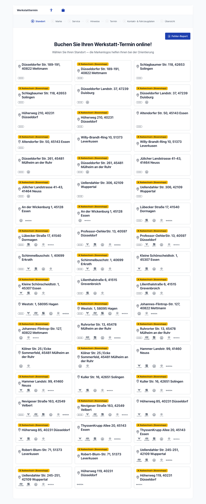

Beim normalen Aufruf von `/home/location` wählt der Kunde zuerst einen Standort. Das Fortschrittsband zeigt hier alle sieben Schritte einschließlich „Standort“. Ein Klick auf eine Standortkarte führt direkt zur Markenauswahl.

---

## Benutzerführung

> Die folgenden Aufnahmen stammen aus der echten Anwendung. Rahmendaten:
> - Backend `http://localhost:3000` mit SoftNet-Daten des Standorts Audi Mettmann.
> - Aufnahme 2026-10-09, Desktop 1280 px.
> - Kundendaten sind frei erfunden; es wurde keine Buchung abgeschickt.

### Schritt 1: Standort-Link öffnen und Marke wählen
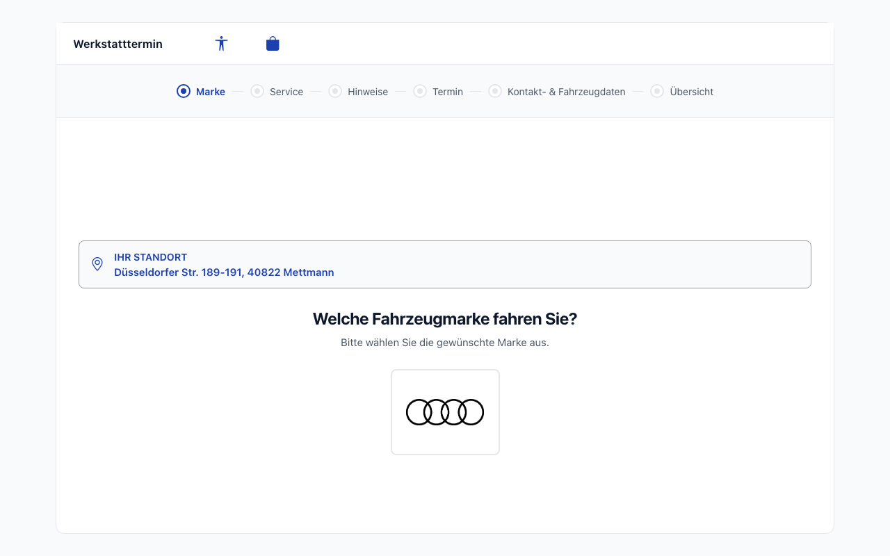

**Beschreibung:**
- Der Standort-Link löst den Standort auf und springt direkt zur Markenauswahl.
- Ein Banner zeigt „Ihr Standort“ mit der Adresse. Darunter folgen die Frage „Welche Fahrzeugmarke fahren Sie?“ und die angebotenen Marken als Logo-Kacheln.
- Das Fortschrittsband zeigt sechs Schritte; „Marke“ ist aktiv.
- Ein Klick auf eine Marke speichert sie und öffnet sofort die Serviceauswahl. Einen „Weiter“-Knopf gibt es nicht (Nutzerentscheid).
- Im Standort-Link-Fluss hat die Seite deshalb keine Aktionsleiste.

### Schritt 2: Service wählen
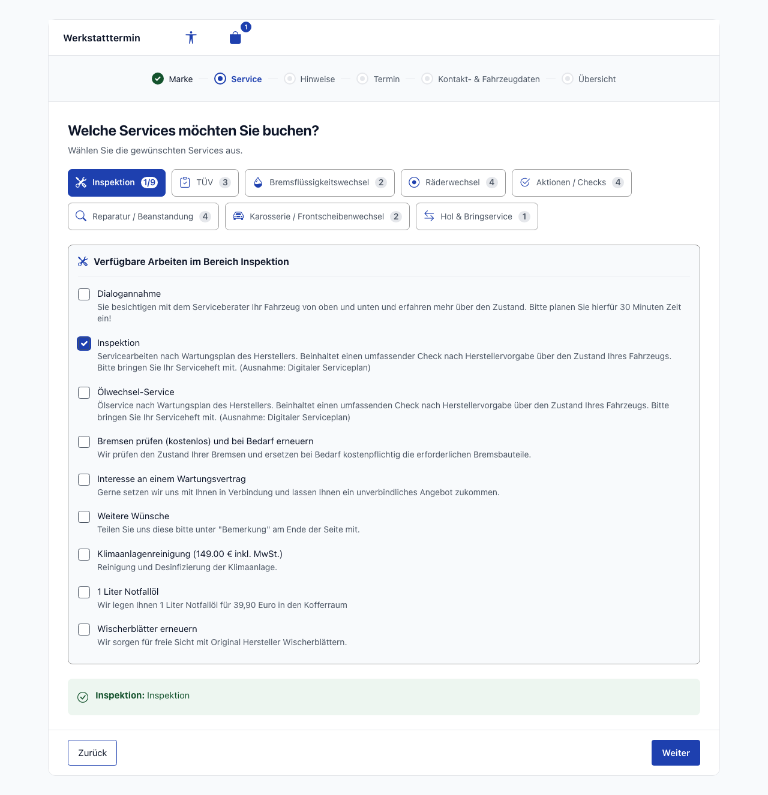

**Beschreibung:**
- Die Servicekategorien stehen als umbrechende Schaltflächen mit Symbol und Zähler, z. B. „Inspektion 1/9“ = 1 von 9 Leistungen gewählt. Die aktive Kategorie ist blau gefüllt.
- Darunter listet das Feld „Verfügbare Arbeiten im Bereich Inspektion“ die Leistungen der aktiven Kategorie als Ankreuzliste mit Beschreibung.
- Eine grüne Zusammenfassung zeigt die Auswahl je Kategorie („Inspektion: Inspektion“).
- In der Aktionsleiste steht „Zurück“ links und „Weiter“ rechts. Ohne gewählte Leistung bleibt „Weiter“ gesperrt.
- „Marke“ ist jetzt als abgeschlossen markiert (grüner Marker mit Häkchen). Das Auswahl-Symbol in der Kopfzeile zeigt den Zähler „1“.

### Schritt 3: Hinweise und Mietwagen
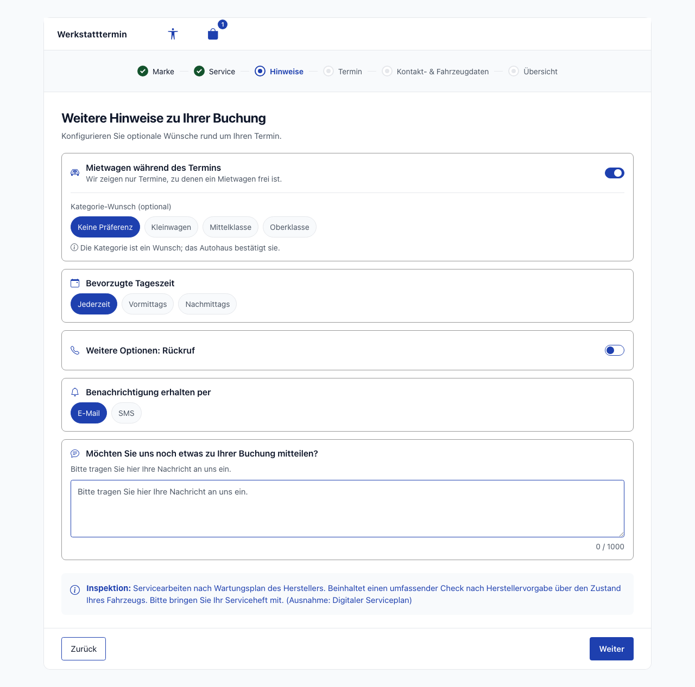

**Beschreibung:** Unter dem Titel „Weitere Hinweise zu Ihrer Buchung“ stehen die Optionen als einzelne Karten.

- **„Mietwagen während des Termins“:** Schalter mit dem Hinweis „Wir zeigen nur Termine, zu denen ein Mietwagen frei ist.“ (Standard: aus).
  - Ist er eingeschaltet, erscheint „Kategorie-Wunsch (optional)“ mit „Keine Präferenz“ (vorausgewählt) und den Kategorien des Standorts (hier Kleinwagen, Mittelklasse, Oberklasse).
  - Darunter steht der Hinweis „Die Kategorie ist ein Wunsch; das Autohaus bestätigt sie.“
  - Es wird kein Mietwagenpreis angezeigt.
- **„Bevorzugte Tageszeit“:** Jederzeit, Vormittags oder Nachmittags.
- **„Weitere Optionen: Rückruf“:** Schalter.
- **„Benachrichtigung erhalten per“:** E-Mail oder SMS.
- **Freie Nachricht:** „Möchten Sie uns noch etwas zu Ihrer Buchung mitteilen?“, maximal 1000 Zeichen, mit Zähler.
- **Wichtige Hinweise zu den gewählten Services:** blaue Hinweiszeilen („Inspektion: …“).

„Weiter“ speichert die Angaben und öffnet die Terminauswahl.

### Schritt 4: Termin wählen
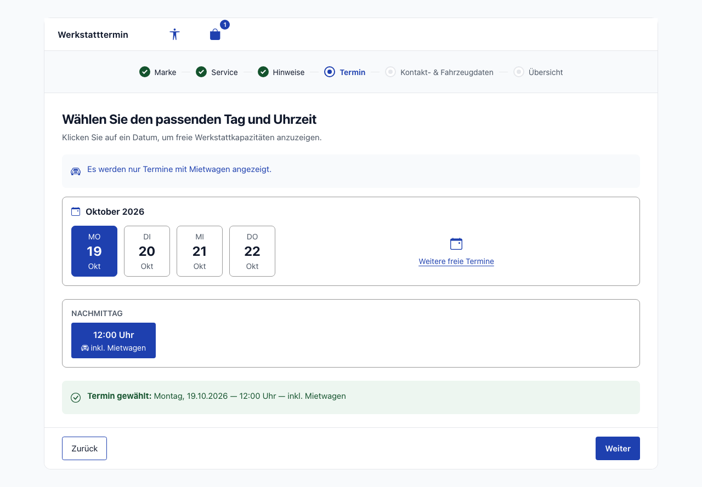

**Beschreibung:** Titel „Wählen Sie den passenden Tag und Uhrzeit“.

- Bei eingeschaltetem Mietwagen steht darunter der Hinweis **„Es werden nur Termine mit Mietwagen angezeigt.“**
- **Kalenderkarte:** Monatsüberschrift (z. B. „Oktober 2026“) und Datumskacheln mit Wochentag, Tag und Monat, beschriftet in der Oberflächensprache.
- Der Link **„Weitere freie Termine“** öffnet den Werkstattkalender. Er zählt als derselbe Schritt „Termin“ und verwendet denselben Mietwagen-Filter.
- **Uhrzeiten:** Nach Wahl eines Tages erscheinen die freien Uhrzeiten, getrennt nach **Vormittag** und **Nachmittag**.
  - Maßgeblich ist die angezeigte Berliner Uhrzeit; 12:00 Uhr gehört also zum Nachmittag.
  - Jede angebotene Uhrzeit trägt die Kennzeichnung **„inkl. Mietwagen“** (Symbol plus Text).
- Die grüne Bestätigung „Termin gewählt: Montag, 19.10.2026 — 12:00 Uhr — inkl. Mietwagen“ fasst die Wahl zusammen.
- „Weiter“ ist erst nach Wahl eines Termins aktiv.

> **Beobachtung bei der Aufnahme (echtes SoftNet-Verhalten):** SoftNet lieferte für Audi Mettmann mit Mietwagen-Wunsch freie Termine. Der Leerzustand trat deshalb nicht auf; er ist im Abschnitt [Mietwagen-Logik](#mietwagen-logik) beschrieben.

### Schritt 5: Kontakt- & Fahrzeugdaten (FIN freiwillig)
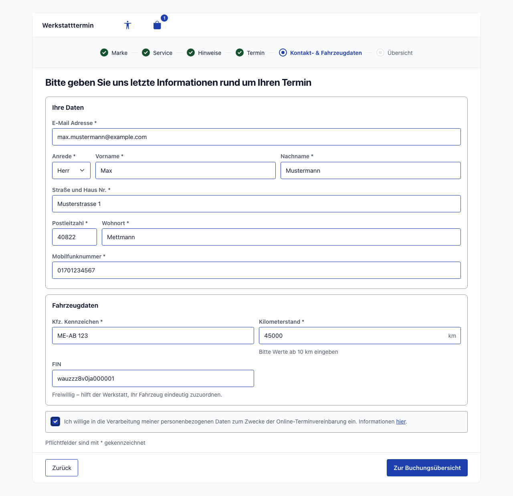

**Beschreibung:** Die Beschriftungen stehen wie im Mockup über den Feldern.

- **Karte „Ihre Daten“:** E-Mail, Anrede/Vorname/Nachname in einer Zeile, Straße, PLZ/Wohnort und Mobilfunknummer. Alle Felder sind Pflicht und mit Stern markiert.
- **Karte „Fahrzeugdaten“:**
  - **Kennzeichen** und **Kilometerstand** sind Pflicht; der Kilometerstand hat die Einheit „km“ und muss mindestens 10 km betragen.
  - Das Feld **„FIN“ hat keinen Stern** und den Hilfetext „Freiwillig – hilft der Werkstatt, Ihr Fahrzeug eindeutig zuzuordnen.“
- Darunter folgen die Einwilligung zur Datenverarbeitung und „Pflichtfelder sind mit * gekennzeichnet“.
- „Zur Buchungsübersicht“ prüft das Formular. Fehlerhafte oder leere Pflichtfelder werden rot markiert und zeigen ihren Fehlertext, und die Seite bleibt stehen.
- Der Fehler der Einwilligung verschwindet, sobald sie angehakt wird.

**Regeln für die FIN:**
- Leer oder nur Leerzeichen gilt als „nicht angegeben“. Die Buchung ist trotzdem möglich; das Backend übermittelt dann wie bisher `UNKNOWN`.
- Eine eingegebene FIN muss genau 17 Zeichen haben („Die FIN muss genau 17 Zeichen enthalten.“). Sie darf nur Buchstaben und Ziffern enthalten („Die FIN darf nur Buchstaben und Zahlen enthalten.“).
- Sie wird getrimmt, in Großbuchstaben umgewandelt, mit der Buchung übermittelt und in der Übersicht angezeigt. Im Beispiel wird `wauzzz8v0ja000001` zu `WAUZZZ8V0JA000001`. Das Backend normalisiert die FIN zusätzlich ebenso.

### Schritt 6: Übersicht und Anfrage
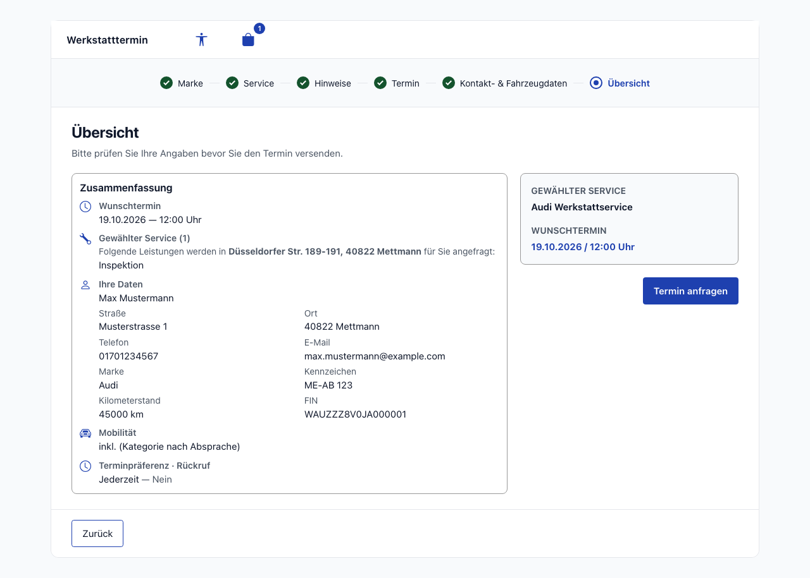

**Beschreibung:**
- **Linke Karte „Zusammenfassung“:**
  - Wunschtermin, gewählter Service mit Standort, Ihre Daten.
  - Fahrzeugdaten, inklusive **FIN**, falls angegeben.
  - Bei Mietwagen-Buchungen die Zeile **„Mobilität: inkl. (Kategorie nach Absprache)“**. Wurde ein Kategorie-Wunsch gewählt, steht zusätzlich „Kategorie-Wunsch: {Kategorie}“ dabei.
  - „Terminpräferenz · Rückruf“.
- **Rechte Seite:** „Gewählter Service“ (z. B. „Audi Werkstattservice“), der Wunschtermin und die Schaltfläche **„Termin anfragen“**.
- In der Aktionsleiste steht „Zurück“.
- Auch nach erfolgreicher Anfrage bleibt „Übersicht“ der letzte aktive Schritt; es entsteht kein weiterer Wizard-Schritt.

### Direkte Korrektur über das Fortschrittsband

- In jedem erreichten Schritt kann ein **früherer** (abgeschlossener) Schritt direkt angeklickt werden.
- Die Anwendung setzt dabei die Daten gemäß der bestehenden Rücksetzregel ab dem Zielschritt zurück und öffnet die passende Seite.
- Aktive und zukünftige Schritte sind nicht anklickbar (`aria-disabled`), damit kein Schritt und keine Prüfung übersprungen wird.
- Ein Rücksprung auf „Hinweise“ oder früher setzt zusätzlich den Mietwagen-Schalter zurück.

---

## Responsives Verhalten

| Ansicht | Darstellung |
|---|---|
| Breit (verfügbare Wizard-Breite ab `56em`, z. B. Desktop 1280 px) | Weiße Karte mit Rahmen; im Fortschrittsband alle Schrittbezeichnungen neben den Markern mit kurzen Verbindungslinien; Aktionsleiste am Fuß der Karte |
| Schmal (Smartphone, Tablet im Hochformat, schmales iFrame) | Volle Breite; Markerreihe ohne sichtbare Beschriftung; darunter zentriert **Schritttitel** und **„Schritt X von Y“**; Aktionsleiste klebt am unteren Bildschirmrand („Zurück“ links, „Weiter“ rechts) |

Die Umschaltung des Fortschrittsbands richtet sich nach seiner tatsächlich verfügbaren Breite (Container-Query), nicht allein nach der Fenstergröße. Dadurch bleibt es auch bei vergrößerter Schrift oder in schmalen Einbettungen kompakt und ohne horizontales Scrollen.

**Zustände:**
- abgeschlossen = grün gefüllter Marker mit Häkchen;
- aktiv = blauer Ring mit Punkt;
- ausstehend = grauer Marker.

Der Zustand wird zusätzlich über die Form und eine zugängliche Statusbeschreibung vermittelt, nicht nur über Farbe.

### Mobile Ansicht (390 px): kompaktes Fortschrittsband
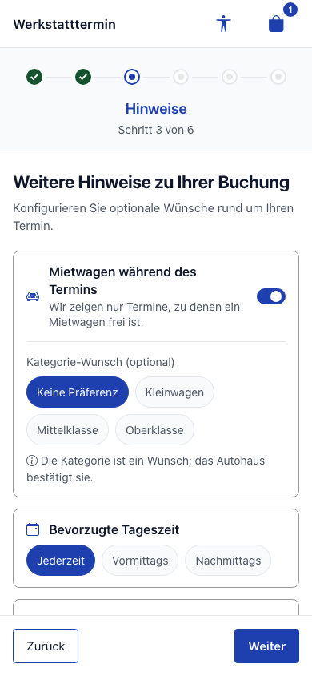

- Die Kopfzeile zeigt den Titel links und die beiden Symbole rechts.
- Das Fortschrittsband zeigt sechs Marker: „Marke“ und „Service“ sind abgeschlossen, „Hinweise“ ist aktiv.
- Darunter stehen „Hinweise“ und „Schritt 3 von 6“.
- Die Schrittbeschriftungen sind visuell ausgeblendet, bleiben aber als zugänglicher Name erhalten.
- Unten klebt die Aktionsleiste mit „Zurück“ und „Weiter“.

### Mobile Ansicht (390 px): Rücksprung per Marker
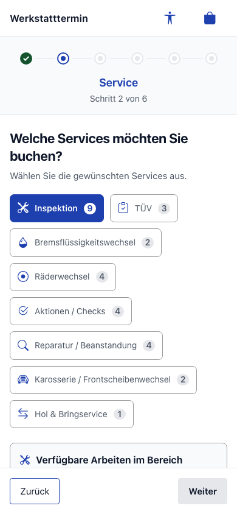

- Ein Tipp auf den Marker des abgeschlossenen Schritts „Service“ führt zurück zur Serviceauswahl, auch ohne sichtbare Beschriftung.
- Der zentrierte Titel wechselt synchron auf „Service“.
- Gemäß Rücksetzregel ist die Serviceauswahl wieder leer, spätere Schritte sind wieder ausstehend.

---

## Mietwagen-Logik

| Situation | Verhalten |
|---|---|
| Schalter **aus** (Standard) | Termine werden wie bisher ohne Mietwagen abgefragt; alle freien Termine werden angezeigt. |
| Schalter **an** | Die Terminabfrage geht mit Mietwagen-Wunsch an SoftNet (`replacementCar: true` → `replacementPreference: true`, ohne Kategorie). Das Backend liefert **nur Termine, zu denen SoftNet einen Mietwagen reserviert hat** (`replacementResource` gesetzt). Gilt für Terminauswahl und Werkstattkalender. |
| Kennzeichnung | Jeder Termin-Slot, die Auswahlbestätigung und die Übersicht nennen **„inkl. Mietwagen“**. Die von SoftNet vergebene Kategorie wird nicht als Zusage angezeigt. |
| Kategorie-Wunsch | Optional und **unverbindlich**; er ändert die Terminliste nicht. Er wird als Präfix im Hinweistext an das Autohaus übermittelt (z. B. „Mietwagen-Wunsch: Mittelklasse“); die Gesamtlänge bleibt ≤ 2000 Zeichen. Ohne Wunsch wird nichts übertragen. Kein Mietwagenpreis. |
| Kein Termin mit Mietwagen / Abruffehler | Statt der Liste erscheint eine Karte mit dem Hinweis **„Im angezeigten Zeitraum ist kein Termin mit Mietwagen frei.“** Auf der Terminseite gibt es zwei Aktionen: **„Spätere Termine anzeigen“** öffnet den Werkstattkalender, **„Ohne Mietwagen fortfahren“** schaltet den Mietwagen ab und lädt alle Termine neu. Im Werkstattkalender gibt es nur „Ohne Mietwagen fortfahren“. Es gibt keinen stillen Rückfall auf alle Termine. |
| Standort/Gruppe **ohne** Mietwagen-Kategorien (oder Kategorien nicht ladbar) | Der Schalter wird **nicht** angeboten; stattdessen erscheint der Hinweis **„An diesem Standort ist online keine Mietwagen-Buchung möglich.“** Die Buchung ohne Mietwagen bleibt möglich. |
| Wechsel mit ↔ ohne Mietwagen | Geladene Termine, Kalenderdaten und ein bereits gewählter Termin werden verworfen und neu geladen. |
| Belegter Termin (Snap-Konflikt) | Der Neuabruf behält den Mietwagen-Filter bei. |

Für die beiden Sonderzustände (Leerzustand und Standort ohne Mietwagen-Angebot) gibt es **keine Aufnahmen der echten Anwendung**, weil SoftNet sie für den genutzten Standort nicht lieferte. Ihre Gestaltung zeigen die folgenden **Design-Mockups** (keine Screenshots der App):

- Design-Mockup „Termin ohne Mietwagen-Angebot“: [mockup-04-termin-kein-mietwagen-desktop.png](./screenshots/mockup-04-termin-kein-mietwagen-desktop.png)
- Design-Mockup „Hinweise ohne Mietwagen-Angebot“: [mockup-03-hinweise-ohne-angebot-desktop.png](./screenshots/mockup-03-hinweise-ohne-angebot-desktop.png)

Beide Zustände sind in der E2E-Suite mit gemockten Antworten automatisiert geprüft (TC-M6, TC-M8).

### Offene Punkte (Requirement 18.19)

Abschnitt 18 wurde auf Nutzerentscheid umgesetzt, **bevor** die Freigabe-Bedingung aus 18.5 erfüllt war. Vor dem Go-Live sind zu klären:

- **O-1 — Übertragung des Kategorie-Wunschs:** Festgelegt ist der Präfix im Hinweistext. Alternative wäre, die Kategorie schon bei der Terminabfrage mitzugeben; SoftNet vergibt dann genau diese Kategorie oder keinen Wagen. Bestätigung durch den Product Owner offen.
- **O-2 — Hält die Reservierung beim Buchen?** Ob `AppointmentResource.rentResource` beim Buchen gesetzt wird, ist bisher nur aus den Termin-Snaps abgeleitet. Blockierend; Klärung über eine einmalige, sofort stornierte Testbuchung mit Freigabe des Product Owners.
- **O-3 — Welche Abfrage bildet die echte Verfügbarkeit ab?** VW Mettmann: „beliebige Kategorie“ 116 Snaps mit Wagen, „Kleinwagen explizit“ nur 51. Tagesgenau prüfen; ggf. auf „erste Kategorie explizit“ umstellen. Blockierend.
- **O-4 — Mietwagen bei Radwechsel-Gruppen:** Ob die Radwechsel-Gruppen (`tireChange`, alle 27 Standorte) Mietwagen-Kategorien haben, entscheidet, ob dort der Schalter oder der Hinweis „keine Mietwagen-Buchung möglich“ erscheint.

---

## Responsive Ansichten

Die folgenden E2E-Aufnahmen zeigen den Schritt „Hinweise“ mit eingeschaltetem Mietwagen-Schalter (echtes Backend, normaler Einstieg mit sieben Schritten).

### Desktop (1280x720)
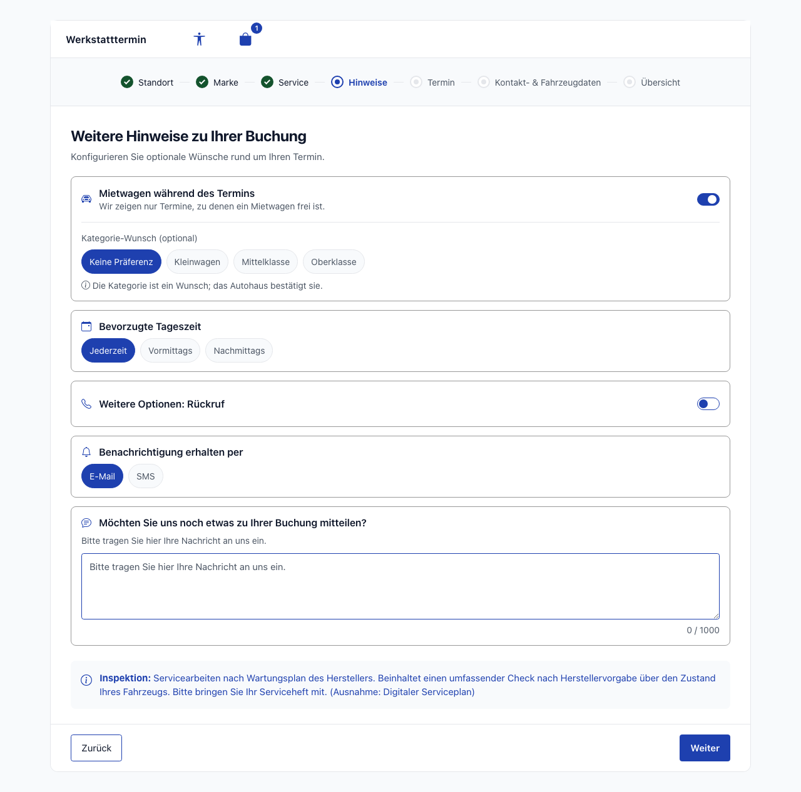

Weiße Karte mit Kopfzeile, vollständigen Schrittbezeichnungen und Aktionsleiste am Kartenfuß.

### Tablet (768x1024)
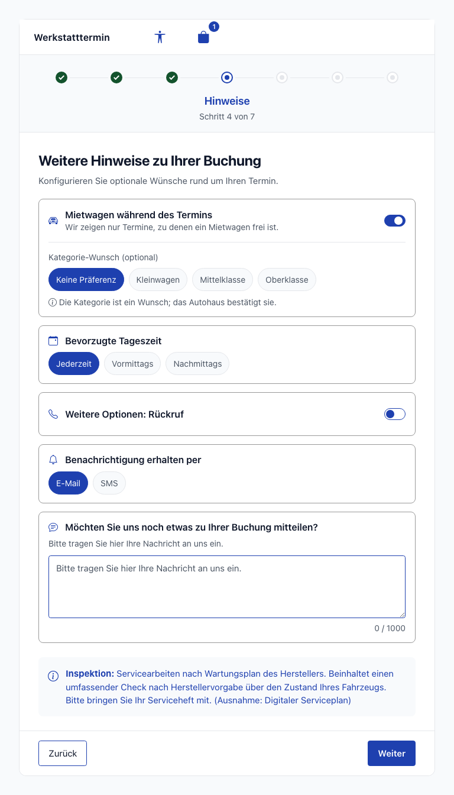

Kompakte Markerreihe mit zentriertem Titel und „Schritt 4 von 7“, da die verfügbare Breite des Fortschrittsbands unter `56em` liegt.

### Mobile (375x667)
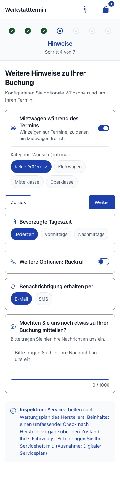

Kompakte Markerreihe; „Zurück“ und „Weiter“ stehen nebeneinander in der klebenden Aktionsleiste. Hinweis: In der Ganzseitenaufnahme erscheint diese Leiste in Höhe des ursprünglichen Bildschirmrands mitten im Inhalt — ein Aufnahme-Artefakt von `position: sticky`. Im Browser klebt sie am unteren Rand (siehe Mobile-Aufnahme in Schritt 3).

---

## Barrierefreiheit

- **Tastaturnavigation:**
  - Jeder Schritt im Fortschrittsband ist genau ein natives `button` (`type="button"`) aus Marker und Beschriftung. Alle Schritte sind per Tab erreichbar; abgeschlossene Schritte lassen sich mit Enter/Leertaste aufrufen.
  - Aktive und zukünftige Schritte tragen `aria-disabled="true"` (kein natives `disabled`); der gemeinsame Handler verhindert die Navigation.
  - Datumskacheln und Uhrzeiten der Terminauswahl sind als `radio` mit Enter/Leertaste bedienbar.
- **Screen Reader:**
  - Fortschrittsband:
    - Die Fortschrittsnavigation hat einen lokalisierten Namen; genau ein Schritt trägt `aria-current="step"`.
    - Jeder Schritt erhält eine Statusbeschreibung („Abgeschlossen“, „Aktueller Schritt“, „Noch nicht verfügbar“).
    - Der zentrierte Titel ist ein `role="status"` mit `aria-live="polite"`.
  - Kopfzeile: Die Symbole haben lokalisierte Namen; der Auswahl-Button nennt die Anzahl („Warenkorb, 1 Artikel im Warenkorb“). Beide Panels schließen mit „Schließen“.
  - Schalter und Mietwagen-Hinweise:
    - Mietwagen- und Rückruf-Schalter sind `role="switch"` mit Label.
    - Filter-Hinweis und Leerzustand werden per `role="status"`/`aria-live="polite"` angesagt.
    - „inkl. Mietwagen“ ist immer auch als Text vorhanden.
  - Formularfelder:
    - Der Zeichenzähler der Nachricht wird als „12 von 1000 Zeichen verwendet“ vorgelesen.
    - Das FIN-Feld verweist per `aria-describedby` auf Hilfetext und ggf. Fehlermeldung (`role="alert"`) und erhält bei Fehler `aria-invalid`.
- **Farbkontrast:** Ziel WCAG 2.1 AA. Farben kommen ausschließlich aus zentralen Tokens (`_variables.scss`, Bootstrap-Theme), Symbole in Primärblau gemäß Farbregel. Zustände werden nicht nur über Farbe vermittelt.
- **Focus-Styles:**
  - Sichtbarer `:focus-visible`-Rahmen an Schrittzielen, Kopfzeilen-Symbolen, Markenkacheln, Kategorie-Schaltflächen, Schaltern, Pills, Datumskacheln, Uhrzeiten und Formularfeldern.
  - Die Schrittziele sind mindestens 44 × 44 CSS-Pixel groß (`2.75rem`), auch bei 320 px Breite mit sieben Schritten.
  - Bei 320–1280 px Breite gibt es kein horizontales Scrollen (E2E geprüft).

---

## Technische Details

| Eigenschaft | Wert |
|-------------|------|
| Routen | `/home/location`, `/home/brand`, `/home/services`, `/home/notes`, `/home/appointment`, `/home/workshop-calendar`, `/home/carinformation`, `/home/booking-overview` (Pfad-Routing, kein Hash) |
| Deep-Link | `/home/location?branchId=<id>&groupId=<id>` → `deepLinkGuard` → `/home/brand` (sechs sichtbare Schritte) |
| Kopfzeile | `FloatingOverlayComponent` (`src/app/shared/components/floating-overlay/`) als Kopfzeile; App-Rahmen in `AppComponent` |
| Fortschrittsband | `WizardBreadcrumbComponent` (`src/app/shared/components/wizard-breadcrumb/`), Schrittkonfiguration `WIZARD_STEPS` (sieben Einträge), `stepsWithStatus`/`activeStep`/`stepCounter` als `computed` |
| Container Components | `BrandSelectionContainerComponent`, `ServiceSelectionContainerComponent`, `NotesContainerComponent`, `AppointmentSelectionContainerComponent`, `WorkshopCalendarContainerComponent`, `CarinformationContainerComponent`, `BookingOverviewContainerComponent` |
| Presentational (Auszug) | `ServiceCardComponent` (Kategorie-Schaltfläche), `NotesExtrasFormComponent` (Mietwagen-Schalter `#rentSwitch`, Kategorie-Wunsch), `AppointmentCardComponent` („inkl. Mietwagen“), `RentalCarEmptyStateComponent` (Leerzustand, Termin + Kalender), `VehicleFormComponent` (FIN `#vehicle-vin`, `optionalVinValidator`) |
| Hilfsfunktionen | `shared/utils/date-locale.util.ts` (Locale je Sprache für `Intl.DateTimeFormat`), `features/booking/utils/category-icon.util.ts` (Symbol je Kategorie) |
| Store | `BookingStore` (`src/app/features/booking/stores/booking.store.ts`): `rentalCarRequested` / `setRentalCarRequested()` / `continueWithoutRentalCar()`, `rentCategoriesLoaded`, `hasRentalCarOffer`, `hasNoRentalCarOffer`, `hasNoRentalCarAppointments`, `hasNoRentalCarCalendarDays`; `selectedRentCategoryId` = Kategorie-Wunsch |
| API Services | `BookingApiService`, `AppointmentApiService`, `RentCategoryApiService` (`?variant=`), `WorkshopCalendarApiService` |
| Backend | `SnapsService` (Mietwagen-Filter, `rentalCarIncluded`), `SoftnetBrandResolver` (Marke in SoftNet-Schreibweise, pro Gruppe gecacht), `RentCategoriesService` (Varianten-Gruppe), `AppointmentsService` (Wunsch als Hinweis-Präfix, FIN normalisiert, kein `rentCategoryid`/`isFleet`/`fleetType`), `UsageEventLogger` (anonymes Merkmal „mit/ohne Mietwagen“), `SessionTokenFilter` (CORS-Preflight) |
| API | `POST /api/v1/snaps` (`replacementCar`), `GET /api/v1/branches/{branchId}/rentcategories?variant=`, `POST /api/v1/appointments` (Vertrag unverändert) |
| i18n | `app.headerTitle`, `booking.wizard.*`, Seitentexte aus Requirement 17.4, `booking.notes.rentalCar.*`, `booking.appointment.rentalCar.*`, `booking.bookingOverview.rentalCar.*`, `booking.carinformation.form.vin.optionalHint` in DE/EN/UK/FR/AR |
| E2E | `playwright/REQ-039-responsive-wizard.spec.ts` (3 Viewports) |

### Bekannte Auffälligkeiten

- **Uhrzeit und Datum in der englischen Oberfläche:** Uhrzeiten erscheinen weiterhin als „12:00 Uhr“ und Datumsangaben als „19.10.2026“. Beide Formate liefert das Backend (`displayTime`/`displayDate`) — vorbestehend. Datumskacheln, Monatsüberschrift und Wochentage sind dagegen lokalisiert. Der Sprachwähler bietet produktiv nur Deutsch an.
- **Daten aus SoftNet:** Kategorienamen (Kleinwagen, Mittelklasse, Oberklasse) und Servicenamen kommen als Daten aus SoftNet und sind daher auch in Englisch deutsch.
