# Feature Documentation: Responsive Booking Wizard with Rental Car per Appointment

**Created:** 2026-10-08
**Updated:** 2026-10-09 (implementation according to the mockups, requirement 11.4)
**Requirement:** REQ-039-Responsive-Wizard
**Language:** EN
**Status:** Implemented

---

## Overview

The online workshop booking guides customers through six steps to their appointment request: **Brand → Service → Notes → Appointment → Contact & vehicle details → Overview**. When the booking is opened via a location link (deep link with `branchId` and `groupId`), the location is already set and hidden in the progress band. With the regular entry, the **Location** step comes first (seven steps).

REQ-039 introduces four changes:

1. **UI according to the mockups:** The app has the same shape as the mockups.
   - At the top is a white header bar with the title "Workshop appointment" and two blue icons: accessibility and your selection, with a counter.
   - The progress band follows below.
   - On desktop, the content sits in a white card, and the action bar closes the card at the bottom.
2. **Responsive progress band:**
   - On wide views, every step label is written out next to a round marker.
   - On narrow views (smartphone, narrow tablet, embedded frames), the band only shows the markers. Below them, the title of the current step and "Step X of Y" are centred.
   - Each step is **one** button made of marker and label, so a completed step can be tapped directly, even on a smartphone.
3. **Rental car per appointment:** Customers who switch on "Rental car during the appointment" in the Notes step are only offered appointments for which the dealership system (SoftNet) has reserved a rental car. The vehicle category is only a non-binding preference.
4. **Optional VIN:** In the vehicle form, the licence plate is sufficient. The vehicle identification number (VIN) is optional; if entered, it must consist of exactly 17 letters or digits.

Business validation, reset rules and the order of the steps remain unchanged. Screen width, zoom or language never change the route or any selection.

### Entry without a location link (regular flow, seven steps)

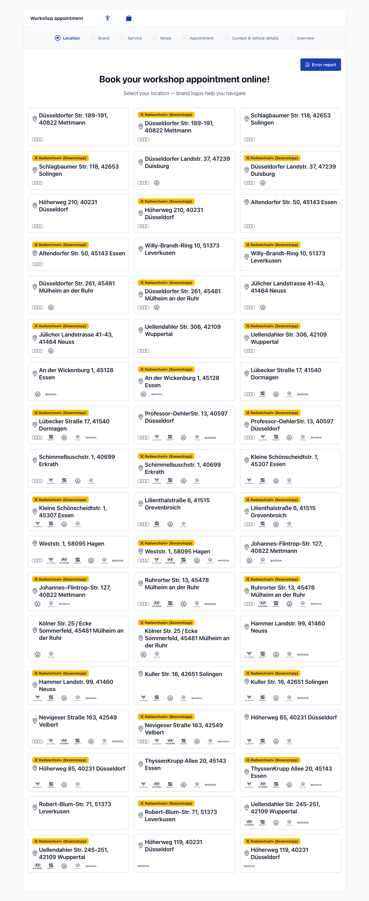

When `/home/location` is opened directly, the customer first chooses a location. The progress band shows all seven steps including "Location". Clicking a location card leads straight to the brand selection.

---

## User Guide

> The following captures were taken from the real application:
> - Backend `http://localhost:3000` with SoftNet data of the Audi Mettmann location.
> - Captured 2026-10-09, desktop 1280 px.
> - All customer data is fictitious; no booking was submitted.

### Step 1: Open the location link and choose a brand
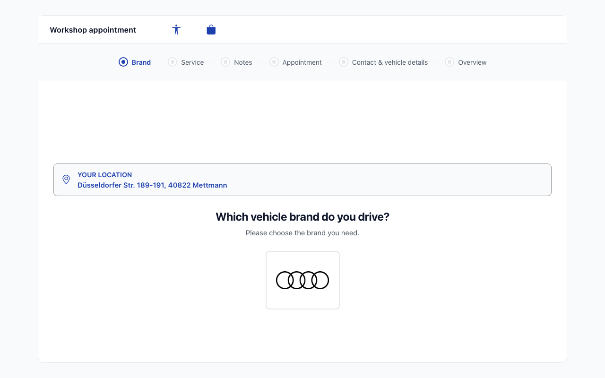

**Description:**
- The location link resolves the location and jumps straight to the brand selection.
- A banner shows "Your location" with the address. Below it are the question "Which vehicle brand do you drive?" and the offered brands as logo tiles.
- The progress band shows six steps; "Brand" is active.
- Clicking a brand stores it and immediately opens the service selection. There is no "Continue" button (user decision).
- In the location-link flow, the page therefore has no action bar.

### Step 2: Choose services
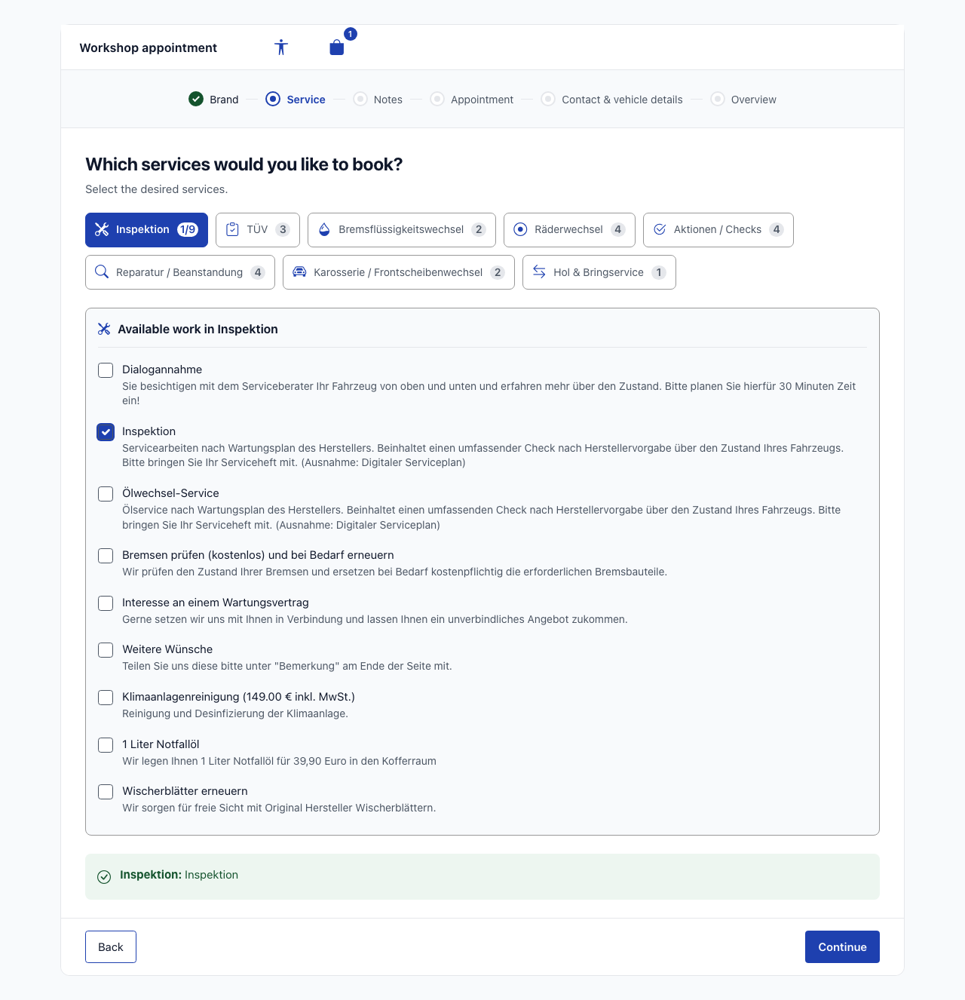

**Description:**
- The service categories are wrapping buttons with icon and counter, e.g. "Inspektion 1/9" = 1 of 9 services selected. The active category is filled blue.
- Below, the panel "Available work in …" lists the services of the active category as a checkbox list with descriptions.
- A green summary shows the selection per category.
- The action bar has "Back" on the left and "Continue" on the right. Without a selected service, "Continue" stays blocked.
- "Brand" is now marked as completed (green marker with check mark). The selection icon in the header shows the counter "1".

### Step 3: Notes and rental car
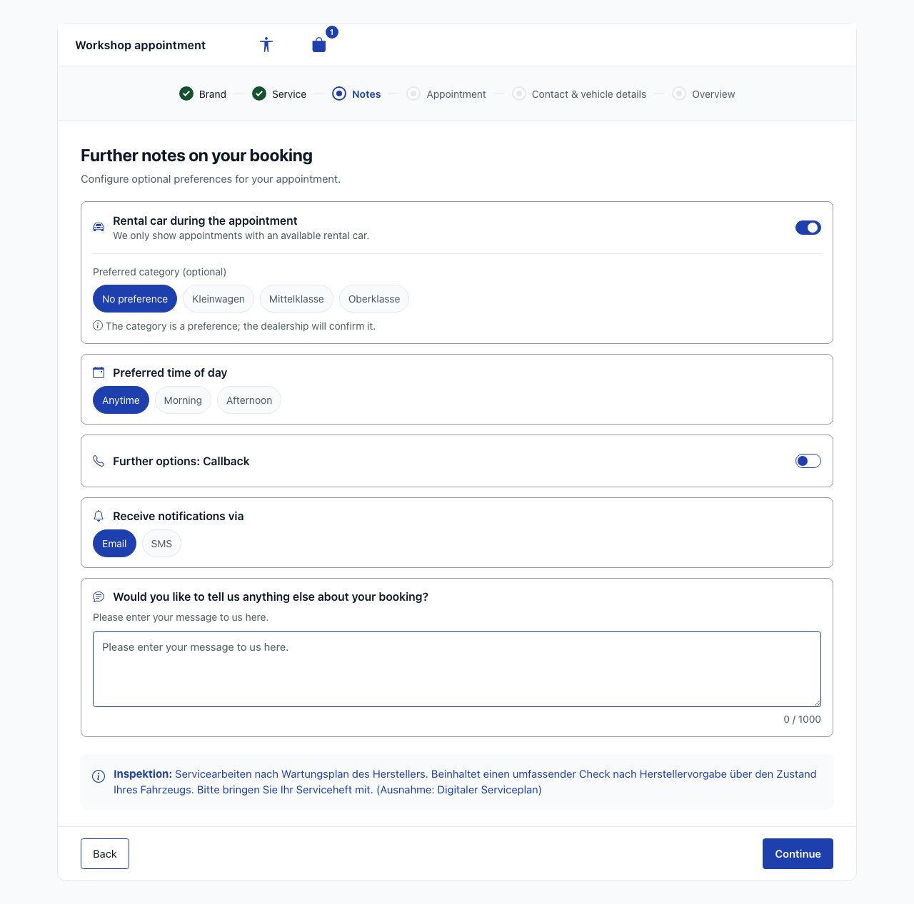

**Description:** Below the title "Further notes on your booking", the options are shown as separate cards.

- **"Rental car during the appointment":** switch with the hint "We only show appointments with an available rental car." (default: off).
  - When it is on, "Preferred category (optional)" appears with "No preference" (preselected) and the location's categories (here Kleinwagen, Mittelklasse, Oberklasse — names delivered by SoftNet).
  - Below is the hint "The category is a preference; the dealership will confirm it."
  - No rental car price is shown.
- **"Preferred time of day":** anytime, morning or afternoon.
- **"Further options: Callback":** switch.
- **"Receive notifications via":** e-mail or SMS.
- **Free-text message:** "Would you like to tell us anything else about your booking?", maximum 1000 characters, with a counter.
- **Important notes on the selected services:** blue hint lines.

"Continue" stores the input and opens the appointment selection.

### Step 4: Choose an appointment
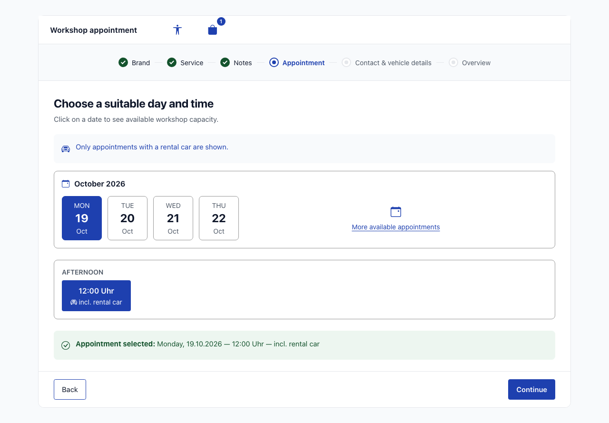

**Description:** Title "Choose a suitable day and time".

- With the rental car switched on, the hint **"Only appointments with a rental car are shown."** appears below.
- **Calendar card:** month heading (e.g. "October 2026") and date tiles with weekday, day and month, labelled in the UI language.
- The link **"More available appointments"** opens the workshop calendar. It counts as the same "Appointment" step and uses the same rental car filter.
- **Times:** After choosing a day, the free times appear, grouped into **Morning** and **Afternoon**.
  - The displayed Berlin time decides the group, so 12:00 belongs to the afternoon.
  - Every offered time carries the label **"incl. rental car"** (icon plus text).
- The green confirmation "Appointment selected: … — incl. rental car" summarises the choice.
- "Continue" is only enabled once an appointment is selected.

> **Observation during capture (real SoftNet behaviour):** SoftNet returned free appointments with a rental car for Audi Mettmann, so the empty state did not occur. It is described in the [rental car logic](#rental-car-logic) section.

### Step 5: Contact & vehicle details (VIN optional)
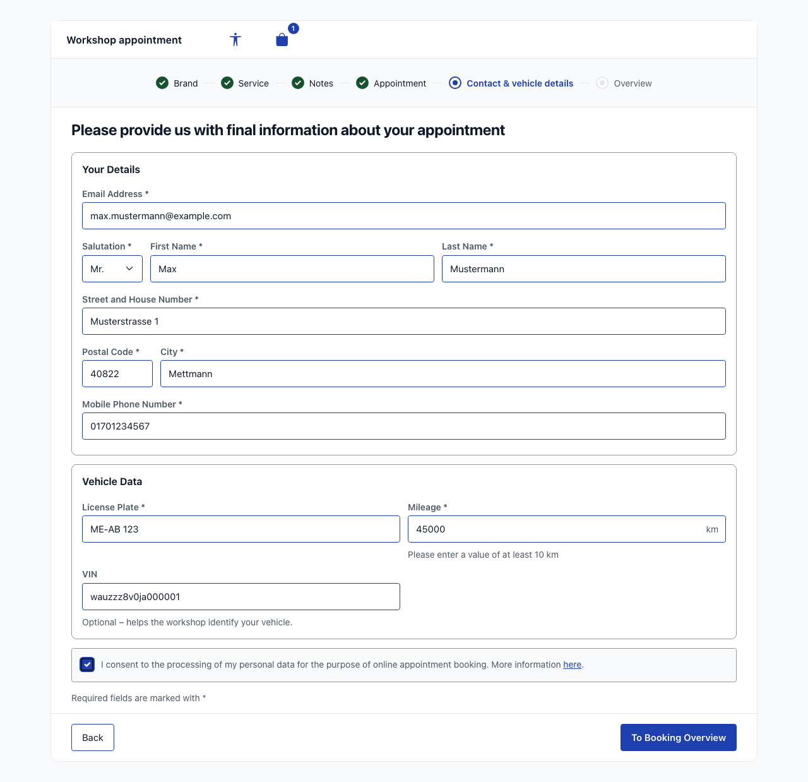

**Description:** As in the mockup, the labels sit above the fields.

- **"Your Details" card:** e-mail, salutation/first name/last name in one row, street, postal code/city and mobile number. All fields are mandatory and marked with an asterisk.
- **"Vehicle Data" card:**
  - **License Plate** and **Mileage** are mandatory; mileage has the unit "km" and must be at least 10 km.
  - The **"VIN" field has no asterisk** and the help text "Optional – helps the workshop identify your vehicle."
- Below follow the data-processing consent and "Required fields are marked with *".
- "To Booking Overview" validates the form. Invalid or empty mandatory fields are highlighted and show their error text, and the page stays put.
- The consent error disappears as soon as the box is ticked.

**VIN rules:**
- Empty or whitespace-only counts as "not provided". Booking is still possible; the backend then sends `UNKNOWN` as before.
- An entered VIN must be exactly 17 characters long ("The VIN must be exactly 17 characters."). It may only contain letters and digits ("The VIN may only contain letters and digits.").
- It is trimmed, converted to upper case, sent with the booking and shown in the overview. In the example, `wauzzz8v0ja000001` becomes `WAUZZZ8V0JA000001`. The backend additionally normalises it the same way.

### Step 6: Overview and request
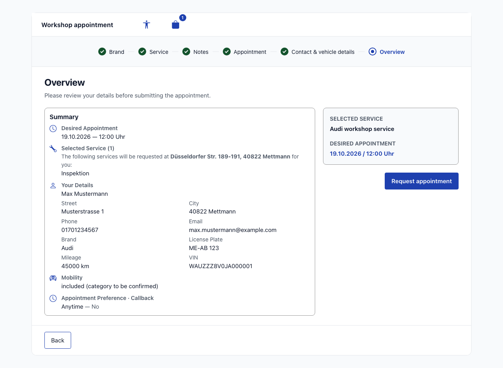

**Description:**
- **Left card "Summary":**
  - Desired appointment, selected service with location, your details.
  - Vehicle data, including the **VIN** if provided.
  - For rental car bookings, the line **"Mobility: included (category to be confirmed)"**. If a category preference was chosen, "Preferred category: {category}" is added.
  - "Appointment Preference · Callback".
- **Right side:** "Selected service" (e.g. "Audi workshop service"), the desired appointment and the button **"Request appointment"**.
- The action bar contains "Back".
- Even after a successful request, "Overview" remains the last active step; no additional wizard step is created.

### Direct correction via the progress band

- In every reached step, an **earlier** (completed) step can be clicked directly.
- The application resets the data from the target step onwards according to the existing reset rule and opens the matching page.
- Active and future steps are not clickable (`aria-disabled`), so no step and no validation can be skipped.
- Jumping back to "Notes" or earlier additionally resets the rental car switch.

---

## Responsive behaviour

| View | Presentation |
|---|---|
| Wide (available wizard width from `56em`, e.g. desktop 1280 px) | White card with border; all step labels next to the markers with short connecting lines; action bar at the bottom of the card |
| Narrow (smartphone, tablet in portrait, narrow iFrame) | Full width; marker row without visible labels; below it the centred **step title** and **"Step X of Y"**; the action bar sticks to the bottom of the screen ("Back" left, "Continue" right) |

The progress band switches according to its actual available width (container query), not only the window size. It therefore stays compact and free of horizontal scrolling even with enlarged text or in narrow embeddings.

**States:**
- completed = green filled marker with check mark;
- active = blue ring with dot;
- upcoming = grey marker.

The state is additionally conveyed by shape and an accessible status description, not by colour alone.

### Mobile view (390 px): compact progress band
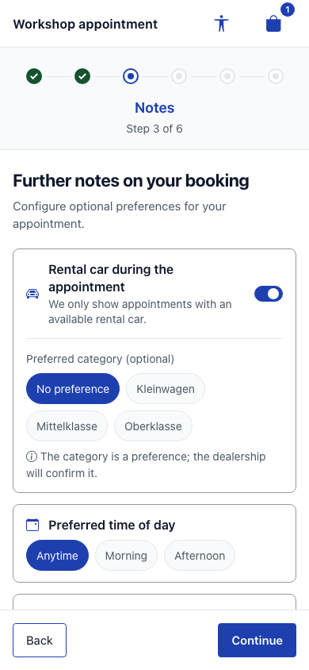

- The header shows the title on the left and the two icons on the right.
- The progress band shows six markers: "Brand" and "Service" are completed, "Notes" is active.
- Below them are "Notes" and "Step 3 of 6".
- The step labels are visually hidden but kept as accessible names.
- The action bar with "Back" and "Continue" sticks to the bottom.

### Mobile view (390 px): jumping back via marker
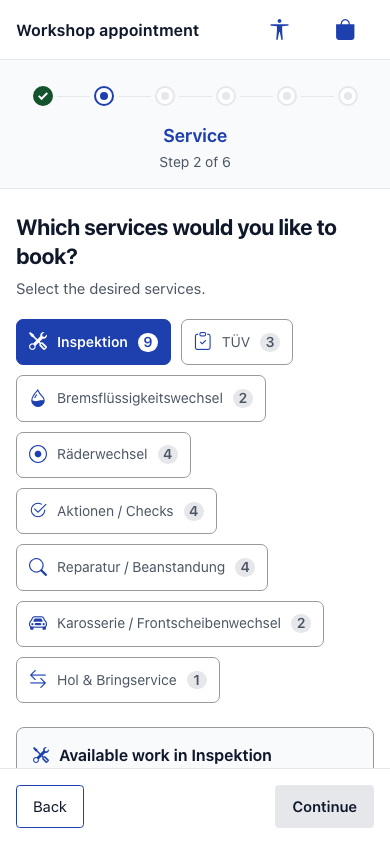

- Tapping the marker of the completed step "Service" returns to the service selection, even without a visible label.
- The centred title switches to "Service" at the same time.
- According to the reset rule, the service selection is empty again and later steps are upcoming again.

---

## Rental car logic

| Situation | Behaviour |
|---|---|
| Switch **off** (default) | Appointments are requested without a rental car as before; all free appointments are shown. |
| Switch **on** | The appointment request is sent to SoftNet with a rental car preference (`replacementCar: true` → `replacementPreference: true`, without a category). The backend returns **only appointments for which SoftNet has reserved a rental car** (`replacementResource` set). Applies to the appointment selection and the workshop calendar. |
| Labelling | Every time slot, the selection confirmation and the overview say **"incl. rental car"**. The category assigned by SoftNet is not shown as a commitment. |
| Category preference | Optional and **non-binding**; it does not change the appointment list. It is passed to the dealership as a prefix of the note (e.g. "Mietwagen-Wunsch: Mittelklasse" — a fixed German backend text for the dealership); the total length stays ≤ 2000 characters. Without a preference nothing is sent. No rental car price. |
| No appointment with a rental car / request error | Instead of the list, a card shows the hint **"No appointment with a rental car is available in this period."** The appointment page offers two actions: **"Show later appointments"** opens the workshop calendar, and **"Continue without rental car"** turns the rental car off and reloads all appointments. The workshop calendar only offers "Continue without rental car". There is no silent fallback to all appointments. |
| Location/group **without** rental car categories (or categories cannot be loaded) | The switch is **not** offered; instead the hint **"Online rental car booking is not available at this location."** is shown. Booking without a rental car remains possible. |
| Switching with ↔ without rental car | Loaded appointments, calendar data and an already selected appointment are discarded and reloaded. |
| Appointment already taken (snap conflict) | The reload keeps the rental car filter. |

For the two special states (empty state and location without a rental car offer), **no captures of the real application** exist, because SoftNet did not produce them for the location used. Their design is shown in the following **design mockups** (not screenshots of the app; the mockups are in German):

- Design mockup "Appointment without rental car offer": [mockup-04-termin-kein-mietwagen-desktop.png](./screenshots/mockup-04-termin-kein-mietwagen-desktop.png)
- Design mockup "Notes without rental car offer": [mockup-03-hinweise-ohne-angebot-desktop.png](./screenshots/mockup-03-hinweise-ohne-angebot-desktop.png)

Both states are covered by automated E2E tests with mocked responses (TC-M6, TC-M8).

### Open points (requirement 18.19)

Section 18 was implemented at the user's request **before** the release condition from 18.5 was met. The following must be clarified before go-live:

- **O-1 — Transfer of the category preference:** The note prefix is the chosen approach. The alternative would be to send the category with the appointment request already; SoftNet then assigns exactly that category or no car. Confirmation by the product owner is pending.
- **O-2 — Does the reservation hold when booking?** Whether `AppointmentResource.rentResource` is set on booking has so far only been derived from the appointment snaps. Blocking; to be clarified with a single, immediately cancelled test booking approved by the product owner.
- **O-3 — Which request reflects real availability?** VW Mettmann: "any category" 116 snaps with a car, "Kleinwagen explicitly" only 51. To be checked per day; switch to "first category explicitly" if necessary. Blocking.
- **O-4 — Rental cars for wheel-change groups:** Whether the wheel-change groups (`tireChange`, all 27 locations) have rental car categories determines whether the switch or the "not available" hint appears there.

---

## Responsive Views

The following E2E captures show the "Notes" step with the rental car switch turned on (real backend, German UI, regular entry with seven steps).

### Desktop (1280x720)
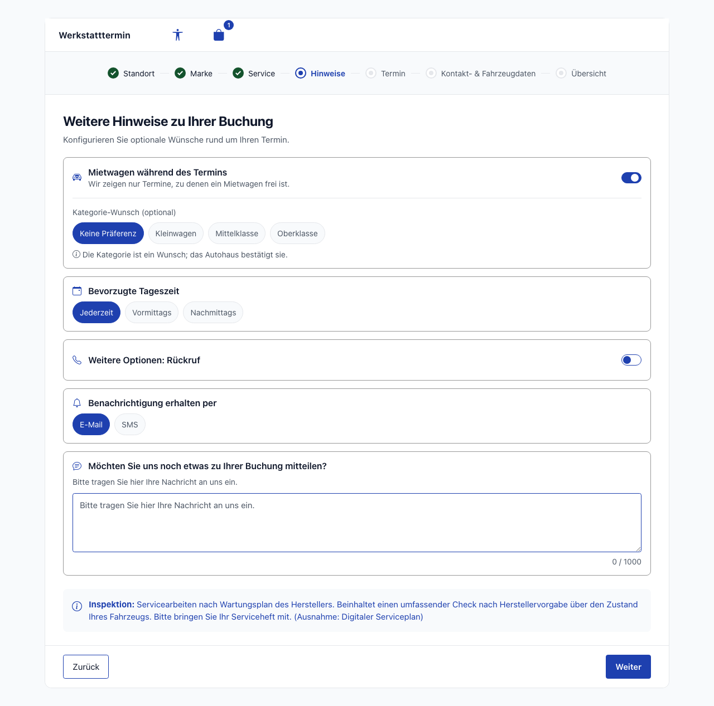

White card with header, full step labels and the action bar at the bottom of the card.

### Tablet (768x1024)
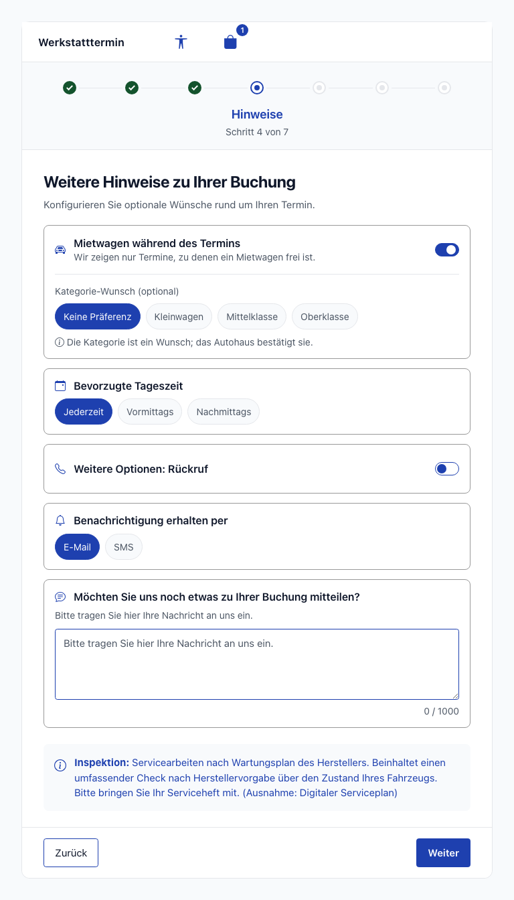

Compact marker row with the centred title and "Schritt 4 von 7", because the available width of the progress band is below `56em`.

### Mobile (375x667)
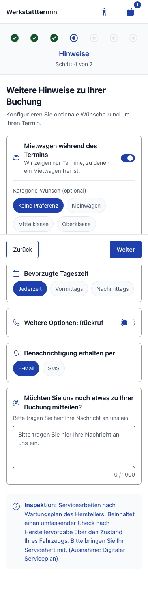

Compact marker row; "Back" and "Continue" sit side by side in the sticky action bar. Note: in the full-page capture, this bar appears in the middle of the content at the height of the original screen edge — a capture artefact of `position: sticky`. In the browser it sticks to the bottom (see the mobile capture in step 3).

---

## Accessibility

- **Keyboard navigation:**
  - Each step in the progress band is exactly one native `button` (`type="button"`) containing marker and label. All steps can be reached with Tab; completed steps can be opened with Enter/Space.
  - Active and future steps carry `aria-disabled="true"` (no native `disabled`); the shared handler blocks navigation.
  - Date tiles and times of the appointment selection are `radio` elements operable with Enter/Space.
- **Screen reader:**
  - Progress band:
    - The progress navigation has a localised name; exactly one step carries `aria-current="step"`.
    - Each step has a status description ("Completed", "Current step", "Not yet available").
    - The centred title is a `role="status"` with `aria-live="polite"`.
  - Header: The icons have localised names; the selection button includes the count ("Shopping cart, 1 items in cart"). Both panels close with "Close".
  - Switches and rental car hints:
    - The rental car and callback switches are labelled `role="switch"` elements.
    - The filter hint and the empty state are announced via `role="status"`/`aria-live="polite"`.
    - "incl. rental car" is always present as text.
  - Form fields:
    - The message counter is read as "12 of 1000 characters used".
    - The VIN field references its help text and, if applicable, the error message (`role="alert"`) via `aria-describedby`, with `aria-invalid` on error.
- **Colour contrast:** Target WCAG 2.1 AA. Colours come exclusively from central tokens (`_variables.scss`, Bootstrap theme), with icons in primary blue according to the colour rules. States are not conveyed by colour alone.
- **Focus styles:**
  - Visible `:focus-visible` outline on step targets, header icons, brand tiles, category buttons, switches, pills, date tiles, times and form fields.
  - The step targets are at least 44 × 44 CSS pixels (`2.75rem`), even at 320 px width with seven steps.
  - There is no horizontal scrolling at widths of 320–1280 px (verified by E2E).

---

## Technical Details

| Property | Value |
|-------------|------|
| Routes | `/home/location`, `/home/brand`, `/home/services`, `/home/notes`, `/home/appointment`, `/home/workshop-calendar`, `/home/carinformation`, `/home/booking-overview` (path routing, no hash) |
| Deep link | `/home/location?branchId=<id>&groupId=<id>` → `deepLinkGuard` → `/home/brand` (six visible steps) |
| Header | `FloatingOverlayComponent` (`src/app/shared/components/floating-overlay/`) rendered as the header bar; app frame in `AppComponent` |
| Progress band | `WizardBreadcrumbComponent` (`src/app/shared/components/wizard-breadcrumb/`), step configuration `WIZARD_STEPS` (seven entries), `stepsWithStatus`/`activeStep`/`stepCounter` as `computed` |
| Container Components | `BrandSelectionContainerComponent`, `ServiceSelectionContainerComponent`, `NotesContainerComponent`, `AppointmentSelectionContainerComponent`, `WorkshopCalendarContainerComponent`, `CarinformationContainerComponent`, `BookingOverviewContainerComponent` |
| Presentational (excerpt) | `ServiceCardComponent` (category button), `NotesExtrasFormComponent` (rental car switch `#rentSwitch`, category preference), `AppointmentCardComponent` ("incl. rental car"), `RentalCarEmptyStateComponent` (empty state, appointment + calendar), `VehicleFormComponent` (VIN `#vehicle-vin`, `optionalVinValidator`) |
| Helpers | `shared/utils/date-locale.util.ts` (locale per language for `Intl.DateTimeFormat`), `features/booking/utils/category-icon.util.ts` (icon per category) |
| Store | `BookingStore` (`src/app/features/booking/stores/booking.store.ts`): `rentalCarRequested` / `setRentalCarRequested()` / `continueWithoutRentalCar()`, `rentCategoriesLoaded`, `hasRentalCarOffer`, `hasNoRentalCarOffer`, `hasNoRentalCarAppointments`, `hasNoRentalCarCalendarDays`; `selectedRentCategoryId` = category preference |
| API Services | `BookingApiService`, `AppointmentApiService`, `RentCategoryApiService` (`?variant=`), `WorkshopCalendarApiService` |
| Backend | `SnapsService` (rental car filter, `rentalCarIncluded`), `SoftnetBrandResolver` (brand in SoftNet spelling, cached per group), `RentCategoriesService` (variant group), `AppointmentsService` (preference as note prefix, VIN normalised, no `rentCategoryid`/`isFleet`/`fleetType`), `UsageEventLogger` (anonymous "with/without rental car" attribute), `SessionTokenFilter` (CORS preflight) |
| API | `POST /api/v1/snaps` (`replacementCar`), `GET /api/v1/branches/{branchId}/rentcategories?variant=`, `POST /api/v1/appointments` (contract unchanged) |
| i18n | `app.headerTitle`, `booking.wizard.*`, page texts from requirement 17.4, `booking.notes.rentalCar.*`, `booking.appointment.rentalCar.*`, `booking.bookingOverview.rentalCar.*`, `booking.carinformation.form.vin.optionalHint` in DE/EN/UK/FR/AR |
| E2E | `playwright/REQ-039-responsive-wizard.spec.ts` (3 viewports) |

### Known findings

- **Time and date in the English UI:** Times still appear as "12:00 Uhr" and dates as "19.10.2026". Both formats come from the backend (`displayTime`/`displayDate`) — pre-existing. Date tiles, month heading and weekdays, by contrast, are localised. In production, the language selector only offers German.
- **Data from SoftNet:** Category names (Kleinwagen, Mittelklasse, Oberklasse) and service names are data delivered by SoftNet and therefore German in the English UI too.
