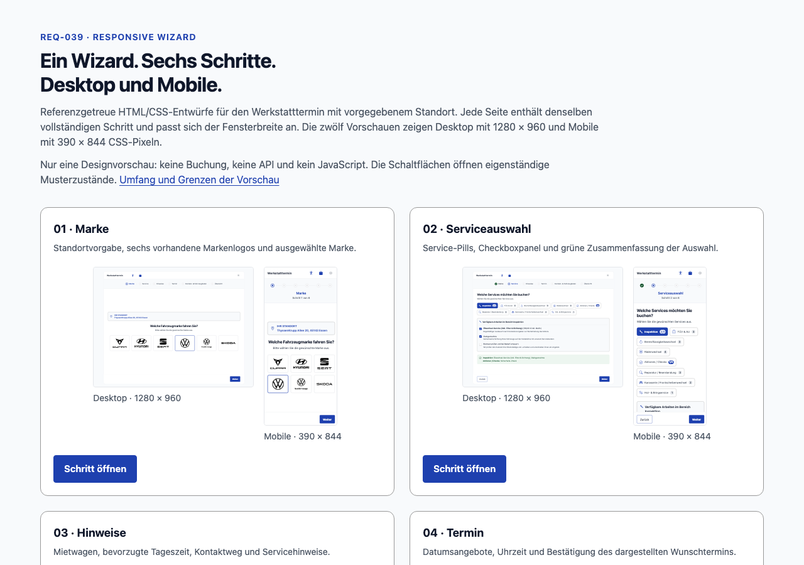

# REQ-039: Responsive Wizard — Desktop- und Mobile-Mockups

**Status:** Draft  
**Priority:** High  
**Type:** Functional + Non-Functional (UI/UX, Responsive, Accessibility)  
**Created:** 2026-10-08  
**Author:** Agent 2 (Requirement), im Auftrag des Nutzers  
**Scope:** Bestehende Buchungsstrecke; sechs sichtbare Schritte im Deep-Link-Kontext, Standort-Einstieg weiterhin vorhanden  
**Erweiterung:** [Abschnitt 18](#18-erweiterung-mietwagen-verfügbarkeit-pro-termin) — Mietwagen-Verfügbarkeit pro Termin (nachträglich aufgenommen 2026-10-08, fachlich eigenständig)  
**Umsetzung nach Mockup:** [Abschnitt 11.4](#114-umsetzung-nach-mockup-stand-2026-10-08) — Kopfzeile, Fortschrittsband, Seitenlayouts und Aktionsleiste wie in den Mockups; Abweichungen dort begründet

---

## 1. Overview

### 1.1 Purpose

Für die vorhandene Werkstatttermin-Buchung entstehen zwölf nachvollziehbare Mockup-Ansichten: sechs Desktop- und sechs Mobile-Ansichten. Grundlage sind sämtliche elf bereitgestellten PNG-Referenzen, nicht eine neu entwickelte Designsprache. Die bestehende Angular-/Bootstrap-Oberfläche erhält eine konsistente responsive Darstellung und eine auch ohne sichtbare Schrittlabels bedienbare Fortschrittsnavigation.

Der konkrete mobile Fehler liegt im gemeinsamen Breadcrumb: Nur das Label eines abgeschlossenen Schritts ist verlinkt. Unterhalb von `48em` wird dieses Label ausgeblendet; das danebenliegende Icon besitzt keine Aktion. Die Korrektur vergrößert und erhält das gemeinsame Bedienelement, statt eine zweite mobile Navigation einzuführen.

### 1.2 Scope

**Included:**
- Vollständige Referenzanalyse einschließlich Kontakt-/Übersichtsvarianten mit und ohne VIN sowie Übersicht vor und nach erfolgreicher Anfrage; Befunde in [design-analysis.md](./design-analysis.md).
- Sechs responsive HTML-/CSS-Mockup-Seiten mit Galerie, zwölf gerenderten Desktop-/Mobile-Screenshots und Einstiegsscreenshot; Liefermatrix in Abschnitt 11.
- Referenzgetreue Zuordnung der Farben zu den zentralen Design-Tokens; Bootstrap-Aliase verwenden dieselbe Palette. Typografie, Icon-System, Abstände, Auswahlzustände und Inhaltsstruktur werden konsistent weiterverwendet.
- Ein gemeinsamer Wizard-Header: vollständige Labels bei ausreichender Breite, kompakte Punkte/Icons und zentrierter aktueller Schritttitel bei schmalem Layout.
- Wiederverwendung von `WizardBreadcrumbComponent`, `WIZARD_STEPS`, `BookingStore`, Container-Handlern, Guards und Resolvern. Direkte Rücknavigation wird auf dem gesamten Schrittziel per Maus, Tastatur und Touch zugänglich.
- Responsive Anpassung der sechs Inhaltsseiten, ihrer Formulare, Serviceauswahl, Terminansicht, Zusammenfassung und vorhandenen Aktionsleisten ohne horizontales Scrollen.
- Regression des normalen Standort-Einstiegs, des Werkstattkalenders und der vorhandenen Lade-, Fehler-, Validierungs- und Erfolgszustände.
- Übersetzte Labels und zugängliche Zustandsbeschreibungen; DE/EN explizit spezifiziert, neue Keys auch in UK/FR/AR vorhanden.

**Excluded:**
- Keine neue Route, kein neuer Wizard-/Mobile-Store, kein zweites Schrittmodell, keine zweite Zustandsmaschine und keine frei erlaubte Vorwärtsnavigation per Punktklick.
- Keine Änderung an fachlicher Validierung, Reset-Semantik, API-Verträgen, Datenquellen, Buchung, Mietwagen-/SMS-Mapping oder Datenpersistenz — **ausgenommen** die in [Abschnitt 18](#18-erweiterung-mietwagen-verfügbarkeit-pro-termin) spezifizierte Mietwagen-Verfügbarkeit pro Termin; deren Änderungen gelten ausschließlich dort.
- Keine Wiedereinführung von Angular Material, Google Material Icons, einem erfundenen GS-Logo-Header oder dem entfernten App-Footer. Vorhandene Bootstrap Icons und Marken-Assets bleiben Grundlage.
- Kein Nachbau einer Host-Anwendung: Modalrahmen, Schließen-Funktion und rote Host-Toolbar der Referenzen begründen keine neue App-Shell oder Host-Navigation. **Nachtrag 2026-10-08 (Nutzerentscheid):** Die Kopfzeile der Mockups — Titel, Barrierefreiheit und Auswahl oben statt schwebender Buttons — wird umgesetzt. Sie ist nur eine neue Darstellung des vorhandenen `FloatingOverlayComponent`, ohne Schließen-X und ohne Navigation; siehe 11.4.
- Kein neues VIN-Pflichtfeld, kein neuer Buchungsabschluss-Schritt, kein neuer „Fertig“-Handler und kein verlegter Notiz-Datenfluss allein aufgrund eines Screenshots.
- Keine Bearbeitung der Registry durch diesen Auftrag; deren Synchronisation übernimmt das Board. Kein Commit, Push oder Pull Request als Bestandteil der Dokumentlieferung.

### 1.3 Verbindliche Auslegung und Related Requirements

Die aktuelle Nutzeranweisung zur exakten Referenzpalette hat Vorrang vor dem veralteten Workflow-Hinweis, keine Farben aus Bildern zu übernehmen. Die Farbwerte werden zentral gepflegt, nicht über Komponenten und Mockups verteilt. Die Material-/Header-/Click-Dummy-Beispiele älterer Anforderungen sind keine aktuelle Implementierungsvorgabe. Die 17 Abschnitte folgen der expliziten Agent-2-Liste des Create-Workflows; Abschnitt 17 enthält i18n, der Freigabestatus steht in Abschnitt 14.

| Grundlage | Bedeutung für REQ-039 |
|---|---|
| [VISION](../../VISION.md) | User First, Accessibility, wartbare Architektur, Sicherheit, Messbarkeit und Definition of Done |
| [REQ-002](../REQ-002-Markenauswahl/requirement.md), [REQ-003](../REQ-003-Standortwahl/requirement.md), [REQ-013](../REQ-013-Branch-Marke-Tausch/requirement.md) | Marke/Standort, tatsächliche Reihenfolge Standort vor Marke, gemeinsamer Breadcrumb |
| [REQ-004](../REQ-004-Serviceauswahl/requirement.md), [REQ-005](../REQ-005-Hinweisfenster/requirement.md), [REQ-006](../REQ-006-Terminauswahl/requirement.md), [REQ-008](../REQ-008-Werkstattkalender/requirement.md) | Services, Hinweise, Termin und Kalender als bestehende fachliche Schritte |
| [REQ-007](../REQ-007-WizardStateSync/requirement.md) | Rückwärtsnavigation und Reset; maßgeblich ist die verifizierte aktuelle Methode, Abschnitt 7 |
| [REQ-009](../REQ-009-carinformation/requirement.md), [REQ-010](../REQ-010-Buchungsübersicht/requirement.md) | Bestehende Formulare, Einwilligung, Übersicht und Submit |
| [REQ-011](../REQ-011-Serviceauswahl-Erweitert/requirement.md), [REQ-012](../REQ-012-Hinweisseite-Erweitert/requirement.md), [REQ-025](../REQ-025-API-Driven-Content/requirement.md) | Kategorien/Operations, Extras, dynamische Inhalte und Standorte |
| [REQ-015](../REQ-015-API-Data-Integration/requirement.md), [REQ-021](../REQ-021-Multi-Branch-Setup/requirement.md), [REQ-026](../REQ-026-Bootstrap-UI-Migration/requirement.md) | Entfernte App-Kopfzeile, Floating Overlay, Deep-Link-/Boxenstopp-Kontext und Bootstrap statt Material |
| [REQ-017](../REQ-017-Loading-Spinner/requirement.md), [REQ-023](../REQ-023-E2E-Test-Coverage/requirement.md), [REQ-024](../REQ-024-Error-Fallback-Screen/requirement.md), [REQ-031](../REQ-031-Booking-Bugfixes/requirement.md) | Loading, E2E, Fehlerbehandlung, Snap-Konflikt und Kilometerstand-Validierung |
| [REQ-027](../REQ-027-Notification-Channel-Toggle/requirement.md), [REQ-028](../REQ-028-Buchungsbestaetigung/requirement.md) | Benachrichtigungskanal und bereits implementierter Erfolgszustand |

Alle weiteren vorhandenen Anforderungen wurden hinsichtlich Scope und Überschneidungen konsultiert; das vollständige Lektüreinventar steht in [design-analysis.md](./design-analysis.md).

---

## 2. User Story

**Als** Kunde der Online-Werkstattterminbuchung  
**möchte ich** auf Desktop und Smartphone meinen Fortschritt erkennen, frühere Schritte gezielt erreichen und die bestehenden Eingaben bequem bedienen  
**damit** ich den Buchungsablauf ohne abgeschnittene Inhalte, unbedienbare Punkte oder widersprüchliche Zustände durchlaufen kann.

**Acceptance Criteria:**
- [ ] **AC-1:** Alle elf Referenzen sind einzeln inventarisiert und visuell ausgewertet; Unterschiede zum tatsächlichen Code sind dokumentiert (TC-1).
- [ ] **AC-2:** Die sechs HTML-Ansichten und die Galerie sind lokal ohne Anwendungsserver nutzbar, enthalten kein JavaScript und sind durch zwölf eindeutig benannte Desktop-/Mobile-PNGs plus Einstiegsscreenshot belegt (TC-1).
- [ ] **AC-3:** Im bestätigten Deep-Link-Kontext werden genau die sechs Schritte Marke, Service, Hinweise, Termin, Kontakt- & Fahrzeugdaten und Übersicht angezeigt. Der normale Einstieg behält Standort und insgesamt sieben Schritte (TC-2, TC-3).
- [ ] **AC-4:** Desktop zeigt sämtliche sichtbaren Schrittbezeichnungen vollständig; kompakte Layouts zeigen eine horizontale Reihe der sechs Punkte/Icons und den vollständigen aktiven Titel zentriert (TC-2, TC-12).
- [ ] **AC-5:** Abgeschlossene, aktive und ausstehende Schritte sind mit der jeweiligen Referenzpalette und zusätzlich durch Form/Icon bzw. zugängliche Zustandsbeschreibung unterscheidbar (TC-16, TC-18).
- [ ] **AC-6:** Jeder Schritt besitzt genau einen nativen Button als gemeinsames Fokus-/Touch-Ziel für Icon und Label. Alle sechs sichtbaren Ziele bleiben fokussierbar und anklickbar; direkter Rücksprung funktioniert auf Desktop und Mobile auch ohne sichtbares Label (TC-4, TC-15).
- [ ] **AC-7:** Punktklicks auf aktive oder zukünftige Schritte ändern weder Route noch Store. Es werden keine fachlichen Schritte oder Validierungen übersprungen (TC-6, TC-8, TC-9).
- [ ] **AC-8:** Bestehende Vorwärts-/Zurück-Aktionen und die jeweiligen Container-/Guard-Regeln funktionieren auf beiden Layouts unverändert (TC-7, TC-8, TC-11).
- [ ] **AC-9:** Direkte Rücknavigation verwendet exakt `onStepClick(event, originalIndex)` und `resetFromStep(originalIndex)` mit der Matrix aus Abschnitt 7; auch Zielschritt-Daten können zurückgesetzt werden (TC-5).
- [ ] **AC-10:** Status, Trennlinien und aktueller Titel stammen aus derselben abgeleiteten Schrittliste und bleiben nach Navigation, Redirect, Sprachwechsel und Resize synchron (TC-2, TC-17, TC-19).
- [ ] **AC-11:** Bei 320, 375, 390, 768, 1024 und 1280 CSS-Pixeln Breite entsteht weder horizontales Seiten-/Wizard-Scrolling noch eine nur horizontal erreichbare Service-, Formular- oder Terminoption (TC-12).
- [ ] **AC-12:** Alle Schrittziele besitzen mindestens 44 × 44 CSS-Pixel tatsächlich messbare Trefferfläche, auch bei kleiner Schrift; sechs bzw. sieben Ziele überlappen nicht (TC-13).
- [ ] **AC-13:** Schriftvergrößerung, 200-%-Textvergrößerung, Reflow bei 400-%-Zoom und RTL verursachen keine verdeckten Beschriftungen oder verlorenen Aktionen (TC-14, TC-17).
- [ ] **AC-14:** Tastaturbedienung, sichtbarer Fokus, lokalisierter Navigationsname, genau ein `aria-current="step"` und zugängliche Statusinformationen sind geprüft (TC-15, TC-16).
- [ ] **AC-15:** Standard- und Kontrastmodus verwenden zentrale Tokens gemäß Referenzbefund. Keine neuen lokalen Farbpaletten, Fonts oder Icon-Bibliotheken werden eingeführt (TC-18).
- [ ] **AC-16:** Die bestehende App-Shell bleibt ohne entfernten Header/Footer; Floating Overlay und Skip-Link bleiben bedienbar und verdecken keine Wizard-Aktionen (TC-12, TC-24). **Nachtrag 2026-10-08 (Nutzerentscheid, 11.4):** Das Floating Overlay erscheint jetzt als Kopfzeile der Mockups (Titel, Barrierefreiheit, Auswahl) — ohne Logo, Footer oder Schließen-X. Geprüft wird, dass Skip-Link, Barrierefreiheit und Auswahl bedienbar bleiben und keine Wizard-Aktion verdecken.
- [ ] **AC-17:** Lade-, Leer-, Fehler-, Snap-Konflikt- und Submit-/Erfolgszustände bleiben fachlich unverändert. VIN- und Erfolgsreferenzen werden nicht als neue Formpflicht oder neuer Schritt interpretiert (TC-20 bis TC-23).
- [ ] **AC-18:** Keine API-/DTO-Änderung, kein zusätzlicher Request durch Resize oder Headerdarstellung und keine mobile Kopie des Stores, der Schrittfolge oder Navigation (TC-10, TC-24).
- [ ] **AC-19:** DE/EN-Texte sind vollständig spezifiziert; alle neuen bzw. geänderten Wizard-Keys werden auch in den drei weiteren bestehenden Sprachobjekten konsistent gepflegt (TC-17).
- [ ] **AC-20:** Die VISION-Qualitätsziele und Definition of Done werden mit tatsächlichen Test-/Messberichten bewertet; weder WCAG-/Lighthouse-Erfüllung noch Screenshot-Erstellung gilt ohne Nachweis als bestanden (TC-25).

---

## 3. Preconditions

### 3.1 System

- Angular-Anwendung mit Bootstrap 5, Bootstrap Icons, Signal-basiertem `BookingStore` und lazy geladenen Booking-Routen vorhanden. Die aktuelle App verwendet `provideRouter(routes)` ohne HashLocation; REQ-039 ändert das Routing-Verfahren nicht.
- Die produktive Buchungsstrecke nutzt die bestehenden Services zum Spring-Boot-Backend unter `/api/v1`; für Tests werden kontrollierte Fixtures/Mocks oder die freigegebene Testumgebung verwendet, nicht reale Kundenbuchungen.
- Die elf PNGs liegen unverändert in [references](./references/). HTML-/CSS-Mockups verwenden synthetische Beispieldaten und bestehende Marken-Assets; ihre Darstellung ist keine API-/Validierungsimplementierung.
- Die vorhandenen Accessibility-Einstellungen, der Skip-Link und das Floating Overlay bleiben verfügbar.

### 3.2 User

- Endkunden benötigen kein neues Login oder zusätzliche Berechtigung.
- Der Sechs-Schritte-Fall setzt einen bereits erfolgreich ermittelten Standort und `isDeepLinked === true` voraus. Der aktuelle `deepLinkGuard` wertet am Standort-Einstieg nur die Kombination aus `branchId` **und** `groupId` aus, lädt die Branch, setzt den Deep-Link-Kontext und leitet zu Marke weiter. REQ-039 erweitert diese Semantik nicht.
- Ohne bestätigten Deep-Link bleibt der normale Standort-Einstieg erhalten; das bloße Verwenden eines Smartphones aktiviert keinen Deep-Link-Modus.

### 3.3 Daten und Übergabe vom vorherigen Schritt

`WIZARD_STEPS` hat sieben Konfigurationseinträge. Die folgende Nummer ist der originale, nullbasierte Index, nicht die mobile sichtbare Position:

| Originalindex / Route | Vorbedingungen des aktuellen Guards | Bestehender Datenladepfad |
|---|---|---|
| 0 — `/home/location` | Normaler Einstieg; `deepLinkGuard` kann nach erfolgreicher Standortauflösung weiterleiten | `locationsResolver` → `loadBranches()` und `loadLocations()` |
| 1 — `/home/brand` | `locationSelectedGuard`: `hasLocationSelected()` | `brandsResolver` → bei vorhandener `selectedBranch` deren `branchId` an `loadBrands()` |
| 2 — `/home/services` | `brandSelectedGuard`: Standort, dann Marke vorhanden | `servicesResolver` → `loadServices()`; bestehender Store lädt Kategorien/Operations für die Branch |
| 3 — `/home/notes` | `servicesSelectedGuard`: Standort, Marke, mindestens ein Service | `rentCategoriesResolver` → `loadRentCategories()` |
| 4 — `/home/appointment` | `servicesSelectedGuard`: Standort, Marke, mindestens ein Service | `appointmentsResolver` → `loadAppointments()` bei Eintritt |
| 4 — `/home/workshop-calendar` | Derselbe `servicesSelectedGuard`; keine zusätzliche Wizard-Position | Kalender-Container → vorhandene Datums-/Slot-Handler und `loadWorkshopCalendarDays()` |
| 5 — `/home/carinformation` | `carInformationGuard`: Standort, Marke, Services, `selectedAppointment` | Vorhandene Formularinitialisierung mit `customerInfo`, `vehicleInfo`, `privacyConsent`, sofern gesetzt |
| 6 — `/home/booking-overview` | `bookingOverviewGuard`: `isBookingComplete()`; Marke, Standort, Services, Termin, Kunden-/Fahrzeugdaten und Einwilligung | Liest vorhandenen Store; Submit erst durch Benutzeraktion |

Die Guards prüfen nicht allgemein, ob sämtliche früheren Schritte jemals besucht wurden. Beispielsweise verlangt `servicesSelectedGuard` keine `notesExtras`. Diese vorhandenen Bedingungen bleiben unverändert.

---

## 4. Main Flow

**Geplante visuelle Referenz:** [Mockup-Galerie](./mockup.html). Der folgende Einstiegsscreenshot gehört zur Lieferliste; seine tatsächliche Erstellung und Prüfung erfolgt durch die Mockup-/Integrationsphase, nicht durch diesen Draft.



**Step 1: Standortgebundener Einstieg und Marke**
- **User:** Öffnet einen gültigen Standort-Deep-Link und wählt eine angebotene Marke.
- **System:** Nutzt die bestehende Standortauflösung. `WizardBreadcrumbComponent` filtert Originalindex 0 bei `isDeepLinked`; Marke ist aktiv, fünf Schritte sind ausstehend. Mobile zeigt den Titel „Marke“ zentriert.
- **Expected:** Die bestehende `onBrandSelect(brand)`-Aktion setzt `selectedBrand` und navigiert unmittelbar zu Services. Ein im Referenzbild dargestellter „Weiter“-Button begründet keine zusätzliche Marken-Navigationslogik.

**Step 2: Serviceauswahl**
- **User:** Wählt bestehende Kategorien/Operations und nutzt den vorhandenen Weiter-Button.
- **System:** Verwendet die bestehenden Auswahl-Handler und `selectedServices`; `onContinue()` navigiert zu Hinweise. Die vorhandene Sperre bei fehlender Serviceauswahl bleibt erhalten.
- **Expected:** Marke ist abgeschlossen, Service zunächst aktiv; nach erfolgreichem Wechsel ist Hinweise aktiv. Mobile-Titel und Status wechseln gemeinsam.

**Step 3: Hinweise**
- **User:** Wählt bei Bedarf Mietwagen-Kategorie, Tageszeit, Rückruf, Benachrichtigungskanal und gibt eine optionale Notiz ein.
- **System:** Die vorhandene `onContinue()`-Methode trimmt die Notiz, speichert leere Eingabe als `null`, setzt `notesExtras` und `selectedRentCategoryId` und navigiert zum Termin.
- **Expected:** Inhalts- und Formzustände bleiben an ihre vorhandenen Inputs/Outputs gebunden; responsives Umordnen erzeugt keine zweite Eingabekopie.

**Step 4: Termin**
- **User:** Wählt einen gültigen Slot, direkt oder über „Weitere freie Termine“, und nutzt Weiter.
- **System:** Speichert den Slot in `selectedAppointment`; beide Terminansichten verwenden `activeStepIndex = 4`. Der Kontakt-Guard verhindert den Eintritt ohne Termin.
- **Expected:** Kontakt- & Fahrzeugdaten ist anschließend aktiv; Kalenderansicht und Schnellauswahl zählen zusammen als ein Schritt.

**Step 5: Kontakt- & Fahrzeugdaten**
- **User:** Füllt die bestehenden Pflichtfelder aus, bestätigt die Einwilligung und sendet das Formular ab.
- **System:** `onSubmit(event)` verhindert den nativen Submit, markiert Fehler, beendet ungültige Eingaben ohne Navigation und speichert bei gültiger Eingabe `customerInfo`, `vehicleInfo` und `privacyConsent = true`.
- **Expected:** Die Übersicht ist erst nach erfolgreichem bestehenden Formular-/Guard-Pfad erreichbar. Desktop- und Mobile-Formulare haben dieselben Controls und Validatoren.

**Step 6: Übersicht und Anfrage**
- **User:** Prüft die Zusammenfassung und verwendet die bestehende Anfrage-Aktion.
- **System:** `onSubmit()` delegiert an `store.submitBooking()`. Die bestehende Lade-/Fehler-/Erfolgsbehandlung bleibt erhalten.
- **Expected:** Übersicht bleibt der aktive letzte Schritt, auch nach Erfolg. Es entsteht weder ein siebter sichtbarer Deep-Link-Schritt noch ein zweiter Submit-/Abschlusszustand.

**Direkte Korrektur in jedem erreichten Schritt:** Ein früherer Punkt bzw. ein früheres Icon aktiviert denselben `onStepClick` wie auf Desktop. Dieser setzt gemäß Abschnitt 7 zurück und navigiert zur vorhandenen Route. Nach erfolgreicher Navigation stammen Titel und Fortschritt aus dem neuen aktiven Eintrag.

---

## 5. Alternative Flows

### 5.1 Normaler Einstieg ohne Deep-Link
**Trigger:** Frischer Store, kein erfolgreich aufgelöster Deep-Link.  
**Flow:** Standort wird als Originalindex 0 angezeigt und ausgewählt; danach folgen Marke bis Übersicht. Alle sieben Einträge bleiben Teil derselben Liste und derselben responsive Darstellung. Es gibt keine neue Standort-Mockup-Pflicht innerhalb der zwölf angefragten Ansichten, aber einen verpflichtenden Regressionstest bei 320 CSS-Pixeln.

### 5.2 Direkt zurück zu einem früheren Schritt
**Trigger:** Benutzer aktiviert ein Ziel mit `originalIndex < activeIndex`.  
**Flow:** Vorhandener Handler → `preventDefault()` → bestehende Zulässigkeitsprüfung → `resetFromStep(originalIndex)` → `router.navigate([steps[originalIndex].route])`. Auch der Zielschritt kann Daten verlieren; kein Dialog, keine Datenerhaltsgarantie und kein separater mobiler Reset werden ergänzt.

### 5.3 Vorhandener Zurück-Button statt Punktklick
**Trigger:** Benutzer verwendet die Aktionsleiste.  
**Flow:** Der jeweilige Container-Handler bleibt maßgeblich. Seine Reset-Wirkung ist nicht automatisch identisch mit der Breadcrumb-Matrix. Beispielsweise löscht Hinweise-Zurück zusätzlich Notiz und Mietwagen-Auswahl; Kontakt-Zurück navigiert ohne eigenen Reset. Beide Layouts behalten jeweils genau dieses Verhalten.

### 5.4 Größen-, Schrift- oder Sprachwechsel
**Trigger:** Resize, Zoom, Accessibility-Schriftgröße oder programmatischer Sprachwechsel.  
**Flow:** Dieselben DOM-Bedienelemente werden umgeordnet bzw. ihre sichtbaren Labels ein-/ausgeblendet. Der aktive Titel wird aus dem aktiven Eintrag in `stepsWithStatus` übersetzt. Kein Reset, keine Route, kein Formular-Neuaufbau und kein API-Aufruf allein aufgrund der Darstellungsänderung.

### 5.5 Kalender- und Boxenstopp-Variante
**Trigger:** Zusätzliche Terminsuche bzw. vorhandener tireChange-Deep-Link.  
**Flow:** Werkstattkalender bleibt auf Originalindex 4. Branch-/Group-Kontext, `selectedVariant` und API-Filter bleiben erhalten; es werden nicht erneut Standort oder Marke ausgewählt, nur weil die Anzeige kompakt wird.

### 5.6 Referenzvarianten mit VIN und nach Erfolg
**Trigger:** Review der Kontakt- oder Übersichtsreferenzen.  
**Flow:** Die Varianten werden im Designvergleich derselben fünften bzw. sechsten Ansicht zugeordnet und können als statische Zustandsvarianten auf derselben HTML-Seite dargestellt werden. Das Fahrzeugformular erhält ein **freiwilliges** FIN-Feld (Nutzerentscheid 2026-10-08, BR-9): Das Kennzeichen genügt, die FIN kann ohne Stern und ohne Pflichtvalidator eingegeben werden und wird dann mitgeschickt. Ein Pflichtfeld wird nicht eingeführt. Erfolg bleibt die vorhandene Anzeige auf der Übersicht, nicht eine neue Route oder Host-Schließen-Aktion.

---

## 6. Exception Flows

### 6.1 Aktiver oder zukünftiger Punkt
**Trigger:** Klick/Tap/Tastaturaktivierung mit `originalIndex >= activeIndex`.  
**Flow:** Der vorhandene Handler beendet die Aktion ohne `resetFromStep` und ohne Router-Navigation. `aria-disabled="true"` und die zugängliche Zustandsbeschreibung erklären „Aktueller Schritt“ bzw. „Noch nicht verfügbar“. Die Buttons erhalten kein natives `disabled`, damit Fokus- und Touch-Ziele erhalten bleiben. Es erscheint keine irreführende Fehlermeldung und keine Erfolgsmeldung.

### 6.2 Ungültige Eingabe oder fehlende Schrittvoraussetzung
**Trigger:** Ungültiges Kontaktformular oder direkter URL-Aufruf ohne erforderliche Store-Daten.  
**Flow:** Bestehende Inline-Validierung bzw. Guards greifen. Fehlender Standort führt zu `/home/location`, fehlende Marke zu `/home/brand`, fehlende Services zu `/home/services`, fehlender Termin im Kontakt-Guard zu `/home/appointment`. Der Overview-Guard leitet bei `!isBookingComplete()` nach `/home` und damit zum bestehenden Einstieg weiter. Keine neue Breadcrumb-Validierung ersetzt diese Guards.

### 6.3 Ladefehler, leere Daten, ungültiger Deep-Link
**Trigger:** Branch-/Service-/Termin-API liefert Fehler oder keine nutzbaren Daten.  
**Flow:** Vorhandene Loading-/Empty-/Retry-Zustände bleiben bedienbar und umbrechbar. Ein im frischen Einstieg nicht auflösbarer Deep-Link bleibt im normalen Standort-Flow; es wird kein fingierter Sechs-Schritte-Zustand erzeugt. Falls das bestehende globale Fehlerhandling greift, bleibt dessen aktuelle Route `/app-error` unverändert.

### 6.4 Buchungsfehler und belegter Slot
**Trigger:** Anfrage schlägt fehl.  
**Flow:** Allgemeine Fehler bleiben im bestehenden Retry-Pfad. Bei HTTP 410 setzt der Store `snapConflict = true`, `bookingSubmitting = false` und `selectedAppointment = null`; der Overview-Container navigiert zur Terminauswahl. Der dortige Resolver lädt neue Vorschläge, der aktuelle Header zeigt Termin. Dieser besondere Reset darf nicht durch die Breadcrumb-Reset-Kaskade ersetzt werden.

---

## 7. Postconditions

### 7.1 Erfolgreiche Vorwärtsnavigation

| Aktion | Bestehende relevante Store-Wirkung | Ziel |
|---|---|---|
| `onBrandSelect(brand)` | `setBrand(brand)` → `selectedBrand` | `/home/services` |
| Serviceauswahl und Weiter | Auswahl über `confirmServiceOptions()` / `deselectService()`; Weiter fügt keinen zweiten Auswahlspeicher hinzu | `/home/notes` |
| Hinweise-Weiter | `bookingNote` getrimmt oder `null`; `notesExtras`; `selectedRentCategoryId` | `/home/appointment` |
| Termin-/Kalenderauswahl und Weiter | `selectedAppointment`; Kalenderdatum/-tage nur über bestehende Kalender-Handler | `/home/carinformation` |
| Gültiger Formular-Submit | `customerInfo`, `vehicleInfo`, `privacyConsent = true` | `/home/booking-overview` |
| Erfolgreiche Anfrage | `bookingSubmitted = true`, `bookingSubmitting = false`, `appointmentId = response.id` | Übersicht bleibt aktiv |

### 7.2 Exakte Reset-Matrix für direkte Breadcrumb-Rücknavigation

Quelle: [BookingStore.resetFromStep](../../../src/app/features/booking/stores/booking.store.ts). Die Bedingungen sind kumulativ: `targetIndex <= 0`, `<= 1`, `<= 2`, `<= 3`, `<= 4`. Der Zielschritt wird eingeschlossen, nicht nur die nachfolgenden Schritte.

| Ziel-Originalindex | Zurückgesetzte Felder und Werte durch `resetFromStep` |
|---|---|
| 0 — Standort, nur normaler Flow | `selectedBranch = null`, `selectedLocation = null`, `selectedBrand = null`, `selectedServices = []`, `notesExtras = null`, `selectedAppointment = null`, `workshopCalendarDate = null`, `workshopCalendarDays = []` |
| 1 — Marke | `selectedBrand = null`, `selectedServices = []`, `notesExtras = null`, `selectedAppointment = null`, `workshopCalendarDate = null`, `workshopCalendarDays = []` |
| 2 — Service | `selectedServices = []`, `notesExtras = null`, `selectedAppointment = null`, `workshopCalendarDate = null`, `workshopCalendarDays = []` |
| 3 — Hinweise | `notesExtras = null`, `selectedAppointment = null`, `workshopCalendarDate = null`, `workshopCalendarDays = []` |
| 4 — Termin | `selectedAppointment = null`, `workshopCalendarDate = null`, `workshopCalendarDays = []` |
| 5 — Kontakt- & Fahrzeugdaten | Kein Store-Feld wird durch diese Methode zurückgesetzt |
| 6 — Übersicht | Kein Reset durch diese Methode; kein reguläres Rücksprungziel, da es keinen späteren Wizard-Schritt gibt |

**Nicht durch diese Methode geändert:** `bookingNote`, `selectedRentCategoryId`, `customerInfo`, `vehicleInfo`, `privacyConsent`, `bookingSubmitted`, `bookingSubmitting`, `bookingError`, `snapConflict`, `appointmentId`, `isDeepLinked`, `deepLinkGroupId` und die übrigen Katalog-/Ladedaten. Resolver und andere vorhandene Handler können beim weiteren Ablauf ihre eigenen Änderungen ausführen. Diese Aufzählung beschreibt den Methodenvertrag, keine allgemeine Garantie, dass sämtliche Eingaben erhalten bleiben.

**Ergänzung durch Abschnitt 18:** Das neue Feld `rentalCarRequested` wird bei Ziel-Originalindex `<= 3` auf `false` zurückgesetzt; ein Wechsel von `rentalCarRequested` verwirft zusätzlich `selectedAppointment`, `workshopCalendarDate`, `workshopCalendarDays` und die geladenen Termine (siehe 18.8).

### 7.3 Vorhandene Zurück-Buttons

| Container | Wirkung von `onBack()` vor Navigation |
|---|---|
| Marke | `clearSelectedBrand()`; danach Standort. Bestehendes Ausblenden im eingebetteten Kontext bleibt erhalten; im Deep-Link-Fluss hat die Markenseite keine Aktionsleiste (11.4) |
| Services | `clearSelectedServices()`; danach Marke |
| Hinweise | `setBookingNote(null)`, `clearNotesExtras()`, `setSelectedRentCategoryId(null)`; danach Services |
| Terminauswahl | `clearSelectedAppointment()`; danach Hinweise |
| Werkstattkalender | `clearWorkshopCalendar()`; danach Terminauswahl |
| Kontakt- & Fahrzeugdaten | Kein eigener Store-Reset; danach Terminauswahl |
| Übersicht | Kein eigener Store-Reset; danach Kontakt- & Fahrzeugdaten |

### 7.4 Nicht erfolgte Navigation

- Aktive/zukünftige Punktklicks und reine Darstellungsänderungen verändern weder Route noch Booking-State.
- Ungültiger Kontakt-Submit speichert keine neuen Kunden-/Fahrzeugdaten und setzt die Einwilligung nicht auf `true`.
- Bei erlaubtem Rücksprung wird der Reset schon vor `router.navigate()` ausgeführt. Ein späterer Navigationsabbruch begründet keine neue Rollback-/Datenerhaltsgarantie; dieses Requirement führt keine Transaktion für Navigation ein.
- Nach einer tatsächlich aktivierten Route zeigt der Header deren aktiven Eintrag; es gibt keinen separat vorausgeschriebenen mobilen Titel oder Fortschrittsstand.

---

## 8. Business Rules

- **BR-1:** `WIZARD_STEPS` bleibt die einzige Schrittkonfiguration mit sieben Originalindices. Nur die vorhandene Deep-Link-Filterung blendet Standort aus.
- **BR-2:** `stepsWithStatus` bleibt die gemeinsame Quelle für `done`, `active`, `future`, `originalIndex` und `isLast`. `activeStep` ist ausschließlich ein `computed`, das darin den Eintrag mit `status === 'active'` findet. Der aktuelle Titel übersetzt dessen `label`.
- **BR-3:** `done` bedeutet hier ausschließlich „in der angezeigten Reihenfolge vor dem aktiven Index“. Es ist weder ein dauerhaft gespeichertes Erledigungsflag noch eine neue Fachvalidierung. Nach einem Rücksprung können früher besuchte spätere Schritte wieder `future` sein.
- **BR-4:** Punkt-/Icon-Aktivierung ist ausschließlich für frühere Originalindices navigierend. Aktive und zukünftige Ziele bleiben wirkungslose, zugänglich beschriebene Ziele; kein Skip, keine Direktbuchung und kein erneuter Submit.
- **BR-5:** Standort ist im Deep-Link-Breadcrumb verborgen und auch durch den bestehenden Handler für Originalindex 0 gesperrt. Es gibt keinen mobilen Indexversatz beim Reset.
- **BR-6:** Die Reset-Matrix aus Abschnitt 7 und die davon verschiedenen bestehenden Zurück-Handler bleiben unverändert. Kein pauschales „alle Eingaben bleiben erhalten“ und kein pauschales „alle späteren Daten werden gelöscht“.
- **BR-7:** Die Breakpoint-Darstellung darf keine fachliche Entscheidung treffen. Bildschirmbreite, Zoom und Sprache ändern keine Route, Auswahl, Branch oder Group.
- **BR-8:** Bestehende Pflichtfelder und Validatoren sind maßgeblich: E-Mail gültig, Anrede vorhanden, Namen/Ort gemäß bestehendem Pattern, Straße vorhanden, PLZ genau fünf Ziffern, Mobilnummer mit `0` oder `+` gemäß vorhandenem Pattern, nicht-leeres Kennzeichen mit mindestens einem Nicht-Leerzeichen, Kilometerstand ganzzahlig mindestens 10 und Einwilligung `true`.
- **BR-9 (geändert 2026-10-08, Nutzerentscheid):** Das Kennzeichen genügt. Die FIN ist ein **freiwilliges** Feld im Fahrzeugformular ohne Stern: leer bzw. nur Leerzeichen gilt als „nicht angegeben“; eine eingegebene FIN muss aus genau 17 Buchstaben/Ziffern bestehen (`optionalVinValidator`, Fehlertexte `vin.error.invalidFormat`/`invalidLength`). Sie wird getrimmt und in Großbuchstaben als `vehicle.vin` mitgeschickt und in der Übersicht angezeigt; ohne Eingabe sendet das Backend wie bisher `VIN = "UNKNOWN"`. Kein VIN-Pflichtvalidator.
- **BR-10:** Farben folgen ausschließlich der zentralen Token-Zuordnung aus [design-analysis.md](./design-analysis.md). Bootstrap-Aliase, Fokus, Outline-Buttons, Disabled-Zustände und Erfolgsmeldungen dürfen keine abweichende Palette erzeugen.
- **BR-11:** Fachliche Inhalte bleiben API-/Store-getrieben. Beispielmarken, Preise, Termine, Notizen und VINs in Referenzen/Mockups werden nicht als produktive Konstanten übernommen.
- **BR-12:** Mockups dokumentieren Layout und Zustände. HTML-Links oder CSS-Zustandsvarianten simulieren keine produktive Validierung und sind kein Funktionsnachweis für den Angular-Wizard.
- **BR-13:** Host-Modalrahmen und App-Wizard sind getrennt. Die entfernte App-Kopf-/Fußzeile wird nicht aus alten Workflow-Beispielen wieder eingeführt.
- **BR-14:** Code-Identifier bleiben Englisch; sichtbare neue Texte und Accessibility-Texte verwenden das vorhandene TypeScript-i18n-System.

---

## 9. Non-Functional Requirements

### Performance und Architektur

- OnPush, vorhandene Signals/Computeds und `@for` mit `track step.route` beibehalten. Kein Resize-Polling, kein zweiter Router-Abonnent nur für Mobile und keine zusätzliche Datenladung für den Header.
- Neue Titel-/Statusdarstellung ist rein lesend abgeleitet. Nach abgeschlossener Routennavigation darf kein veralteter mobiler Titel als zweiter Zustand bestehen bleiben.
- Keine neue UI-/Icon-/State-Bibliothek. Bestehende Styles zentral anpassen statt einzelne Seiten mit unabhängigen Overrides zu versehen.
- VISION-Ziele: Test-Coverage über 80 %, Lighthouse Performance über 90 und Accessibility über 95 als zu messende Projektziele. Messumgebung und etwaige Baseline-Probleme werden im Abnahmebericht genannt; der Draft behauptet keine erreichten Werte.

### Security und Datenschutz

- Keine Änderung an Session-Token, Guards, Backend-Validierung, CORS, CSP oder Host-Embedding-Berechtigungen.
- Keine Buchungs-/Kundendaten in neuen URL-Parametern, Logs oder Browser-Speichern für die responsive Anzeige. Kein `innerHTML`, keine Skripte in Mockups, keine realen API-Buchungen beim Screenshot-Rendering.
- Bestehende Maskierungs-/Logging-Regeln aus REQ-034 bleiben unberührt. Bilder und Test-Fixtures enthalten ausschließlich freigegebene Referenzen bzw. synthetische Daten.

### Usability, Accessibility und Reflow

- WCAG 2.1 AA ist das Prüfziel, keine ungemessene Konformitätsbehauptung. Insbesondere Kontraste, Tastatur, Labels, sichtbarer Fokus, Reflow und Statusankündigungen prüfen.
- Pro Schritt ein nativer `button` mit `type="button"`; ein einziges Fokusziel für Icon/Punkt und optional sichtbares Label. Aktive/zukünftige Buttons tragen `aria-disabled="true"`, aber kein natives `disabled`; der gemeinsame Handler blockiert die Navigation. Kein klickbares `span`/`li` ohne Tastatursemantik und kein zusätzliches, auf Mobile verborgenes Navigationsziel.
- Mindestens 44 × 44 CSS-Pixel Trefferfläche unabhängig von verkleinerter Body-Schrift. `min-inline-size` und `min-block-size` von `2.75rem` liefern bei unverändertem 16-Pixel-Root jeweils 44 CSS-Pixel; das Body-Preset `small` verkleinert sie nicht. Reine `2.75em` im verkleinerten Step-Label genügt nicht. Abweichende Root-/Browsereinstellungen bleiben Gegenstand der tatsächlichen Messung; Spacing und Schrift skalieren weiter über em/rem-Tokens.
- Bei 320 CSS-Pixeln benötigt die Sieben-Schritte-Regression mindestens 308 CSS-Pixel nutzbare Headerbreite für die Ziele allein. Äußere App-/Header-Paddings müssen das zulassen; Ziele dürfen nicht überlappen oder heimlich horizontal scrollen.
- Titel mittig zum gesamten Header, nicht nur unter dem aktiven Punkt. Lange Übersetzungen dürfen mehrzeilig umbrechen; keine Ellipse und keine festgesetzte Zeilenhöhe, die vergrößerten Text abschneidet.
- Desktop-Labels dürfen bei Grenzbreiten innerhalb ihrer Zellen umbrechen, bleiben jedoch vollständig sichtbar. Bei schmalem Layout alle Einzel-Labels visuell ausblenden, zugängliche Namen erhalten.
- Textkontrast mindestens 4,5:1 für normalen Text bzw. 3:1 für großen Text und relevante nicht-textuelle Bedienelemente als Prüfkriterien. Standard- und Kontrastmodus gesondert messen; Referenzfarbe allein ist kein Kontrastnachweis.
- Kein horizontales Scrollen auf Seiten-, Wizard- oder Inhaltsgruppenebene. Lange Servicebezeichnungen, Adressen, Fehlertexte, Datums-/Zeitoptionen und Formularzeilen umbrechen statt abschneiden; kein pauschales `overflow-x: hidden` als Fehlerverdeckung.
- Skip-Link, sichtbarer Fokus, bestehende Reduced-Motion-Einstellungen sowie Floating-Overlay-Bedienung bleiben erhalten. Nach tastaturausgelöster Schritt-Navigation muss der neue aktive Schritt sinnvoll fokussierbar und der neue Inhalt erreichbar sein; bei bloßem Resize bleibt der Fokus auf demselben Schrittziel.
- Prüfumfang: Chromium, Firefox und WebKit in den vorhandenen Testmöglichkeiten; ergänzende Touch-/Screenreader-Prüfung dokumentieren, nicht aus einem einzelnen Screenshot ableiten.

---

## 10. Data Model

### 10.1 Vorhandener Wizard-Vertrag, keine Duplizierung

Der bestehende Vertrag aus [wizard-breadcrumb.model.ts](../../../src/app/shared/components/wizard-breadcrumb/wizard-breadcrumb.model.ts) wird unverändert wiederverwendet:

```typescript
import type { TranslationKey } from '@core/i18n';

export interface WizardStep {
  label: TranslationKey;
  icon: string;
  route: string;
}

export type WizardStepStatus = 'done' | 'active' | 'future';
```

Dies ist eine Dokumentation des existierenden Modells, kein Auftrag zur Neudefinition. Die Inputs bleiben `steps = input.required<WizardStep[]>()` und `activeIndex = input.required<number>()`. Die vorhandene Computed-Liste ergänzt `status`, `isLast` und `originalIndex`; `activeStep = computed(...)` findet darin den aktiven Eintrag, dessen `label` der Titel übersetzt. Ein zusätzliches schreibbares `mobileActiveIndex`, `completedSteps` oder `currentTitle` ist ausgeschlossen.

### 10.2 Wiederverwendete Fachmodelle und Store-Felder

| Vorhandener Typ | Datei / Verwendung | Änderung durch REQ-039 |
|---|---|---|
| `BookingState` im `BookingStore` | [booking.store.ts](../../../src/app/features/booking/stores/booking.store.ts); `withState`, `withComputed`, `withMethods`, root-scoped | Keine neue State-Eigenschaft; existierende Auswahl-, Deep-Link- und Submit-Felder bleiben maßgeblich |
| `BranchConfig`, `LocationDisplay`, `Brand`, `BrandDisplay` | [branch-config.model.ts](../../../src/app/features/booking/models/branch-config.model.ts), [location.model.ts](../../../src/app/features/booking/models/location.model.ts), [brand.model.ts](../../../src/app/features/booking/models/brand.model.ts) | Keine Änderung; reale Standort-/Markenlisten verwenden |
| `ApiCategory`, `ApiOperation`, `SelectedService`, `ServiceType` | [service.model.ts](../../../src/app/features/booking/models/service.model.ts) | Keine zweite Auswahlstruktur für responsive Kategorien |
| `NotesExtras`, `NotificationChannel`, `AppointmentPreference`, `CallbackOption` | [notes-extras.model.ts](../../../src/app/features/booking/models/notes-extras.model.ts) | Defaults bleiben `anytime`, `no`, `email`; Mietwagen-ID bleibt separat im Store |
| `RentCategory` | [rent-category.model.ts](../../../src/app/features/booking/models/rent-category.model.ts) | Vorhandene Kategorie-/Preisfelder; keine Mockup-Preise in Produktionsdaten |
| `AppointmentSlot`, `WorkshopCalendarDay`, `WorkshopTimeSlot` | [appointment.model.ts](../../../src/app/features/booking/models/appointment.model.ts), [workshop-calendar.model.ts](../../../src/app/features/booking/models/workshop-calendar.model.ts) | Kalender und Schnellauswahl schreiben denselben ausgewählten Termin |
| `CustomerInfo`, `VehicleInfo`, `Salutation` | [customer.model.ts](../../../src/app/features/booking/models/customer.model.ts) | Bestehende Felder, insbesondere optionales `vin`; kein neues Formularmodell |
| `CreateAppointmentRequest`, `AppointmentResponse` | [appointment-api.service.ts](../../../src/app/features/booking/services/appointment-api.service.ts) | Request-/Response-Vertrag unverändert; keine neuen DTOs |

---

## 11. UI/UX

### 11.1 Liefermatrix: sechs Seiten, zwölf Ansichten

[mockup.html](./mockup.html) ist die Galerie. Jede nummerierte HTML-Datei ist selbst responsiv; es entstehen nicht zwölf unabhängig gepflegte HTML-/Navigationsimplementierungen. Die PNGs sind gerenderte Ansichten derselben sechs Seiten. Referenzvarianten zählen nicht als zusätzliche Wizard-Schritte.

| Ansicht | HTML-Datei | Desktop-PNG | Mobile-PNG |
|---|---|---|---|
| 01 Marke | [01-marke.html](./mockups/01-marke.html) | [mockup-01-marke-desktop.png](./screenshots/mockup-01-marke-desktop.png) | [mockup-01-marke-mobile.png](./screenshots/mockup-01-marke-mobile.png) |
| 02 Service | [02-service.html](./mockups/02-service.html) | [mockup-02-service-desktop.png](./screenshots/mockup-02-service-desktop.png) | [mockup-02-service-mobile.png](./screenshots/mockup-02-service-mobile.png) |
| 03 Hinweise | [03-hinweise.html](./mockups/03-hinweise.html) | [mockup-03-hinweise-desktop.png](./screenshots/mockup-03-hinweise-desktop.png) | [mockup-03-hinweise-mobile.png](./screenshots/mockup-03-hinweise-mobile.png) |
| 04 Termin | [04-termin.html](./mockups/04-termin.html) | [mockup-04-termin-desktop.png](./screenshots/mockup-04-termin-desktop.png) | [mockup-04-termin-mobile.png](./screenshots/mockup-04-termin-mobile.png) |
| 05 Kontakt | [05-kontakt.html](./mockups/05-kontakt.html) | [mockup-05-kontakt-desktop.png](./screenshots/mockup-05-kontakt-desktop.png) | [mockup-05-kontakt-mobile.png](./screenshots/mockup-05-kontakt-mobile.png) |
| 06 Übersicht | [06-uebersicht.html](./mockups/06-uebersicht.html) | [mockup-06-uebersicht-desktop.png](./screenshots/mockup-06-uebersicht-desktop.png) | [mockup-06-uebersicht-mobile.png](./screenshots/mockup-06-uebersicht-mobile.png) |

Zusätzlich ist [mockup.png](./mockup.png) als Einstiegsscreenshot vorgesehen. Basen für die zwölf Ansichten: Desktop 1280 CSS-Pixel, Mobile 390 CSS-Pixel Breite; vollständiger Inhalt darf als Full-Page-Screenshot eine größere Höhe besitzen. Viewport, Skalierungsfaktor und Renderdatum werden bei der Erzeugung festgehalten. **Dieser Draft erklärt weder diese Bilder noch deren visuelle Abnahme für bereits erstellt/bestanden.**

### 11.2 UI-Elemente und responsive Zuordnung

| Element | Desktop | Mobile / schmale Breiten | Bestehende technische Grundlage |
|---|---|---|---|
| Fortschrittsnavigation | Alle sichtbaren Labels mit einheitlichen Icons/Punkten und Verbindungen | Sechs kompakte Ziele im Deep-Link-Fall, sieben im normalen Flow; aktueller Titel auf eigener zentrierter Zeile | `WizardBreadcrumbComponent`, `WIZARD_STEPS`, Bootstrap Icons |
| Marke | Standortbanner, zentrierte Frage, Marken-Kacheln aus vorhandenen Assets | Banner umbrechend, Kacheln in passendem Raster, keine erzwungene horizontale Reihe | `BrandSelectionContainerComponent`, `BrandCardsComponent` |
| Services | Referenzartige umbrechende Kategorien mit Zählständen, Operations-Detailbereich, Auswahlzusammenfassung | Kategorien/Optionen vollständig erreichbar und umbrechend, keine nur per Horizontal-Scroll verfügbare Kategorie | `ServiceSelectionContainerComponent`; vorhandene Kategorie-/Operations-Handler wiederverwenden |
| Hinweise | Karten/Pills/Switches, bestehende Extras, Notiz und Servicehinweise | Karten untereinander, Pills umbrechend, Controls mit ausreichender Trefferfläche | `NotesContainerComponent`, `NotesExtrasFormComponent`, `NotesFormComponent`, `ServiceHintsComponent` |
| Termin | Datumskacheln, freie Zeiten, weiterer Kalenderzugang und ausgewählter Termin | Datumskacheln und Zeitfelder umbrechend; Terminmeldung über volle Breite | `AppointmentSelectionContainerComponent`, `WorkshopCalendarContainerComponent` |
| Kontakt | Kundendaten-/Fahrzeugkarten, mehrspaltige Zeilen bei Platz, Einwilligung | Formularzeilen einspaltig, Labels und Fehler vollständig sichtbar | `CarinformationContainerComponent`, `CustomerFormComponent`, `VehicleFormComponent`; jeweils vorhandener `form`-Input |
| Übersicht | Bestehende Zusammenfassung links, Anfrage-/Statusbereich rechts | Zusammenfassung und Anfrage-/Statusbereich im Dokumentfluss untereinander | `BookingOverviewContainerComponent`, vorhandene Tiles und Submit-Handler |
| Aktionsleisten | Zurück links, primäre Aktion rechts am Fuß der weißen Karte | Klebende Leiste am unteren Bildschirmrand in einer Zeile (Zurück links, Weiter rechts) gemäß Mockup; ersetzt den gestapelten Mobile-Stack aus REQ-023; alle vorhandenen IDs/Handler bleiben erhalten | Bootstrap `btn`, `btn-primary`, `btn-outline-secondary`, gemeinsame Klasse `.wizard-nav` in `styles.scss` |
| App-Shell | Weiße Karte (max. 70rem) mit Rahmen auf Kopfzeilen-Hintergrund; Kopfzeile mit Titel, Barrierefreiheit und Auswahl | Volle Breite ohne Rahmen; dieselbe Kopfzeile, Symbole rechts | `AppComponent`, `FloatingOverlayComponent` als Kopfzeile (siehe 11.4); kein Logo, kein Schließen-X |

Die Referenz-Notiz auf der Übersicht, der fehlende Mobilnummer-Eintrag im Screenshot, VIN-Pflichtstern, Marken-Weiter-Button und „Fertig“ sind dokumentierte Design-/Bestandsabweichungen. Die aktuellen funktionalen Eingaben und Handler bleiben maßgeblich; erforderliche Formularfelder werden nicht zugunsten eines Pixelvergleichs entfernt.

### 11.3 Tokens, Breakpoints und Zustände

- Farben ausschließlich über [zentrale Variablen](../../../src/styles/_variables.scss): `--color-primary`, `--color-text-on-primary`, `--color-text-primary`, `--color-text-secondary`, `--color-border`, `--color-success`, `--color-background-surface`, `--color-background-header`, `--color-success-bg` und `--color-disabled`. Exakte Standard-/Kontrastwerte und Zuordnung stehen ausschließlich im Referenzbefund in [design-analysis.md](./design-analysis.md).
- [Bootstrap-Theme](../../../src/styles/_bootstrap-theme.scss) bindet `--bs-primary`, Links, Buttons, Auswahlzustände und Erfolgshinweise an dieselbe Quelle. Outlined Zurück-Buttons entsprechen Referenz und aktuellem Bootstrap-Code; die alte pauschale Filled-/Material-Vorgabe gilt nicht.
- System-Schriftfamilie aus [styles.scss](../../../src/styles.scss) beibehalten; vorhandene `--font-size-*`, `--line-height-*`, `--spacing-*` und `--radius-*` statt neuer lokaler Typografieskala. Rasterbilder belegen keine eigenständige neue Webfont.
- [Breakpoints](../../../src/styles/_breakpoints.scss) für die Inhaltslayouts weiterverwenden: Mobile unter `48em`, Tablet ab `48em`, Desktop ab `64em`, Wide ab `80em`. Der **Wizard selbst** richtet sich nach seiner tatsächlich verfügbaren Breite: benannter Inline-Size-Container `wizard`, vollständige Labels ab `@container wizard (min-width: 56em)`, darunter kompakte Punkte und aktueller Titel. Damit bleiben auch schmale Tablet-/iFrame-Container und Schriftvergrößerung kompakt; nicht allein die äußere Viewport-Breite entscheidet. Ab 1024/1280 CSS-Pixeln bei ausreichend breitem normalen App-Container sind alle Desktop-Labels sichtbar. Das Fortschrittsband hat ein eigenes mobiles Inline-Padding von `0.75rem` (`app-main` selbst ist randlos), damit sieben Ziele auch bei 320 CSS-Pixeln Platz haben.
- `done`: grün gefüllter Marker mit Häkchen; `active`: primärfarbiger Marker mit Punkt; `future`: neutraler Marker. Die Marker sind wie im Mockup radioartige Kreise statt Bootstrap-Icons. Verbindungen folgen der bestehenden Statusableitung. Status nicht ausschließlich durch Farbe mitteilen.
- Alle sechs sichtbaren Punkte sind native Buttons mit `type="button"` und demselben Handler; Marker und Label liegen im jeweiligen Button. Für aktive/zukünftige Ziele kommuniziert `aria-disabled="true"` die Nicht-Verfügbarkeit, ohne natives `disabled` und ohne zweiten Navigationspfad. Tastatur- und Touch-Aktivierung erreichen weiter den unverändert blockierenden Handler.
- Navigation erhält über `booking.wizard.progressLabel` den lokalisierten zugänglichen Namen; nur der aktive Button erhält `aria-current="step"`. Dekorative Icons/Verbindungen sind `aria-hidden`. Verborgene Labels bleiben als zugängliche Namen vorhanden; Statusbeschreibungen nutzen `completed`, `current`, `upcoming` im selben Key-Bereich. Der Titel `wizard__current-title` verwendet `role="status"`, `aria-live="polite"` und `aria-atomic="true"`; doppelte Vorlese-Schleifen vermeiden.

### 11.4 Umsetzung nach Mockup (Stand 2026-10-08)

Die erste Umsetzung hatte nur das Fortschrittsband responsiv gemacht; Kopfzeile, Seitenlayouts und Aktionsleiste entsprachen nicht den Mockups. Auf Nutzerhinweis wurde die App Seite für Seite gegen [mockups/wizard.css](./mockups/wizard.css) und die Dateien 01–06 nachgezogen (Vergleich bei 1280 und 390 CSS-Pixeln). Fachlogik, Store, Routen, Guards und API-Verträge bleiben dabei unverändert.

| Bereich | Umsetzung | Dateien |
|---|---|---|
| Kopfzeile | Weiße Leiste mit Titel `app.headerTitle` links. Rechts davon Barrierefreiheit (`bi-universal-access`) und Auswahl (`bi-bag-fill` mit Zähler) in Primärblau gemäß Farbregel „Icons 1E40AF“. Die Panels öffnen unter der Leiste; die schwebenden Buttons entfallen. | `floating-overlay.component.*`, `app.component.*` |
| App-Rahmen | Ab 48em weiße Karte mit Rahmen und Radius auf Kopfzeilenfarbe, darunter volle Breite | `app.component.scss` |
| Fortschrittsband | Radioartige Marker mit dünnen Verbindungen. Unter 56em Wizard-Breite stehen darunter der zentrierte Schritttitel und „Schritt X von Y“ (`booking.wizard.counter`), ab 56em die Labels. | `wizard-breadcrumb.component.*` |
| Seitenkopf | Linksbündiger Titel (`.page-title`) und Untertitel (`.page-subtitle`) | `styles.scss` |
| Marke | Standortbanner, zentrierte Frage, Kachelraster (mobil 2, Tablet 3, Desktop 6 Spalten); Auswahl mit Primärrahmen | `brand-selection-container.*`, `brand-cards.component.*` |
| Service | Kategorie-Pills mit Zähler statt Karussell, Detailpanel „Verfügbare Arbeiten im Bereich …“ mit Checkbox-Zeilen, grüne Zusammenfassung je Kategorie | `service-selection-container.*`, `service-card.component.*` |
| Hinweise | Optionskarten mit Schaltern (Mietwagen, Rückruf), Pills ohne Icons, blaue Hinweiszeilen für Servicehinweise | `notes-*.component.*`, `service-hints.component.*` |
| Termin | Monatsüberschrift, Datumskacheln (Wochentag, Tag, Monat; lokalisiert über `Intl.DateTimeFormat`), Link „Weitere freie Termine“, Slots getrennt nach Vormittag/Nachmittag, grüne Bestätigung | `appointment-selection-container.*`, `appointment-card.component.*` |
| Kontakt | Labels über den Feldern statt Floating Labels, Zeilen gemäß Mockup (Anrede/Vorname/Nachname, PLZ/Ort), Einheit „km“ am Kilometerstand | `carinformation-container.*`, `customer-form.*`, `vehicle-form.*`, `_bootstrap-theme.scss` |
| Übersicht | Zusammenfassungskarte links, rechts Termin-Seitenleiste und Anfragebereich | `booking-overview-container.*`, Tile-Komponenten |
| Aktionsleiste | Mobil klebend in einer Zeile, ab 48em statisch am Kartenfuß | `styles.scss` (`.wizard-nav`) |

**Bewusste Abweichungen vom Mockup:**
- **Schließen-X in der Kopfzeile:** entfällt (Nutzerentscheid 2026-10-08). Die App hat keine Host-Funktion, die ein Schließen auslösen könnte.
- **„Weiter“ auf der Markenseite:** entfällt; Markenwahl navigiert wie bisher sofort weiter (Nutzerentscheid 2026-10-08, vgl. `onBrandSelect` in Abschnitt 16).
- **„Weitere Services hinzufügen“ auf der Übersicht:** nicht umgesetzt. Ein Rücksprung zu den Services würde nach der Reset-Matrix (7.2) den gewählten Termin verwerfen. Das braucht eine Product-Owner-Entscheidung.
- **Notizfeld auf der Übersicht:** bleibt auf der Hinweise-Seite (Abschnitt 1.2, kein verlegter Notiz-Datenfluss).
- **Mobilnummer und Rückruf-Karte:** bleiben, weil sie fachlich genutzt werden (Rückruf aus REQ-021, SMS-Benachrichtigung aus REQ-027).

**Weitere Details der Umsetzung:**
- **Markenseite:** Im Deep-Link-Fluss gibt es keine Aktionsleiste. Mockup 01 zeigt keinen Zurück-Button, und „Weiter“ entfällt per Nutzerentscheid. Beim normalen Einstieg bleibt „Zurück“ zum Standort (7.3).
- **Mietwagen-Leerzustand:** Termin- und Kalenderseite nutzen dieselbe Presentational-Komponente `RentalCarEmptyStateComponent` mit den Mockup-Klassen `.rental-empty*`. „Spätere Termine anzeigen“ gibt es nur auf der Terminseite, weil der Kalender selbst die spätere Ansicht ist. Die Aktionsleiste der Terminseite ist in Normal- und Leerzustand dieselbe; „Weiter“ bleibt bis zur Terminwahl deaktiviert.
- **Kopfzeile:** Der Auswahl-Button nennt die Anzahl im zugänglichen Namen (z. B. „Warenkorb, 2 Artikel im Warenkorb“). Das sichtbare Badge ist `aria-hidden`. Beide Panels schließen mit „Schließen“.
- **Behobene Bestandsfehler im selben Ablauf:**
  - Nach „Weiter“ mit leeren Pflichtfeldern zeigt das Kundenformular jetzt die Fehlertexte, nicht nur rote Rahmen. Ursache war das Group-`valueChanges`-Muster; jetzt folgt es den Child-Control-`events` wie das Fahrzeugformular.
  - Der Einwilligungsfehler verschwindet sofort beim Anhaken.
  - Der Zeichenzähler der Notiz liest „12 von 1000 Zeichen verwendet“ vor statt „12 / 1000“.
  - Das irreführende Gruppenlabel „Mobilitätsoptionen (kostenpflichtig)“ um alle Optionen ist entfernt.
- **FIN im Backend:** Wird wie im Frontend getrimmt und in Großbuchstaben an SoftNet übergeben; ohne Angabe bleibt es bei `UNKNOWN`.

**Technische Begleitänderung (CORS-Preflight):** `npm start` auf :4200 scheiterte an CORS — der Preflight (`OPTIONS`) bekam vom `SessionTokenFilter` ein 403. Zwei Änderungen beheben das:
- Der Filter lässt echte CORS-Preflights durch (`CorsUtils.isPreFlightRequest`: `OPTIONS` mit `Origin` und `Access-Control-Request-Method`). Spring führt dabei keinen Controller aus. Der `OriginFilter` lehnt fremde Origins weiterhin ab, und jeder andere Request braucht wie bisher ein Session-Token.
- Die Dev-Umgebung nutzt eine relative `apiUrl` über den bereits konfigurierten `ng serve`-Proxy (`proxy.conf.json`).

Der Filter-Fix gilt **in allen Umgebungen**. Damit funktionieren Browser-Aufrufe von jeder Origin aus `CORS_ALLOWED_ORIGINS`; vorher scheiterten Cross-Origin-Aufrufe im Browser immer am Preflight. Credentials sind nicht betroffen (`allowCredentials(false)`, keine Cookies). **Empfehlung für den Betrieb:** In Produktion `localhost`-Einträge aus `CORS_ALLOWED_ORIGINS` entfernen.

---

## 12. API Specification

**Keine neue API, keine Vertragsänderung, keine neue Persistenz** — ausgenommen die additiven Änderungen an `POST /api/v1/snaps` und `POST /api/v1/appointments` aus [Abschnitt 18.13](#1813-api-specification). Der Wizard ist produktiv angebunden und wird nicht zu einem Click-Dummy zurückgebaut. Ausschließlich die separaten Mockups sind statisch.

| Bestehender Zugriff | Service / Verwendung | Auswirkung von REQ-039 |
|---|---|---|
| `GET /api/v1/branches`, `GET /api/v1/branches/{branchId}` | `BookingApiService.getBranches()`, `getLocations()`, `getBranchById()` | Unverändert; Deep-Link und normaler Einstieg bleiben bestehen |
| `GET /api/v1/branches/{branchId}/categories`, `/operations`, `/jobtypes` | Bestehende Methoden des `BookingApiService`; Group-Override, wo bereits unterstützt | Kein neuer Filter oder Layout-Parameter |
| `GET /api/v1/branches/{branchId}/rentcategories` | `RentCategoryApiService.getRentCategories()` | Bestehende Hinweise-Datenquelle |
| `POST /api/v1/snaps` | `AppointmentApiService.getAppointments()`, `WorkshopCalendarApiService.getWorkshopCalendarDays()` | Branch, Service-IDs, Variante und bisherige Filter unverändert |
| `POST /api/v1/appointments` | `AppointmentApiService.createAppointment(request)` aus `BookingStore.submitBooking()` | Vorhandener `CreateAppointmentRequest`, bestehende Erfolgs-/Fehlerbehandlung |

`CreateAppointmentRequest` enthält weiterhin `snapId`, `branchId`, optional `variant`, `customer`, `vehicle` sowie optional `note`, `rentCategoryId`, `callbackRequested` und `notifications`. Erfolg setzt die vorhandene Antwort-ID; HTTP 410 nutzt den bestehenden Snap-Konflikt-Pfad. Ein Klick auf Fortschrittspunkte sendet keine Buchung. Datenladeaufrufe eines tatsächlichen Routenwechsels erfolgen ausschließlich über die bereits vorhandenen Pfade; Resize/Sprachwechsel lösen keine zusätzlichen Requests aus.

---

## 13. Test Cases

Alle nachfolgenden Fälle sind **Abnahmespezifikationen, nicht bereits ausgeführte Tests**. Funktionsfälle werden gegen Angular mit kontrollierten Daten geprüft; statische Mockups belegen nur Darstellung. Die Daten für jede Prüfung werden frisch aufgebaut, sofern der Fall keine vorhandene Buchung voraussetzt.

### TC-1: Vollständige Referenzen und Mockup-Lieferung — AC-1, AC-2
- **Given:** Die elf Referenz-PNGs und die Liefermatrix aus Abschnitt 11.
- **When:** Analyseinventar, Galerie, sechs HTML-Seiten und Screenshot-Artefakte werden geprüft.
- **Then:** Jede Referenz ist einzeln mit Zustand zugeordnet; sechs Desktop- und sechs Mobile-PNGs plus `mockup.png` sind tatsächlich lesbar und den richtigen Schritten zugeordnet. Alle sechs Seiten sind lokal verlinkt, haben konsistente Styles, keine Script-Tags, keine Inline-JavaScript-Handler und keine `javascript:`-URLs. Fehlende Render-/Review-Nachweise bleiben offen statt als bestanden markiert.

### TC-2: Sechs Schritte und synchroner aktiver Titel — AC-3 bis AC-5, AC-10
- **Given:** Standort aufgelöst, `isDeepLinked = true`, Originalindices 1 bis 6 werden nacheinander über erlaubte Abläufe aktiv.
- **When:** Jede Seite bei 390 und 1280 CSS-Pixeln gerendert wird.
- **Then:** Die Liste enthält exakt Originalindices 1 bis 6. Genau ein Schritt ist aktiv; davor liegende Einträge sind `done`, spätere `future`. Mobile zeigt sechs Ziele und zentriert die Übersetzung des aktiven `step.label`; Desktop zeigt alle Labels. Titel und Icons beziehen sich auf denselben aktiven Eintrag.

### TC-3: Normaler Standort-Einstieg bleibt erhalten — AC-3
- **Given:** Frischer Store mit `isDeepLinked = false`, keine Standortvorauswahl.
- **When:** `/home/location` bei 320, 768 und 1280 CSS-Pixeln geöffnet und anschließend regulär weitergegangen wird.
- **Then:** Standort bleibt Originalindex 0, die gemeinsame Liste besitzt sieben Einträge, kein Eintrag wird umnummeriert. Kein horizontales Scrollen oder überlappendes Schrittziel; spätere Rücksprünge zu Standort bleiben nur im normalen Flow möglich.

### TC-4: Mobiler Icon-/Punktklick auf früheren Schritt — AC-6
- **Given:** Deep-Link-Flow auf Übersicht, 390 CSS-Pixel Breite, Einzel-Labels visuell verborgen.
- **When:** Der Mittelpunkt des Service-Punkts per Touch und anschließend in einem frischen Durchlauf per Maus aktiviert wird; Desktop wird mit demselben Ziel wiederholt.
- **Then:** Beide Layouts rufen genau einmal `onStepClick(event, 2)` auf, dieser genau einmal `resetFromStep(2)` und die Route `/home/services`. Das Icon ist nicht nur Dekoration neben einem ausgeblendeten Link.

### TC-5: Reset-Matrix einschließlich Zielschritt — AC-9
- **Given:** Zulässiger früherer Zielindex 0 bis 5, späterer aktiver Index und zuvor befüllte Auswahl-, Kontakt-, Notiz-, Kalender- und Submit-Felder; Index 0 nur ohne Deep-Link.
- **When:** Der Zielpunkt aktiviert und der Aufruf von `resetFromStep` vor der Route überprüft wird.
- **Then:** Exakt die Felder der entsprechenden Zeile aus Abschnitt 7.2 werden geändert; die dort ausdrücklich nicht erfassten Felder bleiben durch diese Methode unverändert. Bei Ziel Marke wird auch die Marke gelöscht, bei Ziel Service auch die Auswahl, bei Ziel Termin auch der Termin; bei Ziel Kontakt erfolgt kein Store-Reset. Kein sichtbarer mobiler Index wird statt `originalIndex` übergeben.

### TC-6: Aktive/zukünftige Ziele bleiben No-op — AC-7
- **Given:** Hinweise aktiv, `activeIndex = 3`; Desktop und Mobile.
- **When:** Ziele 3, 4, 5 und 6 jeweils per Klick bzw. Tastatur aktiviert werden.
- **Then:** Die Buttons sind fokussierbar, besitzen `aria-disabled="true"`, aber kein natives `disabled`. `preventDefault()` wird im Handler ausgeführt, `resetFromStep` und `router.navigate` werden nicht aufgerufen. Route, Auswahlfelder, aktiver Titel und Status bleiben unverändert. Im Deep-Link-Fall führt auch ein direkter Handler-Aufruf mit Index 0 zu keiner Navigation.

### TC-7: Bestehende Vorwärts-/Zurück-Aktionen — AC-8
- **Given:** Ein gültiger Buchungsdurchlauf und für jeden Container passende Store-Daten.
- **When:** Vorwärts- und Zurück-Aktionen auf Desktop und Mobile jeweils mit identischen Daten ausgeführt werden.
- **Then:** Die Wirkungen entsprechen Abschnitt 7.1 und 7.3, nicht pauschal der Breadcrumb-Matrix. Hinweise-Zurück löscht Notiz, Extras und Mietwagen-ID; Kontakt-/Übersicht-Zurück führt keinen neuen Reset aus. Markenwahl navigiert wie bisher direkt zu Services.

### TC-8: Guard-Regression — AC-7, AC-8
- **Given:** Je ein frischer Fall ohne Standort, ohne Marke, ohne Services, ohne Termin oder mit unvollständiger Übersichtsvoraussetzung.
- **When:** `/home/brand`, `/home/services`, `/home/notes`, `/home/appointment`, `/home/carinformation` bzw. `/home/booking-overview` direkt angefragt werden, jeweils passend zum fehlenden Feld.
- **Then:** Die zugehörigen Guards liefern exakt die Redirects aus Abschnitt 6.2. Header-Code umgeht keinen Guard und erfindet keine zusätzliche `notesExtras`-Pflicht.

### TC-9: Formularvalidierung ohne responsiven Sonderpfad — AC-7
- **Given:** Kontaktseite mit gültigem Termin; einzelne Fälle mit leerem/ungültigem E-Mail-Wert, vierstelliger PLZ, Mobilnummer ohne gültiges Präfix, reinem Leerzeichen als Kennzeichen, Kilometerstand 9 bzw. 10, oder fehlender Einwilligung.
- **When:** Das Formular in beiden Layouts abgesendet wird.
- **Then:** Die bestehenden ungültigen Fälle bleiben auf Kontakt und zeigen zugängliche Fehler; 10 ganze Kilometer passieren diesen Validator bei sonst gültigen Werten. Ungültige Eingaben schreiben keine neuen Kunden-/Fahrzeugdaten und erreichen nicht die Übersicht. Keine neue VIN-Pflicht.

### TC-10: Kein Daten-/Netzwerkeffekt durch Darstellung — AC-18
- **Given:** Gültige Seite, vorhandene Auswahlen, beobachtete Store-Methoden und API-Aufrufe.
- **When:** Breite und Schriftgröße mehrfach wechseln und der aktive Titel angezeigt wird.
- **Then:** Keine zusätzliche Reset-, Lade- oder Submit-Methode läuft; Branch-/Group-Kontext und Formularwerte bleiben durch die Darstellungsänderung unverändert. Eine reguläre Navigation darf ihre bisherigen Resolver ausführen.

### TC-11: Werkstattkalender ist derselbe Termin-Schritt — AC-8
- **Given:** Services gewählt, Terminauswahl geöffnet.
- **When:** Kalenderlink geöffnet, Slot ausgewählt und Weiter verwendet wird.
- **Then:** Beide Terminansichten verwenden Originalindex 4 und denselben Titel „Termin“. `selectedAppointment` stammt aus dem bestehenden Slot-Handler; Kontakt öffnet über denselben Guard. Es erscheint kein zusätzlicher Fortschrittspunkt.

### TC-12: Vollständiger Breiten-/Inhaltsvergleich — AC-4, AC-11, AC-16
- **Given:** Alle sechs Schritte mit langen Servicebezeichnungen, Adresse, Fehlertexten und gefülltem Formular.
- **When:** Bei 320, 375, 390, 768, 1024 und 1280 CSS-Pixeln sowie im eingebetteten Layout geprüft wird; zusätzlich auf einem breiten Viewport die Wizard-Containerbreite knapp unter und ab `56em` eingestellt wird.
- **Then:** Dokument- und Wizard-Scrollbreite überschreiten die jeweilige nutzbare Breite nicht. Alle Kategorien und Termine sind ohne horizontale Inhalts-Navigation erreichbar, Texte werden nicht abgeschnitten. Unter `56em` verfügbarer Headerbreite erscheinen kompakte Ziele und zentrierter Titel, ab `56em` vollständige Labels; im regulären ausreichend breiten App-Container bei 1024/1280 ist die vollständige Darstellung sichtbar. Floating Overlay, Sticky-Bereiche und Aktionsleisten verdecken keine Bedienfläche; vertikales Scrollen bleibt möglich.

### TC-13: Trefferflächen bei kleiner Schrift — AC-12
- **Given:** Deep-Link-Liste mit sechs Zielen und normaler Flow mit sieben Zielen; Schriftgrößen `small` und `normal`.
- **When:** Bei 320 und 390 CSS-Pixeln die tatsächlichen Bedienelement-Rechtecke gemessen werden.
- **Then:** Breite und Höhe jedes Ziels sind jeweils mindestens 44 CSS-Pixel; Ziele liegen im verfügbaren Bereich und überlappen nicht. Die Größe des sichtbaren Kreises allein ist kein Bestehenskriterium.

### TC-14: Schriftvergrößerung und Zoom — AC-13
- **Given:** Kontakt-Titel, lange Inhalte und alle vorhandenen Accessibility-Schriftstufen.
- **When:** Text auf 200 % vergrößert und ein Desktop-Viewport von 1280 CSS-Pixeln bei 400-%-Browserzoom zusätzlich manuell auf Reflow geprüft wird.
- **Then:** Aktueller Titel, Fehlermeldungen und Aktionen bleiben vollständig erreichbar; keine fixierte Headerhöhe schneidet Text ab. Der kompakte Header darf früher einsetzen. Keine horizontale Scrollanforderung bei effektiver Breite von 320 CSS-Pixeln.

### TC-15: Tastatur und Fokus — AC-6, AC-14
- **Given:** Ein früheres Schrittziel und Tastaturbedienung ohne Maus.
- **When:** Alle sichtbaren Schritt-Buttons mit Tab fokussiert und Enter bzw. Leertaste ausgelöst werden.
- **Then:** Sichtbarer Fokus umfasst das gemeinsame Icon-/Label-Ziel; Aktivierung navigiert genau einmal. Der neue aktive Schritt ist fokussierbar und sein Seiteninhalt erreichbar. Resize bei fokussiertem Schritt behält denselben DOM-Fokus und macht ihn nicht durch ein ausgeblendetes Label unsichtbar.

### TC-16: Zugängliche Zustandsanzeige — AC-5, AC-14
- **Given:** Ein mittlerer Schritt ist aktiv und die Navigation wird per Accessibility-Snapshot und Screenreader betrachtet.
- **When:** Die kompakte und vollständige Darstellung geprüft werden.
- **Then:** Navigationslandmark besitzt einen übersetzten Namen; genau ein Schritt trägt `aria-current="step"`; jeder Punkt besitzt den vollständigen übersetzten Schrittnamen und eine verständliche Statusbeschreibung. Verbindungen/dekorative Icons werden nicht als zusätzliche Schritte vorgelesen. Eine Titeländerung wird ohne Endlosschleife angekündigt.

### TC-17: DE/EN, fünf Sprachobjekte und RTL — AC-10, AC-13, AC-19
- **Given:** Aktiver Kontakt-Schritt, Übersetzungen in `de`, `en`, `uk`, `fr`, `ar`; der öffentliche Selektor bietet derzeit nur Deutsch.
- **When:** In Tests über `TranslateService.use()` die Sprachen umgeschaltet werden, ohne den Selektor produktiv zu erweitern.
- **Then:** DE zeigt „Kontakt- & Fahrzeugdaten“, EN „Contact & vehicle details“. Titel, Namen und Zustände wechseln ohne Route-/Store-Reset und ohne ausgegebene Key-Pfade. Alle geänderten Keys existieren in allen fünf Objekten. Arabisch erhält RTL; die logische Schritt-/Originalindex-Zuordnung bleibt identisch und der Titel geometrisch zentriert.

### TC-18: Referenzpalette und Kontrastmodus — AC-5, AC-15
- **Given:** Die Standard-/Kontrasttabelle in [design-analysis.md](./design-analysis.md).
- **When:** Berechnete Farben für aktive, abgeschlossene, zukünftige und deaktivierte Elemente, Texte, Rahmen und Erfolgsmeldungen mit den zentralen Tokens in beiden Modi verglichen werden.
- **Then:** Werte entsprechen der Referenzzuordnung, Bootstrap und Breadcrumb widersprechen sich nicht. Text-/Nichttext-Kontraste und Fokus werden gesondert gemessen und protokolliert; ein CSS-Tokenvergleich wird nicht als vollständiger WCAG-Nachweis ausgegeben.

### TC-19: Rücksprung und Redirect aktualisieren die gemeinsame Anzeige — AC-10
- **Given:** Übersicht aktiv, anschließend erlaubter Rücksprung zu Service; zusätzlich ein separater Fall mit Guard-Redirect.
- **When:** Die neue Route tatsächlich aktiviert ist und danach die Breite wechselt.
- **Then:** Im Service-Fall ist nur Marke `done`, Service `active`, alle späteren Einträge `future`; der mobile Titel lautet „Service“. Im Redirect-Fall entspricht die Anzeige der tatsächlich erreichten Route, nicht dem ursprünglich angeklickten Ziel. Kein zweiter Titel-State bleibt zurück.

### TC-20: Loading, leere Daten und Retry — AC-17
- **Given:** Kontrolliert langsame, leere und fehlgeschlagene Branch-/Service-/Terminantworten.
- **When:** Die betroffenen Schritte bei schmaler Breite angezeigt und vorhandene Retry-Aktionen genutzt werden.
- **Then:** Bestehende Meldungen/Spinner bleiben verständlich und umbrechbar, Aktionen bleiben erreichbar. Der Header meldet nur den tatsächlich aktiven Schritt und setzt keine ausstehenden Schritte künstlich auf abgeschlossen.

### TC-21: Snap-Konflikt bleibt besonderer Fehlerpfad — AC-17
- **Given:** Vollständige Übersicht, Booking-API antwortet auf Submit mit HTTP 410.
- **When:** Der vorhandene Konflikt-Handler und Redirect ausgeführt werden.
- **Then:** `selectedAppointment` wird `null`, `snapConflict` aktiviert den bestehenden Hinweis und die Route wechselt zum Termin. Kunden-, Fahrzeug-, Service-, Notiz- und Einwilligungsdaten werden nicht durch einen neuen Breadcrumb-Reset gelöscht; Termin ist aktiv und Mobile zeigt „Termin“.

### TC-22: Erfolg ist kein neuer Wizard-Schritt — AC-17
- **Given:** Vollständige Buchung und erfolgreicher gemockter API-Submit.
- **When:** `hasBookingSubmitted()` wahr wird.
- **Then:** Bestehende Bestätigung erscheint, der vorhandene Submit-Button bleibt gemäß Bestandsverhalten gegen erneutes Senden gesperrt. Übersicht bleibt Originalindex 6 und aktiver letzter Eintrag; Zahl der Punkte bleibt sechs im Deep-Link-Fall. Kein neuer Host-Redirect oder „Fertig“-Handler wird ausgeführt.

### TC-23: VIN-/Referenzabweichungen ohne Fachänderung — AC-17
- **Given:** Kontakt-/Übersichtsreferenzen mit und ohne VIN sowie Formular mit freiwilligem FIN-Feld (BR-9).
- **When:** Mockup-Varianten und produktives Formular verglichen werden.
- **Then:** Varianten sind im Designinventar als derselbe Schritt erkennbar; Produktionsfelder/-validatoren bleiben unverändert, insbesondere vorhandene Mobilnummer und Kilometerstand-Regel. Die Vorlage erzeugt weder VIN-Pflicht noch neue Notiz-/Abschlussaktionen.

### TC-24: Wiederverwendung und keine API-/Shell-Regression — AC-16, AC-18
- **Given:** Änderungssatz zur Umsetzung dieses Requirements.
- **When:** Schritt-Inputs, Handler-Aufrufe, Store, Guards, Resolver, API-Diffs und App-Shell geprüft werden.
- **Then:** Nur eine Schrittkonfiguration und ein Header-Navigationspfad existieren; `onStepClick` nutzt unverändert `originalIndex`. Kein neuer Mobile-Store, DTO, endpointbezogener Layout-Parameter, Material-Import oder entfernter App-Header/Footer wird eingeführt. Die statischen Mockups importieren keine produktive Navigation und führen keine API-Buchung aus.

### TC-25: Nachweisbare Qualitätsabnahme — AC-20
- **Given:** Umsetzung und tatsächlich erzeugte Mockup-Bilder.
- **When:** Gezielte Unit-/E2E-Regressionen, responsive Sichtprüfung, Accessibility-Prüfung sowie Architektur-/Security-/Performance-Bewertung abgeschlossen werden.
- **Then:** Ergebnisse, Umgebung und verbleibende Einschränkungen sind dokumentiert. Draft wird nicht allein wegen vorhandener Dateien als implementiert/freigegeben markiert; VISION-Ziele werden nur mit Messung als erreicht ausgewiesen.

---

## 14. Implementation

### 14.1 Bestehende Bausteine gezielt anpassen

| Bereich | Vorhandene Datei / Komponente | Arbeit |
|---|---|---|
| Gemeinsamer Header | [wizard-breadcrumb.component.ts](../../../src/app/shared/components/wizard-breadcrumb/wizard-breadcrumb.component.ts), [Template](../../../src/app/shared/components/wizard-breadcrumb/wizard-breadcrumb.component.html), [SCSS](../../../src/app/shared/components/wizard-breadcrumb/wizard-breadcrumb.component.scss) | Gesamtes Schrittziel fokussierbar/klickbar, lokalisierte Zustände, aktiver Titel aus vorhandener Computed-Liste, kompakter Reflow |
| Kopfzeile / App-Rahmen | [floating-overlay.component.html](../../../src/app/shared/components/floating-overlay/floating-overlay.component.html), [app.component.html](../../../src/app/app.component.html) | Kopfzeile und weißer Rahmen gemäß Mockup (11.4); dieselben Handler, Panels und Einstellungen |
| Schrittvertrag | [wizard-steps.config.ts](../../../src/app/shared/components/wizard-breadcrumb/wizard-steps.config.ts), [wizard-breadcrumb.model.ts](../../../src/app/shared/components/wizard-breadcrumb/wizard-breadcrumb.model.ts) | Wiederverwenden; sieben Routen-/Label-/Icon-Einträge erhalten, keine mobile Kopie |
| Zentrale Darstellung | [Variablen](../../../src/styles/_variables.scss), [Bootstrap-Theme](../../../src/styles/_bootstrap-theme.scss), [globale Styles](../../../src/styles.scss), [Breakpoints](../../../src/styles/_breakpoints.scss) | Referenztokens vereinheitlichen, Alias-Kaskade und Touch-Floors prüfen, umbrechende Inhalte/Aktionsleisten |
| Seiten-Container | [Booking-Komponenten](../../../src/app/features/booking/components/) | Bestehende Header-Inputs und Formular-/Auswahl-Handler beibehalten; nur notwendige responsive Template-/SCSS-Anpassungen |
| Fachzustand / Routing | [BookingStore](../../../src/app/features/booking/stores/booking.store.ts), [Routen](../../../src/app/features/booking/booking.routes.ts), [Guards](../../../src/app/features/booking/guards/), [Resolver](../../../src/app/features/booking/resolvers/) | Unverändert wiederverwenden und mit Regressionen absichern |
| Übersetzungen | [translations.ts](../../../src/app/core/i18n/translations.ts) | Abschnitt 17 in allen fünf Sprachobjekten konsistent pflegen |
| Tests | [Breadcrumb-Unit-Tests](../../../src/app/shared/components/wizard-breadcrumb/wizard-breadcrumb.component.spec.ts), [Store-Tests](../../../src/app/features/booking/stores/booking.store.spec.ts), [Playwright](../../../playwright/) | Logiktests zu Indices/Reset/Titel und Browserfälle zu realen Zielen, Breiten, Fokus und i18n ergänzen |

Die vorhandenen routed Container bleiben für ihre Navigation verantwortlich; Presentational Children behalten ihre bisherigen Inputs/Outputs. Der Breadcrumb ist bereits eine gemeinsam verwendete, Store-/Router-injizierende Komponente. REQ-039 macht daraus weder einen zweiten Container pro Gerät noch verlagert es Business-State in neue Presentational Children. Neue API-/Business-Services sind nicht erforderlich.

### 14.2 Dokument- und Mockup-Struktur

- [requirement.md](./requirement.md): dieser Draft mit 17 ausgefüllten Abschnitten.
- [design-analysis.md](./design-analysis.md): alle Referenzen, Bestandsabgleich, Palette und Begründungen.
- [references](./references/): elf unveränderte Quell-PNGs.
- [mockup.html](./mockup.html): Galerie; [mockups](./mockups/): sechs responsive Seiten und gemeinsame Styles.
- Zwölf PNGs im vorgesehenen Unterordner `screenshots` und `mockup.png` gemäß Abschnitt 11, gerendert und bestätigt durch die Integrationsphase.

### 14.3 Reihenfolge, Aufwand und Freigabe

1. Referenzen, vorhandene Requirements und Code analysieren; Abweichungen ausdrücklich festhalten.
2. HTML-/CSS-Mockups aus der bestehenden Sprache ableiten; zwölf Ansichten rendern und visuell prüfen.
3. Zentrale Tokens und gemeinsame responsive Darstellung umsetzen, bestehende Navigation/State-Logik unverändert anbinden.
4. Spezifische Breadcrumb-/Store-Logiktests und DOM-/E2E-Fälle, danach angrenzende Buchungsregressionen und VISION-Checks durchführen.
5. Danach als eigene Phase: Mietwagen-Verfügbarkeit gemäß [Abschnitt 18.15](#1815-implementation), erst nach erfüllter Freigabe-Bedingung aus 18.5.

**Unverbindliche Aufwandsschätzung:** Analyse/Dokumentation 4–6 Stunden, Mockups/Rendering 4–6 Stunden, gezielte Frontend-Umsetzung 6–10 Stunden, Tests/Review 4–6 Stunden. Kein Aufwand für neue APIs oder State-Maschinen vorgesehen.

**Freigabe:** Draft; fachliche und technische Abnahme durch Product Owner und Tech Lead nach Vorlage der tatsächlichen Ergebnisse noch nicht erteilt. Agent 2 bearbeitet ausschließlich die beiden Dokumente; Mockups und Produktivcode/Testausführung liegen bei den parallel zuständigen Agents bzw. der Integration. Ein offener Render-/Testnachweis ist ein Lieferstatus, kein inhaltlicher Platzhalter.

---

## 15. Dependencies

**Requires:**
- Bestehende Buchungskomponenten und Schrittkonfiguration aus REQ-002 bis REQ-013, einschließlich Reset-Verhalten aus REQ-007/REQ-013.
- API-/Deep-Link-Grundlage aus REQ-015/REQ-021/REQ-025 sowie bestehender Bootstrap-Stand aus REQ-026; die tatsächliche Implementierung ist für den Ist-Abgleich maßgeblich, nicht ein veralteter Registry-Status.
- Bestehende Lade-/Fehler-/Testmuster aus REQ-017/REQ-023/REQ-024 und Buchungsregressionen aus REQ-027/REQ-028/REQ-031.
- Bereitgestellte elf Referenzen und lokal verfügbare Marken-Assets; Zugriff auf freigegebene Testdaten für Funktionsnachweise.
- Vorhandene Dienste/Mappings aus REQ-033, REQ-035 und REQ-036 bleiben unverändert; ihre Backend-Korrekturen werden durch Layoutarbeit nicht ersetzt. Ausnahme: Abschnitt 18 löst das Mietwagen-Mapping aus REQ-036 ab und passt das Mietwagen-Merkmal der Statistik (REQ-038) an; Details in 18.16.

**Blocks:**
- Visuelle Freigabe und Auslieferung dieser responsiven Wizard-Überarbeitung bis zur Erstellung der zwölf Ansichten und Erfüllung der Akzeptanzkriterien.
- Kein anderes bereits dokumentiertes Requirement wird durch REQ-039 als fachlich blockiert erklärt. Reporting, Infrastruktur und Statistik sind nicht Teil dieser Lieferung.

**Registry:** [REQUIREMENTS.md](../REQUIREMENTS.md) ist als historischer Überblick konsultiert, wird aber ausschließlich durch das Board synchronisiert. REQ-039 überschreibt dort keine Status oder alten Schrittnummern.

---

## 16. Naming Glossary

### Container- und Navigationsmethoden

| Vorhandener Name | Vertrag in REQ-039 |
|---|---|
| `onStepClick(event, originalIndex)` | Gemeinsame direkte Rücknavigation für Desktop/Mobile; unveränderte Zulässigkeits- und Reset-Regel |
| `onBrandSelect(brand)` | Marke setzen, unmittelbar zu Services navigieren |
| `onContinue()` | Bestehende seitenbezogene Weiter-Aktion, kein universeller neuer Mobile-Handler |
| `onBack()` | Bestehende seitenbezogene Zurück-Aktion mit den Wirkungen aus Abschnitt 7.3 |
| `onSubmit(event)` | Bestehender Kontaktformular-Submit mit Validierung |
| `onSubmit()` / `onRetry()` | Bestehende Anfrage-/Retry-Aktionen der Übersicht |
| `onMiniCardClick(categoryId)` / `onOperationToggle(operationId, checked)` | Bestehende Serviceauswahl auch bei umbrechendem Kategorienlayout |
| `onAppointmentSelect(appointment)` / `onDateSelected(date)` / `onSlotSelected(slot, day)` | Vorhandene Termin-/Kalenderauswahl; keine neue mobile Slot-Auswahl |

### Store, Inputs und Computeds

| Vorhandener Name | Bedeutung |
|---|---|
| `steps`, `activeIndex` | Bestehende verpflichtende Inputs des Breadcrumbs |
| `wizardSteps`, `activeStepIndex` | Bestehende Container-Bindungen an `WIZARD_STEPS` und Originalindex |
| `stepsWithStatus` | Abgeleitete sichtbare Liste; Grundlage für Status und aktiven Titel |
| `activeStep` | Lesendes `computed`, das den aktiven Eintrag in `stepsWithStatus` findet; kein schreibbarer State |
| `originalIndex` | Position im ungefilterten `steps`-Array, auch im Deep-Link-Fall maßgeblich |
| `isDeepLinked`, `deepLinkGroupId`, `selectedVariant` | Vorhandener Buchungskontext; nicht aus Viewport ableiten |
| `resetFromStep(targetIndex)` | Kumulativer Reset einschließlich Zielschritt gemäß Abschnitt 7.2 |
| `setBookingNote`, `setNotesExtras`, `setSelectedRentCategoryId` | Bestehende Hinweise-Übergabe |
| `setCustomerInfo`, `setVehicleInfo`, `setPrivacyConsent` | Bestehende gültige Formularübergabe |
| `submitBooking`, `resetBookingSubmission`, `clearSnapConflict` | Bestehender Submit-/Retry-/Konflikt-Pfad |
| `isBookingComplete`, `hasBookingSubmitted`, `isBookingSubmitting`, `hasSnapConflict` | Vorhandene Guard-/UI-Signale, keine neuen Statusflags |
| `TranslatePipe`, `i18nKeys`, `TranslateService.use()` | Vorhandene Übersetzung und Test-Sprachumschaltung |

**Naming-Regel:** Alle Identifier bleiben Englisch. `activeStep` ist ausschließlich UI-Projektion der vorhandenen Liste, kein neues Datenmodell und kein schreibbarer Schrittzustand.

---

## 17. i18n Keys

### 17.1 Vorhandene Schrittnamen wiederverwenden

Die Labels aus `WIZARD_STEPS` werden sowohl im vollständigen Header als auch für den kompakten aktiven Titel benutzt. Es gibt keine unabhängige mobile Titel-Tabelle. Die Bezeichnung des Kontakt-Schritts wird im vorhandenen Key erweitert, nicht unter einem zweiten mobilen Key gespeichert.

| Key | DE | EN | Maßnahme |
|---|---|---|---|
| `booking.wizard.location` | Standort | Location | Bestehend beibehalten; nur normaler Einstieg |
| `booking.wizard.brand` | Marke | Brand | Bestehend beibehalten |
| `booking.wizard.service` | Service | Service | Bestehend beibehalten; die Referenz verwendet „Service“ |
| `booking.wizard.notes` | Hinweise | Notes | Bestehend beibehalten |
| `booking.wizard.appointment` | Termin | Appointment | Bestehend beibehalten; auch Werkstattkalender |
| `booking.wizard.vehicle` | Kontakt- & Fahrzeugdaten | Contact & vehicle details | Vorhandenes „Fahrzeug“ / „Vehicle“ erweitern |
| `booking.wizard.overview` | Übersicht | Overview | Bestehend beibehalten |

### 17.2 Neue zugängliche Header-/Status-Texte

| Key | DE | EN |
|---|---|---|
| `booking.wizard.progressLabel` | Buchungsfortschritt | Booking progress |
| `booking.wizard.completed` | Abgeschlossen | Completed |
| `booking.wizard.current` | Aktueller Schritt | Current step |
| `booking.wizard.upcoming` | Noch nicht verfügbar | Not yet available |

| `booking.wizard.counter` | Schritt {current} von {total} | Step {current} of {total} |
| `app.headerTitle` | Werkstatttermin | Workshop appointment |
| `booking.overlay.closeLabel` | Schließen | Close |

Die statusbezogenen Texte ergänzen den zugänglichen Schrittnamen; sie ersetzen ihn nicht. Beispielsweise besteht der zugängliche Inhalt eines abgeschlossenen Service-Ziels aus „Service“ und „Abgeschlossen“. Falls ein zusätzlicher Hilfetext für die Rücksprungfunktion benötigt wird, muss er denselben fünfsprachigen Key-Vertrag erfüllen und darf keine Vorwärtsnavigation versprechen.

### 17.3 Sprach-/Implementierungsvertrag

- Quelle bleibt [translations.ts](../../../src/app/core/i18n/translations.ts), TypeScript-only mit `TranslationKey`, `i18nKeys` und `TranslatePipe`. Kein zusätzliches JSON-/Mobile-Übersetzungssystem.
- Neue und geänderte Wizard-Keys werden in **allen fünf vorhandenen Sprachobjekten `de`, `en`, `uk`, `fr`, `ar`** mit gleicher Struktur gepflegt. DE/EN sind mit obigen Texten die Mindestabnahme; UK/FR/AR werden sinngemäß ergänzt und auf fehlende Key-Pfade/RTL geprüft.
- Der aktuelle Sprachselektor enthält nur Deutsch. REQ-039 erweitert dessen Angebot nicht; EN/UK/FR/AR werden für Tests über den vorhandenen Übersetzungsdienst aktiviert.
- Schrittnamen kommen aus den jeweiligen Keys, nicht aus der DOM-Beschriftung oder einer hartcodierten deutschen Liste. Sprachwechsel aktualisiert aktiven Titel und zugängliche Namen ohne Navigation.
- Bestehende Aktions-, Validierungs-, Loading- und Erfolgstexte unter `booking.brand`, `booking.services`, `booking.notes`, `booking.appointment`, `booking.carinformation`, `booking.bookingOverview` und `booking.api` werden weiterverwendet. Die im Screenshot abweichenden Anfrage-/„Fertig“-Texte führen keine neue Buchungsaktion ein.
- Platzhalter wie `{current}`, `{category}` oder `{brand}` ersetzt das jeweilige `computed()` nach `instant()`; die Übersetzung selbst kennt keine Interpolation.

### 17.4 Seitentexte aus den Mockups (11.4)

| Key | DE | EN |
|---|---|---|
| `booking.services.panelHeading` | Verfügbare Arbeiten im Bereich {category} | Available work in {category} |
| `booking.services.noOperations` | Keine Services in dieser Kategorie. | No services in this category. |
| `booking.notes.pageTitle` | Weitere Hinweise zu Ihrer Buchung | Further notes on your booking |
| `booking.notes.pageSubtitle` | Konfigurieren Sie optionale Wünsche rund um Ihren Termin. | Configure optional preferences for your appointment. |
| `booking.notes.appointmentPreference.title` | Bevorzugte Tageszeit | Preferred time of day |
| `booking.notes.notification.title` | Benachrichtigung erhalten per | Receive notifications via |
| `booking.appointment.title` | Wählen Sie den passenden Tag und Uhrzeit | Choose a suitable day and time |
| `booking.appointment.subtitle` | Klicken Sie auf ein Datum, um freie Werkstattkapazitäten anzuzeigen. | Click on a date to see available workshop capacity. |
| `booking.appointment.calendarLink` | Weitere freie Termine | More available appointments |
| `booking.appointment.morning` / `afternoon` | Vormittag / Nachmittag | Morning / Afternoon |
| `booking.appointment.selectedLabel` | Termin gewählt: | Appointment selected: |
| `booking.appointment.noAppointments` | Keine Termine verfügbar. | No appointments available. |
| `booking.appointment.noAppointmentsHint` | Bitte versuchen Sie es erneut oder wählen Sie einen anderen Standort oder Service. | Please try again or choose another location or service. |
| `booking.appointment.reload` | Neu laden | Reload |
| `booking.carinformation.form.mileage.unit` | km | km |
| `booking.bookingOverview.summaryTitle` | Zusammenfassung | Summary |
| `booking.bookingOverview.sidebar.serviceLabel` | Gewählter Service | Selected service |
| `booking.bookingOverview.sidebar.serviceValue` | {brand} Werkstattservice | {brand} workshop service |
| `booking.bookingOverview.navigation.submit` | Termin anfragen | Request appointment |
| `booking.services.navAriaLabel` | Seitennavigation | Page navigation |

Alle Keys sind in `de`, `en`, `uk`, `fr` und `ar` vorhanden. Durch den Umbau ungenutzte Keys sind in allen fünf Sprachen entfernt:
- `booking.notes.mobilityOptions.*`
- `booking.notes.{appointmentPreference,callback,notification}.label`
- `booking.bookingOverview.tiles.appointment.{dateLabel,timeLabel}`

Die schon vorher fehlenden `booking.bookingOverview.tiles.extras.*` sind in uk/fr/ar ergänzt.

---

## 18. Erweiterung: Mietwagen-Verfügbarkeit pro Termin

> Nachträglich auf Nutzerwunsch in REQ-039 aufgenommen (2026-10-08). Fachlich unabhängig vom responsiven Wizard und als **eigene Umsetzungsphase** nach Abschnitt 14.3 Schritt 1–4 geplant. Eigene IDs mit Präfix `M` (`AC-M*`, `BR-M*`, `TC-M*`, `O-*`), damit die Nummerierung der Abschnitte 1–17 unverändert bleibt. Wo Abschnitt 18 den Abschnitten 1–17 widerspricht, gilt für den Mietwagen-Teil Abschnitt 18.

> **Nachtrag 2026-10-12 (Produktionsentscheid): Hybrid — Filter neu, Reservierung wie bewährt.**
> Nach dem Go-Live zeigte die Log-Analyse, dass Mietwagen-Buchungen häufig sind (~15–28/Tag) und bis dahin **zuverlässig** über den REQ-036-Pfad `isFleet`/`fleetType`/`rentCategoryid` reserviert wurden. Weil O-2 (reserviert `replacementPreference` ohne Kategorie überhaupt einen Wagen?) weiter offen ist, wurde der **Buchungs-Mechanismus auf den bewährten Stand zurückgebaut**, die neue Oberfläche und der Termin-**Filter** (`replacementCar` im Snap-Request → nur Termine mit Wagen) bleiben.
> - **Reservierung:** Eine Mietwagen-Buchung setzt wieder `isFleet:true, fleetType:"rentObject", rentCategoryid:<24-stellig>` und **entfernt** die `replacement*`-Felder, sodass der SoftNet-Payload exakt dem bewährten entspricht. Damit ist O-2 für den Live-Betrieb entschärft (bewährter Pfad), bleibt aber als Verifikation für den `replacementPreference`-Pfad weiter offen.
> - **Kategorie:** Wunsch des Kunden, sonst die von SoftNet im Termin angebotene (`replacementResource`, per Name → ID), sonst die erste Kategorie der Gruppe. Die UI behält „Keine Präferenz"; die Auflösung passiert serverseitig.
> - **Dadurch überholt:** BR-M4 (kein `rentCategoryid`) und BR-M5 (Kategorie nur als Notiz-Wunsch) gelten für den Buchungs-Payload **nicht mehr**; der Notiz-Präfix „Mietwagen-Wunsch: …" bleibt zusätzlich erhalten. Code: `AppointmentsService.resolveRentCategoryId` + `patchSnapWithBookingData` (2026-10-12).
>
> **Nachtrag 2026-10-12 (2): BR-M8 markenbezogen + Backend-Schutznetz.** Die Log-Analyse zeigte außerdem: Der Mietwagen-Schalter erschien auch bei Marken **ohne** passende Mietwagen-Kategorie (z. B. Hyundai, SEAT), weil `hasRentalCarOffer` nur prüfte, ob die **Filiale** irgendeine Kategorie hat — nicht, ob eine zur **gewählten Marke** passt. Schaltete der Kunde dann ein, antwortete SoftNet beim Termin-Abruf mit `500 „No matching rent category for brand X"`. Fix:
> - **Frontend (BR-M8 korrekt):** `hasRentalCarOffer`/`hasNoRentalCarOffer` und die Kategorie-Pills (`rentCategoriesForBrand`) prüfen jetzt, ob eine Kategorie zur gewählten Marke passt (case-insensitiv; leere `brands`-Liste = gilt für alle Marken). Bei Marken ohne Mietwagen gibt es **keinen Schalter** → es wird nie `replacementCar:true` gesendet. Code: `booking.store.ts`.
> - **Backend-Schutznetz:** `SnapsService` behandelt einen SoftNet-`500 „No matching rent category"` auf dem Mietwagen-Pfad als leere Liste („kein Mietwagen verfügbar") statt als Fehler. Fängt Edge-Cases ab und hält die Logs sauber. Code: `SnapsService.getSnaps`.

### 18.1 Purpose und Problem

Ein Mietwagen während des Werkstatttermins ist für Kunden faktisch Pflicht. Heute ist er nicht an den Termin gekoppelt:

- Die Termin-Snaps werden **immer ohne Mietwagen** abgefragt: `SnapRequestDto.replacementCar` existiert, wird vom Frontend aber nie gesetzt.
- Die gewählte Kategorie wird erst bei der Buchung als `wishlist.rentCategoryid` (plus `isFleet`/`fleetType`) an den Snap gehängt (REQ-036). Der Termin enthält dadurch keine Mietwagen-Reservierung; der Kunde kann einen Termin wählen, zu dem kein Wagen frei ist.
- Im Frontend ist „Mietwagen ja“ an eine gewählte Kategorie gebunden (`rentEnabled = selectedRentCategoryId !== null`). Eine Kategorie ist aber nicht verbindlich verfügbar (18.2).

**Ziel:** Wählt der Kunde „mit Mietwagen“, werden nur Termine angeboten, zu denen SoftNet einen Mietwagen (beliebige Kategorie) zurückgibt. Wählt er „ohne Mietwagen“, werden wie bisher alle Termine angeboten. Die Kategorie ist nur ein unverbindlicher Wunsch; das Autohaus klärt sie nachträglich.

### 18.2 Analyse-Ergebnisse (Prod-System, 2026-10-08, nur lesend)

Geprüft mit einem nur lesenden Testskript an vier Audi- und einer VW-Station (`GET` + `POST /api/planning/snaps`, keine Termine angelegt, Scope `scope.api.planning.service`):

| Befund | Beleg |
|---|---|
| Mit `wishlist.replacementPreference: true` liefert jeder Snap `replacementResource` (Kategoriename) sowie `replacementStart`/`replacementEnd`. `null` bedeutet: kein Wagen zu diesem Termin. | Audi Mettmann 106 Snaps mit Wagen; Audi Essen 83 mit, 5 ohne |
| Mit Wagen-Wunsch fallen Termine gegenüber dem Abruf ohne Wagen weg bzw. sind ohne Wagen markiert. | Audi Mettmann: 23 Baseline-Zeiten fehlen; VW Mettmann: 32 |
| Ohne Kategorie vergibt SoftNet die erste freie Kategorie (Fallback). | Audi Mettmann: 100× Kleinwagen, 6× Mittelklasse |
| Die drei Kategorien (Klein/Mittel/Ober) unterscheiden sich in der Verfügbarkeit praktisch nicht; die Pflege ist nicht kategoriegenau. | 100/100/100 (Mettmann), 83/83/83 (Essen), 51/51/51 (VW Mettmann) Snaps mit Wagen |
| Die Marke muss in SoftNet-Schreibweise gesendet werden, sonst bricht der Abruf mit Wagen-Wunsch ab. | `brand: "audi"` → HTTP 500 „No matching rent category for brand audi“; `brand: "Audi"` → 200 |
| Der Fleet-Pfad (`isFleet`/`fleetType`) ist mit unserem Scope gesperrt. | HTTP 500 „can not make rent requests (scope mismatch)“ |
| `branches/{id}/group/{id}` liefert kein `Config.Rent.RentMobility` (abweichend von der Spec), nur `RentCategoriesMap` und `MobilityAlternativesMap`. Die Stations-Konfiguration taugt nicht als Verfügbarkeitsquelle. | alle geprüften Stationen |
| `mobilityalternatives` ist leer (laut Spec nur TKP, nicht soft-planning+). | alle geprüften Stationen |

### 18.3 Scope

**Included:**
- Schalter „mit/ohne Mietwagen“ im Hinweise-Schritt, entkoppelt von der Kategorie; optionaler, unverbindlicher Kategorie-Wunsch.
- Snap-Abruf mit `replacementPreference` und serverseitige Filterung auf Termine mit Wagen, für Terminauswahl **und** Werkstattkalender.
- Marke in SoftNet-Schreibweise für den Snap-Abruf.
- Ausblenden des Schalters, wenn die Gruppe keine Mietwagen-Kategorien hat.
- Kennzeichnung „inkl. Mietwagen“ in Termin, Übersicht und Bestätigung; Hinweis bei fehlenden Terminen mit Wagen.
- Ablösung des REQ-036-Mappings (`rentCategoryid`, `isFleet`, `fleetType` bei der Buchung) und Anpassung des Statistik-Merkmals (REQ-038).
- Mockup-Zustände für Hinweise und Termin (Desktop + Mobile), ergänzend zur Liefermatrix in Abschnitt 11.

**Excluded:**
- Keine verbindliche Kategorie-Zusage, keine Kategorie-Verfügbarkeitsanzeige pro Termin.
- Kein Fleet-/Vermietungs-Modul (`fleetcategory`, Scope `scope.api.planning.rent.service`), keine Scope-Erweiterung.
- Keine Preisanzeige für den Mietwagen (Kategorie unverbindlich, BR-M10).
- Keine Mobilitätsalternativen (`mobilityalternatives`), kein Hol- und Bringservice.
- Keine Änderung der Default-Auswahl: der Schalter startet wie heute auf „ohne Mietwagen“.

### 18.4 User Story und Acceptance Criteria

**Als** Kunde, der während des Werkstatttermins einen Mietwagen braucht,
**möchte ich** nur Termine angeboten bekommen, zu denen ein Mietwagen verfügbar ist,
**damit** ich nicht nach der Buchung erfahre, dass kein Wagen da ist.

**Als** Kunde ohne Mietwagenbedarf **möchte ich** wie bisher alle Termine sehen.

- [ ] **AC-M1:** Bei „mit Mietwagen“ sendet das Frontend `POST /api/v1/snaps` mit `replacementCar: true`; das Backend leitet `replacementPreference: true` **ohne** `rentCategoryid` an SoftNet weiter (Terminauswahl und Werkstattkalender).
- [ ] **AC-M2:** Bei „mit Mietwagen“ enthält die Antwort ausschließlich Slots, deren SoftNet-Snap ein gesetztes `replacementResource` hat; Slots mit `null` erscheinen weder in der Liste noch als freier Kalendertag.
- [ ] **AC-M3:** Bei „ohne Mietwagen“ sind Request und Terminliste identisch zum heutigen Verhalten (Regression).
- [ ] **AC-M4:** Der Snap-Request an SoftNet enthält die Marke in SoftNet-Schreibweise; ein Abruf mit Mietwagen endet nicht mit „No matching rent category for brand …“.
- [ ] **AC-M5:** Der gebuchte Snap wird inklusive `replacementPreference`, `replacementResource`, `replacementStart` und `replacementEnd` unverändert an SoftNet übergeben; `rentCategoryid`, `isFleet` und `fleetType` werden nicht mehr gesetzt.
- [ ] **AC-M6:** Ein optionaler Kategorie-Wunsch verändert die Terminliste nicht und wird gemäß BR-M5 als unverbindlicher Hinweis übertragen; ohne Wunsch wird nichts übertragen.
- [ ] **AC-M7:** Gibt es keinen Termin mit Mietwagen oder scheitert der Abruf, erscheint ein übersetzter Hinweis mit den Aktionen „Ohne Mietwagen fortfahren“ und „Spätere Termine anzeigen“; es gibt keinen automatischen Fallback auf alle Termine.
- [ ] **AC-M8:** Ein Wechsel zwischen „mit“ und „ohne Mietwagen“ (auch nach Breadcrumb-Rücksprung oder Zurück-Button) verwirft geladene Termine, Kalenderdaten und einen gewählten Termin und lädt neu.
- [ ] **AC-M9:** Hat die für den Snap-Abruf maßgebliche Gruppe (inkl. Radwechsel-Variante) keine Mietwagen-Kategorien, ist der Schalter ausgeblendet und ein Hinweis erklärt, dass online kein Mietwagen buchbar ist.
- [ ] **AC-M10:** Termin-Slots, Übersicht und Bestätigung zeigen bei Mietwagen-Buchungen „inkl. Mietwagen“, ohne Kategorie als Zusage.
- [ ] **AC-M11:** Die anonyme Statistik zählt Mietwagen-Buchungen weiterhin korrekt, abgeleitet aus `replacementPreference`/`replacementResource` statt aus `rentCategoryid`.
- [ ] **AC-M12:** Alle neuen Texte existieren in DE und EN sowie strukturgleich in UK/FR/AR (Abschnitt 17.3).
- [ ] **AC-M13:** Die Freigabe-Bedingung aus 18.5 ist dokumentiert erfüllt, bevor die Umsetzung startet.

### 18.5 Preconditions und Freigabe-Bedingung

**System:**
- Backend erreicht SoftNet mit Scope `scope.api.planning.service`; `SnapCache` speichert den Roh-Snap (`deepCopy`) inklusive `replacement*`-Feldern.
- Die maßgebliche Gruppe liefert über `GET /api/planning/rentcategories` mindestens eine Kategorie (sonst AC-M9).

**User:** Hat Standort, Marke und mindestens einen Service gewählt und befindet sich im Hinweise-Schritt (vor der Terminwahl).

**Freigabe-Bedingung (blockierend für den Umsetzungsstart):**
- **O-2 geklärt:** Eine einmalige, sofort stornierte Testbuchung mit Mietwagen-Snap an genau einer Station zeigt, dass die Reservierung beim Buchen übernommen wird (`AppointmentResource.rentResource` gesetzt). Nur mit ausdrücklicher Freigabe des Product Owners.
- **O-3 geklärt:** Ein tagesgenauer Abruf (`checkInDatePreference: "date"`) zeigt, ob „beliebige Kategorie“ oder „erste Kategorie explizit“ die echte Verfügbarkeit abbildet. Ergebnis bestätigt oder ändert BR-M2.

### 18.6 Main Flow

1. **Hinweise:** Das System lädt die Mietwagen-Kategorien der maßgeblichen Gruppe. Sind welche vorhanden, zeigt es den Schalter „Mietwagen während des Termins“ (Default: aus).
2. **User** schaltet „mit Mietwagen“ ein und wählt optional einen Kategorie-Wunsch (Default: „Keine Präferenz“).
3. **User** klickt Weiter. Das System speichert `rentalCarRequested = true` und den Wunsch und navigiert zum Termin.
4. **Termin:** Das Frontend ruft `POST /api/v1/snaps` mit `replacementCar: true` auf. Das Backend ermittelt die SoftNet-Marke, sendet `replacementPreference: true` ohne `rentCategoryid`, cacht alle Roh-Snaps und liefert nur Slots mit `replacementResource != null`, jeweils mit `rentalCarIncluded: true`.
5. **System** zeigt die gefilterten Termine mit Kennzeichnung „inkl. Mietwagen“ und einen zugänglichen Hinweis „Es werden nur Termine mit Mietwagen angezeigt“.
6. **User** wählt einen Termin, füllt Kontakt-/Fahrzeugdaten aus und sendet die Anfrage ab.
7. **Backend** holt den Roh-Snap aus dem Cache, patcht Kunden-/Fahrzeugdaten und Hinweis (inkl. Kategorie-Wunsch gemäß BR-M5), lässt alle `replacement*`-Felder unverändert und bucht.
8. **System** zeigt Übersicht/Bestätigung mit „Mietwagen: inkl. (Kategorie nach Absprache)“.

### 18.7 Alternative und Exception Flows

- **A-1 Ohne Mietwagen:** Schritt 2 entfällt; Schritt 4 sendet kein `replacementCar`; alle Termine wie bisher (BR-M3).
- **A-2 Werkstattkalender (REQ-008):** Gleicher Filter wie Schritt 4; freie Tage werden ausschließlich aus gefilterten Slots berechnet.
- **A-3 Radwechsel-Variante:** Kategorien und Snaps stammen aus derselben (Varianten-)Gruppe (BR-M7). Hat diese keine Kategorien → AC-M9.
- **A-4 Wechsel der Wahl:** Rücksprung zu Hinweise und Umschalten → Termine/Kalender/Auswahl verworfen, Neuabruf (AC-M8).
- **E-1 Keine Termine mit Wagen:** Leere gefilterte Liste → Hinweis mit „Ohne Mietwagen fortfahren“ (setzt `rentalCarRequested = false`, lädt neu) und „Spätere Termine anzeigen“ (bestehender Zeitraum-/Kalendermechanismus).
- **E-2 SoftNet-Fehler beim Abruf mit Wagen** (z. B. HTTP 500 „No matching rent category“): Backend loggt `SOFTNET_ERROR` wie bisher; Frontend zeigt denselben Hinweis wie E-1, nicht den generischen Fehlerbildschirm. Kein automatischer Abruf ohne Wagen.
- **E-3 Marke nicht auflösbar:** Keine passende SoftNet-Marke in der Gruppe → Backend sendet die interne ID unverändert und loggt eine Warnung ohne personenbezogene Daten; führt der Abruf zu E-2, gilt E-2.
- **E-4 Belegter Termin (HTTP 410, REQ-031):** Der Neuabruf nach Snap-Konflikt behält `rentalCarRequested` und damit den Filter bei.
- **E-5 Kategorien nicht ladbar:** Schlägt `rentcategories` fehl, wird der Schalter ausgeblendet wie bei AC-M9; die Buchung ohne Mietwagen bleibt möglich.

### 18.8 Postconditions

| Situation | Ergebnis |
|---|---|
| Buchung mit Mietwagen | SoftNet-Termin aus einem Snap mit `replacementResource`; Wunsch im Hinweis; Statistik-Merkmal „mit Mietwagen“ |
| Buchung ohne Mietwagen | Unverändert gegenüber heute; Statistik-Merkmal „ohne Mietwagen“ |
| Wechsel von `rentalCarRequested` | `selectedAppointment = null`, `workshopCalendarDate = null`, `workshopCalendarDays = []`, geladene Termine verworfen |
| „Ohne Mietwagen fortfahren“ im Leerzustand (`continueWithoutRentalCar()`) | Wie der Wechsel, zusätzlich Kategorie-Wunsch verworfen; **abweichend** bleibt `workshopCalendarDate` erhalten, damit der Kunde ab demselben Tag weitersucht |
| Breadcrumb-Rücksprung auf Originalindex `<= 3` | Zusätzlich zu 7.2: `rentalCarRequested = false` |
| Hinweise-Zurück (7.3) | Zusätzlich: `rentalCarRequested = false` |

### 18.9 Business Rules

- **BR-M1:** Im Hinweise-Schritt wählt der Kunde „mit“ oder „ohne Mietwagen“. Die Wahl ist ein eigener Boolean (`rentalCarRequested`) und **nicht** an eine Kategorie gebunden.
- **BR-M2:** **Mit Mietwagen:** Snap-Abruf mit `replacementPreference: true` **ohne** `rentCategoryid` (= beliebige Kategorie); angezeigt werden ausschließlich Snaps mit `replacementResource != null`. Die Filterung erfolgt serverseitig. Vorbehaltlich O-3.
- **BR-M3:** **Ohne Mietwagen:** Snap-Abruf unverändert (kein `replacementPreference`); alle Termine, Sortierung wie bisher.
- **BR-M4:** Der gewählte Snap wird unverändert an `POST /appointments` zurückgegeben, inklusive aller `replacement*`-Felder. Das Backend entfernt oder überschreibt diese Felder nicht und setzt **kein** `rentCategoryid`, `isFleet` oder `fleetType` mehr (löst REQ-036 ab).
- **BR-M5:** **Kategorie ist nur ein Wunsch.** Optional, ohne Einfluss auf die Terminliste. Übertragung als Präfix im Hinweis (`wishlist.note`), z. B. „Mietwagen-Wunsch: Mittelklasse“, vor einer ggf. vorhandenen Kundennotiz; die Gesamtlänge bleibt ≤ 2000 Zeichen (Kundennotiz wird bei Bedarf gekürzt, nicht der Wunsch). Ohne Wunsch kein Präfix. Vorbehaltlich O-1.
- **BR-M6:** Für den SoftNet-Snap-Abruf wird die Marke in SoftNet-Schreibweise gesendet (z. B. `Audi`, `Volkswagen`). Quelle: `GET /api/planning/brands` der maßgeblichen Gruppe, Abgleich mit der internen ID ohne Beachtung von Groß-/Kleinschreibung; Ergebnis pro Gruppe gecacht.
- **BR-M7:** Kategorien und Snaps werden aus **derselben** Gruppe geladen (`setupService.resolveGroupId(branchId, variant)`). Der heutige feste Rückgriff auf `default` in `RentCategoriesService` entfällt für diese Prüfung.
- **BR-M8:** Hat die maßgebliche Gruppe keine Kategorien oder sind sie nicht ladbar, wird der Schalter nicht angeboten (AC-M9, E-5).
- **BR-M9:** Bei leerer gefilterter Liste oder Fehler im Abruf mit Wagen gibt es **keinen** stillen Fallback auf alle Termine (E-1, E-2).
- **BR-M10:** Kein Mietwagen-Preis in Hinweise, Termin oder Übersicht; der bisherige Preisblock (REQ-025 AC-15) entfällt für den Kategorie-Wunsch.
- **BR-M11:** Termin, Übersicht und Bestätigung nennen „inkl. Mietwagen“; die von SoftNet vergebene Kategorie (`replacementResource`) wird **nicht** als Zusage angezeigt.
- **BR-M12:** Die anonyme Statistik (REQ-037/038) erfasst weiterhin nur das Merkmal „mit/ohne Mietwagen“, jetzt abgeleitet aus `replacementPreference == true` und `replacementResource != null` im gebuchten Snap. Keine Kategorie, keine personenbezogenen Daten.

### 18.10 Non-Functional Requirements

- **Performance:** Kein zusätzlicher SoftNet-Aufruf pro Terminabruf; der Marken-Abgleich wird pro Gruppe gecacht. Das bestehende Rate-Limit (`RateLimitFilter`) bleibt unverändert.
- **Fenster-Effekt:** SoftNet liefert ein begrenztes Fenster (ca. 100–150 Snaps). Wird durch Filterung ein Zeitraum leer, greift E-1 („Spätere Termine anzeigen“), kein automatisches Nachladen in Schleife.
- **Logging/Datenschutz:** Die Mobilitäts-Logfelder (`MOBILITY_LOG_FIELDS`) werden um `replacementPreference` und `replacementResource` ergänzt, `rentCategoryid`/`isFleet`/`fleetType` entfallen. Nur Booleans und Kategorienamen, keine personenbezogenen Daten (REQ-034).
- **Accessibility:** Schalter als zugänglicher Switch mit sichtbarem Label und `:focus-visible`; Filter-Hinweis und Leerzustand per `aria-live="polite"`; „inkl. Mietwagen“ nicht nur über Farbe/Icon. Touch-Ziele ≥ 2.75em (Abschnitt 9).
- **Responsive:** Schalter, Wunsch-Auswahl, Hinweis und Kennzeichnung ohne horizontales Scrollen auf allen Breakpoints aus Abschnitt 11.3.

### 18.11 Data Model

| Stelle | Änderung |
|---|---|
| `BookingStore` | Neu: `rentalCarRequested: boolean` (Default `false`) mit `setRentalCarRequested(value)` und `continueWithoutRentalCar()` (18.8). Neu: `rentCategoriesLoaded: boolean`, damit „kein Angebot“ nicht schon während des Ladens erscheint. Neue Computeds: `hasRentalCarOffer`, `hasNoRentalCarOffer`, `hasNoRentalCarAppointments`, `hasNoRentalCarCalendarDays`. `selectedRentCategoryId` bleibt, bedeutet aber nur noch „Kategorie-Wunsch“. `selectedRentCategoryPrice` und der Preisblock entfallen (BR-M10). Der Wechsel von `rentalCarRequested` verwirft Termin-/Kalenderdaten (18.8). |
| `CreateAppointmentRequest.VehicleDto.vin` | Freiwillig (BR-9): `null` erlaubt, sonst 17 Buchstaben/Ziffern. Das Backend trimmt und schreibt groß; ohne Angabe sendet es `UNKNOWN`. |
| `SnapRequestDto.replacementCar` | Bestehendes Feld; wird vom Frontend aus `rentalCarRequested` gesetzt. |
| `SnapResponseDto.TimeSlotDto` | Neu: `rentalCarIncluded: boolean` (abgeleitet aus `replacementResource != null`). Kategorie wird nicht ausgegeben. |
| `CreateAppointmentRequest.rentCategoryId` | Bleibt optional; wird als Kategorie-Wunsch interpretiert und gemäß BR-M5 in den Hinweis übernommen, **nicht** mehr als `rentCategoryid`. |
| `UsageEventLogger.logBooking(..., mobility)` | `mobility` wird aus dem gebuchten Snap gemäß BR-M12 abgeleitet. |

Keine neue Route, keine neue Persistenz.

### 18.12 UI/UX

- **Hinweise:** Der bestehende Kategorie-Block wird ersetzt durch (1) Switch „Mietwagen während des Termins“ und (2) – nur bei eingeschaltetem Switch – Auswahl „Kategorie-Wunsch (optional)“ mit „Keine Präferenz“ als Default und Hilfetext „Die Kategorie ist ein Wunsch; das Autohaus bestätigt sie.“ Kein Preis.
- **Hinweise ohne Mietwagen-Angebot (AC-M9):** Statt des Switches ein neutraler Hinweistext.
- **Termin/Kalender:** Oberhalb der Liste ein dezenter Filter-Hinweis; jeder Slot trägt das Label „inkl. Mietwagen“ (Bootstrap Icon `bi-car-front` mit `.icon-framed` plus Text).
- **Leerzustand (E-1/E-2):** Hinweisbox mit zwei `btn`-Aktionen „Ohne Mietwagen fortfahren“ und „Spätere Termine anzeigen“; Farben ausschließlich über zentrale Tokens (BR-10).
- **Übersicht/Bestätigung:** Zeile „Mietwagen: inkl. (Kategorie nach Absprache)“; bei Wunsch zusätzlich „Wunsch: {Kategorie}“.
- **Mockups:** Die Mockup-Seiten Hinweise und Termin erhalten je Desktop/Mobile die Zustände „Switch aus“, „Switch an mit Wunsch“, „gefilterte Liste“ und „Leerzustand“ als zusätzliche Ansichten neben der Liefermatrix aus 11.1.

### 18.13 API Specification

| Endpoint | Änderung |
|---|---|
| `POST /api/v1/snaps` | Request: `replacementCar: true` aktiviert BR-M2. Response: Slots zusätzlich mit `rentalCarIncluded`. Ohne `replacementCar` unverändert. |
| SoftNet `POST /api/planning/snaps` | Bei `replacementCar`: `replacementPreference: true`, kein `rentCategoryid`; `brand` und `car.brand` in SoftNet-Schreibweise (BR-M6). |
| `GET /api/v1/branches/{branchId}/rentcategories` | Optionaler Query-Parameter `variant` (Default `default`), damit Kategorien aus derselben Gruppe wie die Snaps kommen (BR-M7). |
| `POST /api/v1/appointments` | Vertrag unverändert; `rentCategoryId` wird als Wunsch in den Hinweis übernommen (BR-M5). |
| SoftNet `POST /api/planning/appointments` | Snap unverändert inkl. `replacement*`; kein `rentCategoryid`/`isFleet`/`fleetType` (BR-M4). |
| SoftNet `GET /api/planning/brands` | Neu genutzt für den Marken-Abgleich (BR-M6), gecacht pro Gruppe. |

### 18.14 Test Cases

- **TC-M1 (AC-M1, AC-M2):** Backend-Unit: `replacementCar: true` → SoftNet-Request mit `replacementPreference: true`, ohne `rentCategoryid`; gemischte Roh-Snaps → Response enthält nur Slots mit `replacementResource`, jeweils `rentalCarIncluded: true`; Cache enthält alle Roh-Snaps.
- **TC-M2 (AC-M3):** Ohne Mietwagen → Request ohne `replacementPreference`, alle Slots (Backend-Unit + E2E-Regression).
- **TC-M3 (AC-M4, E-3):** Marken-Abgleich `audi → Audi`, `volkswagen → Volkswagen`; unbekannte Marke → interne ID + Warnung ohne personenbezogene Daten.
- **TC-M4 (AC-M5):** Buchung mit Mietwagen-Snap → an SoftNet gesendeter Snap enthält unveränderte `replacement*`-Felder und kein `rentCategoryid`/`isFleet`/`fleetType`.
- **TC-M5 (AC-M6):** Wunsch gesetzt/nicht gesetzt → Terminliste identisch; Hinweis mit bzw. ohne Präfix; Längengrenze 2000 Zeichen bei langer Kundennotiz.
- **TC-M6 (AC-M7, E-1, E-2):** Leere gefilterte Liste bzw. SoftNet-500 → Hinweis + beide Aktionen; „Ohne Mietwagen fortfahren“ lädt ohne Filter neu; kein automatischer Fallback.
- **TC-M7 (AC-M8):** Wechsel mit → ohne → mit per Rücksprung und per Zurück-Button → Termine neu geladen, Auswahl zurückgesetzt (Store-Unit + E2E).
- **TC-M8 (AC-M9, E-5, A-3):** Gruppe ohne Kategorien bzw. Ladefehler → Schalter ausgeblendet, Hinweis sichtbar; Radwechsel-Variante lädt Kategorien aus der `tireChange`-Gruppe.
- **TC-M9 (AC-M10):** Slot, Übersicht und Bestätigung zeigen „inkl. Mietwagen“, keine Kategorie als Zusage, kein Preis.
- **TC-M10 (AC-M11):** Statistik-Merkmal aus `replacementPreference`/`replacementResource`; Buchung ohne Mietwagen → Merkmal `false`.
- **TC-M11 (E-4):** Snap-Konflikt (410) mit Mietwagen → Neuabruf weiterhin gefiltert.
- **TC-M12 (AC-M12):** Neue Keys in allen fünf Sprachobjekten; DE/EN-Texte gemäß 18.18.
- **TC-M13 (AC-M13, manuell):** Freigabe-Nachweise O-2/O-3 liegen als Protokoll vor.

### 18.15 Implementation

| Bereich | Datei | Arbeit |
|---|---|---|
| Snap-Abruf | [SnapsService.java](../../../server/src/main/java/com/autohaus/backend/snaps/SnapsService.java), [SnapResponseDto.java](../../../server/src/main/java/com/autohaus/backend/snaps/dto/SnapResponseDto.java) | SoftNet-Marke, `replacementPreference`, Filterung in `transformSnaps`, `rentalCarIncluded` |
| Marken-Abgleich | Neu: `SoftnetBrandResolver` im Paket `snaps` | `/api/planning/brands` pro Gruppe, case-insensitiv, gecacht |
| Kategorien | [RentCategoriesService.java](../../../server/src/main/java/com/autohaus/backend/rentcategories/RentCategoriesService.java), RentCategoriesController | Varianten-Gruppe statt fest `default` |
| Buchung | [AppointmentsService.java](../../../server/src/main/java/com/autohaus/backend/appointments/AppointmentsService.java) | `patchSnapWithBookingData`: Wunsch in Hinweis, kein `rentCategoryid`/`isFleet`/`fleetType`; `MOBILITY_LOG_FIELDS`; `logUsageBooking`-Merkmal |
| Statistik | [UsageEventLogger.java](../../../server/src/main/java/com/autohaus/backend/usage/insights/UsageEventLogger.java) | Javadoc/Parameter-Semantik gemäß BR-M12 |
| Store | [booking.store.ts](../../../src/app/features/booking/stores/booking.store.ts) | `rentalCarRequested`, Reset-Erweiterung, `replacementCar` im Snap-Abruf, Preis-Computed entfernen |
| Hinweise | [notes-extras-form.component.ts](../../../src/app/features/booking/components/notes/notes-extras-form.component.ts), notes-container, rent-category-price-block | Switch + Wunsch, Preisblock entfernen |
| Termin/Kalender | Terminauswahl- und Werkstattkalender-Komponenten | Kennzeichnung, Filter-Hinweis, Leerzustand |
| Übersicht | Booking-Overview-Komponenten | Zeile „Mietwagen“ |
| i18n | [translations.ts](../../../src/app/core/i18n/translations.ts) | Keys aus 18.18 in allen fünf Sprachobjekten |

**Reihenfolge:** (1) Freigabe-Bedingung 18.5, (2) Backend + Unit-Tests, (3) Store + Komponenten, (4) Mockup-Zustände, (5) E2E inkl. Regression ohne Mietwagen.

**Unverbindliche Aufwandsschätzung:** Klärung O-2/O-3 1–2 Stunden, Backend 4–6 Stunden, Frontend 5–7 Stunden, Mockup-Zustände 2–3 Stunden, Tests 4–6 Stunden.

### 18.16 Dependencies

**Requires:** REQ-006 (Terminauswahl), REQ-007 (Reset), REQ-008 (Werkstattkalender), REQ-025 (Hinweise-Extras, Kategorien), REQ-031 (Snap-Konflikt), REQ-034 (Logging ohne personenbezogene Daten), Freigabe-Bedingung 18.5.

**Löst ab / passt an:**
- **REQ-036:** Das Mapping „Kategorie → `rentCategoryid` + `isFleet` + `fleetType`“ bei der Buchung entfällt (BR-M4, BR-M5).
- **REQ-025 AC-15:** Der Mietwagen-Preisblock entfällt (BR-M10).
- **REQ-037/REQ-038:** Das Statistik-Merkmal „Mietwagen“ wird anders abgeleitet; die Aggregation bleibt anonym und unverändert (BR-M12).

### 18.17 Naming Glossary

| Name | Bedeutung |
|---|---|
| `rentalCarRequested` / `setRentalCarRequested(value)` | Store-Boolean „mit Mietwagen“, unabhängig von der Kategorie |
| `continueWithoutRentalCar()` | Store-Methode für „Ohne Mietwagen fortfahren“ im Leerzustand (18.8) |
| `rentCategoriesLoaded`, `hasRentalCarOffer`, `hasNoRentalCarOffer` | Ladezustand der Kategorien; Schalter anbieten bzw. Hinweis „keine Mietwagen-Buchung möglich“ (AC-M9) |
| `hasNoRentalCarAppointments`, `hasNoRentalCarCalendarDays` | Leerzustand mit Mietwagen auf Termin- bzw. Kalenderseite (E-1/E-2) |
| `RentalCarEmptyStateComponent` (`app-rental-car-empty-state`) | Presentational: Input `showLaterAvailable`, Outputs `showLater` und `continueWithout` |
| `normalizeVin(vin)` | Frontend (Kontakt-Container) und Backend (`AppointmentsService`): getrimmt, Großbuchstaben, leer → nicht gesetzt bzw. `UNKNOWN` |
| `selectedRentCategoryId` | Bestehend; nur noch optionaler Kategorie-Wunsch |
| `replacementCar` | Bestehendes Feld im `SnapRequestDto`, gesetzt aus `rentalCarRequested` |
| `rentalCarIncluded` | Neues Slot-Feld im `TimeSlotDto` |
| `SoftnetBrandResolver.resolve(groupId, brandId)` | Liefert die SoftNet-Schreibweise der Marke |
| `replacementPreference`, `replacementResource`, `replacementStart`, `replacementEnd` | SoftNet-Felder in Wishlist bzw. Snap (unverändert durchgereicht) |

### 18.18 i18n Keys

| Key | DE | EN |
|---|---|---|
| `booking.notes.rentalCar.toggleLabel` | Mietwagen während des Termins | Rental car during the appointment |
| `booking.notes.rentalCar.toggleHint` | Wir zeigen nur Termine, zu denen ein Mietwagen frei ist. | We only show appointments with an available rental car. |
| `booking.notes.rentalCar.wishLabel` | Kategorie-Wunsch (optional) | Preferred category (optional) |
| `booking.notes.rentalCar.wishNone` | Keine Präferenz | No preference |
| `booking.notes.rentalCar.wishHint` | Die Kategorie ist ein Wunsch; das Autohaus bestätigt sie. | The category is a preference; the dealership will confirm it. |
| `booking.notes.rentalCar.notAvailable` | An diesem Standort ist online keine Mietwagen-Buchung möglich. | Online rental car booking is not available at this location. |
| `booking.appointment.rentalCar.included` | inkl. Mietwagen | incl. rental car |
| `booking.appointment.rentalCar.filterActive` | Es werden nur Termine mit Mietwagen angezeigt. | Only appointments with a rental car are shown. |
| `booking.appointment.rentalCar.noneAvailable` | Im angezeigten Zeitraum ist kein Termin mit Mietwagen frei. | No appointment with a rental car is available in this period. |
| `booking.appointment.rentalCar.continueWithout` | Ohne Mietwagen fortfahren | Continue without rental car |
| `booking.appointment.rentalCar.showLater` | Spätere Termine anzeigen | Show later appointments |
| `booking.bookingOverview.rentalCar.value` | inkl. (Kategorie nach Absprache) | included (category to be confirmed) |
| `booking.bookingOverview.rentalCar.wishLabel` | Kategorie-Wunsch | Preferred category |
| `booking.carinformation.form.vin.optionalHint` | Freiwillig – hilft der Werkstatt, Ihr Fahrzeug eindeutig zuzuordnen. | Optional – helps the workshop identify your vehicle. |

Als Zeilenlabel der Übersicht dient der vorhandene Key `booking.bookingOverview.tiles.extras.mobilityLabel`; der Wunsch wird als „{wishLabel}: {Kategorie}“ dargestellt (die TypeScript-i18n kennt keine Platzhalter-Interpolation in `instant`).

Von `booking.notes.rentCategory.*` bleibt nur `none`; `title` und `label` sind ungenutzt und entfallen. `booking.notes.rentCategoryPrice.*` entfällt mit dem Preisblock. Der Präfix im SoftNet-Hinweis („Mietwagen-Wunsch: …“) ist ein fester deutscher Backend-Text für das Autohaus und kein UI-Key.

### 18.19 Offene Punkte

> **Stand 2026-10-08:** Abschnitt 18 wurde auf Nutzerentscheid umgesetzt, **bevor** die Freigabe-Bedingung aus 18.5 erfüllt war. O-2 und O-3 bleiben deshalb **vor Go-Live** zu klären; bis dahin gilt BR-M2 („beliebige Kategorie“) wie spezifiziert.

- **O-1:** Übertragung des Kategorie-Wunschs. Festgelegt: Präfix im Hinweis (BR-M5), weil ein nachträglich gesetztes `rentCategoryid` den Snap gegenüber der Verfügbarkeitsprüfung verändert. Alternative: `rentCategoryid` bereits im Snap-Abruf setzen (SoftNet vergibt dann genau diese Kategorie oder `null`). Bestätigung durch Product Owner.
- **O-2:** Hält die Reservierung beim Buchen (`AppointmentResource.rentResource`)? Bisher nur aus Snaps abgeleitet. Blockierend (18.5).
- **O-3:** VW Mettmann: „beliebige Kategorie“ 116 Snaps mit Wagen, „Kleinwagen explizit“ nur 51. Tagesgenau klären, welcher Modus die echte Verfügbarkeit abbildet; ggf. BR-M2 auf „erste Kategorie explizit“ umstellen. Blockierend (18.5).
- **O-4:** Haben die Radwechsel-Gruppen (`tireChange`, alle 27 Standorte) Mietwagen-Kategorien? Bestimmt, ob A-3 in der Praxis den Schalter zeigt oder AC-M9 greift.
