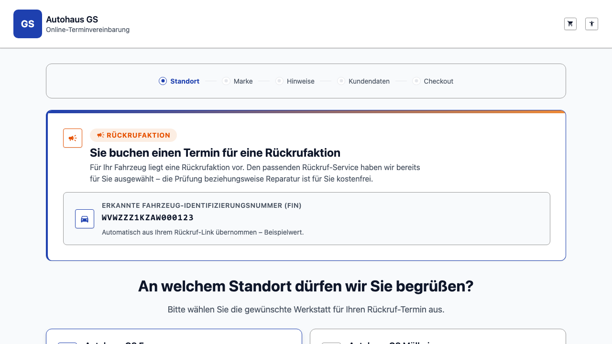

# REQ-041: Rückrufaktion — Einstieg ins OTV (Online-Terminvereinbarung)

**Status:** In Umsetzung (Architektur verifiziert 2026-10-14)
**Priority:** High

> **ARCHITEKTUR-KORREKTUR (2026-10-14, live gegen SoftNet INT verifiziert):** Die ursprüngliche
> Annahme „Rückruf-Service in der normalen default-Group, kein eigener Group" war **falsch**. Die
> Rückrufaktion ist eine **eigene SoftNet-Group** (`soft-net`, ID `6ac7939ba4c0acee699905a8`) mit
> **genau einer** Operation pro Branch (aktuell „Rückrufaktion Lenkungsgetriebe Schraube") — also
> **analog zum tireChange-Deep-Link** über den bestehenden `variant`/`deepLinkGroupId`-Mechanismus
> (`selectedVariant() === 'recall'`, `setup.json`-Variante `recall`). Der Service wird nicht per
> Namensmuster erkannt, sondern ist schlicht **die (einzige) Operation dieser Group** → kein
> Service-Schritt nötig, robust auch für künftige Rückruf-Kampagnen. **Zwei Fingerprints** (Azure,
> Abrechnungs-Trennung): der **neue** für die Rückrufaktion-Group, der **alte** fürs restliche OTV
> (default + tireChange). Backend: `SoftnetAuthService` wählt den Credential/Token je Group
> (Fallback auf den Default-Fingerprint, wenn der Rückruf-Fingerprint nicht gesetzt ist).
>
> **NUTZER-ENTSCHEIDUNGEN beim lokalen Test (2026-10-14):**
> - **Standortauswahl im Rückruf-Modus ohne Radwechsel-/Boxenstopp-Karten** — nur echte Standorte
>   (`LocationCardsComponent.hideTireChange`, gebunden an `isRecallMode()`).
> - **Standorte alphabetisch nach Stadt**, bei gleicher Stadt nach Name (deutsche Sortierung, Ü/Š wie
>   Grundbuchstabe; Standorte ohne Stadt am Ende). Gilt für **beide** Modi (normal + Rückruf) —
>   die Karte zeigt die Adresse, Kunden suchen nach ihrem Ort.
> - **Interner Fehler-Report-Button** (REQ-030) im Rückruf-Modus **ausgeblendet** (zusätzlich zum
>   iframe-Fall).
> - **Hinweis „Serviceauswahl entfällt" entfernt** (Banner zeigt nur Badge, Beschreibung, FIN);
>   i18n-Key `booking.recall.serviceAutoSelected` in allen 5 Sprachen gelöscht. Im Mockup ebenso
>   Hinweis-Chip und die (nie implementierte) Breadcrumb-Notiz „Schritt Service entfällt" entfernt,
>   `mockup.png` neu erzeugt.
> - **Mietwagen im Rückruf-Modus aus der Rückruf-Group** (Review-Befund): `RentCategoriesController`
>   reicht `variant=recall` jetzt durch (vorher → `default`). Live INT 2026-10-14: Rückruf-Group hat an
>   allen 27 Standorten **0** Mietwagen-Kategorien und liefert mit `replacementCar=true` **0** Slots →
>   Hinweise-Schritt zeigt „kein Mietwagen verfügbar" statt eines Schalters, der ins Leere führt.
**Type:** Functional (neuer Einstiegsmodus, Wizard-Flow-Variante, Deep-Link, Backend-Integration)
**Created:** 2026-10-13
**Author:** Agent (Requirement), im Auftrag des Nutzers (rico.sonntag@lhind.dlh.de)
**Scope:** Bestehende Buchungsstrecke (OTV); neuer „Rückruf-Modus" mit **direktem Einstieg in die Standortauswahl** (keine eigene Landing-/Startseite), ausgeblendetem Service-Schritt und automatisch gesetztem Rückruf-Service. Hinweise, Termin, Kontakt-/Fahrzeugdaten und Checkout werden unverändert wiederverwendet. **Unser Scope ist ausschließlich: (a) die Definition der Rückruf-URL + Parameter (`recall`-Flag + FIN) und (b) das OTV-Verhalten ab dem Deep-Link.** Der externe FIN-Betroffenheits-Fragebogen („Frage-Wizard") der GS-Website ist NICHT Teil dieses Scopes.

> **Code-Sprache:** Englisch (FIXIERT) — alle Identifier (`recallMode`, `recallGuard`, `activateRecallMode`, `RecallBannerComponent`, CSS-Klassen). UI zweisprachig DE + EN (zusätzlich UK/FR/AR konsistent nachgezogen).
>
> **Namens-Hinweis (Kollisionsvermeidung):** Im bestehenden Code bedeutet **„Rückruf"** bereits den *telefonischen Rückruf-Wunsch* (`notesExtras.callbackOption: 'yes'|'no'`, `callbackRequested`). Die **Rückrufaktion** (Fahrzeug-Recall-Kampagne) ist fachlich etwas anderes. Zur Trennung heißt das neue Feature im Code durchgängig **`recall`** (recall campaign), niemals `callback`. Siehe Glossar (Abschnitt 16).

---

## 1. Overview

### 1.1 Purpose

Fahrzeughersteller/Autohaus führen **Rückrufaktionen** durch (sicherheits- oder qualitätsrelevante Nachbesserungen an bestimmten Fahrzeugen). Ein betroffener Kunde soll aus der GS-Website heraus **direkt einen Werkstatttermin** für die Rückrufaktion buchen können, ohne den Service selbst suchen zu müssen.

Der Einstieg erfolgt über einen **Deep-Link (Rückruf-URL)**, der aus dem externen FIN-Prüfformular der GS-Website generiert wird und die **FIN** des betroffenen Fahrzeugs trägt. Das OTV erkennt an dieser URL den **Rückruf-Modus** und **startet direkt mit der Standortauswahl (Wizard-Schritt 1)** — es gibt **keine eigene vorgelagerte Rückruf-Landing-/Startseite**. Ein optionaler Rückruf-Hinweis/Banner **auf der Standortauswahl-Seite** ist zulässig. Im Rückruf-Modus wird **genau ein fest konfigurierter Rückruf-Service** automatisch gesetzt und der Service-Schritt übersprungen; der verkürzte Wizard lautet: **Standort → Marke → (Service entfällt) → Hinweise → Termin → Kundendaten → Checkout**. Die FIN aus der URL wird im Kundendaten-Schritt vorausgefüllt (synergetisch zu REQ-040) und mit der Buchung an SoftNet gesendet.

### 1.2 Problem / Motivation

- Ohne Rückruf-Modus müsste der Kunde den passenden (oft nicht offensichtlichen) Service manuell im Service-Katalog suchen — fehleranfällig und für eine Pflicht-Nachbesserung unzumutbar.
- Die Fahrzeugzuordnung einer Rückrufaktion gelingt nur mit der **FIN**; diese liegt beim externen Einstieg bereits vor (das GS-Formular hat per FIN die Betroffenheit festgestellt) und soll verlustfrei ins OTV übernommen werden — Synergie mit REQ-040 (`optionalVinValidator`, `normalizeVin`, `vehicle.vin`).
- Der Rückruf-Service ist genau **ein** Service; ein Auswahl-Schritt ist überflüssig und würde den Flow nur verlängern.

### 1.3 Scope

**Included (UNSER Scope):**
- **Definition der Rückruf-URL** (Deep-Link) mit **`recall`-Flag** und **`vin`** als Parametern — die Schnittstelle, auf die das externe GS-Formular verlinkt.
- **OTV-Verhalten ab dem Deep-Link:** Aktivierung des Rückruf-Modus im `BookingStore` und **direkter Start in der Standortauswahl** (Wizard-Schritt 1) — **keine eigene Landing-/Startseite**.
- Optionaler **Rückruf-Hinweis/Banner auf der Standortauswahl-Seite** (und dezent im Wizard-Kopf) — kein vorgelagerter eigener Screen.
- **Automatisches Setzen genau eines fest konfigurierten Rückruf-Service** aus der **normalen SoftNet-default-Group** (KEIN eigener Deep-Link-Group wie tireChange).
- **Ausblenden des Service-Wizard-Schritts** im Rückruf-Modus (Breadcrumb + Navigation), analog zum bestehenden Ausblenden des Standort-Schritts im Deep-Link-Fall.
- **Standortauswahl = normale Standortauswahl** (default variant), **volle Filialliste**, **ohne** Räderwechsel-/tireChange-Standortfilterung (siehe BR-3).
- **FIN-Prefill** im Kontakt-/Fahrzeugschritt (`carinformation-container`) aus der URL, Pflicht wie REQ-040 (siehe BR-6).
- Unveränderte Wiederverwendung von **Hinweise** (`notes-container`), **Kontakt-/Fahrzeugdaten** (`carinformation-container`), **Termin** (`appointment-selection` / `workshop-calendar`) und **Checkout** (`booking-overview`).
- **Provisionierung eines neuen Fingerprints/Credentials** für die Rückruf-Integration (Cognigy-Integration) — als **Secret**, nicht im Repo, als **Azure-Secret/Env-Var** bereitgestellt (siehe Abschnitt 9, 14.6, 15).
- i18n (DE + EN, zusätzlich UK/FR/AR) für den Rückruf-Hinweis/Banner und die Rückruf-Modus-Texte.

**Excluded:**
- Der **externe FIN-Betroffenheits-Fragebogen / „Frage-Wizard"** der GS-Website (prüft, ob ein Fahrzeug von einer Rückrufaktion betroffen ist) wird **von GS extern** auf deren Website gebaut und ist **nicht Teil unseres Scopes**. Auch das externe FIN-Prüfformular inkl. „Jetzt Termin buchen"-Button gehört GS — nur die daraus erzeugte Rückruf-URL ist die Schnittstelle.
- **Keine eigene Rückruf-Landing-/Startseite** im OTV (kein eigener Screen vor der Standortauswahl) — der Rückruf-Modus ist ab der Standortauswahl aktiv.
- **Kein eigener Deep-Link-Group** für den Rückruf (anders als tireChange/Boxenstopp). Der Rückruf-Service liegt in der normalen default-Group.
- **Kein neuer Store** — der bestehende `BookingStore` wird erweitert.
- **Keine Änderung** an Termin-, Mietwagen-, Benachrichtigungs- oder Preislogik, am FIN-Format (17 alphanumerisch) oder an der FIN-Normalisierung.
- **Keine Namensquelle aus der Cognigy-Excel** (`Names_and_IDs*.xlsx`): Filial-/Standort-**Anzeigenamen** stammen aus SoftNet `/branches` (bestehende Quelle), siehe BR-4.
- Kein Hardcoden des Rückruf-Fingerprints ins Repo oder Image.

### 1.4 Verbindliche Grundlagen / Related Requirements

| Grundlage | Bedeutung für REQ-041 |
|---|---|
| [VISION](../../VISION.md) | User First, Accessibility (WCAG 2.1 AA), Security First (OWASP, Defense in Depth), >80 % Coverage, Definition of Done |
| [REQ-039](../REQ-039-Responsive-Wizard/requirement.md) | Responsive Wizard, `WizardBreadcrumbComponent`/`WIZARD_STEPS`, Step-Filterung im Deep-Link-Fall (Vorbild fürs Ausblenden des Service-Schritts), Reset-Matrix `resetFromStep`, FIN-Feld (freiwillig) |
| [REQ-040](../REQ-040-FIN-Reifeneinlagerung/requirement.md) | Bedingt-zwingende FIN, `optionalVinValidator`, `normalizeVin`, `hasStoredTiresService`, dynamische Validatoren im Fahrzeugformular (Vorbild für FIN-Prefill + Pflicht) |
| [REQ-003](../REQ-003-Standortwahl/requirement.md), [REQ-007](../REQ-007-WizardStateSync/requirement.md) | Standortauswahl + Anzeigenamen aus SoftNet `/branches`, Reset-/State-Sync-Semantik |
| [REQ-002](../REQ-002-Markenauswahl/requirement.md), [REQ-013](../REQ-013-Branch-Marke-Tausch/requirement.md) | Markenauswahl, Branch/Marke-Kontext |
| [REQ-025](../REQ-025-API-Driven-Content/requirement.md) | API-getriebene Operations/Categories (der Rückruf-Service ist eine Operation in der default-Group) |
| [REQ-021](../REQ-021-Multi-Branch-Setup/requirement.md), [REQ-035/036 (tireChange)] | Deep-Link-/Group-Mechanik (`deepLinkGroupId`, `selectedVariant`) als Abgrenzung: Rückruf nutzt KEINEN tireChange-Group |
| [REQ-020](../REQ-020-VorlaeufigDeployment/requirement.md) | Azure Container App (`gs-terminbuchungs-app`) als Hosting; Secret-/Env-Var-Injektion für das Backend |

---

## 2. User Story & Acceptance Criteria

**Als** von einer Rückrufaktion betroffener Fahrzeughalter
**möchte ich** nach der FIN-Betroffenheitsprüfung auf der GS-Website mit einem Klick direkt im OTV einen Termin für die Rückrufaktion buchen,
**damit** ich den richtigen Service nicht selbst suchen muss und mein Fahrzeug (per FIN) eindeutig zugeordnet wird.

**Als** Autohaus
**möchte ich**, dass der Rückruf-Service automatisch und korrekt gesetzt wird und die FIN mit der Buchung ankommt,
**damit** die Rückrufaktion dem richtigen Fahrzeug zugeordnet und terminiert werden kann.

**Acceptance Criteria:**
- [ ] **AC-1:** Wird das OTV über die **Rückruf-URL** (mit `recall`-Flag) geöffnet, merkt sich die App den **Rückruf-Modus** (`recallMode = true`) und **startet direkt in der Standortauswahl** (Wizard-Schritt 1) — ohne eigene Landing-/Startseite; ein optionaler Rückruf-Banner erscheint auf der Standortauswahl (TC-1).
- [ ] **AC-2:** Trägt die Rückruf-URL eine **FIN** (`vin`), wird diese normalisiert (`normalizeVin`) im Store (`recallVin`) abgelegt und im Kontakt-/Fahrzeugschritt vorausgefüllt (TC-1, TC-7).
- [ ] **AC-3:** Im Rückruf-Modus durchläuft der Kunde **Standort → Marke → Hinweise → Termin → Kundendaten → Checkout**; der **Service-Schritt wird nicht angezeigt** (Breadcrumb + keine Service-Route) (TC-2, TC-3).
- [ ] **AC-4:** Es wird **genau ein** fest konfigurierter **Rückruf-Service** automatisch gesetzt (`selectedServices` enthält exakt diese eine Operation), bevor der Hinweise-Schritt betreten wird (TC-4).
- [ ] **AC-5:** Die **Standortauswahl** zeigt die **normale, volle Filialliste** (default variant), **nicht** die tireChange-/Räderwechsel-gefilterte Liste; `selectedVariant` bleibt `'default'` (TC-5, BR-3).
- [ ] **AC-6:** Filial-/Standort-**Anzeigenamen** stammen aus **SoftNet `/branches`** (bestehende Quelle, wie REQ-003/REQ-007), nicht aus der Cognigy-Excel (TC-5, BR-4).
- [ ] **AC-7:** Die FIN ist im Kundendaten-Schritt **Pflicht** (genau 17 alphanumerisch, nicht leer) — vorbelegt aus `recallVin`, editierbar (TC-7, BR-6).
- [ ] **AC-8:** Beim Checkout wird die (normalisierte) FIN als `vehicle.vin` mit der Buchung an SoftNet gesendet und in der Übersicht angezeigt (TC-8).
- [ ] **AC-9:** **Hinweise**, **Kontakt-/Fahrzeugdaten**, **Termin** und **Checkout** verhalten sich im Rückruf-Modus **unverändert** gegenüber dem normalen Flow (abgesehen vom vorbelegten/pflichtigen FIN-Feld) (TC-9).
- [ ] **AC-10:** Wird das OTV **ohne** Rückruf-URL/`recall`-Flag geöffnet, bleibt der **normale OTV-Flow** vollständig erhalten (Service-Schritt sichtbar, FIN wie in REQ-040) — keine Regression (TC-10).
- [ ] **AC-11:** **Exception/Guards:** fehlende FIN, ungültige FIN in der URL und direkter Aufruf einer Rückruf-Route ohne aktiven Rückruf-Modus werden sauber behandelt (Abschnitt 6) (TC-11, TC-12, TC-13).
- [ ] **AC-12:** Der neue **Rückruf-Fingerprint/Credential** liegt **nie** im Repo/Image (per `.gitignore`/`.dockerignore` ausgeschlossen) und wird ausschließlich als **Azure-Secret/Env-Var** bereitgestellt; das Backend liest ihn über eine neue Env-Var (`${ENV_VAR:default}`-Muster) (TC-14, Abschnitt 9/14.6).
- [ ] **AC-13:** Alle neuen sichtbaren Texte sind in **DE + EN** (und konsistent in UK/FR/AR) vorhanden; keine hartkodierten Strings (TC-15).
- [ ] **AC-14:** VISION-Qualitätsziele (Coverage > 80 %, A11y/WCAG 2.1 AA, keine HIGH/CRITICAL im `npm audit`) werden mit Testberichten belegt, nicht behauptet (TC-16).

---

## 3. Preconditions

### 3.1 System

- Angular-OTV mit Signal-basiertem `BookingStore`, lazy geladenen Booking-Routen, `WizardBreadcrumbComponent`/`WIZARD_STEPS`, Guards und Resolvern ist vorhanden (REQ-039).
- Spring-Boot-Backend (`/api/v1/*`) mit SoftNet-Anbindung läuft; die Operations/Categories je Branch sind über `getOperationsByBranch`/`getCategoriesByBranch` abrufbar (REQ-025).
- Der **fest konfigurierte Rückruf-Service** existiert in der **default-Group** der betroffenen Filialen als buchbare SoftNet-Operation (Name/ID als Config, TBD — siehe Offene Punkte O-1).
- Der Rückruf-Einstieg nutzt die **bestehende Location-Route** (`/home/location`); das Lesen der Query-Parameter folgt dem bestehenden `deepLinkGuard`-Muster (`queryParamMap`). Für optionales `input()`-Binding der Params (Banner-Anzeige) ist `withComponentInputBinding()` in `app.config.ts` Voraussetzung (sonst Guard-basiertes Lesen, siehe 14.5).
- Der **neue Rückruf-Fingerprint** ist als Azure-Secret/Env-Var in der Container App (`gs-terminbuchungs-app`) provisioniert (Deployment-Voraussetzung, siehe 14.6); ohne ihn bleibt der Rückruf-Einstieg inaktiv/degradiert (O-4).

### 3.2 User / Externe Vorstufe (nicht Teil des OTV)

- Der Kunde hat auf der **GS-Website** (extern) im FIN-Prüfformular festgestellt, dass sein Fahrzeug von einer Rückrufaktion betroffen ist, und „Jetzt Termin buchen" geklickt.
- Daraus wird die **Rückruf-URL** erzeugt, die das OTV öffnet. Kein Login/keine Zusatzberechtigung nötig.

### 3.3 Einstiegspunkt + Übergabe aus der URL (exakt)

**Einstiegspunkt:** Die Rückruf-URL zeigt auf die **Location-Route** (Standortauswahl, Wizard-Schritt 1) mit den Query-Parametern `recall` + `vin`, z. B. `…/home/location?recall=true&vin=WDB…` (exaktes Schema TBD — O-2). **Kein** eigener Landing-/Startseiten-Pfad.

Die Rückruf-URL trägt folgende Parameter (Query-Parameter):

| Parameter | Pflicht | Bedeutung | Ziel im Store |
|---|---|---|---|
| `recall` | ja | Rückruf-Modus-Flag (z. B. `recall=true`) | `recallMode = true` (via `activateRecallMode`) |
| `vin` | optional¹ | FIN des betroffenen Fahrzeugs | `recallVin = normalizeVin(vin)` (oder `null`) |

¹ `vin` ist in der URL technisch optional (der Modus funktioniert auch ohne), fachlich jedoch erwartet; fehlt sie, muss sie im Kundendaten-Schritt manuell eingegeben werden (Pflicht, siehe E-1/BR-6).

**Nicht übergeben** (bewusst): `branchId`/`groupId` — der Rückruf nutzt **keinen** Deep-Link-Group; Standort wird im OTV normal gewählt (BR-3).

---

## 4. Main Flow

**Visuelle Referenz (Mockup):**



**Step 1 — Einstieg über Rückruf-URL → DIREKT Standortauswahl (normale, volle Filialliste)**
- **User:** Öffnet die Rückruf-URL (aus dem externen GS-Formular), z. B. `…/home/location?recall=true&vin=WDB…`.
- **System:** `recallGuard` auf der Location-Route liest `recall` + `vin` (`queryParamMap`, analog `deepLinkGuard`) und ruft `store.activateRecallMode(vin)` → `recallMode = true`, `recallVin = normalizeVin(vin)`. Das OTV **startet direkt in der Standortauswahl** (kein eigener Landing-Screen). Es wird die **normale, volle default-Filialliste** angezeigt (keine tireChange-Filterung); Anzeigenamen aus SoftNet `/branches`. Optionaler **Rückruf-Banner** auf der Seite (Kontext + ggf. erkannte FIN). `selectedVariant` bleibt `'default'`. Der Breadcrumb blendet den Service-Schritt aus.
- **User:** Wählt eine Filiale.
- **System:** Bestehende `setLocation`/`selectBranch`-Logik.
- **Expected:** App im Rückruf-Modus; FIN im Store gemerkt; `selectedBranch`/`selectedLocation` gesetzt; weiter zu Marke.

**Step 2 — Marke**
- **User:** Wählt die Fahrzeugmarke.
- **System:** Bestehende `onBrandSelect(brand)` → `setBrand(brand)`. **Im Rückruf-Modus** navigiert der Brand-Container **nicht** zu `/home/services`, sondern direkt zu **`/home/notes`**.
- **Expected:** `selectedBrand` gesetzt; der Service-Schritt wird übersprungen.

**Step 3 — (Service entfällt) → automatische Rückruf-Service-Auswahl**
- **User:** — (kein sichtbarer Schritt).
- **System:** Beim Betreten der nachfolgenden Routen stellt `recallServiceGuard` sicher, dass die Operations der gewählten Branch geladen sind, und setzt **genau einen** konfigurierten Rückruf-Service über `store.applyRecallService()` (`selectedServices = [{ serviceId: <recall operation id>, selectedOptionIds: [] }]`). Damit ist `servicesSelectedGuard` erfüllt.
- **Expected:** Exakt ein Rückruf-Service gesetzt; `hasServicesSelected === true`.

**Step 4 — Hinweise (unverändert)**
- **User:** Optionale Notiz, ggf. Tageszeit/Mietwagen/Benachrichtigung.
- **System:** Unveränderter `NotesContainerComponent`-Flow (`onContinue()` trimmt Notiz, setzt `notesExtras`, `selectedRentCategoryId`).
- **Expected:** Weiter zu Termin.

**Step 5 — Termin (unverändert)**
- **User:** Wählt einen Slot (Schnellauswahl oder Werkstattkalender).
- **System:** Unveränderte Terminlogik; Snaps der **default-Group** (Rückruf-Service), `selectedAppointment` gesetzt.
- **Expected:** Weiter zu Kontakt-/Fahrzeugdaten.

**Step 6 — Kontakt- & Fahrzeugdaten (FIN vorbelegt + Pflicht)**
- **User:** Füllt Kunden-/Fahrzeugfelder aus; das **FIN-Feld ist mit `recallVin` vorbelegt** und **Pflicht**.
- **System:** `CarinformationContainerComponent` vorbelegt das FIN-Control aus `store.recallVin`; im Rückruf-Modus gelten für die FIN `Validators.required` + `optionalVinValidator()` (Format), analog REQ-040. `onSubmit` speichert `vehicleInfo.vin = normalizeVin(...)`.
- **Expected:** Nur mit gültiger FIN weiter zu Checkout.

**Step 7 — Checkout / Übersicht (unverändert)**
- **User:** Prüft die Zusammenfassung, „Jetzt anfragen".
- **System:** Unveränderter `BookingOverviewContainerComponent` → `store.submitBooking()`; Request enthält `vehicle.vin` (FIN) und den Rückruf-Service; `variant: 'default'`.
- **Expected:** Buchung erfolgreich; `bookingSubmitted = true`, `appointmentId` gesetzt.

---

## 5. Alternative Flows

### 5.1 Alt A: FIN fehlt in der URL (`recall=true`, kein `vin`)
**Trigger:** Rückruf-URL ohne `vin`.
**Flow:** `recallMode = true`, `recallVin = null`. Flow wie Main Flow; im Kundendaten-Schritt ist das FIN-Feld **leer, aber Pflicht** (BR-6). Der Kunde gibt die FIN manuell ein. Kein Abbruch.

### 5.2 Alt B: Normaler OTV-Einstieg (ohne Rückruf-URL)
**Trigger:** Kein `recall`-Flag.
**Flow:** `recallMode = false`; vollständiger Standard-Flow inkl. Service-Schritt; FIN-Verhalten wie REQ-040 (bedingt zwingend nur bei `stored-tires`). REQ-041 verändert nichts am Normalfall.

### 5.3 Alt C: Rücknavigation im Rückruf-Modus
**Trigger:** Kunde springt per Breadcrumb/Zurück auf Marke oder Standort zurück.
**Flow:** Bestehende Reset-Matrix `resetFromStep` greift (REQ-039). Ein Reset `targetIndex <= 2` leert `selectedServices` — im Rückruf-Modus ist das unkritisch, da `recallServiceGuard` beim erneuten Vorwärtslaufen die Rückruf-Service-Auswahl **re-appliziert** (selbstheilend). `recallMode`/`recallVin` bleiben erhalten (persistieren wie `isDeepLinked`).

### 5.4 Alt D: Wiederkehr-Kunde (Bestandsdaten)
**Trigger:** SoftNet erkennt die FIN/E-Mail als Bestandskunde.
**Flow:** Bestehendes Prefill-Verhalten (sofern aktiv) bleibt; die FIN aus der Rückruf-URL hat Vorrang für das FIN-Feld. Kein neues Verhalten durch REQ-041.

---

## 6. Exception Flows

### 6.1 E-1: Fehlende FIN beim Checkout
**Trigger:** `recallVin` leer und Kunde lässt FIN leer.
**Flow:** FIN-Pflichtvalidierung (`Validators.required`) blockiert den Submit; Fehlermeldung `vin.error.required`. Keine Navigation. (BR-6)

### 6.2 E-2: Ungültige FIN in der URL
**Trigger:** `vin`-Parameter hat kein gültiges 17-stelliges alphanumerisches Format.
**Flow:** `activateRecallMode` prüft/normalisiert: Ein formal ungültiger Wert wird **nicht** als gültige FIN übernommen (`recallVin = null`) und der Hinweis `recall.vinInvalidHint` erscheint; das FIN-Feld bleibt leer und Pflicht, der Kunde korrigiert manuell. Keine ungültige FIN wird je an SoftNet gesendet. (Alternativ-Entscheid siehe O-5.)

### 6.3 E-3: Aufruf ohne aktiven Rückruf-Modus
**Trigger:** Nutzer ruft `/home/location` **ohne** `recall`-Flag auf, oder eine recall-abhängige Logik wird ohne `recallMode` erreicht (z. B. direkter Deep-Link in einen späteren Schritt ohne vorherige Rückruf-Aktivierung).
**Flow:** Ohne `recall`-Flag aktiviert `recallGuard` den Modus **nicht** → vollständiger **normaler OTV-Flow** (Service-Schritt sichtbar). `recallServiceGuard` ist **no-op**, wenn `recallMode === false` (kein automatisches Setzen eines Service im Normalfall). Keine fingierten Zustände, kein Rückruf-Banner.

### 6.4 E-4: Rückruf-Service in der gewählten Branch nicht gefunden
**Trigger:** Die konfigurierte Rückruf-Operation existiert in der default-Group der gewählten Filiale nicht (Fehlkonfiguration/Branch bietet Rückruf nicht an).
**Flow:** `applyRecallService()` findet keine passende Operation → setzt keinen Service, loggt `console.debug`, und der Flow zeigt einen verständlichen Hinweis (`recall.serviceUnavailable`) mit Rückfallpfad zur normalen Serviceauswahl (Service-Schritt wird in diesem Branch-Fall wieder eingeblendet). (O-1/O-6)

### 6.5 E-5: Backend-Fingerprint/Env-Var fehlt
**Trigger:** Die Azure-Env-Var für den Rückruf-Fingerprint ist nicht gesetzt.
**Flow:** Backend-seitig degradiert die Rückruf-Integration kontrolliert (kein Start-Crash; `${ENV_VAR:default}`-Muster mit leerem Default, analog `SOFTNET_FINGERPRINT_JSON`). Rückruf-spezifische Backend-Calls, die den Fingerprint benötigen, liefern einen klaren Fehler statt eines Leaks. (O-4)

---

## 7. Postconditions

### 7.1 Erfolg (nach Checkout im Rückruf-Modus)

Store-Felder (relevante Werte):
- `recallMode = true`
- `recallVin = "<normalisierte FIN>"` (oder vom Kunden manuell eingegebene, normalisierte FIN)
- `selectedServices = [{ serviceId: "<recall operation id>", selectedOptionIds: [] }]` (genau ein Rückruf-Service)
- `selectedBranch` / `selectedLocation` gesetzt (aus normaler, voller Filialliste)
- `selectedBrand` gesetzt
- `selectedAppointment` gesetzt (Slot aus default-Group)
- `customerInfo`, `vehicleInfo` (`vehicleInfo.vin = normalizeVin(...)`), `privacyConsent = true`
- `selectedVariant() === 'default'` (kein tireChange)
- `bookingSubmitted = true`, `bookingSubmitting = false`, `appointmentId = response.id`
- Buchungs-Request an SoftNet enthält `vehicle.vin` (FIN) und den Rückruf-Service.

### 7.2 Fehler
- Keine Buchung; relevante Felder unverändert (`bookingSubmitted = false`).
- Ungültige/fehlende FIN → kein Submit, `vin.error.required`/`invalidFormat` sichtbar.
- Snap belegt (HTTP 410): bestehendes REQ-031-Verhalten (`snapConflict = true`, Redirect zur Terminauswahl) unverändert.

### 7.3 Nicht verändert durch REQ-041
- Normaler OTV-Flow (ohne `recall`-Flag), Service-Schritt, Mietwagen-/Benachrichtigungs-/Preislogik, FIN-Format/Normalisierung, Reset-Matrix-Verträge (ergänzt um Selbstheilung der Rückruf-Service-Auswahl, 5.3).

---

## 8. Business Rules

- **BR-1 (Modus-Erkennung):** Der Rückruf-Modus ist **genau dann** aktiv, wenn das OTV über eine URL mit gesetztem `recall`-Flag geöffnet wurde (`recallMode = true`). Der Modus persistiert über den gesamten Flow (wie `isDeepLinked`) und wird nur durch einen normalen Neueinstieg/Store-Reset beendet.
- **BR-2 (Service-Schritt entfällt):** Im Rückruf-Modus wird der **Service-Wizard-Schritt ausgeblendet** (Breadcrumb filtert Originalindex 2) und per Navigation übersprungen — analog zum bestehenden Ausblenden des Standort-Schritts im Deep-Link-Fall. `WIZARD_STEPS` bleibt die einzige Schrittkonfiguration (keine zweite Step-Liste).
- **BR-3 (Standort = default, volle Liste):** Die Standortauswahl im Rückruf-Modus ist die **normale** Standortauswahl (default variant) mit der **vollen Filialliste**, **explizit ohne** Räderwechsel-/tireChange-Standortfilterung (tireChange hat eigene Filialen/Boxenstopp-Samstage). Der Rückruf ist ein **eigener Modus, getrennt von tireChange**, und nutzt den default-Group/variant. `selectedVariant()` bleibt `'default'` (es wird kein `deepLinkGroupId` auf die tireChange-Group gesetzt).
- **BR-4 (Anzeigenamen-Quelle):** Filial-/Standort-**Anzeigenamen** werden so angezeigt wie im jetzigen OTV — aus der **SoftNet-`/branches`-Quelle** (wie die bestehende Standortauswahl, REQ-003/REQ-007), **nicht** aus der Cognigy-Excel (`Names_and_IDs*.xlsx`). Die Excel ist schlecht benannt und liefert höchstens IDs, nie die Anzeigenamen; Excel und Fingerprint sind reine **Integrations-/Credential-Artefakte**, keine Namensquelle.
- **BR-5 (genau ein Rückruf-Service):** Es wird **genau eine** fest konfigurierte Rückruf-Operation automatisch gesetzt. Die Konfiguration erfolgt über eine Modul-Konstante/Config (Name-Pattern `RECALL_SERVICE_NAME_PATTERNS` und/oder Operation-ID) — kein verstreuter String-Vergleich. Die Erkennung läuft über den **Operation-Namen** (join `selectedServices` ↔ `operations`, wie `selectedServiceLabels`/`hasStoredTiresService`), da die SoftNet-Operation-ID je Branch variiert. Exakter Wert TBD (O-1).
- **BR-6 (FIN Pflicht im Rückruf):** Im Rückruf-Modus ist die **FIN im Kundendaten-Schritt Pflicht** (nicht leer + genau 17 alphanumerisch; `optionalVinValidator` für das Format + `Validators.required`), vorbelegt aus `recallVin`. Nur eine gültige, normalisierte FIN wird als `vehicle.vin` gesendet (Synergie/Konsistenz mit REQ-040; die Pflicht ist hier an den Rückruf-Modus gebunden, nicht an `stored-tires`).
- **BR-7 (kein eigener Group/Deep-Link):** Der Rückruf-Service liegt in der **normalen default-Group** — KEIN eigener Deep-Link-Group wie tireChange. Die bestehende `selectedVariant`/`deepLinkGroupId`-Mechanik wird **nicht** für den Rückruf umgeschaltet.
- **BR-8 (Wiederverwendung unverändert):** Hinweise, Termin, Kontakt-/Fahrzeugdaten und Checkout werden **unverändert** wiederverwendet; einziger Unterschied ist das vorbelegte/pflichtige FIN-Feld im Rückruf-Modus.
- **BR-9 (Secret-Haltung):** Der Rückruf-Fingerprint/Credential ist ein **Secret**: nie im Repo/Image (per `.gitignore`/`.dockerignore`-Glob `fingerprint-*.json`, `cognigy.net_*.json`, `Names_and_IDs*.xlsx` ausgeschlossen), ausschließlich als **Azure-Secret/Env-Var** bereitgestellt; das Backend liest ihn über `System.getenv()`/`application.yml` (`${ENV_VAR:default}`).
- **BR-10 (Code-Sprache & i18n):** Code-Identifier Englisch (`recall…`); sichtbare Texte über das TypeScript-i18n-System, DE + EN (+ UK/FR/AR konsistent). Begriffstrennung `recall` (Rückrufaktion) ≠ `callback` (telefonischer Rückruf).

---

## 9. Non-Functional Requirements

### Performance & Architektur
- OnPush, bestehende Signals/Computeds, `@for … track item.id`/`track step.route`. Kein Resize-Polling, kein zweiter Store, keine Duplizierung der Schrittliste.
- Die Standortauswahl lädt (wie der normale Einstieg) nur die nötigen Branches; der Rückruf-Modus-Flag erzeugt keinen zusätzlichen Request.
- Lighthouse Performance > 90 als zu messendes Ziel (Draft behauptet keine erreichten Werte).

### Accessibility (WCAG 2.1 AA)
- Standortauswahl mit Rückruf-Banner: korrekte Überschriftenhierarchie, Fokus-Reihenfolge, sichtbarer Fokus (`:focus-visible`), Touch-Ziele ≥ 2.75em/44px, Kontrast ≥ 4.5:1; der Banner ist korrekt ausgezeichnet (`role="status"`) und verdeckt keine Bedienelemente.
- CTA als `mat-flat-button`/gefüllter Button (kein outlined). Hinweise (erkannte/ungültige FIN) als `role="status"`/`role="alert"` ankündigen.
- Breadcrumb im Rückruf-Modus: genau ein `aria-current="step"`; ausgeblendeter Service-Schritt erzeugt keine toten Fokusziele. Lighthouse Accessibility > 95 als Ziel.

### Security (OWASP, Defense in Depth)
- **Fingerprint/Credential als Secret:** nie im Repo/Image; nur als **Azure-Secret/Env-Var** in der Container App `gs-terminbuchungs-app`. Backend liest über neue Env-Var (`${ENV_VAR:default}`, z. B. `RECALL_FINGERPRINT_JSON`/`RECALL_FINGERPRINT_PATH`), analog `SOFTNET_FINGERPRINT_JSON`/`SOFTNET_FINGERPRINT_PATH`. (14.6, 15)
- **Keine Secret-Dateien im Build-Kontext** (`.dockerignore`-Glob) und nicht im Git (`.gitignore`-Glob) — bereits vorhanden, deckt neue Fingerprints ab.
- **FIN-Umgang:** FIN ist personenbezogen/fahrzeugbezogen — nicht unnötig loggen (bestehende Masking-/Logging-Regeln REQ-034 beachten); FIN nur als Query-Param übergeben, nicht in Logs/Analytics persistieren. Input-Validierung (17 alphanumerisch) vor Übernahme/Versand.
- **Kein `innerHTML`**, Angular-Template-Escaping; HTTPS-only; keine Credentials im Frontend. `npm audit`: 0 HIGH/CRITICAL als Ziel.
- **Anonyme Statistik** (Nutzerpräferenz): etwaige Auswertungen des Rückruf-Einstiegs nur als anonyme Aggregate, nie personenbezogen, keine Verknüpfung mit Buchungen.

### Usability / Responsive
- Mobile-First, keine horizontalen Scrolls bei 320–1280 CSS-px; Rückruf-Banner und Hinweis-Texte umbrechen statt abschneiden. Browser: aktuelle 2 Versionen (Chromium/Firefox/WebKit).

---

## 10. Data Model

**Prinzip:** Bestehende Typen **erweitern**, nicht duplizieren.

### 10.1 `BookingState` (Erweiterung in `booking.store.ts`)

```typescript
interface BookingState {
  // … bestehende Felder (unverändert) …

  /** REQ-041: true, wenn das OTV über die Rückruf-URL (recall-Flag) geöffnet wurde. */
  recallMode: boolean;
  /** REQ-041: aus der Rückruf-URL übernommene, normalisierte FIN (oder null). */
  recallVin: string | null;
}
```

`INITIAL_STATE`-Ergänzung: `recallMode: false`, `recallVin: null`.

### 10.2 Konstante (Rückruf-Service-Erkennung)

```typescript
/**
 * REQ-041: lowercase name substrings that identify the single configured recall service
 * within the default SoftNet group. The SoftNet operation id differs per branch, so the
 * selection is matched by operation NAME (same pattern as STORED_TIRES_NAME_PATTERNS).
 * TODO(O-1): fill with the canonical recall operation name once confirmed.
 */
const RECALL_SERVICE_NAME_PATTERNS: string[] = [/* TBD — e.g. 'rückrufaktion' */];
```

### 10.3 Neue Computeds (withComputed)

```typescript
/** REQ-041: recall campaign mode active. */
isRecallMode: computed<boolean>(() => recallMode()),
/** REQ-041: the configured recall service is currently selected. */
recallServiceSelected: computed<boolean>(() => {
  const ops = operations();
  return selectedServices().some(sel => {
    const name = ops.find(o => o.id === sel.serviceId)?.name.toLowerCase() ?? '';
    return RECALL_SERVICE_NAME_PATTERNS.some(p => name.includes(p));
  });
}),
```

### 10.4 Neue Methoden (withMethods)

```typescript
/** REQ-041: activate recall mode and remember the (normalized) VIN from the URL. */
activateRecallMode(vin: string | null): void { /* patchState recallMode:true, recallVin: normalized-or-null */ },
/** REQ-041: auto-select exactly the configured recall operation (idempotent). Returns success. */
applyRecallService(): boolean { /* find op by RECALL_SERVICE_NAME_PATTERNS in operations(), set selectedServices */ },
/** REQ-041: leave recall mode (normal entry / reset). */
clearRecallMode(): void { /* patchState recallMode:false, recallVin:null */ },
```

### 10.5 Unverändert
- `CustomerInfo`, `VehicleInfo` (`vin?: string` bereits vorhanden), `ApiOperation`, `SelectedService`, `BranchConfig`, `LocationDisplay`, `Brand` — keine Strukturänderung. `normalizeVin`/`optionalVinValidator` (REQ-040) werden wiederverwendet.
- `CreateAppointmentRequest`/`AppointmentResponse`-Vertrag unverändert (FIN reist bereits in `vehicle.vin`).

---

## 11. UI/UX

### Mockup


### 11.1 Rückruf-Hinweis/Banner auf der Standortauswahl (neu) — KEINE eigene Seite
- **Kein** vorgelagerter eigener Screen. Das OTV startet direkt in der Standortauswahl; ein **optionaler Banner auf der Standortauswahl-Seite** erklärt den Rückruf-Kontext (Zweck, ggf. erkannte FIN) und weist darauf hin, dass der passende Service bereits ausgewählt wurde.
- Optionaler dezenter Rückruf-Modus-Hinweis/Badge im Wizard-Kopf während des gesamten Flows, damit der Kontext klar bleibt.
- Design-Tokens aus `_variables.scss`, helles Theme, `.icon-framed` für Icons, Overlays weiß (`var(--color-background-surface)`).
- Texte DE/EN final TBD — Mockup liefert Vorschlag (O-3).

### 11.2 FIN-Feld im Kundendaten-Schritt
- Vorbelegt aus `recallVin`; **Pflicht** im Rückruf-Modus (Stern, `aria-required="true"`, Fehler `role="alert"`/`aria-invalid`), Zweck-Hinweis (Rückruf-Zuordnung). Validierung: nicht leer + 17 alphanumerisch.

### 11.3 Form Fields (nur die REQ-041-relevante Änderung)

| Field | Type | Required | Validation | Prefill |
|-------|------|----------|------------|---------|
| FIN (`vin`) | text | **Ja (im Rückruf-Modus)** | 17 alphanumerisch (`optionalVinValidator`) + `required` | `store.recallVin` |

Alle übrigen Felder (E-Mail, Anrede, Name, Straße, PLZ, Ort, Mobil, Kennzeichen, Kilometerstand, Einwilligung) unverändert (REQ-009/039/040).

### 11.4 Breadcrumb im Rückruf-Modus
- Sichtbare Schritte: **Standort, Marke, Hinweise, Termin, Kontakt- & Fahrzeugdaten, Übersicht** (Service ausgeblendet). Dieselbe abgeleitete Schrittliste/`stepsWithStatus`; Status/Trennlinien synchron.

---

## 12. API Specification

REQ-041 führt **keinen neuen Frontend→Backend-Endpunkt** ein; der Buchungs-Request bleibt unverändert (FIN reist bereits in `vehicle.vin`). Relevante bestehende Calls:

**Operations der Branch laden (bestehend, REQ-025):**
```http
GET /api/v1/branches/{branchId}/operations
X-Session-Token: <token>
```
→ Liste `ApiOperation[]`; der Rückruf-Service wird daraus per `RECALL_SERVICE_NAME_PATTERNS` identifiziert (default-Group).

**Buchung absenden (bestehend):**
```http
POST /api/v1/appointments
Content-Type: application/json
X-Session-Token: <token>

{
  "snapId": "…",
  "branchId": "…",
  "variant": "default",
  "customer": { "email": "…", "firstName": "…", "lastName": "…", "…": "…" },
  "vehicle": { "licensePlate": "…", "mileage": 12345, "vin": "WDB8XXXXXXA123456" },
  "note": "…"
}
```
**Success (201):**
```json
{ "id": "appointment-uuid" }
```
**Error (410):** Snap belegt → bestehendes REQ-031-Handling (Redirect Terminauswahl).

**Backend-Konfiguration (neu, Server-seitig):** Der Rückruf-Fingerprint wird als Env-Var/Secret gelesen (siehe 14.6), analog zu `softnet.fingerprint-json`/`-path`. Kein zusätzlicher Frontend-sichtbarer Endpunkt.

---

## 13. Test Cases

### TC-1: Einstieg via Rückruf-URL (AC-1/AC-2)
- **Given:** URL `…/home/location?recall=true&vin=WDB8XXXXXXA123456`
- **When:** OTV wird geöffnet
- **Then:** `recallMode === true`, `recallVin === "WDB8XXXXXXA123456"`, Standortauswahl im Rückruf-Modus sichtbar (Banner), kein vorgelagerter Landing-Screen.

### TC-2: Service-Schritt ausgeblendet (AC-3)
- **Given:** Rückruf-Modus aktiv
- **When:** Breadcrumb rendert
- **Then:** Keine Service-Position sichtbar; Reihenfolge Standort→Marke→Hinweise→Termin→Kontakt→Übersicht.

### TC-3: Navigation überspringt Service (AC-3)
- **Given:** Rückruf-Modus, Marke gewählt
- **When:** `onBrandSelect` ausgeführt
- **Then:** Navigation zu `/home/notes` (nicht `/home/services`).

### TC-4: Genau ein Rückruf-Service gesetzt (AC-4/BR-5)
- **Given:** Rückruf-Modus, Branch/Operations geladen
- **When:** `recallServiceGuard`/`applyRecallService()` läuft
- **Then:** `selectedServices.length === 1` und entspricht dem konfigurierten Rückruf-Service; `hasServicesSelected === true`.

### TC-5: Standort = normale volle Liste, default variant (AC-5/BR-3)
- **Given:** Rückruf-Modus
- **When:** Standortauswahl rendert
- **Then:** Volle default-Filialliste (nicht tireChange-gefiltert); `selectedVariant() === 'default'`.

### TC-6: Anzeigenamen aus SoftNet /branches (AC-6/BR-4)
- **Given:** Branches aus `/branches`
- **When:** Standortauswahl rendert
- **Then:** Angezeigte Namen entsprechen den SoftNet-Branch-Namen; keine Herleitung aus Cognigy-Excel.

### TC-7: FIN vorbelegt + Pflicht (AC-7/BR-6)
- **Given:** `recallVin` gesetzt
- **When:** Kundendaten-Schritt
- **Then:** FIN-Feld vorbelegt, Stern/`required`; leerer/ungültiger Submit blockiert (`vin.error.required`/`invalidFormat`).

### TC-8: FIN in Buchung (AC-8)
- **Given:** Gültige FIN, vollständige Daten
- **When:** Checkout `submitBooking`
- **Then:** Request enthält `vehicle.vin` (normalisiert, Großbuchstaben); Übersicht zeigt FIN.

### TC-9: Hinweise/Termin/Kundendaten/Checkout unverändert (AC-9)
- **Given:** Rückruf-Modus
- **When:** Durchlauf dieser Schritte
- **Then:** Identisches Verhalten wie Normalflow (außer FIN-Prefill/Pflicht).

### TC-10: Normalflow ohne Regression (AC-10)
- **Given:** Keine Rückruf-URL
- **When:** OTV öffnen
- **Then:** `recallMode === false`, Service-Schritt sichtbar, FIN-Verhalten wie REQ-040.

### TC-11: Fehlende FIN (E-1/AC-11)
- **Given:** `recall=true` ohne `vin`
- **When:** Checkout ohne manuelle FIN
- **Then:** Submit blockiert, `vin.error.required`.

### TC-12: Ungültige FIN in URL (E-2/AC-11)
- **Given:** `vin` mit 16 Zeichen
- **When:** Einstieg
- **Then:** `recallVin === null`, Hinweis `recall.vinInvalidHint`, Feld leer+Pflicht.

### TC-13: Direkter Aufruf ohne Rückruf-Modus (E-3/AC-11)
- **Given:** `/home/location` ohne `recall`-Flag
- **When:** Aufruf
- **Then:** Normaler OTV-Flow (Service-Schritt sichtbar), `recallMode === false`, kein Banner; `applyRecallService` no-op.

### TC-14: Secret nie im Repo/Image + Env-Var (AC-12)
- **Given:** `.gitignore`/`.dockerignore`-Globs, `application.yml`-Env-Var
- **When:** `git check-ignore fingerprint-*.json` / Image-Build / Backend-Start
- **Then:** Fingerprint ignoriert, nicht im Build-Kontext; Backend liest Fingerprint aus Env-Var (`${ENV_VAR:default}`), kein Hardcoding.

### TC-15: i18n DE+EN (AC-13)
- **Given:** Sprachumschaltung
- **When:** Rückruf-Banner + FIN-Hinweise
- **Then:** Alle Texte DE und EN (und UK/FR/AR) vorhanden; keine hartkodierten Strings.

### TC-16: Qualitäts-Gates (AC-14)
- **Given:** Jest-Coverage, A11y-/Lighthouse-Checks, `npm audit`
- **When:** `/check-all`
- **Then:** Coverage > 80 %, keine HIGH/CRITICAL, WCAG-Prüfpunkte dokumentiert.

### TC-17 (E2E, 3 Viewports): Happy-Path Rückruf-Modus von der Rückruf-URL bis zur Übersicht (Standort→Marke→Hinweise→Termin→Kundendaten mit FIN→Checkout), 320/768/1280.

---

## 14. Implementation

### 14.1 Reihenfolge (Models → Store → Guards → Container → Components → i18n → Routes)
1. **Store:** `BookingState` um `recallMode`/`recallVin` erweitern; `INITIAL_STATE`; Konstante `RECALL_SERVICE_NAME_PATTERNS`; Computeds `isRecallMode`, `recallServiceSelected`; Methoden `activateRecallMode`, `applyRecallService`, `clearRecallMode`.
2. **Guards:** `recallGuard` (CanActivateFn auf der **Location-Route**; liest `recall`+`vin` aus `queryParamMap` analog `deepLinkGuard`, ruft `activateRecallMode`, no-op ohne `recall`-Flag); `recallServiceGuard` (async; lädt Operations falls nötig, ruft `applyRecallService`, no-op wenn `!recallMode`).
3. **Breadcrumb/Steps:** Bestehende Step-Filterung (Standort im Deep-Link) um das **Ausblenden des Service-Schritts** im Rückruf-Modus erweitern (`isRecallMode`). `WIZARD_STEPS` bleibt unverändert als einzige Quelle.
4. **Location-Container (erweitert):** Optionaler Rückruf-Banner (`isRecallMode` + `recallVin`); **keine eigene Seite**.
5. **Presentational (neu, optional):** `RecallBannerComponent` (`input()`/`output()` only) für den Hinweis/Banner auf der Standortauswahl.
6. **Brand-Container:** `onBrandSelect` → im Rückruf-Modus Navigation zu `/home/notes` statt `/home/services`.
7. **Carinformation-Container:** FIN-Control aus `store.recallVin` vorbelegen; Pflicht-/Format-Validatoren im Rückruf-Modus (Wiederverwendung der REQ-040-Logik, erweitert um `isRecallMode`).
8. **Routes:** `recallGuard` auf `location` (vor/neben `deepLinkGuard`); `recallServiceGuard` auf `notes`/`appointment`/`carinformation`/`booking-overview` (vor `servicesSelectedGuard`). **Keine** neue `/home/recall`-Route.
9. **i18n:** Keys `booking.recall.*` + `vin`-Hinweise in DE/EN/UK/FR/AR.
10. **Backend/Deploy:** Env-Var/Secret für Rückruf-Fingerprint (14.6).
11. **Tests:** Store, Guards, Location-Banner, Carinformation (Prefill/Pflicht), E2E (3 Viewports).

### 14.2 Components / Guards / Store (Checkliste)
- [ ] `BookingStore` erweitert (State/Computed/Methods) — **kein neuer Store**
- [ ] `recallGuard` (functional CanActivateFn, auf Location-Route)
- [ ] `recallServiceGuard` (functional, async)
- [ ] `RecallBannerComponent` (Presentational, optional — Banner auf der Standortauswahl)
- [ ] `LocationSelectionContainerComponent` (Banner einbinden, `isRecallMode`)
- [ ] `CarinformationContainerComponent` (FIN-Prefill + Pflicht im Rückruf-Modus)
- [ ] `BrandSelectionContainerComponent` (Navigationsziel abhängig von `isRecallMode`)
- [ ] Breadcrumb-Step-Filterung erweitert
- [ ] **Keine** eigene Rückruf-Landing-/Startseite, **keine** `/home/recall`-Route

### 14.3 Folder Structure (neu/erweitert)
```
src/app/features/booking/
├── components/
│   ├── location-selection/
│   │   ├── location-selection-container.component.ts/.html/.scss  # erweitert (Banner)
│   │   └── components/
│   │       └── recall-banner/recall-banner.component.ts/.html/.scss  # Presentational (neu, optional)
│   ├── brand-selection/…                                      # onBrandSelect-Navigationsziel erweitert
│   └── carinformation/…                                       # FIN-Prefill + Pflicht erweitert
├── guards/recall.guard.ts                                     # neu (Location-Route)
├── guards/recall-service.guard.ts                             # neu
├── stores/booking.store.ts                                    # erweitert
└── booking.routes.ts                                          # recallGuard + recallServiceGuard verdrahtet
```

### 14.4 Routing-Skizze
```typescript
// booking.routes.ts (Auszug) — KEINE neue Route, nur Guard-Verdrahtung
{ path: 'location', canActivate: [deepLinkGuard, recallGuard], resolve: { _: locationsResolver }, /* … */ },
// notes/appointment/carinformation/booking-overview: recallServiceGuard VOR servicesSelectedGuard
{ path: 'notes', canActivate: [recallServiceGuard, servicesSelectedGuard], resolve: { _: rentCategoriesResolver }, /* … */ },
```
Das Lesen der `recall`/`vin`-Query-Parameter erfolgt im `recallGuard` über `route.queryParamMap` (bestehendes `deepLinkGuard`-Muster).

### 14.5 app.config
- Primär: `recallGuard` liest die Query-Parameter (`queryParamMap`) — kein zusätzliches Setup nötig (HashLocation-Entscheidung bleibt unberührt).
- Optional (nur falls der Location-Container die Params per `input()` für die Banner-Anzeige binden soll): `provideRouter(routes, withComponentInputBinding())` sicherstellen.

### 14.6 Deployment & Configuration (Azure Secret/Env-Var) — PFLICHT-SCHRITT
- Der neue **Rückruf-Fingerprint/Credential** wird **nach Azure provisioniert**: als **Secret/Env-Var** in der Azure Container App **`gs-terminbuchungs-app`** (RG `DefaultResourceGroup-DEWC`, `westeurope`), damit das Spring-Boot-Backend ihn **zur Laufzeit** lesen kann — analog zu bestehenden Secrets (`CORS_ALLOWED_ORIGINS`, SoftNet-Credentials), die per Container-App-Env-Var injiziert werden.
- **`application.yml` (neu, Muster `${ENV_VAR:default}`):**
  ```yaml
  recall:
    fingerprint-json: ${RECALL_FINGERPRINT_JSON:}
    fingerprint-path: ${RECALL_FINGERPRINT_PATH:}
  ```
  (Env-Var-Name/Variante — Inline-JSON vs. Datei-Pfad-Secret — als Config TBD, analog `SOFTNET_FINGERPRINT_JSON`/`SOFTNET_FINGERPRINT_PATH`.) Backend liest via `System.getenv()`/`@Value`/`@ConfigurationProperties`.
- **Checkliste Deployment:**
  1. [ ] Fingerprint **nie** ins Repo/Image (per `.gitignore`/`.dockerignore`-Glob bereits ausgeschlossen: `fingerprint-*.json`, `cognigy.net_*.json`, `Names_and_IDs*.xlsx`).
  2. [ ] Secret in der Container App setzen (`az containerapp secret set` / `--set-env-vars` mit `secretref`), siehe `docs/infrastructure/azure-deploy.md`.
  3. [ ] Backend liest die neue Env-Var; leerer Default → Rückruf-Integration degradiert kontrolliert (kein Crash, E-5).
  4. [ ] Verifikation: Rückruf-Einstieg funktioniert mit gesetztem Secret; ohne Secret klare Fehlermeldung, kein Leak.

### 14.7 Effort (Schätzung)
- Development: ~14–20 h (Store/Guards/Routing + Rückruf-Banner + Carinformation-Prefill + Breadcrumb-Filter + Backend-Config). Kein eigener Landing-Screen spart Aufwand.
- Testing: ~8–12 h (Unit > 80 % + E2E 3 Viewports + Smoke/Deploy-Verifikation).

---

## 15. Dependencies

**Requires:**
- **REQ-040** (FIN/VIN-Handling: `optionalVinValidator`, `normalizeVin`, dynamische FIN-Validatoren, `vehicle.vin`) — FIN-Prefill + Pflicht bauen darauf auf.
- **REQ-039** (Responsive Wizard: `WizardBreadcrumbComponent`, `WIZARD_STEPS`, Step-Filterung Deep-Link als Vorbild, `resetFromStep`, FIN-Feld).
- **REQ-003 / REQ-007** (Standortauswahl + Anzeigenamen aus SoftNet `/branches`, State-Sync/Reset).
- **REQ-002 / REQ-013** (Markenauswahl, Branch/Marke-Kontext).
- **REQ-025** (API-getriebene Operations/Categories — Rückruf-Service ist eine Operation in der default-Group).
- **REQ-020** (Azure Container App Hosting + Secret/Env-Var-Injektion) — für die Fingerprint-Provisionierung.
- **Infra-Doku** `docs/infrastructure/azure-deploy.md` / `azure-read.md` (Secret setzen/auslesen).
- **Externe Vorstufe** (nicht im Repo): GS-Website FIN-Prüfformular, das die Rückruf-URL erzeugt.
- **Secret/Credential-Dependency:** neuer Rückruf-**Fingerprint** (Cognigy-Integration) — als Azure-Secret/Env-Var, nie im Repo.

**Blocks:**
- (keine bekannten nachgelagerten REQs)

**Abgrenzung:** Nutzt **nicht** die tireChange-/Boxenstopp-Deep-Link-Group (REQ-035/036); Rückruf ist ein eigener Modus im default-Group.

---

## 16. Naming Glossary (Code-Sprache ENGLISCH)

### Begriffs-Trennung
- `recall` = **Rückrufaktion** (Fahrzeug-Recall-Kampagne) — dieses Feature.
- `callback` = **telefonischer Rückruf** (bestehend, `notesExtras.callbackOption`) — NICHT dieses Feature.

### Store State / Computeds (`BookingStore`)
- `recallMode: boolean` — Rückruf-Modus aktiv
- `recallVin: string | null` — normalisierte FIN aus der Rückruf-URL
- `isRecallMode` (computed) — `recallMode()`
- `recallServiceSelected` (computed) — Rückruf-Service ist gesetzt
- `RECALL_SERVICE_NAME_PATTERNS` (Modul-Konstante) — Name-Pattern zur Erkennung der Rückruf-Operation

### Store Methods
- `activateRecallMode(vin: string | null)` — Modus + FIN setzen (normalisiert/validiert)
- `applyRecallService()` — genau einen konfigurierten Rückruf-Service setzen (idempotent)
- `clearRecallMode()` — Modus/FIN zurücksetzen

### Guards / Routes
- `recallGuard` (`CanActivateFn`) — auf der Location-Route; liest `recall`+`vin` (`queryParamMap`), aktiviert den Rückruf-Modus (no-op ohne `recall`-Flag)
- `recallServiceGuard` — stellt Operations + Rückruf-Service sicher (no-op ohne `recallMode`)
- Einstieg: `/home/location?recall=true&vin=…` (bestehende Location-Route; **keine** eigene `/home/recall`-Route)

### Components
- `RecallBannerComponent` — optionaler Rückruf-Hinweis/Banner auf der Standortauswahl (Presentational); **keine eigene Startseite**

### CSS-Klassen (BEM, Englisch)
- `.recall-banner`, `.recall-banner__text`, `.recall-badge`

### Backend-Config
- Env-Var `RECALL_FINGERPRINT_JSON` / `RECALL_FINGERPRINT_PATH` → `recall.fingerprint-json` / `recall.fingerprint-path`

---

## 17. i18n Keys (DE + EN; UK/FR/AR konsistent nachziehen)

Schema: `booking.recall.*` (passend zu `booking.feature.key`). Platzierung im bestehenden `booking`-Objekt aller fünf Sprachobjekte in `src/app/core/i18n/translations.ts`. Die Keys gehören zum **Banner auf der Standortauswahl** und zum Rückruf-Modus-Hinweis (es gibt **keine eigene Startseite**). Finale Texte TBD (O-3) — folgende Werte sind der Vorschlag.

| Key | DE | EN |
|---|---|---|
| `booking.recall.bannerTitle` | Rückrufaktion | Recall campaign |
| `booking.recall.bannerText` | Ihr Fahrzeug ist von einer Rückrufaktion betroffen. Wir haben den passenden Service bereits ausgewählt – wählen Sie nur noch Standort, Marke und Termin. | Your vehicle is affected by a recall campaign. We have already selected the right service – just choose location, brand and an appointment. |
| `booking.recall.vinDetected` | Erkannte FIN: {vin} | Detected VIN: {vin} |
| `booking.recall.vinInvalidHint` | Die übergebene FIN ist ungültig. Bitte geben Sie sie im Schritt „Kontakt- & Fahrzeugdaten" manuell ein. | The provided VIN is invalid. Please enter it manually in the “contact & vehicle” step. |
| `booking.recall.serviceInfo` | Service: Rückrufaktion (automatisch ausgewählt) | Service: recall campaign (selected automatically) |
| `booking.recall.serviceUnavailable` | Für diesen Standort ist die Rückrufaktion nicht verfügbar. Bitte wählen Sie den Service manuell. | The recall service is not available for this location. Please select the service manually. |
| `booking.recall.badge` | Rückruf-Modus | Recall mode |

**Wiederverwendete FIN-Keys (bestehend, aus REQ-039/040):**
- `booking.carinformation.form.vin.label`, `.placeholder`, `.requiredHint`, `.error.required`, `.error.invalidFormat`, `.error.invalidLength` — im Rückruf-Modus genutzt (Pflicht + Format). Kein neuer FIN-Key nötig.

> Hinweis: Neue Keys werden in **allen fünf** Sprachobjekten (de/en/uk/fr/ar) ergänzt; UK/FR/AR-Texte konsistent zum bestehenden Stil (TBD-Feinschliff analog O-3).

---

## 18. Approval

| Role | Name | Date |
|------|------|------|
| Product Owner | | |
| Tech Lead | | |

---

## 19. Offene Punkte (Open Points)

- **O-1 (Rückruf-Service):** Exakter Rückruf-Service — Operations-Name/-ID als Config-Wert. `RECALL_SERVICE_NAME_PATTERNS` (und/oder eine Operation-ID) sind TBD. Robuster wäre langfristig ein kanonisches Operation-Flag im Operations-DTO (Folge-Ticket, analog REQ-040 O-2).
- **O-2 (Rückruf-URL-Schema):** Exaktes Deep-Link-Format TBD (Einstieg auf die Location-Route, z. B. `/home/location?recall=true&vin=…`; Param-Namen `recall`/`vin` und Hash- vs. Path-Location abhängig vom Deployment vorläufig).
- **O-3 (Banner-/Rückruf-Texte):** DE/EN (und UK/FR/AR) des Rückruf-Banners und der Rückruf-Modus-Texte final TBD; Mockup liefert Vorschlag.
- **O-4 (Fingerprint-Provisionierung):** Verantwortlichkeit/Prozess (wer legt den Fingerprint an, wo gespeichert, **Secret-Rotation**) TBD. Ohne gesetzte Azure-Env-Var bleibt der Rückruf-Einstieg inaktiv/degradiert (E-5).
- **O-5 (ungültige URL-FIN):** Übernehmen-und-markieren vs. verwerfen (`recallVin = null`) — Vorschlag: verwerfen + Hinweis (E-2). PO-Entscheid.
- **O-6 (Branch ohne Rückruf-Service):** Verhalten, wenn die gewählte Filiale den Rückruf-Service nicht anbietet — Vorschlag: Hinweis + Rückfall auf normale Serviceauswahl (E-4).
- **O-7 (Backend-Fingerprint-Form):** Inline-JSON-Secret vs. Datei-Pfad-Secret (`RECALL_FINGERPRINT_JSON` vs. `RECALL_FINGERPRINT_PATH`) — konsistent zur SoftNet-Variante wählen.

---

## 20. Implementation Notes

**Code-Sprache Englisch (FIXIERT)** für alle Identifier; UI DE + EN (+ UK/FR/AR konsistent).

- Kommentare DE + EN wo sinnvoll (bestehendes Projektmuster), Error Messages Englisch, i18n Keys für alle Sprachen.
- **Sicherheit:** Die Dateien `fingerprint-*.json`, `cognigy.net_*.json`, `Names_and_IDs*.xlsx` sind **Secrets** und werden nie geöffnet/committet/ins Image gebaut; sie sind reine Integrations-/Credential-Artefakte und **keine** Namensquelle (BR-4/BR-9).
- Workflow-Gates (CLAUDE.md): Step 6 (lint:fix + type-check + test:coverage), Step 6.5 (Smoke + E2E `npm run test:local`), Step 7 (`/check-all` Score ≥ 90, `qualitaets.md`).
